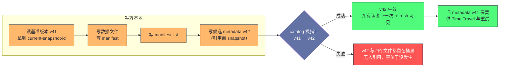
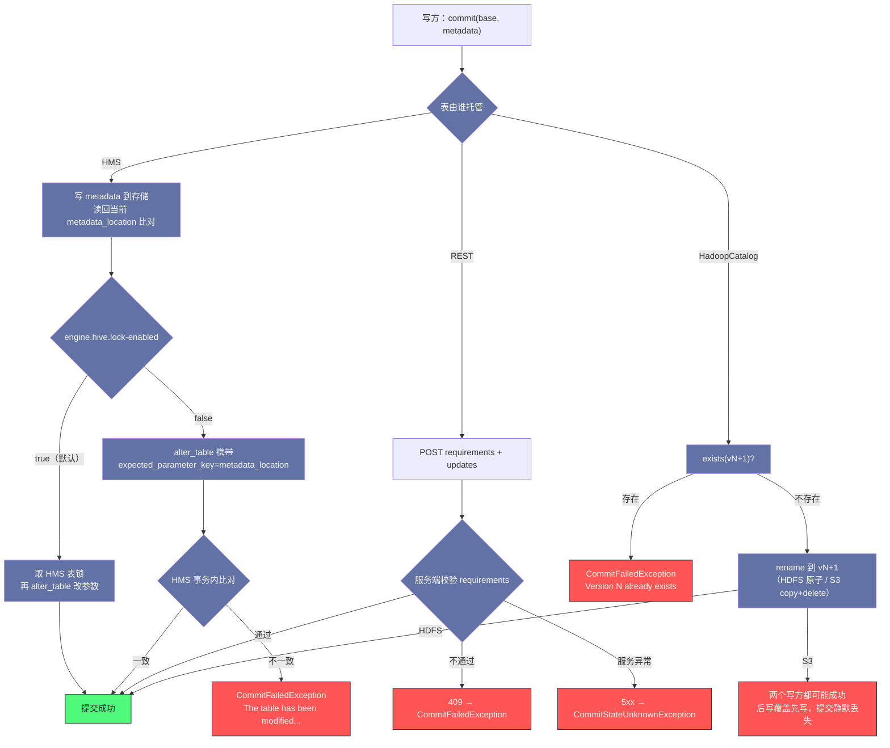
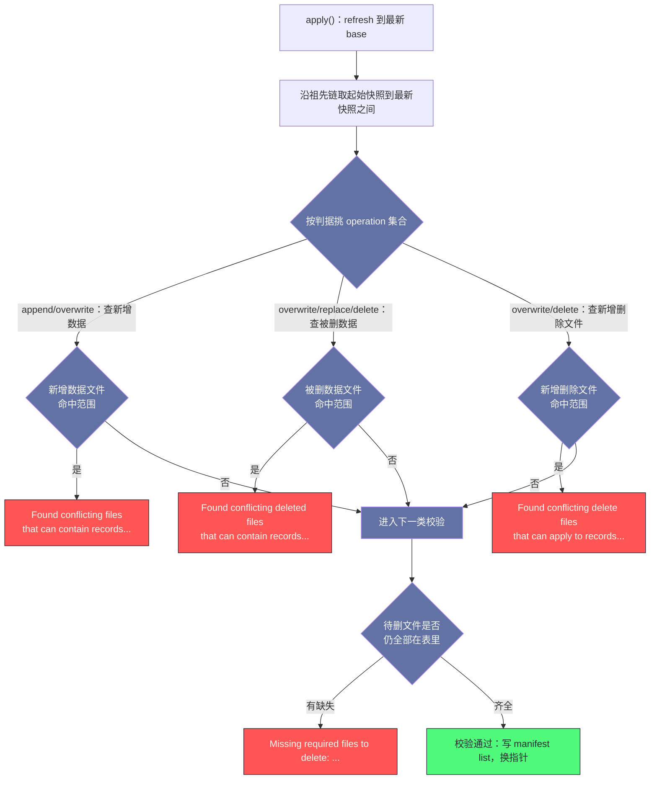
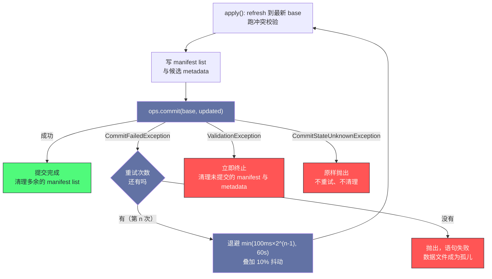
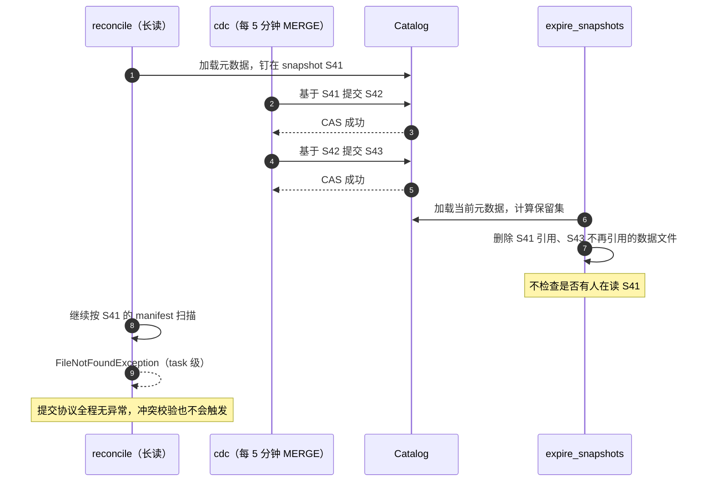

**摘要：**

Iceberg 规范讲提交只有两段话：写方都假设当前版本不会在自己提交前被动过，于是就各自写各自的候选元数据，最后把表元数据指针换过去；指针换不过去，就基于新版本重做一遍。规范没有定义"什么算冲突"，也没有规定"指针怎么换"——前者被实现层做成了一组可组合的校验，后者被交给 catalog。本文把这两处留白都拆开：先看清一次提交在存储上留下哪些文件、哪一步才是唯一的可见性分界；再逐家交代 catalog 的原子性来源与失败面，包括 Hive Metastore 的 `expected_parameter_key` 条件更新、REST Catalog 的 `requirements` 契约、HadoopCatalog 的 rename 与进程内锁，以及 2024 年 8 月出现、却尚未被 HadoopCatalog 用上的 S3 条件写。核心在第 3、4 章：Iceberg 的冲突判定不看"我读过哪些文件"，而看"对方的变更有没有撞进我声明要动的范围"，因此 append 与 append 永远可以合并，delete 与 delete 只按分区与文件集合是否重叠来判；重试只对 `CommitFailedException` 生效，`ValidationException` 一旦出现就是确定的语义拒绝。第 5 章交代隔离级别的真实形状——读侧是快照隔离，写侧的 serializable/snapshot 只是"开几项校验"，没有跨表可串行化。最后给出六类故障的判据、HadoopCatalog 静默丢提交这一独有形貌，以及四条反例。

---

## 第 1 章 提交在存储上留下的东西

### 1.1 四个作业撞在同一张表上

设想一张 `analytics.events` 表，记录用户在端上的行为，字段是 `event_id`、`user_id`、`event_ts`、`dt`、`action`，按 `days(event_ts)` 做隐藏分区。表上跑着四个作业：`ingest` 每分钟把 Kafka 里的一批事件追加进当天分区；`cdc` 每五分钟做一次按 `event_id` 的 upsert，只处理当天分区；`compact` 每小时用 `rewrite_data_files` 合并小文件；`reconcile` 日终对账，全表扫一遍，跑四十分钟。另有一个 `expire` 每天凌晨清理快照，保留三天。

这四个作业之间的相互作用，不取决于它们各自用了什么引擎、什么并发度，而取决于两件事：它们在提交时向 catalog 声明了什么，以及在这一声明生效之前，别人往同一个声明范围里放了什么。要讲清这两件事，得先从一次提交在对象存储上留下哪些文件说起。

### 1.2 四类产物，一条可见性分界线

一次追加写会在存储上留下四类文件，另加一行 catalog 指针（分层职责见 [[02 元数据三层架构——Snapshot、Manifest List 与 Manifest File]]），它们的重要性完全不同：

| 产物 | 谁写 | 命名 | 提交前可见 | 提交失败后归属 |
|---|---|---|---|---|
| 数据文件（parquet） | 执行引擎的 task | 随机 UUID | 不可见 | 孤儿，等孤儿清理 |
| Manifest（avro） | 写方 Driver | `<uuid>-m0.avro` | 不可见 | 孤儿，写方会尝试删除 |
| Manifest List（avro） | 写方 Driver | `snap-<snapshot-id>-*.avro` | 不可见 | 孤儿 |
| `metadata.json` | 写方 Driver | `<版本>-<uuid>.metadata.json` | 不可见 | 孤儿，写方会尝试删除 |
| catalog 里的指针 | catalog 自己 | HMS 表参数 / 数据库列 / 文件名 | 换过去那一刻可见 | 不存在 |

前四类都是"不可变对象的创建"，在对象存储上只有"写成功"与"没写完"两种状态，没有中间态可言；第五类是唯一的可变状态，也是唯一能决定"哪一版算数"的状态。可见性的分界线就画在**第五类**上：在指针换过去之前，前四类文件躺在桶里，任何读者都读不到半个字节；指针换过去之后，它们同时成为表的一部分，不存在"一部分可见、一部分不可见"的窗口。



用一个不太精确但足够顺手的比喻：写方是在自己办公室里起草合同的业务员，catalog 是登记处。合同写得再厚、条款再全，没到登记处盖章之前都不产生效力；盖了章，全世界看到的都是这一版，之前放在登记处档案柜里的旧版本也不会被销毁，只是不再是"当前版本"。合同能不能通过，取决于登记处那一关的比较——而这一关具体怎么比，就是下一章要分家的事情。

### 1.3 两段：先造一个候选版本，再换登记

Iceberg 的规范把提交写成两个动作，第一段完全在写方手里，第二段完全在 catalog 手里：

第一段是**造候选版本**。写方从 catalog 拿到当前 `metadata.json` 的位置，读进内存，得到一个带 `current-snapshot-id` 的 `TableMetadata` 对象；然后按操作类型造新快照、新 manifest list、新 `metadata.json`。这期间不需要任何协调，两个写方同时做也互不干扰，因为它们各自写各自的 UUID 文件，名字不会撞。

第二段是**换指针**。写方调用 `TableOperations.commit(base, metadata)`，把"我基于哪个版本改的"和"改成了什么"一起交给 catalog。catalog 的责任被 `TableOperations` 的接口注释写死成三句话：这个方法必须实现并说明原子性保证；实现必须检查 `base` 就是当前版本，以免覆盖别人的更新；一旦原子提交成功，实现不得再做任何可能失败的操作，因为那种失败无法与提交失败区分。

第三句话常被忽略，但它解释了一个现象：提交成功之后，写方还要去刷新元数据、清理多余的 manifest list、发事件通知，这些动作全都包在 `try` 里、失败只记日志。日志里出现"Failed to load committed table metadata or during cleanup"这类警告时，提交其实已经落账了，读者看到的是新数据；把它当成提交失败去重跑，才是真正的错误来源。

### 1.4 `CommitFailedException` 与 `ValidationException` 是两件事

一个流传很广的说法把"冲突"统一归到 `CommitFailedException` 名下，这里必须先纠正，否则后面所有排障判据都会失准。Iceberg 里至少有两族异常，语义完全不同：

- `CommitFailedException`：注释只有一句"when a commit fails because of out of date metadata"，即**CAS 输了**——catalog 发现 `base` 不是当前版本。它是可重试的，重试路径是"重新读最新版本、把变更应用上去、再提交一次"。
- `ValidationException`：表示"参数单独看没问题，与当前表状态结合就不成立"，即**语义冲突**——校验器认定这次变更不能安全地落在一个已经变了的表上。它不可重试，出现即终止。

第 2 章讲第一种，第 3 章讲第二种，两者在代码里的处置路径不同，混为一谈会得出"重试几次总能成功"的错误结论。有一段代码可以作为分界的证据，也就是提交循环里的这一行：

```java
Tasks.foreach(ops)
    .retry(base.propertyAsInt(COMMIT_NUM_RETRIES, COMMIT_NUM_RETRIES_DEFAULT))
    .onlyRetryOn(CommitFailedException.class)   // 只有这一族会进重试
    .run(taskOps -> {
      Snapshot newSnapshot = apply();           // 每次重试都重新读最新版本、重新校验
      ...
      taskOps.commit(base, updated.withUUID());
    });
```

`onlyRetryOn` 的参数只有一个类，`ValidationException` 不在此列。这个细节决定了后面第 6 章故障处置的分岔口。

---

## 第 2 章 换指针：三种 catalog，三种失败面

### 2.1 契约只有一句话

`TableOperations.commit` 的注释说得很克制："This method should implement and document atomicity guarantees." 规范不规定实现，因为表由谁托管并不由格式决定。于是"当前版本是谁"这件事被外包给了 catalog，原子性也就成了 catalog 的属性，而不是存储的属性。

按托管方式分，生产上真正常见的是三种：Hive Metastore（简称 HMS）、REST Catalog、HadoopCatalog。它们各自找一个支持"比较并交换"（compare-and-swap，CAS）的原语，但原语不同，暴露给写方的失败面也不同——这比"能不能原子提交"这一句结论有用得多。

### 2.2 Hive Metastore：把 CAS 压进 metastore 的事务里

HMS 把表元数据存在关系库里，`metadata_location` 是 `TABLE_PARAMS` 里的一行参数。Iceberg 的 `HiveTableOperations` 提交流程是：先把新的 `metadata.json` 写到存储上，再读回 HMS 里的当前表参数与本地的基准路径比对一次，最后才做替换。替换有两条互斥的路径，选哪一条取决于表属性 `engine.hive.lock-enabled`（默认 `true`）。

默认路径是加锁：取一把 HMS 表锁（`MetastoreLock`），持锁期间调 `alter_table` 改参数，串行化完全由这把锁提供，这时 `persistTable` 传下去的条件值是 `null`，不会再走条件更新。把 `engine.hive.lock-enabled` 关掉之后才改走另一条：调用 `alter_table` 时往 `EnvironmentContext` 里塞两个键——`expected_parameter_key=metadata_location` 与 `expected_parameter_value=<base 的路径>`，由 HMS 在自己的数据库事务里比对，不一致就拒绝。换句话说，**CAS 的判定发生在 HMS 的 RDBMS 事务内**，而不是 Iceberg 客户端，这是"原子性来自 catalog"最直白的一例。

两条路径失败时抛出的消息不同，排障时区分得开：

```text
# 本地比对失败（HiveCatalog 与 HadoopCatalog 都有这一道）
Cannot commit: Base metadata location 's3://.../v41.metadata.json' is not same as
the current table metadata location 's3://.../v42.metadata.json' for analytics.events

# HMS 事务内的条件更新失败
The table has been modified. The parameter value for key 'metadata_location' is ...
```

前者说明读取与提交之间隔得太久，通常伴随长时间计算，重试往往能成功；后者说明数据库里的值已被别人改掉，重试前先确认是不是真有并发写者。

锁还有心跳，`MetastoreLock` 每隔一段时间续约；续约失败时客户端已经无法判断"提交到底落没落"，于是抛 `CommitStateUnknownException`，附带的提示是调小 `iceberg.hive.lock-heartbeat-interval-ms`。另有一类环境问题也在这条路径上暴露：嵌入式 metastore 没有 `HIVE_LOCKS` 表，锁拿不到，客户端会直接报"metastore 不支持事务，请更换 metastore"。这句话背后是同一个前提——HMS 底层的数据库必须支持事务，没有事务，锁与条件更新都会退化成读一遍再写一遍。

### 2.3 REST Catalog：把契约写成 JSON

REST Catalog 把这层逻辑推到服务端，客户端只发一次 HTTP 请求，请求体由两部分组成：`requirements` 是断言，`updates` 是变更。规范里列出的断言类型有 `assert-create`、`assert-table-uuid`、`assert-ref-snapshot-id`、`assert-current-schema-id`、`assert-default-spec-id`、`assert-last-assigned-field-id` 等，其中与并发判定直接相关的是 `assert-ref-snapshot-id`——它断言某个 ref（提交到主分支时就是 `main`）当前指向哪个快照。

很多示例会把 `requirements` 写成 `assert-current-snapshot-id`，规范里并没有这个名字，与并发判定对应的是 `assert-ref-snapshot-id`，请求的形状大致如下：

```json
POST /v1/namespaces/analytics/tables/events
{
  "requirements": [
    {"type": "assert-table-uuid", "uuid": "9c9d..."},
    {"type": "assert-ref-snapshot-id", "ref": "main", "snapshot-id": 3051774107949218754}
  ],
  "updates": [
    {"action": "add-snapshot", "snapshot": {"snapshot-id": 3055729675574597004, "...": "..."}},
    {"action": "set-snapshot-ref", "ref-name": "main", "type": "branch",
     "snapshot-id": 3055729675574597004}
  ]
}
```

服务端校验通过返回 200，任一断言不成立返回 409。客户端侧的错误映射是确定的：409 转 `CommitFailedException`，500、502、503、504 转 `CommitStateUnknownException`，404 转 `NoSuchTableException`。这套映射把"冲突"与"不知道结果"分得很清楚，正是 REST 相对文件系统方案更可控的地方。

服务端用什么保证原子性，规范不管：可能是关系库里的一条条件 `UPDATE`，可能是 etcd 或 DynamoDB 的条件写，也可能是托管服务内部的分布式事务。规范还留了一个多表提交端点 `/v1/{prefix}/transactions/commit`，用于"多张表一起提交"的场景，这是服务端能力而非格式能力——开源实现里的 `Transaction` 仍然以单表为单位，跨表原子性要由具体 catalog 补。

### 2.4 HadoopCatalog：rename 就是提交

HadoopCatalog 没有服务端，表的"当前版本"靠目录里最大的 `v<N>.metadata.json` 决定。提交时写方先写一个 `<uuid>.metadata.json` 临时文件，再把它 rename 成 `v<N+1>.metadata.json`；`HadoopTableOperations` 在源码里把这一句注释得很直白："this rename operation is the atomic commit operation"。

在 HDFS 上 rename 是元数据服务的原子操作，目标已存在就失败，所以这套机制成立。但它有三个薄弱面，在不同存储上暴露程度不同：

第一，`exists` 检查与 `rename` 之间有窗口。代码先 `fs.exists(dst)`，为真就抛 "Version %d already exists"；为假才 rename。两个写方同时通过 `exists`、再各自 rename，在支持原子 rename 的文件系统上仍只有一个成功（rename 本身排斥同名目标），但在对象存储上 rename 被实现为"复制 + 删除"，第二个可能直接把第一个覆盖掉。

第二，锁只在进程内。`renameToFinal` 会先拿一把 `LockManager` 锁，而默认实现是 `InMemoryLockManager`——一个共享的进程内静态对象。同一个 JVM 里的多个线程能互斥，多个 Spark 应用、多个 Flink TaskManager、多个 Trino worker 之间则完全没有协调。要跨进程，必须显式配 `lock-impl`，AWS 环境下就是 DynamoDB 锁管理器。

第三，`version-hint.text` 只是提示。写方每次提交后尽力写一下这个文件，写失败只 warn；读取时先看它，发现与目录列表对不上就回退到列举目录取最大版本。它降低了 LIST 开销，但不构成"当前版本"的权威来源。

Iceberg 官方文档对这一点的措辞很重："A Hadoop catalog ... can only be used with HDFS or similar file systems that support atomic rename. Concurrent writes with a Hadoop catalog are not safe with a local FS or S3." 这不是建议，而是能力边界。

### 2.5 S3 条件写：能力出现了，但没有装上

2024 年 8 月，S3 开始支持 `PutObject` 与 `CompleteMultipartUpload` 带 `If-None-Match: *` 的条件写——同名对象不存在才创建，否则返回 412。这条路看起来正好补上 HadoopCatalog 的缺口：把"rename"换成"条件创建 `v<N+1>.metadata.json`"，对象存储就有了 CAS 原语。

把这条线索核实到底，会得到一个更克制的结论：

- 条件写最初只覆盖 PUT 与分段上传的完成请求；S3 直到 2025 年 10 月才把条件写扩展到 `CopyObject`，也就是"复制"这一步。rename 在 S3 上正是复制加删除，所以条件写在 2024 年那版能力里并不能直接让 rename 变成原子的。
- Hadoop 侧的条件创建由 HADOOP-19256 引入，落在 S3A 的 `createFile` 路径上，配置项是 `fs.s3a.create.conditional.enabled`，写侧选项是 `fs.option.create.conditional.overwrite`。它约束的是"新建文件"，不是"目录内改名"。
- Iceberg 1.12 的 `HadoopTableOperations` 仍然只有 rename 一条路径，没有任何条件创建的调用；官方 AWS 文档也仍然写着"文件系统类 catalog 要保证原子性，需要给 HadoopCatalog 配 DynamoDB 锁管理器，因为 S3 不提供文件的写入互斥"。

所以"对象存储的条件写救活了 HadoopCatalog"这句话，方向对，时态错。能力在存储层已经出现，甚至在 S3A 这一层已经可用，但 **Iceberg 的提交路径没有采用它**；今天在 S3 上跑 HadoopCatalog 多写者，仍然是那个会丢提交的组合。把这条判断写进选型材料时，最好连版本与路径一起写清，否则过一两年它会变成一句需要重新核实的断言。

### 2.6 三种实现的失败面

把上面三家放在一张表里，重点不是"谁更强"，而是"出了事你能看到什么"：

| 维度 | Hive Metastore | REST Catalog | HadoopCatalog |
|---|---|---|---|
| CAS 原语 | HMS 事务内的 `expected_parameter_key` 比对 | 服务端校验 `requirements` | 目标文件是否已存在的 rename |
| 提交失败时客户端看到 | `CommitFailedException`（本地或 HMS 侧），锁心跳丢失时 `CommitStateUnknownException` | 409 转 `CommitFailedException`，5xx 转 `CommitStateUnknownException` | `CommitFailedException`，或改名成功但覆盖了别人的版本 |
| 多写者是否安全 | 是（依赖 metastore 的事务能力与锁） | 是（依赖服务端实现） | 仅在支持原子 rename 的文件系统上；对象存储上不安全 |
| 主要运维代价 | HMS 可用性、锁竞争、连接池 | 多一个服务的部署与鉴权 | 几乎为零，换来的是正确性缺口 |
| 典型误用 | 关掉锁又用不支持事务的 metastore | 自研服务端把 409 实现成 500 | 在 S3 上直接多写者并发写 |



---

## 第 3 章 冲突判定：比的是两侧的变更

### 3.1 重试时重做的那一步

理解判定规则之前，要先知道重试时到底重算了什么。`SnapshotProducer.commit()` 的循环体只有几行，展开来是五件事，顺序不能乱：

1. `apply()` 先调 `refresh()`，从 catalog 重新读一遍最新 `TableMetadata`，把 `base` 换成它；
2. 取最新的快照作为 `parent`，跑 `runValidations(parent)`——也就是冲突判定；
3. 通过之后，把本操作的 manifest 与 `base` 里已有的 manifest 一起，写成一份新的 manifest list；
4. 基于刷新后的 `base` 造新的 `metadata.json`，把新快照加进去；
5. 调 `ops.commit(base, updated)` 换指针。

请注意第 2 步的位置：**校验在写 manifest list 之前**。这个顺序不是偶然，它意味着校验失败的提交连 manifest list 都不会写，留下的垃圾只有数据文件与 manifest；也意味着校验读的是最新元数据里的 manifest 文件，而不是写方本地缓存的任何快照列表。

从成本上看，重试最贵的一步不是校验，而是第 3 步那份 manifest list。规范对此有一段常被引用的说明：新 manifest 里的文件条目把序号写成 `null`，读取时由 manifest list 里的序号继承；提交失败要重试时，序号需要重新分配，而"改序号只需重写 manifest list，manifest 本身可以复用"。这就是为什么 Iceberg 的追加写冲突成本通常远小于重写数据本身——重试时复用的是本次与 base 已有的 manifest，改的只是一份小的 list。

### 3.2 判定的输入：起始快照、最新快照、冲突过滤器

Iceberg 没有"读集"这个概念。Delta 那套模型里，事务要登记自己读过哪些文件、下推过哪些谓词，提交时逐版本比对读集有没有被破坏；Iceberg 走的是另一条路：它记录**这次操作开始时的快照**（`startingSnapshotId`），提交时把"从起始快照到最新快照之间所有新增的东西"扫一遍，看有没有落进**这次操作声明要动的范围**（`conflictDetectionFilter` 或 `replacedPartitions`）。

这个扫描由 `MergingSnapshotProducer.validationHistory` 完成，逻辑值得逐条读：

- 从最新的 `parent` 快照出发，沿祖先链往回走，直到 `startingSnapshotId`；
- 按判据挑快照的 `operation`：查"新增了什么文件"只认 `append` 与 `overwrite`，查"删掉了什么文件"认 `overwrite`、`replace` 与 `delete`，查"新增了什么删除文件"只认 `overwrite` 与 `delete`；
- 只收集那些由该快照自己创建的 manifest（`manifest.snapshotId() == snapshot.snapshotId()`），因为被复用的老 manifest 里装的是更早的文件；
- 然后在这些 manifest 里按 `conflictDetectionFilter` 或分区集合过滤条目，只要有一条命中，就判冲突。

operation 集合的差别值得单独讲。`replace` 被排除在"新增文件"的判定之外，是因为 `rewrite_data_files` 这类操作会把小文件换成大文件、却不改变行集合——如果把它算成"并发追加"，那么只要 compaction 跑过一次，同分区的 `merge` 就再也提交不上去。但在"删除文件"的判定里，`replace` 又在名单内：compaction 删掉的旧文件如果落在我声明的范围内，我仍然会收到 `Found conflicting deleted files ...`。

两侧的差别可以概括成一句话：**compaction 新增的文件不算冲突**，删掉的文件照样算。理由在语义里——新增的大文件里装的是老数据，不会让我漏处理任何行；被删掉的文件如果正是我读过或要动的，我的计算基础就没了。Delta 那套模型对后一种情况的处置是 `ConcurrentDeleteReadException`，机制不同，结论相近。

`startingSnapshotId` 的来源分两档：操作显式调用 `validateFromSnapshot(snapshotId)` 时用它，否则为 `null`，表示"沿祖先链一直查到表的第一个快照"。第二档看起来代价很高，但因为只读新增快照创建的 manifest，实际开销与"这段时间提交了多少次、每次产生几个 manifest"成正比，与表的文件总量无关。Spark 的 DataFrame overwrite 还提供 `validate-from-snapshot-id` 选项，文档特别提醒它"应当是任何读取之前那一刻的快照"，换句话说，写方自己要知道读是从哪一版开始的。

### 3.3 六条判据与它们的原文

按操作类型组合，判定落在六条判据上。这些异常文本在生产日志里能直接搜到，值得逐条记住：

| 判据 | 触发条件 | 抛出的原文（节选） |
|---|---|---|
| 并发追加撞进覆盖范围 | 对方在起始快照之后新增的数据文件，落在我要覆盖的分区或行过滤器范围内 | `Found conflicting files that can contain records matching partitions [...]` |
| 并发"加删除"撞进覆盖范围 | 对方为我声明范围内的数据写入了删除文件（position 或 equality delete） | `Found conflicting delete files that can apply to records matching [...]` |
| 并发"删数据"撞进覆盖范围 | 对方把我声明范围内的数据文件整个删掉了（compaction、批量删除） | `Found conflicting deleted files that can contain records matching [...]` |
| 我要替换的文件被人加了删除文件 | 我基于这些数据文件计算新值，而对方为同一批文件写了 position/equality delete | `Cannot commit, found new delete for replaced data file: ...` |
| 我要删的文件已经不在 | 我持有要删除的文件集合，提交前校验时发现其中部分文件已不被当前元数据引用 | `Missing required files to delete: ...` |
| 我要用的文件已经不在 | 我引用了某些数据文件（例如按文件做增量重写），它们或其中的删除文件已消失 | `Cannot commit, missing data files: ...` |

第二、第三条容易混：前者说的是"有人给行打了删除标记"（数据文件还在，删除文件是新增的），后者说的是"有人把整个数据文件从表里摘掉了"。两条消息只差一个词——`delete files` 与 `deleted files`——排障时看错一个词，方向就完全相反。

此外还有两条与删除向量（deletion vector，v3 起）有关的校验：对方给某个数据文件新加了 DV，而我在这个提交里要重写或删除该文件，同样判冲突，报错指向"新增位置删除"。

这六条判据的粒度是**文件与分区**。行级信息在提交校验里不存在——哪怕两个 `merge` 改的是完全不同的行，只要落在同一个分区、命中同一个过滤范围，就会被判冲突。把行级更新当成行级并发保护，是最常见的误判。



这张图也说明了判定的方向性：它问的是"**对方的变更有没有进入我的声明范围**"，而不是"我的读取有没有被对方破坏"。两者在追加密集的表上结论相同，在删除密集的表上差别很大——前者更宽（对方删了任何落在我范围内的文件都算），后者更窄（只关心我读过的文件）。

### 3.4 append 与 append 为什么永远能合并

`AppendFiles` 接口的注释里有一句关键的话：提交时变更会被应用到最新的表快照上，冲突通过"应用到新快照并重试"来解决。它没有提任何校验，因为追加操作在语义上不需要校验：新文件不与任何既有文件重叠，落到哪个版本上都成立。

代码层面的实现更直接：`table.newAppend()` 返回的是 `MergeAppend`，它的 `apply()` 会把本次新增的 manifest 与刷新后 `base` 里的 manifest 按阈值合并，产出一份新的 manifest list。于是两个并发追加的典型路径是：A 先提交成功；B 的第一次 CAS 失败，进重试；B 重新 `refresh()`，把 A 的 manifest 与自己的合并，写新 list，第二次 CAS 成功。整个过程没有校验，也没有等待。

这就是"append-append 总是可合并"的全部机制。它不是一条判定规则，而是"没有判定 + 合并 manifest + 重新换指针"三件事合起来的结果。代价在别处：每次合并都要重写 manifest，`commit.manifest-merge.enabled`（默认 `true`）与 `commit.manifest.min-count-to-merge`（默认 100）、`commit.manifest.target-size-bytes`（默认 8 MB）控制着这笔写放大。把合并关掉换更低的提交延迟，就得接受 manifest 数量随提交次数膨胀、读规划变慢；这个权衡与并发控制无关，但它在高频写入的表上与并发度一起决定了提交成本。

顺带说清一个容易被误推的结论：追加不冲突，不等于"追加不会被延迟"。CAS 失败后的重试、manifest 合并的写放大、`commit.retry.num-retries` 的耗尽，都会让追加作业失败或变慢，只是它们的报错不是某一类冲突异常，而是 `CommitFailedException` 用尽重试之后的堆栈。

### 3.5 delete 与 delete：按分区与文件集合判

删除类操作有两个入口，判定方向不同：

其一是"我删的，别人也在删"。两个 `rewrite_data_files`（[[05 查询优化——Partition Pruning、Column Metrics 与 Row-level Delete]]）或两个 `delete` 撞在同一批文件上时，后提交者会收到 `Missing required files to delete`——它手里的待删集合里，有一部分已经不在当前元数据里了。这条不加宽容的余地，是因为删除与新增是配套的：跳过一条 `remove` 会让旧文件继续留在表里，读者读到重复数据，删两次的语义只能整体重来。

其二是"别人删的，正好在我范围内"。以 `ReplacePartitions` 为例，开了校验的动态分区覆盖会带着 `replacedPartitions` 集合去判定：如果起始快照之后有人往这些分区里写了数据文件，或者删了文件、写了删除文件，都判冲突。这一条是分区级的——同一分区里任何一处变更都算，哪怕改的是与我的谓词完全无关的行。不同分区的并发覆盖则可以合并，各自把自己那个分区替换掉。

### 3.6 粒度为什么停在文件与分区

判定停在文件与分区，不是因为实现偷懒，而是因为元数据树里只有这两级索引：manifest 条目记录的是数据文件、分区值与列统计，没有行位置。校验因此只有两种过滤方式——按分区集合匹配（`ReplacePartitions` 的 `replacedPartitions` 就是这样一个集合），或者按表达式在 manifest 条目上求值（`conflictDetectionFilter`）。

对精确到行的删除，粒度也没有变细。position delete 记录的是"哪个文件的第几行"，校验关心的却是"这个删除文件作用于哪些数据文件"；v3 的删除向量把删除从独立文件变成附着在数据文件上的位图，校验关心的仍然是"这个数据文件上有没有新增 DV"，而不是"被删的是哪几行"。所以误判的方向是确定的：在开了校验的操作上，同一分区内的并发写几乎必然被判冲突，不同分区的并发写几乎必然放行。要让判定更准，能动的只有分区设计——把读写范围在分区维度上切细，而不是指望校验器读懂谓词。

### 3.7 与 Delta 的结构差别

把两套机制并排看，差别不在"谁更严格"，而在四个结构性选择上：

| 维度 | Iceberg | Delta Lake |
|---|---|---|
| 判定的输入 | 起始快照 + 最新快照 + 冲突过滤器（我声明要动的范围） | 读集（读过的文件与分区谓词）+ 获胜提交的动作 |
| 判定扫描的对象 | 新增快照创建的 manifest 条目 | 逐版本读 `_delta_log` 里每个提交 JSON 的 actions |
| 中间提交多时的成本 | 只读新增快照的 manifest，与表规模无关 | 每个中间版本都要读、解析、比对一遍 |
| 冲突后的重做范围 | manifests 复用，重写 manifest list 与 metadata | 重新校验并 rebase 到新版本，必要时由上层重算 |
| 异常族 | `ValidationException`（语义冲突）+ `CommitFailedException`（CAS 输） | `Concurrent*Exception` 一族 |
| 默认严格程度 | 按操作类型分级：append 无校验、overwrite 默认无校验、merge/delete 默认 serializable | 取决于隔离级别，OSS 只接受 Serializable |

第一行的差别最实质。Delta 的模型要维护读集，所以冲突判定天然是"我的读有没有被破坏"；Iceberg 不维护读集，所以判定只能反过来做——**投影到我的声明范围**。两种投影各有偏差：Iceberg 按声明范围判定，范围划宽了会过度失败，划窄了（譬如谓词没有落到分区列上）又会漏掉落在范围之外、却改变了结果的那些行；Delta 的读集精度更高，代价是要为每个事务登记与比对读集，长事务的校验成本随中间版本数线性增长。

第二行的差别在长事务上被放大。一个跑两小时的作业，期间表被提交了 40 次：Delta 要在提交时读 40 个 JSON 并逐个校验；Iceberg 只扫这 40 次提交新建的 manifest——如果每次提交只产生一个 manifest，那就是 40 个 avro，量的差别不大；但若期间跑过 compaction，Iceberg 的 append 类校验会跳过那些 `replace` 快照，Delta 仍要逐版本处理它们。

---

## 第 4 章 重试的账

### 4.1 六个参数与一条退避曲线

重试相关的配置都在表属性里，默认值在官方配置文档与 `TableProperties` 里可以逐一核对：

| 配置 | 默认值 | 管什么 |
|---|---|---|
| `commit.retry.num-retries` | 4 | 提交重试次数，总尝试次数为 5 |
| `commit.retry.min-wait-ms` | 100 | 退避起点 |
| `commit.retry.max-wait-ms` | 60000 | 单次退避上限 |
| `commit.retry.total-timeout-ms` | 1800000 | 整轮重试的总时长上限 |
| `commit.status-check.num-retries` | 3 | 结果未知时回读状态的次数 |
| `commit.status-check.min-wait-ms` | 1000 | 状态回读的退避起点 |

退避是指数式的，倍数 2，并叠加 10% 的随机抖动。`commit.retry.num-retries=4` 意味着最多 4 次重试，加上首次尝试共 5 次。

### 4.2 算一算默认退避能撑多久

把数字代进去做一次示例推算：第 1 次重试等 100 毫秒，第 2 次 200 毫秒，第 3 次 400 毫秒，第 4 次 800 毫秒，合计约 1.5 秒，加上抖动也就在 1.6 秒上下。

这组数字与另外两个默认值放在一起，会得到一个反直觉的结论：`commit.retry.max-wait-ms=60s` 与 `commit.retry.total-timeout-ms=30min` 这两道"上限"在默认次数下根本摸不到。按 100 毫秒起步、翻倍到 60 秒封顶的曲线，需要大约第 10 次重试才会接近 51 秒，第 11 次才被截到 60 秒；而默认只给 4 次重试，第 5 次尝试之后循环就结束了。

换句话说，默认的提交重试窗口是"一秒半级别"，而不是"半小时级别"。这几个参数的设计意图因此很清楚：`num-retries` 负责"让瞬时竞争有个三五次机会"，`max-wait` 与 `total-timeout` 只在有人把次数调大之后才起作用。反过来说，若真要让提交在几分钟的竞争里存活，只调大 total-timeout 没用，必须同时调大 `num-retries`，否则第三道闸永远碰不到。（以上为示例推算，不是实测值。）

下图把这个循环里三条失败路径画出来，注意它们的分岔点都在同一个 `commit` 调用上，但出口完全不同。



既然重试不是免费的，配置就该按"竞争窗口"而不是按"心理预期"来定。默认的 4 次、约 1.5 秒，适合的是"偶发撞车"；如果确实存在高频并发写者，可以把 `commit.retry.num-retries` 提到十几次，并同步抬高 `commit.retry.total-timeout-ms`，否则总时长上限会先于次数生效。做一次示例推算：从 100 毫秒起步、60 秒封顶，第 10 次重试的等待约 51 秒，前 10 次累计约 102 秒；若把次数设到 20，第 11 到 20 次每次都是 60 秒，累计约 12 分钟，仍低于 30 分钟的默认总上限。反过来说，只把 total-timeout 从 30 分钟改成 2 小时而次数还是 4，等于什么都没改。

### 4.3 只有一种异常进重试循环

第 1 章埋的那行 `onlyRetryOn(CommitFailedException.class)` 在这里展开。三类失败在提交循环里的走向完全不同：

- **CAS 失败**：`ops.commit` 抛 `CommitFailedException`，重试机制接手，下一轮从 `refresh()` 开始，把最新版本读进来，重新校验、重新写 list、重新尝试。
- **校验失败**：`runValidations` 抛 `ValidationException`，它不是 `CommitFailedException`，循环直接终止。`ValidationException` 也实现了 `CleanableFailure`，所以写方会顺手清掉自己写的 manifest 与 `metadata.json`，但数据文件不会——那是引擎写的，写方不知道它们是否还有别的用途。
- **状态未知**：`CommitStateUnknownException` 被单独捕获后原样抛出，既不重试也不清理。异常文本把原因写得很清楚："无法确认提交是否成功，底层数据文件可能需要也可能不需要，重试已经成功的操作会产生重复记录"。

这一节最实用的推论是：看到冲突相关的错误时，先看异常类型，再看消息。`ValidationException` 的重试是没有意义的，因为同样的表状态会再次得出同样的判定；真正要做的是改条件（缩窄范围、对齐分区）或者接受"上一次提交已经成功"的可能。只有 `CommitFailedException` 才值得交给自动重试。

### 4.4 重试成功与"重试成功"是两种结果

追加操作的重试成功没有歧义：文件并进去了，语义没变。覆盖类操作的重试成功则有语义问题，取决于它开没开校验。

普通 DataFrame overwrite 的隔离级别默认为空，文档对它的描述是"`null` => no checks (for idempotent writes)"。不开校验的覆盖是幂等的：第二次跑同一条语句，结果一样，所以"后提交者胜出"是可接受的。但如果这条覆盖是为了"把某个时间窗口的数据修正成新的取值"，而不开校验，并发的追加就可能落在被覆盖的窗口里、又在覆盖之后提交，结果是新追加的行留了下来——历史顺序看起来像覆盖先执行，实际上覆盖后执行。第 5 章会把这条边界说透。

真正带校验的覆盖（`validateNoConflictingData`）行为就不同了：它宁可失败也不接受一个需要重新解释的结果。这也是为什么 Spark 的 `merge` 默认走 serializable 档位，而 DataFrame 覆盖默认不校验——一个是"读后写"的语义，漏读就是错；一个是"整段替换"的语义，重跑就好。

### 4.5 事务里的重试是另一条路径

多步操作装进 `Transaction` 之后，重试的单位变了。`BaseTransaction.commitSimpleTransaction` 也用了同一组配置做退避，但循环体是 `applyUpdates()`：先比对 `base` 与刷新后的元数据是否还是同一个对象，变了就把事务里挂着的每个 `PendingUpdate` 逐个重新提交，让它们各自基于新版本重新走一遍校验与写 list 的流程，最后再换一次指针。

这带来一个使用上的差异：事务里的每个操作都保留自己的校验语义，冲突时仍然会抛 `ValidationException` 并终止整个事务；而 CAS 竞争则由事务层重试。事务内不要混放"高冲突的窄范围操作"与"长时间的全表操作"，否则后者持有的基准版本一过期，前者就要陪着重来。

---

## 第 5 章 隔离级别：读侧固定，写侧是开关

### 5.1 读者钉在自己加载的那一版上

读侧的语义简单到可以一句话说完：读者加载表元数据时确定一个快照，之后的扫描全部基于这个快照的 manifest 与数据文件；只要不重新加载元数据，表在它眼里就是静止的。规范把这个性质写成"Readers use the snapshot that was current when they load the table metadata and are not affected by changes until they refresh"，并在 Goals 一节里把它归到"Serializable isolation"的名下。

这段表述容易被读成"Iceberg 提供可串行化隔离"，实际情况要分两层看。规范说的 Serializable 是就"读到的是一份已提交的完整快照、写不会部分可见、读者不需要加锁"这三点而言的；它并没有承诺多个写事务之间存在可串行化的顺序，也没有跨表的能力。OCC 一节的最后一句话其实已经把这个边界点破了："The conditions required by a write to successfully commit determines the isolation level. Writers can select what to validate and can make different isolation guarantees."——隔离级别由"写方选择校验什么"决定，这句话正是第 3 章那些判据的来源。

### 5.2 写侧的 serializable 与 snapshot 是校验档位

Iceberg 1.x 里确实有两个写侧隔离档位，`IsolationLevel` 枚举只有 `SERIALIZABLE` 与 `SNAPSHOT` 两个值，枚举注释定义得很具体：serializable 下，正在执行的 UPDATE/DELETE/MERGE 如果遇到并发提交写入了"可能含有与条件匹配的行"的新文件，必须失败；snapshot 下同样的操作可以提交。

落到配置上，三个表属性分别控制三类命令，默认都是 serializable：

| 命令 | 表属性 | 默认 | 实际开启的校验 |
|---|---|---|---|
| DELETE | `write.delete.isolation-level` | serializable | 并发新增数据文件、并发删除文件 |
| UPDATE | `write.update.isolation-level` | serializable | 同上 |
| MERGE | `write.merge.isolation-level` | serializable | 同上 |
| DataFrame 覆盖 | 写选项 `isolation-level` | 空（不校验） | 空 = 幂等覆盖；serializable = 加查新增与删除；snapshot = 只查删除 |

这张表解释了一个常见困惑：同一张表上，`MERGE` 因为并发追加而失败，紧跟着的一条 `INSERT OVERWRITE` 却顺利提交了。不是表"时松时紧"，而是两类操作的默认档位不同——`merge` 是读后写，漏读一行就是语义错误，所以默认最严；覆盖是整段替换，重复执行结果一致，所以默认不校验。

Copy-on-write 模式下，Spark 的 `merge` 最终构造的是一个 `OverwriteFiles`，删除扫描命中的数据文件、加入新文件，然后按档位挂上校验：serializable 时 `validateFromSnapshot` + `conflictDetectionFilter` + `validateNoConflictingData` + `validateNoConflictingDeletes`；snapshot 时只留后一个。这就是第 3 章那六条判据在真实调用链里的装配方式——判据本身是通用的，装不装由档位决定。

### 5.3 没有可串行化

把话说到底：Iceberg 没有提供数据库意义上的可串行化（Serializable）隔离。理由可以在机制里找到三条：

- 没有读集，也没有谓词锁。判定只看对方的变更是否落进我的声明范围，看不见"我读过、但不在声明范围内"的那些文件。
- 没有跨表事务。规范按单表提交设计，多表原子提交是 REST Catalog 的服务端扩展；Hive 文档对多表插入的表述也是"每张表单独提交，跨表不原子"。
- 没有对写入顺序的全局裁决。两个写方各自提交成功，历史里就有两个快照，先后顺序由 catalog 的 CAS 时机决定，与业务上的因果顺序无关。

要在这套机制上补出更强的语义，只能靠应用层：把读与写收进同一个窄窗口、用条件谓词把并发窗口挤掉、或者干脆把需要强一致的几张表放进同一个调度单元串行执行。

### 5.4 快照保留：协议之外的删除

`expire_snapshots` 是 Iceberg 里唯一会物理删除数据文件的机制，而它不在提交协议里。它按保留期清理快照，进而清理不再被任何保留快照引用的数据文件；`history.expire.max-snapshot-age-ms` 默认 5 天，`history.expire.min-snapshots-to-keep` 默认 1。

这就留下了一个与 Delta 的 VACUUM 同构的破口：读作业钉在某个快照上跑四十分钟，过期作业在这期间把这个快照连同它引用、而其他保留快照已不再引用的文件删掉，读作业会在某个 task 上报文件不存在。此时提交协议一切正常，校验也不会报任何冲突——删除根本不经过它。



处置方向不是调提交参数，而是把保留期设得比最长作业时长更长，或者把过期作业挪到低峰并给足余量。这两条都属于排班与参数范畴，与并发控制无关——认清这一点，才不会在冲突校验里找错的根因。

---

## 第 6 章 故障形态：六类症状与判据

### 6.1 `CommitFailedException` 的两种来源

第一类是客户端本地比对失败。HadoopCatalog 在 `commit` 开头就做一次对象身份比较（`base != current.second()`），不相等直接抛 "Cannot commit changes based on stale table metadata"；HiveCatalog 在拿到当前 HMS 表参数之后也会比一次 `metadata_location`，不相等抛 "Cannot commit: Base metadata location ..."。这类失败几乎必然出现在"写方读了元数据、期间表被别人提交过"的场景。

第二类是 catalog 侧的条件更新或锁竞争失败。HMS 事务内的 "The table has been modified..."、REST 的 409、HadoopCatalog 的 "Version N already exists"、HMS 锁心跳丢失，都属于这一类。

两种来源的重试路径相同（重新 `refresh()` 再来），但判据不同：本地比对失败说明"我在提交前就没跟上"，通常伴随长时间的计算；catalog 侧失败说明"我跟上了，但提交那一刻被别人抢了"，属于正常竞争。消息里带两条元数据路径的是本地比对，只带一句表参数提示或 HTTP 状态码的是 catalog 侧。

### 6.2 `ValidationException`：六条原文与对应处置

校验失败的消息是排障的第一手证据，因为它直接指出了"哪一类变更落进了哪个范围"：

| 消息（节选） | 含义 | 处置方向 |
|---|---|---|
| `Found conflicting files that can contain records matching ...` | 有并发追加落进了我的覆盖范围 | 缩窄范围（把分区条件写进谓词）、把覆盖挪到低峰，或降到 snapshot 档位并接受漏读 |
| `Found conflicting delete files that can apply to records matching ...` | 有人为我范围内的数据写入了删除文件 | 同上；这一项在 snapshot 档位仍然生效，降档也去不掉 |
| `Found conflicting deleted files that can contain records matching ...` | 有人把我范围内的数据文件整个删掉了 | compaction 与本次写入的范围重叠，把维护作业排开或缩窄范围 |
| `Cannot commit, found new delete for replaced data file: ...` | 我要重写的文件被人加了删除文件 | 重新扫描后再提交，或让两类操作按分区错开 |
| `Missing required files to delete: ...` | 我要删的文件已经不在表里 | 两个合并/删除作业撞了同一批文件，重跑即可 |
| `Cannot commit, missing data files: ...` | 我引用的数据文件已经不在 | 增量重写与过期清理撞车，或 compaction 与重写撞车 |

这六条有共同点：它们都出现在 `apply()` 里、写 manifest list 之前，所以失败的提交不会留下半份新快照。要确认一次失败到底属于哪一类，除了看异常类名，还可以看 `snapshots` 元数据表里相邻快照的时间戳与操作类型，把"对方是谁"对上。

### 6.3 `CommitStateUnknownException`：不能重试，也不能清理

这族异常的语义只有一个：客户端无法判定提交成功与否，任何自动动作都可能把表弄坏。它的触发路径集中在"请求已经发出、响应没回来"这一类：网络中断、超时、服务端 5xx、HMS 锁心跳丢失。

代码对它的处置是两项"不做"：不重试、不清理。异常文本里甚至点名了后续动作——"Manual intervention via the Remove Orphan Files Action can remove these files when a connection to the Catalog can be re-established if the commit was actually unsuccessful"，同时提醒"重试一个已经成功的操作会产生重复记录"。

正确的处置顺序是先回读 catalog：查 `current-snapshot-id` 或 `snapshots` 表里有没有一条与本次提交的 summary 对得上的记录。有，说明提交成功，作业按成功处理；没有，才考虑重跑。`commit.status-check.*` 那组参数就是给"回读"准备的退避与次数，默认 3 次、从 1 秒起退避。

把这两类结局并排看，指针与存储之间可能出现两种错位，而提交协议本身发现不了：其一，指针换过去了、文件却读不到（对象被生命周期策略清理、跨区域复制只同步了一部分），打开表直接报元数据文件不存在；其二，文件写好了、指针没换（响应丢失后客户端按失败处理，或有人绕过 catalog 手工改参数），表读起来仍是旧数据。前者的判据是 catalog 里的路径与桶里的对象对不上，后者是目录里有更新的 `metadata.json` 但 `current-snapshot-id` 没变。两者的处置方向相反：前者要恢复对象，或者把指针指向一个可读的版本；后者要先确认新版本确实没有被提交，再原样重提一次。

### 6.4 静默丢提交：HadoopCatalog 独有的一类

前几类故障都会抛异常，有一类不会：两个写方在 S3 上通过 HadoopCatalog 并发提交，各自算出下一个版本号是 `v42`，各自 `exists` 检查都通过，各自 rename 到同一个目标。S3 的 rename 是复制加删除，后完成的那次会覆盖先完成的元数据文件。结果是一方的提交整体消失——它的数据文件还在桶里，但没有任何 `metadata.json` 引用它们；表在读者眼里"回退"到了另一个写方的版本。

这类故障的判据是"数据对不上"而不是"报错"：作业日志显示提交成功，但 `metadata-log` 里找不到对应版本，数据文件在桶里躺着却不被引用。处置只能靠孤儿清理与重跑，且要先切到安全的 catalog——继续在同一个配置上补提交，只会在同一个窗口里再丢一次。

### 6.5 起始快照消失：确定性的不可重试失败

还有一类失败连异常族都不同：起始快照被过期清理掉了，校验在沿祖先链回溯时找不到它，于是抛 `Cannot determine history between starting snapshot ... and the last known ancestor ...`；如果操作显式设了 `startingSnapshotId`，前置断言会更早失败，消息是 `Snapshot ... is not an ancestor of ...`。

这两种都属于**确定性失败**：表的当前元数据里已经没有那个快照了，重试一百次也是同一个结论。它们出现在"长事务 + 高频过期"的组合里：作业跑了两小时，起始快照在第二十分钟就被 `expire_snapshots` 清走了。第 7 章会把它列为反例。

### 6.6 孤儿文件：提交失败留下的物理账单

前面几类都在讲"提交没成功"，还有一类讲"没成功之后留下了什么"。一次提交失败，桶里会留下四样东西：引擎已经写完的数据文件、写方写的 manifest、manifest list、候选 `metadata.json`。后三样属于写方自己的产物，失败路径上会尽力清理（`ValidationException` 与 `CommitFailedException` 都实现了可清理标记），但进程被强杀、或者状态未知时，清理不会发生。数据文件则一律不清理——写方不知道这些文件有没有被别的操作引用，删错了就是数据丢失。

元数据侧的清理还有一条容易被忽视的边界：`write.metadata.delete-after-commit.enabled`（默认 `false`）只删 `metadata-log` 里**被跟踪**的旧元数据文件，那些从未进入过任何 `metadata-log` 的候选文件它是看不见的。官方维护文档举过一个例子：不开启这个开关、`write.metadata.previous-versions-max=10`，提交一百次之后目录里是 10 个被跟踪文件加 90 个未被跟踪文件，后者只能靠孤儿清理收拾。

孤儿清理（`deleteOrphanFiles`）默认保留三天，文档对它的警告写得毫不含糊：保留期短于一次写入的最长耗时会**破坏表**，因为正在写、尚未提交的文件会被当成孤儿删掉。用一次示例推算说明这条边界：一个跑两小时、每批半小时、分四批提交的回填作业，如果孤儿清理的保留期设为二十分钟，第一批写下的文件在第二批提交之前就已经过了保留窗口，清理器完全有理由把它们当垃圾删掉，而那个提交随后会因为 `Cannot commit, missing data files` 或者读阶段丢文件而失败。

判据不难找：桶里存在不被任何保留快照引用的 `<uuid>.metadata.json`、`snap-*.avro` 或数据文件，且 `metadata_log_entries` 里没有对应记录。处置是跑孤儿清理并把保留期调到大于最长写入耗时，而不是手工 `rm`——手工删除分不清"孤儿"与"正在写"。

### 6.7 从异常到现场的顺序

排障时按固定顺序走，比凭直觉翻日志快得多。第一步看异常类，它直接决定后面该做什么：`CommitFailedException` 走重试路径，`ValidationException` 走改条件路径，`CommitStateUnknownException` 走回读路径。第二步看消息里的范围与路径：`matching partitions [...]` 会列出被命中的分区，`for replaced data file:` 会给出具体文件路径，把这两类信息与作业的谓词对照，通常就能判断是分区没对齐还是谓词写宽了。

第三步查 `snapshots` 表，把失败时刻附近的快照按时间排开，看并发方是谁、它的 summary 里 `operation` 是什么。这一表能同时回答"对方是 append 还是 overwrite"与"它动了多少文件"。第四步才轮到 catalog：对状态未知的提交，直接查当前快照 ID 与 `metadata-log` 的末尾，确认那次提交到底有没有落账。

还有一条容易被忽略的日志线：重试开始时会打一条 `Retrying task after failure: sleepTimeMs=...`，它出现在每次退避之前，把这条日志的时间戳连起来看，就能算出这次提交究竟耗在重试上还是耗在计算上。一次提交里它连续出现四五次，说明并发度已经高到让退避形同虚设，此时调参数解决不了问题，得回到分区设计。

### 6.8 一张处置表

| 症状 | 判据 | 根因 | 可重试 |
|---|---|---|---|
| `Cannot commit changes based on stale table metadata` | 本地 base 与刷新后的元数据不是同一个对象 | 计算期间表被提交过 | 是 |
| `The table has been modified. The parameter value for key 'metadata_location' is ...` | HMS 事务内比对失败 | 提交瞬间被别的写方抢先 | 是 |
| REST 返回 409 | `requirements` 中至少一条不成立 | `assert-ref-snapshot-id` 等断言过期 | 是 |
| `Found conflicting files ...` / `found new delete for replaced data file` | 并发新增或删除落进声明范围 | 读写范围重叠、分区未对齐 | 否，需重算或改条件 |
| `Found conflicting deleted files ...` / `Missing required files to delete` | 声明的文件被并发 compaction 或同类删除摘掉 | 维护作业与写入作业同范围并行 | 否，重算或错开时间窗 |
| `CommitStateUnknownException` | 无响应、5xx、锁心跳丢失 | 结果不确定 | 否，先回读 catalog |
| 提交成功但版本消失 | 日志成功、`metadata-log` 无记录 | HadoopCatalog + 对象存储的多写者覆盖 | 否，先换 catalog |

---

## 第 7 章 反例与边界

### 7.1 用 HadoopCatalog 承载多写者

最常见的形态是"图省事"：不想维护 HMS，也不想上 REST 服务，直接在 S3 上建一个 HadoopCatalog 的表，然后开三个流式作业往里写。单写者时它不会出错，所以这套组合往往能安稳跑很久；在 HDFS 上即使多写者也只是竞争变多，问题只出在对象存储上。

它的危险之处不是"失败"，而是"看起来成功"。前文 6.4 描述的那种覆盖，日志里没有任何异常，监控上提交成功率 100%，只有数据对账时才会发现某几分钟的提交整段消失。判断方法很朴素：查 `metadata-log` 的连续性，或者看 `snapshots` 表里有没有时间戳跳空。

正确做法只有两条：换到有服务端 CAS 的 catalog（HMS、JDBC、REST、Glue 都在此列），或者给 HadoopCatalog 配上跨进程的锁管理器（DynamoDB 是现成的），后者换来的是"又一个要运维的部件"和每次提交多一次条件写往返。把 S3 条件写当成第三条路的前提，是提交路径真的用上了它——按本文核实的结果，今天还没有。

### 7.2 把冲突当 bug 去关校验

冲突是协议在工作的信号，不是缺陷。常见的"消灭冲突"的手法有三种，各自的后果都比冲突本身严重：

其一，把 `commit.retry.num-retries` 调成 0。这不会让冲突消失，只会让原本能靠一次重试成功的追加提交直接失败，并把失败堆积到调度层。其二，把 `write.merge.isolation-level` 改成 `snapshot`。这只会去掉"并发追加"这一项检查，删除相关的两类校验一项不少；而且它改变的是语义——被放过的追加不会消失，只是变成"按 snapshot 语义解释"，下游若依赖"MERGE 一定处理了提交时刻所有匹配行"，这个放宽就是错的。其三，关掉 manifest 合并（`commit.manifest-merge.enabled=false`）以减少提交开销，结果是 manifest 数随提交次数膨胀，读规划变慢，冲突窗口反而更长。

真正该做的是把冲突当成信号去改设计：读写范围在分区上错开、把覆盖谓词写全、把维护作业排到低峰。这三条没有一条是"关掉某个开关"。

### 7.3 长事务与高频过期

一个跑两小时的回填，配一个每十分钟跑一次、保留期设成六小时的过期作业。两种死法会同时出现：

第一种死在读取阶段。回填作业按起始快照扫描数据文件，过期作业把不再被保留快照引用的文件删掉，task 报文件不存在；此时提交协议毫发无损，校验也不会报冲突。

第二种死在提交阶段。回填作业的起始快照被清走，校验回溯不到祖先，抛 `Cannot determine history between starting snapshot ...`；这类失败重试无效，只能重跑，而重跑又会遇到同样的时间窗口。

把 `history.expire.max-snapshot-age-ms` 设得比最长作业时长更长，是最简单的一条；更稳的做法是给过期作业一个与写入作业不重叠的时间窗，并在执行前确认最近一次快照的时间戳已经晚于所有长作业的起始时间。

### 7.4 用 append 绕开冲突

"追加永不冲突"这条性质很诱人，于是有人把 upsert 改写成"只追加 + 下游去重"。这确实能让写入路径彻底退出并发控制，但它换走的是语义：表里会出现同一个 `event_id` 的多份记录，读取方必须自己按 `event_ts` 去重；`MERGE` 提供的主键原子性不再存在，而这部分正确性被搬到了下游的每一条查询里。

这条路上还有一个隐性成本：重复数据会持续放大存储与扫描量，而合并它们的 compaction 作业本身又是 `replace` 操作，与写入作业在 manifest 层面竞争。绕开冲突不等于绕开并发，只是把冲突换成了数据质量问题。

### 7.5 边界：跨表与条件写

两条边界值得单独写清。第一条是跨表：Iceberg 的提交以单个表为单位，`Transaction` 也是单表事务；REST Catalog 的 `/transactions/commit` 提供了多表原子提交的端点，但这是服务端能力，开源实现与各家托管服务的支持程度不同，不能当成格式保证。需要跨表一致的场景，得在调度层把相关写入串起来。

第二条是对象存储的条件写。它确实在改变这个领域的可行边界，但改变的方式是"让未来的实现有了更简单的原语"，而不是"让今天的 HadoopCatalog 变安全"。判断一个具体部署属于哪种情况，看三件事：catalog 是哪个、提交路径走的是 rename 还是条件创建、服务端有没有实现 `requirements` 校验。三件事都答得出来，才谈得上"这张表能多写者"。

---

## 小结

Iceberg 的并发控制可以压成四句话。提交分两段：写方造一个没人引用的候选版本，catalog 负责把指针换过去；原子性来自 catalog 的 CAS 原语，HMS 靠 metastore 事务，REST 靠服务端校验，HadoopCatalog 靠 rename，前两者可以承载多写者，后者只在支持原子 rename 的文件系统上成立。

冲突判定不看读集，看"对方的变更有没有落进我的声明范围"：起始快照到最新快照之间，按判据分别看 append/overwrite 快照新建的 manifest、overwrite/replace/delete 快照删掉的文件，按冲突过滤器与分区集合过滤，命中就抛 `ValidationException`。因此追加与追加总能合并，删除与删除只按分区与文件集合是否重叠判；compaction 新增的文件不算冲突，它删掉的文件照样算。

重试只对 `CommitFailedException` 生效，退避从 100 毫秒起、最多 4 次，实际窗口在一秒半量级；`ValidationException` 是确定的语义拒绝，`CommitStateUnknownException` 则连清理都不许做，只能回读 catalog 再决定。

隔离级别要分两层读：读侧是快照隔离，加载即钉住；写侧的 serializable 与 snapshot 只是"开几项校验"，默认值因操作类型而异，`MERGE` 最严、DataFrame 覆盖最松。把这套机制看清楚，就不会指望它提供可串行化，也不会把"冲突"当成需要关掉的开关。

> [!note] 思考题
> 1. `newAppend()` 与 `newFastAppend()` 在 manifest 层面差在哪里？如果一张表每秒都在追加，选错一个会在提交侧还是读规划侧付出代价？
> 2. `MERGE` 默认是 serializable 档位，而 DataFrame 覆盖默认不校验。如果业务要求"覆盖某天分区时，绝不能漏掉并发追加进来的行"，应该改哪个配置，又该接受什么代价？
> 3. 在 S3 上用 HadoopCatalog 的两个写者同时提交 `v42`，为什么日志里可能两次都成功？如果只能加一个监控指标来发现这类问题，你会选什么？
> 4. 起始快照被过期清走后，校验会抛 `Cannot determine history between starting snapshot ...`。为什么这类失败重试无效，而 `CommitFailedException` 重试通常有效？两者在协议上差在哪一步？
> 5. 如果对象存储的条件写被 Iceberg 的 HadoopTableOperations 采用，HadoopCatalog 的哪些薄弱面会消失，哪些仍然存在？

## 参考资料

- [Apache Iceberg 表规范（OCC、序列号与写冲突重试）](https://github.com/apache/iceberg/blob/main/format/spec.md)
- [Iceberg 配置文档（commit.retry.* 与 commit.status-check.* 的默认值）](https://iceberg.apache.org/docs/latest/configuration/)
- [Java API：Using a Hadoop catalog（S3 上并发写不安全的原文）](https://iceberg.apache.org/docs/latest/java-api-quickstart/#using-a-hadoop-catalog)
- [REST Catalog 开放 API（commit 端点、requirements 类型与 409 语义）](https://github.com/apache/iceberg/blob/main/open-api/rest-catalog-open-api.yaml)
- [TableOperations.java（commit 的原子性与 CAS 契约）](https://github.com/apache/iceberg/blob/main/core/src/main/java/org/apache/iceberg/TableOperations.java)
- [SnapshotProducer.java（提交循环、onlyRetryOn 与指数退避）](https://github.com/apache/iceberg/blob/main/core/src/main/java/org/apache/iceberg/SnapshotProducer.java)
- [MergingSnapshotProducer.java（validationHistory 与冲突消息原文）](https://github.com/apache/iceberg/blob/main/core/src/main/java/org/apache/iceberg/MergingSnapshotProducer.java)
- [BaseOverwriteFiles.java / BaseReplacePartitions.java（校验开关与分区集合）](https://github.com/apache/iceberg/blob/main/core/src/main/java/org/apache/iceberg/BaseOverwriteFiles.java)
- [IsolationLevel.java（serializable 与 snapshot 的定义）](https://github.com/apache/iceberg/blob/main/core/src/main/java/org/apache/iceberg/IsolationLevel.java)
- [HiveTableOperations.java（HMS 条件更新与锁）](https://github.com/apache/iceberg/blob/main/hive-metastore/src/main/java/org/apache/iceberg/hive/HiveTableOperations.java)
- [HadoopTableOperations.java（rename 即提交、版本号与锁）](https://github.com/apache/iceberg/blob/main/core/src/main/java/org/apache/iceberg/hadoop/HadoopTableOperations.java)
- [Iceberg AWS 文档（Glue 乐观锁与 HadoopCatalog 的 DynamoDB 锁管理器）](https://iceberg.apache.org/docs/latest/aws/)
- [S3 条件写与条件复制（If-None-Match 的适用范围）](https://docs.aws.amazon.com/AmazonS3/latest/userguide/conditional-requests.html)
- [HADOOP-19256：S3A 支持条件写（fs.s3a.create.conditional.enabled）](https://issues.apache.org/jira/browse/HADOOP-19256)
- [Iceberg Maintenance 文档（快照过期与孤儿文件清理的保留期）](https://iceberg.apache.org/docs/latest/maintenance/)
- [Delta Lake Concurrency Control（作为对照的另一套冲突判定模型）](https://docs.delta.io/latest/concurrency-control.html)