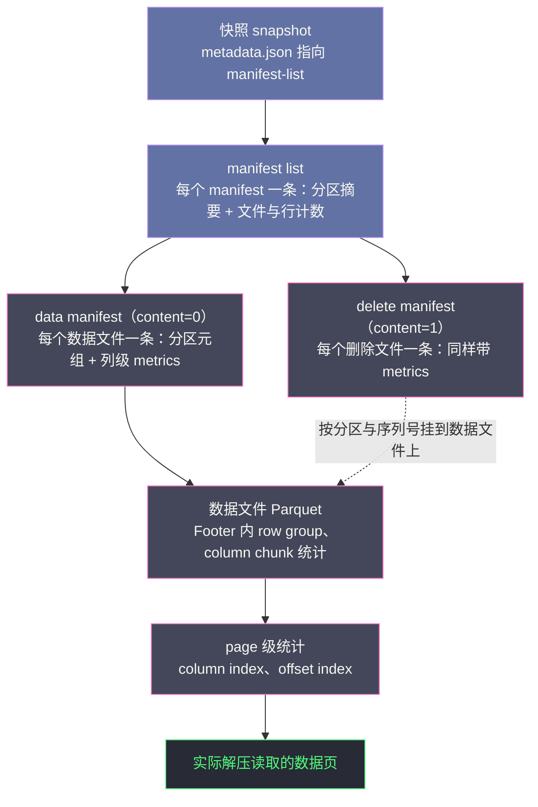
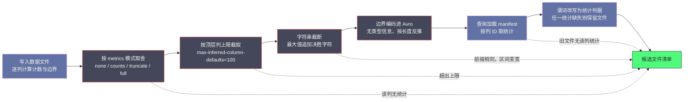
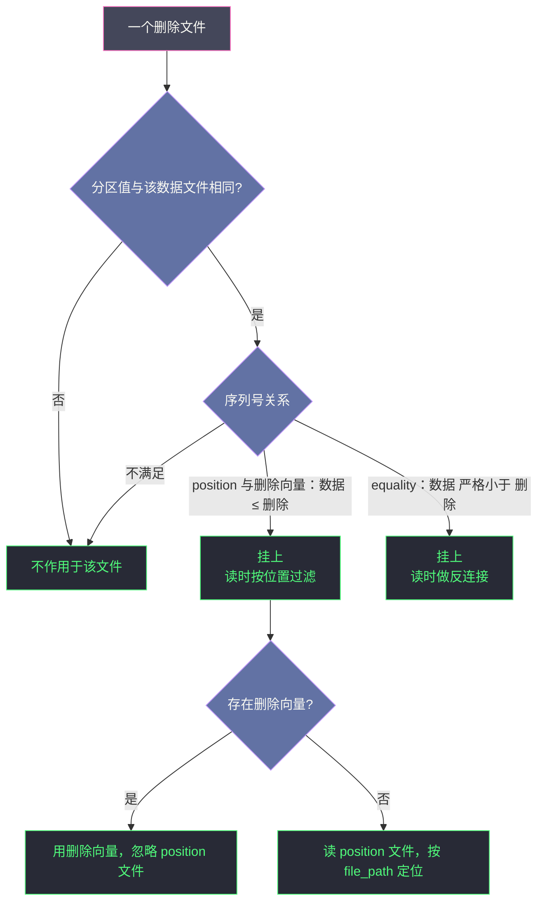
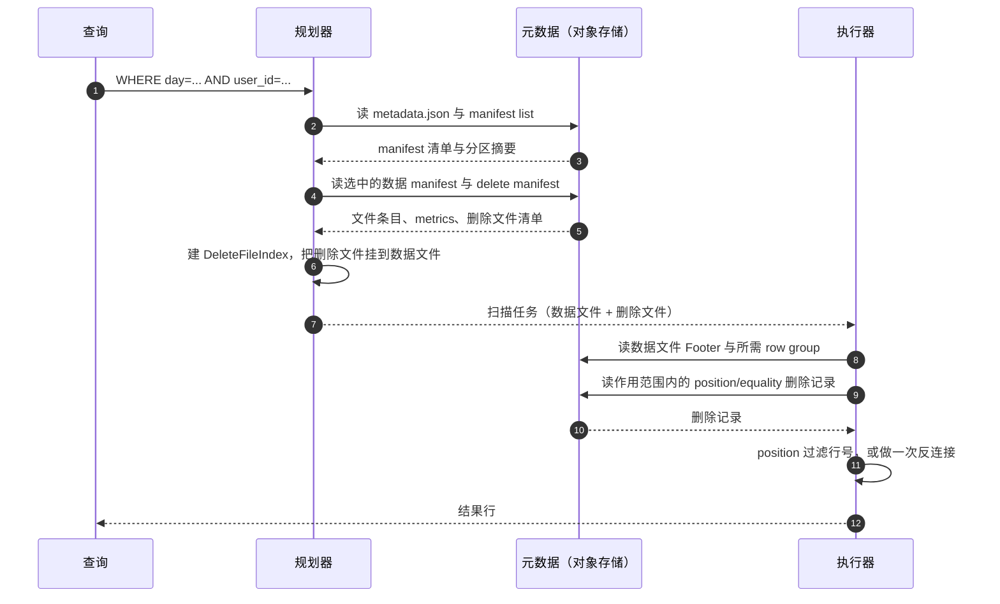

**摘要：**

Iceberg 的查询加速从来不是一条路径，而是三级判据各自在不同粒度上兑现"少读一点"这件事：manifest list 用分区摘要排除整片 manifest，manifest 用文件级列统计排除数据文件，数据文件内部再交给 Parquet 的 row group 与 page 统计。三级的判据来源、生效位置与失效条件完全不同，把它们混成一句"数据跳过"，调优时就会打偏方向——扫描量没降下来，原因可能根本不在你正在调的那一级。本文沿一次点查的规划路径走完这三级，重点算清列级 metrics 那四个字段（`value_counts`、`null_value_counts`、`lower_bounds`、`upper_bounds`）各自能给出什么答案，又因为截断、类型提升与 NaN 而给不出什么答案。随后转入行级删除，拆开 position delete 与 equality delete 的记账方式，说明读取代价如何从"多打开几个文件"变成"多一次反连接"，以及为什么频繁删少量行会让一条原本很快的查询慢慢变慢。最后把 `rewrite_data_files`、`rewrite_manifests` 与 `rewrite_position_delete_files` 三件事的分工摆清楚，顺带用一句话对照 Delta Lake 的删除向量，再用三个反例与三个观测落点收束：分区选粗却指望 manifest 层、delete 文件只增不减、以及 `format-version=1` 上谈行级删除。

---

## 第 1 章 一次点查要翻过几页元数据

### 1.1 成本的形状被对象存储改写过

在 HDFS 时代讨论扫描成本，习惯从磁盘带宽算起，NameNode 常驻内存、块位置批量下发，元数据寻址接近于免费。对象存储把这套成本结构翻了过来：一次 `GET` 的往返通常落在数十毫秒的量级，与文件只有几 KB 还是几 GB 无关，于是**少打开一个文件**的价值第一次超过"少读一兆字节"。Iceberg 的三级裁剪之所以值得专门写一章来讲，根源就在这里——它把判断前移到根本不发生 `GET` 的位置上。

这件事在 Iceberg 的表属性里留下了明确的痕迹。`read.split.metadata-target-size` 的缺省值是 32 MB，`read.split.open-file-cost` 的缺省值是 4 MB：扫描规划器在把 manifest 切成读任务时，把"打开一个文件的估计代价"折算成 4 MB 的扫描量参与装箱。一个 512 MB 的数据文件折算下来约等于 128 个"打开动作"，这个换算透露了设计者的成本观——打开文件的固定开销大到值得用 4 MB 的假想字节去填平。理解这一点，才能理解为什么 Iceberg 宁可在元数据里多存几份摘要，也要把"哪些文件不用打开"的判断做到尽可能早。

### 1.2 三级裁剪各自对着什么数据

三级裁剪不是同一套逻辑在三个粒度上的重复，它们读的是三种不同的物理结构，也需要付出三种不同的代价。

第一级读的是 manifest list（清单列表）。每个快照对应一个 manifest list 文件，里面每个条目描述一个 manifest：路径与长度、分区规范（partition spec）ID、内容类型（数据或删除）、序列号、新增/现存/删除的文件数与行数，以及最关键的一项——分区字段摘要（field summary）。摘要记录该 manifest 内所有分区值的最小值、最大值、是否含 null、是否含 NaN。查询的分区谓词先在这里过一遍，不含目标分区的 manifest 整片跳过，连打开都不必。

第二级读的是 manifest（清单文件）本身，每个条目描述一个数据文件：路径、格式、分区元组、记录数、文件大小、按列 ID 组织的 `column_sizes` 与四组统计（`value_counts`、`null_value_counts`、`nan_value_counts`、`lower_bounds`/`upper_bounds`）。这些统计存在元数据里而不是数据文件里，所以这一级仍然是"不开数据文件就能判断"的。三层元数据文件的字段定义与跨快照复用机制见 [[02 元数据三层架构——Snapshot、Manifest List 与 Manifest File]]。

第三级已经没有元数据可用了，只能打开数据文件读 Footer，用 Parquet 的 row group 与 column chunk 统计判断文件内哪些块可以不读；再往下是 page 级的 column index 与 offset index，取决于读取器是否实现了页级下推、以及文件是否写了页索引。

这里需要把两个正交的维度分开：三级裁剪回答的是"读哪些行"，列裁剪（column pruning）回答的是"读哪些列"。后者不依赖任何统计，只看查询引用了几列，在列式格式上直接决定解压与反序列化的数据量。一张两百列的宽表点查三列，即便文件级裁剪一个文件都没跳过，读取的字节数也可能只有文件大小的百分之几；反过来，只读一列却要扫全表所有文件，字节数照样能到 TB 级。两个维度的收益会相乘，也会互相掩盖——扫描字节没降下来时，先确认是行没裁掉还是列没裁掉，比调统计参数更快。

下图是三级判据的串联形状，请注意删除文件走的是另一条支路，这一支要到第 5 章才会展开。

### 1.3 三级的账单不一样

把三级并排比较，能看出它们的成本结构与失效条件几乎不重叠，这也解释了为什么"数据跳过没生效"通常不止一种答案。

| 层级 | 判据来源 | 生效位置 | 判据粒度 | 额外 I/O | 典型失效条件 |
|---|---|---|---|---|---|
| manifest list | 分区字段的 field summary，加文件与行计数 | 规划器 | 单个 manifest（内含数千至数万文件） | 读 manifest list 本身，通常几十 KB 到数 MB | 分区变换与谓词对不上；分区粒度过细导致 manifest 数量膨胀；分区列不在谓词中 |
| manifest | 每个数据文件的 `lower_bounds`/`upper_bounds` 与三组计数 | 规划器 | 单个数据文件 | 读选中的 manifest，每个约数 MB | 统计被设为 `none`；列超出推断上限；字符串边界被截断；统计缺失 |
| 数据文件内部 | Parquet Footer 的 row group 统计、page 索引 | 执行器 | 单个 row group 或 page | 一次 Footer 读取，已不可避免 | 文件只有一个 row group；文件内无序；读取器未启用页级下推 |

前两级是**不开文件就能做判断**，第三级是"开了文件但不必全读"。三者的成本差一到两个数量级，调优时先定位瓶颈落在哪一级，比盲目加排序或加分区有效得多。

---

## 第 2 章 第一级：manifest list 的分区摘要

### 2.1 field_summary 的四个字段

manifest list 里与裁剪直接相关的字段是 `partitions`，它的类型是 `list<field_summary>`，长度与 manifest 所用分区规范的分区字段数一致，一一对应。每个 `field_summary` 有四个成员：`contains_null` 表示该 manifest 内是否存在分区值为 null 的文件；`contains_nan` 表示是否存在分区值为 NaN 的文件（浮点分区才有意义）；`lower_bound` 与 `upper_bound` 是该分区字段在所有文件上的最小与最大值，按规范附录的单值序列化编成字节串，并显式排除 null 与 NaN。

这四个字段的信息量很小，小到经常被忽略，但它的作用面极大：一个 manifest 通常承载数千到数万个数据文件，摘要一旦判出"没有交集"，省下的就是这整批文件的打开动作。以按天与地区双分区的日志表为例，查某个地区的某两天，摘要层面对 `day(event_ts)` 与 `region` 各做一次区间相交判断，几十个 manifest 里通常只剩一两个通过。

它也有一种容易被低估的用法：`added_files_count`、`existing_files_count`、`deleted_files_count` 与三个对应的行数计数。计数本身不参与谓词判断，但它是"这个 manifest 还值不值得读"的快速否决项——文件数全为 0 的 manifest 可以直接剔除；反过来，知道某个 manifest 承载了两万个文件、另外一个只承载了三个，规划器就可以按成本决定读取顺序，让大 manifest 的并行度更高。

### 2.2 摘要看不到数据值，只能看到分区值

这一级的**精度上限**由分区规范决定，与数据本身无关。分区按 `month(event_ts)` 时，摘要只能说"这个 manifest 里的数据落在 2024 年 1 月到 3 月之间"，查 `event_ts = 2024-02-14 12:00` 时三月的 manifest 仍要通过，因为分区值上无法区分月内的具体时刻。规范把这种投影称为 inclusive projection（包含式投影）：只要某行可能满足谓词，它所在的分区就必须被判为可能匹配，宁可多留不可误杀。严格投影（strict projection）则相反，它算的是"这个文件里的行是否全部满足谓词"，用途是给每个文件推导剩余谓词，而不是用来跳过。

精度上限带来一个直接的推论：分区粒度就是这一级的分辨率，而分辨率与元数据成本成反比。按天分区到 3 年只有 1095 个分区值，摘要很紧凑；按小时分区就到了 2.6 万个分区值，manifest 条目数与 manifest list 的体积同步上涨；再叠加租户、地区、事件类型这些维度，分区数量按乘积增长，manifest list 从几十 KB 涨到几 MB，规划阶段的元数据 I/O 反而成了新瓶颈。这就是过度分区（over-partitioning）在 Iceberg 上的具体症状：不是查询变慢在数据读取上，而是变慢在规划上。各种分区变换的语义与演进边界见 [[03 Hidden Partitioning——告别分区列陷阱]]。

### 2.3 从谓词到扫描任务：一级过滤如何传导

下图把一次查询从谓词到"扫描任务"的传导画出来，重点看两条并行支路：数据文件与删除文件都要经过同一套分区投影与统计过滤，最后在规划结果里配对。

这条链上有一个常被忽略的细节：分区投影使用的是"写该 manifest 时所用的那个分区规范"。表做过分区演进（partition evolution）之后，不同 manifest 可能对应不同的规范，读取端不能拿当前规范去套所有 manifest，否则旧数据要么被误跳，要么谓词推导失败。Iceberg 把 `partition_spec_id` 放在 manifest list 的每个条目上，正是为了让规划器按 manifest 逐个选择规范。

### 2.4 这一级的代价随 manifest 数增长

manifest list 本身是每个快照一份，写一次完整快照就要写一份新的 manifest list。它的条目数等于该快照引用的 manifest 数，而 manifest 数取决于写入模式：每次快速追加（fast append）只新增一个 manifest，快照之间复用旧 manifest，所以 manifest 数会随着提交次数增长。

`commit.manifest-merge.enabled` 缺省为 true，`commit.manifest.min-count-to-merge` 缺省为 100，`commit.manifest.target-size-bytes` 缺省 8 MB，这套机制在写入时自动把累积的小 manifest 合并成大 manifest，把 manifest 数压在一个与数据规模相称的量级上，而不是与提交次数相称。但合并有边界：合并只发生在提交路径上，且大 manifest 一旦写成就不会再被拆开；删除与重写同样会产出新 manifest，旧 manifest 里那些标了 DELETED 的条目不会消失，只会随快照切换被替换掉。

| manifest list 字段 | 用途 | 不读 manifest 能得到的结论 |
|---|---|---|
| `manifest_path` / `manifest_length` | 定位与成本估算 | 该先把哪个 manifest 读进来 |
| `partition_spec_id` | 选择分区规范 | 谓词该按哪套分区规则投影 |
| `content` | 区分数据与删除 manifest | 删除文件与数据文件分开规划 |
| `sequence_number` / `min_sequence_number` | 判断文件新旧 | 删除文件是否需要作用于该 manifest 内的文件 |
| `added_files_count` 等三个计数 | 快速否决与成本排序 | 文件数全 0 的 manifest 直接剔除 |
| `partitions` 的 field_summary | 分区区间相交 | 不含目标分区的 manifest 整片跳过 |

表里最后一行是这一级的主体，但倒数第二行的价值在带删除的表上会突然放大：删除文件是否作用于某个数据文件，判据之一就是序列号大小关系，而 `min_sequence_number` 让规划器在读取 manifest 之前就能做一次粗筛。

---

## 第 3 章 第二级：列级 metrics 的四个字段

### 3.1 metrics 的物理形态

manifest 里每个 `data_file` 条目带一组可选统计字段，全部以列 ID（field ID）为键，而不是以列名为键：`column_sizes: map<int, long>`、`value_counts: map<int, long>`、`null_value_counts: map<int, long>`、`nan_value_counts: map<int, long>`、`lower_bounds: map<int, binary>`、`upper_bounds: map<int, binary>`。用列 ID 作键是为了让 schema 演进不至于失效——改名不影响统计，删列之后旧统计只是无人引用，新增列则在旧文件上自然缺失。

`column_sizes` 记录该列在磁盘上占用的字节总数，规范特意注明它不含读取其它列所需的开销（Footer、字典页等），所以它只能用来估算"读这一列大概要花多少字节"，不能当作文件大小用。这个字段对列裁剪（column pruning）的收益估算是有效的：一个宽表读三列与读三十列，`column_sizes` 能给出量级差别。

`lower_bounds`/`upper_bounds` 的序列化是单值编码，整数与浮点按小端序，字符串按 UTF-8 原字节，日期是天数、时间戳是微秒数，UUID 用 16 字节定长。这里埋着一个不太直观的坑：manifest 的 Avro 结构里并不存边界的原始类型，而类型提升（type promotion）不会回头重写已有边界。把 `int` 提升为 `long` 之后，旧文件里的 `lower_bounds` 仍然是 4 字节；读取端只能靠字节长度反推写入时的类型（4 字节判为 `int`，8 字节判为 `long`；`float` 与 `double`、`date` 与 `timestamp` 同理）。这个反推规则写进了规范，引擎必须照做，否则一次无害的类型提升就会让统计解码错位。

### 3.2 value_counts 与 null_value_counts：计数能给什么答案

`value_counts` 的语义经常被读错。它统计的是该列的**取值个数**，包含 null 与 NaN，而不是"非 null 值数量"。这个区别对扁平列没有影响（取值个数等于行数），对嵌套结构与数组列却有实质影响：一个数组列的 `value_counts` 可以远大于文件行数。于是由 `value_counts` 与 `null_value_counts` 推出的"非空值数"也就只在非重复列上等于行数，判断 `IS NOT NULL` 能否跳过文件时，这个前提必须成立。

计数能给出的答案是二值的、确定的，这比上下界更可靠：`null_value_counts` 为 0，则该列在文件内全非空，`IS NULL` 谓词可以整文件跳过；`null_value_counts` 等于 `value_counts`，则全为 null，`IS NOT NULL` 可以整文件跳过。中间值不携带任何可用于裁剪的信息——一个文件里 null 占六成还是占六成五，对"是否可能匹配"没有影响。这种"只有**端点**有意义"的特性，是计数类统计的通病，也是它便宜的原因。

### 3.3 上下界是安全但不紧的

`lower_bounds` 的规范措辞是"小于等于该列所有非 null、非 NaN 值"，`upper_bounds` 是"大于等于"。请注意这是不等式，不是等式，它保证的是**安全而非精确**：边界可以比真实的最小/最大值更宽，只要不窄。截断、类型提升、写入端保守估计，都会让边界变宽，而变宽只会降低裁剪率，不会造成错误跳过。

等值谓词 `col = v` 的判据是 `lower ≤ v ≤ upper`，范围谓词 `col BETWEEN a AND b` 的判据是 `upper ≥ a 且 lower ≤ b`，开区间 `col > v` 的判据退化成一个方向（`upper > v`）。三条判据都是必要条件而非充分条件，所以留下的文件里仍然可能有大量不匹配的行，真正的精确性要落到数据页上的谓词过滤，由数据本身给出。

有一种谓词只能靠上下界判，那就是不等值谓词 `col != v`：边界给出的是区间而不是取值集合，只要区间覆盖了 `v`，就无法证明文件里不含 `v`，唯一能整文件跳过的情况是该文件内只存在一个值且它恰好等于 `v`。规范在 v2 里把 `distinct_counts`（按列的去重计数）标记为弃用并禁止写入，于是这类谓词失去了唯一可能提供判据的统计，只能落在数据读取阶段过滤。把它当作数据跳过失效的案例去调参数，方向从一开始就错了。

### 3.4 nan_value_counts：浮点撕开的一道口子

NaN 在比较运算里与任何值都不相等、也不大于或小于任何值，这使上下界判据在浮点列上失去确定性。规范的处理是把 NaN 从边界里显式排除（边界只覆盖非 NaN 值），同时单独给出 `nan_value_counts`，让读取端知道文件里有没有 NaN、有多少。

为什么必须单独给一个计数字段，而不是简单地把 NaN 算进边界？因为各引擎对 NaN 的排序语义并不一致，有的把它当作大于一切值，有的把它排在末尾之外。读取端在谓词涉及浮点列时，只要 `nan_value_counts` 显示存在 NaN，保守做法就是"不跳过"——因为无法确定 NaN 行是否满足谓词。这直接降低了浮点列上的裁剪率，也是时间戳、金额这类列为什么更适合用 `decimal` 或整型微秒存储的一个附带理由：整数域里没有 NaN，判据干净。

### 3.5 截断：默认 truncate(16) 与 100 列上限

统计不是全列全量收集的。`write.metadata.metrics.default` 的缺省值是 `truncate(16)`，含义是字符串与二进制列的边界只保留前 16 个字符（二进制按字节），其余列按完整值收集；`write.metadata.metrics.column.<列名>` 可按列覆盖，取值有四种：`none` 不收集、`counts` 只收集计数、`truncate(n)` 截断到 n、`full` 完整收集。另有一个上限 `write.metadata.metrics.max-inferred-column-defaults`，缺省 100，含义是只对前 100 个顶层列按默认模式收集统计，超出的列一律按 `none` 处理（嵌套结构的叶子列各自占统计条目，实际条目数可能超过这个数）。

截断的实现方向决定了它是安全的：最小值直接取前缀即可，因为任何以更长前缀开头的字符串在字典序上都不会更小；最大值不能直接截断，否则原值可能大于截断结果，上界就被破坏了。实现会在截断后的前缀末尾追加一个足够大的"决胜"字符（必要时继续加长），使结果不小于任何真实值。于是边界依然安全，只是变宽了，宽多少取决于前缀的重复度。

**前缀重复度**高到什么程度会让裁剪彻底失效，值得算一笔账。设订单号形如 `ORD-20260115-000123`，同一批次写入的文件共享 `ORD-20260115-` 这个 13 字符的前缀，`truncate(16)` 保留下来的前 16 个字符里只有 3 位是流水号。若一个文件覆盖流水号 000000 到 099999，那么截断后的上界大概是 `ORD-20260115-0` 再追加决胜字符，下界是 `ORD-20260115-0`，区间宽度覆盖了整个批次；查 `ORD-20260115-000042` 时，同批次的一千个文件全部通过判据，一个也跳不掉。这类"带业务语义的定长编号"是截断策略最不友好的输入，UUID 那种十六进制随机串反而好一些，因为前缀的取值空间天然分散。

调参的方向因此不是"把 truncate 调大"，而是先判断谓词是否真的落在长字符串上：如果查询主要按时间与数值过滤，长字符串列的边界再精确也换不来收益，把它的模式设成 `none` 或 `counts` 反而能省下可观的 manifest 体积；如果查询确实按订单号点查，要么把前缀拆成独立的短列，要么接受这一级失效、靠分区与排序去补。

### 3.6 统计收集的四次折损

从写入端收集统计到读取端用上统计，中间有四次丢信息的机会：按列位置或顶层列数取舍、按 `truncate(n)` 截断、类型提升后靠字节长度反推、读取端遇到统计缺失时放弃裁剪。下图把这四次折损串成一条链。

四次折损里有三次是写入端的选择，一次是读取端的保守策略。这意味着裁剪率不达标时，先看统计的覆盖情况（哪些列有统计、模式是什么），再谈调参，顺序反了会白花很多时间。

### 3.7 谓词形态与判据的对照

| 谓词形态 | 改写后的判据 | 备注 |
|---|---|---|
| `col = v` | 保留 `lower ≤ v ≤ upper` 的文件 | 字符串列受截断影响 |
| `col BETWEEN a AND b` | 保留 `upper ≥ a AND lower ≤ b` 的文件 | 与等值同构 |
| `col > v` | 保留 `upper > v` 的文件 | 开区间，边界需严格比较 |
| `col IS NULL` | 保留 `null_value_counts > 0` 的文件 | 依赖计数统计存在 |
| `col IS NOT NULL` | 保留 `null_value_counts < value_counts` 的文件 | 全 null 文件可跳 |
| `col != v` | 仅当文件内该列只有一个取值时可跳 | 实践中几乎无收益 |
| `a = 1 AND b = 2` | 两侧判据同时成立 | 交集，最强 |
| `a = 1 OR b = 2` | 两侧判据任一成立 | 并集，收益随分支数增加而衰减 |
| 浮点列上的比较 | 存在 NaN 时只能保守保留 | `nan_value_counts` 决定保守程度 |

表中最后一行的保守性会传染：`OR` 的并集判据里只要有一个分支无法排除某个文件，整个 `OR` 就排除不掉它，于是裁剪率由最弱的那个分支决定。把浮点列换成整型或 `decimal` 存储，收益不只是存储空间。

---

## 第 4 章 第三级：文件内部还剩多少余地

### 4.1 Parquet 的三级结构

Parquet 文件在物理上分成若干 row group，row group 内按列切出 column chunk，column chunk 再切成 page；文件末尾的 Footer 里存着每个 row group、每个 column chunk 的统计（该列在该 row group 内的最小最大值、空值计数），可选的 column index 与 offset index 则把统计下沉到 page 级。这套结构与 manifest 里的统计同构，只是层级不同：manifest 统计描述整个文件，Footer 统计描述文件内的一块，page 索引描述更小的一块。

于是裁剪天然可以分两级做：先用 manifest 砍掉文件，再用 Footer 砍掉文件内的 row group。第三级的分辨率被 row group 这个粒度锁死，一个 row group 内的数据无法再被轮廓统计拆开，只能整块读或整块跳（除非读取器实现了 page 级下推）。

### 4.2 三个写入参数决定这一级的分辨率

`write.parquet.row-group-size-bytes` 缺省 128 MB，`write.parquet.page-size-bytes` 缺省 1 MB，`write.parquet.page-row-limit` 缺省 20000 行。三者的关系是：目标文件 512 MB 按 128 MB 切，得到 4 个 row group；一个 row group 约 100 万行（按每行百字节估），再按 20000 行一页切成 50 页。第三级最细能细到 1/50 个 row group，前提是读取器实现了 page 索引下推且文件写了索引。

把 row group 调小能提高分辨率，代价是 Footer 变大、压缩率下降、每块的调度开销上升；把 row group 调大则相反。这里没有普适最优值，判断依据是"文件内数据是否按查询关心的列有序"：如果文件内无序，每个 row group 的最小最大值都近似等于文件级的区间，分辨率再高也换不来跳过，反而因 Footer 变大而增加每次读取的固定成本。

### 4.3 责任边界在引擎与格式之间

Iceberg 负责"哪些文件不用读"，Parquet 读取器负责"文件里哪些块不用读"，这条边界在多引擎环境里尤其重要。同一个文件用 Spark 读、用 Trino 读，第三级的效果可能不同：谓词下推的实现程度、是否启用 page 索引、向量化读取的批大小，都是读取器自己的参数，Iceberg 的元数据管不到。

这解释了一类常见现象：同一张表，某个引擎上扫描字节明显下降，换一个引擎却纹丝不动，而 manifest 统计一切正常。此时问题不在 Iceberg 的统计，而在读取器对 Footer 统计与谓词下推的支持程度。判断方法也比较直接：看物理计划里文件扫描节点的"读取文件数"与"读取字节数"两个指标，前者不降说明第一二级失效，后者不降说明第三级或列裁剪失效。

读取器侧还有两个参数值得记住。`read.parquet.vectorization.enabled` 缺省为 true，向量化读取把多行数据攒成一批列向量再处理（批大小由 `read.parquet.vectorization.batch-size` 控制，缺省 5000 行），过滤与位置匹配的循环结构都建立在批上；`read.split.target-size` 缺省 128 MB，它决定把同一次扫描切分成多少个读任务，切得太碎会让每个任务都承担一遍固定的打开与调度开销，切得太粗又会拉低并行度、放大单任务失败后的重试代价。这两个参数与 Iceberg 的元数据无关，却会实实在在改变第三级的实测效果。

### 4.4 三级串起来的量级

用一组统一假设算一遍，把三级的收敛效果放在同一张表里（下表为示例推算，用于比较量级，不是某次基准测试的实测值）：单分区 1 TB、2000 个 512 MB 文件、每文件约 400 万行、`write.parquet.row-group-size-bytes` 取缺省的 128 MB 即每文件 4 个 row group；查询是"某一天 × 一个地区 + `user_id` 等值"，即落在一个分区内，选择性百万分之一。

| 阶段 | 未做聚簇（默认写入） | 按 `user_id` 排序写入 | 依据 |
|---|---|---|---|
| 分区裁剪后进入规划 | 2000 个文件 | 2000 个文件 | 分区摘要，两级相同 |
| manifest 层按 `user_id` 裁剪 | 2000 个文件（边界横跨全量，一个也跳不掉） | 约 2 个文件 | `lower/upper_bounds` |
| row group 层 | 8000 个 row group | 8 个 row group | Footer 统计 |
| 文件内有序后的进一步裁剪 | 不适用 | 1 个 row group | Footer 统计 |
| 实际读取量（示例推算） | 约 1 TB | 约 128 MB | — |

两列的对比说明一件事：**进入规划的文件数由第一级决定**，第二级能不能把它缩小，取决于写入端有没有让同一列的值在文件之间聚簇；第三级能不能再缩一个量级，取决于文件内部有没有按该列有序。默认写入（无排序）的表上，第二三级的判据退化成第一级的复制品，怎么调都不见变化——这时候该改的是写入布局，不是查询参数。反过来说，如果分区粒度过粗，第一级就留下了几千个文件，后面两级即使有效，也只是在这个巨大集合里做减法。

---

## 第 5 章 行级删除的两种形态

### 5.1 v1 的死角：只能整文件重写

格式版本 1 的表只支持文件级替换：删一行等于重写它所在的数据文件。要删的记录在一个 512 MB 文件里，读 512 MB、过滤掉一行、写出约 512 MB，写放大约等于文件大小除以行大小，量级在百万倍。CDC 场景里这类小批量删除与修正是常态——撤单、地址纠正、状态回滚，每次只涉及几十上百行，CoW 的代价与删除行数完全脱钩，只与被删行恰好落在哪个文件有关。

`format-version: 2` 引入的 delete file（删除文件）就是为这件事准备的：不碰数据文件，另写一个小文件记录"哪些行算删掉了"，读的时候再把删除应用到数据行上。配置项 `write.delete.mode`、`write.update.mode`、`write.merge.mode` 缺省都是 `copy-on-write`，要吃到低写放大必须显式改成 `merge-on-read`，而且这个模式只在 v2 表上可用——这是第一个必须记住的版本门槛。

### 5.2 position delete：按文件与偏移记账

position delete 文件的 schema 很窄，通常三列：`file_path`（被删行所在的数据文件路径）、`pos`（该文件内的行号，从 0 起）、`row`（可选，被删行的原始内容，用于 CDC 场景记录 before-image）。删 1000 行大致写出几十 KB，写放大接近 1，代价几乎只与删除行数成正比。

它有一项规范强制、而常被忽视的设计：position delete 文件**必须按 `file_path` 与 `pos` 排序**，而且这类文件的 `sort_order_id` 必须为空（表级排序规范不适用于它）。排序的意义全在读取端——读取某个数据文件的删除记录时，`file_path` 这一列在文件内是有序的，读取端可以只定位并读取属于该文件的那一段，而不是把整个 delete 文件从头扫到尾。这是一个纯粹为读取代价服务的规定，也是 position delete 在大规模场景下可用的前提。

manifest 里另有一个字段 `referenced_data_file`：当一个 delete 文件里的所有删除记录都指向同一个数据文件时，可以把它写进这个字段。有了它，规划器不必打开 delete 文件就能知道"这个 delete 文件只作用于那一个数据文件"，把一个可能涉及成千上万个数据文件的匹配问题降成一对一。删除向量（v3 起）要求必须写这个字段。

删除文件本身也有格式与写入参数的余地。`write.delete.format.default` 缺省跟随数据文件格式，可以单独指定；`write.delete.target-file-size-bytes` 缺省 64 MB，比数据文件的 512 MB 小得多——删除记录本来就少，按 512 MB 攒会把小批删除拖成很晚才落盘的一大批，读的时候反而更难跳过。position delete 文件只有三列且按 `file_path` 有序，在很小的删除文件上，行式格式（Avro）能省掉列式格式的 Footer 与字典页开销，这也是部分实现把删除文件单独设成行式的原因。

### 5.3 equality delete：按键值记账

equality delete 文件记录的是"满足某组列取值的行需要删掉"，文件里存的是一组键值，schema 由写入端决定，按哪些列判等则写在 manifest 条目的 `equality_ids` 里（`content=2` 时该字段必填，且这些列必须真的出现在 delete 文件里）。

它的好处是与物理位置解耦：不关心行的位置，也不关心数据文件之后会不会被重写，只要键值相同就能删。代价全部落在读取端：数据行与删除行之间不是"位置对应"关系，而是一个集合差问题，必须做一次按键的连接运算才能判断某行是否被删。

它还有一条会放大代价的规则：若 equality delete 文件是用无分区规范写的，它被当作全局删除（global delete），要作用于表里所有分区的数据文件。一个全局删除文件的存在，意味着每次扫描都要把它拉进来判断一遍，这个设计在维度表、小表上或许可接受，在大表上是明确的负担。

### 5.4 应用规则由几个不等式决定

删除文件不会自动作用于所有数据文件，规范用序列号（sequence number）与分区共同限定作用范围，判据可以概括成三组。

不等式里的"≤"与"<"不同，是最容易记错的一处：position delete 可以删除同一提交里刚写入的行（序列号相等也生效），equality delete 只作用于严格更老的数据（序列号必须更小），因为它的匹配依据是键值而不是位置，一旦允许同序列号生效，一次删除就会连带删掉同一提交里随后写入、键值恰好相同的行。分区这一条也有例外：等式删除若用无分区规范写出，则跳过分区判断；位置删除与删除向量一律要求分区（规范与分区值）完全相同。

---

## 第 6 章 读取代价：合并发生在读的时候

### 6.1 计划阶段先把删除文件挂到数据文件上

merge-on-read 的"合并"不是在存储层完成的，而是**在每次读取时重建**。计划阶段要做两件事：把 delete manifest 读出来，得到删除文件的清单与其 metrics；再把每个删除文件挂到它作用于的数据文件上。Iceberg 的 Java 实现在这一步会先建一个按分区与序列号组织的索引（`DeleteFileIndex`），然后为每个数据文件查出对应的删除文件集合，避免两两比较。

这一步的成本容易被低估。它**不是一个纯内存操作**：delete manifest 要读，删除文件要按分区与序列号筛，筛完之后每个数据文件还要带着一份"删除文件清单"进扫描任务。删除文件数量少时这部分可以忽略，数量上万时，规划阶段本身的耗时就会进入秒级——与数据读取无关，纯粹是元数据与匹配的开销。

规范还给了一条缓解措施：删除文件同样带 metrics，所以它也能被查询谓词裁剪。"若 metrics 表明删除文件里没有行能匹配扫描谓词，它可以像数据文件一样被忽略"——前提是删除文件写得规整，`file_path`、`pos` 或等值列上有可用的边界。反过来，如果删除文件里 `file_path` 的边界横跨全表（一次合并了多批删除的 delete 文件常见这种情况），这条缓解措施就失效了。

### 6.2 position delete 的执行路径

读取一个数据文件时，执行器先拿到作用于它的 position delete 文件清单，再按 `file_path` 列过滤出属于本文件的记录，收集成一个位置集合（bitmap 或排序数组），最后在读取数据页时按行号跳过。整条路径不需要 shuffle，也不需要跨节点的数据交换，是纯粹的本地过滤。

代价因此可以写成一个加法：每个数据文件多打开若干个 delete 文件，多读一点删除记录，多维护一个位置集合。删除记录本身很小（几十 KB 量级），位置集合也小（100 万行里删 1000 行，用 bitmap 只要 125 KB），所以只要 delete 文件数量可控，这条路径的额外开销远小于重写 512 MB 数据文件的代价。

### 6.3 equality delete 的执行路径：一次额外的反连接

equality delete 走不通上面这条捷径，因为删除行与数据行之间没有位置对应关系。读取端的做法是把删除行按等值字段组织成一个可查找的结构（哈希表或排序后归并），再与数据行做一次反连接：数据行的键出现在删除集合里就不输出。

这一动作的代价结构完全不同：它需要一个 join 算子，通常伴随着按键的分发（shuffle）或广播，内存占用随删除键的数量增长，执行计划里多出一个节点。删除记录少时广播即可，删除记录多到几百 MB 时广播会把 Executor 内存打满，只能改成 shuffle join，于是网络与磁盘 I/O 一起上来。各引擎的具体实现不同（Spark、Trino、Flink 各有自己的分发策略），但"多一次连接"这件事是语义决定的，无法绕过。

### 6.4 读放大的算术

把两类删除的代价折算成具体数字，能看出它们的分水岭在哪里（下表为示例推算）：一张按天分区的日志表，某天分区有 20 个 512 MB 数据文件；CDC 流每 10 分钟提交一批删除，一批 20 条 position delete 或 5000 个 equality 键。

| 项目 | position delete | equality delete |
|---|---|---|
| 单批删除文件大小 | 约 2 KB（20 条记录） | 约 200 KB（5000 个键） |
| 一天（144 批）累积 | 144 个文件、约 300 KB | 144 个文件、约 28 MB |
| 一个月不清理 | 约 4300 个文件 | 4300 个文件、约 850 MB 删除键 |
| 单查询额外打开（该分区） | 与"引用了该批数据文件的删除文件"数量同阶，示例约 20 个 | 该分区内所有序列号更大的删除文件，示例 4300 个 |
| 常数开销 | 20 次 `GET`，按每次 30 ms 计约 0.6 秒 | 读 850 MB 删除键并建哈希，外加一次连接 |
| 真正的成本来源 | 文件打开次数，与删除行数几乎无关 | 删除键的总量，与查询命中多少数据无关 |

这张表解释了两种删除方式的分水岭：position delete 的成本由"打开多少个删除文件"决定，可以通过减少提交批次、合并删除文件来压低；equality delete 的成本由"删除键总量"决定，只要不清理，每次查询都要把这份总量过一遍，与本次查询真正需要的删除毫无关系。前者是**元数据成本**，后者是实打实的**数据量与计算成本**。

### 6.5 为什么频繁删少量行最伤读

把上面的机制串起来，频繁的小批量删除会同时攻击三个位置。

第一是计划阶段。每次删除提交都新增删除文件与 manifest 条目，规划器要读的 manifest 数、要匹配的删除文件数同步增长，而这一步发生在任何数据读取之前，用户感知到的就是"查询还没开始读数据就先卡了几秒"。

第二是每个数据文件的读取前置动作。position delete 要为每个数据文件定位并读出对应的删除段，即使该文件一行都没被删；equality delete 要把整个删除键集合读进来。一次查询扫 20 个文件，这个前置动作就发生 20 次。

第三是快照与元数据的膨胀。删除提交产生新快照，快照里要引用新的 delete manifest，旧的 manifest 与 delete 文件在过期清理之前一直占着空间与列表位置；`expire_snapshots` 清的是快照与不再需要的文件，它不会替你合并删除文件，两件事的职责不同。

下图是这条链的时序，重点看"规划"与"应用"两个阶段里删除文件各自出现的位置。

时序里第 9 步是 merge-on-read 的代价所在：它在每次查询都要发生，而不是在写入时发生一次。**写放大**被省下之后并不会消失，它换了个位置出现在读取端，且要乘以查询次数。

还有一层语义上的约束值得点出：查询读到的删除集合在快照那一刻就固定了，之后提交的删除不会影响正在执行的查询。这当然是正确性上的好事，但它也意味着长查询的删除负担无法在运行中被减轻——一个跑了二十分钟的报表查询，它会读到的删除文件在开始时就已经确定，中途就算触发了重写或清理，也帮不上这次查询；重写的收益要到下一次查询才兑现。这也解释了为什么维护作业要安排在业务低峰，而不是指望它们在高峰期"顺手"救一下慢查询。

---

## 第 7 章 维护的三个动作不是一件事

### 7.1 rewrite_data_files：合并数据文件与消化删除比例

`rewrite_data_files` 是数据文件级重写，按文件组（file group）工作：先按分区切分，再在分区内按大小切成组，每组独立重写。它的候选判据由几个选项控制，缺省值决定了开箱行为：

| 选项 | 缺省值 | 含义 |
|---|---|---|
| `min-input-files` | 5 | 文件组内文件数超过它即无条件重写，是小文件合并的主触发 |
| `target-file-size-bytes` | 536870912（512 MB） | 输出文件目标大小 |
| `min-file-size-bytes` | 目标的 75% | 低于此值的文件无条件进候选 |
| `max-file-size-bytes` | 目标的 180% | 高于此值的文件无条件进候选 |
| `max-file-group-size-bytes` | 107374182400（100 GB） | 单个文件组的上限，避免一次重写吞掉超大分区 |
| `delete-ratio-threshold` | 0.3 | 数据文件上关联的删除比例超过它才进候选 |
| `delete-file-threshold` | 2147483647 | 删除条数超过它才进候选，缺省等于关闭 |
| `max-concurrent-file-group-rewrites` | 5 | 并发重写的文件组数 |
| `partial-progress.enabled` | false | 是否分组提交，避免大作业一次失败全丢 |

`delete-ratio-threshold` 是这张表里最值得记住的一项。缺省 0.3 意味着：一个数据文件被删掉的行超过三成才值得重写，删了 1% 的文件不会被 compaction 碰。这与"频繁删少量行"的现实正好错位——少量删除永远不会触发这个阈值，于是删除文件一路累积，直到某天比例跨过 0.3，才有一批文件被重写。想让小比例删除也被消化，得把阈值调低，代价是重写量上升；调低多少，取决于你能接受多少读取代价。

`strategy` 参数缺省是 `binpack`，即只按大小装箱合并，输出的数据顺序继承输入。它解决的是文件数与文件大小，第三级的判据不会因此变好——一堆乱序小文件合成一个大文件之后，row group 的最小最大值依旧横跨全量。另一种策略是 `sort`，按 `sort_order` 指定的顺序重写，输出文件之间与文件内部都按该顺序聚簇，第二三级的判据随之收紧；`sort_order` 还可以写成 `zorder(c1, c2)` 这种多维形式，代价是一次全局 shuffle 与排序，量级远高于 binpack。把两种策略混在同一个高频作业里跑，等于每次都用全局重写的成本换一次文件合并的收益，通常是算不过账的。

还有一处需要说清楚：`rewrite_data_files` 缺省使用 `use-starting-sequence-number=true`，写出的新文件沿用重写开始时的序列号，因此旧删除文件仍然对新文件生效。这是正确性上的保守选择（重写不会让已删行复活），但也意味着一次 compaction 并不会自动把删除"物化"掉，减少文件数不等于消掉删除文件。

### 7.2 rewrite_manifests：自动合并之后为什么还需要它

既然 `commit.manifest-merge.enabled` 缺省开启、`commit.manifest.min-count-to-merge` 缺省 100，写入路径上已经把 manifest 合并做掉了，为什么还要一个独立的 `rewrite_manifests` 过程？两个过程的触发条件与作用面不同。

写入路径上的合并是为"累积小 manifest"设计的：它在提交时把新增的小 manifest 与已有的合并到 8 MB 目标大小，只处理与本次提交相关的部分。`rewrite_manifests` 则是全表或指定分区规范的手动整理：它把现存 manifest 按分区字段重排、合并到目标大小，让 manifest 内的数据文件按分区聚簇，从而让第二级的"文件数计数"与"分区边界"更有效，也让后续写入的合并代价更低。它的选项较少，`use_caching` 缺省 true（用 Spark 缓存避免重复读），`spec_id` 用于只重写某个分区规范的 manifest。

还有一个不能省的场景：表经历大量删除与重写之后，manifest 里会积累大量状态为 DELETED 的条目，这些条目不再参与扫描，但仍占 manifest 的空间与读取时间。写入路径的合并只看小 manifest，不会主动清理这些历史条目；`rewrite_manifests` 按当前快照重新生成 manifest，才真正把它们丢掉。

### 7.3 rewrite_position_delete_files：清理悬挂删除

这个过程的文档措辞把它的两个用途写得很直白：一是小文件合并（把小的 position delete 文件合成大的，减少 manifest 条目与打开开销），二是清理悬挂删除（dangling deletes）——重写数据文件之后，指向那些旧文件的 position delete 记录并不总是被同步标记移除，它们会继续挂在快照元数据里，成为"指向已不存在文件的删除"。

它的参数结构与 `rewrite_data_files` 类似，但目标大小取 `write.delete.target-file-size-bytes`（缺省 64 MB），输出指标是 `rewritten_delete_files_count` 与 `added_delete_files_count`。悬挂删除在重写过程中一律被过滤掉，这一点没有开关。

### 7.4 三个动作与 compaction 的关系

"compaction"在湖格式语境里是一个统称，落到 Iceberg 上至少对应三件独立的事，它们的作用对象、判据与产出都不一样。

| 过程 | 作用对象 | 主要判据 | 输出指标 | 不做的后果 |
|---|---|---|---|---|
| `rewrite_data_files` | 数据文件 | 文件数、文件大小、关联删除比例 | `rewritten_data_files_count`、`rewritten_bytes_count` | 小文件堆积、删除比例高的文件一直带着无效行被扫描 |
| `rewrite_manifests` | manifest | 手动触发（可按分区规范限定） | `rewritten_manifests_count` | 规划阶段读的 manifest 过大、DELETED 条目残留 |
| `rewrite_position_delete_files` | position delete 文件 | 文件数、文件大小 | `rewritten_delete_files_count` | 删除文件碎片化、悬挂删除长期占用 |

三者的**执行顺序**也有讲究：先重写数据文件，再清理位置删除文件，因为在数据文件重写之前清理，被重写的文件仍需要那些删除记录；反过来先清理，重写时就可能把已删行重新读进来写出去。这个顺序不是规范要求，而是由"删除文件作用于哪个序列号的数据"这条规则推出来的必然结果。

下图把写入、累积与维护串成一个闭环，注意删除文件在环上的位置：它由写入产生，由读取消费，由重写清理，三个环节各自独立。

闭环上没有任何一步是"一次性修好"的：写入持续产生新的删除文件，重写持续把旧的清掉，两者的速度差决定了读取代价的上限。把维护作业的频率定成与写入频率同阶，通常比"每月大扫除一次"更划算，因为读取代价是在两次维护之间线性累积的。

---

## 第 8 章 边界、反例与观测

### 8.1 一句话对照：Delta 的删除向量

Delta Lake 的 deletion vector（删除向量）与 Iceberg 的删除文件解决的是同一个问题——不重写数据文件就标记删除——但存储形态不同：它把被删行的位置编码成一个位图，作为一个独立文件由事务日志的 `add` 动作引用（日志结构的细节见 [[大数据/数据湖/Delta-Lake-Lakehouse架构深度解析/02 事务日志 Delta Log：ACID 保证的基石|Delta Log]]），而不是写成一张独立的删除数据文件再在计划阶段与数据文件配对。形态不同带来了不同的读取代价结构，但"读时合并、需要维护收敛"这条约束是共通的。

### 8.2 反例一：只做分区裁剪，不看 manifest 层

症状是扫描量常年不动，查询总是把目标分区的全部数据读一遍，`EXPLAIN` 里文件数等于分区内文件数。诊断时先看分区粒度：如果表按月或按地区粗分，一个分区几千个文件、几十 GB，第一级的收益在分区这一层就用完了，第二级要负责把几千个文件筛到几十个，而这一级**往往是失效的**。

失效的三种典型原因各有判据。其一，谓词列没有统计：检查 `write.metadata.metrics.default` 是否被改成 `none`，或该列是否排在 100 个顶层列之后。其二，谓词落在长字符串上：看 manifest 里该列的边界是否都退化成相同前缀，若是，`truncate(16)` 已经把判别力吃掉了。其三，类型提升导致边界解码异常：这类问题会表现为裁剪结果与预期完全不符，需要对照写入时的类型与当前 schema 的类型。

处置方向不是继续**细分分区**（那会把第一级的元数据成本推高），而是让第二级重新具备判别力：给高频过滤列单独设 `full` 或更大的 `truncate(n)`，把长编号拆成短前缀列，或者用排序让文件级边界变窄。

### 8.3 反例二：delete 文件只增不减

症状是查询从某天开始变慢，慢在规划阶段与扫描前置动作上，`EXPLAIN` 里出现的删除文件数量远超预期，`rewrite_data_files` 跑了也没改善。判据有三条：看 `delete-ratio-threshold` 是否让大部分文件达不到重写门槛；看是否存在无分区规范的等式删除文件（全局删除）；看 delete manifest 的条目数是否与数据 manifest 同阶甚至更多。

处置要分两步。先止血：合并删除提交的批次以减少删除文件数量，把等值删除换成位置删除或退回 CoW 模式，并检查删除文件是否带上了 `referenced_data_file`。再收敛：调低 `delete-ratio-threshold` 让带删除的文件尽早重写，配合 `rewrite_position_delete_files` 清理悬挂删除，必要时打开 `remove-dangling-deletes`。

### 8.4 反例三：format-version=1 上谈行级删除

`format-version: 1` 的表上没有删除文件这个概念，`write.delete.mode=merge-on-read` 这类配置不会生效，DELETE 一律走文件级替换。这条边界在多引擎环境里更隐蔽：有的写入端在 v1 表上会直接忽略 `merge-on-read` 设置而不报错，于是"配置了 MoR 却没有 MoR 效果"变成一个纯靠观测才能发现的问题。

判据很简单：读 `metadata.json` 的 `format-version` 字段，或查表的 `format-version` 属性；v1 表的 `write.delete.mode` 无论怎么设都按 CoW 执行。升级到 v2 是纯元数据操作（`ALTER TABLE ... SET TBLPROPERTIES ('format-version'='2')`），不需要重写数据文件，旧 v1 元数据在 v2 表里仍可读；但升级之后要确认每个读写引擎都支持 v2 特性，否则会在某个旧连接器上直接失败。

### 8.5 三个可观测的落点

| 观测点 | 采集方式 | 能回答的问题 |
|---|---|---|
| 快照摘要里的删除文件数与行数 | `snapshots` 的 `summary` 中 `added-delete-files`、`added-position-deletes` 等字段 | 删除提交产生了多少删除文件，增长速率是否异常 |
| 表的 manifest 数与 delete 文件数 | 读 manifest list 或用元数据表（`entries`、`files`）统计 | 规划阶段的固定成本有多大，delete 文件是否只增不减 |
| 查询计划的扫描文件数与读取字节数 | 物理计划里的文件扫描节点、引擎 UI 的扫描指标 | 三级裁剪各自生效到什么程度，是文件数没降还是字节数没降 |

三个落点里，第三个最能区分"裁剪没生效"与"裁剪生效了但用不上"。前两个是运维侧的常态化监控项，第三个是排障时的定位手段。把三者放在一起看，才能判断投入应该放在分区设计、统计配置还是维护作业上。

维护作业是否真的收敛，看过程返回的指标比看表目录更可靠：`rewrite_data_files` 返回 `rewritten_data_files_count`、`added_data_files_count` 与 `rewritten_bytes_count`，`rewrite_manifests` 返回 `rewritten_manifests_count` 与 `added_manifests_count`，`rewrite_position_delete_files` 返回删除文件的重写与新增计数。这几个数字与预期不符时，先查候选判据而不是加并发：重写文件数为 0 通常意味着 `min-input-files` 或 `delete-ratio-threshold` 根本没让文件进候选，而不是作业没跑。另外，`partial-progress.enabled` 打开之后是按组提交，作业中途失败会留下"提交了一部分"的表状态，重跑不会重复已完成组，但也意味着失败后表已经变了——这类作业的幂等性要靠指标核对，不能靠"重跑一遍就好"的直觉。

行文至此，Iceberg 的查询优化可以收成一句话：它把"哪些数据不用读"的判断分三层编码进元数据，用元数据的体积换取扫描量的下降，代价是写入端要维护统计、读取端要在规划阶段多做一些匹配；行级删除进一步把"删除"从重写动作改成了读时合并，代价则从写路径搬到了读路径，并随着删除文件的累积按查询次数复利。这两件事的取舍落点是一样的——任何把成本从一处搬到另一处的设计都不会消灭成本，它只是让成本出现在更容易被摊薄的位置上；摊薄的前提是有稳定的维护节奏，而不是一次性的优化动作。

---

## 参考资料

1. Apache Iceberg 表规范（manifest、metrics、delete file 与应用规则）：https://iceberg.apache.org/spec/
2. Iceberg 规范源码（`format/spec.md`，含 manifest list 字段、data_file metrics 字段定义）：https://github.com/apache/iceberg/blob/main/format/spec.md
3. Iceberg 表属性参考（`write.metadata.metrics.*`、`write.parquet.row-group-size-bytes`、`write.delete.mode` 等缺省值）：https://iceberg.apache.org/docs/latest/configuration/
4. Iceberg Spark 存储过程（`rewrite_data_files`、`rewrite_manifests`、`rewrite_position_delete_files` 的参数与输出指标）：https://iceberg.apache.org/docs/latest/spark-procedures/
5. Iceberg 维护文档（compaction、manifest 重写与快照过期）：https://iceberg.apache.org/docs/latest/maintenance/
6. Iceberg 性能文档（扫描规划、切分与读取配置）：https://iceberg.apache.org/docs/latest/performance/
7. Iceberg 源码 `DeleteFileIndex`（按分区与序列号索引删除文件，供规划阶段匹配数据文件）：https://github.com/apache/iceberg/blob/main/core/src/main/java/org/apache/iceberg/DeleteFileIndex.java
8. Iceberg 源码 `InclusiveMetricsEvaluator`（谓词到 metrics 判据的改写，含 NaN 与计数处理）：https://github.com/apache/iceberg/blob/main/core/src/main/java/org/apache/iceberg/InclusiveMetricsEvaluator.java
9. Parquet 格式文档（row group、column chunk、Footer 统计）：https://github.com/apache/parquet-format/blob/master/README.md
10. Parquet Page Index 文档（column index 与 offset index 的页级统计）：https://github.com/apache/parquet-format/blob/master/PageIndex.md
11. Delta Lake 协议规范（deletion vector 在 `add` 动作中的引用方式）：https://github.com/delta-io/delta/blob/master/PROTOCOL.md

---

> [!note] 思考题
> 1. `value_counts` 包含 null 与 NaN，这对数组列意味着它不等于行数。如果要判断一个数组列"是否全为空"，你需要哪几个字段组合，为什么单靠 `null_value_counts` 不够？
> 2. 字符串边界被 `truncate(16)` 截断后，最大值要追加决胜字符才能保证安全。请构造一个前缀重复度极高、又必须按该列点查的场景，说明你会选择"加大截断长度"还是"拆前缀列"，判断依据是哪几个数？
> 3. position delete 与 equality delete 的读取代价一个取决于删除文件数量、一个取决于删除键总量。这两种代价在什么写入模式下会同时出现，又该如何排定维护作业的优先级？
> 4. `rewrite_data_files` 缺省沿用重写开始时的序列号，因此旧删除文件仍然作用于新文件。这个选择避免了哪一类正确性问题，又让"删除物化"多出了哪一步？
> 5. `format-version=1` 的表无法使用行级删除，但升级到 v2 只是元数据操作。升级之后，哪些引擎侧的能力需要同步确认，才不至于在某个读取路径上直接失败？