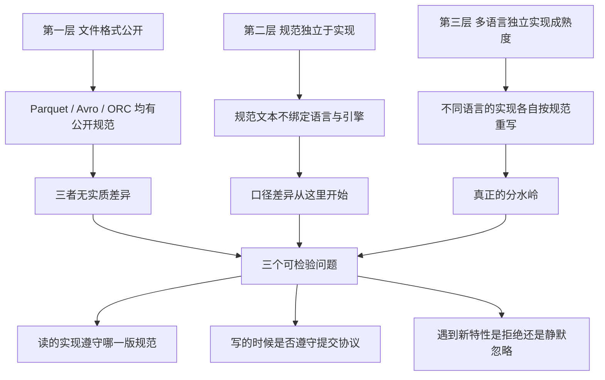
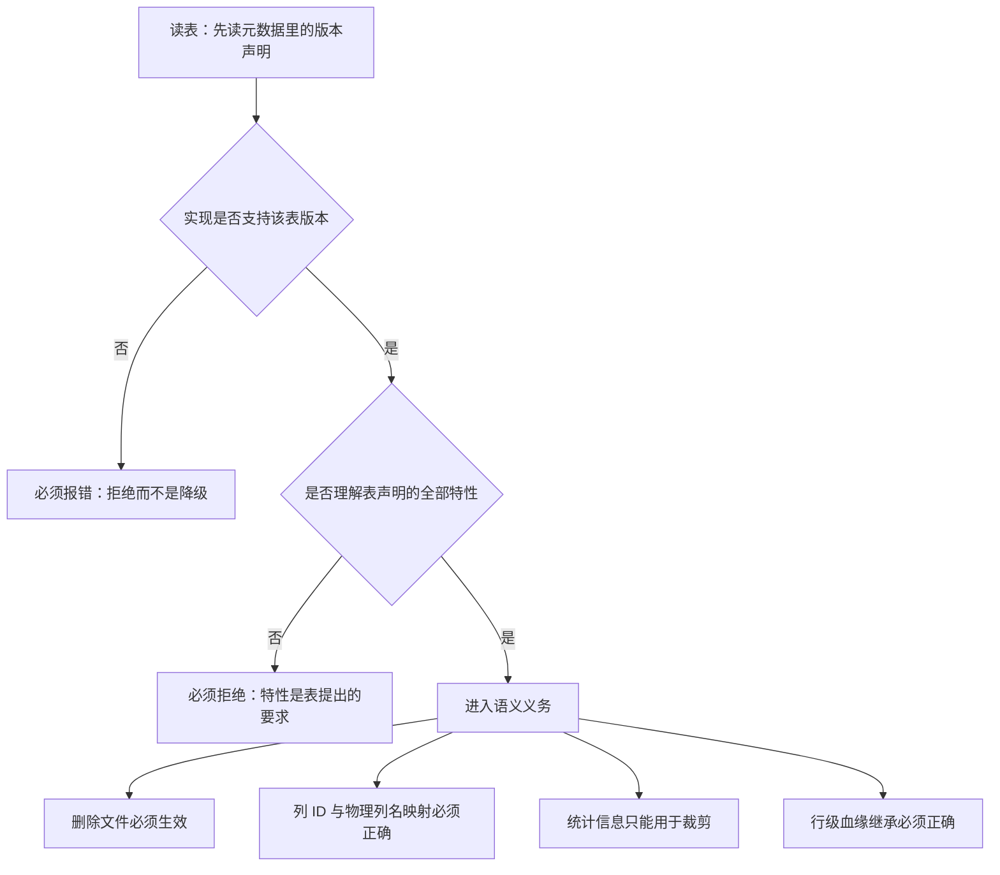
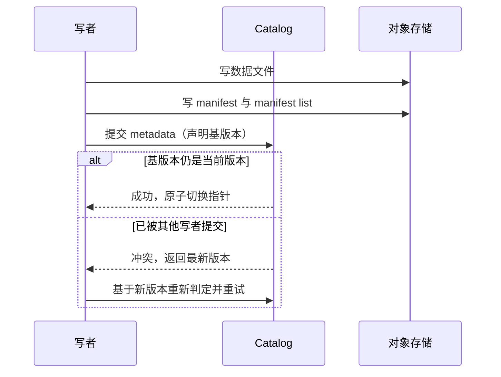
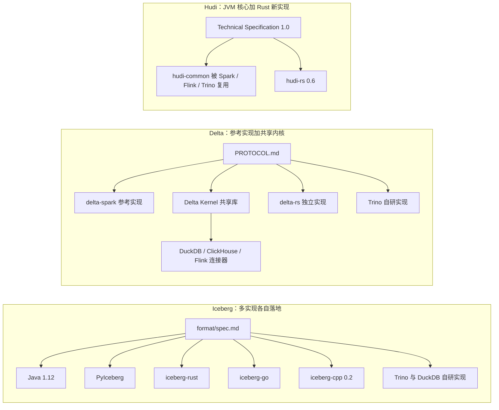
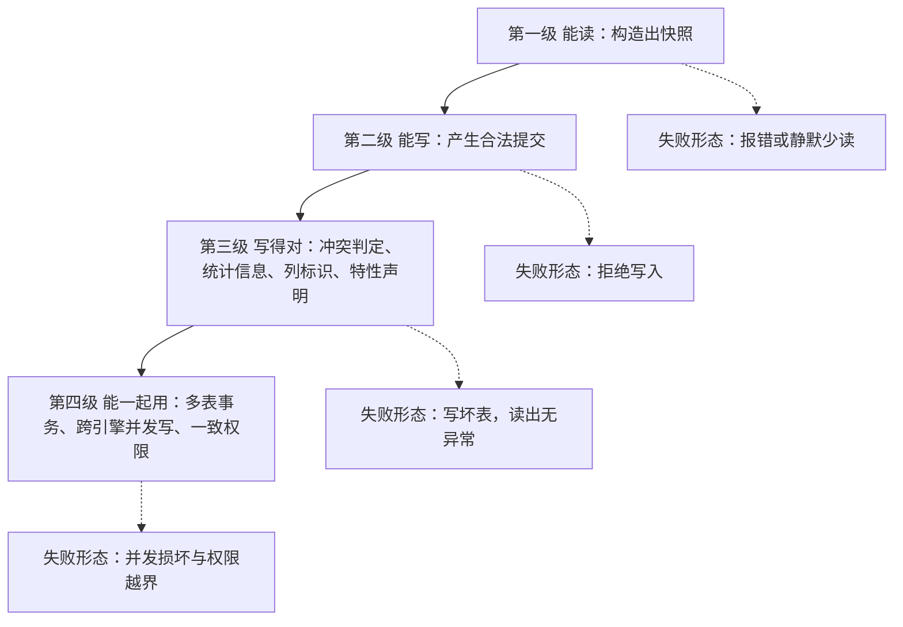

**摘要：**

2025 年 5 月 22 日，Apache Iceberg 社区投票通过 v3 表规范；同一年，Delta Lake 4.0 把 catalogManaged 写进协议，Apache Hudi 的规范文档则随 1.2.0 更新到表版本 9。三条新闻背后是同一个问题：所谓"开放表格式"，开放的到底是什么。本文不写三种格式的全面对比，只从规范开放性这一个视角切入，把"开放"拆成文件格式公开、规范独立于实现、多语言独立实现三层，并指出真正拉开差距的是第三层。为了让"开放"从口号变成可验证的判断，文中给出三个问题：读的实现遵守哪一版规范、写的时候是否遵守提交协议、遇到新特性是拒绝还是静默忽略，三者的共同指向是"别的引擎实现的是不是同一份语义"。全文以一条分层数据管道贯穿，给出六类引擎的读写矩阵并逐格标注版本，解释 Iceberg 把提交点外置成 catalog 为何成为生态广度的杠杆，也交代这份开放的三笔账单：能力不对等、版本碎片与兼容性测试成本。最后落成一张现场可用的三问清单与一组上线前该做完的动作。

---

## 第 1 章 一条读不出来的报表

2025 年 5 月 22 日，Iceberg 社区完成了一次并不喧闹却影响深远的投票：v3 表规范正式被采纳。此后半年里，大大小小的数据平台陆续碰到同一类事故。一个团队把用户行为日志表升级到 v3，用上了行级血缘（row lineage），Spark 侧一切正常，四十八小时后 Trino 上的看板集体失败；另一个团队在 Delta 表上开了删除向量（deletion vector），Databricks 上的作业毫无异样，Hive 里的历史报表却再也跑不出来；还有一个团队把 Hudi 的 MoR 表接进 Trino，查询能返回结果、也不报错，只是金额比 Spark 侧少了三成——Trino 读的是读优化视图，日志文件里的更新被整整齐齐地跳过了。

三种事故，其实是两种失败形态：前两个是显式拒绝，最后一个是静默错读。显式拒绝还算体面，至少失败是可见的；静默错读最危险，因为它在所有监控指标上都表现为"成功"，只在业务口径上表现为"不对"。这三起事故是笔者写这一篇的直接由头：能把三种格式区分开的，从来不是厂商页面上的支持列表，而是另一个问题——**别的引擎实现的是不是同一份语义**。

### 1.1 三个可检验的问题

要回答"同一份语义"，不需要把三份规范逐条读完，只需要在读表和写表两个时刻各问三个问题，并且要求答案落到具体版本上。

问题一：读的实现遵守的是哪一版规范。每张表都在元数据里声明了自己的版本门槛，读的实现要么支持、要么拒绝，中间没有"差不多"的地带。声称"支持 Iceberg"而不说支持到 format-version 几，等同于声称"会开车"而不说会不会开手动挡。

问题二：写的时候是否遵守提交协议。读错了尚且只影响一次查询，写错了会让后面所有引擎都读到错的东西。写者要负责的事情不止"把 Parquet 文件落盘"，还包括冲突判定、统计信息、列标识与特性声明，任何一项失守都不会当场报错。

问题三：遇到不认识的新特性，是拒绝还是静默忽略。这个问题最容易被忽略，却最能区分工程的严谨程度。忽略未知字段是向前兼容的美德，忽略未知特性则是把正确性交给运气，两者之间隔着一整份规范的克制。

### 1.2 层次一：文件格式公开，三者没有差异

把"开放"往下拆的第一层，是数据文件本身用公开格式存放。这一点上三者几乎无差别：Iceberg 的数据文件支持 Parquet、Avro、ORC，清单文件用 Avro；Delta Lake 的数据文件是 Parquet，检查点也是 Parquet；Hudi 的基文件支持 Parquet、ORC 与 HFile，表版本 9 又加入了 Lance；日志文件按块组织，块内容可以是 Avro、Parquet 或 HFile。这些格式都有公开的字节级规范与多个独立实现，任何一家都不构成锁定。

用这一层做选型依据是常见的误区。有人说"Delta 用 Parquet，所以 Delta 是开放的"，这句话本身没错，但它证明的东西太少——把一堆 Parquet 文件拷到另一个目录，并不会自动变成一张可查询的表。文件格式公开解决的是"数据能不能被别的工具打开"，不解决"这些文件按什么规则组成一张表"。

### 1.3 层次二：规范是否独立于实现

第二层是真正开始分岔的地方：表的组织规则是否写在一份与实现无关的文本里。判据有三条，缺一不可——不绑定编程语言，不绑定某个引擎的运行时，并且用规范性的措辞规定读写双方各有什么义务。只有满足这三条，一个只用 Python 的团队才可能只读文档就写出一个合格的读写器。

三者在这一层的起步顺序不同，于是规范文本的气质也不同。Iceberg 的 `format/spec.md` 从一开始就是为"多语言、多引擎"写的，正文里到处是 must、should 与字段级的读写要求表；Delta 的 `PROTOCOL.md` 最早更像是参考实现行为的正式化，条目跟着 Delta Spark 的落地节奏走；Hudi 则长期把格式定义留在 Java 代码里，直到 1.0 才发布一份名为 Technical Specification 的文档，而这份文档自己也承认定位是"给想直接读写存储格式的计算引擎做参考指南"。

### 1.4 层次三：多语言独立实现的成熟度

第三层才是分水岭：有没有足够多的、彼此不共享代码的独立实现，并且它们之间真的互相试装过。笔者喜欢用螺纹来打这个比方。螺纹的牙型角、螺距、公差都写在 ISO 标准里，图纸公开、谁都能查；但一个车间能不能造出与别家螺栓互配的螺母，取决于它有没有按标准加工，更取决于市场上有没有足够多的车间各自按标准生产、并且真的拿对方的件试装过。标准决定"应该互配"，独立实现与互操作测试决定"确实互配"。

对应到表格式上，这一层要看三件事：官方或社区维护了多少种语言的实现，这些实现是不是各自独立写的，以及有没有一个公开的地方能看到每种实现支持到哪一步。三者在这三条上的差距，比前两层加起来还大。

### 1.5 本篇的范围

需要先把边界划清：本篇只讨论规范开放性这一个维度。三种格式在元数据组织、写路径、流式写入上的差异，属于另外两个视角的题目，本文不展开，也不把它们混进来做"综合评分"。同样的道理，本文不会给出"谁更好"的结论，只回答三个更窄的问题——在规范开放性这一维度上，三者各自走到了哪一步，这份开放性换来了什么，又要付出什么。

下图把上述三层与本文的判据放在一起，后面各章依次展开。



---

## 第 2 章 三种规范的出生顺序

规范长成什么样，很大程度上由它出生时的处境决定。三种格式的起点分别落在 2016 年到 2019 年之间，那几年对象存储、Spark、流计算三条线各有各的紧迫问题，于是规范也就长出了三种不同的性格。

### 2.1 Iceberg：先有图纸，再造机器

Iceberg 2018 年由 Netflix 开源，动机是解决 Hive 表模型在多引擎环境下的失灵：分区靠目录、schema 靠 metastore、引擎各自解释目录结构，于是同一张表在不同引擎里能读出不同的结果。既然病根是"没有一份共同的定义"，药方自然就是先写定义——规范先落地，Java 参考实现随后跟进，两者在同一个 Apache 仓库里维护，但规范的读者被默认为"任何语言、任何引擎的实现者"。

这条路线留下了几个可以触摸的痕迹。规范正文用字段级的要求表区分 required、optional 与"v1 可缺、v2 必填"，把兼容性写成一张可查的表，而不是交给实现者揣摩；版本号只有一个整数 `format-version`，语义非常干脆：一旦表声明的版本高于实现支持的版本，实现必须抛出异常。v1 在 2018 年随开源落地，v2 在 2021 年加入行级删除，v3 在 2025 年 5 月通过社区投票，加入了纳秒时间戳、`unknown`、`variant`、`geometry`、`geography` 几种类型，列默认值，多参数分区变换，行级血缘，二进制删除向量与表级加密密钥。元数据分层与快照结构的拆解，可参照 [[大数据/数据湖/Iceberg/02 元数据三层架构——Snapshot、Manifest List 与 Manifest File|元数据三层架构]]。

规范的自我克制在这里体现得很清楚。v3 已经采纳、v4 还在起草（元数据结构重排、自适应元数据树、文件与删除向量合并为一条记录、相对路径、约束表达式），但规范正文明确写着"版本 1、2、3 已完成并被社区采纳，版本 4 正在积极开发、尚未正式采纳"。一份规范能把自己的成熟度标到这么细，本身就是 spec-first 文化的产物。

### 2.2 Delta：先有机器，再把机器的行为写成协议

Delta Lake 2019 年由 Databricks 开源，出发点是把数据湖上的写入做成事务性的，让 Parquet 目录具备 ACID 与时间旅行。它的协议文档 `PROTOCOL.md` 与实现同仓维护，措辞同样严谨，但设计目标里有一句决定了它后来所有取舍的话：**自描述（self describing）**——表的所有元数据都与数据放在一起，读一张表不需要额外的元数据服务，静态表可以用文件系统工具直接搬走。

这句话是优点，也是**路径依赖**。提交点因此落在 `_delta_log` 目录，靠对象存储的"键不存在才写入成功"原语实现原子性；并发冲突靠写者读当前版本、尝试写下一个版本号来判定。协议演进规则也随之定型：未知的 action、字段、metadata domain 必须被忽略，但表特性（table features）必须被理解——前者保证向前兼容，后者保证正确性。协议版本是两套账：`minReaderVersion` 从 1 到 3，`minWriterVersion` 从 2 到 7，再叠加一张特性名单，`columnMapping`、`deletionVectors`、`v2Checkpoint`、`rowTracking`、`variantType`、`catalogManaged`、`icebergCompatV1/V2` 等都在名单上，且明确标注属于读者、写者还是两者。

2025 年的 Delta 4.0 补上了这块拼图里最关键的一角：catalog-managed tables。表特性 `catalogManaged` 把"提交是否成功"的裁判权交给 catalog，协议甚至规定这类表不支持文件系统直读直写，以免绕过 catalog 把表写坏。不过协议紧接着声明，它不规定 catalog 与客户端之间的 API——每个 catalog 自己定义自己的规格。

### 2.3 Hudi：先有车间，十年后补图纸

Hudi 2016 年起源于 Uber，要解决的是把数据库的更新语义搬到 Hadoop 上：主键、索引、增量拉取、写时合并与读时合并。它的格式最早完全由 Java 代码定义——`org.apache.hudi.common.model` 这些包里的类就是格式本身，表怎么组织、日志块怎么编码、时间线怎么存放，都以代码行为为准。这条路线的性格可以概括成**代码即格式**：语义最完整，也最难被别的语言复述。

这条路线的优点是落地快、语义完整；代价是别的语言想实现一个 Hudi 读器，实际上得读懂一份 Java 实现。1.0 版本改变了这一点：Hudi 发布了 Technical Specification 1.0，把存储布局、日志文件格式（从魔数 `#HUDI#` 开始逐字节描述块头、头尾元数据与块长度）、表配置项、列统计、索引版本、时间线布局都写成了文档。文档最后更新于 2026 年 8 月，口径是 Hudi 1.2.0（2026 年 5 月发布）与表版本 9。

但这份规范有两个与生俱来的特征。其一，它由 `hoodie.*` 配置项组织，读者要先接受一整套 Java 侧的命名体系；其二，兼容性由 `hoodie.table.version` 单调递增来保证，规范里写得很直白：新读者能读旧表，旧读者不保证能读新表的新特性，所以升级顺序必须是先升读者、再升写者。表版本 8 在 1.0.0 引入，表版本 9 在 1.1.0 引入，1.2.0 继续沿用。

### 2.4 三种治理结构，三种后果

把三种出身放在一张表里对照，会看到规范文本与实现之间的关系差异。

| 维度 | Apache Iceberg | Delta Lake | Apache Hudi |
|---|---|---|---|
| 规范载体 | 仓库内 `format/spec.md`，字段级读写要求表 | 仓库内 `PROTOCOL.md`，版本与特性清单 | Technical Specification 文档，随版本更新 |
| 版本编号 | `format-version` 1 / 2 / 3，v4 起草中 | `minReaderVersion` 1–3、`minWriterVersion` 2–7，加表特性 | `hoodie.table.version` 8 / 9 |
| 规范与实现的先后 | 规范先行，Java 为参考实现 | 实现先行，协议随后正式化 | 代码即格式，1.0 起补文档 |
| 兼容性判据 | 表版本高于实现支持则必须抛异常 | 未知字段忽略，表特性必须拒绝 | 表版本单调递增，读者先升级 |
| 治理方式 | Apache 社区投票 | Linux Foundation 项目，与参考实现同仓演进 | Apache 社区，规范与代码同仓 |
| 规范的自我定位 | 面向所有实现的标准 | 面向所有 Delta 客户端的协议 | 面向计算引擎的参考指南 |

三种结构的后果都很具体。规范先行意味着"规范可能写早、写错"，代价是规范与实现之间持续存在时差；实现先行意味着规范一定可落地，代价是规范容易退化成"某个实现的说明书"；代码先行意味着语义最扎实，代价是别人要理解它，得先把代码读一遍。

> [!info] 版本与归属口径
> 本文涉及的 Iceberg 事实以 `apache/iceberg` 仓库的 `format/spec.md` 与 1.12.0 文档为准，Delta 事实以 `delta-io/delta` 仓库的 `PROTOCOL.md` 与 4.x 文档为准，Hudi 事实以 Technical Specification 1.0（表版本 9，对应 Hudi 1.2.0）与 1.2.x 文档为准。开源项目能力与商业平台能力需要分开看：Delta 的 catalogManaged 是协议特性，真正托管这类表的 Unity Catalog 服务属于商业产品（其内核另有开源版本，需分开计算）；Polaris、Snowflake Open Catalog、AWS S3 Tables 各自是独立的开源项目或云服务，不能笼统算作"Iceberg 的能力"。

---

## 第 3 章 判据一：读的实现遵守哪一版规范

三个可检验问题里的第一个，看似最容易回答，实际最容易含糊。引擎文档上写着"支持 Iceberg"，却没有说支持到 v2 还是 v3；连接器仓库的 README 上写着"支持 Delta"，却没有说 reader version 到几。字符串级别的"支持"在跨版本的表面前毫无意义，真正能拿来做判据的，是元数据里的版本声明加上实现的拒绝行为。

### 3.1 版本号写在哪里

三种格式都把版本声明放在元数据里，只是字段形态不同。下面三段是笔者在排障现场最常打开的三个位置。

```text
# Iceberg：表级元数据 JSON 里的单个整数，v3 起还要求维护 next-row-id
{"format-version": 3, "table-uuid": "...", "next-row-id": 1048576, ...}

# Delta：protocol action 里两套账，reader 3 + writer 7 之后再加特性名单
{"protocol": {"minReaderVersion": 3, "minWriterVersion": 7,
              "readerFeatures": ["deletionVectors", "columnMapping"],
              "writerFeatures": ["deletionVectors", "columnMapping", "appendOnly"]}}

# Hudi：hoodie.properties 里的表版本，兼容性由它单调递增保证
hoodie.table.version=9
hoodie.table.initial.version=8
```

字段形态的差异会直接改变排障方式。Iceberg 只回答一个问题：这张表需要第几版规范；Delta 回答三个问题：读者要到第几版、写者要到第几版、具体启用了哪些特性；Hudi 回答一个问题但答案的含义更宽：这张表整体处在第几代存储格式上，读者要支持到这一代才能完整解释它。

### 3.2 看不懂的时候怎么办

规范对"版本不认识"的处理方式，决定了失败是可见还是隐蔽。

Iceberg 的规定最硬：`format-version` 是必填字段，实现必须支持表声明的版本，一旦表声明的版本高于实现支持的版本，**必须抛异常**。这条规则把"不支持"变成了确定性事件，排障时看到异常就知道是版本问题，不需要怀疑数据。

Delta 把规则拆成两句方向相反的话：客户端必须忽略不认识的 action、字段与 metadata domain，因为破坏性变更一定会伴随版本升级或特性新增，所以不认识的东西一定不是正确解读这张表所必需的；但客户端不得忽略表特性，特性是表明确声明"你必须理解我"的部分，读一张表就要实现并遵守 `readerFeatures` 里的每一条，写一张表则要同时满足读者特性与写者特性。前一句保向前兼容，后一句保正确性，中间靠"特性清单"这道闸门分开。

Hudi 的规则藏在表版本与特性标志的组合里。规范写明新读者能读旧表，旧读者不保证能读新特性，因此升级顺序是先读者后写者。更微妙的一处是它对逻辑类型的处理：表版本 9 引入了若干 Hudi 自有逻辑类型，规范明确说这些类型对不认识的读写者是透明的——它们看到的是底层物理 Avro 类型。这是一个刻意的向前兼容设计，代价读者要自己承担：一个不理解逻辑类型的读器不会报错，只会把值当成底层类型读出来。

### 3.3 三个动作，验证第一个问题

把版本判据做成可执行的检查，排障时按顺序做三步即可。

```bash
# 1. 先读版本声明，别先看引擎文档
aws s3 cp s3://bucket/warehouse/db/events/metadata/v3.metadata.json - | jq '."format-version"'
aws s3 cp s3://bucket/warehouse/db/orders/_delta_log/00000000000000000000.json - | jq '.protocol'
aws s3 cp s3://bucket/warehouse/db/hudi_trips/.hoodie/hoodie.properties - | grep table.version

# 2. 查实现的白名单而不是宣传语：连接器仓库里的 TableFeatures / 特性开关
# 3. 用只读账号做一次"只读一张老快照"的验证，观察是报错还是返回
```

第二步值得展开。成熟的实现通常维护两份白名单，读侧一份、写侧一份，白名单之外的特性一律拒绝。Delta 的 Trino 连接器就是典型：`v2Checkpoint` 只在读侧白名单里，意味着它能读用 V2 检查点写的表，但不能写这种表；一旦上游某个连接器默认把 `v2Checkpoint` 写进 `writerFeatures`，这张表在 Trino 侧就变成了"能读不能写"。这类行为不会写进宣传语，只会写进代码或文档的角落。

### 3.4 兼容窗口的三种形状

三种格式的兼容窗口形状不同，运维含义也不同。

| 判据 | Iceberg | Delta Lake | Hudi |
|---|---|---|---|
| 版本变量 | 单个整数 `format-version` | reader/writer 两个整数加特性集合 | 单个整数 `hoodie.table.version` |
| 升级方向 | 表版本只升不降，写入时声明 | 协议只升不降，特性不可随意移除 | 表版本单调递增 |
| 读旧表 | 支持，v1 元数据可留在 v2/v3 表中 | 支持，向后兼容靠检查点与 action 忽略 | 支持，新读者读旧表 |
| 读新表 | 版本高于支持则必须抛异常 | 缺少任一 readerFeature 必须拒绝 | 旧读者可能读不了新特性 |
| 字段严格度 | 元数据 JSON 严格，manifest 宽松 | action 字段宽松，特性严格 | 表配置缺失即视为不合法 |
| 谁先升级 | 一般先读后写 | 一般先读后写 | 规范明确要求先读后写 |

Iceberg 在"字段严格度"上有一个容易被忽略的设计：规范允许 v1 的 manifest 留在 v2/v3 表中，读的时候把缺失字段按默认值补齐，但对元数据 JSON 反而更严格，因为 JSON 文件不会被复用、一定与表版本匹配。这条区分说明**宽容是有选择的**——宽容留给"为了免去重写历史元数据"的地方，严格留给"一定会被重新生成"的地方。

### 3.5 误读版本声明的后果

最常见的误读，是把 `format-version` 理解成"底层文件格式的版本"，以为升级只是多几个字段。实际后果要严重得多：v3 的行级血缘要求写者在写数据文件时维护 `_row_id` 与 `_last_updated_sequence_number` 两个行字段，并由快照的 `first-row-id` 与表的 `next-row-id` 做继承赋值。一个只按 v2 语义写的写者，即使能写出 v3 表声明，写出来的行也不含可用的血缘，后续基于血缘做增量物化的管道会拿到一堆空值。规范对这类越界有防御：写者不得提交分区变换未知的 manifest，读的实现遇到更高版本必须拒绝。但如果某个中间层把异常吞掉、退回按物理列名匹配，错误就会从"报错"退化成"少几列"。

下图把读表时的协商顺序画成一条判定链，三个问题里的第一个与第三个都在其中。



---

## 第 4 章 判据二：写的时候是否遵守提交协议

第二个问题问的是写者。它比第一个问题难回答得多，因为读错了顶多一次查询结果不对，写错了会把错误固化进表，让后面所有引擎一起读错。更麻烦的是，写者的大部分失守在写入侧都表现为"成功"。

### 4.1 三种提交点，三种目录

三种格式的提交点落在不同位置，从表目录的布局就能看出来。

```text
# Iceberg：提交点是 catalog 里的一根指针，指向某个 metadata.json
warehouse/db/events/
  metadata/00001-<uuid>.metadata.json      # 每次提交生成新文件
  metadata/snap-<id>-1-<uuid>.avro         # manifest list
  data/...                                   # 数据文件

# Delta：提交点是 _delta_log 里按版本号递增的 JSON 文件
warehouse/db/orders/
  _delta_log/00000000000000000000.json      # 第 0 版提交
  _delta_log/00000000000000000001.json
  _delta_log/00000000000000000002.checkpoint.parquet
  part-00000-<uuid>.parquet

# Hudi：提交点是 .hoodie/timeline 里的 instant 文件
warehouse/db/trips/
  .hoodie/hoodie.properties
  .hoodie/timeline/20251118093015123.commit
  .hoodie/timeline/20251118093015123.commit.requested
  <partition>/<fileId>_<instant>.parquet
```

目录布局本身就是设计文档。Iceberg 的目录里只有"文件"，没有"当前状态"——当前状态存在 catalog 里；Delta 与 Hudi 的目录里都带着"当前状态"的线索，前者是编号最大的那个 JSON，后者是已完成状态的 instant。

### 4.2 Iceberg：把提交点外置

Iceberg 规范里有一段话，决定了它整个生态的形状。

> The atomic operation used to commit metadata depends on how tables are tracked and is not standardized by this spec.

规范只是规定了元数据长什么样、提交冲突如何解决、失败后如何重试，至于"怎么把指针从旧版本换到新版本"，交给你用的 catalog。规范随后给了两个示例：文件系统表用原子重命名实现 `v<V>.metadata.json` 的换代，metastore 表用 check-and-put 交换指针。紧接着又补了一刀：文件系统方案已废弃，将在 v4 中移除，理由是它在对象存储与本地文件系统上不安全。

这段设计在工程上是一步险棋，也是一步好棋。险在于它把表格式的可用性绑定在 catalog 的实现质量上，catalog 单点、catalog 权限、catalog 的并发能力都会变成表的问题；好在它把"提交"变成了一件可替换的事。Hive metastore 能做，JDBC 能做，AWS Glue 能做，自研的 REST 服务也能做，换 catalog 不影响表本身，读取方只要实现一次 catalog 客户端就能接上所有后端。后面第 7 章会展开，这条外置的提交点正是 Iceberg 生态广度的杠杆。

冲突处理也写进了规范：追加操作没有前置条件，永远可以基于新版本重试；替换操作要验证被删的文件仍在表中；删除操作要验证目标文件仍在；schema 与分区变更要验证基版本以来没被改过。这套规则是**规范给语义、实现给机制**的分工样板，并发控制在具体实现里如何落地，可参照 [[大数据/数据湖/Iceberg/04 事务与并发控制——乐观锁与 Optimistic Concurrency|事务与并发控制]]。

### 4.3 Delta：提交点在存储层，catalogManaged 是后补的一课

Delta 的起点是另一条路。因为要 self-describing，提交点必须跟着数据走，于是 `_delta_log` 里编号连续的 JSON 文件成了表的真相；写者读完当前版本，尝试写下一个版本的文件，成功即提交，失败即冲突，重读、重试、重判。

这条路径的优点在跨组织共享时特别明显：把整个目录拷给另一个团队，对方不需要任何元数据服务就能读；缺点也很清楚，提交原子性依赖存储层的"键不存在才可写"原语，而对象存储的这类原语在历史上并不总是可靠，于是很多生产事故最终都归结为"某个写者没走这条原语"。

2025 年的 catalogManaged 是对这个缺口的正式回应。协议规定这类表由 catalog 仲裁提交：客户端把一组 action 提交给 catalog，由 catalog 决定哪个写入者赢，赢家的提交被"批准"（ratified），随后发布（publish）到 `_delta_log`；文件系统直读直写被明确禁止，因为绕过 catalog 会同时写坏表和 catalog。但协议同时留了白：它不规定客户端与 catalog 之间的 API，每个 catalog 自己定规格。这意味着"catalog 仲裁"解决了原子性的机制问题，却没有解决"不同 catalog 之间能否互换"的协议问题。这一点是 Iceberg 与 Delta 在开放性上最大的分水岭，第 7 章详述。

### 4.4 Hudi：timeline 就是提交点

Hudi 的提交点在 `.hoodie/timeline` 下的 instant 文件里。一次提交在时间线上留下 requested、inflight、completed 三个状态的文件，1.0 之后时间线改用 LSM 树组织，instant 元数据统一用 Avro 序列化，完成态带完成时间；表服务（compaction、clustering、clean）也要在时间线上留下自己的 instant。时间线的读写细节可参照 [[大数据/数据湖/Hudi/03 Timeline 机制——Hudi 事务与增量语义的核心|Hudi Timeline 机制]]。写者要做的第一件事是理解这条时间线，而不是理解目录。

这带来一个常被低估的约束：跨引擎写 Hudi 表，等于要求那个引擎实现一整套与时间线、文件组、索引、表服务协同的写协议。这也是为什么 Hudi 的写能力长期集中在 Spark 与 Flink 两条 JVM 线上，其他引擎即便提供写入，也多是有限形式。

### 4.5 跨引擎写的三种失败形态

写者失守的后果可以分成三类，恰好对应第 1 章开头那三起事故。

第一类是显式拒绝，最好的一类。Delta 的 `writerFeatures` 就是这种机制：某个写者不理解表上的某个写者特性，就直接拒绝写入，不会留下半成品。

第二类是静默降级，Hudi 的读优化查询是典型。MoR 表的读优化视图只读基文件、跳过日志文件，返回的是某个更早状态的快照。它在接口上完全合法，在语义上却是"少读了增量"，而查询方拿不到任何提示。把这种视图接到 BI 看板上，指标会稳定地偏小，且随时间推移偏差越来越大。

第三类是写坏。ClickHouse 写 Iceberg 是一个很具体的例子：它的文档承认，若开启某些 Parquet 自定义编码开关，写出的文件不会带 Parquet 字段 ID，而 Spark 一类引擎是按字段 ID 读列的，结果就是别的引擎读这张表时列错位。同一份文档还写明 ClickHouse 会把 `Int8`、`UInt8`、`Int16`、`UInt16` 拓宽成 Iceberg 的 `int`，读回来变成 `Int32`；它不支持写 `FixedString`、`Time`、`Time64`；删除向量只读不写；`ALTER TABLE ... DELETE/UPDATE` 不支持 v3 表；连 `OPTIMIZE TABLE ... MANIFEST` 这种维护动作，也明确在 v3 表上失败，原因是 v3 的行级血缘首行 ID 还没有在 manifest 重写里往返。

DuckDB 的写限制是另一类证据：1.4.0 起支持建表与插入，1.4.2 起支持 DELETE 与 UPDATE，但只写位置删除、只支持 merge-on-read，且写入仅限未分区、未排序的表——对分区表做插入、更新、删除都会直接报错；写入还必须经过 REST catalog，不能用路径直连。这些限制谈不上缺陷，只是"规范开放、实现按需推进"的常态。它们共同说明一件事：**能写不等于写得对，写得对也不等于写全**。

下表把三种提交点放在一起对照。

| 维度 | Iceberg | Delta Lake | Hudi |
|---|---|---|---|
| 提交点位置 | catalog 持有的 metadata 指针 | `_delta_log` 下按版本递增的 JSON | `.hoodie/timeline` 下的 instant |
| 原子性来源 | catalog 的 check-and-put / REST 服务端 | 存储层键不存在才可写 | 时间线 instant 状态推进 |
| 规范是否定义提交机制 | 否，明确交给 catalog，文件系统方案 v4 移除 | 默认定义文件系统方案，catalogManaged 另立一节 | 定义时间线与 instant 状态机 |
| 无元数据服务能否读 | 可以，但文件系统 catalog 已不推荐 | 可以，这是 self-describing 的核心收益 | 可以，base path 加 `.hoodie` 即可 |
| 跨表事务 | v3 多表事务，REST 有 transactions/commit 端点 | catalogManaged 由 catalog 编排 | 无标准化机制 |
| 主要失败形态 | 版本拒绝、catalog 不可用 | 版本或特性拒绝、直读被禁 | 读优化视图静默少读 |

下面这张时序图把 Iceberg 的提交流程单独画出来，另外两种格式的差异集中在"谁来判定冲突"这一步。



---

## 第 5 章 判据三：多语言独立实现的成熟度

第三个问题问的是生态。规范写得再漂亮，如果只有一个语言能实现，那它仍然是一种绑定，只是绑定的对象从引擎换成了语言。判断这一层，需要三个证据：官方维护了哪些语言的实现，这些实现是不是真的独立，以及有没有公开的地方能看到它们各自支持到哪一步。

### 5.1 什么算独立实现

笔者用三条标准来卡：不共享参考实现的代码，只依赖公开的规范与文件格式；能独立完成读与写，而不是只做只读外壳；有跨实现的互操作测试，最好能读到公开的测试结果。

按这三条，三种格式的实现生态呈现出清晰的梯度。Iceberg 官方仓库之外，还有 Python、Rust、Go、C++ 四个 Apache 顶级项目下的实现，加上 Trino、DuckDB 这类在引擎里直接按规范写的实现；Delta 有 Spark 参考实现、Delta Kernel 这一层共享库、独立维护的 delta-rs，以及 Trino 自研的一套；Hudi 的实现长期围绕 `hudi-common` 这个 Java 核心展开，Spark、Flink、Trino 的连接器都在复用它，独立的非 JVM 实现要等到 hudi-rs。

### 5.2 Iceberg：四种语言，各自实现，公开对表

Iceberg 的实现清单可以列得很具体。Java 是参考实现，当前文档版本 1.12.0；Python 侧是 PyIceberg，定位是"Iceberg 表规范的一个 Python 实现"，既读元数据也读写数据；Rust 侧是 iceberg-rust，组件里有 catalog-rest、catalog-glue、catalog-hms、catalog-sql、catalog-s3tables 这些独立 crate，说明它不仅实现表格式，也把 catalog 客户端分开实现了；Go 侧是 iceberg-go，README 里直接列了读写操作的支持清单，从追加、覆盖、重写文件到位置删除、等值删除逐项打勾；C++ 侧是 iceberg-cpp，2026 年 1 月发布 0.2.0，社区自己的生态页把它标注为早期阶段。

更关键的是有一张公开的对照表。Iceberg 官网的 status 页按实现列出特性支持情况，Spark、Flink、Hive、Trino、PyIceberg、IcebergRust、IcebergGo 等各自一格，可以横向看到某个特性在哪个实现里已经可用。这张表的意义不在于它有多完整，而在于它把"支持"从宣传语变成了可核对的状态。

引擎侧还有一批"不依赖上述实现"的独立实现。Trino 的 Iceberg 连接器是 Java 自研；DuckDB 的 iceberg 扩展是 C++ 按规范实现，1.4.0 起支持完整读取与初步写入，1.4.2 起支持对 v2 表的删除与更新。这些实现的存在，反过来给官方实现施加了压力：规范含糊的地方，会立刻表现为两个实现读出不同结果。

### 5.3 Delta：参考实现、共享内核与独立实现三条线

Delta 的实现格局更像三层同心圆。最内层是 `delta-spark`，作为参考实现把规范逐条落地；中间层是 Delta Kernel，用 Java 与 Rust 提供一套"解析日志、构造快照、规划扫描、提交写入"的库，引擎只需实现读文件、写文件与执行计划；最外层是独立实现，delta-rs 用 Rust 另写一套并覆盖高层 DML，Trino 的连接器也自己维护日志解析与特性白名单。

Kernel 这一层的价值与代价同样明显。价值在于把最容易写错的解析逻辑收拢到一处，DuckDB、ClickHouse、Flink 这些连接器都建在它上面，于是"能读"的门槛被大幅拉低；代价在于 Kernel 的能力上限就是所有下游连接器的上限。Kernel 的写路径长期只支持盲追加，基于它的连接器也就只能在追加这个范围内写。这是一种**用共享实现换实现一致性**的策略，与 Iceberg 的"各自独立实现、靠规范与测试对齐"是两条不同的路。

### 5.4 Hudi：JVM 中心，hudi-rs 是新变量

Hudi 的实现生态长期以 JVM 为中心。Spark 与 Flink 是一等公民，Trino 的 Hudi 连接器依赖 Hudi 的 Java 库来解析时间线与文件切片，Hive 侧走 `HoodieParquetInputFormat`。这套结构的优点是语义一致——大家用的是同一份元数据解析代码；缺点是任何非 JVM 引擎想接进来，要么走 JNI，要么重写。

hudi-rs 改变了这个局面。这个 Apache 项目在 2026 年 11 月发布 0.6.0，公告的标题是"来自 Rust 与 Python 的原生写入"，读侧支持快照查询、时间旅行、增量查询与流式读，并且能读 Hudi 元数据表的各个分区；`hudi-ffi` 还提供了基于 Arrow C Data Interface 的 C ABI，供其他引擎嵌入。它有自己的 reader-spec 文档，把读选项与行为保证写了下来。这是一个独立实现该有的样子，只是时间点偏晚，版本号还在 0.x。

### 5.5 互操作测试的组织方式

三种格式对"如何证明互操作"的组织方式也不同，这直接影响使用者的验证成本。

| 语言或形态 | Iceberg | Delta Lake | Hudi |
|---|---|---|---|
| Java | 参考实现 1.12.0 | delta-spark 4.x | hudi-common 与各 bundle |
| Python | PyIceberg | delta-rs 的 Python 绑定 | hudi-rs 0.6 的 Python 绑定 |
| Rust | iceberg-rust | delta-rs；delta-kernel-rs | hudi-rs |
| Go | iceberg-go | 无官方实现 | 无官方实现 |
| C++ | iceberg-cpp 0.2，早期阶段 | 无独立实现，可经 Kernel 的 C 接口 | hudi-ffi 提供 C ABI |
| 引擎内自研实现 | Trino、DuckDB 等 | Trino、delta-rs | Trino 复用 Hudi Java 库 |
| 公开支持矩阵 | 官网 status 页按实现列特性 | 各连接器各自的特性白名单 | 表版本与规范文档 |

三种组织的差别，在事故复盘时最明显。Iceberg 的问题通常表现为"某个实现的支持矩阵里这一格是空的"，顺着 status 页能找到替代方案；Delta 的问题通常表现为"连接器的白名单里没有这条特性"，要看具体连接器的代码或文档；Hudi 的问题通常表现为"表版本升上去了，某个读者还没跟上"，只能等或者降级重建。三种排查路径的确定性与成本完全不同。

下面的图把规范层与实现层的关系画出来，可以看到 Delta 的 Kernel 是一个"横向共享层"，而 Iceberg 是"多份实现各自垂直落地"。



---

## 第 6 章 支持矩阵：把版本号钉在每一格上

前面三章讨论的是判据，本章把判据落成矩阵。矩阵像一张地铁线路图，标出哪些站可以到，却不标首末班车时间与换乘要多久；读到"是"只完成了一半判断，另一半在限定条件里。这里的每一格都必须带版本，否则半年后就会变成错误陈述——三种格式的连接器各自独立演进，"某引擎支持某格式"这种说法在时间维度上几乎必然失效。

### 6.1 读矩阵

先看读。读的能力最先普及，也最先被误认为"互操作"。

| 引擎与版本 | Iceberg | Delta Lake | Hudi |
|---|---|---|---|
| Spark 4.x | 是，Iceberg 1.12 官方连接器 | 是，delta-spark 4.x | 是，hudi-spark4.0-bundle（Hudi 1.1 起） |
| Trino 484 | 是 | 是，373 起原生支持 | 是，仅 COW 快照查询与 MOR 读优化查询，且需 HMS |
| Flink 2.x | 是，官方连接器 | 否，Delta 仓库的 Flink 连接器当前为 sink-only | 是，hudi-flink 1.2.x 支持流式读与增量读 |
| Hive 4.0 | 是，经 StorageHandler | 是，delta-hive 只读，能力停在较早的读者版本 | 是，经 HoodieParquetInputFormat |
| DuckDB 1.4.2 | 是，iceberg 扩展 | 是，delta 扩展（经 Delta Kernel） | 否 |
| ClickHouse 25.x | 是 | 是，DeltaLake 表引擎 | 否 |

表里最容易被跳过的一格是 Trino 读 Hudi。它"能读"，但读的是读优化视图，MOR 表的日志文件不会被合并进来；要读完整快照，得换引擎。这不是 Trino 的疏忽——在 Trino 侧实现 MoR 快照合并，等于把 Hudi 的合并逻辑搬进查询引擎，代价与收益不成比例。矩阵里写"是"很容易，写清"是哪个语义"才是工作量的所在。

Flink 读 Delta 这一格也值得单独说。Delta 仓库里的 Flink 连接器长期是 sink-only，只能写不能读，很多团队的"流批一体"方案因此绕回 Spark 微批。这说明矩阵有时效：它记的是某个时点上各实现的进度快照，过期就会失真。

### 6.2 写矩阵

写的能力分化更大，而且每一格都要附带限定条件。

| 引擎与版本 | Iceberg | Delta Lake | Hudi |
|---|---|---|---|
| Spark 4.x | 是，参考实现，DDL 与 MERGE 齐全 | 是，参考实现 | 是，含表服务 |
| Trino 484 | 是，v3 支持标注为实验性 | 是，含 INSERT / UPDATE / DELETE / MERGE | 否 |
| Flink 2.x | 是，含 upsert 与等值删除转删除向量 | 是，sink-only，单全局提交者 | 是，支持 upsert 与部分更新 |
| Hive 4.0 | 是，CRUD 仅限 v1 表且 DML 只能用 Tez | 否 | 否 |
| DuckDB 1.4.2 | 是，仅 merge-on-read、仅未分区未排序表可写、必须走 REST catalog | 是，经 Kernel 仅支持追加 | 否 |
| ClickHouse 25.x | 实验，需开关，且 v3 表的部分 DDL 不支持 | 实验，25.10 起支持，仅 INSERT | 否 |

把两张表并排看，会得到一个与"支持列表"直觉相反的结论：写矩阵的空格远多于读矩阵，而写矩阵里写着"是"的格子，限定条件又往往比格式本身更影响可用性。Hive 写 Iceberg 那一格尤其典型——能写，但 CRUD 只覆盖 v1 表，DML 只能用 Tez 执行引擎。一个只看"支持写"三个字的团队，很可能在真跑起来的第二天才发现自己的表是 v2。

### 6.3 版本敏感性：同一句话在两年内会反转

矩阵必须带版本的理由，可以举三个具体的例子。

Trino 对 Delta 的支持，在 373 之前是只读，373 之后原生读写；如果有人照着 2021 年的资料做选型，会得出完全相反的结论。DuckDB 对 Iceberg 的写支持，在 1.4.0 之前不存在，1.4.0 只支持建表与追加，1.4.2 才补上删除与更新；同一份"支持写入"的说法，在三个版本上对应三种完全不同的能力。ClickHouse 对 Delta 的写入在 25.10 才开放，且要打开实验开关、表必须事先存在、只支持 S3 与 GCS。

版本敏感性还有一层含义：表自身的版本与引擎的版本是两个维度。一张 v2 的 Iceberg 表配 Trino 484 可以工作得很好，一张 v3 表配同一个 Trino 就会被标注为实验性支持；引擎没变，表变了，结论就变了。做选型时把这两个维度压成一句话，是后面所有误判的源头。

### 6.4 矩阵之外的三条隐含依赖

矩阵的格子之外，还有三条依赖不会写进表格，却决定了方案能不能落地。

第一是元数据服务依赖。Trino 读 Hudi 需要 Hive metastore，Hive 读 Delta 需要外部表定义与输入格式配置，Iceberg 走 REST catalog 则需要一个能提供凭证与并发仲裁的服务端。这些依赖不是格式的一部分，却是部署的一部分。

第二是文件系统与存储原语依赖。Delta 的提交依赖"键不存在才可写"，Iceberg 的 catalog 方案在对象存储上更稳妥而文件系统方案已被废弃，Hudi 的表服务对文件列举有较强依赖。换存储时，先受影响的往往不是读写性能，而是提交能否成功。

第三是连接器版本与引擎版本的耦合。同一引擎的不同小版本，连接器可能换了实现路线：基于 Kernel 的与自研的，读同一张表的行为可能不同。矩阵里写"Trino 484"而不是"Trino"，就是为了避免这层耦合被抹平。

---

## 第 7 章 Catalog：生态广度的杠杆

到这里可以回答一个更宏观的问题：同样是把规范公开，为什么 Iceberg 的生态广度看起来更高？答案不在表格式的细节里，而在它把"提交点"外置成了一个可插拔的组件——catalog。这件事的战略价值，比任何单个特性都大。

### 7.1 Catalog 到底在做什么

把 catalog 的职责拆开，有四件事：把表名解析成元数据位置；为提交提供原子性仲裁；向客户端下发访问存储所需的凭证；承载权限与策略。四件事里只有第二件与表格式强相关，其余三件都是平台能力。Iceberg 的设计选择是把四件事一起交给 catalog 抽象，表格式本身只规定元数据的形状与冲突规则。

这个选择带来的直接后果是：表格式的开放性可以借 catalog 的开放性放大。换一个 catalog 实现，不需要换表格式；接一个新的计算引擎，只需要实现一个 catalog 客户端。

### 7.2 REST 协议把这种外置制度化了

Iceberg 的 REST Catalog 协议是一份 OpenAPI 3.1.1 文档，第一版就明确了目标——"任何 Iceberg catalog 的通用 API"，让新语言与新引擎只需实现一次客户端就能支持任何 catalog，同时把冲突解决、元数据版本升级、凭证下发、多表提交这些工作收到服务端。

协议的端点清单能说明它的野心。`/v1/config` 返回 defaults、overrides 与 endpoints 三个字段，其中 endpoints 让服务端声明自己支持哪些端点，客户端据此做能力协商；`/v1/{prefix}/namespaces/{namespace}/tables/{table}` 负责表的读取与提交；`/v1/{prefix}/namespaces/{namespace}/tables/{table}/credentials` 负责凭证下发，配合 `X-Iceberg-Access-Delegation` 头决定是由服务端直接下发短期凭证，还是只做远程签名、把换凭证的动作留给客户端；`/v1/{prefix}/namespaces/{namespace}/tables/{table}/plan` 与 `tasks` 把扫描规划搬到服务端；`/v1/{prefix}/transactions/commit` 支持跨表提交；此外还有 `register`、`rename`、`metrics`、`views` 与 OAuth 端点。

这一套端点的意义不在于数量，而在于它把"引擎与 catalog 之间怎么说话"也标准化了。引擎作者不需要为 Hive metastore 写一套、为 Glue 写一套、为自研服务再写一套；catalog 作者也不需要为每个引擎适配一遍。组合数从"引擎数乘 catalog 数"降到了**引擎数加 catalog 数**，这是典型的网络效应。AWS Glue、Apache Polaris、Snowflake Open Catalog、S3 Tables、Nessie 这些形态各异的实现能共存，靠的就是这条共同的协议线。

需要区分开源与商业的部分：Polaris 是 Apache 孵化项目（1.0.0-incubating 于 2025 年 7 月发布），Snowflake Open Catalog 是它的托管服务形态，AWS S3 Tables 是云服务，Unity Catalog 的 Iceberg REST 接口则横跨开源与商业两条线。同为"REST catalog"，治理主体与可用性承诺完全不同。

### 7.3 对照：Delta 与 Hudi 的 catalog 位置

Delta 的默认设计里没有 catalog 这个角色。self-describing 的目标就是把元数据放在数据旁边，读表不需要额外服务；提交点因此落在 `_delta_log`，原子性靠存储原语。这条路在单引擎、单团队时极其省心，但在多引擎、多组织时就要补课。

补课分两条线。一条是协议线：catalogManaged 让 catalog 成为提交的裁判者，同时禁止文件系统直读直写。这是把提交点外置的正确方向，但协议只规定表侧义务，不规定 catalog 客户端与服务端之间的 API。换句话说，它让"由 catalog 仲裁"成为可能，却没有让"任意 catalog 与任意引擎互换"成为可能。另一条是格式线：UniForm（`icebergCompatV1`、`icebergCompatV2` 两个写者特性）让 Delta 写表时顺带写出一份 Iceberg 元数据，于是 Iceberg 生态的引擎能读这张表。这是互操作，但不是协议互通——读的仍然是另一份元数据，只是那份元数据被顺手写出来了，写入侧的语义与更新频率都受 Delta 写者控制。

Hudi 的对应物更弱一些。它靠 HMS 同步把表登记到 Hive metastore，靠 Flink 侧的 Hudi Catalog 提供 SQL 层的表管理，没有一个跨引擎的 catalog 协议。这也解释了为什么 Hudi 的生态位置更靠近"写路径"而不是"查询联邦"：它的强项在把变更高效写进去，而不在让尽可能多的引擎以同一份语义读出来。

| 能力 | Iceberg | Delta Lake | Hudi |
|---|---|---|---|
| 标准化 catalog 协议 | 有，REST OpenAPI，含能力协商 | 无，catalogManaged 只定义表侧义务 | 无 |
| 提交仲裁是否外置 | 是，设计起点即是 | 可选，catalogManaged 后补 | 否，时间线自带 |
| 常见 catalog 形态 | Hive、JDBC、REST、Nessie、Glue、S3 Tables、Polaris | Unity Catalog 及兼容实现、HMS 登记 | HMS 同步、Flink Hudi Catalog |
| 凭证下发是否在协议内 | 是，credentials 与签名端点 | 由 catalog 自定 | 无 |
| 服务端扫描规划 | 有，plan 与 tasks 端点 | 无标准 | 无 |
| 跨表事务 | v3 多表事务，REST 有提交端点 | catalogManaged 由 catalog 编排 | 无标准化机制 |

### 7.4 外置提交点的代价

把提交点交给 catalog，代价同样具体。catalog 变成了新的单点：它挂了，所有表都写不进去；它的 CAS 性能不够，提交延迟就会成为写入瓶颈；它的权限模型设计得不好，跨团队共享就退化成给一堆 IAM 策略打补丁。这些问题在**文件即表**的方案里不存在，因为那时没有中心组件可以坏。

所以这是一笔明码标价的交换：用中心组件换取可替换性与组合能力，用简单性换取生态广度。Iceberg 选择了前者，Delta 长期选择后者并正在补前者，Hudi 则把中心放在了写入路径上。三种选择各有各的账本，没有哪一本是免费的。

---

## 第 8 章 开放的代价

规范开放从来不是单向收益。它把选择权交给使用者的同时，也把验证责任交给了使用者。这一章把代价拆成三笔账：能力不对等、版本碎片、兼容性测试成本。

### 8.1 第一笔账：能力不对等

"开放"最容易被简化成"能读"。真实的差异是一条四级台阶：能读、能写、写得对、能一起用。四级台阶上每上一级，合格的实现数量就少一批。

读只需要构造出快照；写要求产生合法的提交并维护表级状态；写得对要求冲突判定、统计信息、列标识、特性声明全部正确；能一起用要求多表事务、跨引擎并发写与一致的权限模型。同一张表在四个层级上的可用引擎集合是严格递减的，而产品的宣传语通常只承诺第一级。

下图把这条台阶画出来，每一级都有明确的判据，也有明确的失败形态。



### 8.2 第二笔账：版本碎片

第二个代价是组合爆炸。一张表的状态由三个变量决定：表格式版本、引擎版本、连接器版本；再加上 catalog 实现与存储类型，真实的组合数远超直觉。

举一个示例推算，数字只为说明量级。假设一个平台接入六类引擎、每类引擎保留两个在用的版本、三种格式各有一到两个在用版本，则"引擎版本乘格式版本"就有二十四到三十六个组合，再乘上 catalog 的两种形态与存储的两种类型，接近一百五十个格子。若每个格子做四类验证（读历史快照、读新特性、追加写、并发冲突写），每次十五分钟，一轮全量验证约需一百五十小时。这个数字当然可以靠自动化压缩，但它说明的是：**验证成本从厂商转移到了使用者**。

### 8.3 第三笔账：测试得自己组织

据笔者所知，三种格式都没有提供一个跨实现、跨版本的官方一致性测试套件，能拿来跑一遍就宣布"互操作没问题"。能做的是自建三层验证。

第一层是元数据层：读版本声明、读特性清单、与策略表比对，确认没有超出白名单的表。第二层是行级层：对同一张表用两个引擎各算一次行数与关键聚合，差异超过阈值就告警；这一层能抓住静默少读，抓不住列错位。第三层是内容层：抽样比对具体行的字段值，尤其是经过 schema 演进与列重命名的列。

三层里最容易漏的是第二层与第三层的组合。只做行数校验，遇到 ClickHouse 把 `Int16` 拓宽成 `Int32` 这类问题不会报警；只做字段抽样，遇到读优化视图少读增量则可能因为抽样点恰好没落在新增分区上而漏过。

### 8.4 反例一：只看支持列表就选型

最常见的错误，是把厂商页面的支持矩阵当成事实来源。矩阵通常不写版本、不写限定、不写语义，只写一个对勾。更可靠的做法是把矩阵翻译成三个问题，逐个在自己的环境里验证：这张表的版本声明是什么、这个连接器实现的 reader 版本是多少、遇到不认识的特性它报错还是返回。三个问题的答案都能在一次只读验证里拿到，成本远低于事后返工。

### 8.5 反例二：把"能读"当"互操作"

第二个错误更隐蔽：因为某个引擎能查这张表，就认为两个引擎对这张表的理解一致。Hudi 的 MoR 表接 Trino 就是标准反例——查询成功、结果偏小、没有任何异常。类似的还有 Delta 的 catalogManaged 表被文件系统工具直读，以及 Iceberg v3 表被只实现到 v2 的客户端读取（后者会报错，属于体面的失败）。

判断互操作是否成立，要看的是**语义而非连通性**。一个可操作的标准是：同一个查询在两个引擎上的结果差异，是否能用已知的实现差异解释；解释不了，就不是互操作，只是巧合。

---

## 第 9 章 从开放性出发的选型

前面八章拆的是机制，这一章把它折成可用的判断。选型有点像配眼镜，先验光确定度数，再挑镜架；格式的名气是镜架，读写语义才是度数，度数不对，镜架再漂亮也没用。选型不从"哪个格式更开放"开始，而从"这张表需要谁来读、谁来写"开始。

### 9.1 三问清单

把三个判据做成一张现场可用的清单，比任何评分表都实用。

| 检查项 | 要问的问题 | 不合格的表现 |
|---|---|---|
| 版本 | 表声明的版本是多少，每个读者实现到哪一版 | 答不出读者版本，或回答"最新版" |
| 特性 | 表启用了哪些读者特性，哪些连接器认识它们 | 只核对格式名，不核对特性清单 |
| 提交 | 写入是否经过 catalog 或日志协议，是否会做冲突判定 | 用文件系统工具直接写表目录 |
| 语义 | 同一查询在两个引擎上的差异能否解释 | 用行数相等证明互操作成立 |
| 升级 | 升级表版本时读者是否先行 | 先升写入侧，再期望读者跟得上 |

### 9.2 场景与开放性

从开放性这一个维度看，场景与结论的对应关系大致如下。

| 场景特征 | 开放性上的关键约束 | 倾向 |
|---|---|---|
| 多引擎只读，写入集中在一处 | 读实现的覆盖面、catalog 凭证下发 | Iceberg，REST catalog 收益最大 |
| 跨组织共享，双方各自有引擎 | 是否有一份共同的协议而非一份共同的产品 | Iceberg REST 或 Delta Sharing，取决于对方栈 |
| 写入与查询都在 Databricks 内 | 协议开放性让位于平台集成度 | Delta，catalogManaged 与 UniForm 都有价值 |
| 高频 CDC 写入，下游按增量消费 | 写协议与时间线语义的完整实现 | Hudi 或 Paimon，第三引擎很难写得对 |
| 边缘分析（DuckDB、ClickHouse） | 嵌入式与单机引擎的读实现质量 | Iceberg，覆盖面最广 |
| 已有 Hive 4 集群且不想加服务 | StorageHandler 的成熟度 | Iceberg 经 Hive StorageHandler |
| 团队只有两个人、单引擎 | 维护 catalog 的人力 | 越简单越好，开放性不是首要变量 |

### 9.3 落地动作

如果最终选了开放性更强的那条路，有四件事要在上线前做完，而不是上线后补。

第一，**先升读者再升写者**。这条在三种格式上都成立，Hudi 的规范把它写成了明文要求：新读者能读旧表，旧读者不保证能读新表。把升级顺序写进变更流程，比事后排查"某天开始报表读不了"便宜得多。

第二，给表加特性闸门。新特性在测试环境启用、在预发环境用全部读者各读一遍、在生产环境启用前登记读者清单。Delta 的表特性机制天生适合做这件事，Iceberg 与 Hudi 需要靠流程补。

第三，把元数据审计做成例行巡检。读表版本、读特性清单、比对白名单，这三步可以脚本化，跑一次几分钟，能提前发现"某张表被悄悄升级了"这类事故。

第四，用双读校验兜住语义。选两个引擎对同一张表做同一组聚合，差异超阈值即告警。这一条的成本不高，但它是唯一能抓住静默少读的手段。

### 9.4 混合架构里的开放性分层

大型平台很少只用一种格式，分层使用是常态。从开放性视角看，分层的依据是"这一层需要多少个引擎以同一份语义读"，与数据新旧无关。

需要三个以上引擎读、且读者分布在多个团队的层，交给 Iceberg 与 REST catalog；只在单一平台内闭环、且追求写入与查询集成深度的层，交给 Delta；写入以 CDC 为主、下游按增量消费的层，交给 Hudi 或 Paimon。这个分层不承诺哪种格式更先进，只承诺每一层都用对了它擅长的那个维度。

---

## 第 10 章 开放性的边界

行文至此，需要给这份开放性加上几条边界，否则它很容易被读成"越开放越好"。

第一，开放性不解决治理问题。规范公开、实现众多，并不能阻止有人在生产环境用文件系统工具直接删数据文件，也不能阻止两个团队对同一张表用不同的写入策略。治理靠流程、权限与审计，格式只能提供可检查的锚点。

第二，开放性有运维成本。多一个引擎，就多一份连接器版本管理；多一个 catalog，就多一个需要高可用的组件。小团队、单引擎、稳态业务，选择最省心的方案往往比选择最开放的方案更理性。

第三，规范开放不等于实现等价。同一份规范下，实现的完成度、缺陷密度、维护活跃度差异很大。把"规范公开"当成"质量保证"，是把标准与产品混为一谈。

第四，生态广度是时间的函数。今天某一格矩阵是空的，半年后可能就补上了；今天某一格写着"是"，也可能因为连接器换实现而退回"部分支持"。任何一次选型都应该有一个复核周期，而不是一次性判决。

回到开头那三起事故。它们都不是"开放"的失败，而是"把开放理解得太浅"的失败：把格式公开当成表开放，把能读当成读对，把支持列表当成语义保证。三种格式在这条路上走了不同的距离，Iceberg 把提交点外置、把规范写成标准、把多语言实现做成公开清单，因此生态最广；Delta 把简单性做到极致、再用 catalogManaged 与 UniForm 往回补，因此在单一平台内最顺手；Hudi 把写路径做到最深、规范迟到但补得扎实，因此在变更密集的场景里最可靠。这三条路没有高下，只有代价落在谁头上。

---

## 参考资料

1. [Apache Iceberg Table Spec](https://iceberg.apache.org/spec/)：`format-version` 定义、v3 与 v4 变更、读写要求表、提交冲突解决与重试规则，以及文件系统提交方案在 v4 移除的说明。
2. [Apache Iceberg REST Catalog OpenAPI](https://github.com/apache/iceberg/blob/main/open-api/rest-catalog-open-api.yaml)：`/v1/config` 能力协商、`credentials`、`sign`、`plan`、`transactions/commit` 等端点定义。
3. [Apache Iceberg 实现状态页](https://iceberg.apache.org/status/)：按实现列出特性支持情况，用于核对各语言与各引擎的完成度。
4. [Delta Lake Transaction Log Protocol](https://github.com/delta-io/delta/blob/master/PROTOCOL.md)：self-describing 设计目标、协议演进规则、表特性清单与 catalog-managed tables 一节。
5. [Use catalog-managed tables](https://docs.delta.io/delta-catalog-managed-tables/)：catalog 作为提交真相来源、禁止文件系统直读直写的说明。
6. [Delta Lake 4.0 发布说明](https://delta.io/blog/2025-09-25-delta-lake-40/)：catalog 集成、variant 类型、类型拓宽等特性。
7. [Apache Hudi Technical Specification 1.0](https://hudi.apache.org/learn/tech-specs/)：表版本 9、时间线布局、日志文件格式、表配置与索引版本。
8. [Apache Hudi 1.0 发布说明](https://hudi.apache.org/releases/release-1.0/)：表版本 8 的格式变更与时间线重构。
9. [Apache Hudi-rs 0.6.0 发布公告](https://hudi.apache.org/blog/2026/11/03/apache-hudi-rs-0-6-0-release-announcement/)：Rust 与 Python 原生写入、读兼容性与 C ABI。
10. [Trino Hudi connector](https://trino.io/docs/current/connector/hudi.html) 与 [Trino Iceberg connector](https://trino.io/docs/current/connector/iceberg.html)：表类型与查询类型支持矩阵、v3 实验性支持说明。
11. [Writes in DuckDB-Iceberg](https://duckdb.org/2025/11/28/iceberg-writes-in-duckdb)：1.4.0 与 1.4.2 的写入能力边界、仅位置删除与仅 merge-on-read 的限制。
12. [ClickHouse Iceberg 文档](https://clickhouse.com/docs/engines/table-engines/integrations/iceberg)：字段 ID 写入问题、类型拓宽、删除向量只读、v3 表维护操作限制。
13. [Iceberg Hive 集成](https://iceberg.apache.org/docs/latest/hive/) 与 [Iceberg Flink Writes](https://iceberg.apache.org/docs/latest/flink-writes/)：Hive 4.0.0 起的支持清单、Flink 的删除向量转换要求。
14. [Apache Polaris](https://polaris.apache.org/)：基于 Iceberg REST 协议的开源 catalog 实现及其版本。
15. [ASF Iceberg 项目月度报告（2025 年 6 月）](https://lists.apache.org/thread/w1xgdgdzfyd5kb6sxx0t88tbykyrkbqb)：v3 规范采纳时间与各语言实现的发布节奏。

---

> [!note] 思考题
> 1. 如果一份规范把"提交机制"明确交给外部组件决定，这算设计的成熟还是责任的转移？在什么条件下，这种外置会变成新的锁定？
> 2. 同一张表在两个引擎上读出的行数一致，能否证明互操作成立？如果不能，你会用哪两个指标补上这个证明？
> 3. 表版本升级不可逆、读者升级有滞后，团队应该把"读者清单"放在哪个流程节点上才不会被绕过？
> 4. 共享实现库（如 Delta Kernel）降低了接入门槛，也统一了能力天花板。这个取舍在什么规模下划算、在什么规模下不划算？
> 5. 当一个格式的规范、catalog、商业托管服务分别由不同主体控制时，使用者应该在合同或架构里留哪一条退路？
