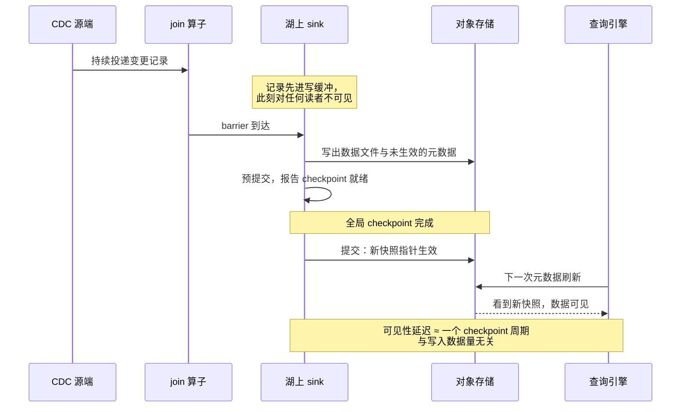
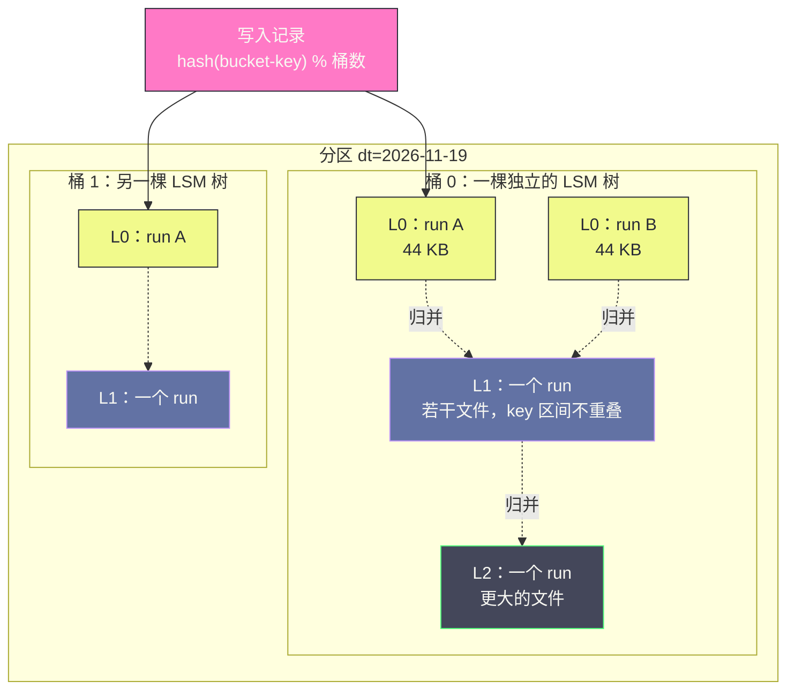
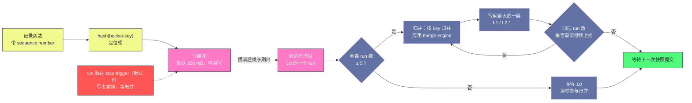
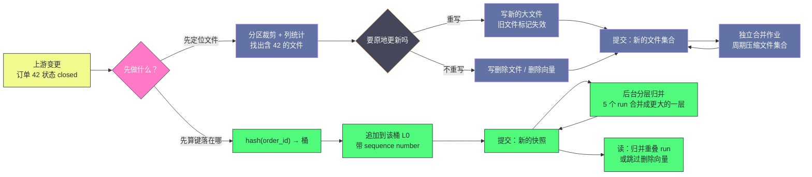
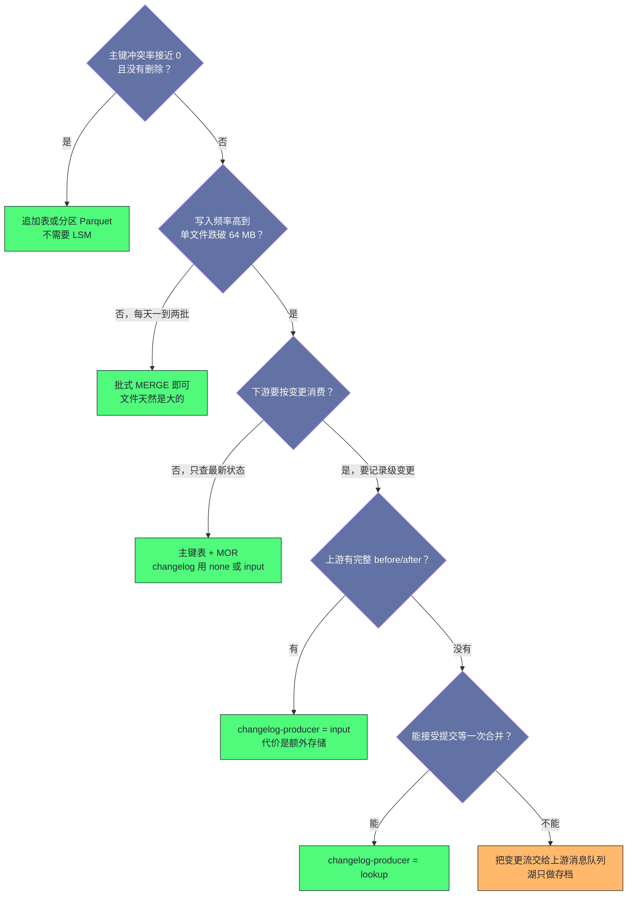

# 为什么需要 Paimon——Flink 实时写湖的延迟困境与 LSM 解法

**摘要：**

Flink 写数据湖的困境很少以"写不进去"的形式出现，它通常表现为一个怎么调都不动的数字：从上游 binlog 发生，到湖里那张表被下游查到，中间隔着五到十五分钟。把这十几分钟拆开，真正的大头不是计算而是等待提交——湖上 sink 走两阶段提交，数据只有在一个 checkpoint 完成的那一刻才作为新快照发布，于是可见性的节拍由 checkpoint 频率决定。想把新鲜度压到三十秒，就得把 checkpoint 压到三十秒；而在"一次提交产出一批不可变文件"的模型里，提交频率又直接决定文件大小：一天两 GB 的表配上三十秒的节拍，单个文件只有几十 KB，一天产生四万多个。合并小文件只能靠重写文件，重写必须以独立提交完成、成本随被合并文件的大小增长，于是"写得快"与"读得到最新"被绑在同一根滑杆的两端。Paimon 的改法是把文件组织成一棵可增量合并的 LSM 树（Log-Structured Merge-Tree）：一次提交只往最上面一层放一小批文件，后台按层把同量级的文件归并到更大的层，读的时候再把多层合起来看，于是提交频率不再决定读性能，代价转移成读放大与 compaction 负载。本文用一条订单链路贯穿全篇，先算清提交频率、文件大小、读放大、写放大之间的四个等式，再拆开这棵树在对象存储上的具体形状，最后说明主键表、changelog 与 lookup join 三个能力如何从这棵树里长出来，以及四类不该用它的情况。

---

## 第 1 章 两个时钟

### 1.1 一条订单链路上的两次等待

2022 年 1 月，Flink 社区里出现了一个叫 Flink Table Store 的项目，一年后它进入 Apache 孵化器并更名为 Apache Paimon，2024 年 4 月毕业成为顶级项目。这个项目要回答的问题，几乎每一家做实时数仓的团队都在同一时期碰过，只是说出来的时候往往被包装成一句含糊的抱怨："Flink 写湖太慢了"。

把场景具体化。一家电商把交易库的 binlog 和 App 埋点接进数据湖，链路是这样的：MySQL 的 binlog 由 Flink CDC 捕获，与支付流水做双流 join，结果写成两张表——一张订单明细主键表，按 `order_id` 去重并随状态变更反复更新；一张用户行为追加表，只增不改。查询侧用 Trino 与 StarRocks 读湖，供应实时看板和运营的临时分析。业务方提的需求很朴素：用户下单成功后三十秒内，看板上"今日 GMV"要变。

实际测量下来，从 binlog 事件落库到看板数字跳动，稳定在五到十五分钟，无论怎么加资源、怎么调并行度都压不下去。有趣的地方在于，链路上每一段单独看都很快：CDC 的消费延迟在百毫秒级，双流 join 的状态访问在毫秒级，Trino 查一个已经打开的湖表也在秒级。慢的是两段等待，一段在写入侧，一段在读取侧，而这两段等待是同一个机制的两个端点。

这些环节里有两处不服从"加资源就能解决"：写入侧要等一个 checkpoint 周期，读取侧要等元数据刷新。所谓等待提交，指的是数据已经写完、文件已落到对象存储上，但读者还看不到，因为这次写还没有变成"已提交的版本"。等待的长度不由数据量决定，而由 checkpoint 间隔决定——把间隔从五分钟改成三十秒，等待就从五分钟缩到三十秒，但这只是把问题换了个位置。

### 1.2 提交的节拍由谁打

湖上的 sink 遵循 Flink 的两阶段提交协议，这条协议把"数据写完"与"数据可见"分成了两步。

checkpoint 触发时，JobManager 向所有算子广播 barrier；sink 收到 barrier 后进入预提交阶段，把这段时间缓冲的记录排序、写成数据文件、登记到一份尚未生效的元数据里，然后向 JobManager 报告准备就绪；等到所有算子都报告就绪、checkpoint 全局完成，JobManager 再回头通知 sink 执行真正的提交，把这份新元数据的指针推上去。从这一刻起，读者才会认为这批数据存在。



把它想成一列固定班次的班车：货装好不等于发运，车次到点开走，收货方才认这一单。这条设计不是 Paimon 的发明，Iceberg、Hudi、Delta 的 Flink 连接器都是同一套骨架，因为只有把提交挂在 checkpoint 之后，才能保证崩溃重启时既不丢也不重。代价是可见性的节拍被钉死：数据能不能被看到，取决于"下一个 checkpoint 什么时候完成"，而不是"数据什么时候写完"。

Flink 社区自己也很清楚这个耦合。FLIP-309 讨论的是一个很具体的场景：作业启动时要追很长的积压，此时希望 checkpoint 稀疏一些以免每次都重放大量数据，可一旦稀疏，sink 的提交也跟着稀疏，下游数据就不再新鲜。提案给出的解法是允许按阶段切换间隔——追积压时半小时一次，追平之后切到三十秒一次，"这样 sink 每三十秒就 flush、commit 并对外暴露一次数据"。这段动机写得比任何架构图都直白：在湖上，数据新鲜度这个业务指标，翻译成配置项就是 checkpoint 间隔。

### 1.3 把节拍压到三十秒，代价落在文件上

于是需求变成了一句可以执行的话：把 checkpoint 间隔从三分钟改成三十秒。改完之后延迟确实下来了，但另一个指标开始恶化——文件数。

这里有一条容易被忽略的恒等式：在"一次提交产出一批封闭文件"的模型里，单个文件的大小约等于写入速率乘以提交间隔，再除以并发写文件的子任务数。

```
单文件大小 ≈ (日写入量 / 每天的提交次数) / 写并行度
```

代入一组示例数据，数字只用来固定量级。订单明细表日增两千万行、每行压缩后约 400 字节，日增压缩数据约 2 GB；写并行度取 16，即 16 个子任务各自写各自的文件。

| checkpoint 间隔 | 每天提交次数 | 每次每子任务落盘量 | 单文件大小 | 每天新增文件数 | 一年文件数 |
|---|---|---|---|---|---|
| 3 分钟 | 480 | 2 GB / 480 / 16 | 约 266 KB | 7,680 | 约 280 万 |
| 1 分钟 | 1,440 | 2 GB / 1,440 / 16 | 约 89 KB | 23,040 | 约 840 万 |
| 30 秒 | 2,880 | 2 GB / 2,880 / 16 | 约 44 KB | 46,080 | 约 1,680 万 |
| 10 秒 | 8,640 | 2 GB / 8,640 / 16 | 约 15 KB | 138,240 | 约 5,000 万 |

把这张表倒过来读，结论更刺眼：如果坚持每个文件都写到 128 MB，那么在日增 2 GB、并行度 16 的设定下，`128 MB × 16 / 2 GB` 约等于一整天——也就是说，一天只能提交一次。想让文件大，就得让它慢；想让数据新，就得让文件碎。这不是某一次配置没调好，而是恒等式本身给出的边界。

行为日志表的情况稍好一些，因为它日增一百 GB，同样的三十秒节拍下单个文件能到几 MB，但代价是并行度和分区维度：一旦按 `dt/hour` 做时间分区、再按 16 个桶分散，每个分区每个桶每小时只有一个几 MB 的文件，而一天有 24 个分区目录要管。分区越细、并发越高，恒等式右边的分母越大，文件越小。

### 1.4 被说错的机制：Paimon 并没有绕开 checkpoint

讲到这里，很多二手材料会给出一个听起来很诱人的解释：Paimon 把写入与可见性解耦了，数据快照可以不等 checkpoint 就发布，所以它做到了十秒级可见。这个说法是错的，而且错得很有代表性，值得当场纠正。

第一，看 Flink 连接器的行为就知道了：Paimon 的流式写入同样要求开启 checkpoint，提交动作同样发生在 checkpoint 完成之后，官方文档在讲 `INSERT INTO` 时专门提醒"流式提交前要先开启 checkpointing"，给出的示例配置就是十秒一次。提交协议没有变，两阶段提交的骨架也没有变。

第二，Paimon 的文档里有一句话，恰好是"小文件照样产生"的官方证词：对 `input`、`lookup`、`full-compaction` 这几类 changelog 生产者，短的 Flink checkpoint 间隔配上较多的桶数，会产生大量小的 changelog 文件，此时可以打开 `precommit-compact` 在提交前把它们合并一次。如果 Paimon 真的绕开了提交频率的约束，就不需要这个选项。

所以正确的问法不是"谁能让数据更快可见"，而是"把提交频率提上去之后，多出来的那些小文件由谁收拾、怎么收拾、收拾的成本落在哪里"。前两节已经算清：小文件是短提交间隔的必然产物，四种格式都躲不掉。真正分道扬镳的地方在下一章——面对同一堆小文件，它们选择了不同的"合并位置"，而合并位置决定了"写得快"与"读得到最新"能不能同时成立。

---

## 第 2 章 提交即一批文件

### 2.1 封闭的文件是提交的最小单位

对象存储不提供对已存在文件的随机改写，HDFS 也不提供；Parquet 与 ORC 又是列式布局加 footer 的结构，改一行要重写的不是一行字节，而是这行所涉全部列的块。于是湖上的写入从来不是"修改记录"，而是"产出新的文件，并声明旧文件不再属于当前版本"。

由此得到一条很少被摆上台面的约束：文件在提交那一刻就封闭了，下一条记录只能进下一个文件。文件大小因此不是可以自由选择的参数，而是提交间隔乘以写入速率再除以并发度算出来的结果；想写大文件只有两个旋钮——拉长间隔或降低并发，而两者都会撞上别的限制，前者牺牲新鲜度，后者限制吞吐。

与 Kafka 的日志段对比会更清楚：Kafka 的分区日志按大小或时间滚动，文件大小由滚动策略决定，与生产者的发送频率无关；湖上的文件是批量式的，一批数据一个文件，文件边界就等于提交边界。同样是顺序写，一个把批次的权力留给存储层，一个交给了写入者的节拍——这是湖与消息队列在写入模型上最本质的一处分岔。

### 2.2 三个乘数把文件数放大

文件数的完整算式有三个乘数：提交次数、分区数、桶数（或写并行度）。

```
每天新增文件数 ≈ 每天提交次数 × 活跃分区数 × 每分区写并行度
```

以 1.3 的订单表为例，不做分区时是 `2,880 × 1 × 16`，四万六千个文件；一旦按小时分区，活跃分区在同一时刻只有一个，数字不变，但历史上限变成 24 倍；如果业务希望按城市分片查询，再叠一层 `city` 分区，那么每个小时分区下会有若干个城市目录，每个目录下 16 个桶，一次提交就要产出 `城市数 × 16` 个文件。城市的数量通常是几百，于是"一天四万个文件"很容易变成"一天上千万个文件"。

这也是为什么小文件问题在真实系统里总比纸面推算严重：单看提交频率是秒级、并行度是十几、分区是小时级，三样都合理，乘起来就是灾难。笔者见过的一例把 `dt/hour/minute` 三级时间分区与 CDC 的秒级提交叠在一起，一天产出两亿多个文件，目录列举本身就要几分钟。

### 2.3 小文件的两笔账

第一笔账在元数据侧。每一次提交都要在元数据里留下这批文件的条目：文件路径、大小、行数、每列的 min/max、分区值。文件越小，同样数据量对应的条目越多，读取计划阶段要解析的条目也越多。这部分成本在查询很轻的时候最明显——一个只扫一行数据的点查，也要先把几万个文件条目过一遍才能决定读哪个文件。

第二笔账在打开文件这一侧。每个文件至少要一次寻址、一次 footer 解析、一次列块定位；几十 KB 的文件里，footer 与列统计占的比例高得离谱，有效载荷比很低。更麻烦的是，小文件让列存的优势反过来变成劣势：列存靠"只读需要的列"省 I/O，可当一个文件只有几十 KB 时，省下来的那点 I/O 抵不过打开文件本身的开销，parquet 的字典编码与页级索引也失去了统计意义。

还有一笔隐性的账，后文会反复用到：**最新的数据布局最差**。无论哪种格式，刚提交的那批文件一定是碎的、小的、未被合并的，而实时看板、实时风控、实时维表这些"要新鲜度"的查询，读的恰好就是最近一小时。也就是说，小文件造成的读放大在时间上不是均匀分布的，它集中在最热的那一段数据上，恰好压在最不能慢的查询前面。

### 2.4 合并撞上"刚写进去要马上读到"

既然小文件有害，合并就是了。可是在"提交即一批文件"的模型里，合并这个动作本身会与新鲜度打架，机制有四条。

第一条，重写的成本随被合并文件的大小增长。合并两个几十 KB 的文件很便宜，把新的几十 KB 文件并进一个 1 GB 的文件，就要把 1 GB 重读重写一遍，放大两千倍。"频繁合并"与"合并大文件"因此不能兼得：要么频繁动小文件（收益有限），要么偶尔动大文件（一次很贵）。

第二条，合并必须以一次独立提交完成，并与正在提交的写者竞争同一个元数据版本。写者在三十秒一次的节奏上提交，合并任务想在两者之间插一次提交，就要做乐观并发校验；冲突了就重试，重试期间读者看到的是旧的布局。提交越频繁，合并撞车的概率越高，于是"提频"这件事在写侧省下的时间，会在合并侧还回去。

第三条，合并只能对已经稳定下来的文件做，于是永远存在一个"最近窗口"。窗口内的文件是新到的、未被合并的；窗口外的文件才是大文件。窗口的大小由合并调度的周期决定，而调度周期不可能小于一次合并的耗时。这条推论有个很硬的后果：不管合并任务跑得多勤，总有一批最新数据处在最差的布局里。

第四条，合并的吞吐必须跑赢写入速率，否则文件数无界增长。这是一道定额题而不是调参题——把合并任务的资源砍掉一半，文件数不会缓慢上升，而会在某个拐点之后一路失控，因为积压的文件又要参与后续合并，形成正反馈。

四条叠在一起就是一根滑杆：往左推（更快可见），小文件更多、合并更频繁、写放大更高；往右推（更大文件），数据更旧。这根滑杆在 Iceberg、Delta、Hudi 上都存在，只是手柄装在不同位置——前两者把合并做成独立的文件重写操作（`rewrite_data_files`、`OPTIMIZE`），Hudi 做成表服务（compaction、clustering），三者的共同点是都需要额外的调度者、资源定额与并发约定。

可以借一间只能整垛搬运的仓库来理解这件事。货到了先堆在门口的小箱子里，因为拆箱上架太慢；要把小箱子并进大托盘，只能把整托盘重新码一遍；码盘的人必须跑得比到货的人快，而门口那批最新的货永远是散装的。湖上的"文件"就是托盘，"提交"就是封垛，"合并"就是重码。Paimon 的改法不是请更多码盘工，而是换一种堆法——让"重码"变成货架本身的结构。

### 2.5 五种对策与它们把成本放在哪里

把工程上见过的做法列全，会发现它们的分歧不在"要不要合并"，而在"把合并放在哪一层、由谁付费"。

| 对策 | 具体做法 | 换来了什么 | 成本落在哪里 |
|---|---|---|---|
| 攒批 | 拉长提交间隔 | 文件变大，元数据变少 | 数据新鲜度，直接等于放弃需求 |
| 定时重写 | `OPTIMIZE`、`rewrite_data_files`、clustering | 文件数被周期性压回去 | 额外调度与资源，与写者争抢元数据版本 |
| 读时合并 | Hudi MoR 的 log 文件、Iceberg 的删除文件 | 写侧不必重写文件 | 读侧要合并，读放大随未合并文件数增长 |
| 写时定位 | Hudi 的索引与文件组、Iceberg 的排序布局 | 更新只碰被命中的文件 | 索引维护，且未改变"文件是提交单位"这一前提 |
| 结构化合并 | LSM 的分层与按层归并 | 提交频率与读性能解耦 | 读放大、后台合并负载、调参复杂度 |

前四种做法有一个共同点：合并是**外挂**在写入路径之外的一次操作。它要么延后（攒批）、要么另起作业（定时重写）、要么推给读者（读时合并）、要么缩小命中范围（写时定位），但"一次提交 = 一批封闭文件"这个前提没有动。第五种动了前提：它把"文件集合"换成"一棵按体积分层的树"，合并成为树的维护动作，而不是一次针对文件集合的重写。

### 2.6 反事实：T+1 的世界里没有这个问题

把这一章的推理推到极端，会得到相反的结论：如果下游只要昨天的全量，提交间隔就是一天，文件天生是几百 MB 到 GB 级，小文件问题不存在，合并也不需要。在这种负载上引入 LSM 的全部机制——层、run、后台归并、读时归一、阈值调参——是为一个不存在的问题付费。所以困境有明确前置条件：提交频率高到让文件大小跌破合理阈值。判断方法就是 1.3 那条恒等式，算出来在 64 MB 以上，"提交即一批文件"完全够用；只有当数字是几十 KB 而业务又要求分钟级见数时，才轮到第 3 章那棵树出场。

---

## 第 3 章 把文件组织成一棵树

### 3.1 1996 年的那篇论文与它被借走的部分

LSM-Tree 这个概念出自 Patrick O'Neil 等人在 1996 年发表于 *Acta Informatica* 的论文，标题就叫《The Log-Structured Merge-Tree》。它要解决的问题是磁盘上的随机写太贵：B 树为了改一个键，要在树里找到位置、读一个页、改、写回，一次更新至少一次随机读加一次随机写；LSM 的做法是把随机写全部变成顺序写——新写入先进内存里的有序结构，攒满后整体刷成磁盘上的有序文件，后台再把多个有序文件归并成更大的有序文件，读的时候把多层归并起来。

论文给出的代价结构，三十年后仍然一字不改地适用：写放大（同一条记录在归并中被反复重写）、读放大（一次查要合并多层）、空间放大（旧版本在被清理前仍然占着地方）。这三个放大的具体数值取决于归并策略，但它们不会同时为零——这是 LSM 的物理学，不是实现的粗糙。

Paimon 借走的是这套组织方式，不是 RocksDB 的实现。论文里的组件是磁盘上的键值块，湖上的组件是对象存储上的列式文件，一次读取要付网络往返、要解析 footer、要靠列统计裁剪，但骨架留了下来：内存缓冲、分层文件、按层归并、读时归一。真正需要重新设计的，是"树根长在哪里"。

### 3.2 桶是这棵树的根

对象存储没有全局有序的键空间，也没有跨文件索引，因此湖上的 LSM 不能是一棵树，只能是一片森林。Paimon 的切法是**桶**（bucket）：分区内的数据按键的哈希分到若干桶，每个桶是一棵独立的 LSM 树，各有写缓冲、L0 与归并任务。



分桶的意义不止于并行。它把"归并"的作用域收窄到了一个桶内：同一时刻只有一棵树的少量 run 需要被合并，合并任务之间几乎不重叠，因此不需要像重写式合并那样在表的元数据上做全局的并发协调。这是"提交可以提得很频"的前提之一——每次提交只在一个桶的 L0 里添一个 run，冲突面小到一个桶。

分桶方式在版本之间演进过。较早的写法是固定桶：`bucket = N`，用键的哈希对 N 取模，落点完全可计算，代价是桶数定下后不便更改，要重分布只能做离线 rescale。较新的版本里主键表默认改成动态桶（`bucket = -1`），维护一份键到桶的映射，随数据增长分配新桶，省掉了容量预估，换来两份成本：映射索引常驻内存（文档给的量级是单分区一亿条键约需 1 GB），以及同一分区只允许一个写者。桶容量有一条经验区间，MOR 负载下每桶 200 MB 到 1 GB 作为初始参考——背后还是恒等式，桶太小则文件碎，太大则归并任务过重、读写并行度受限。

### 3.3 目录里到底有什么

把这棵树摊平到文件系统上，同一个表目录里并排放着两层东西：回答"哪一版可见"的快照元数据，与回答"这批文件怎么排"的数据文件。

| 目录或文件 | 内容 | 解决什么问题 |
|---|---|---|
| `schema/schema-<n>` | 字段、主键、分区键、表选项的版本 | 读旧文件时按写入时的模式解释 |
| `snapshot/snapshot-<id>` | 快照 JSON：引用的 schema、base 与 delta 的 manifest list、可选的 changelog 与 index 引用 | 哪一版数据对外可见 |
| `snapshot/LATEST` | 指向最新快照的短文件 | 读者一次读取即可定位当前版本 |
| `manifest/` | manifest list 与 manifest：文件增删记录、分区统计、行数与列统计 | 一次快照里有哪些文件，哪些文件可以被裁剪掉 |
| `index/` | 桶索引、删除向量等索引文件 | 点查定位，以及不重写文件就标记失效行 |
| `<partition>/bucket-<n>/` | 数据文件、可选的 changelog 文件与索引文件，按层组织 | 记录本身，以及 LSM 的层级结构 |

两层分工不同：快照层回答"哪一版可见"，与 Iceberg 的元数据树是同一类东西；LSM 层决定这份清单里的文件长什么样、如何重叠。Paimon 没有取消快照层，只是在它下面装了一个会自我整理的文件集合——这次提交新增的 run 可能三分钟后就被并进更大的层，下一次快照的清单里已经没有这些小文件。

### 3.4 一次写入穿过哪些层

一条记录进入 Paimon 的主键表，走的是这样一条路。

它先按 `bucket-key`（默认是去掉分区列之后的主键）算出桶号，进该桶的写缓冲；写缓冲默认 256 MB，可配成 spillable 溢写到本地盘，避免堆内存压力。缓冲里的记录按主键排序，攒到阈值后整体刷出，形成一个**有序段（sorted run）**：一个 run 含一个或多个文件，run 内文件按主键有序且区间不重叠，run 之间可以自由重叠——同一个键的多个版本同时躺在不同 run 里，是 LSM 的正常状态。

L0 的每个文件单独算一个 run，更高的每一层算一个 run。归并的触发由两个阈值控制：`num-sorted-run.compaction-trigger` 默认是 5，重叠的 run 数达到 5 就选出它们做一次归并；`num-sorted-run.stop-trigger` 默认是 trigger 加 3，也就是 8，到了这个数写者会停下来等归并完成。这个"停下来"的设计很容易被忽略，它恰好是"提交频率与读性能解耦"的关键：写者宁可短暂地卡住，也不允许 L0 的 run 数无限增长，因为 run 数就是读放大的上界。



归并时同主键的版本按两样东西定胜负。一是**序列号（sequence number）**，落盘时带单调递增的号，归并时号大的赢；上游可能乱序时用 `sequence.field` 指定业务字段（binlog 位点或事件时间）来排序。二是**合并引擎（merge engine）**：`deduplicate` 默认保留完整的最新一行，`partial-update` 只更新非空字段，`aggregation` 按函数累计，`first-row` 保留首次出现的行。

这里有一处对比值得记住。相同的问题在"提交即文件"的格式里，答案是"先把包含这些键的文件找出来，再重写它们"；在 LSM 里，答案是"新版本直接进 L0，旧版本等归并时被淘汰"。前者要定位，后者只要排序。定位的成本随表的规模和键的分散程度增长，排序的成本随写入量增长——这就是后文"upsert 的写代价与表规模脱钩"的算术来源。

写放大可以在这里算一遍，仍然标注为示例推算。沿用 1.3 的设定：日增 2 GB、并行度 16、30 秒提交一次，每桶每次提交刷出约 44 KB 的 run。若归并的扇出（fan-out）取 5：

| 轮次 | 输入 | 输出 | 每条记录被重写次数 |
|---|---|---|---|
| 第 1 次归并 | 5 × 44 KB | 220 KB | 1 |
| 第 2 次归并 | 5 × 220 KB | 1.1 MB | 2 |
| 第 3 次归并 | 5 × 1.1 MB | 5.5 MB | 3 |
| 第 4 次归并 | 5 × 5.5 MB | 27 MB | 4 |
| 第 5 次归并 | 5 × 27 MB | 135 MB | 5 |

大致五轮之后，单桶文件就到了 135 MB 的量级，一条记录平均被重写五次，写放大约为 5。关键在于，这个 5 与提交频率无关：提交频率只决定 L0 里同时躺着几个 run、什么时候开始归并，不改变"一条记录要爬几层"。作为对照，假如改用"每 30 秒把该桶当日数据整体重写一遍"的单层策略，一天要重写 2,880 次，每次重写该桶当日已积累的数据（全天约 128 MB，平均一半），累计约 184 GB，是日增数据的近百倍。两者差的不是实现效率，而是成本结构：分层归并的重写量随层数对数增长，单层重写的重写量随提交次数线性增长。

### 3.5 读的时候由谁合并

写入侧的归并只是把文件整理好，读者拿到的仍是一个多层的文件集合，于是"合并"在读侧还有一次，只是形态不同。Paimon 提供了三种表模式，区别就在于这次读侧合并做在哪里。

**读时合并（Merge On Read，MOR）** 是默认模式：读者把重叠的 run 一起读出来，按主键归并、应用合并引擎，同一个键只返回最新的一行。它有一个实在的限制——对被更新的非主键列做过滤不能提前下推。某订单旧行 `status = 'open'`、新行 `status = 'closed'`，若查询条件带 `status = 'open'`，引擎在归并前按条件把新文件裁掉，就会把已关闭的订单当成仍打开的返回。只要列可更新，过滤就得等到归并之后，这类查询的扫描量无法被列统计有效裁剪。

**写时合并（Merge On Write，MOW）** 换了个思路：归并发生在写侧的 lookup 合并里，合并时把被淘汰的行在数据文件里的物理位置记进**删除向量（deletion vector）**，读的时候照常并行读文件、跳过这些位置即可，不需要再把多个 run 合起来。代价是写侧要查旧值、要维护向量，而且改动这个开关不是改个配置就完事——已存在的表要开启删除向量需要额外的迁移配置并做一次全量合并，否则会读到重复行。

**全量合并（Copy On Write 效果）** 可以靠 `full-compaction.delta-commits = 1` 近似：每次提交之后同步对被改动的桶做一次全量合并，读的时候完全不重叠。这是把 LSM 用成了 CoW，写放大最高，换来读路径最简单。

| 模式 | 打开方式 | 读侧做什么 | 写侧付出什么 | 新鲜度的坑 |
|---|---|---|---|---|
| MOR（默认） | 默认 | 合并重叠 run，应用合并引擎 | 几乎没有额外开销 | mutable 列过滤不能提前下推 |
| MOW | `deletion-vectors.enabled = true` | 读文件并跳过删除向量标记的位置 | lookup 旧行、维护向量 | 默认批读跳过未 promote 的 L0 |
| COW 效果 | `full-compaction.delta-commits = 1` | 直接读全量合并后的结果 | 每次提交后同步全量合并 | 写放大随合并频率线性上升 |

表里 MOW 那一列的"坑"值得展开，因为它同时说明了本文的一个核心论点。Paimon 的文档明确写着：默认情况下，批读会跳过尚未被 lookup 合并发布出来的 L0 文件，而写者默认会等待这次合并完成——如果为了写入吞吐把合并改成异步，或者改用独立的合并作业，那么删改数据的可见性就会延后。换句话说，即便在 LSM 世界里，"最新数据能不能被看到"依然取决于合并有没有跟上，只是这个依赖从 checkpoint 的节拍转移到了合并的节拍上，而后者至少是可以独立扩容的。

### 3.6 可见性仍然走提交

可以给出一个准确的表述：Paimon 让"提交频率可以提得很高而不会把表写坏"，而不是"提交被绕开了"。

提交仍然是原子的：写者先备好数据文件与元数据，再发布快照；空提交可以跳过，一次事务可能产生"追加"与"合并"两个快照。读者读到的永远是某个已提交的快照，不会看到一半旧文件一半新文件的中间态，这一点与 Iceberg、Delta 没有区别——对象存储上只有"单对象 PUT 是原子的"这一条原语可用。

LSM 改变的是提交里装的东西。重写式合并的格式里，一次提交装的是一份新的文件集合，提交越频繁碎片越多；Paimon 里一次提交装的是"某个桶的 L0 多了一个 run"，碎片程度由归并阈值封顶，与提交次数无关。时间旅行、快照过期、标签这些能力则与 LSM 正交：LSM 不解决历史留多久，只解决文件排多好。

---

## 第 4 章 两条路的对照

### 4.1 "写入"这个词在两种模型里含义不同

把 Iceberg 与 Delta 放在一起看，会发现它们对"一次写入"的定义高度一致：往文件集合里加入一批新文件，并用删除文件、删除向量或覆盖声明让旧文件失效。关键词是**集合**。写入的语义单位是文件，一行记录的更新只能被表达成"某些文件失效、某些文件加入"，至于"这一行换了什么值"，要等读者自己去比较。

Paimon 的定义换了一个词：一次写入是对某个键空间的一次增量更新，落成某个桶的 L0 里的一个 run。关键词是**键空间**。一行记录的更新直接表达成"同一个键有了新版本"，旧版本的失效发生在归并时应用的合并引擎里，物理上的清除再延后到下一次归并。

这个差别不在接口层——四种格式都能做 upsert，都能 delete，都有 MERGE 语句。差别在更新的物理落点：一个落在文件上，一个落在键上。后面三节讲的三条推论，全部由这一个落点差异推出。

可以借一份活页夹来理解。文件集合式像一本装订好的册子：要在第三页插一句话，只能重排整本册子再装订，插得越频繁，重装订的成本越接近整本册子的大小。键空间式像活页夹：新页直接插到最前面，旧页留在后面，攒够一批再统一重抄；读的人从前往后翻，第一次见到的就是最新版本。技术限定也清楚：重抄不是免费的，它就是第 3 章算过的分层归并；"第一次见到的就是最新"要靠序列号裁定，上游乱序时必须显式指定排序字段。

### 4.2 三条推论

第一条推论关于 upsert 的落点。文件集合模型要更新一行，必须先回答"这一行在哪些文件里"，答案靠分区裁剪、列统计与连接源表；CDC 的变更恰好散落在各个分区上（一条订单昨天创建、今天退款，两次变更分属两个分区），裁剪的命中率不高，定位退化成接近全表的连接。键空间模型不需要回答这个问题：桶号由哈希算出，新版本直接进 L0，旧版本在哪里根本不用知道——它会在归并时被序列号淘汰。写代价因此与"命中的文件有多大"脱钩，只与"要写多少行"相关。

第二条推论关于 changelog 的产出。文件集合模型给出的读接口是"某一版的全量文件"，要拿变更只有两条路：比较两个快照的元数据差集（粒度是文件，行级变化要额外结构还原），或者在写入时另存一份变更（Delta 的 CDF、Hudi 的 CDC 日志）。键空间模型的更新本身就是以"同一键的新版本"落盘的，归并时把"归并前"与"归并后"的差写出来，就得到了记录级的变更流，代价是要在归并时多做一次比较。

第三条推论关于点查的可能。文件集合模型没有记录级的键索引，点查要打开候选文件按序过滤，候选数量随文件数增长。键空间模型里，一个桶内的文件按主键有序，数据文件旁边还有键索引文件，点查可以先定位到文件、再在文件内二分——这让湖表第一次可以充当流计算的维表，而不只是批处理的底座。

| 维度 | 文件集合模型（Iceberg / Delta） | 键空间模型（Paimon） |
|---|---|---|
| 一次写入的产物 | 一批新文件 + 元数据提交 | 某个桶的 L0 里多一个 run |
| 更新的物理表达 | 旧文件失效 + 新文件加入 | 同键新版本进 L0，旧版本等归并淘汰 |
| 定位成本 | 分区裁剪、列统计、连接源表 | 哈希算桶，与表规模无关 |
| 读侧一致性手段 | 快照隔离，文件级删除 | 快照隔离 + 归并时的序列号裁定 |
| 变更的最小粒度 | 文件（另存变更可达行） | 记录 |
| 小文件的归宿 | 靠独立的合并作业压缩文件集合 | 靠分层归并吸收，run 数有上界 |
| 时间旅行 | 快照层直接支持 | 快照层同样支持 |

### 4.3 为什么快照层没有被取消

看到这里会有一个自然的疑问：既然键空间模型这么灵活，为什么不干脆用一棵树取代快照元数据？

因为两者回答的问题不同。快照层回答"哪一版可见、能回退到哪一版、什么时候可以删旧文件"，承载原子性、隔离性与保留策略；LSM 层回答"这批文件怎么排、读的时候要合几层"。去掉快照层，LSM 就只剩一堆无法确定边界的文件，读者不知道哪些文件属于当前版本，也就无从谈隔离。

Paimon 的做法是把快照层做薄：快照只引用 manifest，manifest 只记录增删，文件整理下沉到层里。与 Iceberg 的三层元数据树相比，它的层级少了一截，因为文件集合在层内已经自我整理，不需要靠元数据来表达"哪些小文件应当一起重写"。

### 4.4 分叉点在哪里

把两条路径画在一张图上，分叉点只有一个：上游的变更记录进来之后，系统先做什么。



注意图里两条路径的终点都是"提交一次快照"。LSM 并没有省掉提交，也没有省掉元数据，它省掉的是"提交里必须装着一份被重新整理过的文件集合"这个负担。读者仍然通过快照发现新数据，只是快照背后的文件集合不再随提交次数碎裂。

---

## 第 5 章 从这棵树里长出来的三个能力

### 5.1 主键表的实时 upsert

第一个能力最直接：按主键更新一行，只需把新版本写进桶的写缓冲，不需要知道旧版本在哪。

把一次 upsert 的完整路径摊开，会看到它与"定位加重写"的差别落在哪一步。记录到达后，先算 `hash(bucket-key)` 得到桶号；桶号确定之后，落点就确定了，剩下的只是排序与刷盘；提交时 L0 多一个 run；归并时同一主键的多个版本按序列号决出胜负，输的那个被丢弃。整条路径里没有一步需要"读出旧行"——除非表开了删除向量或 lookup changelog，那两种模式需要读旧值来做标记或生成变更。

这个差异的工程含义是：**写代价与表的规模脱钩，只与写入量相关**。表从 1 TB 长到 100 TB，一次 upsert 的写量不变；而在重写式合并的格式里，写代价取决于命中文件的总大小，命中范围随表规模与键的分散程度变化。CDC 的变更往往散落在所有分区上（昨日创建的订单今天退款，两次变更分属两个分区），定位的命中率不高，于是"重写"很容易退化成"重写大半个分区"。

不过这条路径有三处边界必须提前讲清，否则会把一个受限的能力当成通用的能力。

第一处是跨分区更新。主键不含分区列、而分区列会被更新时（譬如把 `update_time` 放进 `dt` 分区），新版本落到另一个分区，旧分区那一行就成了幽灵。Paimon 的处理按分桶模式分岔：动态桶维护键到分区与桶的映射，`deduplicate` 下删旧分区插新分区，映射可加 TTL；固定桶与 postpone 桶不维护这种映射，要求上游提供含撤回记录的完整 changelog。文档给的建议很实用：用不可变的创建时间做分区列，不要用会变的事件时间或 CDC 的 `op_ts`。

第二处是合并引擎的语义差。`deduplicate` 是"整行替换"，新行里的 null 会把旧值覆盖掉；`partial-update` 才是"只更新非空字段"。多流打宽的场景选错引擎，会出现"某个字段莫名其妙变成 null"的问题，而这类问题通常要等到业务方发现报表缺列才被定位。

第三处是顺序。上游如果可能乱序（补数、多路合并、多个 sink 并发写），必须显式指定 `sequence.field`，否则"最后到达的赢"会把一条旧数据当成新数据。Flink SQL 里还有一处相关的坑：`table.exec.sink.upsert-materialize` 默认会插入一个物化算子，它可能改变记录到达 Paimon 的顺序，官方文档在讲合并引擎时专门提醒这类管道要把这个选项设成 `NONE`。

### 5.2 changelog：旧值从这棵树里来

第二个能力的动机来自下游。上游写进湖的是一条 upsert 流（`+I`、`+U`），而下游如果有带状态的聚合——譬如按城市累加 GMV——它需要一个 `-U` 才能把旧值减掉。只给 `+U`，下游就得自己记住每个键的上一个值，状态会随键的数量膨胀。

四种 changelog 生产者回答的其实是同一个问题：旧值从哪里来。

| 生产者 | 旧值来源 | 变更何时对读者可见 | 适用前提 | 主要代价 |
|---|---|---|---|---|
| `none`（默认） | 没有，交给下游自行归一化 | 增量快照读 | 下游能接受 upsert，或愿意付状态成本 | Flink 侧 normalize 算子的状态随键数增长 |
| `input` | 上游直接提供 before/after | 输入 changelog 提交后 | 上游是完整 changelog，譬如规范的数据库 CDC | 额外的 changelog 文件存储与写放大 |
| `lookup` | 合并时回查旧行 | lookup 合并提交之后 | 上游只有 after 镜像，下游要完整变更 | 写者默认等合并完成才提交，延迟里含合并时间 |
| `full-compaction` | 比较两次全量合并的结果 | 全量合并提交之后 | 下游能容忍分钟级以上的延迟 | 同步全量合并的写放大，中间更新被折叠 |

表里最值得琢磨的是 `lookup`：它的延迟不在数据写入，而在"提交前必须等一次合并"，因为只有合并时才能读到被替换的旧行。这也解释了删除向量表不支持 `full-compaction`、而 `full-compaction` 与 `lookup` 互斥——两者的旧值获取路径互相冲突。

`full-compaction` 的语义还要再澄清一次，因为它经常被误解。它给出的是"表状态的变化"，不是"每一条源事件"。两次全量合并之间的多次更新会被折叠成一次差异，所以用它做审计日志会丢中间态，用它做下游聚合的增量同步则完全够用，因为聚合只关心净变化。它的间隔由 `full-compaction.delta-commits` 控制，在 Flink 流式写入里如果没显式配置，默认按一个 checkpoint 折合。

还有两个容易忽略的细节。一是过滤器：`lookup` 与 `full-compaction` 支持 `changelog-producer.row-deduplicate`（新旧行相等时不发更新对）、`ignore-update-before`、`ignore-delete`，这三个开关能显著减少下游压力，但每一个都在改变消费者契约，删掉 `-U` 之后下游的撤回聚合就不对了。二是小文件：短的 checkpoint 间隔配上较多的桶，会产出大量小的 changelog 文件，此时打开 `precommit-compact` 让它在提交前合并一次——这个选项的存在本身就是本文第 1 章那个论点的注脚：在 Paimon 里，小文件照样会被生产出来，区别只在于它有地方可去。

### 5.3 lookup join：湖表第一次能当维表

第三个能力是前两个的合流：既然桶内文件按键有序、旁边还有键索引，一次按键点查就不必扫全表。流计算里的维表 join 因此可以省掉"把维表同步进 HBase 或 Redis"这一跳。

用法上遵循 Flink 的 lookup join 语法，右表用 `FOR SYSTEM_TIME AS OF` 指定处理时间，Paimon 连接器扮演 lookup source，把每个键的查询翻译成算桶、定位文件、在文件内二分。工程上决定成败的是缓存与分发：每个 subtask 默认缓存一份完整维表；维表大到单机放不下时，Flink 2.0 以上可用 shuffle lookup，按桶把查询路由到只持有部分数据的 subtask（前提是固定桶、join 键含全部桶键）；也可以只查最新分区（`scan.partitions = 'max_pt()'` 配刷新间隔）；更进一步是把查询做成独立的 query service 供多个作业共享。

它与"文件集合"式的湖表相比，差别不只是快慢，而是可行性。没有记录级的键索引，点查只能打开候选文件逐个过滤，候选数随文件数增长；而维表恰恰是那种"键很随机、查询很密集、单次只要一行"的负载，候选一多就没法用。Paimon 在这里还付出了另一份成本：维表的更新可见性依然受提交节拍约束，维表更新到维表可查之间仍然隔着一个 checkpoint，只不过这个间隔通常可以设得比数仓主表更短。

### 5.4 三个能力共用一个前提

upsert、changelog、lookup join 看着是三件事——一个在写、一个在流、一个在读，共用的前提只有三条：一个**键**用来路由（哈希到桶，避免定位），一个**序**用来裁定版本（序列号或业务字段），一层**可合并**用来淘汰旧版本。缺了键，更新退化成"找文件重写"；缺了序，"最新"变成不确定的结果而查询不会报错；缺了可合并的层，旧版本永远躺在文件里。三条里任何一条要维护，都要占资源，这就是第 6 章的代价来源。

---

## 第 6 章 代价

### 6.1 读放大的算术

LSM 的读放大有一个很干净的表达：一次扫描要读几个 run，读放大就是几。默认配置下，`num-sorted-run.compaction-trigger` 是 5，`num-sorted-run.stop-trigger` 是 8，所以 L0 最多同时存在 8 个 run，再加上更高层每层一个 run，一次全表扫描的读放大上限在十倍上下；稳定状态下通常停在 5 附近，因为归并一触发，run 数就被压回阈值以下。

做一组示例推算。假设某个热分区有 10 GB 数据，归并没有及时跟上，L0 里躺着 8 个 run，每个 run 的主键区间都覆盖整个桶，那么一次全表扫描要读的字节数上限就是 80 GB 量级。实际上重叠部分的重复率没有这么高（后到的 run 通常只覆盖部分键区间），但数量级不会变。列统计与分区裁剪能减少被选中的文件数，但对"同一个键的多个版本必须一起读"这件事无能为力。

点查的放大形态不同：它不必读全部 run，但每个 run 都要定位一次，延迟从一次寻址变成最多八九次寻址，这也是维表查询在 Paimon 上要配缓存的原因。空间放大是第三个：同一主键的多个版本在淘汰前都占着存储，上限由 stop-trigger 与写入频率决定，在"高频更新同一批键"的负载上最明显——1 TB 的表里，热的那部分数据可能有数倍冗余版本。

### 6.2 compaction 是第二份写入负载

LSM 把合并从提交的关键路径上挪走了，但没有让它消失。写者默认在自己的线程里跑合并；当多写者需要共享一个合并者、或者希望把合并资源独立出来时，可以把写入侧设成 `write-only = true`，另起一个专门的 compaction 作业。

资源账很好算：写放大是 5，每写 1 GB 数据，后台就要额外搬运 5 GB。沿用日增 2 GB 的例子，合并的搬运量大约 10 GB，与写入量同阶——合并不是顺手做一下，而是一份持续的 I/O 与 CPU 预算。

更麻烦的是它与提交的耦合。合并落后到接近 stop-trigger 时，写者会停下来等，写一停，checkpoint 里的 sink 就迟迟不能预提交，checkpoint 可能超时，作业重启，重启之后又要从状态恢复并重放一段数据。这条链路值得单独记住：**合并跟不上会表现为写入停顿，写入停顿会表现为 checkpoint 超时，最后以作业不稳定收场**，而监控上最先报警的往往不是合并积压，而是 checkpoint 失败。这是 Paimon 特有的失败形态。

### 6.3 层级与桶的调参

调参的本质是在四个量之间换：读放大、写放大、并行度、内存。

| 参数 | 常见默认或参考 | 调大换来什么 | 调小换来什么 |
|---|---|---|---|
| `bucket` | MOR 每桶 200 MB–1 GB 为参考 | 并行度与读并行更高 | 单桶文件更小，合并更频繁 |
| `write-buffer-size` | 256 MB | L0 文件更大，run 更少 | 内存压力小，但 run 更碎 |
| `num-sorted-run.compaction-trigger` | 5 | 合并更少，写更顺 | 读放大更小，写放大更高 |
| `num-sorted-run.stop-trigger` | trigger + 3 | 容忍更多积压，写不易停顿 | 更早触发写等待，延迟更稳 |
| `full-compaction.delta-commits` | 视生产者而定 | 合并更稀疏，写放大更低 | 读更简单，写放大更高 |
| `lookup.cache-max-memory-size` | 256 MB | 点查命中率更高 | 内存更省，回查更多 |

这张表里最容易调错的是桶数。桶太少，单桶数据量超出参考区间，合并任务变重、并行度上不去；桶太多，每个桶的文件都小，文件数按桶数成倍增长。桶数是建表时最难改的参数，固定桶还要靠离线 rescale，值得在建表前用日增量、保留期、查询并发估一遍。动态桶把容量预估交给系统，代价换到内存与并发上：映射常驻内存，且同一分区只允许一个写者，多写者并行写入的设计会被这条约束直接挡住。

### 6.4 与批读引擎的兼容性

Paimon 的数据文件是普通列式文件（`file.format` 可指定 Parquet、ORC、Avro，默认值在版本间变过，建表时显式声明最省心），元数据也公开可读，所以"别的引擎能读"在文件层面成立；但"能读对"要靠各自的连接器实现，这里有三处差别。

第一处是合并。主键表的正确结果需要归并，批读引擎必须实现这套逻辑。Spark 与 Trino 的连接器实现了它，代价是读取时多一层合并开销；若绕过连接器直接用 Hive 或只认文件格式的工具读目录，读到的是未经归并的多个 run，同一主键会出现多行，症状是"用 Paimon 客户端查是 100 万行，用旧工具查是 130 万行"。

第二处是可见性。MOW 表默认的批读会跳过尚未 promote 的 L0，所以"刚写进去 Spark 就能读到"在开启删除向量之后不再自动成立，要等 lookup 合并发布，或显式打开允许读未合并数据的选项（后者要付读时合并开销）。

第三处是语义特性的支持面。`partial-update`、`aggregation`、删除向量与各类 changelog 过滤器在不同连接器里的支持程度并不一致，跨引擎使用时以对应版本的连接器文档为准；Paimon 也提供 Iceberg 兼容层让 Iceberg 客户端只读访问，但支持范围同样受版本约束，不宜当作双向互通来规划。

### 6.5 保留期与空间回收

LSM 的旧文件不会因为被归并淘汰就立刻消失，它们还被更早的快照引用着。快照过期、标签、物理删除是三套独立的生命周期：过期让旧版本不再可读，标签把某些快照钉住，物理删除要等所有引用消失。

工程含义是：磁盘用量不等于当前版本的数据量，而是当前版本加上保留期内的历史版本。保留期越长空间放大越明显；压得太短则流式消费一旦落后超过窗口，增量读就找不到起始快照。这条对齐关系通常没人负责，直到某个停了两周的作业重启失败。

### 6.6 代价的症状与判据

把这一章的代价落到可观测的现象上，会得到一张排查表。它的用处不是背下来，而是在出事时先判断"这是哪一层的债"。

| 现象 | 判据 | 根因 | 处置 |
|---|---|---|---|
| 查询变慢，扫描量随写入频率上升 | L0 文件数与查询耗时同向变化 | 合并落后，读放大接近 stop-trigger | 提高合并资源，或改用独立 compaction 作业 |
| 作业频繁重启，checkpoint 超时 | checkpoint 时长与 L0 run 数同向变化 | 写者到达 stop-trigger 后停顿 | 放宽 stop 阈值并同步扩合并容量，不能只放宽一个 |
| 点查延迟高且抖动 | 单次查询寻址次数多，缓存命中率低 | 桶数与维表规模不匹配，或缓存太小 | 调桶数、调 lookup 缓存、启用异步查询 |
| 同一张表两个引擎行数不一致 | 未合并 run 数大于零 | 读取侧没有实现归并 | 统一走连接器，禁止直读目录 |
| 写入吞吐上不去，CPU 不高 | 合并线程占满 I/O，或写缓冲频繁溢写 | 写放大与本地盘溢写叠加 | 调大缓冲、降低归并频率、加本地盘 |
| 磁盘用量远超数据量 | 快照保留期与文件数对应关系异常 | 历史快照未过期，旧文件无法回收 | 收紧保留期，检查标签是否钉住了快照 |

---

## 第 7 章 反例

### 7.1 反例一：只有 T+1 需求时用 Paimon

这是最常见的一类错配。数据每天凌晨跑一次批处理，下游只按分区全量扫描，没有任何流式消费。在这种负载上，LSM 的每份成本都在付，每项收益都拿不到：提交间隔是一天，文件天生就大，小文件问题不存在；没有按键更新，合并引擎白配；读时还要多一层归并；后台合并与调参是纯增的负担。判断方法还是那条等式，算出来是几百 MB 就说明"提交即一批文件"已经够用，此时该选分区 Parquet 加生命周期策略。用 Paimon 做纯批，等于给一条只在白天开门的走廊装了一整套自动扶梯。

### 7.2 反例二：把 Paimon 当纯列存查询引擎

第一个误区来自"湖仓一体"这个词的暗示：既然湖表能被 Trino 与 StarRocks 查，是不是可以把它当数据仓库用，承接高并发的即席分析与点查？

答案是否定的，原因不在性能数字上。Paimon 没有向量化执行引擎、没有基于代价的优化器、没有本地缓存与二级索引体系，这些都是查询引擎的职责，不是表格式的职责。它能做的是把数据组织成引擎好读的形状，做不到替引擎算得快；MOR 下可更新列的过滤又不能提前下推，扫描量还会被放大。

正确的位置是：Paimon 做流式写入与准实时的存储底座，查询交给专门的引擎；需要亚秒级响应的高并发查询，把结果再同步到 StarRocks、Doris、ClickHouse 或 KV。把两层合成一层，省掉的是同步链路，付出的是查询性能与稳定性。

### 7.3 反例三：追加数据却建了主键表

第二个误区是给只增不改的数据建主键表。埋点日志、审计流水这类事件流本来没有主键冲突。给这类数据建主键表会白付三份成本：写入要哈希分桶与排序，读要归并，后台要合并；而按键更新、按版本淘汰这两项收益一次都用不上。更麻烦的是主键选择：若挑一个不一定唯一的字段做键，本该保留的两条记录会被当成同一键覆盖，数据静默丢失。

追加表在这个场景下更合适：它不做按键归并，写入路径更短，读的时候也不需要合并。判断标准很直接：主键冲突率接近零、没有删除与撤回、下游按时间范围扫描，三条全中就该用追加表。

### 7.4 反例四：把 full-compaction changelog 当默认配置

第三个误区是把"要 changelog"直接翻译成 `changelog-producer = 'full-compaction'`，因为它的语义听起来最完整。代价是每次全量合并要把桶里的数据整体重写一遍，写放大与保留量成正比，中间更新还会被折叠——既贵，又不提供每条源事件。

选型顺序应该反过来：上游本来就是完整 changelog（规范的 CDC 输出）就用 `input`；上游只有 after 镜像且下游确实需要旧值，才用 `lookup` 并接受"提交等合并"的延迟；下游能容忍分钟级以上延迟、且只关心净变化，才用 `full-compaction`。至于 `none`，它不是"没有 changelog"，而是"把补旧值的责任交给下游的 Flink 状态"，在键数可控的场景下往往是最省的选择。

### 7.5 一条判据

把这几处分叉显式化，其中"提交频率"这一支最容易被跳过：很多团队只在"要不要 upsert"上做判断，忽略了 LSM 的收益随提交频率升高而放大，成本也随提交频率升高而累积。



| 场景 | 建议 | 主要理由 |
|---|---|---|
| T+1 批处理、只增不改 | 分区 Parquet 加生命周期策略 | LSM 的成本全付、收益全无 |
| 每天一到两批 upsert | 批式 MERGE 加定期重写 | 文件天然大，分层归并没有对象 |
| 高频 upsert、下游只查最新 | Paimon 主键表，MOR | 写代价与表规模脱钩 |
| 高频 upsert、下游要记录级变更 | Paimon 加 `input` 或 `lookup` 生产者 | 旧值可从输入或合并时获得 |
| 高并发点查、亚秒级响应 | 湖做底座，查询交给 OLAP 引擎 | 表格式不负责执行速度 |
| 团队无人维护合并与调参 | 托管服务或更朴素的格式 | 否则合并积压会变成稳定性事故 |

---

## 第 8 章 小结：提交频率的代价转移

Paimon 解决的问题可以压缩成一句话：把"提交频率"从读性能的公式里摘出去。

在"提交即一批文件"的模型里，提交频率同时决定三件事——数据多快可见、文件有多小、合并要多频繁，三者被同一根滑杆串起来，任何一端的调整都会推动另外两端。LSM 的改法是给"文件"加一层结构：提交只往最上面放一小批文件，合并按层增量进行，读的时候把多层归一。于是提交频率只决定 L0 里同时躺着几个 run，而 run 数有硬上界；读性能由归并阈值与层数决定，与提交次数无关。

这笔交易的另一面写在账单的背面，需要说清楚。读放大换成了数倍的扫描量，写放大换成了按层数计的重复搬运，运维面换成了桶数、缓冲、阈值、合并作业这一整套参数；而"最新数据能不能被看到"这件事，也从依赖 checkpoint 变成了依赖"合并有没有跟上"。成本没有消失，它只是从提交的关键路径上被搬到了一个可以独立扩容、也可以独立监控的位置——这是笔者以为这笔交易最本质的内容，也是判断该不该做的依据：如果你的团队有能力监控并扩容合并，这笔交易划算；如果没有，那么把合并积压留给自己，等于把延迟问题换成了稳定性问题。

至于什么时候不该做这笔交易，第 2 章与第 7 章给的是同一个答案：先用那条恒等式算出单文件大小，再看下游要不要按变更消费。两个答案都指向"不需要"时，朴素的分区文件反而是更诚实的选择。

---

## 参考资料

1. [Apache Paimon 官方文档：Basic Concepts](https://paimon.apache.org/docs/master/concepts/basic-concepts)：表类型、分区与桶、快照与 manifest 的分层，以及"一次事务可能产生追加与合并两个快照"的说明。文档站提供 1.1 至 master 多个版本目录，本文引用的页面在各版本下同名，个别选项名以目标版本文档为准。
2. [Apache Paimon 官方文档：Primary-Key Tables](https://paimon.apache.org/docs/master/primary-key-table/)：桶与 LSM 树的关系、sorted run 的定义、L0 与更高层的 run 计数方式。
3. [Apache Paimon 官方文档：Data Distribution](https://paimon.apache.org/docs/master/primary-key-table/data-distribution)：固定桶与动态桶的分配方式、哈希取模、每桶 200 MB–1 GB 的容量参考、动态桶的索引内存量级与单写者约束、跨分区更新。
4. [Apache Paimon 官方文档：Merge Engines](https://paimon.apache.org/docs/master/primary-key-table/merge-engine/)：四种合并引擎的语义，以及 `table.exec.sink.upsert-materialize` 对记录顺序的影响。
5. [Apache Paimon 官方文档：Compaction](https://paimon.apache.org/docs/master/primary-key-table/compaction)：归并策略、`num-sorted-run.compaction-trigger` 与 `stop-trigger` 的默认值与关系、lookup 合并、`write-only` 与独立合并作业。
6. [Apache Paimon 官方文档：Changelog Producer](https://paimon.apache.org/docs/master/primary-key-table/changelog-producer)：四类生产者的旧值来源与可见时机、`lookup` 与 `full-compaction` 的互斥关系、过滤器选项，以及小 changelog 文件与 `precommit-compact`。
7. [Apache Paimon 官方文档：Table Mode](https://paimon.apache.org/docs/master/primary-key-table/table-mode)：MOR、COW 与 MOW 的分工，删除向量的读写路径，MOW 下批读默认跳过未 promote 的 L0，以及可更新列过滤不能提前下推的原因。
8. [Apache Paimon 官方文档：SQL Write](https://paimon.apache.org/docs/master/flink/sql-write)：流式写入前必须开启 checkpointing（官方示例给出十秒间隔），`UPDATE`、`DELETE` 对表类型与合并引擎的要求。
9. [Apache Paimon 官方文档：Lookup Joins](https://paimon.apache.org/docs/master/flink/sql-lookup)：普通与异步 lookup、shuffle lookup（Flink 2.0 以上、固定桶）、动态分区与 query service。
10. Patrick O'Neil, Edward Cheng, Dieter Gawlick, Elizabeth O'Neil. [The Log-Structured Merge-Tree (LSM-Tree)](https://link.springer.com/article/10.1007/s002360050048). *Acta Informatica*, 33(4), 1996：LSM 的原始定义与写放大、读放大、空间放大的代价结构。
11. [Apache Flink 文档：Checkpointing](https://nightlies.apache.org/flink/flink-docs-stable/docs/dev/datastream/fault-tolerance/checkpointing/)：checkpoint 的对齐、完成通知与两阶段提交 sink 的关系；FLIP-309 的间隔策略即建立在该机制上。
12. [Apache Iceberg 规范](https://iceberg.apache.org/spec/)：快照、manifest list 与 manifest 的分层，以及删除文件与删除向量的版本门槛，用于第 4 章的两条路对照。
13. [Delta Lake 协议规范](https://github.com/delta-io/delta/blob/master/PROTOCOL.md)：`_delta_log` 的提交条目、add 与 remove 动作、检查点与删除向量的 writer 版本要求。
14. [Apache Paimon 毕业为 Apache 顶级项目的公告](https://flink-learning.org.cn/article/detail/1d0101c524201dcc333a7f259ff16501)：从 Flink Table Store 起步、2023 年 3 月进入 Apache 孵化器、2024 年 4 月毕业的时间线。

---

> [!note] 思考题
> 1. 可见性节拍由 checkpoint 决定，而 checkpoint 间隔又被"故障后最多重放多少数据"这个恢复目标约束。如果业务要求三十秒可见、同时要求故障重放不超过一分钟，这两个数字会打架吗？你会把哪一项写进 SLA。
> 2. 把日写入量、提交间隔、写并行度代进那条恒等式，算出你手上某张表的单文件大小。它是多少？如果远低于 64 MB，你会先改提交间隔还是先换存储模型。
> 3. 分层归并把一条记录重写的次数压到层数量级，单层重写则随提交次数线性增长。当写入量突然放大十倍时，这两种成本结构分别会以什么形式暴露出来？
> 4. 合并积压最终表现为 checkpoint 超时，而监控最先报警的是 checkpoint，不是合并。你会用哪一个指标来做合并的先行指标，阈值怎么定。
> 5. MOW 表默认的批读会跳过尚未 promote 的 L0，这意味着"开启删除向量"与"刚写入立即可查"之间存在取舍。在产品承诺"实时可见"之前，你会怎么验证这条链路。
> 6. 如果绕过连接器直接用 Hive 读 Paimon 表的目录，会读到未归并的多个版本。这个坑在什么迁移场景下最容易被踩到，你会用什么机制在流程上拦住它。
