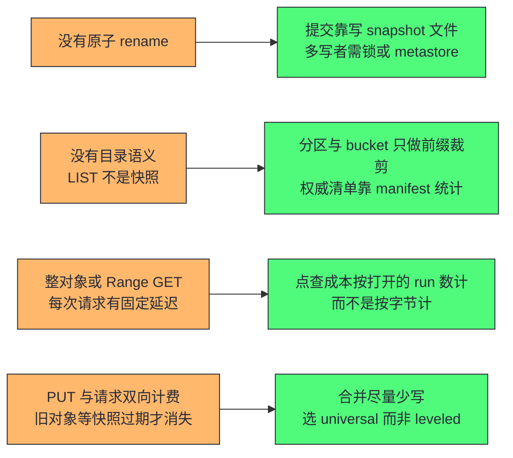
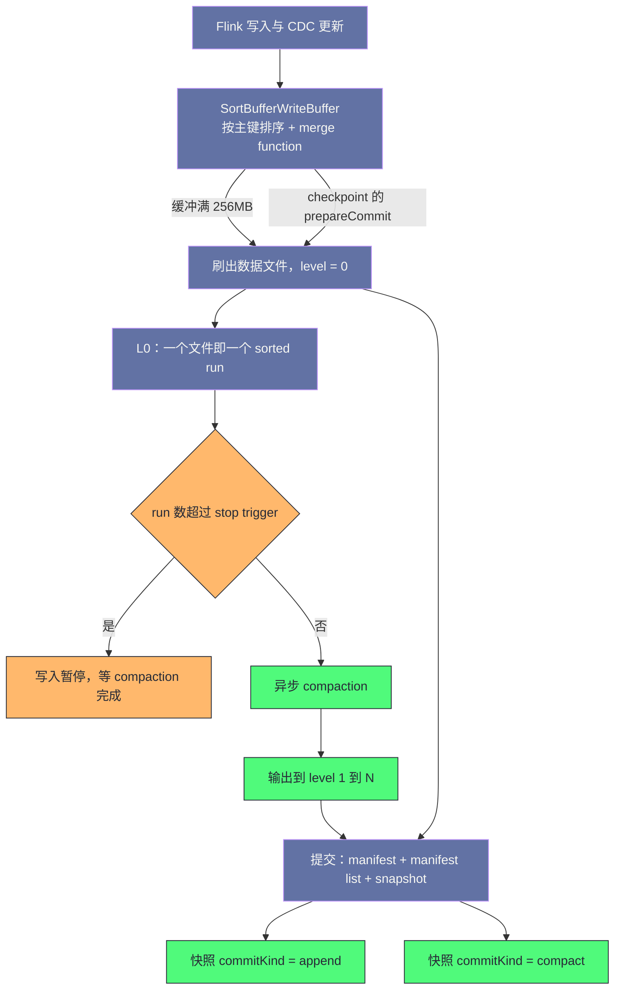
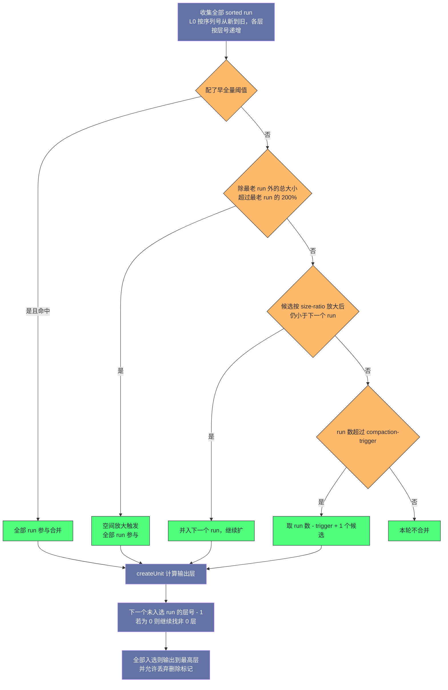
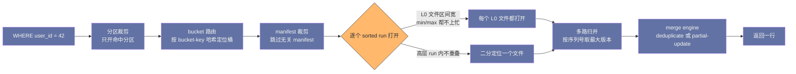
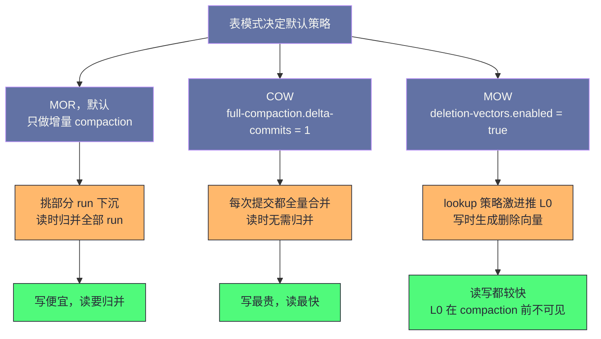
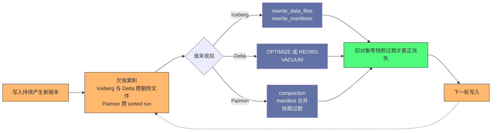

**摘要：**

Parquet 文件写完即不可变，湖上的更新于是只能换算成"换一批文件"；Paimon 换了一条路，把数据库里的 LSM-Tree（Log-Structured Merge-Tree）搬到对象存储上：写入先进内存缓冲，刷出的小文件进 Level 0，后台再把它们逐层合并成更大的有序文件，读者按排序段（sorted run）归并出最新版本。这套结构在本地磁盘上早已成熟，搬到 S3 一类对象存储上却有几处性质变了：没有原子的 rename，没有真正的目录，读一个字节也先要发一次请求；于是合并的每一层都对应真实的字节搬运与请求成本，而"多打开几个文件"的代价反而相对可算。本文以一张用户画像主键表的实时更新贯穿全篇：先交代 Level 0 的粒度其实由 checkpoint 周期决定，再拆开 universal compaction 选文件的四步判断与 `num-sorted-run.compaction-trigger` 一类参数的语义，指出点查付出的读放大是"排序段的个数"而不是"文件的个数"；用一组标注为示例推算的数字，回答写放大与读放大在不同阈值下各值多少；并按"删除文件累积"与"排序段累积"两条线对比 Iceberg、Delta 的 Merge-on-Read；落点是三类反例：把 compaction 关掉、层级配得过深、以及只写不查的表误用主键表。

---

## 第 1 章 搬一次家：LSM 落在对象存储上之后

### 1.1 本地磁盘上，LSM 的四个默认前提

LSM-Tree 从 1996 年那篇论文算起，在本地磁盘上被反复打磨了近三十年，[[中间件/Leveldb/01 LevelDB 全局架构——LSM-Tree 的写优化设计|LevelDB]] 与 RocksDB 是最典型的两份教材，它们共同沉淀出一套成熟形态：MemTable 在内存里排序，溢写成一个不可变的 SST 文件，后台按层合并，层与层之间靠布隆过滤器与索引减少无谓的读。LevelDB 的代码里有一批几乎不会被提起的默认前提，因为文件系统替它挡住了这些事。

- 目录项改名是原子的。临时文件写完，`rename` 成正式名字，读者要么看见旧文件，要么看见新文件，不存在中间态。
- 读可以按块随机。打开一个 SST，读出 footer，按索引定位 block，只取需要的那几 KB。
- 缓存可以跨查询复用。操作系统页缓存与引擎自身的 block cache 让热点块不必重复从盘上取。
- 合并的输入输出都在本地。重写一个 64MB 的 SST，花的是本机 IO 与 CPU，没有额外的网络往返，也不按请求计费。

Paimon 把这套结构搬到对象存储上时，这四个前提不能全部保留。原因不在实现取舍的偏好，而在对象存储没有提供对应的语义。

### 1.2 覆盖写的第一笔账

把这两个世界放在一起之前，先把"为什么不用覆盖写"这本账算清楚，否则后面的所有机制都缺一个对照物。

Parquet 文件写完即不可变，所以"覆盖写"的准确含义是：读出一个完整文件，把要改的行替换掉，再写出一个完整的新文件，最后让旧文件从快照里退出。以贯穿案例的单文件 128MB、约 128 万行（行宽 100 字节）为例，改 1000 行只需要 100KB 的新数据，却要读 128MB、写 128MB，合计 256MB 的 IO，写放大一千倍以上。若每 5 分钟一个合并批次、每批都命中一个完整文件，一天 288 批就是 36GB 的写与 72GB 的读写量，而真正变化的数据只有 29MB。

覆盖写并非一无是处。它的读路径极其干净：一个文件就是一份完整视图，没有任何旧版本要归并，没有位图要解码，查询计划与纯 Parquet 一模一样。所以它在"写入批次大、改动比例高、读多写少"的场景里仍然是最优解，批量重刷一个分区时尤其如此。

问题出在"行级、高频、小批量"这组条件上。更新越零碎，覆盖写里"被搬运但没变"的字节占比越高；批次越频繁，被重复搬运的次数越多。LSM 的思路正是把这一笔搬运从写路径挪走：写入只追加新版本，把"合并旧版本"推迟到后台按批处理，于是每次写入的代价与改动量成正比，而不是与文件大小成正比。代价是读的时候要多归并几个文件，以及后台必须有人持续合并。

下表是这笔账的两种记法，后面的章节都在展开右边这一列的实施细节。

| 付账方式 | 每次写入付出什么 | 读的时候付出什么 | 谁来收拾 |
|---|---|---|---|
| 覆盖写（CoW） | 命中文件的完整读写字节 | 几乎为零，文件即视图 | 生成文件的人自己 |
| 追加加合并（LSM） | 改动行的字节，顺序追加 | 按 run 数归并，需裁决版本 | 后台 compaction 任务 |

因此"为什么用 LSM 而非 CoW 文件覆盖"这个问题，前半句的答案是"把搬运成本从写路径挪到后台"，后半句的答案要等对象存储参与进来才完整——在本地磁盘上，这笔搬运还不算贵，挪不挪取决于场景；到了对象存储上，搬运的每一步都要多付一笔请求与保留期的钱，账才算彻底倒向 LSM。

### 1.3 对象存储抽走的四块砖

S3 一类对象存储给的原语只有三个：PUT 一个完整对象、GET 一个完整对象、按前缀 LIST。围绕这三个原语，前面那四个前提逐一失守。

其一，rename 不是原子的。S3 上的 rename 实际是 copy 加 delete，中间任何一步失败都会留下不一致的中间状态；这意味着提交不能用"改名"这个动作表达，必须另找载体。

其二，目录只是前缀。`dt=2026-11-19/bucket-3/` 在对象存储里并不存在，它只是所有 key 的共同前缀；LIST 也不是目录快照，翻页期间的新写入会让结果前后不一致。想靠"列目录得到权威文件清单"的做法，在湖上不成立，文件清单必须由元数据文件显式记录。

其三，读取没有块设备语义。Range GET 可以只取对象的一部分，但要先知道偏移；打开一个 Parquet 文件，footer 与 page index 往往是额外的请求，列块再是几次。每次请求都有几十毫秒量级的固定延迟，而且无法共享本地页缓存。

其四，写入按请求与字节双向计费，且旧对象不会立刻消失。合并产生的新文件要重新编码（重新压缩、重新收集统计、重写 footer），旧文件虽然不再被快照引用，仍要等到快照过期才真正删除。**写放大**在云上不只是带宽，还同时是存储占用与请求数。

把四条并起来看，成本结构就变了：写一侧变贵，读一侧相对可控。一次分析查询本来就要读大文件，请求可以并行，热点可以被上层缓存吸收；真正被放大的只是"打开多少个文件"。于是策略偏向很清楚——宁可读时多归并几层，也不要频繁重写大文件。

下图把这条因果链摊开：左边是对象存储的四条约束，右边是 Paimon 相应改掉的设计。



### 1.4 于是"层"换了定义

本地 LSM 里，"层"通常是一组 SST 的集合：leveled compaction 保证层内 key 区间不重叠，层与层之间容量按倍数增长，一次合并把某一层的若干文件与下一层的重叠文件重写一遍。

Paimon 保留了这个骨架，但把单位换成了排序段（sorted run）：一个 run 由一个或多个数据文件组成，run 内文件的主键区间不重叠；不同的 run 之间可以重叠，甚至可以包含同一个主键的不同版本。Level 0 的每个文件各自构成一个 run，因为每次刷写的 key 范围往往横跨整个桶；level 1 以上的每个非空层恰好是一个 run。

这个改动的结果是，compaction 不再是"整层重写"，而是"挑几个 run 合并成一个"。挑哪些、合并到哪一层，由策略决定。Paimon 选的是 **universal compaction**，也就是 RocksDB 里为"写多读少、对写放大敏感"的场景准备的那一套，与 LevelDB 默认的 leveled compaction 是两条不同的路线，后者在 [[中间件/Leveldb/04 Compaction——分层合并与版本管理|分层合并]] 里被拆得更细。

### 1.5 一个贯穿全篇的案例

后面所有数字都挂在一张表上：`dws_user_profile`，主键 `user_id`，其余列是活跃度、偏好标签、最近行为时间；上游是 Flink 消费的 CDC 与行为流，走 partial-update 合并；表按 `region` 分区，每个分区分 128 个 bucket；一天更新约 2 亿次，单行 250 字节，压缩后约 15GB/天；热数据保留 7 天，单桶常驻约 820MB，落在官方建议的 200MB 到 1GB 区间；上游每 1 分钟做一次 checkpoint；下游有两类读者，一类是每 5 分钟按 `user_id` 点查补全的宽表任务，一类是白天不定时打过来的全表扫描。

把对象存储想成一家异地分馆：本地磁盘像自己馆内的书架，抽出一页换掉再插回去，几步路的事；对象存储则要求整本书装订好寄到分馆，改一页也得重新装订、整车运过去，旧版本还得留着备查。技术限定在于，"运"的成本不只是带宽，还包括每次寄送的固定开销（请求数）与"旧书不能马上销毁"（快照保留期），后者会让写放大以存储账单的形式多付一遍。

下表把本地 LSM 与湖上 LSM 的差别摊在同一组维度上，后面几章讨论的每个参数都能在这张表里找到对应的那一格。

| 维度 | 本地磁盘上的 LSM（LevelDB / RocksDB） | 对象存储上的 LSM（Paimon） |
|---|---|---|
| 合并单位 | 层内的 SST 文件集合 | 排序段（run），L0 一个文件一个 run |
| 合并策略 | leveled，层容量按倍数增长 | universal，按 run 大小与数量挑 |
| 提交原语 | 临时文件 rename + MANIFEST 追加 | 写 manifest 与 snapshot 文件，靠快照指针切换 |
| 读的粒度 | 按 block 随机读，有块缓存 | 按文件 open，footer 与列块各自成请求 |
| 删除的代价 | 文件删除即刻回收 | 等快照过期后回收，期间占存储 |
| 成本主导项 | 本机 IO 与压缩 CPU | PUT 字节 + 请求数 + 旧对象保留 |
| 写放大 | 层数越多越贵 | 同样贵，且多一笔请求与存储账 |

---

## 第 2 章 写入路径：Level 0 的粒度由 checkpoint 决定

### 2.1 第一个组件是缓冲区

写入的第一站是 `SortBufferWriteBuffer`，它从内存池里申请内存，按主键排序，可配置溢写到磁盘；`write-buffer-size` 的默认值是 256MB。刷写时，缓冲里有序的记录被 `mergeFunction` 折叠成每个主键一行，再交给 rolling file writer 写成数据文件。主键表的数据文件里每行除了业务列，还带着两个系统列：`_VALUE_KIND` 标记这是新增还是删除，`_SEQUENCE_NUMBER` 表示版本新旧；主键列默认还会以 `_KEY_` 前缀再存一份，打开 `data-file.thin-mode` 可以省掉这份重复，代价是旧读者要处理没有主键列的文件。

### 2.2 三个刷写触发点，日常起作用的是第二个

缓冲刷到磁盘有三个触发点：缓冲写满 256MB、checkpoint 时的 `prepareCommit`、以及显式调用 `compact()` 或作业关闭。批作业里起作用的是第一个；流作业里起作用的通常是第二个。

原因在于 Flink 的提交语义。每次 checkpoint，sink 要把内存里的数据落盘成可提交状态，`MergeTreeWriter.prepareCommit` 于是调用 `flushWriteBuffer`，只要缓冲里有数据就写出一批 level 0 文件，随后触发一次 compaction 判断，再把新增文件与合并结果打包进 `CommitIncrement`。流写入场景下 L0 文件的常规粒度，因此落在"一个 checkpoint 内落到这个 bucket 的数据量"上，而不是 256MB。

用贯穿案例算一遍：15GB/天 ÷ 1440 次 checkpoint ÷ 128 个 bucket ≈ 81KB 一个文件。与主键表默认的 `target-file-size` 128MB 相比差了三个数量级，**每 checkpoint 一个 L0 文件**因此在流写入里成为常态。这不是参数配错，而是 checkpoint 语义决定的——checkpoint 要求把内存里的东西变成可提交的文件，写入端顺势把缓冲整体写出，写出的文件自然只有这一个周期内的数据量。

rolling file writer 写出时按 `target-file-size` 切分，但切分只能让文件更小，不能凭空变大：一个周期只有 81KB 数据，参数再大也变不出一个 128MB 的文件，参数再小则一个文件被切成几个更小的。同一套算术解释了一个反复出现的现场：一个"每天写入 15GB"的主键表，目录里躺着二十万个几十 KB 的小文件，而配置看起来完全正常。checkpoint 间隔越短、bucket 数越多，单文件就越小，L0 的 run 数涨得越快。

### 2.3 文件名不告诉你层号

数据文件的命名是 `data-${uuid}-${id}.${format}`，例如 `dt=2026-11-19/bucket-3/data-ca1c3c38-dc8d-4533-949b-82e195b41bd4-0.orc`。名字里**没有层号**，层号是 manifest 里 `DataFileMeta` 的一个字段 `level`，与文件大小、行数、min/max key、key 与 value 的统计信息写在一起。要看一个文件在第几层，得读 manifest，而不是看文件名。

这一点在排查时很容易踩空：靠文件名末尾的 `-0` 判断层级，看到的其实是这个写入端本次产出的第几个文件，与 LSM 的层没有任何关系。

### 2.4 一次 checkpoint 在对象存储上留下什么

提交不是"改一个指针"那么轻。一次 checkpoint 的落盘会涉及四类对象：数据文件（每个 bucket 每个写任务一组）、manifest 文件（记录这批文件的 ADD 或 DELETE）、manifest list（记录本快照引用了哪些 manifest）、以及 snapshot 文件（JSON，指向 manifest list）。快照文件写成功，这次提交就算可见；`LATEST`、`EARLIEST` 只是提示文件，不准确时读端会扫全部快照来定位。

一次提交最多产生两个快照。`FileStoreCommitImpl` 把一次提交拆成两次 `tryCommit`：有新增文件，先提交一个 `commitKind = append` 的快照；有 compaction 结果，再提交一个 `commitKind = compact` 的快照。这个拆分让"写入的增量"与"合并的整理"在元数据上各有账本，下游读增量时可以只认 append，读全量时可以挑最近的 compact 快照。

由于 S3 上 rename 不是原子的，多写者写同一张表时需要外部协调：官方文档建议在对象存储上配置 Hive metastore 并打开 `lock.enabled`，由 metastore 提供提交时的互斥。

| 对象 | 一次 checkpoint 的量级 | 谁产生 | 何时清理 |
|---|---|---|---|
| 数据文件 `data-*` | 每 bucket 每写任务一个，几十 KB 到几 MB | 写入端刷写缓冲 | 被 compaction 替换后，等快照过期 |
| manifest `manifest-*` | 一到多个，AVRO | 提交端 | 被后续 manifest 合并吸收 |
| manifest list `manifest-list-*` | 每个快照一个 | 提交端 | 随快照过期 |
| snapshot `snapshot-N` | 一到两个 JSON | 提交端 | 保留期外过期 |

下图是写入与提交的时序，注意 compaction 的输出与本次写入的输出在同一个提交里落地，却对应两个不同的快照。



---

## 第 3 章 分层：一个 level 就是一个排序段

### 3.1 Levels 的两副结构

`Levels` 类里并存两种结构。level 0 是一个 `TreeSet`，按每个文件的最大序列号倒序排列；序列号相同再比最小序列号、创建时间、文件名。后面这几个比较键不是洁癖，而是多写者场景的必要修补：两个作业可能写出最大序列号相同的文件，若只用序列号排序，`TreeSet` 会把后来者当成重复元素丢掉。

level 1 以上每个非空层是一个 `SortedRun`，**一个非空层就是一个 run**，文件按 minKey 排序，并在构造时校验相邻文件的区间不重叠；一旦校验失败会直接抛错，因为重叠意味着"同一层里同一个主键有两个版本"，读端无法二分定位。

### 3.2 层数的默认值

`num-levels` 不配置时，默认值是 `num-sorted-run.compaction-trigger + 1`，也就是 6，对应 level 0 到 level 5 共六级。源码注释写得很直白：这个默认值保证"compaction 不会落到 level 0，至少落到 level 1"。若手工配置，`Levels` 会取配置值与现有文件最大层号加一中的较大者，避免读到一个超出当前层数的文件。

### 3.3 新文件永远进 L0

刷写出来的数据文件 level 恒为 0；只有 compaction 的输出才带更高的 level。因此"数据变大、变老、变稳定"这件事完全由后台任务推动，写入端不感知层。写入端唯一能感知的是 `stop trigger`：run 数超过阈值时，下一次刷写要等 compaction 结束。

### 3.4 高层文件为什么更大

一个层就是一个 run，合并到高层的输出按 `target-file-size` 切分：数据量越大，切出来的文件越多，这些文件按 minKey 排好序、区间不重叠，整层合成一个 run。于是"层越高、文件越大"其实是"层越高、数据越旧越多"的副产物，真正决定读取代价的是"每个 run 里二分一次、只打开一个文件"这条性质，而不是文件有多大。

### 3.5 读时要打开几个 run

`sorted runs` 的数量等于 L0 文件数加上非空层的层数。这个数字就是**读放大**的物理含义，也是理解 compaction 参数的第一把尺子：调大 `compaction-trigger`，run 数上限跟着涨，点查要打开的文件跟着涨。

| 位置 | 组成 | 主键区间 | 文件大小 | 读时是否必须打开 |
|---|---|---|---|---|
| Level 0 | 每个文件一个 run | 可重叠，常横跨整个桶 | checkpoint 量级，几十 KB 到几 MB | 是，每个文件都要开 |
| Level 1 | 整层一个 run | run 内不重叠 | 接近 target-file-size 128MB | 二分后一个文件 |
| Level 2 到 5 | 每层一个 run | run 内不重叠，层越高越老 | 更大，多个文件拼成一个 run | 二分后一个文件 |

---

## 第 4 章 选文件：universal compaction 的四步判断

### 4.1 四步判断的顺序

`UniversalCompaction.pick` 拿到当前全部 run 的列表——L0 文件按序列号从新到旧排在前面，各层按 level 递增排在后面——然后按固定顺序做四次判断，任何一步命中就返回一个 compact unit。

第一步是早全量合并。`EarlyFullCompaction` 在三种条件下把全部 run 合到最高层：`compaction.optimization-interval` 到点（保证读优化表的时效）、表的总大小小于 `compaction.total-size-threshold`（小表干脆一次合干净）、以及最老层以外的增量大小超过 `compaction.incremental-size-threshold`（大表攒够了再整理）。三个条件方向不同，前两个是"小"触发，后一个是"多"触发。

第二步是空间放大。代码把除最老 run 之外的所有 run 的总大小算成 candidateSize，与最老 run 的大小比较：`candidateSize × 100 > maxSizeAmp × earliestRunSize` 成立时全量合并。`compaction.max-size-amplification-percent` 默认 200，含义是"除最老一份之外的其余数据，总量超过最老那一份的两倍"，也就是旧版本占用的空间已经是最新数据的数倍，再不合并就只是白占存储。

第三步是大小比例。从最新的 run 开始，往后逐个并入，条件是"候选总大小按 `compaction.size-ratio` 放大之后仍小于下一个 run"；`size-ratio` 默认 1，单位是百分比。这一步是 universal compaction 的核心：它倾向于**大小相近才合并**，让每一层的容量大致成倍增长，而不是每次重新整理全表。

第四步是数量兜底。若 run 数超过 `num-sorted-run.compaction-trigger`（默认 5），候选数量取"run 数减 trigger 加一"，至少合并两个。这条兜底保证 L0 不会无限制堆积，代价是它挑的往往是较小的几个 run，合并出来的结果仍然很小。

### 4.2 输出到哪一层

`createUnit` 计算输出层的方式值得单独说。若全部 run 都被选中，输出层直接是最高层；否则取"下一个未被选中的 run 的层号减一"，若算出来是 0，就继续往后找第一个非 0 层。这样排下来，"更高的层号对应更老的数据"这个语义不会被破坏，新合并出来的 run 总是位于比它更老的数据之上。

全部 run 都被选中时还有一件附带的事：`dropDelete` 允许为真，合并过程可以丢弃删除标记与旧版本。判断条件写在 `triggerCompaction` 里——输出层不能是 0，且输出层不低于当前最高非空层（或者维护着删除向量）。翻译成一句话：只有当这批数据是**最老的一份**时，才可以宣布旧版本与删除标记再无用处。这也解释了为什么 L0 与中间层里的删除标记必须保留，读的时候必须参与归并。

### 4.3 为什么不是 leveled compaction

从家族上看，universal compaction 与 size-tiered compaction 是近亲：都把大小相近的 run 叠在一起，只是前者多了空间放大与数量两条兜底判断。leveled compaction 才是另一族，它要求每层容量成倍增长，每次合并都要把下一层的重叠文件重写一遍，写放大因此与层数成正比：十层就是十倍以上。universal compaction 用"大小相近才合并"把写放大压到与层数的对数相关，代价是读放大没有硬上限，run 数可以一直涨到触发阈值才回落。

在本地磁盘上，这个交换未必划算，因为读放大伤的是尾延迟，而块缓存与本地 IO 帮不上太多忙；在对象存储上，写放大伤的是 PUT 字节、请求数与快照保留期里的旧对象，读放大伤的只是"多打开几个文件"，而查询侧本来就有并发空间。天平于是偏向 universal。

下图是四步判断与输出层计算的流程图。



### 4.4 两种特殊策略

lookup compaction 是第一种。当表配置了 `changelog-producer = lookup`、`first-row` 合并引擎、或者开启了删除向量时，读的一方需要尽快拿到"一个完整视图"，于是默认策略换成 `ForceUpLevel0Compaction`：每次触发都把 L0 文件推到高层，不惜写放大。`lookup-compact` 参数默认是 `radical`，改成 `gentle` 就退回 universal 的慢慢合并，配合 `lookup-compact.max-interval` 定期强制推一次。

第二种是 append 表的 compaction，它不基于 run，而基于文件集合：`compaction.min.file-num` 默认 5，攒够五个文件才合并；`compaction.delete-ratio-threshold` 默认 0.2，一个文件里被删除的行超过两成才值得重写。这套参数说明 append 表与主键表用的是两套账，前者只需要控制小文件，后者还要维护版本可见性。

---

## 第 5 章 主键查找：读放大花在排序段的个数上

### 5.1 五级裁剪

一次带主键谓词的点查，从 SQL 到磁盘要过五道裁剪，每一道的效果并不相同。

分区裁剪看分区列，直接排除无关的分区目录；bucket 路由看 `bucket-key` 的哈希，把查询限定到一个桶目录。这两步在对象存储上很值钱，因为它们把"要打开的目录"从整表缩到一个桶。

manifest 裁剪看 `_PARTITION_STATS`，跳过与查询无关的 manifest 文件；这一级解决的是元数据读取量，文件数越多越有用。

文件级 min/max key 裁剪是第四级，它在排序段内部有效：同一层内文件区间不重叠，二分就能定位唯一可能命中的文件；L0 的每个文件自成一个 run，其区间往往横跨整桶，min/max 几乎没有区分度，于是就退化成"每个 L0 文件都要打开"。

第五级是文件索引，包括布隆过滤器与位图，配置项形如 `file-index.bloom-filter.columns`。索引本身是旁路文件，小于 500 字节时直接内联进 manifest（`file-index.in-manifest-threshold`）。这一级的作用范围有明确前提，官方文档写的是"全量合并之后的文件，或者开启删除向量的主键表"。

### 5.2 归并与版本裁决

打开的文件各自由一个 reader 读出有序记录，多路归并成一个流，主键相同的记录按 `_SEQUENCE_NUMBER` 裁决，最大者胜出，再交给 merge engine 决定最终一行是覆盖、部分更新还是聚合。删除标记在这里参与裁决：若最大序列号的记录是删除，这个主键就不出现在结果里。

### 5.3 更新为什么不用重写旧文件

一次更新写下去的是一行新记录，带更大的序列号与 `+U` 标记，落在一个新的 L0 文件里；被覆盖的旧行留在原来的 run 中，一个字节都不用改。读的时候归并、比较序列号、取新者，物理上的旧版本要等 compaction 把它所在的那批 run 重写时才消失。

这就是**写入路径与可见性路径分离**的具体落点：可见性由快照决定，物理回收由 compaction 决定。写入端只做追加，所以能跑出很高的吞吐；代价被推到两个地方，一是读时要归并多个 run，二是后台必须有人定期合并。

### 5.4 Merge-on-Read 的一条硬约束

官方文档里有一句容易被忽略的限定：Merge-on-Read 模式下不能对非主键列做基于过滤的跳过，否则会把新数据滤掉，露出旧数据。原因不难推：一个文件里的旧版本可能已经被另一个文件里的新版本覆盖，若按旧文件里的值做过滤，把它跳过了，最终归并出来的结果就可能缺行。

这条约束把文件索引的适用边界划清楚了。布隆过滤器能安全跳过的前提是"这个文件就是该主键的完整视图"，在全量合并之后的文件与开启删除向量的表里成立，在多层 run 并存时只有"肯定不含这个主键"这种否定判断才安全。所以点查的主要杠杆始终是减少 run 数，而不是给每个文件加索引。

### 5.5 一次点查要发几个请求

用贯穿案例估算：稳态下 5 个 L0 文件加 2 个非空层，run 数为 7；每个 run 打开一次，取 footer、取列块，保守按每个文件 2 次请求算，共 14 次请求；对象存储单次请求按 10 到 50 毫秒计，并发度受任务数限制，一次点查落在百毫秒量级。这个量级对"每 5 分钟跑一批"的宽表补全够用，对每秒钟上万次的服务化点查就不够，那是 lookup 缓存或者 MOW 模式要解决的问题。

同一张表若 compaction 停摆一天，L0 文件涨到 1440 个，点查要打开的文件数也跟着涨到四位数，请求数上万，归并还要在内存里同时挂上千个 reader，结果不是慢就是 OOM。读放大"相对可控"这句话有一个前提：**compaction 必须跟得上**。

| 裁剪手段 | 依赖的元数据 | 对 L0 的效果 | 对高层的效果 | 备注 |
|---|---|---|---|---|
| 分区裁剪 | 分区目录与分区谓词 | 有效 | 有效 | 对象存储上省掉大量前缀 LIST |
| bucket 路由 | bucket-key 哈希 | 有效 | 有效 | bucket 数是读写并行度的上限 |
| manifest 裁剪 | `_PARTITION_STATS` | 有效 | 有效 | 只减少元数据读取 |
| min/max key 裁剪 | 每个文件的 min/max key | 基本无效 | 二分定位一个文件 | 依赖 run 内区间不重叠 |
| 文件索引 | 布隆过滤器与位图 | 条件成立才有效 | 条件成立才有效 | 需要"整文件即完整视图" |

下图是点查的完整路径，注意 L0 与高层在第四级裁剪上的分岔。



---

## 第 6 章 Compaction 的三种形态：增量、全量、lookup

### 6.1 增量 compaction：默认形态

Merge-on-Read 是主键表的默认模式，默认只做增量 compaction（minor compaction）：按第 4 章的四步判断挑一批 run，合并成一个 run 写到更高的层，把删除标记与旧版本留到"成为最老数据"的那一刻再丢。专用作业里的 `--compact_strategy minor` 就是这个形态，流模式下默认用它。

增量 compaction 的关键性质是**只碰一部分数据**。它不保证读的时候只有一个文件，只保证 run 数不会无限增长。

### 6.2 全量 compaction：把增量推到极端

全量 compaction（major compaction）让所有文件参与，输出到最高层，允许丢弃删除标记，允许顺带做过期记录清理，也是 `full-compaction` 这种 changelog producer 产出完整前后像的场合。专用作业里 `--compact_strategy full` 对应它，只支持批模式。

它的触发方式比增量多：`full-compaction.delta-commits` 让每 N 次提交做一次全量；表的总大小低于 `compaction.total-size-threshold` 时做，增量超过 `compaction.incremental-size-threshold` 时也做；`commit.force-compact = true` 每次提交前强制做；也可以手工调用 `CALL sys.compact` 或 `bin/paimon compact` 指定 `full`。

全量合并的代价约等于读一遍表、写一遍表。以贯穿案例的 820MB 单桶算，128 个桶全量一次就是 105GB 读加 105GB 写，这决定了它只能低频执行，通常安排在低峰或每日一次。把 `full-compaction.delta-commits` 设成 1，等于每次写入都做一次全量合并，表就退化成了 Copy-on-Write 模式，官方文档直接把这个组合列为 COW 模式的配置方式，并注明写放大非常严重。

### 6.3 lookup compaction：为"读到完整视图"付账

第三种形态服务的是"必须在短时间内读到某个主键的最新值"的场景，比如 Flink 的 lookup join，或者靠回查旧值生成 changelog 的 producer。此时等待 compaction 慢慢合并不可接受，策略换成 `ForceUpLevel0Compaction`，每次触发都把 L0 推到高层；`lookup-wait` 默认 true，提交时会等 lookup 需要的 compaction 完成。

激进策略的代价是写放大成倍上升，所以官方又给了 `lookup-compact = gentle` 与 `lookup-compact.max-interval` 这对折中参数：平时按 universal 慢慢合，到了最大间隔强制推一次。这组参数的存在说明一件事——lookup 场景的读延迟与写成本之间没有免费的平衡点，只能选一个偏向。

### 6.4 参数与语义

| 参数 | 默认值 | 语义 | 调大的后果 |
|---|---|---|---|
| `num-sorted-run.compaction-trigger` | 5 | 触发 compaction 的 run 数 | 读放大上升，写放大下降 |
| `num-sorted-run.stop-trigger` | trigger + 3 | run 数超过即暂停写入 | 卡顿变少，内存与读延迟上升 |
| `compaction.size-ratio` | 1 | 按大小比例扩展候选的百分比 | 单次合并更大，次数更少 |
| `compaction.max-size-amplification-percent` | 200 | 空间放大触发全量的阈值 | 存储占用上升，合并次数下降 |
| `num-levels` | trigger + 1 | 层数上限 | 层数多则写放大高、读层数多 |
| `write-buffer-size` | 256MB | 单个写缓冲的目标内存 | 内存压力上升，L0 文件变大 |
| `target-file-size` | 128MB（主键表） | 合并输出文件目标大小 | 文件更大，单文件读取代价上升 |
| `full-compaction.delta-commits` | 未设置 | 每 N 次提交做一次全量 | 写放大急剧上升，读最快 |
| `write-only` | false | 跳过写入端的 compaction | 必须另配专用作业，否则 run 堆积 |

### 6.5 异步、专用作业与写入暂停

异步 compaction 的标准配置写在官方文档里：`num-sorted-run.stop-trigger = 2147483647`、`sort-spill-threshold = 10`、`lookup-wait = false`。三者合起来的效果是写入永不因为 compaction 停下，峰值期容忍更多文件，低峰期慢慢合并。代价是把"写入暂停"这道保护拆掉了，一旦合并能力长期不足，读放大与内存占用都由读者承担。

多写者写同一分区时，写入端的 compaction 会互相踩文件：两个作业把同一批文件标记为删除，提交时冲突，Paimon 能自动解，但可能导致作业重启。标准做法是把 compaction 从写入端剥离：写入作业设 `write-only = true`，另一个专用作业跑 `CALL sys.compact` 或 `paimon compact`。专用作业与写入作业之间还有一个硬约束——同一个分区的 compaction 同一时刻只能有一个作业在做，否则冲突并有一方失败。

**写入暂停**这道机制的具体位置在 `MergeTreeCompactManager`：`shouldWaitForLatestCompaction` 判断 run 数是否超过 stop trigger，`prepareCommit` 里再判断是否超过 stop trigger 加一，是则本次提交等待 compaction 结果。等待发生在 checkpoint 期间，于是 compaction 跟不上时，最先暴露的症状往往不是读变慢，而是 checkpoint 时长飙升甚至超时。

下图是三种形态的对照，表模式决定默认策略。



### 6.6 一份可以直接用的配置

把前面几节的结论落到 Flink SQL 上，配置长这样。注释写的是"为什么"，不是"是什么"。

```sql
CREATE TABLE dws_user_profile (
    user_id      BIGINT,
    region       STRING,
    active_score BIGINT,
    tags         STRING,
    last_seen    TIMESTAMP(3),
    PRIMARY KEY (user_id) NOT ENFORCED
) PARTITIONED BY (region)
WITH (
    'bucket'                            = '128',   -- 单桶常驻控制在 200MB 到 1GB
    'write-buffer-size'                 = '256 mb',
    'target-file-size'                  = '128 mb',
    'num-sorted-run.compaction-trigger' = '5',     -- run 数上限的起点，读放大的闸门
    'num-sorted-run.stop-trigger'       = '8',     -- 默认 trigger + 3，写入暂停的保护线
    'compaction.size-ratio'             = '1',
    'compaction.max-size-amplification-percent' = '200',
    'compaction.offpeak.start.hour'     = '2',     -- 低峰期用更激进的合并
    'compaction.offpeak.end.hour'       = '6',
    'compaction.offpeak-ratio'          = '20',
    'snapshot.num-retained.min'         = '10',
    'snapshot.time-retained'            = '1 h'
);
```

低峰期合并是这套参数里性价比最高的一项：它不改高峰期的读写行为，只在指定小时把 `size-ratio` 临时放大到 20，让体积差得多的 run 也进入候选，等于在业务空闲时把账还掉。

---

## 第 7 章 两笔放大：写放大与读放大的算术

### 7.1 先说口径

以下所有数字都是示例推算，用于说明量级关系，不是任何真实系统的实测值。统一假设：贯穿案例的 15GB/天写入、128 个 bucket、1 分钟一次 checkpoint、每桶每天约 117MB 新增数据；对象存储按字节与请求计费，忽略跨区流量；每条记录在生命周期内参与的 compaction 次数按树的层数量级估算，不按具体策略精确推导。

### 7.2 写放大

一次 compaction 的读写量近似等于被选中 run 的字节总和，输出略小，因为有旧版本与删除标记被丢弃。一条记录从进入 L0 到沉到最老一层，每跨一层就被重写一次；6 级的树、触发器 5、大小比例 1 的组合下，一条记录平均被重写 3 到 5 次。按 4 次估算，15GB/天的写入对应约 60GB/天的 compaction 读写量，其中写占一半。

这个倍数不是固定的。它随 trigger 变大而下降，随全量合并频率上升而上升，也随"更新比例"变化——更新越频繁，同一个主键留下的旧版本越多，合并时丢弃的字节越多，输出相对输入越小，但输入本身的体量并没有减少。

请求数单独算一笔：每天 18.4 万个 L0 文件（1440 次 checkpoint × 128 个 bucket），每个文件至少被读一次、合并后的输出再写一次，加上中间层的重写，PUT 与 GET 的请求数在数十万到百万量级。在按请求计费的对象存储上，这笔钱与字节费用是同一量级的账，不能只看 GB。

### 7.3 读放大

点查的读放大按 run 数计：稳态 7 到 8 个 run，每个 run 一次打开，加上列块请求，十几到二十几次请求。全表扫描的读放大按字节计：所有文件都要读一遍，与 run 数几乎无关；run 数多只增加两件事，一是归并时同时挂着的 reader 数（内存），二是每个文件的 footer 与 page index 请求数（延迟）。

这个区别很关键。调 compaction 参数，主要是在**点查延迟**与**写成本**之间移动，全表扫描的收益很小。若一张表只有全扫没有点查，为它调 compaction 基本是在为不存在的读放大付写放大。

### 7.4 三个阈值下的推算

| 触发器阈值 | run 数上限 | 点查打开文件数 | 日 compaction 读写量 | 主要风险 |
|---|---|---|---|---|
| 5（默认） | 8 | 6 到 8 | 约 60GB | 写成本高，L0 抖动 |
| 10 | 13 | 10 到 13 | 约 45GB | 点查延迟上升约一半 |
| 20 | 23 | 18 到 23 | 约 30GB | 归并内存压力，checkpoint 等待变多 |
| 关闭 compaction | 1440 以上 | 上千 | 0 | 点查不可用，归并 OOM |

表里最后一行的数字值得单独看一眼：把 compaction 关掉，写成本确实降到零，但点查从"十几次请求"变成"上千次请求"，同时归并的 reader 数从个位数变成四位数。省下来的那笔写放大，会在第一次点查或第一次 checkpoint 时以另一种形式全部还回来。

### 7.5 层数不是越多越好

层数多意味着"数据可以分更多级下沉"，写放大的上界更高，但读的时候要打开的层也更多。6 级的默认值对应触发器 5，两者是绑定的：把 `num-levels` 手工调到 12 而 trigger 仍是 5，树会变成"很多层都很空"的形状，读的时候每层一个 run，打开数反而上升。反过来把 trigger 调到 20 而层数仍是 6，每层要装的数据量变大，空间放大触发全量的频率上升，写放大跟着回来。

这两个参数的关系可以概括成一句：trigger 决定"最多容忍几个 run"，层数决定"最多分几级下沉"，前者是读放大的闸门，后者是写放大的台阶。调整时应当先定读的容忍度，再让层数跟着 trigger 走，而不是反过来。

### 7.6 空间放大与保留期

compaction 丢掉的旧版本不会立刻变成可回收空间。被替换的文件从快照里消失，对象却还在，要等时间窗与个数两个条件都满足之后，清理任务才会把它们删掉：`snapshot.time-retained` 默认 1 小时，`snapshot.num-retained.min` 默认 10 个快照。于是写放大在这段时间里以空间放大的形式又出现一次。

按示例推算：15GB/天、4 倍写放大的表，每小时产生约 2.5GB 被替换的旧对象，保留窗口 1 小时意味着峰值多出 2GB 到 3GB；若为了时间旅行把窗口调到 24 小时，峰值会涨到 60GB 量级，比表本身还大。这也是调大保留期之前应当先算一遍存储账的原因，回溯的便利不是免费的。

对读端来说空间放大没有直接伤害，它伤害的是账单与清理任务的时长。清理同样要列目录、发删除请求，文件越多越慢；compaction 留下的中间文件越多，清理就越像一次小型全表扫描。

---

## 第 8 章 与 Iceberg、Delta 的 Merge-on-Read 对比：两种欠账

### 8.1 记的是两种不同的账

Iceberg 与 Delta 的不可变文件模型里，一次行级更新留下的是删除文件或删除向量：Iceberg 写 position delete 与 equality delete 文件，Delta 在 Merge-on-Read 路径上写删除向量位图；Delta 那一套的读写代价在 [[大数据/数据湖/Delta-Lake-Lakehouse架构深度解析/04 DML 操作深度解析：MERGE、UPDATE 与 DELETE 的实现机制|DML 的代价]] 里有逐项度量。数据文件本身不动，欠账记在"删除文件的个数"与"位图覆盖的行数"上。

Paimon 留下的是 **run 累积**：新版本写成新的 L0 文件，旧版本留在老 run 里，欠账记在"run 的个数"上。两者的共同点是"写入端只追加、读端承担合并"，不同点在于欠账的形状——一个是按文件累积的删除标记，一个是按层累积的版本。

### 8.2 读的时候怎么付账

Iceberg 与 Delta 的读端要逐文件应用删除：打开一个数据文件，读它对应的删除文件或位图，过滤掉被删的行。代价与"命中的文件数"成正比，与查询次数无关，同一个文件被读一百次就付一百次位图解码，但每次的代价是固定的。

Paimon 的读端要归并全部 run：每次查询都要把当前所有 run 的 reader 挂起来，按主键做多路归并，再裁决版本。代价与"run 数"成正比，同样与查询次数成正比。这就是为什么 run 数是一个必须被压住的量，而不是一个可以慢慢优化的指标。

### 8.3 写的时候怎么记账

Delta 的 position delete 只写被删行的位置，改动一千行就写一千行，与文件大小无关；Iceberg 的 equality delete 写的是被删行的键值，读端要拿这些值去比对，代价更高但写得更少。Paimon 的增量 compaction 重写的是整段被选中的 run，改动一千行也可能重写几百 MB，但它一次覆盖了很多个版本，合并之后同一个主键只剩一份。

这组对比解释了两种格式的"最佳规模"不一样：删除文件方案在"改动行占比极低、文件极大"时最划算；排序段方案在"改动频繁、文件中等"时更稳，因为它把多个版本的清理摊到了一次合并里。

### 8.4 谁都必须定期收拾

三种方案都逃不掉"必须有人定期收拾"：

- Iceberg 靠 `rewrite_data_files` 合并小文件与删除文件，靠 `rewrite_manifests` 整理元数据；
- Delta 靠 `OPTIMIZE` 合并小文件、`REORG ... APPLY (PURGE)` 物化删除向量、`VACUUM` 回收旧文件；
- Paimon 靠 compaction 合并 run，靠 manifest 合并（目标 8MB、最少 30 个才合并、超过 16MB 触发全量）整理元数据，靠快照过期（默认最少保留 10 个、按 1 小时时间窗）回收旧文件。

差别只在"收拾的对象"与"收拾的紧迫性"。Paimon 的紧迫性最高，因为不收拾的代价直接落在每次查询上；Delta 的紧迫性中等，不收拾的代价落在文件数与位图数上；Iceberg 的紧迫性最低，删除文件可以攒很久，代价是读端越来越慢。

| 维度 | Iceberg | Delta Lake | Paimon |
|---|---|---|---|
| 欠账对象 | position / equality delete 文件 | 删除向量位图 | sorted run |
| 读端代价 | 逐文件应用删除 | 逐文件解码位图 | 每次查询归并全部 run |
| 写端代价 | 只写删除行 | 只写删除向量 | 重写被选中的 run |
| 收拾命令 | `rewrite_data_files` | `OPTIMIZE` / `REORG` | compaction / 专用作业 |
| 元数据整理 | `rewrite_manifests` | checkpoint 与日志清理 | manifest 合并 |
| 旧对象回收 | 快照过期 | `VACUUM` | 快照过期 |
| 不收拾的症状 | 读放大线性上升 | 文件数与位图数上升 | 点查超时、归并 OOM |

### 8.5 Paimon 自己也有 CoW 与删除向量

把 LSM 与 CoW 对立起来看容易得出错误结论，因为 Paimon 在同一个格式里实现了三种表模式：MOR 是默认，只做增量 compaction、读时归并；COW 通过 `full-compaction.delta-commits = 1` 实现，每次写入都全量合并，读时不需要归并；MOW 通过 `deletion-vectors.enabled = true` 实现，写入时按主键回查并生成删除向量，读时直接过滤掉被删除的行。

MOW 的代价与约束也写在文档里：L0 文件在 compaction 完成之前对读者不可见，所以默认是同步 compaction，若打开异步合并，数据可见性会有延迟。这条约束把"LSM 的读放大"换成了"写时的一次主键回查"与"可见性延迟"，是一次典型的代价搬家。

所以"用 LSM 还是用 CoW 文件覆盖"这个问题，在 Paimon 里其实是一个**表模式选择**：同一个存储格式，可以通过参数表现得像三者中的任何一个。

下图把两种欠账的时间线并排画出来，重点在右端的"旧对象要等过期才消失"，这是对象存储给所有方案共同加的一道延迟。



---

## 第 9 章 边界与反例

### 9.1 反例：compaction 停了

症状是点查一天比一天慢，checkpoint 时长从几秒涨到几十秒，作业偶尔因为归并内存不足重启。目录列表里看不出异常，文件都不大，配置也没动过。根因通常是三件事之一：为了"提升写入吞吐"把 `num-sorted-run.compaction-trigger` 调到几十；照抄了异步 compaction 的三件套却没配监控；设了 `write-only = true` 却忘了起专用 compaction 作业。

判据很好取：看 bucket 目录下文件的平均大小，若长期停在几十 KB 到几 MB，说明 L0 从未被有效合并；看 `num-sorted-run` 一类指标是否单调上涨；看 checkpoint 时长是否与 run 数同向变化。处置分两步，先恢复 compaction 作业，再按分区做局部合并，不要一上来就全表跑全量——几万个文件的全量合并会先把集群资源吃满。

### 9.2 反例：只写不查的表用了主键表

症状是 compaction 的读写量长期等于写入量的四倍上下，而这张表从来没有点查，也没有更新语义，只是一份按时间追加的事件流。根因是把"需要主键"与"需要 LSM"混为一谈：LSM 的合并成本是为"更新可见性"付的，追加型数据没有旧版本要清理，付这笔钱买不到任何东西。

判据是查一下这张表的查询形态：若没有主键谓词、没有 upsert、没有 changelog 消费，那它就该是 append 表。append 表的合并只处理小文件，参数是 `compaction.min.file-num` 与 `compaction.delete-ratio-threshold`，与 run 数无关；再退一步，若下游只做全表扫描且能接受文件数，甚至可以关掉合并、只做定期整理。

### 9.3 反例：层级配得过深

症状是点查的请求数比预期多出一截，而 L0 文件数看起来正常。根因是 `num-levels` 被手工调大，树变成"很多层各有一个小 run"的形状，每次点查要为每一层打开一个文件。判据是数一下非空层的数量，若明显多于 3 到 4 层而每层数据量都不大，就是层数配深了。

处置是把层数改回与 trigger 匹配的值，让合并的输出集中到少数几层。层数不是"越多越能装"，它只是写放大的台阶数；台阶多一级，每条记录多写一次。

### 9.4 反例：checkpoint 太短

症状是文件数暴涨，单文件只有几十 KB，compaction 几乎不停。根因在第 2 章：flush 的粒度就是 checkpoint 的粒度。判据是拿"每 checkpoint 每桶写入量"与文件平均大小对一下，两者应该接近。

处置是把 checkpoint 间隔从 1 分钟调到 3 到 5 分钟，文件数按比例下降，L0 的 run 数同步下降。这只是把成本推迟，不是消除成本，但换来的是更少的对象与更少的请求；代价是故障恢复时要重放更长的数据，checkpoint 间隔的上限由恢复时间目标决定。

### 9.5 反例：bucket 配得过多或过少

bucket 太多，每个桶的数据量小，文件更小、请求更多。128 个桶分 15GB/天，每桶每天只有 117MB，7 天热数据才凑到 820MB；桶数再翻一倍，单桶常驻就落到 400MB 以下，文件也小到几十 KB。bucket 太少，单个 LSM 树的读只能一个线程做归并，点查与扫描的并行度都被限制住。

官方建议单桶数据量 200MB 到 1GB，这不是随口给的数字：低于下限，文件小到合并收益抵不过开销；高于上限，一次归并要打开的文件与内存都太多。

### 9.6 边界：同一分区只能有一个 compaction 作业

这条约束写在文档里：同一个分区的 compaction 同时只能有一个作业在做，两个作业会互相冲突，一方失败。多写者场景要么按分区划分写入职责，要么统一走 `write-only = true` 加专用 compaction 作业。对象存储上还要额外解决提交互斥，需要 metastore 与 `lock.enabled`，否则"两个写者同时提交"这件事在文件系统层面没有仲裁者。

### 9.7 边界：元数据侧的欠账

数据侧的 compaction 之外，还有一笔容易被忽略的账：每次提交都新增 manifest 与 manifest list，快照越攒越多，读端规划时要扫的元数据越来越大。这条链上有三个旋钮：manifest 目标大小 8MB、`manifest.merge-min-count` 默认 30（攒够 30 个才合并）、`manifest.full-compaction-threshold-size` 默认 16MB（超过就全量重写 manifest）；快照侧则是 `snapshot.num-retained.min` 默认 10 与 `snapshot.time-retained` 默认 1 小时。

调大保留期支持时间旅行，元数据与旧文件就一起变多；调小则回溯窗口一起变短。这笔账与数据侧的 compaction 相互独立，运维上要分开监控：一个是 run 数与文件大小，一个是快照数与 manifest 数。

| 症状 | 判据 | 根因 | 处置 |
|---|---|---|---|
| 点查逐日变慢 | L0 文件数单调上涨，`num-sorted-run` 指标上涨 | compaction 停摆或触发器调得过大 | 恢复作业，按分区局部合并 |
| checkpoint 时长飙升 | checkpoint 时长与 run 数同向变化 | run 数超过 stop trigger，写入在等待 | 提高 compaction 并发或降写入速率 |
| 写入正常但读 OOM | 归并 reader 数达到千级 | L0 文件过多，checkpoint 间隔过短 | 延长 checkpoint，调小 stop trigger |
| 写成本是写入量的数倍 | compaction 读写量 / 新增字节 大于 4 | 全量合并过频或层数过深 | 降低全量频率，层数跟随 trigger |
| 追加表却在付合并钱 | 无主键谓词、无更新，compaction 持续 | 用主键表承载纯追加数据 | 改 append 表，换用文件数触发合并 |
| 多次作业冲突重启 | 提交异常伴随重试 | 多写者写同一分区且各自做 compaction | 写入侧 `write-only`，另起专用作业 |
| 规划阶段越来越慢 | 快照数与 manifest 数上涨 | 保留期过长，manifest 未合并 | 调保留期，依赖 manifest 自动合并 |

---

## 第 10 章 落点

回到标题里的那个问题：为什么用 LSM 而不是 CoW 文件覆盖。答案不是"LSM 更先进"，而是湖上的行级更新只有两种付账方式——每次改动就重写整个文件，或者先记账、定期合并。对象存储把"重写"的价格抬高了（重新编码、PUT 请求、旧对象要等过期），把"多打开几个文件"的价格压低了（并发、可缓存、分析查询本来就要读大文件），于是记账式方案在实时更新场景里更划算。

选择可以按一条顺序走下来。先看读的形状：有没有按主键的点查与维表补全；没有就切到 append 表，别为主键付合并的钱。再看更新的粒度：整分区重刷用覆盖写更直接，行级小改才值得上 LSM。然后定形态：默认 MOR，读延迟有硬要求时考虑 MOW 或加大 lookup 策略，写少读多的小表可以用 COW 模式。最后才调参数：trigger 与 stop trigger 是读放大的闸门，checkpoint 间隔与缓冲区决定 L0 的粒度，专用作业解决多写者冲突。

这三步每一步都有代价边界。MOR 的前提是 compaction 跟得上，跟不上就把读放大变成了读故障；MOW 的前提是可见性可以等一个 compaction 周期，等不了就退回同步模式并接受写延迟；COW 的前提是写入量足够小，否则每次全量合并的读写量会把对象存储的账单顶上去。每一项都有**代价边界**，没有一项是开了就好的开关。

从更长的视角看，这就是 Lakehouse 一贯的做法：把复杂性从"应用怎么写"搬到"存储层怎么管"。LSM 让应用不必关心"更新要重写哪个文件"，代价是存储层多了一组必须持续调度的后台任务；对象存储让这份调度更贵，也让这份调度更不可省。复杂性没有消失，它只是被移到了运维能看见的地方——run 数、文件大小、compaction 时长、checkpoint 时长，这几个指标就是它的仪表盘。

---

## 参考资料

1. Apache Paimon 文档：Primary Key Table Compaction，sorted run 定义、`num-sorted-run.compaction-trigger` 与 `num-sorted-run.stop-trigger`、异步 compaction 配置、lookup compaction。https://paimon.apache.org/docs/1.4/primary-key-table/compaction/
2. Apache Paimon 文档：Primary Key Table Overview，LSM tree、sorted run 与 bucket 的关系、单桶 200MB 到 1GB 的建议。https://paimon.apache.org/docs/1.4/primary-key-table/overview/
3. Apache Paimon 文档：Table Mode，MOR、COW、MOW 三种模式的配置与读写代价，MOR 下非主键列不能做过滤跳过。https://paimon.apache.org/docs/1.4/primary-key-table/table-mode/
4. Apache Paimon 文档：Dedicated Compaction，`write-only`、专用 compaction 作业、S3 上 rename 非原子与 `lock.enabled`。https://paimon.apache.org/docs/1.4/maintenance/dedicated-compaction/
5. Apache Paimon 文档：Query Performance，按主键与文件索引做数据跳过、bloom filter 的适用场景。https://paimon.apache.org/docs/1.4/primary-key-table/query-performance/
6. Apache Paimon 规范：DataFile，数据文件命名 `data-${uuid}-${id}`、主键表的系统列。https://paimon.apache.org/docs/1.4/concepts/spec/datafile/
7. Apache Paimon 规范：Snapshot，快照 JSON 字段与 `commitKind` 取值。https://paimon.apache.org/docs/1.4/concepts/spec/snapshot/
8. Apache Paimon 规范：File Index，bloom filter 的配置项与内联阈值。https://paimon.apache.org/docs/1.4/concepts/spec/fileindex/
9. Apache Paimon 源码：`UniversalCompaction.java`，四步判断与输出层计算。https://github.com/apache/paimon/blob/release-1.4/paimon-core/src/main/java/org/apache/paimon/mergetree/compact/UniversalCompaction.java
10. Apache Paimon 源码：`Levels.java` 与 `MergeTreeCompactManager.java`，L0 的排序规则、写入暂停判断与 `dropDelete` 条件。https://github.com/apache/paimon/blob/release-1.4/paimon-core/src/main/java/org/apache/paimon/mergetree/Levels.java
11. Apache Paimon 源码：`CoreOptions.java`，各 compaction 参数的默认值与描述。https://github.com/apache/paimon/blob/release-1.4/paimon-api/src/main/java/org/apache/paimon/CoreOptions.java
12. RocksDB Wiki：Universal Compaction，size amplification 与 size ratio 的原始定义。https://github.com/facebook/rocksdb/wiki/Universal-Compaction

---

> [!note] 思考题
> 1. 上游的 checkpoint 间隔从 1 分钟改成 5 分钟，L0 文件数会降为五分之一。这笔收益来自哪里，又会在故障恢复时以什么形式还回去？如果让你在两者之间做取舍，需要先量出哪个指标？
> 2. `num-sorted-run.stop-trigger` 的默认值是触发器加三。为什么是加三而不是加一，留出的这段缓冲在 compaction 滞后时保护的是什么，代价又是什么？
> 3. Merge-on-Read 下不能对非主键列做过滤跳过。如果业务确实需要按非主键列点查，在 Paimon 的三条路（MOW、MOR 读优化表、外部索引）里你会怎么选，判据是什么？
> 4. 全量合并允许丢弃删除标记，增量的中间层不允许。这条规则与"读时要归并全部 run"是同一件事的两面，你能从快照可见性的角度把它推导出来吗？
> 5. 一张每天写入 15GB、单桶 117MB、bucket 128 个的主键表，如果把 `target-file-size` 从 128MB 调到 32MB，写放大、读放大与文件数各会怎么变？这个调整在什么场景下值得做？