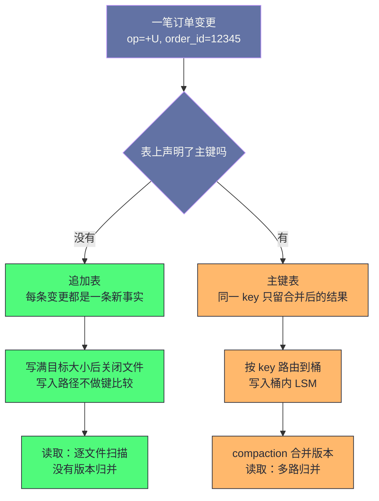
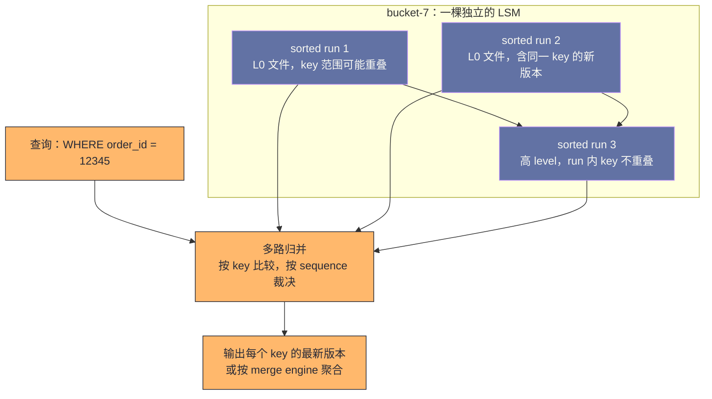
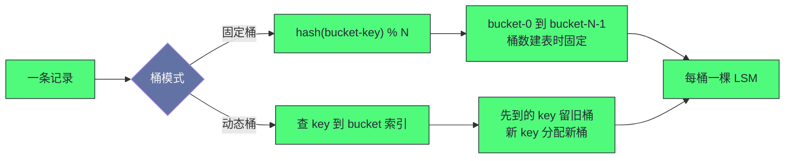
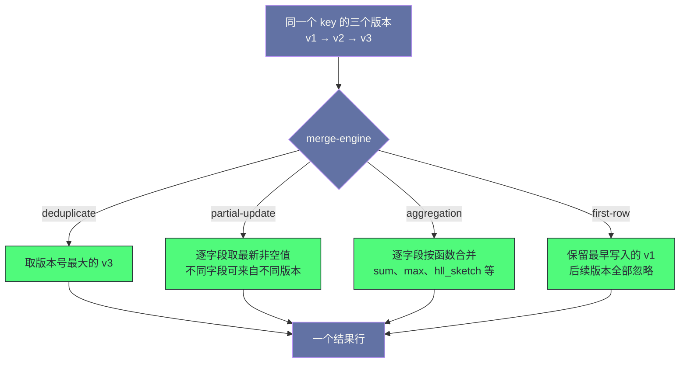
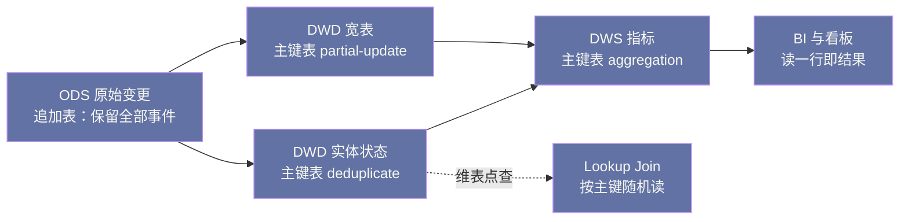

**摘要：**

同一笔订单变更，写进两张 Paimon 表，一张在几分钟后只剩最新状态，另一张在三年后仍能查到「下单、支付、发货」的每一次事件。差别不来自压缩算法或文件格式，而来自建表时签下的写入契约：一张承诺「同一主键只保留合并后的结果」，另一张承诺「每次写入都是一条新事实」。契约不同，物理结构就必须不同——主键表需要按 key 有序的 LSM 与版本合并，追加表只需要把文件写满、关闭、登记。本文从这两种契约出发，拆开追加表为何可以绕过 LSM、主键表为何绕不过；再把桶（Bucket）作为「key 空间切分」的实现讲透，包括固定桶与动态桶（`bucket = -1`）在两种表上截然不同的含义，以及桶数与读写并行度之间那道除法；随后逐一分析四种合并引擎（Merge Engine）的语义边界、序列字段（Sequence Field）如何裁决乱序，最后落到查询、compaction、changelog 三处的分工，以及给追加表设主键、把桶数设成 1、用聚合引擎装明细这三类反例。全文用一张订单表与一张行为事件表贯穿，所有数字均为示例推算。

---

## 第 1 章 两条写入契约

### 1.1 同一份变更，两种归宿

设想一个电商的实时数仓。MySQL 里的订单表每发生一次状态流转，binlog 就吐出一条变更；同一时刻，前端埋点把浏览、加购、下单写进 Kafka。两条流都要入湖，归宿却相反：订单流进湖之后，一个订单号只应该留下一行，状态推进到 PAID，就不该还能查到 CREATED；行为流进湖之后，每一次点击都该是一条独立记录，用户点了两次加购，就该有两行。

用同一张表承接两条流，总有一边不舒服。把行为流塞进主键表，得给每条事件编一个唯一 id 当主键，存储于是要为这个 id 维护排序、版本与合并，可事件从不更新；把订单流塞进追加表，每次状态变更都追加一行，查询方就得自己按时间倒排取最新，等于把合并逻辑推给每一个读者。

Paimon 的选择是把两种需求做成两种表类型，判定标准只有一条：建表时有没有声明主键。没有主键，表就是追加表（Append Table），写入路径只认追加；有主键，表就是主键表（Primary Key Table），写入路径按 upsert 处理。这个判定简单到容易被当成语法糖，但它决定了后面一切：文件怎么组织、提交怎么做、读取要不要归并、后台要不要 compaction、下游能不能消费到变更。

两张表的骨架可以写成两句 DDL，差别只有主键那一行：

```sql
-- 订单表：声明主键，写入按 key 收敛
CREATE TABLE dwd_orders (
    order_id   BIGINT,
    status     STRING,
    amount     DECIMAL(12, 2),
    updated_at TIMESTAMP(3),
    dt         STRING,
    PRIMARY KEY (order_id) NOT ENFORCED
) PARTITIONED BY (dt);

-- 行为表：不声明主键，写入即追加
CREATE TABLE ods_events (
    user_id    BIGINT,
    action     STRING,
    page       STRING,
    event_time TIMESTAMP(3),
    dt         STRING
) PARTITIONED BY (dt);
```

### 1.2 主键不是约束，是路由与合并的依据

Paimon 的主键后面总跟着 `NOT ENFORCED`，这不是语法装饰。它明说了：引擎不校验唯一性，写入方仍可能把同一个 key 写两次，表只负责在合并时收敛。这与关系数据库里「主键即唯一约束」的理解不同，主键在 Paimon 里承担的是三件事——决定记录进哪个桶（**路由**）、决定桶内文件按什么顺序排列（**排序**）、决定同一个 key 的多个版本如何留下一个（**合并**）。

三件事里任何一件变了，物理文件都要重排。因此主键不能像普通列那样随意 ALTER，改主键等于改路由与合并的依据，历史文件全部作废。这一点也解释了为什么 Paimon 把主键表与追加表定为两种表类型，而不是一个「有主键」的开关：两者的写路径从第一行代码起就分叉了。

### 1.3 追加表也能删改，但语义不同

一个常见误解是追加表的文件永远不可变、数据写错了只能删表重来。Paimon 1.x 的追加表支持 Spark SQL 的 `DELETE`、`UPDATE` 与 `MERGE INTO`，底层有两种做法：重写命中的文件（写时复制），或者只写一份删除向量（Deletion Vector，通过 `deletion-vectors.enabled = 'true'` 打开），读时按向量过滤行。

这不改变它作为追加表的定义。定义约束的是「写入路径是否按主键做流式 upsert」，而不是「文件是否永远不能被改写」。追加表的删改是批操作：先定位命中文件，再整体重写或标记删除，提交之后才生效，中间没有逐条的变更事件，也没有按 key 的路由；主键表的 upsert 则是流式写入路径的一部分，每一条记录进来就被路由、排序、合并，随 checkpoint 一起提交。前者像整理书架，后者像流水线上的分拣。

### 1.4 两种表的总账

把两种表的差异摊开，可以发现它们不是「同一套结构的两种参数」，而是两套结构；**主键表**与**追加表**的差别写在物理层，不在参数层：

| 维度 | 主键表（Primary Key Table） | 追加表（Append Table） |
|---|---|---|
| 写入语义 | 按主键 upsert，旧版本被新版本取代 | 只追加，每次写入都是一条新记录 |
| 主键 | 必须有 | 没有 |
| 存储结构 | 每个桶一棵 LSM，多个 sorted run 参与归并 | 只有不可变数据文件，没有键排序与版本 |
| 每行额外开销 | `_VALUE_KIND` 与 `_SEQUENCE_NUMBER` 两个系统列 | 无系统列 |
| compaction 目的 | 合并 sorted run、去除旧版本、产出 changelog 或删除向量 | 合并小文件，不改内容 |
| 流读能力 | 通过 changelog producer 产出变更 | 只产出追加流，全部是 `+I` |
| 读并行度 | 归并读（MOR）受桶数限制 | 不受桶数限制，读 split 随文件切分 |
| 默认桶模式 | `bucket = -1`，动态桶，靠索引记录 key 到桶的映射 | `bucket = -1`，忽略桶概念，全部写进 `bucket-0` |
| 典型退化 | 桶太少导致并行度不足，compaction 追不上写 | checkpoint 太密导致小文件堆积 |

下面这张图把两条路的物理分叉画出来，左边是追加表，右边是主键表，同一个问题——「新记录与旧记录是什么关系」——在两边的答案完全不同：



### 1.5 本文的视角

技术文档常把这两种表列成「类型选择」，好像先挑类型、再调参数。笔者更愿意换个说法：表类型声明的是**写入契约**——「写入方承诺什么、存储方担保什么」。追加表承诺「我只追加，不会要求你覆盖谁」，于是存储方可以只做顺序写；主键表承诺「我会反复写同一个 key，请你只留下对的那个」，于是存储方必须准备排序、版本与合并。契约签下之后，桶、合并引擎、序列字段都只是在履行条款，不是可以随便拧的性能旋钮。

---

## 第 2 章 追加表：把写入做成流水

### 2.1 一条事件在磁盘上的旅程

没有声明主键时得到的就是追加表，它是湖表最朴素的默认形态，目录结构也朴素得近乎无聊。一个按天分区的行为事件表，物理上大致是这样：

```text
warehouse/default.db/ods_events/
├── dt=2026-11-19/
│   └── bucket-0/
│       ├── data-4f1c9a2e-0.parquet
│       ├── data-8b3d7c10-0.parquet
│       └── data-c25e91af-0.parquet
├── schema/
│   └── schema-0
├── snapshot/
│   ├── EARLIEST
│   ├── LATEST
│   └── snapshot-128
└── manifest/
    ├── manifest-list-...-0
    ├── manifest-list-...-1
    └── manifest-...-0
```

文件名遵循 `data-${uuid}-${id}.${format}` 的约定，`id` 是同一个 writer 内的文件序号；目录里没有层级编号，没有 key 范围标记，也没有版本号列。写一条事件的过程同样没有悬念：Flink sink 把记录放进写缓冲，缓冲区满或者 checkpoint 到来时，把缓冲里的记录按到达顺序编码成 Parquet 文件，写到对应分区的 `bucket-0` 下；文件达到 `target-file-size`（追加表默认 256 MB，主键表默认 128 MB）就关闭，换一个新文件继续写。

提交走两阶段提交协议，由 checkpoint 驱动。一个 commit 最多产生两个快照：一个记录本次写入的新文件，`commitKind` 为 `APPEND`；如果这次提交顺带触发了 compaction，再产生一个 `commitKind` 为 `COMPACT` 的快照。读者看到的是快照，快照背后是 manifest 清单，清单里记着「本次新增了哪些数据文件、删除了哪些数据文件」。数据在 checkpoint 完成后才算持久，这也是 Flink 流写湖表的常规语义：可见性与持久性由同一张快照对齐，中间没有 MemTable 与 L0 的过渡层。

写入路径上最要紧的一点是「没有比较」：没有主键比较，没有版本号生成，没有同 key 覆盖判断，也没有把缓冲区分层。整条链路只做分区路由、序列化、写文件三件事，因此它的写吞吐基本由网络带宽与 Parquet 编码速度决定，不受合并策略影响。把这条路径画出来，能看到写入链路上没有任何需要读旧数据的环节：


### 2.2 为什么 LSM 在这里没有用

**LSM（Log-Structured Merge）**解决三个问题：把随机写转成顺序写、把同一个 key 的多个版本按顺序收敛、用分层合并控制读放大。这三个问题都预设了一个前提——存在「同一个 key 的多个版本」。追加表没有这个前提。每条记录都是独立事实，用户点了两次页面就是两条记录，既不覆盖也不收敛；没有 key 的重复，就没有版本要裁决；没有裁决，排序与分层合并就失去了对象。

反过来说，如果硬把事件流建成主键表，代价是实打实的。主键表的每一行都要存两个系统列：一字节的 `_VALUE_KIND`（标记这一行是新增还是删除，相当于 RocksDB 里的 value type）与八字节的 `_SEQUENCE_NUMBER`（版本号，合并时比较先后）；写入缓冲要按键排序，flush 成 L0 的 sorted run；后台 compaction 会反复重写这些 run，把刚写下的数据再搬几遍；读取时还要把多个 run 归并一遍。这些开销换来的唯一好处是：如果事件 id 真的重复了，可以顺手去重。若上游已经用 Flink 的 at-least-once 语义配幂等写入做了去重，这份开销就是纯支出。同一份事件数据写成追加表，写入链路上少掉排序与 compaction 的牵制，吞吐通常也更高。

打个比方，追加表像流水账，按发生顺序往下记；主键表像按客户号装订的账簿，每来一笔都要翻到对应客户那一页更新。如果业务从来只按时间查流水，把流水按客户号装订一遍、还要定期拆开重订，除了多雇一个账房先生，不会让查账更快。

### 2.3 需要顺序时：桶内有序

追加表也有需要顺序的时候。典型的场景是「按用户回放行为」：同一个用户的事件必须按发生顺序被下游消费，否则漏斗计算会算错。这时给追加表加上 `bucket` 与 `bucket-key`，就得到一张**分桶追加表（Bucketed Append Table）**：

```sql
CREATE TABLE ods_events_bucketed (
    user_id    BIGINT,
    action     STRING,
    page       STRING,
    event_time TIMESTAMP(3)
) WITH (
    'bucket'     = '8',
    'bucket-key' = 'user_id'
);
```

同一分区、同一个桶内的记录严格按写入顺序排列，流读时也按这个顺序下发；不同桶之间没有顺序保证，因为它们由不同 task 处理。这个语义很像 Kafka 的分区：key 相同的消息进同一分区，分区内有序，分区之间无序。它的第二个用途是批处理：两张表用相同的桶数与 `bucket-key` 时，Spark 可以识别出两边的分布一致，Join 时省掉一次 shuffle，这对大表关联的批任务很值钱。

代价有两处。其一，数据要按 `bucket-key` 哈希分发，写入多一次路由；如果 `bucket-key` 基数太小（譬如只有几个取值），桶之间会严重倾斜。其二，分桶追加表的 compaction 只在桶内做，桶与桶之间不合并，因此单个桶里的小文件会留得更多；官方配置里 `compaction.max.file-num` 的默认值对普通追加表是 50，对分桶追加表只有 5，就是因为桶内合并的窗口更窄。

| 形态 | 写入组织 | 读并行度 | 流读顺序 | 主要用途 |
|---|---|---|---|---|
| 普通追加表（`bucket = -1`） | 不按 key 分发，全部写 `bucket-0` | 随文件切分，不受桶数限制 | 无跨文件顺序保证 | 日志、埋点、原始变更落湖 |
| 分桶追加表（`bucket > 0`） | 按 `bucket-key` 哈希分发 | 受桶数限制（每桶若干 task） | 同分区同桶内严格有序 | 按 key 回放、批 Join 免 shuffle |

### 2.4 小文件：追加表唯一的后台工作

追加表没有版本要合并，却有另一件躲不掉的事：**小文件**。每次 checkpoint 都会把写缓冲落成文件，checkpoint 越密、写并行度越高，落下的文件越多；一个每天 1 TB 的表，如果 checkpoint 一分钟一次、写并行度 32，一天就是四万多个文件，哪怕每个文件都写满，也远多于按 256 MB 目标大小切出来的四千个。

追加表的 compaction 就是为这件事存在的：它把若干小文件读出来、拼成更大的文件、再登记进新快照，整个过程不改变任何一条记录的内容，也不做键比较。触发条件是文件数与体积：`compaction.min.file-num`（默认 5）要求参与合并的文件总量达到目标大小才值得合并，避免把几个接近满的文件再搬一遍；`compaction.max.file-num`（普通追加表默认 50）是硬上限，文件数超过就强制合并，防止小文件无限堆积。未分桶时，写入算子不做 compaction，由单独的 Compact Coordinator 扫描小文件、把任务派给 Compact Worker；分桶时则在桶内完成。

```sql
-- 流写追加表时控制文件数量的常见配置
ALTER TABLE ods_events SET (
    'target-file-size'        = '256 mb',
    'compaction.min.file-num' = '5',
    'compaction.max.file-num' = '50',
    'full-compaction.delta-commits' = '10'
);
```

`full-compaction.delta-commits` 是另一条兜底：每若干个 delta commit 做一次全量 compaction，把分区内的文件整理到目标大小。对追加表来说，这个参数主要影响「停写之后的文件形态」，不影响写入时的语义。若把 `write-only` 设为 `true`，写入作业会跳过 compaction 与快照过期，把这件事完全交给独立的 compaction 作业，这是多作业共写同一张表时的常规做法。

### 2.5 追加表的适用边界

**追加表适合三类数据**：只增不改的事件流（埋点、日志、传感器读数）、需要保留全部历史版本的原始变更（ODS 层的 binlog 事件，包括 `+I`、`-U`、`+U`、`-D` 全部保留）、以及写入吞吐优先、查询以范围扫描和聚合为主的明细数据。它的价值不在于「便宜」，而在于「不做多余的事」：没有主键就没有合并，没有合并就没有 compaction 的语义负担，写入可以一直保持流水线的形状。

它不适合另外三类：需要按 key 点查单条记录（每个文件都是独立 split，点查要扫很多文件）、需要字段级更新（追加表只能整行追加或批式删改）、以及下游需要消费完整 changelog（追加流里只有 `+I`，删除与更新要么不存在，要么以重写文件的形式发生，消费方看不到 `-U`）。这三类需求一旦出现，就该换主键表，而不是在追加表上打补丁。

---

## 第 3 章 主键表：写入即合并

### 3.1 桶里长着一棵树

主键表的目录比追加表多一层：分区下面按桶切分，每个桶目录里是一棵独立的 LSM。物理布局大致如下：

```text
warehouse/default.db/dwd_orders/
├── dt=2026-11-19/
│   ├── bucket-0/
│   │   ├── data-1a2b3c4d-0.parquet
│   │   └── data-5e6f7a8b-0.parquet
│   ├── bucket-1/
│   │   └── data-9c0d1e2f-0.parquet
│   └── ...
├── schema/schema-3
├── snapshot/snapshot-2048
└── manifest/...
```

桶内不是「一堆文件」，而是若干 **sorted run**。一个 sorted run 由一个或多个数据文件组成，文件内按主键有序，同一个 run 内不同文件的 key 范围互不重叠；不同 run 之间可以重叠，同一个 key 可以在多个 run 里各有一个版本。写入时新数据先进入内存缓冲，缓冲满或 checkpoint 到来时按键排序、flush 成一个新的 run；后台 compaction 再把多个 run 合并成一个，顺手把同一 key 的旧版本丢掉。

这套结构能成立，靠的是每行携带的三个信息：`_VALUE_KIND` 说明这一行是新增还是删除，`_SEQUENCE_NUMBER` 说明版本先后，主键列本身说明它是哪一行。三个信息合起来，读取时才有资格对多个 run 做多路归并——遇到同一个 key，比较版本号，取大的；遇到删除标记，把整行抹掉。下图把一个桶里的 run 与归并关系画出来：



### 3.2 写入路径：先排序，再合并，最后提交

一条 upsert 记录进入主键表，要过四道关。第一道是路由：按分区键算出分区，再按 `bucket-key`（默认就是主键）算出桶，或者查动态桶索引找到桶。第二道是缓冲：记录被放进该桶的写缓冲，缓冲内部按主键排序，同一个 key 的多次写入在这里就能先合并一次，减少后面落盘的文件量。第三道是 flush：缓冲满或 checkpoint 到来，缓冲里的记录按键有序写成新的 sorted run，落到 L0。第四道是 compaction：后台按 `num-sorted-run.compaction-trigger`（默认 5）判断 run 数是否过多，过多就合并，把旧版本清掉、把 run 数压回去。

四道关里，第二、三道是主键表独有的。排序不是目的，目的是让「同一个 key 的多个版本在物理上相邻」，这样 flush 时能顺手去重，compaction 时能做线性归并，查询时能按 key 范围裁剪。追加表没有这两道关，因为它不需要让同一个 key 相邻——没有 key 需要收敛。

```sql
-- 主键表的典型建表参数
CREATE TABLE dwd_orders (
    order_id   BIGINT,
    status     STRING,
    amount     DECIMAL(12, 2),
    updated_at TIMESTAMP(3),
    dt         STRING,
    PRIMARY KEY (order_id) NOT ENFORCED
) PARTITIONED BY (dt)
WITH (
    'bucket'            = '64',            -- 固定桶；不写则默认动态桶
    'bucket-key'        = 'order_id',
    'merge-engine'      = 'deduplicate',
    'sequence.field'    = 'updated_at',
    'changelog-producer' = 'lookup',
    'num-sorted-run.compaction-trigger' = '5'
);
```

### 3.3 为什么绕不过 LSM

主键表必须解决三个问题，而这三个问题在对象存储上恰好都指向 LSM。第一个是覆盖写：写入方只给出新值，不告诉存储旧值在哪个文件的哪一行；Parquet 文件不可变，没法打开文件改一行，存储只能「写一个新版本，再让旧版本在读取时失效」。第二个是高频写：CDC 每秒几千条更新，如果每次都去找旧文件、整份重写，写放大立刻失控；LSM 把每次写入变成顺序追加一个小文件，把重写推迟到后台按批进行。第三个是乱序裁决：同一个 key 的版本可能因为并行度、重放、多上游而乱序到达，存储需要版本号与确定性规则来决定谁赢，而 LSM 的 sorted run 正好提供了「按版本归并」的场所。

换一条路线也能做 upsert，但代价不同。整文件重写的路线（Iceberg 的写时复制、Paimon 的 COW 表模式）每次更新都要重写命中的整个文件，**写放大**与文件大小成正比；日志追加的路线（Hudi 的 MoR）写入很轻，但读时要在 base file 之外建哈希表来合并日志，日志攒得越多读得越慢。LSM 走的是第三条路：写入只追加有序 run，读取做多路归并，后台用 compaction 把 run 数压住，读放大的上界由 run 数而非日志长度决定。换句话说，LSM 不是 Paimon 的审美偏好，而是「upsert 语义 + 不可变文件 + 对象存储」这三个约束下能同时保住写吞吐与读性能的可行解。

### 3.4 合并放在写侧还是读侧

主键表的合并可以放在三个位置：**读取时合并（Merge On Read，MOR）**、**写入时合并（Copy On Write，COW）**、**写入时生成删除向量（Merge On Write，MOW）**。Paimon 把这三件事做成了表属性，可以随时切换，不需要重建表：

| 模式 | 开关 | 写性能 | 读性能 | 读并行度 | 非主键谓词下推 | 数据可见性 |
|---|---|---|---|---|---|---|
| MOR（默认） | 无 | 好 | 一般，需归并 | 受桶数限制 | 不支持 | 每次提交后立即可见 |
| COW | `full-compaction.delta-commits = '1'` | 差，每次写都全量合并 | 最好，无需归并 | 不受桶数限制 | 支持 | 提交后可见 |
| MOW | `deletion-vectors.enabled = 'true'` | 好 | 好，按删除向量过滤 | 不受桶数限制 | 支持 | L0 文件需 compaction 后可见 |
| MOR 读优化 | `compaction.optimization-interval` 加读优化系统表 | 好 | 接近 COW | 不受桶数限制 | 支持 | 停留在最近一次优化 compaction |

这张表里有两处容易被忽略。其一，MOR 的读并行度受桶数限制：一棵 LSM 在同一时刻只能由一个线程读，桶数就是读任务数的上限；这也是为什么桶不能太少。其二，MOR 下非主键列的过滤条件不能下推：如果查询按 `status = 'PAID'` 过滤，而某个文件的旧版本里这条订单还是 CREATED，提前按谓词把文件裁掉，就会把「新版本在另一个文件里」这件事一并裁掉，结果读到旧状态。这个限制不是实现偷懒，而是归并语义的必然结果。

MOW 用删除向量绕开了这个矛盾：写入时就查一次 LSM，把被覆盖的旧行号写进删除向量文件，读时先按向量过滤，再做普通的列式扫描。代价是写入多一次查找，收益是读侧不再需要归并，也不再受桶数限制。COW 则是把合并推到写入侧，写入时就把所有 run 合成一份，读的时候和普通 Parquet 表没区别，代价是每次写入都要重写整份文件。三种模式的取舍与 Hudi 的 CoW/MoR 是同一族问题，区别在于 Paimon 把它做成了可调的表属性，而不是建表时定终身。

### 3.5 主键表的四笔成本

第一笔是读放大：MOR 查询要把桶内所有 sorted run 归并一遍，读的字节可能只有几列，参与比较的行却是整桶。第二笔是 compaction 的写放大：每次 compaction 都要重读重写参与合并的 run，写放大倍数取决于 run 数与合并策略，通常在三到五倍之间。第三笔是并行度上限：桶数定死了读任务数与写任务数的上限，扩容只能靠加桶，而加桶要重写数据。第四笔是动态桶的索引开销：key 到桶的映射要维护，普通模式放在内存里，跨分区模式放在本地盘上，还要在启动时把全表 key 读一遍。

四笔成本叠在一起，主键表就有了明确的适用面：写入频繁、更新集中、需要按 key 点查或流式消费变更的表。反过来，一张只追加、从不更新、查询只按时间范围扫描的表，用主键表等于替它承担了四笔它根本不需要的成本。

---

## 第 4 章 桶：切开 key 的空间

### 4.1 桶的第一职责：把同一 key 关进同一个房间

**桶（Bucket）**是 Paimon 读写的最小单元。一张表或一个分区被切成若干桶，每个桶目录下是一棵独立的 LSM，读任务按桶切分，写任务也按桶切分。这个设计的第一职责不是并行，而是正确性：同一个 key 的所有版本必须落在同一个桶里，否则两个桶各有一份版本，读取时无法判断谁更新，compaction 也无法在桶内完成收敛。

由此可以推出桶的第二职责：把 key 空间切成互不干扰的并行单元。桶与桶之间没有 key 重叠，写入可以并行，读取也可以并行，后台 compaction 也可以并行；桶数于是同时决定了写并行度、读并行度与 compaction 并行度的上限。

### 4.2 固定桶：哈希决定一切

固定桶的规则只有一行公式：`Math.abs(hash(bucket-key) % bucket 数)`。`bucket-key` 不指定时默认取主键；没有主键的追加表则取整行。同一个 key 每次哈希的结果相同，因此永远落到同一个桶，桶内版本收敛的前提成立。把两种桶模式的路由方式并排看，固定桶是纯函数，动态桶要查表：



固定桶的好处是可预测：桶数建表时定死，每个桶的数据量、文件数、compaction 频率都能提前估；多作业并行写同一张表时路由结果是确定的，只要各作业负责不同的桶或分区，就不会把同一个 key 分到两处。代价是桶数不能随便改：`ALTER TABLE ... SET ('bucket' = ...)` 只改元数据，不会重排已有数据，要让新桶数生效必须用 `INSERT OVERWRITE` 把数据按新桶数重写一遍；在重写完成之前，任何按新桶数写入的 `INSERT INTO` 都会抛 `TableException`，提示新旧桶数不一致。分区表可以给不同分区设不同桶数，这给滚动扩容留了一条缝，但缝很窄——重写期间不能再有其他作业写同一分区。

```sql
-- 改桶数：先改元数据，再重写数据，两步都不能省
ALTER TABLE dwd_orders SET ('bucket' = '128');

SET 'execution.runtime-mode' = 'batch';
INSERT OVERWRITE dwd_orders PARTITION (dt = '2026-11-19')
SELECT * FROM dwd_orders WHERE dt = '2026-11-19';
```

### 4.3 动态桶：把「桶数」从建表时挪到运行时

固定桶要求建表时就猜准数据量，猜小了并行度不够，猜大了小文件成灾。**动态桶（`bucket = -1`）**把这件事推到运行时：不预先分配固定数量的桶，而是维护一份「key 到桶」的索引，先到的 key 落进已有的桶，新 key 落进新分配的桶，桶数随数据增长自动扩张。

```sql
-- 动态桶：不写 bucket，或显式写 -1
CREATE TABLE dwd_orders_dynamic (
    order_id   BIGINT,
    status     STRING,
    updated_at TIMESTAMP(3),
    dt         STRING,
    PRIMARY KEY (order_id) NOT ENFORCED
) PARTITIONED BY (dt)
WITH (
    'bucket' = '-1',
    'dynamic-bucket.target-row-num'  = '20000000',
    'dynamic-bucket.initial-buckets' = '8'
);
```

实现上分两种模式，代价不同。普通动态桶模式用于「更新不跨分区」的场景，也就是没有分区，或者主键包含全部分区字段；它用哈希索引维护 key 到桶的映射，索引放在内存里，官方文档给的量级是每个分区一亿条 key 大约多占 1 GB 内存，不再活跃的分区不占内存。跨分区 upsert 模式用于「主键不包含分区字段」的场景，索引落到本地盘，启动流写作业时要把表里已有的 key 全读一遍来初始化索引；数据量大时初始化很久，写入性能也会明显下降，官方建议配合 `cross-partition-upsert.index-ttl` 缩短索引保留时间，代价是可能产生重复数据。

更麻烦的是，不同合并引擎在跨分区 upsert 下的行为不一致：`deduplicate` 会删除旧分区的数据、在新分区插入；`partial-update` 与 `aggregation` 会把新数据写回旧分区；`first-row` 则直接忽略新数据。这不是实现细节，而是合并语义在「分区边界」上的自然投影——删除旧版本、保留旧行、只认第一行，本来就该有不同的落点。选动态桶之前，先确认自己的合并引擎属于哪一种。

动态桶最大的约束写在文档里：只支持单写作业。多个作业同时写同一个分区会导致重复数据，而且这个约束不能靠「写入设 `write-only`、另起专用 compaction 作业」绕开。原因不难理解，key 到桶的映射是一份需要串行维护的状态，两个 writer 各自持有一份索引，必然对同一个 key 分配出不同的桶。

### 4.4 桶数与并行度：一道除法题

桶数的选择可以还原成两道除法。写侧：**写入并行度**不能超过桶数，否则多出来的 task 分不到桶，只能空转；官方建议 sink 并行度小于等于桶数，最好相等。读侧：MOR 的读并行度以桶数为上限，单桶只能由一个线程归并，因此桶数也是读并发的下限保障。两道除法之外还有一条**单桶体积**约束：每个桶的目标数据量在 200 MB 到 1 GB 之间，太小则小文件多、打开文件的开销压过扫描本身，太大则单桶归并变成瓶颈、compaction 一次要搬太多数据。

把三条约束放在一张表里，算例就清楚了。假设订单表每天新增与更新合计 40 GB，按天分区，写并行度 32：

| 桶数 | 每桶每天数据量 | 写侧活跃 task 数 | MOR 读侧单次可并行桶数 | 判断 |
|---|---|---|---|---|
| 1 | 40 GB | 1 | 1 | 并行度瓶颈，单桶归并 |
| 4 | 10 GB | 4 | 4 | 远高于 1 GB 上限，compaction 压力大 |
| 32 | 1.25 GB | 32 | 32 | 接近上限，需要压缩单桶体积 |
| 64 | 625 MB | 32（每 task 两桶） | 64 | 落在推荐区间 |
| 128 | 312 MB | 32（每 task 四桶） | 128 | 可接受，但小文件更多 |

这张表是示例推算，不是实测值；它想说明的是桶数不是「越多越好」，而是「并行度下限」与「单桶体积上限」两个约束的交集。写并行度 32、每天 40 GB 的负载落在 64 到 128 个桶之间；如果写并行度升到 64，桶数也该跟着升到 64 以上，否则新增的 task 会分不到桶。

### 4.5 追加表的桶是排序单元，不是路由单元

`bucket = -1` 在两种表上含义完全不同，这是最容易误读的地方之一。在主键表上，它是动态桶：仍然分桶，只是桶数由运行时决定，靠索引记录 key 到桶的映射。在追加表上，它是「忽略桶概念」：所有数据写进 `bucket-0`，但读写并行度不受桶数限制，因为追加表没有 LSM，每个文件都是独立 split，读可以按文件切、写可以按并行度切。

这个差别的根源还是「有没有 key 需要收敛」。追加表不需要让同一个 key 落到同一个桶，因此不需要路由；它加桶的唯一目的是排序与聚簇——让同一个 `bucket-key` 的数据在物理上相邻，换来流读有序与批 Join 免 shuffle。同一行配置，一张表拿它做索引，另一张表拿它做排序，读文档时必须先看清表类型。

### 4.6 选桶的判断顺序

选桶可以按四步走。第一步问读法：如果查询以按 key 点查为主，桶数要足够多，让每个桶都小到能快速定位；如果查询以全表扫描为主，桶数只需覆盖并行度。第二步问写并行度：桶数不能小于写入并行度，否则写入侧一定有 task 空转。第三步问单桶体积，用「分区日增数据量 ÷ 桶数」估算。第四步才问固定还是动态：数据量可预测、多作业并发写，选固定桶；更新率低、分区多、桶数难估、单作业写入，选动态桶。

---

## 第 5 章 合并引擎：最后一条赢之外

### 5.1 合并发生在三个位置，规则只有一个

主键表的合并会出现在三个位置：写缓冲 flush 时（同一个 key 在内存里先合一次）、compaction 时（多个 run 里的版本再合一次）、查询归并时（compaction 没追上，读的时候顺手合一次）。三个位置执行的是同一个函数，也就是**合并引擎（Merge Engine）**。它接收「同一个 key 的多个版本」，输出「一个结果行」。

这个函数必须能承受合并顺序的不确定：compaction 可能先合 run A 再合 run B，查询可能把三个 run 一起归并，同一个 key 的版本在不同时刻参与合并的集合不一样。`sum` 这类满足交换律与结合律的函数天然耐受；`last_value` 依赖「谁在最后」，必须靠序列号兜底；`first-row` 干脆把「第一」定义为物理写入顺序，因此不允许再配序列字段——两者对「第一」的定义会打架。理解这一点，后面四种引擎的行为就都能推出来。

### 5.2 四种语义

| 引擎 | 冲突规则 | 典型业务 | 主要限制 |
|---|---|---|---|
| `deduplicate` | 保留序列号最大的版本，其余丢弃 | 订单、用户、商品等实体状态 | 删除会抹掉整个 key；需正确处理乱序 |
| `partial-update` | 逐字段取最新非空值，NULL 不覆盖 | 多源拼宽表、字段级 CDC 更新 | 流读需 lookup 或 full-compaction；删除需额外配置 |
| `aggregation` | 逐字段按聚合函数合并 | 实时指标、UV、累计金额 | 不保留明细；下撤只被部分函数支持 |
| `first-row` | 保留第一次写入的版本，后续忽略 | 首次归因、幂等去重、只写一次 | 只支持 none/lookup changelog；不接受删除与更新前像 |

四种引擎的语义分叉可以画成一张图：



### 5.3 deduplicate：默认的「最后一条赢」

`deduplicate` 是默认引擎，规则也最直白：同一个 key 只留序列号最大的一条，其余丢掉；如果最大那条是 `DELETE`，整个 key 的所有版本一起删掉，除非配了 `ignore-delete`。订单表是最典型的用户：订单状态从 CREATED 到 PAID 再到 SHIPPED，每次变更都是一条完整记录，读的时候只关心最后状态。

它的风险全在「最后」二字上。分布式写入下，最后到达的不一定是最后发生的，如果没有 `sequence.field`，Paimon 只能按输入顺序判断，重放、并发、多上游都会让顺序失真。这也是为什么订单表几乎总要配一个 `updated_at` 或 binlog 位点作为序列字段。

```sql
CREATE TABLE dwd_orders (
    order_id   BIGINT,
    status     STRING,
    amount     DECIMAL(12, 2),
    updated_at TIMESTAMP(3),
    dt         STRING,
    PRIMARY KEY (order_id) NOT ENFORCED
) WITH (
    'merge-engine'   = 'deduplicate',
    'sequence.field' = 'updated_at'
);
```

### 5.4 partial-update：把宽表拼接下推到存储

**部分更新（partial-update）**的规则是「逐字段取最新非空值」：新记录里为 NULL 的字段不覆盖旧值，非 NULL 的字段覆盖。它解决的是多路流分别更新同一行不同字段的问题。设想用户宽表由三个服务维护——基础信息服务写昵称与注册时间，头像服务写头像地址，会员服务写等级；三个服务各自把「自己负责的字段 + NULL 的其他字段」写进同一张表，Paimon 在存储层把字段拼起来，最终得到一行完整资料。

```sql
CREATE TABLE dim_user_profile (
    user_id    BIGINT,
    nickname   STRING,      -- 基础信息服务写
    avatar_url STRING,      -- 头像服务写
    vip_level  INT,         -- 会员服务写
    g_base     BIGINT,      -- 基础信息流的序列组
    g_avatar   BIGINT,      -- 头像流的序列组
    g_vip      BIGINT,      -- 会员流的序列组
    PRIMARY KEY (user_id) NOT ENFORCED
) WITH (
    'merge-engine' = 'partial-update',
    'fields.g_base.sequence-group'   = 'nickname',
    'fields.g_avatar.sequence-group' = 'avatar_url',
    'fields.g_vip.sequence-group'    = 'vip_level',
    'changelog-producer' = 'lookup'
);
```

这个引擎之所以成为 CDC 入湖的常用模式，原因在于 CDC 的更新往往只带变更列。MySQL 的 binlog 在 `binlog_row_image = MINIMAL` 时只记录被修改的列，其他列为 NULL；即便用 FULL 模式记录全列，多路上游各自只掌握一部分字段也是常态。传统做法是在 Flink 里做双流 Join 或定期打宽，状态大、窗口难对齐；`partial-update` 把「字段级最后写入者赢」做成存储语义，各路流独立写入，存储层负责拼接，Flink 侧不再需要维护双边状态。这是把 Join 从计算层下推到存储层的典型手法，代价是存储层要额外做一次字段级合并，且读的时候必须能看到完整结果。

它的坑集中在三处。第一处是删除：默认情况下 `partial-update` 不接受 `DELETE`，收到删除记录无法正常处理，必须显式配 `ignore-delete`、`partial-update.remove-record-on-delete`，或者用序列组精确下撤某几个字段。第二处是多流互相覆盖：如果三路流都带同一个全局序列号，后到的流会用自己的 NULL 去「确认」其他字段的旧值仍然有效，看似没问题；但一旦某路流补发历史数据，它的序列号可能比另一路新数据更大，于是把另一路的字段整体回退。序列组（`fields.<field>.sequence-group`）就是为这件事准备的——每个字段只认自己那一路的序列号，别的流的版本再大也不影响它。第三处是流读：`partial-update` 的流式查询必须配 `lookup` 或 `full-compaction` 的 changelog producer，否则消费方拿不到完整的变更序列；这条约束经常被忽略，表现为下游作业读到的结果「过一会儿才正确」。

### 5.5 aggregation：把指标维护在存储里

`aggregation` 给每个非主键字段配一个聚合函数，合并时逐字段执行。未指定函数的字段默认用 `last_non_null_value`。可用的函数覆盖了大部分实时指标需求：`sum`、`product`、`min`、`max`、`last_value`、`last_non_null_value`、`listagg`、`bool_and`、`bool_or`、`first_value`、`first_non_null_value`，以及面向集合与近似计算的 `collect`、`merge_map`、`nested_update`、`rbm32`、`rbm64`、`hll_sketch`、`theta_sketch`。

```sql
CREATE TABLE dws_page_stats (
    dt          STRING,
    page_id     BIGINT,
    pv          BIGINT,
    uv_sketch   VARBINARY,
    max_stay    BIGINT,
    PRIMARY KEY (dt, page_id) NOT ENFORCED
) WITH (
    'merge-engine' = 'aggregation',
    'fields.pv.aggregate-function'        = 'sum',
    'fields.uv_sketch.aggregate-function' = 'hll_sketch',
    'fields.max_stay.aggregate-function'  = 'max'
);
```

有两处必须写清楚。其一，UV 这类去重计数要用 `hll_sketch` 或 `theta_sketch`，它们的输入是序列化后的草图（sketch）字节，不是原始用户 id；上游要先把 user_id 转成草图再写入，查询时再用对应的计数函数把草图还原成估计值。把函数写成 `hll_union` 之类的名字是常见的讹传，Paimon 的聚合函数表里没有这个函数。其二，**下撤（retraction）**只被部分函数支持：`sum`、`product`、`collect`、`merge_map`、`nested_update`、`last_value`、`last_non_null_value` 能处理 `UPDATE_BEFORE` 与 `DELETE`，`max`、`min`、`hll_sketch` 等不支持；如果上游会发下撤消息而这些字段又没配 `ignore-retract`，结果会偏，而且不会报错。

这个引擎回答的问题是「我只关心聚合结果，不关心每一条明细」。用对了，它能把实时指标从「每次查询全表聚合」变成「读一行就是结果」；用错了，它会把明细永久吞掉，等到业务要按新维度重算时，只能回到原始数据重跑。

### 5.6 first-row：只认第一次

`first-row` 保留同一个 key **第一次写入**的版本，后续版本一律忽略，产生的 changelog 只有 `+I`。它适合首次归因类需求：用户第一次从哪个渠道进来、订单第一次创建时的原始金额、活动第一次曝光的时间。这些值一旦写下就不该被后续更新覆盖，用 `first-row` 比在应用层做「先查再写」更可靠，因为查与写之间没有竞态。

它的限制也最多：只能配 `none` 或 `lookup` 的 changelog producer；不能配 `sequence.field`（否则「第一次」到底按物理写入还是按业务时间，定义会冲突）；不接受 `DELETE` 与 `UPDATE_BEFORE`，要配 `ignore-delete` 才能容忍上游的下撤消息；L0 文件要等 compaction 之后才对读者可见，而它默认走同步 compaction，如果打开异步 compaction，数据可见性会有延迟。这些限制共同指向一件事：`first-row` 的「第一」是物理意义上的第一，不是业务时间意义上的最早。

### 5.7 引擎选择是业务问题

四种引擎的取舍不在性能，而在「同一 key 的多个版本里，业务认为哪个值才是对的」。订单状态要最后一个，用户资料要字段级最新，指标要聚合，首次归因要第一个——这四个答案对应四个引擎，选错任何一个是正确性问题，调参救不回来。性能只决定「同一语义下用什么模式实现」，那是桶与表模式的职责。

---

## 第 6 章 序列字段：给乱序一个裁决者

### 6.1 乱序从哪里来

CDC 入湖的乱序有四个来源。其一是并行度：同一个订单的两次变更可能被分到两个 source 并发读取，到达 sink 的顺序与 binlog 顺序无关。其二是多上游：同一张表可能同时被全量同步作业与增量作业写入，两边的时间线不一致。其三是重放：作业从 checkpoint 恢复时会把一段时间内的数据重发，重发的版本可能晚于新写入的版本到达。其四是多分区：Kafka 多个 partition 之间本来就没有全局顺序。

只要存在乱序，「最后一条赢」就变成了「最后到达的赢」，而最后到达的未必是最后发生的。**序列字段（Sequence Field）**就是为这件事准备的：它把「谁更新」的裁决权从到达顺序交给一个业务字段。

### 6.2 默认按输入顺序，序列字段改按值

不配 `sequence.field` 时，主键表按输入顺序判断先后，最后输入的记录最后合并。配上之后，合并时比较序列字段的值，值最大的最后合并；值相同时退回输入顺序。序列字段可以配多个，按声明顺序依次比较，譬如 `'updated_at,op_type'`；支持所有数据类型，包括数值、时间与字符串。

```sql
CREATE TABLE dwd_orders (
    order_id   BIGINT,
    status     STRING,
    updated_at TIMESTAMP(3),
    binlog_ts  TIMESTAMP(3),
    PRIMARY KEY (order_id) NOT ENFORCED
) WITH (
    'sequence.field' = 'binlog_ts'
);
```

### 6.3 该拿什么字段做序列

首选是数据源产生的、单调且唯一的时间或位点：MySQL binlog 的 `op_ts`、变更事件里的 `update_time`、Kafka 的 offset（转成单调数值后）。这类字段的共同点是「由产生方赋值，不由消费方赋值」，重放与并发都不会改变它。

不要用处理时间（processing time）。处理时间是 Flink 算子运行时打的戳，同一条记录重放一次就换一个值，乱序时它反映的是「谁先被处理」，而不是「谁先发生」；更糟的是，处理时间在生产环境里经常出现相同值，比较退化成输入顺序，等于没配。

还有一条容易忽略的边界：跨分区 upsert 时，序列字段只能裁决「同一个分区内」的版本。如果主键不包含分区字段，同一个 key 的旧版本可能躺在历史分区里，`deduplicate` 会把它删掉再在新分区插入，这个动作由跨分区索引驱动，不受 `sequence.field` 的大小影响；如果旧分区里的数据没有被清理，查询时仍可能读到它。序列字段解决的是同桶内的版本顺序，不是跨分区的数据搬迁。

### 6.4 序列字段管不了的事

`sequence.field` 解决「同一个 key 的版本谁更新」，不解决「同一个 key 的字段属于哪条流」。多流 `partial-update` 场景下，三路流各有自己的时间线，一个全局序列字段会被别的流的版本覆盖，导致字段回退；这时要用序列组，让每个字段只认自己那一路的序列号。这两者的分工可以记成一句话：序列字段裁决行，序列组裁决列。

另外两处冲突写在文档里。`first-row` 不能配 `sequence.field`，因为前者定义「物理第一次」，后者定义「业务时间最大」，两者对「第一」的解释不一致；`first_value` 这类「取最早值」的聚合函数与用户自定义序列字段也会冲突，原因相同。配之前先想清楚「最早」是按什么定义的，比事后调参省事。

### 6.5 补数与时钟回拨

序列字段不是万能的。补数作业如果把一批历史数据写进来，而序列字段用的是业务时间，那么这批数据的序列值会小于当前最新版本，合并时直接被丢弃——看起来像「补数没生效」，实际是序列裁决按预期工作。遇到这种场景，要么把补数写成 `INSERT OVERWRITE` 重写分区，要么临时调整序列字段的取值口径，不能指望 upsert 能把旧时间的数据顶上去。

时钟回拨是另一个坑。上游机器的时钟如果往回跳，新产生的 `update_time` 可能小于旧值，这条更新就会被当成旧版本丢掉。用数据库的 binlog 位点或单调递增的版本号代替墙钟时间，可以绕开这个问题；如果只能用时间，至少要保证时间来自同一台机器或同一个时钟源。

---

## 第 7 章 查询、compaction、changelog 的分工

### 7.1 查询：一个扫文件，一个归并

追加表的查询路径短：读 manifest 里的文件清单，用每个文件的 min/max 统计裁剪掉不可能命中的文件，命中的文件直接交给扫描器，列裁剪与谓词下推全部可用；文件多时还能加文件索引（布隆过滤器、位图、BSI），把「这个文件里有没有我要的 key」这一步也省掉。读并行度随文件数增长，文件越多，能切出的 split 越多，扩机器就能提速。需要按某列聚簇时，可以用 `COMPACT` 动作做一次排序重写。

主键表的查询路径长一截。MOR 模式下，查询要把桶内所有 sorted run 做多路归并，按 key 与序列号裁决每个 key 的最终版本；非主键列的过滤条件不能下推，因为提前裁文件会漏掉旧版本，只能在归并之后过滤。读并行度受桶数限制，因为一棵 LSM 同时只能由一个线程读。COW 与 MOW 把归并挪走之后，读路径才回到与追加表相近的形态：COW 每次写入已经合并完毕，MOW 用删除向量在扫描时过滤，两者都支持非主键谓词下推，也都不再受桶数限制。

### 7.2 compaction：语义操作与物理操作

两种表的 compaction 名字相同，性质不同。主键表的 compaction 是语义操作：它要执行合并引擎、丢弃旧版本、生成新的 sorted run，启用 changelog producer 时还要顺带产出 changelog 文件，启用 MOW 时还要生成删除向量。因此它的输入输出不只是字节，还包括「哪些 key 的最终值变了」。追加表的 compaction 是物理操作：把若干文件读出来、按原样拼成更大的文件、登记进新快照，记录内容一条不变；只有带排序的 compaction 会改变物理顺序，删除向量模式会改变删除的表达方式。

这个差别决定了两件事。其一，主键表的 compaction 不能随便交给一个不了解表语义的外部进程乱序执行，同一分区的 compaction 只能有一个作业在做，否则冲突；追加表的 compaction 则相对安全，只要不与其他写作业抢同一分区即可。其二，主键表的 compaction 频率直接影响读性能与 changelog 延迟，追加表的 compaction 频率主要影响文件数量与查询的文件打开开销。

```sql
-- 主键表：控制 run 数与写停顿
ALTER TABLE dwd_orders SET (
    'num-sorted-run.compaction-trigger' = '5',
    'num-sorted-run.stop-trigger'       = '8'
);

-- 追加表：控制小文件与全量整理节奏
ALTER TABLE ods_events SET (
    'compaction.min.file-num'       = '5',
    'compaction.max.file-num'       = '50',
    'full-compaction.delta-commits' = '10'
);
```

### 7.3 changelog：主键表才有的产物

追加表没有 changelog producer。这不是省略，而是不需要：追加流本身全是 `+I`，流读就是按顺序把文件里的记录发出去，桶内保序、跨桶无序。消费方如果需要 `-U` 或 `-D`，说明它要的不是追加表。

主键表的 changelog 则必须显式生产，因为快照之间只能比较出「哪些 key 变了」，拿不到旧值。Paimon 提供四种 **changelog producer**：`none`（默认，只暴露合并后的变化，消费方要自己记住每个 key 的旧值，也就是 Flink 里的 normalize 算子）、`input`（把输入记录原样存成 changelog，要求输入本身是完整 changelog，典型是数据库 CDC）、`lookup`（提交前查一次旧值，生成完整变更，代价是写入多一次查找）、`full-compaction`（比较两次全量 compaction 的差异，延迟由 compaction 周期决定）。各模式的延迟与成本差异不展开，这里只记一条语义边界：changelog 是主键表的能力，不是湖表格式的通用能力。

### 7.4 一张分工表

| 事项 | 追加表 | 主键表 |
|---|---|---|
| 数据裁剪 | 文件 min/max、文件索引、任意列谓词下推 | 主键范围裁剪；MOR 下非主键谓词不可下推，COW/MOW 可以 |
| 读并行度 | 随文件数扩展 | MOR 受桶数限制，COW/MOW 不受限 |
| compaction 输入 | 小文件 | 多个 sorted run 与旧版本 |
| compaction 产物 | 更大的数据文件 | 新的 run、最终版本、changelog 或删除向量 |
| compaction 约束 | 同一分区避免多作业争抢 | 同一分区只能有一个 compaction 作业 |
| 流读形态 | 纯 `+I` 追加流 | 由 changelog producer 决定，可含 `-U`、`+U`、`-D` |
| 下游状态成本 | 无 | `none` producer 下需要 normalize，状态随 key 数增长 |
| 扩容手段 | 加文件、加机器 | 加桶（需重写）或改动态桶 |

### 7.5 实时数仓里的混合布局

一张实时数仓通常不会只用一种表。ODS 层承接原始变更，用追加表最合适：binlog 的 `+I`、`-U`、`+U`、`-D` 全部保留，不做合并，出错时可以回到原始事件重放。DWD 层按业务实体建模，用主键表加 `deduplicate`，每个订单、每个用户只留最新状态，供下游点查与流读。需要拼宽表的层用 `partial-update`，把多路维度的字段写进同一行。DWS 层的指标用 `aggregation`，把 PV、UV、累计金额维护在存储里，查询时读一行就是结果。下图把这种分层与各层选用的表类型画出来：



分层判断可以归结成一个问题：这一层的数据是「事件」还是「状态」。事件层用追加表，状态层用主键表；状态层内部再按「整行替换、字段拼接、聚合计算、只认首次」四分，对应四种合并引擎。

---

## 第 8 章 定量：两种表各欠多少 I/O

### 8.1 推算口径

下面的数字全部是示例推算，用于比较量级关系。假设两张表都按天分区、每天 288 批（约每 5 分钟一批），读写同价，忽略对象存储的请求费用与 Parquet 编码的 CPU 差异。

订单主键表：每天新增与更新合计 40 GB，逻辑行数约 2 亿行（行宽按 200 字节估），64 个固定桶，合并引擎 `deduplicate`，MOR 模式，`num-sorted-run.compaction-trigger` 为 5，每天约 200 次快照查询。

行为追加表：每天 1 TB 事件，行宽按 300 字节估，写并行度 32，checkpoint 每 5 分钟一次，`target-file-size` 256 MB，普通追加表（不分桶），`compaction.max.file-num` 为 50。

### 8.2 主键表的账

先算写入。每批 40 GB ÷ 288 ≈ 139 MB，摊到 64 个桶，每桶每批约 2.2 MB，落成一个或几个小文件。一天下来每桶新写约 625 MB，全表 40 GB。这是逻辑写入量，真正的物理写入还要加 compaction：每桶攒到 5 个 sorted run 就合并一次，一天约 58 次，每次把参与合并的 run 重读重写；按 universal compaction 常见的三到五倍写放大估，每桶一天物理写 2 GB 到 3 GB，全表 128 GB 到 192 GB，相对 40 GB 的逻辑写入，写放大约三到五倍。

再算读取。MOR 模式下，一次针对当天分区的快照查询要把 64 个桶、每桶约 5 个 run 全部归并，参与归并的数据量约 40 GB；200 次查询就是 8 TB 的扫描量，其中大部分是重复扫描同一批文件。若查询只取少数几列，列裁剪能把字节压下来，但归并要读主键与序列号列，行数放大压不下去。这也是为什么主键表在高频查询场景下要往 MOW 或 COW 走：不是为了写得更快，而是为了读的时候不必每次归并。

这张表也能验证桶数与并行度的关系：写并行度 32、桶数 64，每个写 task 平均两个桶；桶数降到 4，只剩 4 个 task 有活，其余 28 个空转；桶数升到 128，每桶每天约 312 MB，仍在推荐区间，但文件数与 compaction 任务数都翻倍。

### 8.3 追加表的账

先算文件数。每天 1 TB，按 256 MB 目标大小切，理想情况下约 4096 个文件；但 checkpoint 每 5 分钟一次，一天 288 次，每次 32 个写 task 各落一个文件，一天就是 9216 个文件——比理想值多一倍多。compaction 会把它们合并回去：每 5 个文件触发一次合并（`compaction.min.file-num`），文件数超过 50 个强制合并（`compaction.max.file-num`），稳态文件数大致落在 4096 到 8192 之间。

再算 compaction 的写入量。每个文件平均参与两到三轮合并，物理写入约 2 TB 到 3 TB，相对 1 TB 的逻辑写入，写放大约两到三倍。这个倍数比主键表低，但它的锚点不同：主键表的写放大由「桶数 × run 数 × compaction 次数」决定，追加表的写放大由「checkpoint 频率 × 写并行度 ÷ 目标文件大小」决定。把 checkpoint 从 5 分钟改成 1 分钟，文件数立刻涨到四万多，compaction 的写入量也随之翻几倍，这是追加表最常见的容量事故。

如果这张表改成分桶追加表，桶数 64、`bucket-key` 为用户 id，情况会变：写入多一次哈希分发，桶内 compaction 的窗口收紧到 5 个文件，单桶里的小文件会留得更多；换来的是同一用户的事件在物理上相邻，按用户回放的流读与按用户关联的批 Join 都能省掉 shuffle。

### 8.4 两种账本的锚点

| 项目 | 主键表 | 追加表 |
|---|---|---|
| 写入的锚 | 桶数、run 数、compaction 频率 | checkpoint 频率、写并行度、目标文件大小 |
| 写放大来源 | compaction 重读重写 sorted run | compaction 合并小文件 |
| 读放大来源 | 归并 sorted run（MOR） | 文件数过多导致的打开与裁剪开销 |
| 扩容手段 | 加桶（重写数据）或改动态桶 | 加文件、加机器 |
| 每天最先撞到的墙 | 单桶体积超过 1 GB 后归并变慢 | checkpoint 太密导致文件数爆炸 |

这张表想说明的是：两种表的成本都不在「写一条记录」这个动作上，而在「写完之后系统为了维持可读性还要做多少事」。主键表为了维持「一个 key 一个最新版本」而做合并，追加表为了维持「文件不要太多」而做拼接；前者是**语义维护**，后者是**物理整理**。认清这一点，容量规划才不会把两张表的成本混为一谈。

---

## 第 9 章 反例与边界

### 9.1 给追加表设主键

症状是写入吞吐上不去、checkpoint 时间随数据量线性增长、存储占用比预期高出一截，而查询并没有因为主键变快。根因是给一张只追加的事件表声明了主键：事件从不更新，主键唯一且不会重复，存储却要为它维护排序、版本号、L0 文件与 compaction，每行还多出 1 字节的 `_VALUE_KIND` 与 8 字节的 `_SEQUENCE_NUMBER`。判据很直接：统计这张表的「更新比例」，如果同一主键的第二次写入占比接近零，主键没有带来任何合并收益；再对比同一份数据写成追加表与主键表的写入吞吐，差距通常在数倍。

处置分两种情况。如果上游保证不重复投递，直接去掉主键，写成追加表；如果上游会重复投递且没有幂等去重，主键表确实是正确的去重工具，那就接受这份成本，并把桶数、checkpoint 频率按主键表的账本重新调一遍——不能既想用主键去重，又想按追加表的成本运行。

### 9.2 把桶数设成 1

症状是 Flink 作业里只有一个 sink task 的 CPU 打满，其余 task 空闲；checkpoint 时长随数据量线性增长；查询一个分区只能起一个读任务。根因是桶数设成 1：主键表的每个桶是一棵 LSM，写与读都以桶为单位切分，一个桶只能由一个 task 写、一个线程读，并行度被锁死在 1。判据是看 Flink 的 task 忙闲分布，如果写入算子里只有一个 subtask 有记录，基本可以确认。

处置是把桶数调到不小于写并行度，并把单桶体积控制在 200 MB 到 1 GB；如果数据量波动大、桶数难估，改用动态桶，让桶数随写入自动扩张。要注意，改桶数不是 `ALTER TABLE` 一句话的事，固定桶需要 `INSERT OVERWRITE` 重分布数据，重写期间不能有其他作业写同一分区。

### 9.3 用 aggregation 装明细

症状是业务方来要「某个订单的明细」或「按新维度重算上个月指标」时，发现表里只有聚合后的值，明细已经不可恢复；想补算，只能回到 ODS 重跑。根因是把 `aggregation` 当成了「节省存储的明细表」，而它从设计上就不保留明细——合并函数只保留聚合状态，旧版本在 compaction 时被丢弃。

判据是问一句：这张表未来会不会需要按新维度、新口径重算？如果会，明细必须单独留一份。处置是双层建模：明细层用追加表或 `deduplicate` 主键表保留原始记录，聚合层用 `aggregation` 维护指标；两层之间用同一份 CDC 流分别写入，而不是让聚合层兼任明细层。存储成本要提前算清楚。

### 9.4 partial-update 与 deduplicate 混用

症状是宽表里某些字段莫名其妙变回 NULL，或者某个服务的更新被另一个服务的整行写入覆盖。根因是同一张表上混用了两种语义：`deduplicate` 是整行替换，新记录里为 NULL 的字段会把旧值抹掉；`partial-update` 是逐字段覆盖，NULL 不生效。如果上游有的服务发全行、有的服务发增量列，用 `deduplicate` 就会把增量服务没带的字段清空。

判据是看写入记录的字段完整度：如果不同上游的字段覆盖范围不同，就该用 `partial-update` 加序列组；如果所有上游都发完整快照，`deduplicate` 更简单。处置是统一契约——要么所有上游都发全行，要么全部改成增量列并配序列组，不能一半一半。

### 9.5 动态桶开多写作业

症状是表里出现重复的 key，或者同一个 key 在两个桶里各有一份版本，查询结果时多时少。根因是动态桶需要维护 key 到桶的映射，这份状态由单个 writer 串行持有；多个作业同时写同一分区，各自分配桶，同一个 key 就可能被分到不同桶。官方文档对此写得很直接：动态桶只支持单写作业，即使打开 `write-only` 再起专用 compaction 作业，也消不掉这个约束。

判据是看写入拓扑：如果同一张表的同一个分区上有两个以上的流写作业，且表用的是动态桶，问题基本成立。处置是把写入收敛成单作业，或者改成固定桶——固定桶的路由是纯哈希，多个作业算出的桶一定一致，不会把同一个 key 分到两个桶，但同一桶的并发提交仍需错开。

### 9.6 三条边界

小表。一张不到 1 GB 的表，主键表的归并、compaction、桶开销都会盖过它带来的收益，用追加表或单桶主键表更省心；此时桶数与并行度的讨论没有意义。

超高频点查。主键表能按 key 裁剪文件，但每次点查仍要打开若干文件、做一次归并；如果 QPS 高到毫秒级延迟成为硬指标，外部 KV 存储通常比湖表更合适。湖表的点查适合「低频、按 key 取整行」的场景，不适合替代在线数据库。

跨分区 upsert。主键不包含分区字段时，动态桶要走跨分区模式，索引落本地盘、启动读全表 key，数据量大时初始化与写入都会明显变慢。这类表要在建模阶段就决定分区字段，尽量让主键覆盖分区字段；实在覆盖不了，再接受跨分区模式的代价。

### 9.7 反例速查表

| 症状 | 判据 | 根因 | 处置 |
|---|---|---|---|
| 写入吞吐低、存储偏高、查询没变快 | 同一主键的重复写入占比接近零 | 给纯追加数据设了主键 | 去掉主键，或接受成本重调桶与 checkpoint |
| 只有一个 sink task 忙 | task 忙闲分布严重倾斜 | 桶数小于写并行度，甚至为 1 | 桶数调到不小于并行度，或改动态桶 |
| 明细查不到、无法按新维度重算 | 表里只有聚合值 | 用 aggregation 承担了明细职责 | 明细层与聚合层分开建模 |
| 字段变 NULL、更新被覆盖 | 不同上游的字段完整度不一致 | deduplicate 与 partial-update 语义混用 | 统一上游契约，宽表用 partial-update 加序列组 |
| 出现重复 key、结果时多时少 | 同一分区有多个写作业且用动态桶 | 动态桶的 key 到桶映射被并发写分叉 | 收敛为单写作业，或改固定桶 |
| 补数不生效 | 补数数据的序列值小于当前版本 | sequence.field 按值裁决，旧时间被丢弃 | 改成 INSERT OVERWRITE 重写分区 |
| 数据写入后一段时间才可见 | 表开了 MOW 或异步 compaction | L0 文件需 compaction 后才可见 | 调 compaction 策略，或接受可见性延迟 |

---

## 第 10 章 落点

回到开头那两张表。订单表与行为表的差别，最终可以还原成两个问题：这份数据里有没有「同一个逻辑行的多个版本」，以及这些版本需不需要收敛。需要收敛，就必须有 key、有排序、有版本裁决，LSM 是这套要求的实现；不需要收敛，排序与合并都是多余的动作，文件写完关闭就是全部工作。

由此可以给出一条判断顺序。第一步问数据形态：这一层存的是事件还是状态？事件进追加表，状态进主键表。第二步问合并语义：状态是整行替换、字段拼接、聚合计算，还是只认首次？四个答案对应四种合并引擎。第三步问顺序来源：同一个 key 的版本会不会乱序到达？会，就指定一个由产生方赋值的序列字段；多流拼宽表，再补序列组。第四步才问桶：写并行度多少、每天每个分区多少数据、单桶落在 200 MB 到 1 GB 的哪个位置，据此定桶数与固定或动态模式。

四步里前三步是语义问题，只有第四步是容量问题。把顺序倒过来——先挑桶数、再想合并引擎——是这类表最常见的错法：桶数可以调，语义选错只能重写。表类型是写入契约，桶与引擎是履约工具；契约签错了，工具再好也只是把错误执行得更快。

版本口径：本文讨论的表类型判定、系统列、桶模式、合并引擎、序列字段与 changelog producer，均在 Apache Paimon 1.x 开源实现范围内；动态桶的默认值、`compaction.max.file-num` 在不同表类型上的默认值、各引擎对删除与下撤的支持范围会随版本调整，涉及具体行为时以对应版本文档与源码为准。商业托管平台提供的自动 compaction 调度、索引加速与监控增强属于平台能力，不在开源实现的机制范围内。

---

## 参考资料

1. Apache Paimon 文档：Table Types，主键表与无主键表的定义与建表示例。https://paimon.apache.org/docs/1.0/concepts/table-types/
2. Apache Paimon 文档：Primary Key Table Overview，桶、LSM 与 sorted run 的定义，单桶 200 MB 到 1 GB 的建议。https://paimon.apache.org/docs/1.0/primary-key-table/overview/
3. Apache Paimon 文档：Append Table Overview，追加表的能力边界与批式删改。https://paimon.apache.org/docs/1.0/append-table/overview/
4. Apache Paimon 文档：Data Distribution，固定桶与动态桶、跨分区 upsert 的行为差异、单写作业约束。https://paimon.apache.org/docs/1.0/primary-key-table/data-distribution/
5. Apache Paimon 文档：Bucketed Append，桶内顺序、流读顺序保证与批 Join 免 shuffle。https://paimon.apache.org/docs/1.0/append-table/bucketed/
6. Apache Paimon 文档：Append Table Update，追加表的写时复制与删除向量两种删改方式。https://paimon.apache.org/docs/1.0/append-table/update/
7. Apache Paimon 文档：Merge Engine Overview，deduplicate 的默认语义与 `ignore-delete`。https://paimon.apache.org/docs/1.0/primary-key-table/merge-engine/overview/
8. Apache Paimon 文档：Partial Update，非空覆盖、序列组、删除处理与 changelog producer 要求。https://paimon.apache.org/docs/1.0/primary-key-table/merge-engine/partial-update/
9. Apache Paimon 文档：Aggregation，聚合函数清单、下撤支持范围与 HLL/Theta 草图。https://paimon.apache.org/docs/1.0/primary-key-table/merge-engine/aggregation/
10. Apache Paimon 文档：First Row，只保留首行、changelog 限制与可见性说明。https://paimon.apache.org/docs/1.0/primary-key-table/merge-engine/first-row/
11. Apache Paimon 文档：Sequence & Rowkind，序列字段的比较规则、多字段顺序与冲突说明。https://paimon.apache.org/docs/1.0/primary-key-table/sequence-rowkind/
12. Apache Paimon 文档：Table Mode，MOR、COW、MOW 与读优化表的读写特性。https://paimon.apache.org/docs/1.0/primary-key-table/table-mode/
13. Apache Paimon 文档：Compaction，sorted run 触发阈值、写停顿与异步 compaction 配置。https://paimon.apache.org/docs/1.0/primary-key-table/compaction/
14. Apache Paimon 文档：Changelog Producer，none、input、lookup、full-compaction 四种模式。https://paimon.apache.org/docs/1.0/primary-key-table/changelog-producer/
15. Apache Paimon 文档：DataFile，数据文件命名与 `_VALUE_KIND`、`_SEQUENCE_NUMBER` 系统列。https://paimon.apache.org/docs/1.0/concepts/spec/datafile/
16. Apache Paimon 文档：Understand Files，提交、快照、compaction 对文件的影响与文件布局示例。https://paimon.apache.org/docs/1.0/learn-paimon/understand-files/
17. Apache Paimon 文档：Rescale Bucket，改桶数的元数据与重写两步流程、桶数不一致的异常。https://paimon.apache.org/docs/1.0/maintenance/rescale-bucket/
18. Apache Paimon 文档：Write Performance，sink 并行度与桶数的关系、动态桶初始化与内存。https://paimon.apache.org/docs/1.0/maintenance/write-performance/
19. Apache Paimon 源码：`CoreOptions.java`，`bucket` 默认值、`target-file-size` 按表类型取默认、`compaction.min.file-num` 与 `compaction.max.file-num` 的默认值。https://github.com/apache/paimon/blob/release-1.0/paimon-common/src/main/java/org/apache/paimon/CoreOptions.java

---

> [!note] 思考题
> 1. 如果一张事件表的上游会以 at-least-once 重复投递，你会用主键表加 `deduplicate` 去重，还是在 Flink 侧做幂等写入后落追加表？判断依据是哪几笔成本？
> 2. 固定桶的桶数一旦写错，扩容要重写数据；动态桶免去了这个麻烦，却要求单写作业。假设业务必须多作业并行写同一张表，你会怎么设计桶与写入拓扑？
> 3. `partial-update` 用序列组解决多流互相覆盖，但序列组本身也需要一个序列值。这个序列值该由谁产生，又该如何避免它在补数时失效？
> 4. `first-row` 的「第一」是物理写入顺序，不是业务时间最早。如果业务要的是「业务时间最早的记录」，在 Paimon 里该用什么组合实现，代价是什么？
> 5. 把一张 40 GB/天的主键表从 64 桶改成 128 桶，读取与 compaction 分别会发生什么变化？如果要验证这个改动是否值得，你会先看哪几个指标？