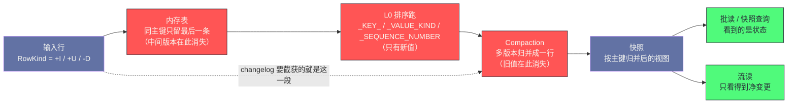
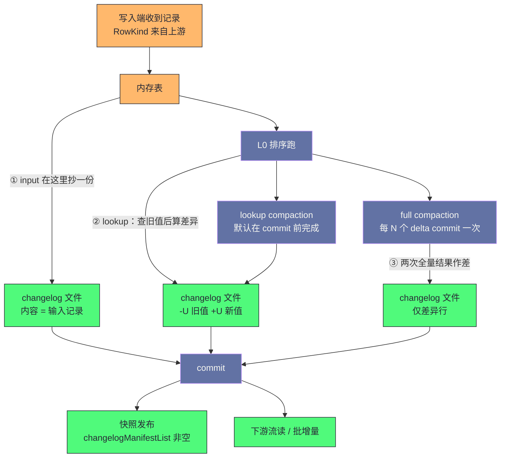
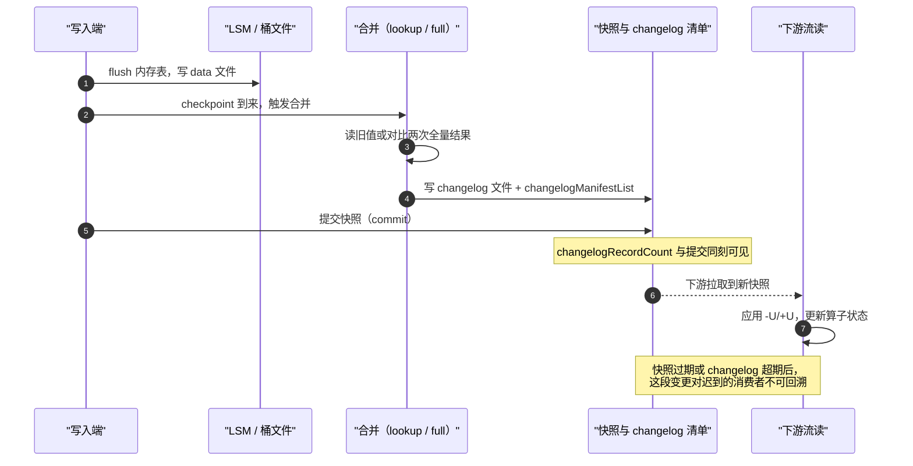
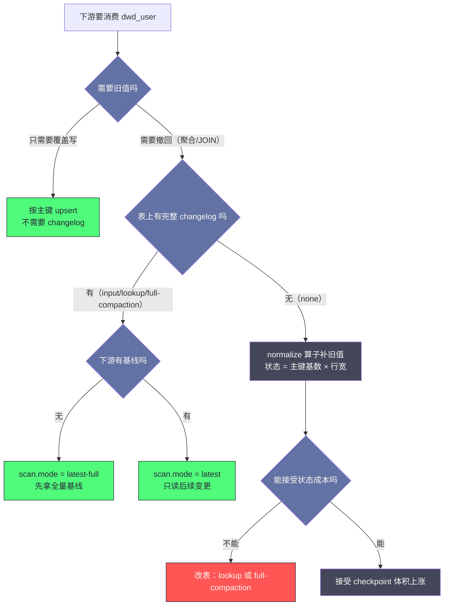
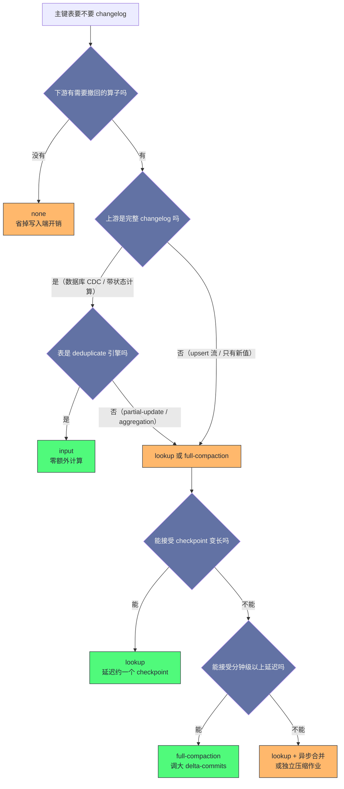

# 04 Changelog Producer——CDC 语义的流式生产与消费

**摘要：**

主键表的写入不是覆盖，而是把新记录合并进一棵 LSM 树：同一条主键的若干版本分层躺在不同文件里，直到某次合并才被归并成一行。这个动作对读友好，对"下游想知道发生了什么"却是麻烦——新写出的数据文件里只有新的值，没有变更；旧值要么躺在更高层的排序跑里，要么已经被合并掉。`changelog-producer` 这个表属性正是为这件事准备的：它在写路径或合并路径上挑一个位置，把"旧值到新值"这一步截获下来，写成独立的 changelog 文件，供流式读取直接消费。四个取值对应三个截获点：`none` 不截获，`input` 在内存表刷盘时把上游输入原样抄一份，`lookup` 在做查找式合并时读出旧值再算差异，`full-compaction` 拿两次全量合并的结果作差。本文沿一条 MySQL 用户表 CDC 入湖的链路，把四个取值的正确性前提、代价落点与可见时间逐个拆开，也顺带拆掉两处流传很广的简化——lookup 不是逐条点查，full-compaction 的开销也不在后台。文章最后回答两个问题：同一份数据，为什么换了 producer 之后下游看到的"变更"会不一样；以及当延迟、成本、正确性三者冲突时，该按什么判据挑。

---

## 第 1 章 变更去哪了：合并进 LSM 的写入没有变更流

### 1.1 症状：等级分布只涨不跌

笔者用一条贯穿全文的链路来说明。某电商的用户库，MySQL 里一张 `app_user` 表约两千万行，日均更新八百万次，通过 Flink CDC 写进 Paimon 的主键表 `dwd_user`，主键 `user_id`，`bucket = 16`，Flink 作业的 checkpoint 间隔设成一分钟。下游有两个消费者：实时画像按会员等级、城市做分组计数；风控名单按 `user_id` 把标记位同步到外部的键值存储。

出问题的是前者。某个周一上午，画像看板上的等级分布开始只涨不跌，四个等级的计数一起上浮，合计比前一天多了百分之十几，而 MySQL 那一侧的口径纹丝不动。作业日志里没有任何异常，checkpoint 一直是绿的，Paimon 的写入速率也正常。

把下游作业的重启记录翻出来，时间对得上：故障前一小时，画像作业因为一次内存溢出被重启过。重启之后它从 `scan.mode = latest` 起播——Paimon 的流读默认会先发一次全量快照再持续读增量，`latest` 则跳过全量、只读后续变更。跳过全量本身没问题，问题在于这张表建的时候没有配 `changelog-producer`，取的是默认值 `none`：源端给出的每一条变更只有新值，没有旧值。Flink 的 Paimon source 为了向下游交出一条能驱动聚合的更新流，会在 source 后面挂一个 normalize 算子，按主键把上一次看到的值记在状态里，收到新值时补一条 `-U`。作业重启，这份状态从空开始：之后的每一条变更都缺了配对的那一半，新键被当作首次出现发成 `+I`，旧值不在状态里，于是没有一条 `-U` 可发，旧等级那一行再也撤不回来。

计数只增不减，就是这么来的。这条链路上没有谁违约：MySQL 的 binlog 是完整的，Flink CDC 没有丢数据，Paimon 的提交也是原子的。缺的是"变更"这件事本身——它从来没有被物化到任何地方，而是每次读的时候由下游去猜。

### 1.2 写路径上被合并掉的三样东西

要把这件事说清楚，得看一条输入记录在 Paimon 里被改写成什么。这条写路径的完整机制在 [[02 LSM-Tree 存储引擎——为什么用 LSM 而非 CoW 文件覆盖]] 与 [[03 主键表与追加表——两种写入模型的设计逻辑]] 里拆过，这里只取与 changelog 有关的三个环节。

第一个环节是进入内存表。Flink 的写入算子按 `bucket` 路由，把记录塞进对应桶的内存表（有序的内存结构），同一主键的新记录覆盖旧记录，只留下序列号更大的一条。覆盖这个动作发生在内存里，也就意味着：如果一个 checkpoint 周期内同一条主键被更新了三次，前两次的中间值在被写进任何文件之前就已经消失，磁盘上从来不存在它们。

第二个环节是刷盘。内存表满了或者 checkpoint 到来时，Paimon 把它排好序写成一个 L0 文件，也就是一个排序跑（sorted run）。此时文件里每一行都带着三个系统列：`_KEY_` 前缀的主键、`_VALUE_KIND`（这一行是新增还是删除）、`_SEQUENCE_NUMBER`（用于判定版本先后）。行本身是新值，`_VALUE_KIND` 在去重引擎下几乎总是 ADD，中间版本依旧没有出现。

第三个环节是合并。L0 文件攒到阈值（`num-sorted-run.compaction-trigger` 默认 5 个排序跑）之后触发合并，把多个 L0 与高层文件归并，同一主键只落一行。归并的输入是"每个主键的若干版本"，输出是"每个主键的最新版本"，中间那些版本在这一步被彻底丢弃。

三个环节合起来，被合并掉的是三样东西：输入行原本携带的 RowKind（第一条是 `+I`，之后全是 `+U`）、同一主键的中间版本、以及那些版本的旧值。三样东西恰好就是 changelog 的全部内容。

### 1.3 快照是一个归并后的视图

站在读的一侧看同一件事。任何一次批读都只读快照：快照 JSON 指向清单列表，清单列表指向清单文件，清单文件里是每个桶的数据文件条目，读取时按主键做一次多路归并，取序列号最大的那一行。删除在 LSM 里不是把旧行抹掉，而是写入一条 `_VALUE_KIND` 为 DELETE 的标记行，读的时候同样参与归并。

数据文件的名字是 `data-<uuid>-<id>.<format>`，格式与内容都规整，完全可以被别的引擎当普通文件读。但它们承载的语义是"某个时刻每一行的样子"，不是"某一刻发生了什么"。一行在快照里存在，说明此刻它有值；一行在快照里消失，说明此刻它没有值；至于它是被删掉的、还是被改成了空值、还是从来就没出现过，快照本身不回答。



图里那条从输入直指合并的虚线，就是 changelog 要补回来的那一段：内存表把中间版本压掉、合并把旧值压掉，两处丢失都发生在输入与终态之间。批读与快照查询要的正是终态，丢掉的它们不关心；流读要的偏偏是被丢掉的那两样，于是只能在路径上另开一个分流口。三种 changelog producer 的差别，本质上就是分流口开在哪一跳。

### 1.4 净变更与完整 changelog 的区别

`none` 这一取值在文档里被描述得很克制：源端只能看到跨快照的合并变更，譬如哪些主键被删掉了、哪些主键有了新的值，这些合起来的差异构不成完整 changelog，因为读不到旧值。这句话的技术含义值得展开：把两个相邻快照相减，得到的确实是一份**净变更**，但差异两侧缺一头——你知道主键 K 现在的值是 v2，不知道它在此之前是 v1 还是 v9。少了这一头，下游算不回正确的增量。

下游对旧值的依赖不是普遍现象，而是集中在几类算子上。把它们排开来看，判据就清楚了。

| 下游算子 | 收到 `+U` / `+I` 的动作 | 缺 `-U` 的后果 | 缺 `-D` 的后果 |
|---|---|---|---|
| 分组计数（`COUNT(*)` 按等级分组） | 新值计入新分组 | 旧分组计数不撤，总数虚高 | 被删的行继续被计数 |
| 求和（`SUM(amount)`） | 累加新值 | 旧值未减，累计偏大 | 删除不反映，偏差只增 |
| 明细主键 upsert | 按主键覆盖 | 无影响 | 目标端残留旧行 |
| 双流 JOIN 补维 | 更新维表副本 | 维表残留旧属性 | 维表不清理 |

表里第三行说明了一件容易被忽略的事：只做 upsert 的下游根本不需要 changelog，`none` 之所以是默认值，是因为最常见的写入端（CDC 同步）把旧值留在自己的输入流里就够了，最常见的读取端（批查询、维表点查）根本不需要旧值。需要撤回的是聚合、JOIN、按业务口径去重计数这一类消费者，它们对"旧值"的要求是硬性的：算子里存着上一次的累加结果，收到新值时不知道该减什么，只能整份重算或者算错。

于是"要不要开 changelog"从一个技术选型问题变成了一个合同问题：你得先知道自己这条链路上的每个下游，是覆盖型的还是累加型的。

### 1.5 一个比喻：清样与校样

把这张表想成编辑部的手稿。作者交上来的是修订稿，每一稿上都留着"这句改了、那段删了"的笔迹（输入行带 RowKind）。排版室不收修订稿，只留最终清样：所有改动被并进同一份文件，读者拿到的永远是最新一版。清样上"某句话变了"是可以看出来的——你记得上一版大概长什么样；但清样本身不记录"原来是什么"，也不记录改过几次。

要让下游能撤回旧句子，编辑部得额外留一份校样对照表：每次定稿时把"上一版的这一行"与"这一版的这一行"并排记下来。这份对照表就是 changelog 文件。技术限定在于，清样是"归并后"的产物，而对照表必须按提交逐次生成，两者产生的时机根本不同；编辑室要么把抄录的工作交给作者（`input`，信任上游本来就带着旧稿），要么在定稿前回头翻一次档案柜（`lookup`），要么等定期盘点时把两次清样摆在一起对（`full-compaction`）。

### 1.6 本文的口径

本文以 Apache Paimon 1.4 的文档与配置项为准，涉及的具体选项名、默认值都可在该版本的配置页查到；不同小版本之间存在选项增删，落地时以对应版本文档为准。文中出现的行数、时间、容量均为示例推算，用于说明量级关系，不是实测数据。开源项目能力与商业托管平台能力分开看：某些托管版本只暴露 `none` 与 `input` 两个取值，`lookup` 与 `full-compaction` 是否可用取决于平台实现。

---

## 第 2 章 三个截获点，四个取值

### 2.1 表属性与产物

`changelog-producer` 是建表时的一个表属性，官方描述是"是否双写一份 changelog 文件，这份文件保存数据变更的细节，可以在流读时被直接读取"，并且只对主键表生效。

打开它之后，写入端在原本的 data 文件之外多产出一类文件：changelog 文件。这类文件与数据文件在格式上完全一致——同为 parquet、avro 或 orc（由 `changelog-file.format` 决定，文件名前缀默认 `changelog-`），主键表数据文件里那三个系统列它都有，`_VALUE_KIND` 也在，因此它本质上是一份按主键排序的 binlog 片段，而不是某种特殊编码。

追加表没有这个属性，也不需要：它只接收插入，没有同主键覆盖，相邻快照的差异天然就是一份完整的插入流。把两种表并排看，能看出 changelog 问题的根源落在"合并"这个动作上——凡是被合并掉的历史，都得有另一个机制补回来。

```sql
CREATE TABLE dwd_user (
    user_id     BIGINT,
    level       STRING,
    city        STRING,
    updated_at  TIMESTAMP(3),
    PRIMARY KEY (user_id) NOT ENFORCED
) WITH (
    'bucket'                    = '16',
    'changelog-producer'        = 'lookup',   -- none / input / lookup / full-compaction
    'changelog-producer.row-deduplicate' = 'true',
    'lookup.cache-max-memory-size'      = '256 mb'
);
```

产物落在快照的元数据里，这一点在后文诊断时要用到：快照 JSON 有一个 `changelogManifestList` 字段，本快照没有产出 changelog 时它是 `null`，另有 `changelogRecordCount` 记录本次产生了多少条变更记录。`$snapshots` 系统表把这两个字段直接暴露成列，查一行就知道某个快照到底产没产变更。

### 2.2 三个截获点

四个取值看似并列，实际上只在三个位置上做文章。

`input` 截在入口：内存表刷盘时，把这一批输入记录原样写进 changelog 文件。它不读旧值，也不做任何转换，等价于"我信你上游给的就是完整变更"。

`lookup` 与 `full-compaction` 都截在合并阶段，差别在取证方式。`lookup` 在查找式合并（lookup compaction）里对涉及的每个主键做一次点查，读出合并前的可见值，与新值一对比，产出 `-U` / `+U`。`full-compaction` 不做点查，而是把两次全量合并的输出整体比对，差异即变更。

`none` 则什么都不截，只是把合并后的净变更交给流读，缺的那一半由下游的 normalize 算子补。



打个比方，三个截获点像给同一条流水线装了三处不同的录像机：一处在原料入库口（`input`），一处在分拣台前（`lookup`），一处在月底盘库时（`full-compaction`）。录下的内容不同，共同点是都得等这一批货验收完才允许调阅。

这张图里最容易被跳过的是"谁在等谁"：三条 changelog 分支最终都要汇到 commit 上，而 commit 在流写下与 Flink checkpoint 对齐。也就是说，无论 changelog 在哪一步产生，下游最早看到它的时刻都是同一个——下一次提交成功之后。producer 的选择改变的是**commit 之前要额外干多少活**，而不是"能不能跳过提交"。

### 2.3 四个取值的对照

把四个取值放在同一张表里横向看，差异集中在四件事上：旧值从哪来、什么时候产生、正确性靠什么成立、代价落在谁身上。

| 取值 | 旧值来源 | changelog 产生时机 | 正确性前提 | 代价落点 |
|---|---|---|---|---|
| `none` | 下游自己记（normalize） | 不产生 | 下游能按主键维护旧值状态 | 下游状态与 checkpoint 体积 |
| `input` | 上游输入里带来 | 内存表刷盘时 | 上游输入本身是完整 changelog | 双份文件 + 上游的正确性 |
| `lookup` | 合并前点查可见值 | lookup compaction 完成时 | 可见快照里有该主键的旧值 | 写入端 checkpoint 时长与点查 IO |
| `full-compaction` | 上一次全量合并的结果 | 全量合并完成时 | 两次全量合并之间无数据丢失 | 全量重写 IO + 同步阻塞提交 |

### 2.4 与 merge engine 正交

`changelog-producer` 与 `merge-engine` 是两个独立的维度：前者决定"变更流怎么来"，后者决定"多条输入拼成的逻辑行是什么样"。这个正交性在 `deduplicate` 引擎下最干净——一行就是最后一条输入。换成 `partial-update`（宽表按列拼）或 `aggregation`（预聚合），逻辑行由多条输入共同决定，输入行本身已经不等于结果行，此时"把输入当 changelog"就断链了。

官方文档在这一处写得很直白：流式查询下，`partial-update` 与 `aggregation` 两种引擎必须搭配 `lookup` 或 `full-compaction` 使用，`input` 虽然也被支持，但只会**返回输入记录**。这句话是整篇文章里最值得抄进评审清单的一句，第 3 章会把它展开成一个具体的失效场景。

---

## 第 3 章 input：把信任转交给上游

### 3.1 机制：刷盘时抄一份

`input` 的实现简单到近乎粗暴：内存表刷盘（flush）时，把这一批输入记录按原样另写一份到 changelog 文件，同时照常写入数据文件。它不做点查，不做归并，不补 `-U`。

这个设计的收益是显而易见的。写入端只多一次顺序写，没有随机读，没有额外的状态，也不会让提交路径变长；changelog 的延迟与数据可见延迟完全相同，都取决于刷盘与提交的节奏。对一条上游已经是 CDC 的链路，这几乎是零成本的。

代价则被完整地转移给了上游：changelog 的**正确性等于输入的完整性**。Paimon 在这里做的事情是"**转述**"，不是"核对"。

### 3.2 正确性前提：上游必须真的是完整 changelog

什么算"完整"？判据只有一条：对每一个主键的每一次状态变化，输入流里都要同时给出变化前后的值，或者给出足以让下游撤回旧值的语义。落到实现上，就是输入流里必须存在成对的 `-U` / `+U` 与明确的 `-D`。

Flink CDC 的 MySQL 连接器在这一点上是合格的，但它的输出分两段，两段的完整性不同：全量快照阶段读的是表当前的样子，发出来的是清一色的 `+I`；增量阶段读 binlog，发出来的是 `+I`、`-U`/`+U`、`-D`。只要下游从全量阶段开始消费，前半段天然没有旧值，因为旧值本来就不存在——对一个刚开始同步的表，第一份数据的"旧值"就是空。

这条边界有一个直接推论：`input` 表在被下游读取时，如果下游从最早的位置起播，读到的前半段是插入、后半段才是更新。这对下游没有坏处（插入语义是对的），但如果下游假设"所有记录都带配对"，就会在第一批数据上出错。

### 3.3 两种典型失效

第一种失效最常见：上游不是 CDC，而是一条 upsert 流。譬如上游是另一个 Flink 作业，它从 Kafka 读出订单事件，做了一轮去重与关联，然后 `INSERT INTO` 到 Paimon——这条流里每一条都是 `+I`（Flink 在未声明主键时只能发 INSERT）。Paimon 把它当 changelog 抄进文件，下游读到的就是"同一个主键反复插入"，没有一条 `-U`。下游的聚合算子会把这些插入全部累加，出错的方式与第 1 章那个看板一模一样，只是这次连 normalize 都救不了：normalize 靠"看到新值才补旧值"，而输入里连"这是一次更新"都没表达出来。

第二种失效更隐蔽，发生在 `partial-update` 与 `aggregation` 表上。宽表拼接场景里，一个逻辑行可能由三个作业分别写入三列，每次输入只带一列的新值。`input` 把这些输入行原样写进 changelog，下游看到的是"三行各带一列"的碎片，而表里真实的逻辑行是"三列拼好的一行"。文档对此的表述是 `input` 只返回输入记录，这句话在宽表上等价于：changelog 与表内容不一致。下游若拿这份 changelog 去重算指标，算出来的是输入流的口径，不是表的口径。

还有一个边界与 overwrite 有关。`INSERT OVERWRITE` 提交带来的变更默认不会被流读读取（`streaming-read-overwrite` 默认关闭），理由是流读的合同是增量变更，而 overwrite 是一次整分区替换，把它当变更流读会让下游收到一批无法解释的删除。这跟 producer 选哪个无关：哪怕 changelog 已经物化好，流读也默认跳过它。想看到 overwrite 带来的修正，要么打开这个开关（它与 `lookup`、`full-compaction` 冲突，见第 5.5 节），要么走批增量与 `$audit_log` 逐段核对。

两种失效的共同点是：错误不在 Paimon 的写入路径上，而在"把输入当结果"这个假设上。`input` 从来没有承诺过转换，它承诺的只是搬运。

### 3.4 代价：双份文件与小文件

`input` 的存储代价接近一比一：每一条写入记录，在数据文件之外多一份 changelog 记录。对一条日更八百万行、行宽几百字节的链路，一天多出几 GB 到十几 GB（示例推算，按行宽与压缩比浮动），保留期由 `changelog.time-retained` 或快照过期策略控制。

第二个代价是小文件。changelog 文件按刷盘批次生成，而刷盘又跟着 checkpoint 走：checkpoint 间隔 30 秒、桶数 16、分区按天切，一次 checkpoint 就可能产生 16 个以上的小 changelog 文件。一天下来是几万个文件，对象存储的 LIST 与读取都要为这个数量付钱。Paimon 为此提供了一个专门的开关：`precommit-compact = true` 会在写入算子之后追加一对协调者与工作者算子，把同一分区的小 changelog 文件合并成大文件；默认关闭，因为这份开销是实打实的额外拷写。

第三个代价是可见时间，但这一项不由 `input` 决定：changelog 写得再早，也要等提交成功才对下游可见。checkpoint 间隔一分钟，端到端就至少是一分钟。

### 3.5 判据

`input` 只适合回答"是"的三个问题：上游是不是数据库 CDC 或带状态的 Flink 计算（会产出完整 changelog）？表是不是 `deduplicate` 引擎（逻辑行等于最后一条输入）？下游是不是只需要输入语义、或者从最早位置起播且能接受前半段没有旧值？

三个都是"是"，`input` 是四个取值里最省的一个；任何一个为"否"，就应该换到第 4 章或第 5 章的做法。

---

## 第 4 章 lookup：在合并前读一次旧值

### 4.1 不是逐条点查，而是查找式合并

把 `lookup` 理解成"每条写入都多一次点查"是一种常见的简化，但它会让人低估延迟、高估成本。真实机制是：Paimon 在做 lookup compaction 时，对本次合并涉及的每个主键去读合并前的可见值，再把新值与旧值一起写成 `-U` / `+U` 两条 changelog 记录。点查发生在合并的读取阶段，不是发生在每条记录的写入路径上。

它更像抄表员在换表之前抄一次旧读数：抄的是这一轮开工时的数，不是每一次用水都记一笔。差别在哪里？一个 checkpoint 周期内同一条主键被更新五次，内存表只留最后一条，点查也只发生一次，产出的是"本周期开始时的值 → 本周期结束时的值"一对记录，中间三次被折叠。所以 `lookup` 与 `full-compaction` 在"折叠中间状态"这一点上是同构的，真正的差别在**取证范围**：`lookup` 只查本周期涉及的键（代价与变更键数成正比），`full-compaction` 要重算整个桶（代价与桶内数据量成正比）。

`lookup` 模式的 compaction 策略与普通主键表不同。只要表上开了 lookup changelog producer，Paimon 就会改用激进的策略，每次触发 compaction 都强制把 L0 文件压进高层——这由 `lookup-compact` 选项控制，默认 `RADICAL`，改成 `GENTLE` 则走温和合并，靠 `lookup-compact.max-interval` 定期强制压实一次。激进策略的目的有两个：让被合并的版本尽快归并成主版本，以及让后续点查不必扫描过多 L0 文件；代价是合并频率高、资源占用大。

### 4.2 commit 要等合并

真正决定"下游多快看到"的，是 `lookup-wait` 这个选项。默认值为 `true`，含义是"需要 lookup 时，提交会等待合并完成"。也就是说，一次 checkpoint 到来时，写入端先把内存表刷盘，等 lookup compaction 生成 changelog，然后才提交；提交完成，changelog 才随快照对下游可见。

这条等待链把 changelog 的延迟压到了一个 checkpoint 之内，同时把成本推到了 **checkpoint 时长** 上。运维上最直观的表现是：开了 `lookup` 之后，作业的 checkpoint 从几秒涨到几十秒，而端到端延迟仍是一个 checkpoint 量级——延迟没有变差，是因为它本来就被 checkpoint 卡在这个量级上，而不是因为合并不花时间。同一时间，Checkpoint Alignment 与超时告警开始变多。官方文档在 lookup 一节专门提醒要把 `execution.checkpointing.max-concurrent-checkpoints` 调大，原因就在这里——一次提交在等合并，后面的 checkpoint 不应该跟着排队。

把 `lookup-wait` 设为 `false`（或用 `write-only` 关掉写入端的合并）可以彻底异步化：写入端不再等合并，吞吐上去了，但 changelog 的产出时间取决于后台合并的进度，延迟从"一个 checkpoint"变成"一次合并周期"，且不再有上限保证。

### 4.3 代价：点查与三层缓存

lookup 的读取走的是与维表点查（见 [[05 Lookup Join 与维表——Paimon 在流计算中的实时维表查询]]）同一套设施：内存缓存、本地磁盘缓存、远端对象存储。配置页给了三个旋钮，默认值分别是：`lookup.cache-max-memory-size` 256 MB、`lookup.cache-max-disk-size` 不限、`lookup.cache-file-retention` 1 小时。缓存命中时点查是内存查找，未命中则要回远端读文件、在本地建索引，一次十毫秒量级（示例推算，取决于存储与文件大小）。

代价的量级与两个因素有关。一是变更键数：每个需要产出 `-U` 的主键都要查一次，高更新率的表上这个数字等于写入速率乘 checkpoint 间隔。二是缓存命中率：用户表这类更新有局部性的负载，热点用户反复更新，缓存命中率高；而"每个主键一天只改一次"的均匀更新负载，缓存几乎全 miss，每一次点查都要落到对象存储上。

这里有一个与直觉相反的推论：高插入率的表在 `lookup` 下并不便宜。新主键也要查一次——写入端必须确认"这个键以前不存在"，才能决定发 `+I` 还是 `-U`/`+U`。也就是说，`lookup` 的成本由**写入键数**决定，而不是由"更新了多少已有行"决定。

### 4.4 默认值带来的两个细节

第一个细节是 `changelog-producer.row-deduplicate`。它的默认值是 `false`，含义是"对同一条记录也生成 `-U` / `+U`"。在 `lookup` 下，如果一次更新写入的新值与旧值完全相同（上游重发、幂等重试、只更新了不参与比较的列），默认会产出一对内容相同的 `-U` / `+U`；下游聚合会先减再加，结果正确但白算一遍。把 `row-deduplicate` 打开，Paimon 会在生成时比较新旧值，相同则跳过；还可以用 `changelog-producer.row-deduplicate-ignore-fields` 指定比较时忽略哪些列，用来处理"更新时间戳每次都变"这类噪声列。这个开关的代价是每次生成都要做一次整行比较，属于用 CPU 换下游计算量。

第二个细节是 `write-only`。多写入端共用一张表时，常规做法是把合并从写入端剥离，交给独立的压缩作业（`write-only = true` 跳过写入端的合并与快照过期）。此时 changelog 由谁产出就是一个必须回答的问题：写入端不合并，就不会有 lookup compaction，也就不会有 changelog。要么让独立压缩作业承担这个角色，要么接受写入端只写数据、changelog 由压缩作业在另一个节奏上补齐。

### 4.5 判据

`lookup` 适合这样的链路：上游只有新值（普通 upsert、宽表拼接、预聚合），下游必须看到完整变更，且能接受 checkpoint 变长、点查 IO 增加。它不适合两类场景：写入端已经贴着资源上限、没有余量做同步合并的；以及主键基数极大而更新极稀疏、缓存命中率注定很低的。

---

## 第 5 章 full-compaction：拿两次盘点结果作差

### 5.1 机制：两次全量合并的结果相减

`full-compaction` 不做点查，它等一次全量合并（full compaction）结束，把这次合并输出的结果与上一次全量合并的结果整体比对，差异写成 changelog。因为全量合并会把桶内所有排序跑归并一遍，它天然握着"每个主键在合并前是什么、合并后是什么"的完整信息，代价是要把整桶数据重写一遍。

这与 `lookup` 的分工很清晰：`lookup` 用点查换掉了全量重写，代价是点查次数随变更键数增长；`full-compaction` 用全量重写省掉了点查，代价是 IO 随桶内数据量增长。一个按"改了多少键"付费，一个按"桶有多大"付费。

### 5.2 延迟由触发频率定义，而不是由 producer 定义

`full-compaction.delta-commits` 决定"积累多少个 delta commit（流写下即 checkpoint）触发一次全量合并"。1.4 的 changelog producer 文档写的是默认 1，即每个 checkpoint 做一次全量合并并产出 changelog；配置页则把这个选项的默认值标为"无"。两处口径不一致这件事本身值得记一笔：凡是依赖这个值的链路，都应该显式写出来，不要靠默认。

把默认值取 1 会发生什么？每个 checkpoint 都要重写整桶数据。这对小表无所谓，对一张两千万行、16 个桶的表，意味着每个桶每次重写约一百多万行——按每行两百字节、压缩后计，单次全量合并的量级在每桶几百 MB，整表每轮几 GB；checkpoint 一分钟一次，一小时就是几百 GB 的重写量（示例推算）。这个量级显然不能接受，所以实践中的 `full-compaction` 几乎总是配一个较大的间隔，譬如 10 个 delta commit 对应十分钟、30 个对应半小时。

延迟的公式因此很朴素：端到端可见延迟约等于"触发间隔 × checkpoint 周期 + 一次全量合并的处理时间"。文档给这个取值的适用场景也是"延迟容忍度高"的那一类，措辞举的例子是三十分钟。

### 5.3 同步合并，慢的是提交不是后台

另一个容易被忽略的点是同步性。全量合并与 lookup 合并都在提交路径上完成，这与"后台异步合并"的直觉不同。合并文档在 `full-compaction.delta-commits` 一节直接写了它的缺点：只能同步执行合并，会影响写入效率。

于是 `full-compaction` 的成本曲线不是"后台多花点 CPU"，而是**提交被拖长**。表现出来是 checkpoint 时长出现周期性尖峰：大部分 checkpoint 几秒钟，每 N 个 checkpoint 出现一次几十秒到几分钟的长尾，长尾期间写入端因为背压而暂停接收。对于下游依赖 checkpoint 间隔决定可见时间的链路，这个尖峰同时抬高了两件事——数据的可见延迟与 changelog 的可见延迟。

如果链路对写入延迟敏感，这套机制还有一个变体：把 `full-compaction` 与独立压缩作业结合。写入端 `write-only = true` 只管写，独立的压缩作业按自己的节奏做全量合并并产出 changelog。changelog 的延迟就从"写入端的 checkpoint"变成"压缩作业的调度周期"，与写入彻底解耦，但要接受两套作业的运维成本与调度错配的风险。

### 5.4 折叠：正确性与信息量的取舍

`full-compaction` 产出的是"表状态的差异"，不是"每一条源事件的副本"。两次全量合并之间，同一个主键被改了十次，changelog 里只有一组 `-U` / `+U`，从第一次的值到第十次的值；中间八次的取值在任何地方都找不到。

对下游聚合，这是好事：一次撤回、一次累加，比十次来回加减小得多。对审计、对账、"这条记录在十分钟内被谁改过"这类需求，这是坏事：信息被合并掉了。要保留逐次变更，只能靠 `input`（上游的原始流）或把 checkpoint 间隔压到足够小，让折叠窗口变窄。

这条边界的实际含义是：changelog 的"完整性"要分两个层次看。**语义完整**（任何时刻都能把下游状态算对）与**历史完整**（每一次变化都留痕）不是一回事，`lookup` 与 `full-compaction` 保证前者，不保证后者；`input` 在满足第 3 章前提时两者都保证。

### 5.5 判据

`full-compaction` 的适用面比它的名字听起来窄：它适合"下游能等（分钟级到半小时级）、写入端有足够 IO 余量、且不需要逐次变更留痕"的链路，譬如离线补数、T+1 口径的修正、对实时性要求不高的下游宽表。反过来说，把它当成"低成本的 lookup"是一种误配：默认参数下它的开销最大，只有在间隔被调大之后成本才降下来，而间隔一大延迟就上去了。

还有一条容易被忽略的互斥：`streaming-read-overwrite` 不能与 `lookup`、`full-compaction` 同时开启，官方给出的理由是会读到重复的变更——overwrite 的变更既由那次提交自身表达，又会在合并后被重新算出一次。调这两个参数要按整条链路的语义一起改，只改一个会把"看得见修正"换成"变更重复"。

---

## 第 6 章 耦合：changelog 与 compaction 绑得多紧

### 6.1 三种绑定关系

前四章分别讲了三种 producer，但有一个共同点被分散在各处：changelog 的产生时机与 compaction 的触发时机**绑在一起**，绑定的紧密度因 producer 而异。把这层关系单独抽出来看，选型时最容易踩的坑就显形了。

| 取值 | changelog 与 compaction 的关系 | 触发条件 | 延迟上限（流写） |
|---|---|---|---|
| `input` | 不依赖 compaction，依赖刷盘 | 每次 flush（checkpoint 前） | 约一个 checkpoint |
| `lookup` | 由 lookup compaction 产出 | 排序跑数量达阈值或定期强制压实 | 一个 checkpoint + 合并耗时 |
| `full-compaction` | 由 full compaction 产出 | `full-compaction.delta-commits` 个 delta commit | 间隔 × checkpoint + 合并耗时 |
| `none` | 无产物 | — | 无（下游自补） |

第二行与第三行的"延迟上限"都带了一个加法项，这个加法项就是同步合并的耗时，它把 commit 往后推。第一行没有这一项，但也拿不到旧值。

### 6.2 一次端到端延迟的算术

把延迟拆成可算的几段：写入 → 内存表刷盘 → （可选）合并与 changelog 生成 → 提交 → 下游拉取。前三段发生在写入端内部，第四段由 checkpoint 触发（这一步是流写下的提交节奏），第五段是下游自己的调度间隔。

沿用贯穿案例的参数：checkpoint 一分钟，桶数 16，单桶峰值写入约每秒三百行。三种取值的端到端延迟估算如下（示例推算，忽略网络与调度抖动）：

- `input`：刷盘与提交同一次 checkpoint 完成，changelog 随提交可见，端到端约 1 分钟，下游再按自己的拉取节奏叠加。
- `lookup`：提交前多一次 lookup compaction，单桶需要为本次变更的三百行乘六十秒（约一万八千个键）点查旧值；缓存命中时是毫秒级，全 miss 时按每次十毫秒估算，单桶串行需要三分钟——这解释了为什么必须并行，以及为什么 bucket 数多、单桶变更键多时 checkpoint 会被拉长。
- `full-compaction`（间隔 10 个 delta commit）：changelog 最多要等十分钟才产生，加上一次全量合并在提交路径上的耗时，端到端在十分钟量级；若下游从最早位置补数，延迟还要再叠加积压。

这三个数字放在一起，回答了一个常见疑问：为什么把 `full-compaction` 的间隔从 10 调到 30，写入端的 checkpoint 尖峰小了，下游的延迟却差了二十分钟。因为这两件事在 `full-compaction` 上共用同一个旋钮，转哪一头都要从另一头找补，没有免费的空档。

### 6.3 用快照元数据判断"为什么没看到变更"

排查线上问题时，最省事的入口不是日志，而是表目录里的元数据。快照 JSON 里的三个字段构成了第一手判据：`changelogManifestList` 为 `null` 说明这个快照没有产出 changelog；`changelogRecordCount` 与 `deltaRecordCount` 的比值说明本次提交里变更记录占多少；`commitKind` 说明这次提交是 APPEND 还是 COMPACT。

三者组合起来能定位绝大多数"下游看不到变更"的问题。开了 `lookup` 或 `full-compaction` 而 `changelogManifestList` 长期为 `null`，说明合并压根没发生——可能是 `write-only` 把写入端的合并关掉了、可能是独立压缩作业没在跑、也可能是 `full-compaction.delta-commits` 设得过大而数据量还不足以触发。`changelogRecordCount` 长期为零而 `deltaRecordCount` 很大，说明每条提交都在写数据但没产变更，方向同上。

`$snapshots` 系统表把同样的字段做成了可查的列，一条 SQL 就能看出最近若干个快照的 changelog 产出情况，不必去翻文件系统。要确认属性本身有没有生效，还可以查 `$options`，它列出的是建表语句里实际写下的表选项，DDL 与线上预期不一致时一眼可见：

```sql
SELECT snapshot_id, commit_kind, delta_record_count, changelog_record_count,
       changelog_manifest_list
FROM dwd_user$snapshots
ORDER BY snapshot_id DESC
LIMIT 20;
```

### 6.4 保留与消费进度的赛跑

changelog 的可用性有**两个时钟**：产生时钟与销毁时钟。那份文件本身不是永久的，保留受两个机制管：`changelog.time-retained` 与 `changelog.num-retained.min/max` 直接控制完成的 changelog 保留多久、留几份；快照过期则在更底层把不再被引用的 changelog 文件物理删除。默认的快照保留是一小时（`snapshot.time-retained`），也就是说，一个下游如果停了一小时以上再回来，它想读的那段 changelog 很可能已经不在了。

Paimon 对此提供了 consumer-id 机制，包含两个能力。一是安全消费：决定某个快照能否过期时，Paimon 会看表上有哪些消费者仍然依赖它，有依赖就不删。二是断点续传：作业停掉之后重新启动，可以从上次的消费进度继续，而不必从 Flink 状态恢复。两者都需要显式配置，并且要用 `consumer.expiration-time` 管理消费者自身的生命周期，否则一个被遗忘的 consumer-id 会把快照无限期钉住。

`consumer.mode` 还有一个 `at-least-once` 取值，把"快照消费与 checkpoint 严格对齐"换成"允许各读取端按不同速率消费、只记录最慢的快照"。默认的 `exactly-once` 模式语义更强，代价是 checkpoint 要等所有读取端对齐；`at-least-once` 换来吞吐与水位对齐能力，但两种模式的 Flink 状态不兼容，切换时不能从旧状态恢复。



图中最后一条注释是这一章的核心：changelog 的可用性有两个时钟，一个是产生时钟（合并触发），一个是销毁时钟（保留策略）。两者之间的窗口，才是下游真正能消费的范围；窗口设得比下游的最坏停机时间还短，就是一次注定发生的数据缺口。

---

## 第 7 章 下游的两条路：流读与当表读

### 7.1 流读：起播语义与全量基线

下游消费 changelog 最直接的方式是 Flink 流读。读法由 `scan.mode` 决定，几个取值之间的差别不是"读多少"，而是"从哪里开始、要不要先给一份全量"。

| `scan.mode` | 流式下的行为 | 批式下的行为 | 典型用途 |
|---|---|---|---|
| `default` | 无其他参数时等同 `latest-full` | 同 `latest-full` | 不显式指定 |
| `latest-full` | 先发一次最新全量快照，再持续读变更 | 只读最新快照 | 冷启动、要一份基线 |
| `latest` | 不发全量，只读后续变更 | 等同 `latest-full` | 下游已有基线 |
| `from-snapshot` | 从指定快照起读变更（可加 `-full` 变体） | 读该快照 | 定点重放 |
| `from-timestamp` | 从指定时间对应的快照起读 | 读对应快照 | 按时间补数 |

`latest-full` 与 `latest` 的差别正是第 1 章那个故障的引信。选 `latest-full`，下游先拿到一份全量快照，这份快照里的每一行都是 `+I`，normalize 状态从这些行建起来，之后的 `+U` 才有旧值可撤；选 `latest`，下游跳过基线直接从变更读起，重启后的状态是空的，之后收到的新值找不到可撤回的旧值。这不是配置错误，而是两种语义各有用处：有上游基线（比如另一份全量已同步）时用 `latest` 省掉一次全量读取，没有基线时用 `latest-full`。

### 7.2 normalize：`none` 模式的隐性账单

`none` 之所以"能用"，是因为 Flink 的 Paimon source 内建了一个 normalize 算子。它的职责是给更新流补旧值：按主键缓存上一次的值，收到新值时先发 `-U`（旧），再发 `+U`（新）。从下游算子的视角看，这是一条完整的更新流。

账单在这里：normalize 的**状态大小等于"主键基数 × 行宽"**，而且只增不减（除非配置了状态 TTL）。一张两千万行、行宽几百字节的主键表，normalize 状态在 GB 量级；这份状态要参与 checkpoint，于是 checkpoint 体积、恢复时间、作业内存全被它拖住。文档对此的判断很直接：这个算子非常昂贵，应当避免；同时提供了一个危险的开关 `scan.remove-normalize`，强制摘掉它。

`scan.remove-normalize` 的语义是"我确信下游不需要旧值"。它对只做覆盖写的下游是成立的，对聚合类下游是灾难：没有 `-U`，聚合只能累加，结果单调偏差。把它当成"性能优化"来用，是这一章最典型的误用。

### 7.3 当表读：三个受支持的入口

changelog 不只能被流读消费，它还能以表的形式被查询，入口有三个，语义各不相同。

`$binlog` 系统表把更新前后拼进同一行：`+U` 那一行的每一列是一个数组，前一个元素是更新前、后一个元素是更新后。适合做"看一眼最近发生了什么"的抽查，不适合直接喂给聚合。

`$audit_log` 系统表给每一行加一个 `rowkind` 列，四种取值就是 `+I`、`-U`、`+U`、`-D`。批增量查询（`incremental-between`）默认会优先扫 changelog 文件，但批 SQL 不允许返回删除记录，`-D` 会被丢掉；要看到删除，就得走 `$audit_log`。

批增量本身是第三个入口：`incremental-between` 指定起止快照或标签，Paimon 在这段区间内按"有 changelog 就读 changelog，没有就扫变更文件"的顺序取数。这条路径的价值在于补数：把一个时间窗内的变更重放一遍，而不必重跑全量。

三个入口的共同点是都经过元数据：读的是清单文件登记过的文件，读到的行带系统列，`-D` 与否、`+U` 与 `-U` 的配对都由 Paimon 解释。这一点在第 7.4 节会形成对照。

### 7.4 直接读文件：格式对得上，语义对不上

changelog 文件与数据文件格式相同，这意味着它可以被任何 parquet 读取器打开。实践中确实有人这么干：用 Spark 直接扫表目录，把 `changelog-` 前缀的文件当成一张"变更表"读出来。

这条路**物理上走得通，语义上走不通**，具体是三个陷阱。

一是混读。表目录里同一个桶下同时有 `data-` 与 `changelog-` 两类文件，直接扫目录会把两者一起读进来，得到一份既包含状态又包含变更的混合结果，行数对不上任何口径。

二是绕过清单。Paimon 的读路径依赖清单文件决定"这个快照由哪些文件组成"，直接扫目录看到的是物理现状，包括了尚未提交的、已标记删除但未过期的、以及快照过期过程中残留的文件。第 1.3 节说的"文件可读但语义是状态"，在这里变成"文件可读但集合不对"。

三是系统列要自己解释。读出来的每一行带 `_KEY_`、`_VALUE_KIND`、`_SEQUENCE_NUMBER`，要按主键与序列号自己归并、自己区分增删，还要处理同一主键在多个文件里出现多次的情况。这些正是 Paimon 读路径替你做的事，绕过它就得重写一遍。

### 7.5 下游 deduplicate 缺主键信息

还有一类问题不发生在 Paimon 侧，而发生在消费端：拿到了完整 changelog，却按错误的键去重。

changelog 的撤回语义以主键为单位：`-U` 与 `+U` 是同一个主键的两个版本。如果下游按业务列去重（比如按手机号、按订单号），而不是按主键，`-U` 那条记录就可能被当成"新出现的业务键"处理，去重表里多出一行；反过来，两个主键共享同一个业务键时，下游会把它们错误地合并。

更隐蔽的一层在 Flink 的数据结构上。RowKind 属于 `Row` 这个类型，`Row` 转成 POJO 或 Tuple 之后 RowKind 就丢了——下游 DataStream 里看到的只是"一条记录"，不再是"一条插入/撤回"。很多"消费了 changelog 却算错"的作业，根因是把 `Row` 转成了自定义对象，撤回消息被静默降级成插入。

### 7.6 几种读法的取舍

| 读法 | 看到的 RowKind | 是否需要额外状态 | 适用场景 |
|---|---|---|---|
| Flink 流读（`latest-full`） | 完整（有全量基线） | 仅 `none` 表需要 normalize | 冷启动建基线 |
| Flink 流读（`latest`） | 仅后续变更 | 下游自己维护基线 | 已有基线、追求低延迟 |
| `$binlog` / `$audit_log` | 带 `rowkind` 列 | 无（批式） | 抽查、审计、补数 |
| 直接扫目录 | 需自行解释系统列 | 需自行归并 | 不建议，除非只做离线排查 |



图里最后两个分支是这一章要落到的判断：normalize 的状态成本与表的 changelog 配置是一笔账的两面，选前者等于把成本放在下游、把简单留给存储；选后者等于把成本放在写入端、把简单留给下游。

---

## 第 8 章 与其他格式对照与选型

### 8.1 一句话对照

同类能力在另外三个格式里的形态是：[[大数据/数据湖/Hudi/00 专栏导览|Hudi]] 用 `hoodie.table.cdc.enabled` 打开 CDC 数据的持久化（该选项自 0.13.0 起提供），再用增量查询的 `incremental-format = cdc` 把变更读出来；[[大数据/数据湖/Iceberg/00 专栏导览|Iceberg]] 提供 changelog 扫描接口（`newChangelogScan`），v3 规范里也有专门的变更数据文件与 `_change_type` 列；[[大数据/数据湖/Delta-Lake-Lakehouse架构深度解析/00 专栏导览|Delta Lake]] 的 Change Data Feed 由表属性 `delta.enableChangeDataFeed` 打开，用 `table_changes` 按版本区间读。Paimon 的差别在于它把这件事做成了**表属性上的四个档位**，并且让档位与 LSM 的合并路径直接对应。具体实现细节以各自版本文档为准，此处不展开。

### 8.2 选型决策

把前几章的判据压缩成一张决策树，顺序按"先看上游、再看下游、最后看资源"排。



### 8.3 三份可直接抄的配置

第一种，上游是 MySQL CDC、表是普通主键去重表、下游要低延迟聚合：用 `input`，把双份文件与小文件治理一并配上。

```sql
CREATE TABLE dwd_user (
    user_id BIGINT, level STRING, city STRING, updated_at TIMESTAMP(3),
    PRIMARY KEY (user_id) NOT ENFORCED
) WITH (
    'bucket'             = '16',
    'changelog-producer' = 'input',
    'precommit-compact'  = 'true'      -- 合并小 changelog 文件，代价是额外拷写
);
```

第二种，上游只有新值（宽表拼接或多作业分别写列），下游是聚合：用 `lookup`，并显式处理同值重复写。

```sql
ALTER TABLE dwd_user SET (
    'changelog-producer'                     = 'lookup',
    'changelog-producer.row-deduplicate'     = 'true',
    'lookup.cache-max-memory-size'           = '512 mb',
    'lookup-compact'                         = 'GENTLE',
    'lookup-compact.max-interval'            = '5 min'
);
```

第三种，下游延迟容忍度高、写入端 IO 余量有限：用 `full-compaction`，并把间隔显式写出，不依赖默认值。

```sql
ALTER TABLE dwd_user SET (
    'changelog-producer'              = 'full-compaction',
    'full-compaction.delta-commits'   = '10',
    'changelog.num-retained.min'      = '5'
);
```

### 8.4 该盯的四个数

| 指标 | 观测位置 | 健康形态 | 异常时的指向 |
|---|---|---|---|
| `changelog_record_count` | `$snapshots` | 与写入变更量同阶 | 恒为 0：合并没触发或 producer 未生效 |
| checkpoint 时长 | Flink UI | 平稳，偶有尖峰 | 持续上涨：lookup 点查过重或 full compaction 太频 |
| 合并耗时与频率 | compaction 指标 | 与写入速率匹配 | 尖峰周期性出现：`delta-commits` 间隔不当 |
| 快照过期数 | `$snapshots` 的历史长度 | 覆盖最慢消费者的停机窗口 | 明显短于停机窗口：consumer-id 未配或保留期过短 |

第一个数是**最直接的证据**：它证明 changelog 真的被产出了，而不是"表上写了属性、代码里以为开了"。后三个数决定的是这份 changelog 能不能被下游及时、稳定地消费到。

---

## 第 9 章 反例与边界

### 9.1 用 input 配 upsert 上游，变更静默缺失

症状：下游聚合只增不减，与第 1 章那个看板一致，但这次表上明明配了 `changelog-producer = input`，`$snapshots` 里 `changelog_record_count` 也不是零。

识别：把 changelog 内容抽出来看 `rowkind` 分布。如果清一色是 `+I`，说明输入流本身就只有插入语义，Paimon 忠实地转述了它。

根因：上游不是完整 changelog。处置只有两条——换用 `lookup`，或者在上游把流改成带主键的 upsert（让它真的产出 `-U`/`+U`）。指望在 Paimon 侧修，方向是错的，因为它没有旧值可查。

### 9.2 要实时 changelog，却选 full-compaction

症状：链路上配了 `full-compaction`，下游延迟稳定在十分钟以上，偶发更久；写入端的 checkpoint 周期性出现长尾。

识别：看 `full-compaction.delta-commits` 的值，以及 checkpoint 时长的时间序列。间隔乘 checkpoint 周期就是延迟下限，尖峰则是同步全量合并的耗时。

根因：`full-compaction` 的产出节奏由同一个参数同时决定延迟与开销，把延迟压下来就得承受每个 checkpoint 做一次全量重写。要实时，选 `lookup`；要继续用 `full-compaction`，就得接受延迟。

### 9.3 下游按非主键去重

症状：changelog 完整，Paimon 侧一切正常，但下游结果与明细表对不上；`-U` 之后目标表里多出一行。

识别：打印下游算子的执行计划，确认去重/聚合的键是不是主键；再确认反序列化之后的类型是不是 `Row`。

根因：撤回以主键为单位，下游按别的列分组就会把 `-U` 当成新记录；或者 RowKind 在类型转换中丢失，撤回被当成插入。

### 9.4 开了 producer，但合并被关掉

症状：表上 `changelog-producer` 配了 `lookup`，`$snapshots` 里 `changelog_manifest_list` 长期为空，下游只能看到净变更。

识别：查一下 `write-only` 是不是 `true`，以及有没有独立的压缩作业在跑。

根因：`lookup` 与 `full-compaction` 的产物都出自合并，写入端不合并就没有产物。这是**配置了但没生效**里最典型的一种，且不产生任何告警。

### 9.5 aggregation 表的撤回能力边界

症状：changelog 里 `-U`/`+U` 都在，下游聚合却越算越偏。

识别：看 `merge-engine` 是不是 `aggregation`，再看聚合函数用的是哪一种。

根因：预聚合引擎不是所有聚合函数都支持撤回，官方列出的支持撤回的函数是 `sum`、`product`、`collect`、`merge_map`、`nested_update`、`last_value`、`last_non_null_value`；其余函数（如某些近似聚合）收到撤回消息时行为由实现决定。存储层给出了完整 changelog，计算层却接不住，这是跨层问题，只在 Paimon 侧排查永远查不到。

### 9.6 保留期短于消费断点

症状：下游作业停机维护超过一小时，重启后从断点继续时报错或直接跳过一段，数据出现缺口。

识别：看快照保留配置与最后一次提交的时间差；看表上有没有配 consumer-id。

根因：快照默认只保留一小时，changelog 随快照过期被清理。要跨窗口续传，必须让消费者登记进度并阻止相关快照过期，同时用 `consumer.expiration-time` 管住消费者自身的生命周期。

### 9.7 用 remove-normalize 省状态

症状：为了压 checkpoint 体积关掉了 normalize，作业跑得更稳更快，但聚合结果开始单边漂移。

识别：看作业有没有配 `scan.remove-normalize`，再看表的 producer 取值。

根因：`none` 表 + 摘掉 normalize，等于既没有物化的 changelog，也没有消费端补旧值，`-U` 就此消失。省下的状态体积是从正确性里抠出来的。

---

## 结语

changelog producer 这个属性的表面含义是"要不要多写一份变更文件"，实际决定的是三件事的分工：谁负责产生旧值、谁承担这份工作的成本、以及下游最晚什么时候能看到变更。`none` 把旧值的维护推给下游的 normalize 状态，写入端最轻，状态成本落在 Flink 上；`input` 把信任交给上游，写入端只做搬运，正确性等于输入流的完整性；`lookup` 用同步合并与点查换取一个 checkpoint 之内的延迟，成本压在 checkpoint 时长与点查 IO 上；`full-compaction` 用全量重写换取"不依赖点查"的简单，代价是延迟与重写量由同一个参数决定。

三种 producer 与 compaction 的耦合方式不同，但可见时刻相同——都要等提交。这条约束把一个常被误认为"producer 决定实时性"的问题还原成了两个独立问题：变更多快被算出来（producer 与合并频率），以及它多快被承认（checkpoint 间隔）。把这两件事混在一起调参，往往一边压下去另一边涨上来。

选型上真正需要回答的只有三个问题：下游有没有必须撤回的算子，上游是不是完整 changelog，资源余量在哪一侧。三个答案不同，合适的取值就不同；没有哪一种 producer 在所有链路上都占优，只有**成本放在哪一端**更划算。

---

## 参考资料

1. Apache Paimon 1.4 文档：Changelog Producer，<https://paimon.apache.org/docs/1.4/primary-key-table/changelog-producer/>
2. Apache Paimon 1.4 文档：Configurations（`changelog-producer`、`lookup.cache-*`、`full-compaction.delta-commits`、`changelog.*` 等选项与默认值），<https://paimon.apache.org/docs/1.4/maintenance/configurations/>
3. Apache Paimon 1.4 文档：Compaction（lookup compaction 策略、全量合并的同步性、异步合并配置），<https://paimon.apache.org/docs/1.4/primary-key-table/compaction/>
4. Apache Paimon 1.4 文档：SQL Query（`scan.mode` 各取值、批增量 `incremental-between`、快照保留对时间旅行的影响），<https://paimon.apache.org/docs/1.4/flink/sql-query/>
5. Apache Paimon 1.4 文档：Consumer ID（安全消费、断点续传、`consumer.mode`），<https://paimon.apache.org/docs/1.4/flink/consumer-id/>
6. Apache Paimon 1.4 文档：Snapshot 规范（`changelogManifestList`、`changelogRecordCount`、`commitKind` 字段），<https://paimon.apache.org/docs/1.4/concepts/spec/snapshot/>
7. Apache Paimon 1.4 文档：DataFile 规范（主键表数据文件的 `_VALUE_KIND`、`_SEQUENCE_NUMBER` 与 changelog 文件的等价性），<https://paimon.apache.org/docs/1.4/concepts/spec/datafile/>
8. Apache Paimon 1.4 文档：System Tables（`$snapshots`、`$audit_log`、`$binlog`），<https://paimon.apache.org/docs/1.4/concepts/system-tables/>
9. Apache Paimon 1.4 文档：Merge Engines — Partial Update 与 Aggregation（流式查询必须搭配 lookup/full-compaction，`input` 只返回输入记录；可撤回的聚合函数清单），<https://paimon.apache.org/docs/1.4/primary-key-table/merge-engine/partial-update/>、<https://paimon.apache.org/docs/1.4/primary-key-table/merge-engine/aggregation/>
10. Apache Paimon 1.4 文档：Understand Files（流写、checkpoint 提交、快照过期的文件生命周期），<https://paimon.apache.org/docs/1.4/learn-paimon/understand-files/>
11. Apache Hudi 1.0 文档：Configurations（`hoodie.table.cdc.enabled`）与 Table Types（增量查询的 `incremental-format = cdc`），<https://hudi.apache.org/docs/1.0.0/configurations>、<https://hudi.apache.org/docs/1.0.0/table_types>
12. Apache Iceberg 规范与 API：changelog 扫描与 v3 变更数据文件，<https://iceberg.apache.org/spec/>
13. Databricks 文档：Use Delta Lake change data feed（`delta.enableChangeDataFeed` 与 `table_changes`），<https://learn.microsoft.com/azure/databricks/delta/delta-change-data-feed>

---

> [!note] 思考题
> 1. 一条链路上的下游既有聚合算子又有明细 upsert，是否可以用一个 producer 同时满足两者，还是必须在链路中间落一层？
> 2. `input` 的正确性完全依赖上游，那么"上游是另一个 Paimon 表"时，这张上游表的 producer 取值会怎样传导到下游的语义？
> 3. `lookup` 把成本压在 checkpoint 时长上，如果用独立压缩作业分担合并，changelog 的延迟由什么决定，这个延迟还能被下游的消费进度约束吗？
> 4. `full-compaction` 的间隔从 10 调到 30 之后，写入端尖峰消失了，下游延迟变差；如果业务要求两者都满足，除了换 producer 还有哪些结构性手段？
> 5. 下游消费端把 `Row` 转成 POJO 会丢失 RowKind，这类问题在代码评审阶段有什么比测试更早发现的办法？