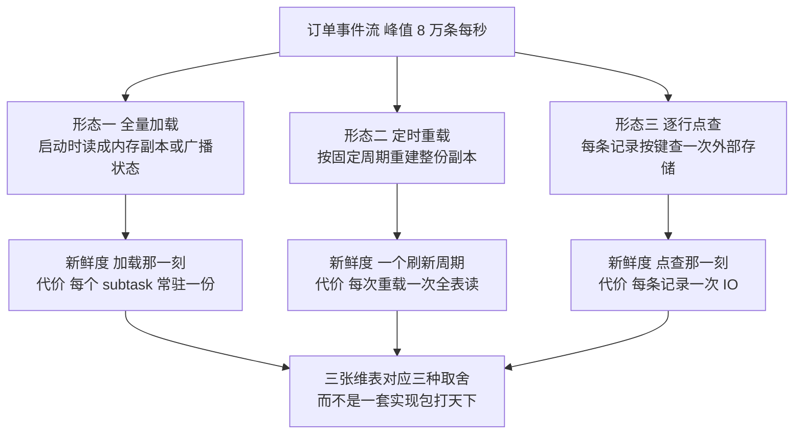
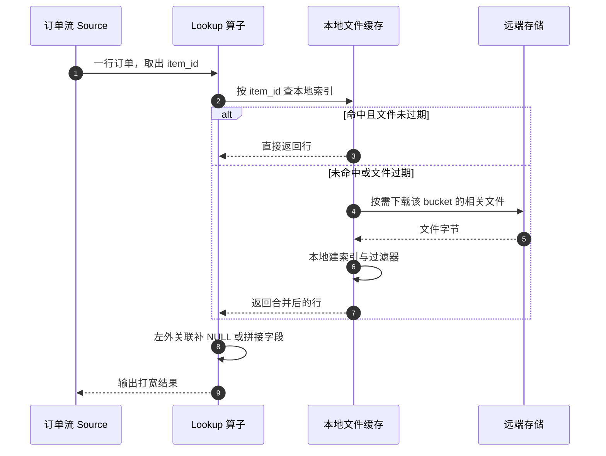
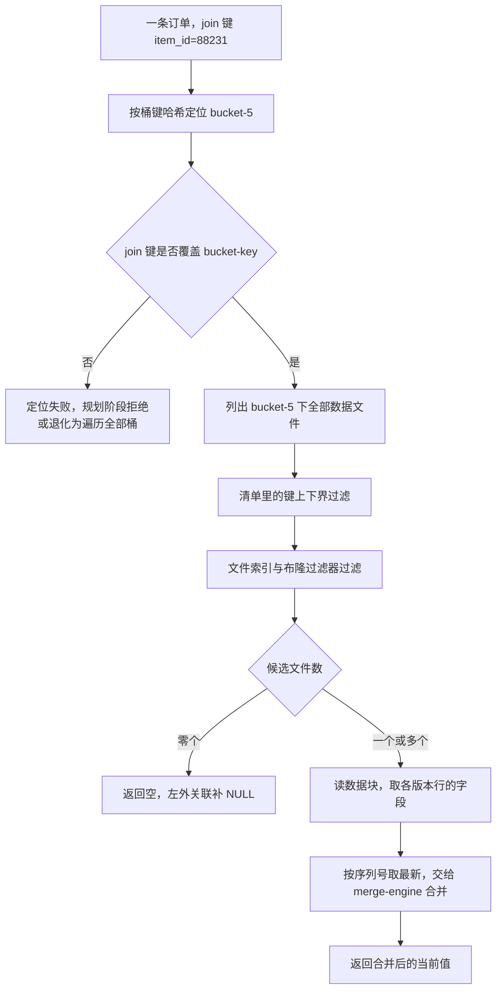
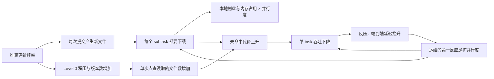
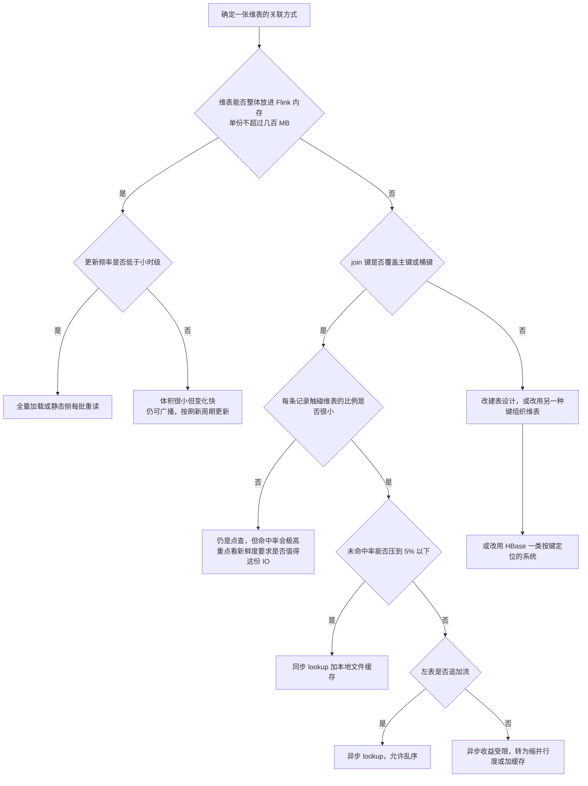
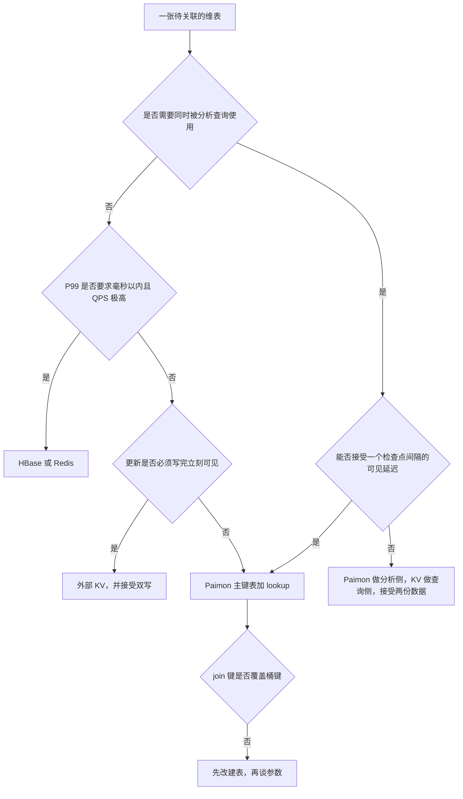

**摘要：**

事实流每秒都在来，维表隔几分钟才变一次，两条节奏不同的数据要拼在一起，就必然要在某个环节做一次"以谁为准"的决定：要么让维表屈就事实流的节奏，每来一条记录就查一次当前值；要么让事实流屈就维表的节奏，先把维表搬成一份本地副本，再按批去探。本文只走第一条路——把维表放进 Paimon 主键表，让 Flink 的 lookup join 在处理每条记录时按主键点查一次。这条路成立的一半原因在 Flink 侧：`FOR SYSTEM_TIME AS OF` 在维表连接器实现 `LookupTableSource` 时会退化成逐条调用 `LookupFunction`，代价按记录计，好处是按记录新鲜。另一半在 Paimon 侧：bucket 先按键把候选收缩到一个目录，桶内的 LSM 层级、文件索引与文件级键范围再把候选收缩到一两个文件，点查因此不必扫全表，而且写入端提交快照之后不需要等 compaction 就能被读到。全文沿一条订单打宽的链路展开：先比较三种维表关联形态在新鲜度与代价上的分工，再把一次点查从 SQL 语句追到算子、从快照追到本地文件缓存，然后用算术交代三笔成本——远程读、每个 subtask 一份的本地副本、维表更新频率乘以并行度，接着给出同步与异步、缓存参数与维表建表的设计约束，最后用六个反例收口：维表可能小到不该 lookup，键可能随机到命中率为零，表也可能出现"主键不是 join 键"这种结构性错配。

---

## 第 1 章 维表为什么必须"边写边查"

先把场景收窄。一条订单事件从 Kafka 进来，带 `order_id`、`user_id`、`item_id`、`region_code` 四个键，打宽需要补三类字段：用户会员等级与注册渠道、商品的类目与品牌、地区码对应的大区与销售负责人。这三类字段分属三张维表，三张表的特征完全不同——地区码表只有几千行、几年不动；商品维表几千万行、商家后台随时改价；用户维表两亿多行、会员系统每小时同步一次标签。同一个查询里，三张维表的"变化速度"相差四个数量级，这就是维表关联真正难的地方：难的不是关联本身，而是三类变化节奏要在一套实现里各得其所。

### 1.1 三种形态：把新鲜度换成代价的三笔交易

流与维表关联，业界反复落地的只有三种形态，它们的差别不在实现细节，而在"谁等谁"。

第一种是全量加载。任务启动时把整张维表读进 Flink 的状态或广播变量，之后每条记录只查本地内存。它让事实流等维表：维表在启动那一刻定格，之后无论事实流跑多久，看到的都是同一份快照。第二种是定时重载。缓存照旧，但另设一条周期性的刷新路径，每隔若干分钟把维表重新读一遍并换掉旧副本。它让两边的等待被压缩成一个可以标定的窗口：最多陈旧一个刷新周期。第三种是逐行点查。不保存维表副本，每条记录到达时去外部存储按主键取当前值。它让维表等事实流：表里有什么最新提交，查询就返回什么。



三支箭头落回同一个结论，这是本文的出发点：三种形态不是三代技术，而是三笔交易，各自把成本记在不同的账本上。

| 维度 | 全量加载 | 定时重载 | 逐行点查 |
|---|---|---|---|
| 新鲜度 | 加载那一刻，之后长期陈旧 | 一个刷新周期 | 查询那一刻 |
| 每条记录代价 | 一次哈希查找 | 一次哈希查找 | 一次 IO，命中缓存时退化为本地读 |
| 启动代价 | 一次全表读，随维表大小线性增长 | 一次全表读，之后按周期重复 | 近乎为零，首个 key 到来时才触碰存储 |
| 常驻内存 | 维表大小乘以 subtask 数 | 同左，切换瞬间两份 | 缓存上限，与维表大小解耦 |
| 主要故障面 | 静默陈旧，无任何报错 | 刷新与使用的时序错乱 | 反压、IO 抖动、命中率下滑 |
| 什么时候合适 | 维表小且几乎不变 | 维表中等、可容忍分钟级 | 维表大、变化快、键有热点 |

表里最容易被读错的一行是"主要故障面"。三种形态都会坏，但坏的姿势不同：前两种坏起来是**静默陈旧**，指标全绿，只是某些行的关联字段悄悄变成旧值；第三种坏起来是响亮的，任务反压、延迟抬升、日志里堆满超时。响亮的故障反而好处理，这也是很多团队明知成本更高仍然选点查的原因之一——它在监控上诚实。

### 1.2 不这样会怎样：两条走不通的替代路

如果不用点查，现实里通常还有两条路可走，但它们都通向更糟的地方。

第一条是流与维表做常规双流关联（regular join）。两路输入都作为流参与，Flink 必须把两侧的历史都留在状态里，等另一侧的新记录来匹配。假设用户维表有 10 亿个 key、每行 500 字节，两侧全量进状态就是 TB 级的检查点，而维表的每一次更新还会在状态里追加一条新版本。用状态 TTL 把历史裁掉能控制体量，代价是关联结果不再保证正确：TTL 过期的键会被当成"维表里没有"，左外关联于是安静地补上 NULL。状态、TTL 与正确性这三件事在流-流关联里没法同时满足，这也解释了为什么维表关联要单独有一条语法路径。

第二条是每批重读维表。把维表当静态侧，每个微批重新扫一遍，靠批次界定新鲜度。这个方案在批处理里非常自然，在流里很快撞上 I/O 预算：以本章的订单链路为例，用户维表 2.4 亿行、行宽 300 字节、列存压缩比 3:1，落盘约 24GB（示例推算）；批次间隔 10 秒，意味着每 10 秒读 24GB，折成持续带宽 2.4GB/s，这个数字与订单量无关，只与维表大小和批次间隔有关。

两条路各自堵在一个地方：一条堵在状态与正确性，一条堵在 I/O 与新鲜度。点查之所以存在，是因为它把这两个约束同时绕开了——维表不进 Flink 状态，所以状态恒定；每条记录现查，所以新鲜度最贴近当下。绕开的方式是把成本从"状态与全表扫描"换成"每条记录一次远程读"，而这一次远程读的经济性，就取决于后面两章要拆的存储实现。

### 1.3 点查的语义是处理时间，不是事件时间

把新鲜度做到按记录，代价不只在 IO 上，还有一层语义上的让步，而这层让步经常在上线后才被意识到。

Lookup join 的语法要求维表侧用一个处理时间属性去对齐，通常写成 `FOR SYSTEM_TIME AS OF o.proc_time`，其中 `proc_time` 由左表的 `PROCTIME()` 提供。这个写法的含义是"用处理这条记录时维表的当前样子去关联"，而不是"用这条记录发生时刻维表的样子去关联"。两者的差别在正常情况下很小，在两种情况里会放大。

其一是回撤与重放。作业从检查点恢复，最近一段时间内已经处理过但尚未提交的记录会被重算一遍；重算发生在更晚的物理时刻，查到的维表版本可能已经变了，于是同一批数据在两次执行里得到不同的打宽结果。这对下游是致命的，如果下游做的是精确一次的对账，重放窗口内的差异会被当成数据错误去排查。其二的严重程度低一些，但同样需要预先约定：维表的历史变更不会回改已经输出的宽表行，一次价格修改只影响修改之后处理的订单，此前已经流出的订单继续持有旧价格。

这两条不是缺陷，而是**处理时间语义**的直接推论：接受它，等于接受"打宽结果是处理时刻的观测值"这个定位；不接受它，就得让维表带时间属性变成一张版本表，用两路输入的 temporal join 按事件时间找版本，代价是维表的所有版本都要进 Flink 状态。

版本表的这条路值得单独说清，因为很容易与 lookup 混淆。同一句 `FOR SYSTEM_TIME AS OF`，在右表是版本表时走的是两个输入算子的时间关联（处理时间下对应 `TemporalProcessTimeJoinOperator` 一类的算子，事件时间下对应按时间戳找版本的算子），维表侧的数据确实作为流进到了 Flink 状态里；在右表是一个实现了 `LookupTableSource` 的外部连接器时，走的才是逐条点查，维表数据根本不进 Flink。社区早期的材料里常把前者称作 processing-time temporal table join，这个名字在不同版本的计划节点与规则名之间有过变动，具体落到哪个物理节点，以对应版本的源码与文档为准。判断自己走的是哪条路，有一个很干净的判据：看作业的检查点大小——如果维表全量进了状态，检查点会随维表增长；如果走的是 lookup，检查点与维表大小无关。

### 1.4 贯穿案例

后文的算术都基于同一条链路，先把参数固定下来，避免每节换一套数字。

链路是 `orders` 主题到 `dwd_order_enriched` 表：订单事件从 Kafka 进入，峰值 8 万条每秒，单条 400 字节左右；打宽需要关联三张 Paimon 主键表，三张表都由上游 CDC 链路实时写入。

| 维表 | 行数 | 每行宽 | 主键 | 更新频率 | 查询特征 |
|---|---|---|---|---|---|
| `dim_user` | 2.4 亿 | 300 字节 | `user_id` | 每小时约 200 万行 | 键分布较均匀，热点集中在活跃用户 |
| `dim_item` | 5000 万 | 500 字节 | `item_id` | 每分钟约 5000 行 | 强热点，头部商品占大头 |
| `dim_region` | 3000 | 120 字节 | `region_code` | 每年几次 | 全量遍历，无热点概念 |

三张表在这条链路里的待遇应当完全不同，这也是本文反复要回到的判据：维表关联的选型不是"团队统一用哪种"，而是"这张表的更新频率、键分布与体量组合成什么形状"。地区码表放进 Flink 里每批重读都比点查便宜，用户表与商品表则几乎没有别的选择。

---

## 第 2 章 Flink 把 lookup join 落成了什么

### 2.1 从一条 SQL 到一条算子链

先看一条完整的写法，把语法成分标出来。

```sql
-- 维表：Paimon 主键表，由上游 CDC 任务实时写入
CREATE TABLE dim_item (
    item_id     BIGINT,
    category_id BIGINT,
    brand       STRING,
    list_price  DECIMAL(12, 2),
    PRIMARY KEY (item_id) NOT ENFORCED
) WITH (
    'connector' = 'paimon',
    'path'      = 'hdfs:///warehouse/dim/dim_item'
);

-- 事实流：处理时间属性是 lookup join 的入场券
CREATE TEMPORARY TABLE orders (
    order_id    BIGINT,
    user_id     BIGINT,
    item_id     BIGINT,
    region_code STRING,
    amount      DECIMAL(12, 2),
    proc_time   AS PROCTIME()
) WITH (
    'connector' = 'kafka',
    'topic'     = 'orders',
    'format'    = 'json',
    'properties.bootstrap.servers' = 'kafka-1:9092'
);

-- 打宽：右侧带 FOR SYSTEM_TIME AS OF，才是点查语义
INSERT INTO dwd_order_enriched
SELECT o.order_id, o.amount, i.category_id, i.brand, i.list_price
FROM orders AS o
LEFT JOIN dim_item FOR SYSTEM_TIME AS OF o.proc_time AS i
  ON o.item_id = i.item_id;
```

这段 SQL 里真正决定执行形态的是三个字面成分：左表上的 `proc_time`、右侧的 `FOR SYSTEM_TIME AS OF`、以及右表连接器是否实现 `LookupTableSource`。三者齐备时，优化器不会生成一个哈希关联算子，而是把右表换成一个 lookup 源，左表的每一行在经过这个算子时被当作一次查询请求。

计划阶段的处理可以粗略理解为"把它当作时间维度关联的一个特例"。Flink SQL 里时间维度关联有两类落法：一类是版本表，右表本身是一条带主键与时间属性的 changelog 流，关联由两输入算子完成，两侧数据都在状态里；另一类是外部维表，右表由连接器提供查找能力，关联由单输入算子逐行发起。Paimon 表在 Flink 的目录里注册出来即具备查找能力，因此默认落在后一类。前一类在 1.x 的物理节点体系中体现为 `StreamPhysicalTemporalJoin` 之类的节点，后一类体现为 `StreamPhysicalLookupJoin`；节点名与规则名在版本之间有过整理，写在这里只作为定位线索，精确归属仍需以对应版本源码为准。

到了运行时就只剩一个朴素的循环：算子收到一行，从行里取出 join 键，调用查找函数，拿到结果后拼宽，再往下游发。同步实现对应 `LookupJoinRunner` 一类的运行时算子，查找函数的签名是"给一组键，返回一个行的迭代器"；没有命中就返回空，左外关联在空结果时补 NULL。异步实现则把单次查找包成一个未来对象，交给 `AsyncWaitOperator` 统一调度，这条路径在 2.4 节展开。

### 2.2 两条路径的差别不止"数据在哪"

把两条路径并排放在一起，会看到它们在六个维度上各自让步，而多数选型讨论只盯着延迟。

| 维度 | 版本表路径（temporal join） | 外部维表路径（lookup join） |
|---|---|---|
| 维表数据位置 | Flink 状态，随检查点持久化 | 外部存储，不进 Flink 状态 |
| 关联时间语义 | 可对齐事件时间，找历史版本 | 处理时间，只能取当前值 |
| 检查点规模 | 随维表版本数增长 | 与维表大小基本无关 |
| 可见延迟 | 由维表 changelog 追平速度决定 | 由外部存储的提交与缓存决定 |
| 每条记录代价 | 一次状态查找 | 一次 IO，命中缓存时退化为本地读 |
| 适合的维表 | 需要按事件时间回溯的缓慢变化维 | 体量大、更新频繁、只需当前值的维 |

表里最值得比较的是"检查点规模"这一行：版本表用状态容量换语义正确性，lookup 用 IO 换状态容量。当一个作业的检查点已到 GB 级且仍在随维表增长时，继续往版本表方向加码不是好选择，状态的增长是单向的，而 IO 成本至少还能靠缓存与并行度摊薄。

### 2.3 逐条点查的吞吐墙

笔者在这里算一笔账，看清"每条记录一次远程读"这句话在数值上意味着什么。假设点查一次远程读取的往返时间是 20 毫秒（对象存储上一个不算苛刻的数字），缓存命中时本地读耗时 0.3 毫秒（示例推算，用于说明量级关系）。

```text
单个 subtask 的吞吐上限 ≈ 1000 / 单次点查耗时（毫秒）
  全部未命中、每次 20 毫秒      → 约 50 条每秒
  全部命中本地缓存、0.3 毫秒    → 约 3300 条每秒
整条链路的吞吐 ≈ 单个 subtask 吞吐 × 并行度
  8 万条每秒 ÷ 50 条每秒        → 需要 1600 个并行 subtask
  8 万条每秒 ÷ 3300 条每秒      → 需要 25 个并行 subtask
```

这两个数字之间差了六十多倍，而它们描述的是同一份代码、同一张维表。差别只有一个：命中率。所以在这条技术路线上，缓存命中率不是"调优项"，而是"可行性前提"——命中率一旦跌到某个阈值以下，需要的并行度会迅速超过集群能给的数量，扩并行度又会把远程请求数按比例放大，最后撞在存储侧的 QPS 与带宽上。后文第 4 章会把这个反馈回路算完整。

反过来说，命中率高的场景里点查相当便宜：维表键分布有热点时，单次查找退化成一次本地读，成本结构与广播一份副本接近，却省掉了广播的启动开销与常驻内存。

### 2.4 同步与异步：把等待从串行变成并发

同步实现的语义极其直白：一行进来，发起查找，等结果，再处理下一行。好处是输出顺序与输入顺序一致、内存可控、失败好定位；坏处是单次查找的延迟会原样变成整条链路的**吞吐墙**，一旦某次查找变慢（远端抖动、某几个 key 触发多层合并），这个 subtask 后面的记录全部排队。延迟重试会放大它：为等一张迟到的维表行重试 600 次、每次 1 秒，这条记录能被拖住十分钟，后面的记录一起陪跑。

异步实现把"发起"与"拿到结果"拆开：算子在缓冲区里同时挂起若干个查找请求，谁先回来先处理谁，于是单次 20 毫秒的延迟不再等于"每 20 毫秒处理一条"，而是"每 20 毫秒可以有一批在途请求"。Flink 的 `AsyncWaitOperator` 负责这件事，具体参数通过 `LOOKUP` hint 给出：

```sql
-- 异步 + 允许乱序 + 延迟重试：一条记录等维表不再阻塞其他记录
SELECT /*+ LOOKUP(
    'table' = 'i',
    'async' = 'true',
    'output-mode' = 'allow_unordered',
    'capacity' = '200',
    'timeout' = '60s',
    'retry-predicate' = 'lookup_miss',
    'retry-strategy' = 'fixed_delay',
    'fixed-delay' = '1s',
    'max-attempts' = '60'
) */
    o.order_id, o.amount, i.category_id, i.brand
FROM orders AS o
LEFT JOIN dim_item /*+ OPTIONS('lookup.async' = 'true', 'lookup.async-thread-number' = '16') */
FOR SYSTEM_TIME AS OF o.proc_time AS i
  ON o.item_id = i.item_id;
```

这段 hint 里的每一项都对应一笔代价，值得逐项交代。`capacity` 是异步算子的在途缓冲上限，默认 100，调大能提高并发度，代价是内存与乱序窗口一起变大；`timeout` 是一次查找从发起到最终完成的总时限，默认 300 秒，超时即按失败处理、触发作业重启，所以它不是"等更久"的旋钮，而是"多快认错"的旋钮；`output-mode` 取 `allow_unordered` 才能让先返回的记录先走，而它只在左表是追加流时有效——左表若是 CDC 流，Flink 会忽略这个设置并保持有序，也就是说一条迟到的维表行照样能把后面的变更事件堵住。Paimon 的文档给这条限制留了一个绕法：把左表换成 Paimon 的审计日志系统表（把变更展开成追加记录）再消费，代价是查询里要自己解释行类型，等于用语义清晰度换吞吐。

还有一条容易被忽略的事实：维表连接器必须真的支持异步，hint 才有意义。`'async'='true'` 只是一个建议，连接器没有异步实现时会被忽略，作业照样按同步跑——这类**配了但没生效**的情况在排障时最难认，因为日志里什么都没有。Paimon 的 Flink 连接器提供了 `lookup.async` 与 `lookup.async-thread-number` 两个参数（前者默认关闭，后者默认 16），需要显式打开才会启用异步查找。

### 2.5 缓存的两层：行级与文件级

讲到缓存，社区里最常引用的两个参数是 `lookup.cache.max-rows` 与 `lookup.cache.ttl`。它们是 Flink 生态里 JDBC、HBase 一类连接器约定俗成的行级缓存配置：把查到的行按 join 键放进一个有容量上限、带过期时间的本地映射，下一次同键查询直接命中。行级缓存的代价非常好算，陈旧窗口的上限就是 `ttl`——一行在缓存里最多停留这么久，期间维表改了也读不到；下限则是 0，缓存未命中时立刻穿透到外部存储。

Paimon 的连接器没有采用这一层抽象，它把缓存做在文件与索引这一级：远端的数据文件按需拉到本地磁盘，在本地重建成便于查找的形态，索引与过滤器常驻内存，文件本身按保留时间过期。这类参数的清单较长（内存上限、磁盘上限、保留时间、本地文件形态、过滤器开关与假阳性率、内存池分配比例），作用与代价留到 5.3 节统一交代，此处只需记住一件事：**缓存的对象是文件，不是行**。

| 层次 | 缓存对象 | 典型参数 | 陈旧的来源 | 未命中的代价 |
|---|---|---|---|---|
| 行级 | 查询结果行 | `lookup.cache.max-rows`、`lookup.cache.ttl` | 行的值在 ttl 内不再更新 | 一次完整的远程点查 |
| 文件级 | 远端数据文件与本地索引 | `lookup.cache-max-memory-size`、`lookup.cache-file-retention` | 新写入落在新文件里，旧文件本身不会被改写 | 一次文件下载加一次本地建索引 |

这个差别不是实现细节，它决定了"陈旧"在两种缓存里长得不一样。行级缓存陈旧的表现是"这一行的值是旧的"，因为缓存里存的就是值；文件级缓存陈旧的表现是"这个文件还没见过"，因为 LSM 的数据文件一旦写出就不再修改，维表的新值总是落在新文件里，读到旧文件不会读出错的值，只会读到旧快照的视图。所以 Paimon 这条路上真正决定可见延迟的，不是文件保留时间，而是**读取端多久能看到一次新快照**，以及写入端多久提交一次新快照。把可见延迟写成一个不等式会更清楚：

```text
可见延迟 ≈ 维表侧写入延迟（CDC 追平 + 攒批）
         + 快照提交间隔（写入端以检查点为节拍）
         + 读取端发现新快照的间隔
         + 缓存未命中时的文件下载时间
```

四项里前三项与缓存参数无关，只有第四项与缓存有关。真正压新鲜度的动作在写入端：缩短检查点间隔、让维表侧的 CDC 追平延迟可控，才是这条链路上有效的两个旋钮。

下图把一条记录从进入算子到写出结果的路径画出来：



图里第二步与第三步之间是这条链路的所有成本所在。命中时它退化为一次本地查找，与广播一份副本的探测成本同阶；未命中时它包含一次远端下载、一次本地索引构建，以及一次按序列号取最新版本的合并。把这个分叉的概率测出来，点查方案是否可行就基本定了——第 4 章给出测法与该看的量。

---

## 第 3 章 一次点查在 Paimon 里走到哪

Flink 侧把一行交出去之后，事情就与 Flink 无关了。Paimon 的查找函数面对的输入只有一组键值，它要回答的问题是"这张表里这个键当前的所有版本合并之后是什么"。这个问题在批读里也要回答，只是批读可以一次回答几十万次，点查必须一次回答一次，于是每一层能省的 I/O 都必须省下来。

### 3.1 表在存储上是什么形状

先把这个形状说清，后面每一步的裁剪才有落点。Paimon 表在文件系统上按 `bucket` 分目录，桶内是一组不可变文件，元数据侧由快照与清单描述这些文件。

| 路径 | 内容 | 点查是否用得上 |
|---|---|---|
| `snapshot/` | 每次提交后表的完整视图，指向一份清单列表 | 用来确定"当前版本包含哪些文件" |
| `manifest/` | 清单列表与清单，逐条记录文件的桶、层级、键上下界与统计 | 用来做键范围与分区裁剪 |
| `bucket-N/data-*` | 不可变数据文件，内含文件索引块 | 命中后读取数据块 |
| `bucket-N/index-*` | 独立索引文件，记录键到数据块的映射 | 用来定位数据块 |
| `bucket-N/changelog-*` | 变更日志，供流读消费 | 点查不走这条路 |

这份布局里没有任何一处是"为了点查"专门设计的，它们全部来自 [[大数据/数据湖/paimon/02 LSM-Tree 存储引擎——为什么用 LSM 而非 CoW 文件覆盖|LSM 写入模型]]：写入先落内存表，攒够了刷成一个不可变文件，文件按层级合并。点查能高效，是因为这套模型恰好提供了三层裁剪，而不是因为它有一张额外的索引表。

### 3.2 第一层裁剪：键到桶

一次点查的第一件事是把键换算成一个桶号。换算方式是 `hash(join 键) % 桶数`，桶号确定之后，候选集从"整张表的所有文件"骤然缩小到"一个桶目录下的文件"。

这一步的成立有一个前提条件，而这个条件在实践里最容易被破坏：**join 键必须覆盖桶键**。桶键（`bucket-key`）未显式指定时等于主键，指定之后按指定列哈希。维表的主键如果是 `(item_id, dt)` 这样的复合键，而 join 条件只写了 `item_id = i.item_id`，那么桶号根本无法算出来——表按复合主键打散，单凭 `item_id` 定位不到唯一的桶。工程上的表现通常是任务起不来：连接器在规划阶段就会拒绝，因为单凭 `item_id` 定位不到唯一的桶。这类错配不是运行时调优能救的，只能改建表设计：要么把 `dt` 从主键里拿掉、把维表做成"只保留最新分区"的表，要么在 join 条件里把 `dt` 一起带上。

### 3.3 第二层裁剪：桶内的文件

桶目录下的文件组成一棵 LSM 树。Level 0 的文件来自内存表的直接刷写，彼此之间的键范围可以重叠；更高层级的文件是合并产物，同一层内键范围不重叠，可以二分。这个结构决定了点查在桶内要做的两件事：先用文件级元数据排除"不可能含有这个键"的文件，再对剩下的文件按序列号取最新版本。

排除的手段有三样，成本从低到高排列。最便宜的是清单里记录的键上下界：目标键落在范围之外的文件直接跳过，这一步不触碰数据文件。贵一点的是数据文件自带的索引块与布隆过滤器：Paimon 为数据文件建立文件索引，清单里对小于阈值的索引会直接内嵌，查找时先读索引判断目标键落在哪个数据块，再只读那一块；本地缓存层另有一套布隆过滤器（`lookup.cache.bloom.filter.enabled` 默认开启，假阳性率默认 0.05），在文件根本不含该键时提前返回。最贵的是真正的数据块读取，它发生在前两步都通过之后。

同一个键在 LSM 里可能有多个版本，合并语义见 [[大数据/数据湖/paimon/03 主键表与追加表——两种写入模型的设计逻辑|主键表与合并引擎]]：早先写过的旧行还在深层文件里，最近的更新在 Level 0 的新文件里。点查不能只返回最新的那一个文件，它必须把所有命中的版本都读出来，按序列号取最大，再交给合并引擎（`merge-engine`）计算。表若是 `deduplicate`，取序列号最大的那一行；`partial-update` 要把多个版本的非空字段拼起来；`aggregation` 则按字段函数累加。这一条决定了点查的成本不只与键的分布有关，**还与键的版本数有关**——一个每分钟被改一次价的商品，在两次合并之间会在 Level 0 攒下多个版本，点查这个商品就要读多个文件做合并。头部商品是热点，热点又恰好是更新最频繁的那批，两个效应叠在一起，正好落在点查最贵的位置上。



图里从 E 到 F 是两级过滤，它们的成本差别很大：E 只读元数据，F 要读文件头或索引块，两者都比 I 便宜一到两个数量级。把 E、F 两级做扎实（键上下界完整、索引常驻内存、bloom 开启），点查的远程读次数就能从"每个版本一次"压到"每个键一次"。

### 3.4 第三层裁剪：本地文件缓存

前两层把候选压到一两个文件，但这两次判断本身仍要访问远端：元数据、索引块、数据块都在远端。如果每条记录都这样走一遍，第 2.3 节算过的 20 毫秒往返就会成为常数。

Paimon 的处理办法不是缓存"查询结果"，而是缓存"文件"。远端文件按需下载到本地磁盘，在本地重新组织成便于查找的形态：`lookup.local-file-type` 在有序文件与哈希文件之间选，前者适合范围与等值混合的访问，后者适合纯等值点查且内存更省；索引与布隆过滤器放进内存，由 `lookup.cache-max-memory-size`（默认 256MB）与 `lookup.cache.high-priority-pool-ratio`（默认 0.25，预留给索引与过滤器）共同约束；文件本身受 `lookup.cache-file-retention`（默认 1 小时）与 `lookup.cache-max-disk-size`（默认不限）约束；首次初始化时的并发由 `lookup.bootstrap-parallelism`（默认 4）控制。

这个设计的形态学后果值得单独强调：IO 的计价单位**从"行"变成"文件"**。一次未命中要付的代价是该数据文件的字节数与一次下载往返，与这一次查询到底取一行还是取一万行无关；反过来，同一个文件一旦落到本地，之后无论这个文件里有多少个键被查到，都不再产生远端 IO。于是 Paimon 点查的成本曲线与 HBase 完全不同：HBase 的成本随查询次数线性增长（每行一次读），Paimon 的成本随"被访问过的文件总量"增长，查询次数只影响本地读的次数。

这条差异带来两个反直觉的推论。第一，维表小但查询键极其分散时，Paimon 未必便宜——若每次查询都碰到一个此前没被下载过的文件，成本按文件算，而小维表的文件数可能并不少（桶数乘以层数）。第二，维表大但查询集中在少数文件上时，Paimon 很便宜——热点键把少数文件反复加热，代价被摊薄到每次本地读。判断该不该用 lookup，要看的不是"维表有多大"，而是"一段时间的查询会覆盖多少个文件"。

### 3.5 可见性：为什么不需要等合并

批读要等合并，因为列式扫描最怕读放大；点查不等合并，因为查找路径本来就是按 LSM 设计的，它天生要在多个层级里找同一个键。这带来一个工程上的好处：**写入端提交快照之后点查立刻可见**，不需要等 compaction 完成。

于是第 2 章末尾那个不等式在这里落地成一个可以直接改的数字：写入端以检查点为节拍提交快照，间隔 10 秒，维表变更的最乐观可见延迟就是一个检查点间隔。把间隔从 3 分钟改到 10 秒，可见延迟的下界直接从分钟级掉到十秒级，这个动作的效果比调任何缓存参数都大。

不等合并也有代价，代价记在读放大上。合并跟不上时，Level 0 会积压，同一个键的版本数增加，点查要读的文件数随之增加；极端情况下 Level 0 攒了几十个文件，一次点查要把它们逐个检查一遍，点查延迟的 P99 会先于平均值恶化。所以维表的写入端必须把合并配置当回事：写入量稳定时合并能跟上，写入量突增（譬如一次全量初始化、一次批量调价）时合并会落后，此时点查的延迟抖动与写入端是同一个问题的两端。

### 3.6 为什么这条路径在 Iceberg 与 Delta 上难以照搬

同样的问题在另外两个开放表格式上并非无解，但解法与被访问的对象不同，理解这一点有助于判断 Paimon 的边界在哪。

Iceberg 的读路径由三层元数据驱动：快照指向清单列表，清单列表指向清单，清单里逐条记录数据文件的分区、列统计与删除信息。做点查时，这些元数据能把候选从"全表"压到"少数几个"：分区裁剪砍掉大部分，`lower_bounds`/`upper_bounds` 与 Puffin 索引里的布隆过滤器各再砍一轮。但这条链路的终点仍是"文件级筛选"：它回答"这个文件可能含有这个键"，不能回答"键在文件的哪一行"，候选选出来之后还要把整个数据块读进内存过滤。更新则更麻烦，Iceberg 的行级删除以删除文件记录，点查一个被反复更新的键，要把数据文件与若干删除文件一起读进来合并，删除文件越多读放大越严重。

Delta Lake 的路径更直接：它依赖文件级统计做数据跳过，配合分区、排序与聚簇把候选文件压小，读取时在内存里过滤。它没有主键的概念，因此也没有"键到文件"的映射，一份被反复更新的记录会随着 `MERGE` 重写数据文件而不断搬家，点查只能靠统计信息去猜文件，猜不中就多读几个文件。Delta 的删除向量能减少重写，但那仍然是"行级标记 + 读时过滤"，不是索引。

这两条路径都能把点查做到"可用于低频查询"的程度，但做不到"每条流记录一次"的经济性：它们缺少的不是某个优化，而是一个把键映射到少数文件的持久结构。Paimon 有这个东西，是因为它用了 LSM，而 LSM 的写入模型本来就要求按键组织文件。这也是为什么在同样的维表场景里，Iceberg 与 Delta 常见的做法不是"让流直接点查"，而是把维表同步到 HBase、Redis 或者一个专门的查询服务上——绕开格式本身，去借一个天生支持键定位的系统。

Paimon 自己也没有把这条路封死。社区提出的查询服务（Query Service，PIP-10）把这个查找能力从 Flink 任务里挪出来，做成独立的 Flink 流作业，由它持有本地副本并对外提供查找，多个作业共享同一份缓存。它要求维表是固定桶的主键表，通过 `CALL sys.query_service('db.table', parallelism)` 启动。这一步的动机不难理解：把缓存复制从"每个作业一份"变成"整个集群一份"，正好对应第 4 章要算的那个乘法因子。

---

## 第 4 章 代价：三笔账与两条放大

把点查的成本写成一句话：它等于"每条记录的查找次数"乘以"一次查找的代价"，再乘以"有几份副本在各自付这笔钱"。前两章已经拆了单次查找的代价，这一章拆后两项，并把它们算成可以拿去和容量规划对账的数字。

### 4.1 三笔账

第一笔是远程读。它只在缓存未命中时发生，代价由一次往返时间加传输字节构成。这笔账的特点是方差极大：命中时是微秒级，未命中时是几十毫秒，两者差三个数量级，所以平均值几乎没有意义，P99 才有意义。

第二笔是本地副本。每个 subtask 都在自己的本地磁盘与内存里维护一份缓存，缓存上限由参数控制，但"上限"不等于"实际占用"——实际占用取决于这个 subtask 见过多少文件。当并行度是 64 时，同一份热数据会被 64 个 subtask 各存一份，磁盘占用与内存占用都要乘 64。

第三笔是元数据读取：查找函数要判断"当前快照里有哪些文件"，就得读快照与清单，维表提交越频繁，快照越多、清单越碎，这部分读的次数也越多。它不随记录数增长，却是每次刷新都要付的固定成本。

| 成本项 | 决定变量 | 放大方式 | 该看的量 |
|---|---|---|---|
| 远程读 | 未命中率、单次往返、文件字节数 | 随流量的未命中部分线性增长 | 未命中次数、单次下载字节、P99 延迟 |
| 本地副本 | 访问覆盖的文件总量、并行度 | 按 subtask 数复制 | 各 subtask 的本地磁盘用量、堆外内存占用 |
| 元数据读 | 快照数、清单体积、刷新频率 | 随提交频率增长 | 每次刷新的元数据字节数、刷新耗时 |
| 合并开销 | 键的版本数、Level 0 积压程度 | 随维表更新频率增长 | 单次点查读取的文件数、合并耗时 |

### 4.2 第一条放大：并行度与缓存副本

并行度在这条链路上扮演的是双重角色，这一点经常被忽略。它既是吞吐的来源，也是成本的乘数。为了把 8 万条每秒的流吃下来而把并行度从 16 提到 64，看起来只是多用了四倍的计算资源，实际上本地缓存也多出了三份：每个 subtask 都要把热点文件下载一遍，每个 subtask 都要在内存里放一份索引，每个 subtask 都要在本地磁盘上留一份文件副本。

不过覆盖范围这件事更隐蔽。假如并行度是 64、维表只有 8 个桶，每个 subtask 都可能收到任意桶上的键，长期看它需要具备 8 个桶的热点缓存才有高命中率。所以**副本数等于并行度本身**，桶只是把文件切小，并没有把访问切窄。

这也解释了为什么会出现"查询服务"这类方案，以及为什么 Paimon 后续版本引入了桶对齐的 shuffle lookup：前者把副本从 N 个作业变成 1 个服务，后者把每个 subtask 需要的缓存从"全表"缩小到"按桶分片后的一部分"。后者的生效条件很硬——需要 Flink 2.0 及以上、维表必须是固定桶、join 键必须覆盖全部桶键，三者缺一不可，具体的版本门槛以对应版本文档为准。

### 4.3 第二条放大：维表更新频率

第二笔放大来自维表本身的变化。LSM 的文件不可变，每一次提交都产生新文件，而这些新文件对每个 subtask 都是"没见过"的，都要下载一次。于是下载总量近似等于"维表更新产生的字节数"乘以"subtask 数"，而更新字节数又等于"更新频率"乘以"每次更新的行数与行宽"。

笔者用一个算例把这个乘法摊开（以下均为示例推算，用于说明量级关系，不是实测）。`dim_item` 每分钟更新 5000 行，行宽 500 字节，原始数据约 2.5MB；写入端按 10 秒检查点提交，每分钟 6 次；每次提交产生的数据文件与索引合计按 12MB 估（桶分散与索引开销让实际字节数高于行数据本身）。并行度 64，且每个 subtask 长期都会碰到全部桶的文件，则：

```text
每小时新增文件字节 ≈ 12 MB × 6 × 60 = 4.3 GB
汇总下载量 ≈ 4.3 GB × 64 = 276 GB / 小时 ≈ 78 MB/s 的持续读
单 subtask 本地磁盘占用（保留 1 小时）≈ 4.3 GB
64 个 subtask 的磁盘总量 ≈ 276 GB
```

这几项里，带宽看起来还能接受，磁盘那一项则足以让一台 TaskManager 的本地盘告急，而 `lookup.cache-max-disk-size` 默认是不限的。这条算例的意义不在于数字精确，而在于它把"维表更新频率"与"并行度"这两个看起来无关的参数放进了同一个乘法式里：维表更新得越频繁，单个 subtask 的缓存越是被新文件冲刷；并行度越高，被冲刷的副本越多。若把更新频率从每分钟一次提到每 10 秒一次，前面三个数字都要乘 6。

同样的逻辑反向成立：把维表做成"只保留最新分区"的形状，让查找只在一份全量分区上进行，就相当于把增量提交换成整体切换，下载量骤降而当天内的变更不再逐条可见。分区怎么指定、切换多久一次，见 5.4 节。

### 4.4 算例：命中率决定可行性

把 2.3 节的吞吐墙按命中率展开成一条曲线（示例推算）：设并行度 64、单次命中 0.3 毫秒、单次未命中 20 毫秒，则单个 subtask 的吞吐上限是：

```text
吞吐(task) ≈ 1 / (命中率 × 0.0003 + 未命中率 × 0.020)   条/秒
命中率 99%     → 1 / 0.000497 ≈ 2012 条/秒 → 全链路约 12.9 万条/秒
命中率 97%     → 1 / 0.000891 ≈ 1122 条/秒 → 全链路约 7.2 万条/秒
命中率 95%     → 1 / 0.001285 ≈  778 条/秒 → 全链路约 5.0 万条/秒
命中率 90%     → 1 / 0.002270 ≈  440 条/秒 → 全链路约 2.8 万条/秒
```

这条曲线刺眼的地方是陡峭：命中率从 97% 掉到 90%，全链路吞吐掉了六成，而"平均值"只从 0.9 毫秒涨到 2.2 毫秒，看起来仍然健康。**命中率必须单独监控**，它无法从延迟平均值里倒推。



这张图右下角那个回路是这条链路上最典型的误操作：反压出现时扩并行度，扩并行度又让缓存副本与存储请求同步放大，命中率未必上升，请求总量却一定上升。要打断这个回路，能动的只有三处——降低维表更新带来的新文件量、提高单点查询的候选剪枝效率、把副本从 N 份减到 1 份。扩并行度是回路的一部分，不是出口。

---

## 第 5 章 落地：把参数调到与维表形状匹配

参数没有普适值，只有与维表形状匹配的值。这一章按"先定形态、再定同步异步、最后定缓存与建表"的顺序展开，每一步的判据都尽量落成可检查的条件，而不是"视情况而定"。

### 5.1 先判形态，再谈参数

判断该不该走 lookup，有一个比"维表多大"更准的判据：一次关联触碰维表的多少比例。按大区关联时，大区只有几十个取值，点查会把同一批行反复取，命中率极高，但广播一份副本的成本同样低，胜负取决于更新频率；按商品关联时，一条订单只涉及一个商品，点查才真正省下"只取需要的行"这份好处。

把这两个维度画成判定顺序，选择就不再依赖直觉：



判定里最容易被跳过的是 F 这一格，它问的不是性能而是可行性：join 键不覆盖桶键时，后面所有参数都失去意义。最典型的错配是维表主键带了分区列，而分区列没有出现在 join 条件里。

### 5.2 同步还是异步

同步与异步的选择不是"谁更快"，而是"谁能容忍乱序、谁能容忍阻塞"。

| 维度 | 同步查找 | 异步查找 |
|---|---|---|
| 输出顺序 | 与输入一致 | `allow_unordered` 时乱序 |
| 单 task 吞吐 | 受单次查找延迟限制 | 受在途缓冲与线程数限制 |
| 内存占用 | 一行一份，很小 | 每个在途请求一份，按 `capacity` 增长 |
| 失败形态 | 单次超时阻塞后续记录 | 超时即作业失败，靠重启重放 |
| 对左表的要求 | 无 | `allow_unordered` 只对追加流有效 |
| 适用场景 | 命中率高、延迟稳定、需要严格顺序 | 未命中多、远端抖动大、顺序不重要 |

表里最后两行的组合最麻烦：左表是 CDC 流、维表又有大量迟到行。异步的乱序能力被禁用，延迟重试独占链路，作业看起来配了异步却在按同步阻塞运行。处置只有两种：把左表换成审计日志这类追加流，或者在写入侧消灭迟到。

### 5.3 缓存与并发参数

下表把 Paimon 连接器与 Flink 算子里与这条链路直接相关的参数列在一起，默认值取自 1.x 文档，具体数值以所用版本的配置文档为准。

| 参数 | 默认 | 作用 | 调大或开启的代价 |
|---|---|---|---|
| `lookup.cache-max-memory-size` | 256MB | 本地缓存可用的内存上限 | 挤压算子堆内存，需与 TaskManager 内存规划一起算 |
| `lookup.cache-max-disk-size` | 不限 | 本地缓存可用的磁盘上限 | 不限会吃满本地盘，第 4 章的算例说明它必须设 |
| `lookup.cache-file-retention` | 1 小时 | 本地缓存文件的保留时间 | 保留越久，磁盘占用越大，但不提升新鲜度 |
| `lookup.local-file-type` | 版本间不同 | 本地文件组织成有序文件还是哈希文件 | 哈希更快但只支持等值；有序兼顾范围读 |
| `lookup.cache.bloom.filter.enabled` | 开启 | 用布隆过滤器跳过不含目标键的文件 | 关闭会让不存在的键也走到数据块读取 |
| `lookup.cache.bloom.filter.fpp` | 0.05 | 布隆过滤器的假阳性率 | 调低要更多内存，调高会多读数据块 |
| `lookup.cache.high-priority-pool-ratio` | 0.25 | 内存中留给索引与过滤器的比例 | 调低会让索引频繁换出，调高挤压数据缓存 |
| `lookup.bootstrap-parallelism` | 4 | 首次构建本地缓存时的并发 | 调高加快预热，但预热期远端压力集中 |
| `lookup.async` / `lookup.async-thread-number` | 关闭 / 16 | 是否异步查找与线程数 | 线程数过高会放大远端并发，可能打满存储 QPS |
| `capacity` / `timeout`（hint） | 100 / 300 秒 | 异步在途缓冲与单次查找总时限 | 缓冲越大乱序窗口越大；时限越长故障暴露越晚 |

表里最该设置、也最容易被漏掉的是 `lookup.cache-max-disk-size`。默认不限意味着缓存会一直长到把磁盘写满，而写满的表现是 TaskManager 的 I/O 异常与作业重启，很难联想到缓存。按第 4 章的算例，更新频繁的维表在 64 并行下 1 小时就能占几百 GB，这个上限必须**事先设好**。

### 5.4 维表本身该怎么建

参数调得再好，也救不了一张建错的维表。维表的建表设计要同时满足写入侧与查询侧的约束，而两侧的诉求经常相反。

第一是桶数。桶数决定单桶数据量，也决定一次点查要触碰的文件粒度。桶太少，单桶文件大，首次下载代价高，合并也更容易抖动；桶太多，文件碎片多，清单条目多，元数据开销上升。实践中常见的做法是让单桶数据量落在几十 MB 到几百 MB 之间（经验区间，非硬指标），并按"维表总量 ÷ 桶数"估算。桶数一旦写入数据就难以更改，这一项要在建表时定下来。

第二是桶键。桶键必须覆盖 join 键，否则定位不到桶。维表如果确实需要按两个不同的键各查一次（譬如按 `item_id` 查、也按 `sku_id` 查），正确做法是建两张表或再加一张以 `sku_id` 为主键的表，而不是在一张表上指望两种键都能定位。Paimon 1.x 没有可用的二级索引机制来支撑任意列的等值定位，这一点在选型阶段就要确认。

第三是主键与合并引擎。`deduplicate` 最省，点查只需取序列号最大的版本；`partial-update` 支持多流拼字段，但要求所有写入方对"NULL 不覆盖"这件事有共识——某个字段一旦写进去，后续的写入方无法把它改回 NULL；`aggregation` 适合指标类维表，点查时要按字段函数累加，成本高于前两者。合并引擎的选择直接决定了点查的合并开销，在热点键上这一项不可忽略。

第四是分区与可见粒度。按天或按小时分区的维表，可以用 `scan.partitions` 把查找限定在指定分区或 `max_pt()` 的最新分区上，再用 `lookup.dynamic-partition.refresh-interval` 控制刷新周期。这条设计把"增量可见"换成了"整体切换"：当天的变更不会逐条反映，只在新分区生效时统一可见。是否接受，取决于维表的变更是否必须当下可见。

第五是写入端的节奏。写入端的检查点间隔就是读取端新鲜度的下界；写入端的合并策略就是读取端读放大的上界。把维表写入任务与打宽任务交给两个团队时，这两个数字必须写进接口约定，否则一侧调大检查点间隔去"减少小文件"，另一侧的可见延迟会无声地变长。

### 5.5 迟到的维表行与延迟重试

流计算里有一类未命中不是"键不存在"，而是"键还没到"：订单先产生，用户注册事件在几百毫秒后才写入维表；CDC 链路有积压时，这个时间差会被放大到秒级甚至分钟级。左外关联遇到这种情况会安静地补 NULL，下游看到的是"这批订单没有用户等级"，而数据本身没坏。

Flink 从 1.16 起提供了延迟重试机制，通过 `LOOKUP` hint 声明"未命中就按固定间隔重试若干次"，Paimon 文档给出的写法是 `retry-predicate='lookup_miss'`、`retry-strategy='fixed_delay'`、`fixed-delay` 与 `max-attempts` 四件套。它的语义是"等一等再查"，而不是"等维表追上来"，因此重试预算要与维表侧的实际追平延迟对齐：维表侧 P99 追平需要 5 秒，把 `max-attempts` 设成 600 次、间隔 1 秒，等于给每条迟到记录预留十分钟，同步模式下这十分钟会堵住它后面的一切。

重试还放大了"未命中"的语义：键始终不存在时最后按未命中处理，重试期间被写入时又会命中新值，两种结果在下游无法区分。要区分就得在输出里带标记，或者把这类关联移到写入侧用 partial-update 拼宽表，让"迟到"变成"后到的字段补上"。

### 5.6 角色反转：维表本身也是流的产物

走到这里可以看清这条链路最有意思的一处结构：维表不再是外部系统的快照，它本身也是流计算的输出。上游 CDC 任务把业务库的变更写进 Paimon 主键表，下游打宽任务把这张表当维表去点查。同一张表对上游是结果表，对下游是维表，角色在同一条链路上反转。

反转带来一个直接的好处：数据只有一份，不存在"业务库一份、HBase 一份、数据湖一份"的双写一致性问题；维表的更新与打宽任务的可见性由同一套快照机制保证，不需要额外的同步组件。它也带来一个新的耦合：维表的写入节奏、合并策略、桶设计，全部要同时满足两个使用方。

宽表拼接是这种反转最典型的用法：多路流分别写入同一张 `partial-update` 表的不同字段，下游把这张表当维表查。相比多路流做常规关联，这条路的 Flink 状态恒定，宽表本身可被 SQL 查询，历史状态还能按快照回溯。

```sql
-- 宽表：三路流各写各的字段，NULL 不覆盖已有值
CREATE TABLE user_wide (
    user_id      BIGINT,
    username     STRING,          -- 来自用户基础信息流
    vip_level    INT,             -- 来自会员信息流
    total_orders BIGINT,          -- 来自行为统计流
    PRIMARY KEY (user_id) NOT ENFORCED
) WITH (
    'merge-engine'      = 'partial-update',
    'changelog-producer' = 'lookup',   -- 需要下游按 changelog 消费时打开
    'bucket'            = '16'
);

-- 下游按主键点查，拿到的是三路字段合并之后的行
SELECT o.order_id, o.amount, w.vip_level, w.total_orders
FROM orders AS o
LEFT JOIN user_wide FOR SYSTEM_TIME AS OF o.proc_time AS w
  ON o.user_id = w.user_id;
```

这段 DDL 里有两处细节与 lookup 直接相关。`changelog-producer='lookup'` 是为了让下游按变更消费时能拿到 before/after 对，它的实现同样要在写入前查一次旧值，因此写入端的成本里已经包含了一份点查；`bucket` 的选择则同时服务两侧——写入端按桶打散，读取端按桶定位，桶数一旦定下就同时约束了合并的粒度与点查的粒度。合并引擎、变更日志与点查三件事共用同一份 LSM 结构，改动其中任何一个都要回头检查另外两个。

---

## 第 6 章 边界与反例

前面几章都在讲"这条路怎么走通"，这一章讲"什么情况下不该走"。六种反例按发生频率排序，每一种都给出了可检查的判据。

| 反例 | 判据 | 后果 | 替代做法 |
|---|---|---|---|
| 维表极小却点查 | 维表单份可整体放进内存，键无热点差异 | 每行一次本地查找，还要维护缓存与元数据，成本高于广播 | 静态侧每批重读，或直接广播 |
| 陈旧窗口算错 | 把 ttl 或文件保留时间当作新鲜度旋钮 | 调参无效，业务侧仍看到旧值 | 缩短写入端检查点间隔，或改用分区切换 |
| 命中率极低 | 键完全随机，覆盖文件量远超缓存上限 | 每次点查穿透远程，吞吐随命中率线性塌陷 | 批侧关联前移，或改按键聚簇的维表 |
| 并行度盲目上调 | 反压出现即扩并行度 | 存储请求与缓存副本同步放大，命中率不升 | 先降新文件量，再考虑桶对齐的 shuffle |
| 主键与 join 键错配 | 主键含分区列，join 条件未带 | 定位不到桶，任务起不来或退化 | 重建维表，只保留最新分区 |
| 顺序与回溯有硬要求 | 需要严格按事件时间对齐，或结果必须可复现 | lookup 语义不满足 | 版本表加事件时间关联，或把维表版本落血缘 |

### 6.1 维表极小：点查是最贵的广播

`dim_region` 只有 3000 行、一年改几次。对它做点查，每条订单都要走一遍查找函数的调用、键计算与本地索引探测；缓存确实会命中，但命中的成本仍高于一次哈希表查找。更不用说每个 subtask 还要为它维护本地缓存与元数据。

这种表正确的处理是让它在 Flink 里驻留：静态侧每批重读（维表小时重读一遍的成本可以忽略），或者显式广播成状态。判据可以用一句话概括：当"整表读一遍"的成本低于"每条记录点查一次"的成本乘以记录数时，点查就已经输了。中小维表基本都落在这个区间里。

### 6.2 陈旧窗口：三层延迟不能被一个参数吃掉

把可见延迟误当成一个可调参数的场景非常普遍。业务反馈"会员等级没更新"时，第一反应往往是调小缓存保留时间或 ttl，而这个动作多数情况下无效——延迟是**三段串联**的，依次是维表侧 CDC 追平、写入端提交快照、读取端发现与下载，缓存只影响第三段；前两段是大头时，调缓存只是把 P99 从 5.1 秒挪到 5.05 秒。

可检查的判据是：直接在 Paimon 上做一次批查询，看维表里到底有没有新值。批查询看得到而流里看不到，问题在第三段；批查询也看不到，问题在第一段，去查 CDC 与写入任务的延迟。这个两步排查能省掉大量无谓的参数调整。

### 6.3 命中率极低：键的分布不配合

键完全随机、维表远大于缓存时，命中率趋近于零，每次查找都是远程读，扩并行度只能把远程请求数按比例放大。这种场景下 lookup 不是"慢一点"，而是方向性错误。

可行的替代有两类。一类是把关联前移：在批侧把维表字段冗余进宽表，流侧只做增量维护，代价是历史数据不回改、事件体积变大。另一类是改变数据的组织，让"随机"变"有序"——例如把维表按 join 键排序并聚簇，或者使用桶对齐的 shuffle lookup 把每个 subtask 的缓存缩到一份分片。后者在 Paimon 1.x 里已经可用，但门槛是 Flink 2.0 以上、固定桶、join 键覆盖全部桶键，三个条件同时满足才有意义。

### 6.4 并行度：反压时最不该动的旋钮

反压出现时扩并行度几乎是条件反射，但在这条链路上它经常是火上浇油：并行度会同步抬高远端 GET 并发、缓存副本数与元数据刷新次数，若瓶颈在存储侧的 QPS 或带宽，扩并行度只是把同样多的请求分给更多线程去抢。

判断该不该扩，要看的是"单个 subtask 的查找耗时里，本地部分与远程部分各占多少"。本地部分占大头，说明瓶颈在 CPU 或本地磁盘，扩并行度有效；远程部分占大头，说明瓶颈在存储，扩并行度无效，该做的是提高命中率或降低新文件量。这个拆分从线程栈与本地 I/O 指标就能大致看出来。

### 6.5 主键设计：错配发生在建表那天

第 3.2 节说过桶键与 join 键的关系，这里补上它的另一种形态：维表按 `(id, dt)` 做主键、按 `dt` 分区，本意是"每天一份全量快照、可以回溯"，但 join 条件只写了 `id`。此时桶号算不出来，查询在规划阶段就会被拒绝。更隐蔽的一种是主键里带了业务上"总是非空"但实际会为空的列，写入时该列偶尔缺失，导致同一个业务键散落在不同主键值上，点查命中率无故偏低。

这类问题在建表那天就定型，运行期只能靠改建表绕过。评审维表 DDL 时该固定问三个问题：join 条件里的列是否构成桶键的超集、主键是否可能因业务空值而分裂、分区列是否会让最新快照散落多处。

### 6.6 什么情况下仍该用 HBase 或 Redis

把边界说完整，也要承认 Paimon 不是所有维表场景的答案。三类需求指向专门的键值系统：P99 要求毫秒以内且流量极高；需要按非主键列建索引或行级 TTL 这类语义；维表由业务系统写入、要求写完立刻可查且不接受批式提交。

反过来，当需求是"一份数据既是维表又是分析表"时，Paimon 的优势无可替代：同一张表既能被 Flink 点查、又能被 Spark 或 Trino 做聚合，不需要在两个系统之间同步。选型的分界不在于性能数字，而在于"这份维表是否需要被两种方式同时使用"。



---

## 第 7 章 取舍

Paimon 的 lookup join 把"维表查询"从一个需要独立系统承担的能力，收进了表格式本身：桶定位负责把候选从全表压到一个目录，LSM 的文件索引与键范围负责把候选压到一两个文件，本地文件缓存负责把按记录的远程读摊成按文件的下载。这三层各自让出一样东西——桶定位让出"任意列等值查询"的自由，LSM 让出"读放大恒定"的保证，文件缓存让出"本地磁盘无限"的假设。

代价因此也是三份，且都记在乘法里：远程读随未命中率增长，本地副本随并行度复制，新文件下载量随维表更新频率放大。三者的乘积决定这条链路在给定集群上的上限，而其中唯一不能靠加机器解决的是第三项——维表更新得越频繁，每个 subtask 越是要反复下载新文件，加并行度只会让这份下载被复制更多份。

于是选型的落点很朴素：维表变化慢、体量中等，就用 Flink 里的副本；维表变化快、体量大、键有热点，才用点查；维表要求毫秒级 P99 或需要二级索引，就仍然交给 HBase 与 Redis。**选型没有普适答案**，只有"这张表的更新频率、键分布与体量组合成什么形状"这一个问题，而它每张表都要单独回答一次。

---

## 参考资料

1. [Apache Flink 1.20 Joins](https://nightlies.apache.org/flink/flink-docs-release-1.20/docs/dev/table/sql/queries/joins/)：lookup join 的语法要求、`FOR SYSTEM_TIME AS OF` 与处理时间属性的关系、与 temporal join 的区分。
2. [Apache Flink 1.20 Query Hints](https://nightlies.apache.org/flink/flink-docs-release-1.20/docs/dev/table/sql/queries/hints/)：`LOOKUP` hint 的 `async`、`output-mode`、`capacity`、`timeout`、`retry-predicate`、`retry-strategy`、`max-attempts` 各选项的取值与默认值。
3. [Apache Flink 1.20 Async I/O](https://nightlies.apache.org/flink/flink-docs-release-1.20/docs/dev/datastream/operators/asyncio/)：异步算子的 `AsyncWaitOperator` 模型、在途缓冲与超时处理。
4. [Apache Paimon 1.2 SQL Lookup](https://paimon.apache.org/docs/1.2/flink/sql-lookup/)：lookup join 的写法、延迟重试、异步重试与 `allow_unordered` 的限制、固定桶 shuffle lookup 的版本门槛、`max_pt()` 动态分区与查询服务。
5. [Apache Paimon 1.2 配置项](https://paimon.apache.org/docs/1.2/maintenance/configurations/)：`lookup.cache-*`、`lookup.local-file-type`、`lookup.hash-load-factor`、`lookup.async`、`lookup.bootstrap-parallelism` 等参数的定义与默认值。
6. [Apache Paimon 1.2 Primary Key Table 数据分布](https://paimon.apache.org/docs/1.2/primary-key-table/data-distribution/)：桶与桶键的定义、固定桶与动态桶的差别。
7. [Apache Paimon 1.2 Merge Engine](https://paimon.apache.org/docs/1.2/primary-key-table/merge-engine/)：`deduplicate`、`partial-update`、`aggregation` 的语义与字段级聚合函数。
8. [Apache Iceberg Table Spec](https://iceberg.apache.org/spec/)：行级删除（位置删除与等值删除）、删除向量与 Puffin 索引文件的定义，用于对照"文件级筛选"与"键定位"的差别。
9. [Delta Lake Protocol](https://github.com/delta-io/delta/blob/master/PROTOCOL.md)：文件级统计与数据跳过所依赖的元数据字段，以及删除与更新对数据文件的影响。

---

> [!note] 思考题
> 1. 若把可见延迟的四个组成部分分别测量出来，你认为哪一项最容易被误判成缓存问题？用什么证据可以把它排除？
> 2. 缓存以文件为单位时，"命中率"该如何定义才与吞吐相关——按查询次数算，还是按被访问文件的覆盖比例算？
> 3. 维表更新频率提高十倍、查询量不变，成本的哪一部分会先出问题？如果换成查询量提高十倍、更新频率不变，答案是否相同？
> 4. 一张主键为 `(id, dt)`、按 `dt` 分区的维表，要支持只按 `id` 的等值点查，有哪些改造路径，各自牺牲了什么？
> 5. 当同一个维表既要服务点查又要服务分析查询时，把两者放在一张 Paimon 表上，与拆成两份数据相比，边界分别在哪里？
