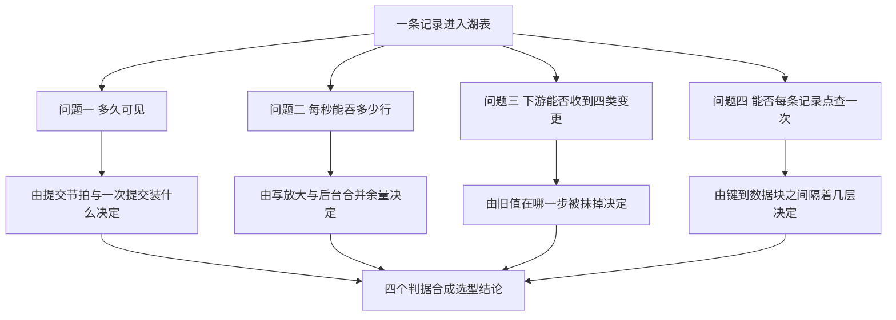
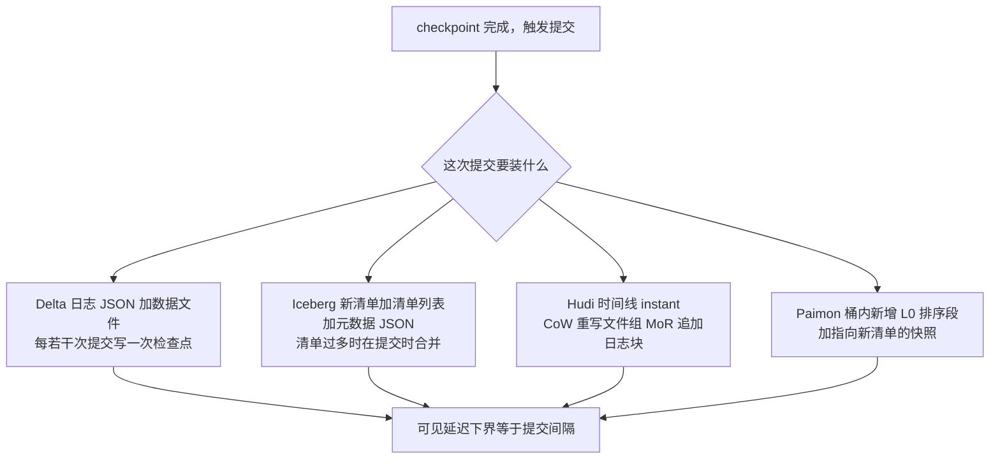
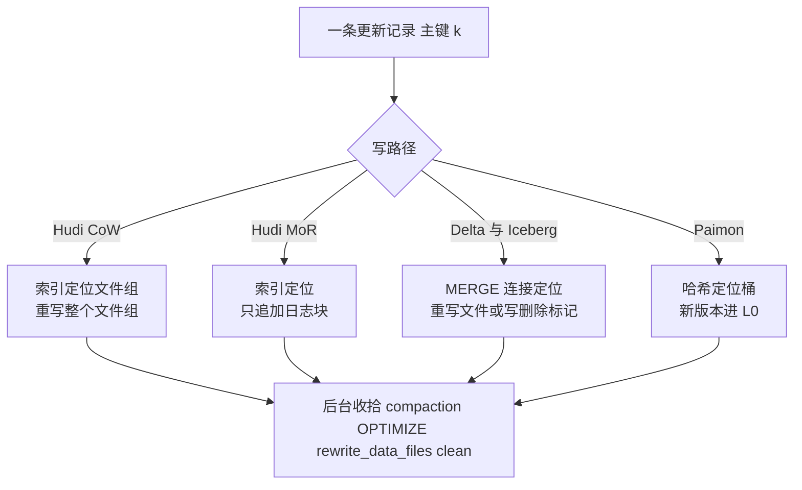
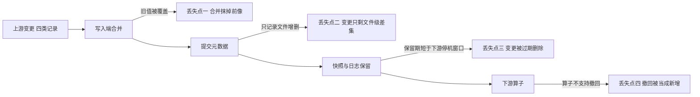
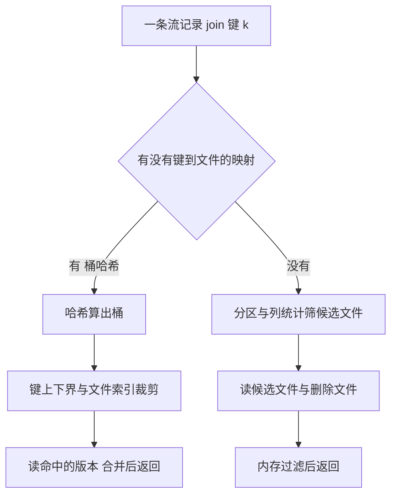
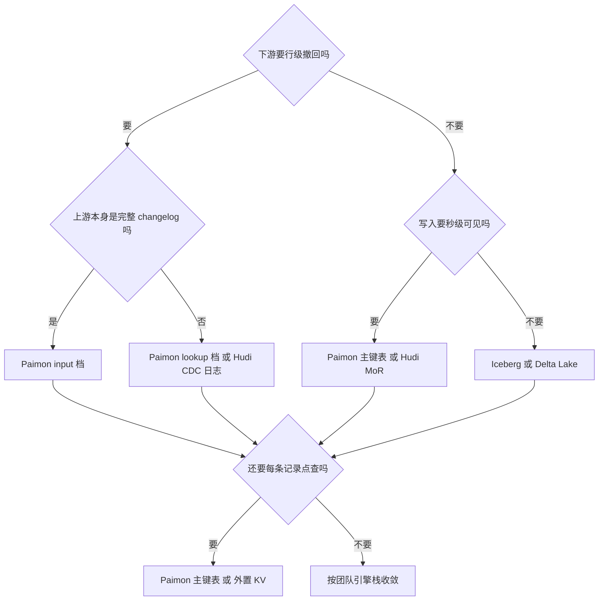

**摘要：**

四种开放表格式的对比，通常从元数据分层、生态广度、扫描性能这些角度展开，但对一条 Flink 实时链路来说，真正决定成败的是四个更窄的问题：一条记录多久可见、每秒能吞进多少行以及为此多写了几倍字节、下游能否拿到 `+I/-U/+U/-D` 这四类变更、以及能否拿湖表做每条流记录一次的维表点查。本文只用这四个判据看 Paimon、Hudi、Iceberg 与 Delta Lake，先说明四者都受提交节拍约束、没有谁绕开 checkpoint，再拆开一次提交各自装了什么，由这个差异解释可见延迟与写放大为什么不同；随后把变更流拆成文件级差集、行级变更与前后像三层，指出语义在哪个环节丢失；再把点查能力落到"一次点查要碰几个文件"这个可算的量上。末尾给出按写入频率、变更流需求、点查需求排布的决策表与一份运维对象清单，并列出四个反例：只看吞吐选型、把 CDC 日志当万灵药、忽视团队对引擎的熟悉度、把某一维度当成全部。

---

## 第 1 章 一条实时链路，四个问题

### 1.1 事故的形状：写入全绿，消费全错

2024 年前后，笔者旁观过一家公司的迁移。他们把订单同步从"Flink 写 Kafka、再由批任务落 Hive"改成"Flink 直接写湖表"，写入端一切正常，端到端延迟从小时级掉到分钟级，两周之后口径开始对不上账：实时大屏上的成交额只涨不跌，退款与取消像是从没发生过。排查到最后一层，问题不在写入，而在消费侧。下游是一个按用户维度累计的聚合作业，它需要在上游删除或更新时撤回先前的结果，而湖表当时交给它的是"新增文件里的行"，删除与更新藏在元数据与日志里，作业把每一次状态修改都当成了新增。

这类事故有个共同的形状：写入通路的指标全是绿的，变更通路的语义全是错的。它说明湖表的流存储能力不是一个开关，而是一组彼此独立的属性，至少包括四件事，而这四件事在选型讨论里经常被压缩成一句"支持不支持流式写入"。支持写在湖表上从来不难，难的是写进去之后，下游能不能用一个流算子该有的方式消费它。

### 1.2 四个能从机制推出来的问题

把"流存储能力"摊开，笔者用四个问题替代通常的对比维度。

第一个问题是写入延迟，具体问法是"一条记录从进入写入端，到它对另一个引擎的读者可见，中间要经过几次提交"。这个问题的答案不由厂商的基准测试决定，而由提交节拍和一次提交要写的元数据量决定。

第二个问题是写入吞吐，具体问法是"每秒能稳定吞进多少行，以及为此在物理层多写了几倍字节"。吞吐的上限很少是解析或序列化的速度，更多时候是写放大与后台合并余量的比值；把写放大算清楚，吞吐的天花板大致就能估出来。

第三个问题是变更流的完整性，具体问法是"下游能不能拿到 `+I`、`-U`、`+U`、`-D` 四类记录，以及能不能拿到更新前的那一版值"。对无状态的追加型下游，这个问题不重要；对有状态、要撤回的聚合与去重算子，它决定整条链路的正确性。

第四个问题是点查能力，具体问法是"一条流记录要 join 一次维表，这次访问要碰几个文件、几次远端往返，这个数会不会随写入频率升高而变大"。lookup join 把湖表从"批处理的底座"拉进了"流计算的执行路径"，判据也随之从"扫描多少字节"变成了"每条记录付多少代价"。

这四个问题的共同点，是都可以从物理机制推出来，而不必依赖某一家的基准测试。延迟由提交节拍与提交内容决定，吞吐由写放大决定，变更流由旧值在哪一步被抹掉决定，点查由键与数据块之间隔着几层决定。机制是公开的，推理也就可以复核，这比记住任何一组跑分都可靠。

> [!info] 本篇的口径
> 事实以 Apache Iceberg 1.x、Apache Hudi 1.x、Apache Paimon 1.x 与 Delta Lake 4.x 的文档与源码为准，涉及具体选项时标注引入版本，核不实的写"以对应版本文档为准"。开源项目能力与商业平台能力分开看：Delta 的 `autoCompact`、`optimizeWrite` 这类写入端自动合并，在 Databricks Runtime 上是开箱即用的平台能力，开源 Delta Spark 也提供同名表属性，但调度与观测要自己接；Paimon 的托管服务则把 compaction 的运维接管了过去。文中出现的所有数字都是为把账算清而设的示例推算，不是任何生产系统的实测值。

### 1.3 为什么分析型判据在这里失焦

分区演进、多引擎互操作、列裁剪效率、catalog 标准化，这些是评估表格式的常见维度，对月底跑报表的分析师确实重要，对下游算子却几乎不重要。下游算子不看表，只看记录流；它不会因为表支持隐藏分区就少算一次 join，也不会因为 catalog 协议统一就拿到 `-U`。拿分析型判据去评流存储，有点像用后备箱容积评价一辆车的操控：容积是真实指标，但它回答的不是你要问的那个问题。

反过来，流存储的判据也不能拿去评分析场景。一个每天只跑两次全量扫描的离线数仓，为了让数据早十秒可见而引入一套 LSM 合并运维，是把成本花在了没人受益的地方。判据必须跟着消费者走，这是本篇所有结论的前提。

### 1.4 贯穿全文的一组参数

为了让后面的算术有落点，先设一组场景参数。某电商平台的订单库通过 CDC 进入 Flink，清洗后写入一张按订单号做主键的明细表；同一张表有两个消费者，一个是实时成交额聚合，需要撤回，另一个是按订单号查询最新状态的维表 join。写入峰值取订单变更每秒 8,000 行、行为日志每秒 12 万行；订单明细表约 20 亿行、600 GB，行为日志按天分区、单分区约 40 GB。检查点间隔从 60 秒起算，后文会讨论把它压到 10 秒的后果。

下图把这四个问题与它们各自的决定因素放在一起，后面四章依次展开。

---

## 第 2 章 写入延迟：节拍是共同的，账单各不相同

### 2.1 可见性只有一个出口

湖表的读者能看到的，永远是某个已经提交完成的快照。对象存储上可用的原子原语只有"整个对象写入成功或不存在"，所以从数据文件落盘到读者可见，中间必须有一次提交把"哪些文件属于当前版本"这件事原子地发布出去。这条约束对四种格式一视同仁，也意味着可见延迟的物理下界就是 **提交间隔**；任何低于提交间隔的可见性承诺，要么是提交变得更频繁，要么是读者在读未提交的中间态。

流写场景下，提交节拍由 Flink 的检查点决定。Paimon 的流式写入同样要求开启 checkpoint，提交动作同样发生在检查点完成之后，官方文档在讲 `INSERT INTO` 时专门提醒流式提交前要先开启 checkpointing，示例配置就是十秒一次。把 Paimon 描述成"绕开 checkpoint、快照独立发布"，是二手材料里流传很广的一个错误说法；它带来的直接后果是让人以为可见延迟可以任意压低，而忽略了每次提交要付出的代价。

真正分岔的地方在下一个层次：同样是一次提交，四种格式往里装的东西完全不同。

### 2.2 一次提交装的是什么

不妨把提交想成给仓库贴封条：封条一旦贴上，里面的东西才算数。四种格式的差别在封条贴上前要干多少活——写时合并像把整排货架重新摆一遍再贴，读时合并像只把新货堆到门口、封条照贴，LSM 则像是往货架顶层插一格、其余不动。这个比喻的边界在于，货架最终总要整理，只是整理发生在封条前、封条后、还是读者来取货的时候。

Delta Lake 的提交是往 `_delta_log` 里写一个按版本号递增的 JSON 文件，内容是本次的数据文件增删与元数据动作；每若干次提交再写一个 Parquet 格式的检查点，用来压缩日志回放的长度。提交本身与表的历史规模关系不大，但检查点的成本与表的动作总量相关，因为它是"上一个检查点的全量状态加上期间的增量"重新物化。这也解释了一个常见现象：表越大、提交越密，检查点写入越容易在日志上留下尖峰。

Iceberg 的提交会生成新的清单（manifest）、新的清单列表和一份新的 `metadata.json`。追加型提交可以通过复用旧清单做到近似 O(新增文件数)，但只要清单数量超过阈值，提交时就要做一次清单合并，把多个小清单重写成少数大清单，否则读端的规划开销会失控。提交的成本因此与"清单的个数"相关，而清单个数随写入频率增长，这是流写压在 Iceberg 上最容易被低估的一笔账。

Hudi 的提交点在时间线上，一次提交会在 `.hoodie/timeline` 下留下一组 instant 文件；Hudi 1.0 把原来"活动时间线加归档时间线"的二分结构换成了基于 LSM 树的时间线，instant 元数据统一用 Avro 序列化，布局也移到了 `.hoodie/timeline` 目录。提交元数据本身很轻，重的是数据改写：写时合并（CoW）的提交要重写被命中的文件组，读时合并（MoR）的提交只追加日志块。

Paimon 的提交装的是"某个桶的 L0 里多了一个 run"，外加一份指向新清单的快照。它不改写旧文件，也不在提交时整理文件集合，碎片由归并阈值封顶，默认攒够五个排序段才触发一次合并。于是短提交间隔在 Paimon 上的 **边际成本**，主要落在"多出几个小文件"与"合并更频繁"这两项上，不落在"每次提交都要重排整份文件集合"上。

下图把四种提交的内容并排画出来，四者的可见延迟下界一模一样，差别全在提交里装了什么。

### 2.3 把间隔压到十秒，各自付什么

压间隔是实时链路最常见的动作，也是把四种格式差异放到最大的一步。文件大小不是可以自由选择的参数，它是提交间隔乘以写入速率再除以并发度算出来的结果；间隔缩短六倍，文件平均大小就缩到六分之一，文件个数涨六倍，这一条对四种格式同样成立。

落到 Delta 与 Iceberg 上，多出来的文件除了数量，还把维护作业的负担推高了。Delta 的小文件要靠 `OPTIMIZE` 合并，合并作业读写的字节数与文件数成正比；Iceberg 的小文件要靠重写数据文件整理，同时清单条目数上升会拖慢每次查询的规划。这两笔成本都不会在写入端立刻显现，往往要等到第二天早上有人问"昨天的看板为什么慢了"才浮现。

落到 Hudi CoW 上，短间隔意味着每个文件组更小、命中重写的概率更高，一次更新重写的字节数虽然小了，但被命中的文件组数量变多，写放大没有实质改善。MoR 把这一问题推给 compaction：日志块一直追加很便宜，可一旦 compaction 跟不上，文件切片里的日志越堆越多，快照查询要把它们全部合并，读端开始变慢。

落到 Paimon 上，短间隔的代价是 Level 0 的排序段变多。合并阈值默认是五个排序段，超过就要合并；间隔压到十秒意味着同样一分钟里的提交次数从一次变成六次，合并从"偶尔发生"变成"持续发生"。合并本身是写操作，与业务写入争抢同一批 IO 资源，于是"把延迟压下去"的代价，变成了"写入端的 IO 余量被合并吃掉"。

### 2.4 把活挪到提交之前

既然提交是延迟的下界、而提交要装的活又躲不掉，四种格式都发展出了同一个方向的优化：把一部分整理工作挪到提交之前完成，用更长的提交时间换取更整齐的提交产物。

Paimon 的 `precommit-compact` 是一个直接例子：开启之后，提交前会先把本批次产生的小 changelog 文件合并一次，代价是提交路径上多一次读写。Iceberg 的清单合并同样是提交前的活，只不过它的触发条件是清单数量而不是文件大小。Delta 的检查点写入可以看作另一种形式的"提交前整理"，只不过整理的对象是日志而不是数据文件。Hudi 的 MoR 走的是反方向：它把整理完全推给提交之后的 compaction，用读端与后台作业承担这笔账。

这三种做法指向同一个结论：延迟、写放大与运维负担三者之间不可能同时最优，只能选一个位置付账。把账推到提交前，延迟变差但读端整齐；把账推给后台，写入轻快但读端要等合并；把账留在读端，写入与提交都轻，代价是每次查询都替所有人还债。

### 2.5 这一问的边界

需要说明的是，写入延迟这一问只在"数据要尽快被另一个引擎看到"时成立。T+1 的离线数仓里，提交间隔是小时级，四种格式在这条判据上的差异被抹平，拿延迟做选型依据就是把一个不存在的优势当成了卖点。反过来，实时风控这类场景把可见延迟从分钟压到十秒，收益是实打实的，这时追问"为了这十秒要养什么"才有意义。

---

## 第 3 章 写入吞吐：写放大是一笔三层账

### 3.1 先把口径定下来

写放大通常被定义成"物理写入字节除以逻辑变更字节"，这个定义太粗，会把三种性质完全不同的开销混在一起。笔者习惯把它拆成三层。

第一层是 **定位放大**：为了知道"这条更新该落到哪个文件"，要读多少元数据、做多少次查找。第二层是 **重写放大**：一条记录变了，物理上要重写多少字节。第三层是 **后台放大**：为了让读端不至于越来越慢，后台的合并、聚类、清理要额外写多少字节。三层账的关系，有点像搬一件家具的三段计费：先按找楼栋收一次、再按拆装收一次、最后按复位收一次，只问第一段的价格，会得出"搬家很便宜"的错觉。

三层放大对写入吞吐的影响方式不同。定位放大影响的是写入端的单条延迟与 CPU，重写放大影响的是带宽，后台放大影响的是"写入吞吐能否持续"——短时间跑得快不难，难的是合并作业追得上、并且不把业务写入挤掉。选型时只测前两层，得到的吞吐数字往往在稳定运行一周后失效。

### 3.2 定位放大：找得到，不等于改得少

Hudi 是四种格式里唯一把"记录级定位"当核心设计的。它的索引（布隆过滤器、桶索引、1.0 引入的记录级索引）回答的问题是"这个主键属于哪个文件组"，配合时间线，写入端可以直接找到要改的文件。不过索引解决的是定位，不解决改写；找到之后 CoW 仍然要把整个文件组重写一遍，MoR 则把记录追加进日志块。

Paimon 的定位走的是另一条路：主键哈希到桶，桶内是一棵 LSM 树。定位成本与表的总规模无关，只与桶数有关；写入端不需要知道"旧版本在哪个文件里"，因为旧版本的淘汰交给归并时的序列号裁决。这让定位放大近乎常数，代价是把"旧版本还在"这件事变成读端的负担。

Delta 与 Iceberg 没有记录级索引，更新要靠 `MERGE` 语句把源表与目标表连接起来。定位依赖分区裁剪与列统计，命中率取决于变更在分区上的分布。CDC 的变更恰好是散开的：譬如一条订单昨天创建、今天退款，两次变更分属不同分区；一条用户资料今天改城市、明天改等级，散落在不同的日期分区里。分区裁剪在这种分布下命中率不高，连接退化成接近全表的扫描，定位放大随表规模线性上升。

### 3.3 重写放大：改一行要重写多少

CoW 的重写放大有一个简单的算术：一次更新命中一个文件组，就要重写这个文件组的全部字节。文件组越大，单次更新的代价越高；文件组越小，文件数量越多，元数据与合并开销越大。Hudi 的 CoW 表因此有一个隐含的文件组大小调优问题，这个问题的答案取决于"每天有多少行会变"，而不是取决于表有多大。

MoR 把重写推后：更新只追加日志块，日志块的大小与变更行数成正比。代价出现在 compaction，一次 compaction 要把日志块与基础文件合并成新的基础文件，写放大在这一刻集中支付。MoR 的吞吐优势因此有一个前提条件：compaction 要有独立的资源与调度，否则日志块堆积的速度超过合并速度，读端先坏掉。

Delta 与 Iceberg 走的是"删除标记"路线。Delta 的删除向量只记录被删行的位置，改动一万行就写一万个位置，与文件大小无关；Iceberg 的位置删除文件同理，等值删除文件记录被删行的键值。写端因此很省，读端要付出解码与合并的代价，而且要有人定期物化（Delta 的 `REORG`）或重写（Iceberg 的 `rewrite_data_files`），否则删除标记越攒越多。

Paimon 的写端只做追加，重写发生在后台归并。LSM 的写放大由层数与层间大小比决定，与"命中哪个文件"无关；这也是它在随机更新场景下最占优的地方。反过来，如果写入是纯追加、几乎没有更新，LSM 的分层归并就成了纯粹额外的重写，追加表反而是更合适的选择。

下图把一条更新在四种格式里的落点画在一起，四者的分岔发生在"写端重写"与"后台重写"这一格上。

### 3.4 后台放大：吞吐能否持续

后台放大的量级经常被忽略，因为它不在写入端的监控面板上。一次归并写出的字节数，可能数倍于当天的业务写入；一次小文件合并读写的字节数，可能等于整张表的一个分区。

四种格式的后台工作形态不同。Paimon 的合并与写入同源，都在 Flink 作业里跑，除非专门起独立的压缩作业并把写入端设成 `write-only`；这意味着合并与业务写入共享资源，资源不足时合并落后，读放大上升。Hudi 的 compaction 可以内联也可以异步，异步模式下由独立的作业调度，`hoodie.compact.inline` 这类开关决定它落在哪边。Delta 的 `OPTIMIZE` 与 Iceberg 的 `rewrite_data_files` 都是显式触发的作业，可以按时间窗调度，也可以完全不调度——不调度的代价推迟到查询时支付。

后台放大的可控性，比它的绝对值更重要。一个可以按分区、按时间窗精细调度的合并作业，与一个只能"要么全开要么全关"的合并，对吞吐稳定性的影响完全不同。选型时该问的是"这套后台工作能不能与业务写入隔离"，而不只是"它的写放大是多少"。

### 3.5 一次示例推算

把上面的口径套进第 1 章的场景参数，算一遍三层放大。设定订单明细表 600 GB、20 亿行、平均每行约 300 字节，按 128 MB 一个文件组切分，约 4,800 个文件组；每天有 2,000 万行发生更新（约占 1%），逻辑变更约 6 GB。以下全部是示例推算，只为比较量级。

CoW 路径：2,000 万行随机散落在 4,800 个文件组里，每个文件组约 41 万行，被至少命中一次的概率接近 1，于是当天几乎所有文件组都要重写一遍，物理写入约 600 GB，写放大约 100 倍。

MoR 路径：当天只写日志，物理写入约 6 GB；compaction 时重写被命中的文件组，若每天做一次全量合并，物理写入仍是约 600 GB，但可以摊到 24 小时的后台窗口里，不与业务峰值撞车。

Delta 与 Iceberg 的 `MERGE` 路径：命中文件重写，量级与 CoW 接近；若改用删除向量或删除文件，写端降到 GB 级，但读端每次都要解码删除标记，并且要有人定期物化，物化的那一刻又把接近全表的字节重写一遍。

Paimon 路径：当天写进 Level 0 的约 6 GB 数据，在归并到高层时被反复重写；记录每下沉一层就要整段重写一次，按四层估算，写放大在四到五倍，物理写入约 24 至 30 GB。这笔写入与业务写入同源，峰值时更明显。

四组数字放在一起，得不出"谁快谁慢"的结论；它们说明的是，四种格式的写放大随不同变量变化：CoW 与 `MERGE` 随"更新命中的文件组大小"变化，MoR 随"compaction 频率"变化，LSM 随"层数与层间比"变化。吞吐规划要盯的正是那个变量，基准测试里的峰值行数说明不了太多。

| 格式 | 写端主要开销 | 后台主要开销 | 写放大随什么增长 | 关键旋钮 |
|---|---|---|---|---|
| Hudi CoW | 重写命中文件组 | clean 与 clustering | 单次更新命中的文件组字节数 | 文件组大小、索引类型 |
| Hudi MoR | 追加日志块 | compaction 重写基础文件 | compaction 落后程度 | compaction 调度方式 |
| Delta Lake | 重写命中文件或写删除向量 | `OPTIMIZE`、`REORG`、`VACUUM` | 更新分布与文件大小 | 目标文件大小、DV 开关 |
| Iceberg | 重写命中文件或写删除文件 | `rewrite_data_files`、清单重写 | 删除文件数量与清单数量 | 删除文件策略、清单阈值 |
| Paimon | 追加 L0 排序段 | compaction 分层归并 | 层数与层间大小比 | 合并阈值、桶数、独立压缩 |

### 3.6 这一问的落点

写入吞吐的判据，最终要落成一个可操作的问句："这套格式的写放大，随哪个变量增长，我能不能在业务峰值之外把它消化掉。"能消化，吞吐就是可持续的；不能消化，峰值测试跑出来的数字只是一次性的。

---

## 第 4 章 变更流：三种粒度与四个丢失点

### 4.1 旧值是在哪里被抹掉的

变更流这件事的难点，不在于"能不能记录变更"，而在于"旧值在哪一步消失"。四种格式的数据模型决定了它们在不同位置丢掉旧值，于是补回旧值的方式也不同。

Paimon 的主键表在写侧就把旧值覆盖掉了：新版本进 Level 0，旧版本留在深层文件里但不再被引用，读的时候按序列号取最新。合并发生在写入模型内部，所以"这次更新之前是什么"必须由写入端额外记录下来。Hudi 的 MoR 在读侧合并：基础文件里是旧值，日志块里是新值，快照查询把两者合起来，因此旧值物理上还在，只是需要一种机制把它读出来并表达成变更。Delta 与 Iceberg 的更新落在文件层：旧文件失效、新文件加入，或者删除标记覆盖若干行，"这一行原来是什么"要么由额外的变更数据文件承担，要么由读者比较两次快照自己推断。

这就是为什么四种格式的变更流能力看起来都在"支持"，实际语义却差得很远。判据不是"有没有 CDC"，而是"四个丢失点里，哪几个被补上了"。

### 4.2 三种粒度

把变更流想成银行流水与余额的区别：只有余额时，你要自己比对两次余额才能推断中间发生了什么；有流水才能看到每一笔；带前后像的流水还告诉你这笔钱从哪个账户来、到哪个账户去。三种粒度对应的正是这三样东西，代价也依次递增。

第一种粒度是 **文件级差集**：给定两个快照，列出新增、删除、重写的文件。它能回答"哪些数据变了"，不能回答"哪一行变了"；下游要还原行级变化，得把新旧文件都读进来做连接，成本与变更涉及的文件大小成正比。

第二种粒度是 **行级变更**：给出每一行的操作类型与键，必要时附带变更前后的值。这是流算子真正需要的东西，因为只有拿到 `-U` 才能撤回之前算过的结果。四种格式都要为这一粒度额外付出存储或计算。

第三种粒度是 **完整前后像**：除了操作类型，还给出更新前的那一整行。它对 SCD-2 与审计场景是刚需，对只做聚合的下游则是冗余；四种格式在"要不要存前像"这件事上的默认值不同，这个默认值直接决定了存储开销。

下图把变更从产生到被下游消费的四个丢失点画出来，后面几节逐个对照四种格式的补法。

### 4.3 四方的补法

Hudi 的增量语义长在时间线上。增量查询按 instant 区间拉取某个时间窗内的变更，配合 `_hoodie_commit_time` 这类元字段，可以把"这段时间写过哪些记录"取出来；它给出的是每个文件切片在该区间内的最新记录，并不等于逐条变更流。要拿到逐条变更，需要打开 **CDC 日志**：表属性 `hoodie.table.cdc.enabled`（0.13.0 起提供）控制是否把这部分变更持久化，`hoodie.table.cdc.supplemental.logging.mode` 决定记录到什么程度，取值包括只记键与操作、记前像、记前后像；读取侧用增量查询并指定 `hoodie.datasource.query.incremental.format=cdc`。0.13.0 的发布说明里写明了这个属性一旦开启就不允许关闭，这个细节对容量规划有直接影响：它不是一个可以临时打开的开关。

Delta 的变更数据流（Change Data Feed，CDF）是表属性 `delta.enableChangeDataFeed` 打开的能力，Delta 2.0 起提供，读取时可以用 `table_changes()` 表函数按版本或时间区间取，也可以用流式读取的 `readChangeFeed` 选项把它当流消费。CDF 记录 `_change_type` 以及更新前后的列（`update_preimage` 与 `update_postimage`），语义上接近完整的行级变更。没开 CDF 的表并非完全拿不到增量：按版本读新增文件仍然可行，只是拿不到被更新与删除的行，粒度退回文件级。

Iceberg 的默认增量是快照差集，引擎侧可以按两个快照之间的新增文件做增量扫描。行级变更长期是"实验性"的：Java 侧有 changelog 扫描接口（`newChangelogScan`），v3 表规范里定义了专门的变更数据文件与 `_change_type` 列，二者为行级变更提供了规范层的落点，但能不能用、用到什么程度，取决于引擎与连接器实现在哪一版。这是"Iceberg 的流式能力取决于连接器"这句话的具体含义。

Paimon 把变更流做成了表属性上的四个档位。`changelog-producer` 取 `none`、`input`、`lookup`、`full-compaction`，分别对应"不产生、刷盘时抄一份输入、合并前点查旧值后作差、两次全量合并的结果作差"。产物是独立的 changelog 文件，与数据文件同格式，文件名前缀默认 `changelog-`，快照元数据里的 `changelogManifestList` 与 `changelogRecordCount` 记录了这次提交产没产变更、产了多少条。档位选择的知识在 [[大数据/数据湖/paimon/04 Changelog Producer——CDC 语义的流式生产与消费|Changelog Producer]] 里有完整拆解，这里只留一条判据：档位决定的是"提交前多干多少活"，不决定"能不能绕开提交"。

### 4.4 一张能力对照

四种格式在变更流上的差异，集中体现在粒度、开启方式、产生时机与撤回能力四件事上。

| 格式 | 最小粒度 | 开启方式 | 变更产生时机 | 前像完整度 | 额外存储 |
|---|---|---|---|---|---|
| Hudi | 行级 | `hoodie.table.cdc.enabled` 加增量查询格式 | 写入时持久化，按 instant 取 | 三档可选，可含前后像 | CDC 日志与日志块 |
| Delta Lake | 行级 | 表属性 `delta.enableChangeDataFeed` | 写入时记账，按版本区间取 | 更新前后像 | `_change_data` 目录 |
| Iceberg | 文件级，v3 可到行级 | 连接器与规范版本决定 | 读取时由快照差集推导 | 取决于引擎实现 | 变更数据文件（v3） |
| Paimon | 行级 | `changelog-producer` 四档 | 随提交产出，与提交同刻可见 | 由合并引擎与档位决定 | changelog 文件 |

### 4.5 两个时钟

变更流的可用性受两个时钟约束。第一个是产生时钟：变更什么时候被写出来。第二个是销毁时钟：这些变更能保留多久。两个时钟之间的窗口，才是下游真正能消费到的范围；窗口比下游的最坏停机时间还短，就是一次注定发生的数据缺口。

四种格式的销毁机制不同，但这道算术完全一样。Paimon 的 changelog 受 `changelog.time-retained` 与 `changelog.num-retained.min`、`changelog.num-retained.max` 控制，快照默认保留一小时、至少十个；Hudi 的增量读取窗口受时间线保留与 clean 策略约束；Delta 的 CDF 受日志保留与 `VACUUM` 的保留期约束，`VACUUM` 默认保留七天，但历史版本被清掉之后，按版本读取的路径也就断了；Iceberg 的快照过期会把旧清单与旧数据文件一并回收，增量扫描的起点随之消失。

Paimon 在这件事上多给了一件工具：`consumer-id` 让下游把消费进度记录在表上，既能断点续传，也能让快照过期时避开仍被依赖的版本。这个机制解决的是"消费者停机"这一类问题，代价是多了一个需要管理生命周期的对象，`consumer.expiration-time` 配得不合适，一个被遗忘的 consumer-id 会把快照无限期钉住，存储空间随之涨上去。

### 4.6 这一问的反例

把 CDC 日志当万灵药，是这一问上最常见的错误。开了 `changelog-producer` 不等于下游就拿到了完整语义，至少有三个前提要各自成立。

第一，上游本身要是完整变更流。`input` 档的做法是把输入原样抄一份，它相信上游给的就是完整变更；如果上游是一个只有新值的 upsert 流，`+U` 会被当成变更写出去，`-U` 从来没有存在过，下游的累计结果会偏大且无法纠正。

第二，合并引擎要与档位匹配。`partial-update` 与 `aggregation` 这两种引擎下，一行逻辑结果由多条输入共同决定，输入行已经不等于结果行；官方文档在这一处写得很直白：流式查询下这两种引擎必须搭配 `lookup` 或 `full-compaction`，`input` 虽然被支持，但只会返回输入记录。

第三，保留期要覆盖最慢的消费者。变更流的窗口由前面那两个时钟决定，`full-compaction` 档位下延迟由 `full-compaction.delta-commits` 的间隔定义，间隔调大能减轻写入端压力，代价是下游要等更久；如果下游的停机时间又超过了保留窗口，恢复时就会缺一段数据，而缺的那一段通常不会报错。

---

## 第 5 章 点查：键与数据块之间隔着几层

### 5.1 为什么点查是流存储问题

lookup join 把湖表放进了流计算的执行路径：每来一条记录，算子就按 join 键向维表要一次当前值。这与批处理的访问模式有本质区别，批处理一次扫描可以摊薄几千次访问，流处理把每一次访问都当独立请求处理，任何"先筛候选文件、再把整块读进内存过滤"的路径，都会在每秒万级记录的速率下暴露出来。

所以点查的判据要落到三个可以算的量上：一次点查要碰几个文件、要发几次远端请求、这两个数会不会随写入频率与表规模一起变大。第一个量决定单次成本，后两个决定这个成本能不能被缓存摊薄。

### 5.2 Paimon：桶内有序加文件缓存

点查像查字典。有部首目录的字典，先翻到那一页；没有目录的字典，只能先判断哪几册可能有这个词，再把整页读完再比对。Paimon 属于前者，Iceberg 与 Delta 属于后者。

Paimon 的点查路径可以直接从写入模型推出来。主键哈希到桶，桶内是按主键排序的 LSM 文件；点查先按 join 键算桶号，再用清单里的键上下界裁掉不可能命中的文件，再用文件自带的索引块与布隆过滤器排除不含该键的文件，最后读命中的版本，按序列号取最新，交给合并引擎算出结果。远端文件按需下载到本地，之后同一个文件的访问不再产生远端 IO。

这条路径的成本结构值得单独说：IO 的 **计价单位是文件**，不是行。一次未命中要付的代价是这个数据文件的字节数与一次下载往返，与这次查询取一行还是一万行无关；反过来，一个文件一旦落到本地，里面有多少键被查到都不再产生远端 IO。于是判断该不该用 Paimon 做维表，判据落在"一段时间的查询会覆盖多少个文件"上，维表总行数的参考价值有限；热点键把少数文件反复打热，成本被摊得很薄，长尾键每次命中新文件，成本按文件计。更细的查找路径与缓存参数见 [[大数据/数据湖/paimon/05 Lookup Join 与维表——Paimon 在流计算中的实时维表查询|Lookup Join 与维表]]。

这条路径能成立有一个硬前提：join 键必须覆盖桶键。桶键未显式指定时等于主键，维表若按 `(item_id, dt)` 这样的复合主键打散，而 join 条件只写 `item_id`，桶号根本算不出来，规划阶段就会拒绝或者退化成遍历全部桶。这类错配发生在建表那天，运行期调参救不回来。

### 5.3 Hudi：索引服务写，不服务每次读

Hudi 的索引能力在四种格式里最完整，布隆过滤器、桶索引、1.0 引入的记录级索引，解决的却主要是"这条更新该写到哪个文件组"。读路径是另一套：快照查询打开文件切片，把基础文件与日志块按记录合并，返回最新值；点查要做的仍然是"定位文件切片、读基础文件、合并日志块"。

Hudi 1.0 起 Flink 侧也提供了 lookup join 支持，这让湖表在 Flink 里当维表成为可能；不过它读的依然是前面那套合并路径，成本与"这个键在多少个文件切片里有未合并的日志"相关，而这正是一个高频更新的维表最容易积累的东西。索引可以把"找文件"这一步做快，但压不住"合并日志"这一步。

### 5.4 Iceberg 与 Delta Lake：终点是文件级筛选

Iceberg 的读路径由三层元数据驱动：快照指向清单列表，清单列表指向清单，清单里逐条记录数据文件的分区、列统计与删除信息。点查时这些元数据能把候选文件从全表压到少数几个，Puffin 里可以存布隆过滤器再压一轮，但这条链路的终点是文件级筛选，它回答"这个文件可能含有这个键"，不能回答"这个键在这个文件的哪一行"；候选文件选出来之后，仍要把数据块读进内存过滤。更新让问题更复杂：一个被反复更新的键会积累若干删除文件，点查要把数据文件与删除文件一起读进来合并，删除文件越多，读放大越重。

Delta 的路径更直接：靠文件级统计做数据跳过，配合分区、排序与聚簇把候选文件压小，读时在内存里过滤。它没有主键概念，也就没有键到文件的映射；一条记录被 `MERGE` 更新之后会搬到新文件里，点查只能靠统计信息猜文件。删除向量能减少重写，但那仍然是行级标记加读时过滤，不是索引。

这两种格式把点查做到"可用于低频查询"没有问题，做到"每条流记录一次"就不经济了。它们在维表场景里的常见做法是绕开格式本身，把维表同步到 HBase、Redis 或一个专门的查询服务上，去借一个天生支持键定位的系统。

下图把两条点查路径并排画出来，分岔点是"格式里有没有键到文件的持久映射"。

### 5.5 一句话的取舍

点查能力的差距，落点是 **持久结构里有没有一张键到文件的表**。有这张表，成本按文件计且与表规模无关；没有这张表，成本按候选文件数计，而这个数会随更新频率与删除文件数量一起涨。四种格式在这条判据上的排序很清楚，但排序不等于结论：如果维表只有几十万行、更新一天一次，把维表全量广播进算子内存，比任何点查都便宜。

| 格式 | 点查路径 | 单次成本随什么增长 | 常见替代方案 |
|---|---|---|---|
| Paimon | 桶哈希、文件索引、本地文件缓存 | 被访问过的文件总量 | 维表极小则广播 |
| Hudi | 定位文件切片、合并基础文件与日志 | 未合并日志数量与切片数 | 同步到 KV 或缓存 |
| Iceberg | 清单统计裁候选、读数据与删除文件 | 候选文件数与删除文件数 | 外置 KV、物化视图 |
| Delta Lake | 文件统计裁候选、读文件并过滤 | 候选文件数与更新搬家次数 | 外置 KV、聚簇加排序 |

---

## 第 6 章 把四个问题压成一张决策表

### 6.1 判定的顺序

四个问题不能平均加权，它们的权重由下游决定，所以判定要有顺序，像急诊分诊那样先看有没有生命危险，再看伤势轻重，最后才安排检查：先问消费侧要什么，再问写入节拍要多快，再问要不要点查，最后问团队能在哪个引擎上把这一切维护住。顺序反了，就会先选出自己喜欢的格式，再为它找理由。

第一问是下游需不需要 **行级撤回**。需要，格式就必须提供行级变更流，四种格式里能稳定提供的是 Hudi、Delta 与 Paimon，Iceberg 要看连接器与表版本。不需要，这一问就直接出局，后面的比较可以简单很多。

第二问是可见延迟要求。秒级要求意味着提交间隔要压到十秒上下，这时要比较的是"短间隔下谁的边际成本低"；分钟级要求则把四种格式拉回同一起跑线，比较重心转到运维与生态。

第三问是点查。需要每条记录一次点查，就要么选有键映射的格式，要么外置一个 KV 系统；两种做法的成本结构完全不同，前者把负担放在湖表的合并运维上，后者多一套系统但要独立运维。

第四问是团队。前三个问题给出的是候选集，最后一问才把它收敛成一个决定。

### 6.2 四问与四格式的速查

下表的每一格写的是"由什么决定"，不做打分，便于在自己的环境里逐格核。

| 判据 | Paimon | Hudi | Iceberg | Delta Lake |
|---|---|---|---|---|
| 可见延迟 | 提交间隔与合并耗时 | 提交间隔，MoR 合并可后置 | 提交间隔与清单数量 | 提交间隔与检查点写入 |
| 持续写入吞吐 | 层数与层间比决定的写放大 | 文件组大小与 compaction 余量 | 更新分布与清除作业 | 更新分布与文件大小 |
| 变更流完整性 | 四个档位，随提交可见 | CDC 日志，按 instant 取 | 快照差集，行级看版本 | CDF，按版本区间取 |
| 点查成本 | 按文件计，需覆盖桶键 | 合并日志的成本 | 候选文件加删除文件 | 候选文件加搬家次数 |

### 6.3 按写入频率排布的决策表

把前三问合成场景，结论大致如下。表里的"首选"都带着条件，条件写在同一行的"主要代价"里。

| 场景（写入频率、变更流、点查） | 首选 | 次选 | 主要代价 |
|---|---|---|---|
| 秒级可见，要撤回，要按主键点查，Flink 栈 | Paimon 主键表，按上游选 `input` 或 `lookup` 档 | Hudi MoR 加 CDC 日志 | compaction 与桶数要有人盯 |
| 秒级可见，不要撤回，纯追加 | Paimon 追加表 | Iceberg 加高频提交 | 文件数与清单条目上涨 |
| 分钟级可见，要完整前后像，Spark 栈 | Hudi MoR 加 CDC 前后像 | Delta CDF | compaction 与时间线运维 |
| 分钟级可见，要行级变更，平台内闭环 | Delta CDF | Hudi MoR | 平台绑定与 CDF 存储 |
| 小时级批量，下游要增量拉取 | Hudi 增量查询 | Delta 按版本读新增 | 增量窗口受保留期约束 |
| 只要多引擎读，写入以追加为主 | Iceberg | Delta Lake | 行级变更能力弱 |
| 点查为主，写入次要，维表不大 | 外置 KV，或 Paimon 主键表 | Hudi 索引加本地缓存 | 多一套系统或一套合并运维 |

### 6.4 一张可以照着走的判定图

下图把前三问的判定顺序画成一条路径，叶子节点给的是方向而不是结论，最后的结论要回到第 7 章的运维账上核算。

### 6.5 表之外的三个限定

第一，首选与次选之间的差距，通常小于"能不能把它运维好"带来的差距。一个被熟练团队运维的 Hudi，稳定性会超过一个没人懂 compaction 的 Paimon。

第二，**混合布局**是常态。同一份数据在不同层用不同格式，譬如 ODS 用追加表保原始事件、DWD 用主键表做实时状态、DWS 的批量分析落到另一个格式上；混合布局的代价是跨格式同步链路，这条链路的延迟与一致性要单独算，不能假设它免费。

第三，决策表有保质期。四种格式的连接器与能力每年都在变，某条"行级变更弱"的判断过一个版本就可能失效；把判断依据写成"由什么决定"，比记住结论更有用。

---

## 第 7 章 复杂度账：每种格式要养什么

### 7.1 运维对象清单

四种格式都需要定期收拾，差别在收拾的对象、紧迫性与失败形态。这些定期工作像体检项目，不能因为上一次结果正常就取消；区别只在于哪几项漏做会立刻出症状，哪几项漏做要等半年才在报表上看见。

| 格式 | 运维对象 | 触发行 | 停掉的症状 |
|---|---|---|---|
| Paimon | compaction、清单合并、快照过期、consumer-id 生命周期 | 排序段达到阈值、清单数量、保留期 | 点查与扫描变慢，Level 0 文件堆积 |
| Hudi | compaction、时间线归档、clean、clustering | MoR 日志量、instant 数量、文件版本数 | 读合并变慢，时间线过长拖慢提交 |
| Delta Lake | 检查点、`OPTIMIZE`、`VACUUM`、删除向量物化 | 提交次数、文件数、删除标记数 | 小文件多，规划慢，旧版本残留 |
| Iceberg | 清单重写、数据文件重写、快照过期、catalog 可用性 | 清单数量、删除文件数、保留期 | 规划变慢，读放大上升，提交受阻 |

这张表里最容易被低估的是 **紧迫性**。Paimon 的合并一旦停了，代价立刻落在每一次查询上，因为查询要把全部排序段归并；Hudi MoR 的 compaction 停了，代价落在文件切片的日志数量上，表现为读端逐日变慢；Delta 与 Iceberg 的整理作业停了，代价落在文件数与清单数量上，恶化得慢，但恢复起来要一次大作业。三种紧迫性对应三种运维节奏，选型时要问的不是"要不要做"，而是"能不能按这个节奏做"。

### 7.2 资源隔离是共同的前提

四种格式的整理作业都面对同一个问题：与业务写入抢资源，也就是 **资源隔离**。Paimon 的合并默认在写入作业里跑，用独立压缩作业时要给写入端设成 `write-only`，两边的资源都要单独规划；Hudi 的 compaction 可以内联也可以异步，异步模式需要独立的调度与队列；Delta 与 Iceberg 的整理作业本来就是独立作业，隔离容易，但需要有人按时间窗触发。

一个常见的失效形态是这样的：写入任务与合并任务共享同一个资源池，白天业务峰值时合并被挤掉，晚上合并集中启动，把第二天的写入挤慢，两天的延迟曲线呈现出交替的尖峰。这类问题的根因不在格式，在资源规划；但四种格式对这个问题的敏感度不同，Paimon 最敏感，因为它的合并与写入同源、且直接决定查询延迟。

### 7.3 开源能力与平台能力要分开算

评估运维成本时，必须区分"格式本身需要什么"与"平台替你做了什么"。Delta 的 `autoCompact` 与 `optimizeWrite` 在 Databricks Runtime 上是开箱即用的写入端优化，开源 Delta Spark 也提供同名表属性，但合并作业的调度、观测与容量规划要自己接；Paimon 的托管服务会把 compaction 接管过去，开源部署则要自己起独立压缩作业；Hudi 与 Iceberg 在云厂商的托管服务里也是类似的分工。

这把"运维成本"这个模糊的词拆成了两半：一半是"格式要求的定期工作"，四种格式都躲不掉；另一半是"谁来调度、谁来观测、出问题谁来看"，这一半由平台与团队决定。选型讨论里把两半混在一起，就会得出"某个格式零运维"的错觉。

---

## 第 8 章 反例、边界与落点

### 8.1 反例一：只看写入吞吐选型

最常见的选型方式是跑一个写入基准：同样的数据、同样的并发，看谁每秒写得更多。这个基准能测出写路径的效率，测不出消费侧的代价。笔者见过的一次选型，候选格式在写入基准上差了三成，团队选了快的那一个，上线之后才发现下游要的是 `-U`，而那个格式的行级变更要靠额外开启的机制，开启之后写入吞吐掉回与另一个候选持平，还要多养一套变更数据的存储。

写入吞吐只是 **必要条件**，远不是充分条件。正确的做法是把四问排成一条链：先确认消费侧要什么，再测写入，最后核运维；顺序反过来，基准测试跑得再漂亮也只是在错误的题上答得快。

### 8.2 反例二：把 CDC 日志当万灵药

第 4 章已经拆过三个前提，这里补一个更隐蔽的：开了变更流，不等于下游能用好。下游算子要区分"能撤回"与"会撤回"两件事，前者是格式给的能力，后者是算子实现的选择。譬如一个用了 `TUMBLE` 窗口聚合的作业，即使上游给了完整 `-U`，也可能因为状态过期而无法回撤很久以前的结果；这时问题不在格式，在算子的状态保留策略。

还有一种情形是把变更流当成审计日志用。变更流是为下游计算设计的，它的保留期通常按小时到天计，而审计要按年计；拿它当审计，要么把保留期拉到不可承受的长度，要么在某个时间点发现历史缺口。审计需求应该落到独立的归档上，而不是压在变更流身上。

### 8.3 反例三：忽视团队对引擎的熟悉度

四种格式都与具体引擎的运维深度耦合。Paimon 的桶数与合并参数要跟着写入形状调，调参的人得懂 LSM；Hudi 的时间线出问题要有人能读 `.hoodie/timeline` 与 instant 状态；Delta 的 `OPTIMIZE` 与 `VACUUM` 要有人排调度，还要理解 `VACUUM` 与并发读的赛跑；Iceberg 的提交依赖 catalog，catalog 的高可用与权限模型要有人负责。

这些都不是"学会一个 SQL 语法"就能覆盖的技能。选型的最后一问应该是：凌晨三点这条链路出问题，谁来看，他看得懂哪一套。选型像给一层楼配电梯，载重量只是一个参数，速度、井道尺寸、维保合同、坏了多久能修好，缺一样都可能是天天停运的那一台。答案指向哪个格式，那个格式就是当下的正确选择；团队能力变化之后，答案可以再改。

### 8.4 反例四：把某一维度当成全部

湖表不是 OLAP 引擎，也不是键值存储。点查上量之后，把维表外置到 KV 往往比继续调湖表更经济；扫描上量之后，物化一层宽表往往比让每个查询都去归并更经济。把"湖表能点查"理解成"湖表该承担所有点查"，与把"湖表能流写"理解成"湖表该承担所有实时计算"是同一种错误：把能力的存在当成了能力的最优使用方式。

同样要警惕的是把某一组基准数字当成普适结论。第 3 章的推算用的是特定参数，参数一换，量级关系就会变；把推算当成结论搬运，是把别人的场景当成了自己的场景。

### 8.5 边界：什么时候这四个问题不重要

如果写入是每天一次的批量导入，下游只做全量扫描，那么四个问题里只有第三个可能相关，而它也可以用"每天重算"绕过去；这时四种格式的流存储差异不构成决策依据，生态、团队熟悉度与既有平台是更合理的判据。

如果数据量很小，单表几十 GB、每天变更几万行，四种格式的任何一种都不会成为瓶颈，因为写放大与读放大的绝对值都很小；这时为了"未来可能的高频写入"提前引入一套合并运维，是把成本花在了假想的未来上。

### 8.6 落点

回到第 1 章那起事故。它的根因不是选错了格式，而是选型时只问了"能不能写进去"，没问"下游怎么消费"。四个问题的价值，在于把"流存储能力"这个模糊的词拆成四笔可以分别核算的账：延迟是提交节拍的账，吞吐是写放大的账，变更流是旧值去哪里的账，点查是键与文件之间隔几层的账。四笔账各有各的付法，没有一种格式能在四笔账上同时最省。

由此得到的判断方式很朴素：先确认自己的四笔账各自能付多少，再去找账单结构与之匹配的格式，排序放到最后。**架构即权衡**这句话在这里很具体：有利有弊才需要决策，有取有舍才需要权衡；四笔账都算过之后的决定，哪怕与主流选择不同，也是这个团队当下最合理的决定。

---

## 参考资料

1. [Apache Paimon 主键表 Changelog Producer](https://paimon.apache.org/docs/1.2/primary-key-table/changelog-producer/)：`changelog-producer` 四个取值、`changelog-producer.row-deduplicate` 与流读语义。
2. [Apache Paimon 主键表 Compaction](https://paimon.apache.org/docs/1.2/primary-key-table/compaction/)：排序段合并策略、`num-sorted-run.compaction-trigger` 与 `write-only` 模式。
3. [Apache Paimon Manage Snapshots](https://paimon.apache.org/docs/1.2/maintenance/manage-snapshots/)：`snapshot.time-retained` 默认一小时、`snapshot.num-retained.min` 默认十个与过期规则。
4. [Apache Paimon Dedicated Compaction](https://paimon.apache.org/docs/1.2/maintenance/dedicated-compaction/)：独立压缩作业与写入端 `write-only` 的配合方式。
5. [Apache Paimon Flink SQL Lookup](https://paimon.apache.org/docs/1.2/flink/sql-lookup/)：lookup join 的缓存选项、桶键与 join 键的对应要求。
6. [Apache Paimon Configurations](https://paimon.apache.org/docs/1.2/maintenance/configurations/)：`write-buffer-size`、`target-file-size`、`consumer-id`、`changelog.time-retained` 等选项默认值。
7. [Apache Hudi Release 1.0](https://hudi.apache.org/releases/release-1.0/)：LSM 时间线与 `.hoodie/timeline` 布局、非阻塞并发控制、Flink lookup join 支持。
8. [Apache Hudi Technical Specification](https://hudi.apache.org/learn/tech-specs/)：时间线布局、日志文件格式、表配置与兼容性规则。
9. [RFC-51: Hudi to support Change-Data-Capture](https://github.com/apache/hudi/blob/master/rfc/rfc-51/rfc-51.md)：`hoodie.table.cdc.enabled`、`supplemental.logging.mode` 三档与 CDC 查询选项。
10. [Apache Hudi Incremental Queries](https://hudi.apache.org/docs/querying_data/)：增量查询的时间窗、`_hoodie_commit_time` 元字段与 `incremental-format` 选项。
11. [Delta Lake Change Data Feed](https://docs.delta.io/latest/delta-change-data-feed.html)：`delta.enableChangeDataFeed`、`table_changes()`、`readChangeFeed` 与前后像列。
12. [Delta Lake Structured Streaming](https://docs.delta.io/latest/delta-streaming.html)：Delta 作为流式源与目标的语义、检查点与 exactly-once 前提。
13. [Delta Lake Table Batch Reads and Writes](https://docs.delta.io/latest/delta-batch.html)：日志检查点间隔、`OPTIMIZE`、`VACUUM` 保留期与 `REORG`。
14. [Apache Iceberg Table Spec](https://iceberg.apache.org/spec/)：快照与清单结构、位置删除与等值删除文件、v3 变更数据文件与 `_change_type`。
15. [Apache Iceberg Flink Writes](https://iceberg.apache.org/docs/latest/flink-writes/)：流式写入的提交行为、upsert 模式与写入分发的取舍。
16. [Iceberg Changelog Scan 实现讨论](https://github.com/apache/iceberg/pull/10935)：带删除文件的表如何做变更扫描，说明行级变更在规范与实现之间的进度差。

---

> [!note] 思考题
> 1. 如果一条链路的下游只需要追加语义，四个判据里哪两个可以直接出局，为什么剩下的两个仍然值得算一遍？
> 2. 把检查点从 60 秒压到 10 秒，四种格式各自多付出的那部分代价，哪一种最容易在监控上被漏掉？
> 3. 变更流的保留窗口、下游的最坏停机时间、快照保留策略三者之间，应该按什么顺序定？
> 4. 维表的点查成本若按"被访问过的文件总量"计，你会用什么指标判断这套 lookup join 是否划算？
> 5. 团队只有 Spark 经验、却有一个秒级可见的需求，除了换格式还有哪些做法，各自的代价是什么？