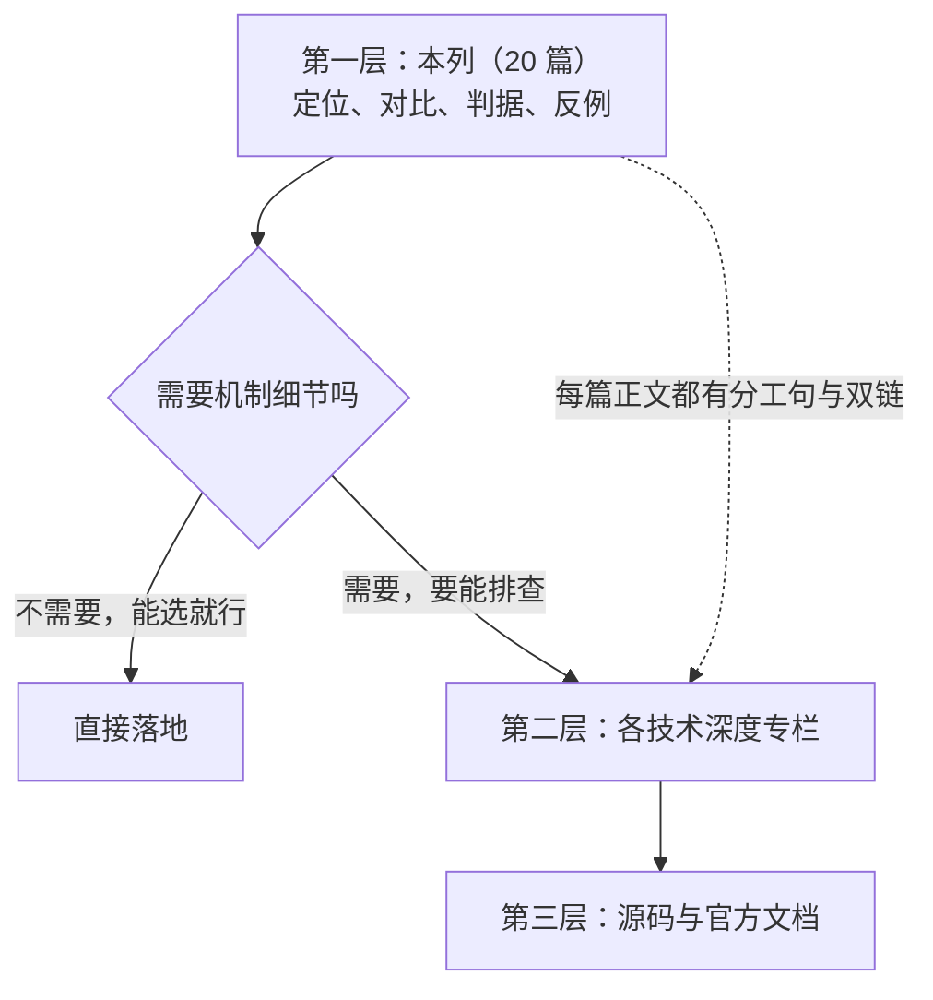

# 大数据技术栈概览 · 专栏导览

## 这一列是什么，不是什么

它是**地图**，不是**景点**。

大数据技术栈有二十来个组件，每一个都有一套自己的机制、参数与故障形态。仓库里已经为其中大部分建了深度专栏：HDFS 十篇、Hive 十一篇、Spark 内核四十七篇、Iceberg、Delta、Hudi、Kafka、Flink、Ranger 各有成套的内容。在这样的前提下再写二十篇"某某技术深度解析"，结果只能是同一批事实换一种排列再讲一遍。

所以这一列改做另一件事：回答"什么时候用它、什么时候别用、和旁边那个东西差在哪"。机制细节不在这里展开，每一篇都会明确指向承载细节的深度专栏——这边回答值不值得选，那边回答它怎么做到。

技术版本：Hadoop 3.x、Hive 4.x、Spark 4.3.0、Flink 2.x、Kafka 4.x、Iceberg 1.x。涉及具体版本行为差异处会标注，无法确定的写「以对应版本文档为准」。

## 二十篇的分组

单看篇名是二十个并列的技术，实际上它们是七个问题域。

| 问题域 | 篇目 | 这一组要回答的 |
| :--- | :--- | :--- |
| 存储底座 | 01 HDFS、17 云部署模式 | 数据到底放在哪，自建与对象存储的语义差别值多少 |
| 资源与执行 | 02 YARN、03 MapReduce、04 Tez | 资源怎么分配、作业怎么被拆开执行、为什么会有三代引擎 |
| SQL 与元数据 | 05 Hive、06 ACID、07 LLAP | 表这个抽象是怎么来的、事务与低延迟各自付出什么 |
| 通用引擎 | 08 Spark、09 内存与 Tungsten、10 Catalyst | 通用引擎的取舍：为什么它什么都能干、又什么都不最快 |
| 表格式与湖 | 11 文件格式、12 Iceberg、13 Delta 与 Hudi | 文件怎么排布、表格式为什么必须多出一层、三种记法怎么选 |
| 机器学习 | 14 PySpark、15 MLlib、16 特征工程 | 分布式机器学习的成本结构、跨语言执行的代价 |
| 实时与治理 | 18 Kafka、19 Flink、20 Ranger | 流式链路的两端与横切的安全授权 |

## 选型入口：从问题找篇目

不要按顺序读，按你手上的问题找。

| 你手上的问题 | 先读 | 再深入 |
| :--- | :--- | :--- |
| 数据放本地 HDFS 还是对象存储 | 01、17 | HDFS 深度专栏、Spark on K8s |
| 集群资源总是不够分 | 02 | YARN 深度专栏 |
| 一条 SQL 跑得比预期慢十倍 | 10、04 | Spark SQL 深度专栏、Hive 优化器 |
| 要支持更新与删除，选 Hive ACID 还是湖格式 | 06、12、13 | Iceberg / Delta / Hudi 深度专栏 |
| 选哪种文件格式落地 | 11 | Hive 的 ORC 与 Parquet 篇 |
| 要不要为了多引擎提前上表格式 | 12、13 | 各湖格式深度专栏 |
| 批处理为主，要不要上 Flink | 19、18 | Flink 深度专栏、Kafka 深度专栏 |
| Python 团队做大数据，性能怎么补 | 14、16 | Spark 内核的性能调优分册 |
| 多组件权限怎么统一收口 | 20 | 安全与认证深度专栏 |

## 三层阅读结构

第一层的产出是判断：这个场景该选谁、代价在哪、什么情况下这个选择会失效。第二层的产出是能力：能读懂日志、能定位参数、能解释现象。跳过第一层直接读第二层，容易变成"知道所有组件怎么工作，但不知道该用哪个"；只读第一层不读第二层，则是"选得对但出了问题看不出来"。

## 怎么读这二十篇

按问题域读。七个域之间没有强依赖，但域内有顺序：存储底座 → 资源与执行 → SQL 层 → 通用引擎 → 表格式 → 机器学习 / 实时与治理。原因很实际——后一层的选型判据建立在前一层的能力边界上。不知道 HDFS 的 rename 是 O(1) 元数据操作而对象存储是 O(字节) 复制，就无法理解表格式为什么必须接管提交协议。

反例比结论重要。每一篇的最后都会给出"什么时候不该用它"。这些反例来自真实的误用形态，读它们的性价比高于读优势清单——选型失误通常不是不知道优点，而是忽略了自己正好落在缺点上。

留意跨篇的同一笔账。有几笔账在多个技术里反复出现：本地性（HDFS、存算分离、Spark 调度）、提交原子性（Hive ACID、三种湖格式、MapReduce 的输出提交）、元数据服务的单点（HMS、Catalog、NameNode）。把这几笔账串起来看，整个栈的结构会突然清楚——它们其实是同一个工程约束在不同层次上的投影。

> [!note] 使用建议
> 这一列适合在读具体技术专栏之前过一遍，用来建立坐标系；也适合在技术选型会议之前翻对应章节，用来准备"为什么不选另一个"的答案。它不适合当作手册查参数——那些在各技术的深度专栏里。