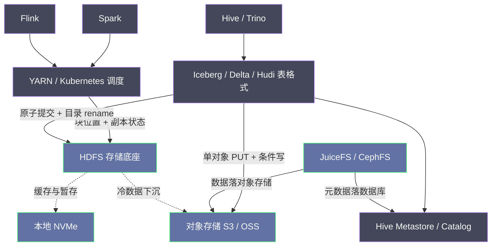
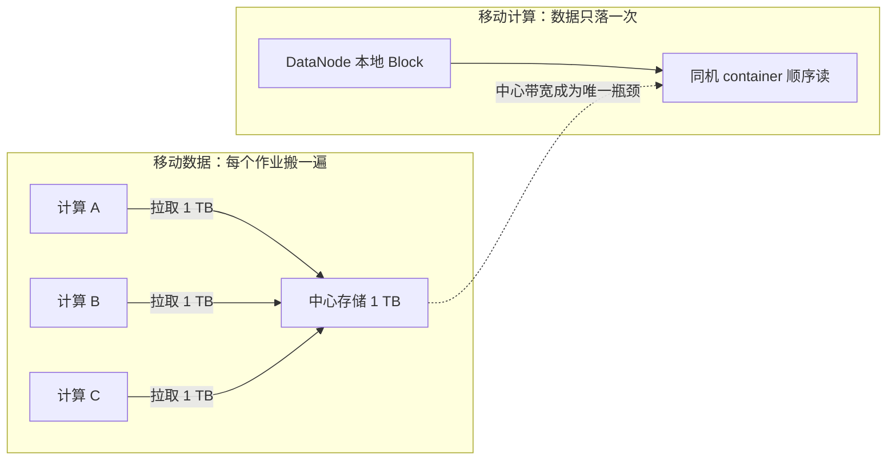
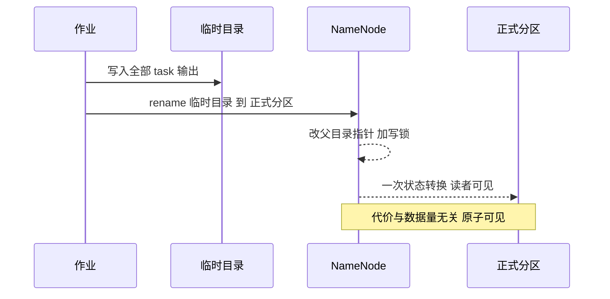
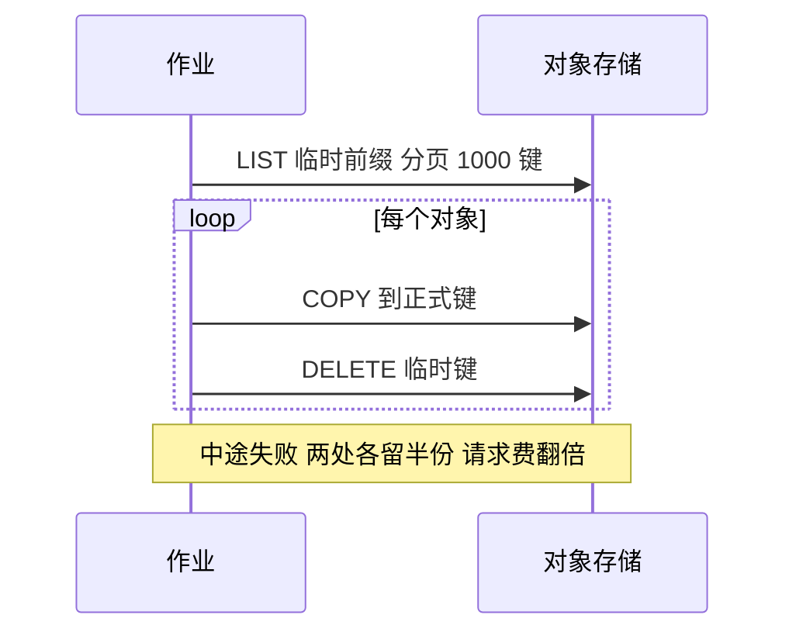
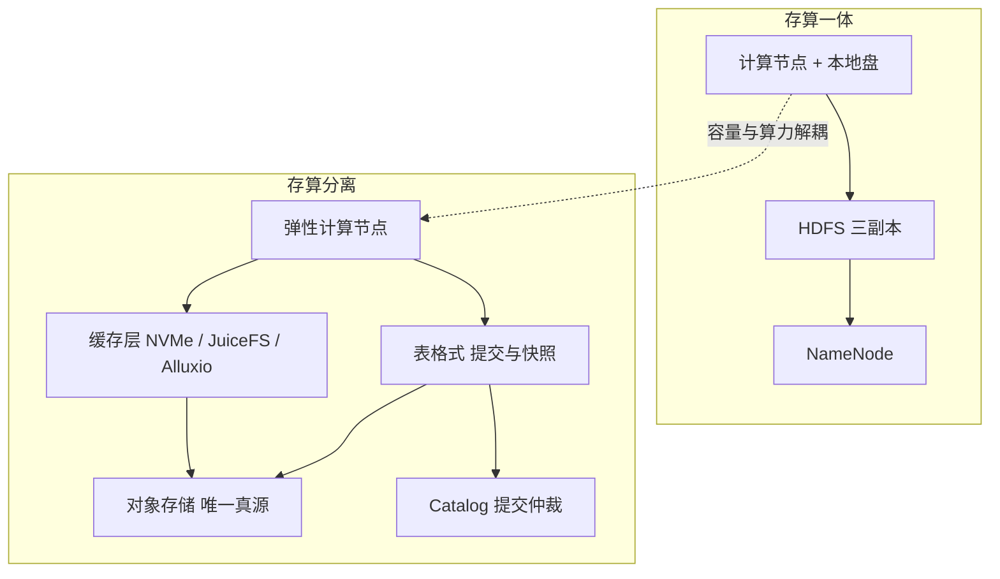
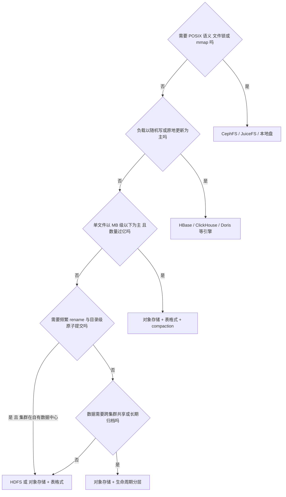

# 01 HDFS：分布式文件系统的数据可靠性与扩展性

**摘要：**

HDFS 通常被当作「分布式文件系统」来讲，它在数据栈里实际承担的角色却是存储底座——一个为数据集而非为文件设计、把硬件故障当常态的共享存储层。本文不做机制拆解，FsImage、Pipeline 写入、机架感知、QJM、Federation、小文件治理这些细节已由 HDFS 深度专栏承载；本文回答两个选型问题：这一层在今天还能承担什么，什么时候该换成对象存储。文章先还原它当年解决的具体问题——单机磁盘的容量与带宽天花板，以及「移动计算而非移动数据」这本账怎么算；再把 HDFS 与 S3/OSS 的差异收敛到四处会咬人的语义：目录与命名空间、一致性与原子性、rename、追加与原地修改；随后讨论存算分离如何把本地盘 HDFS 从主存储挤成缓存层或数据沉积层。最后给出选型判据矩阵、决策树与六类反例。结论是：HDFS 的不可替代性不在吞吐峰值，而在元数据操作成本与提交语义；一旦负载形态偏离这两点，对象存储加表格式的组合会更划算。

---

## 第 1 章 被误读的定位：它不是文件系统

多数人第一次接触 HDFS 是在终端里敲 `hdfs dfs -ls /user/hive/warehouse`，看到熟悉的目录列表，于是很自然地把它归类成「一个能存很多文件的网盘」。这个类比在只有一台集群、只跑一个 Hive 任务的年代足够用，但在 2026 年做存储选型时，它会引出几乎全部的错误结论——因为文件系统只是它的实现手段，不是它的设计对象。

HDFS 的设计对象是**数据集**：单文件从几百 MB 到几 TB，写入一次之后长期只读，读取多为顺序全扫，并发读者成百上千，而写者通常只有一个。这类对象对「文件系统」这个名号的要求其实很弱——没人指望给数据文件加文件锁，也没人指望 mmap 一个 40 GB 的 Parquet 文件做字节级修补。它真正需要的是一棵稳定的全局地址树、一个能承受副本失效的可靠性契约，以及一个能让计算靠近数据的位置信息通道。

### 1.1 底座的三条契约

把「存储底座」这个词拆开，它向上一层承诺的是三件事，缺任何一件都不成其为底座。

第一是**全局单一的命名空间**。计算引擎不认识磁盘，只认识路径：Hive 表的 `LOCATION`、Spark 的输入路径、HBase 的 `hbase.rootdir`、Flink 的 checkpoint 目录，全都指向同一棵目录树。HDFS 通过 Federation 把命名空间在物理上拆成多个 NameNode（Hadoop 2.x 引入，3.x 增加了 Router 统一路由），但对任何一个客户端而言，它看到的仍然是一棵树（`viewfs://` 或 RBF 路由之后）。这个抽象让「数据在哪里」这件事对业务代码彻底透明——业务只需要给出一个 URI，不需要知道它落在多少个机架上。

第二是**位置信息对调度器公开**。客户端调用 `getBlockLocations` 拿到的不是一个句柄，而是一组带 DataNode 地址的块位置。这条看起来只是 API 细节，却是底座与网盘的分界线：底座把物理布局暴露给上层，让 YARN 能把 container 调度到块所在的节点，让 Spark 能算出 `NODE_LOCAL`、`RACK_LOCAL`、`ANY` 三级本地性；网盘则刻意隐藏布局，因此它永远只能做「远程读取」。数据本地性不是一个优化开关，它是 HDFS 与计算框架之间的一份协议。

第三是**可靠性由存储层兜底**。应用写一次，副本数、校验和、坏盘检测、副本补齐全部由系统在后台完成。这意味着上层可以合法地假设「我写进去的东西不会丢」，从而不必在自己的代码里再实现一遍副本管理——这条契约，才是后来所有计算引擎能长得那么薄的前提。

### 1.2 它在数据栈里的位置

下面这张图给出 HDFS 在整条数据栈中的位置，以及它和相邻层之间交换的到底是什么。

图里值得多看一眼的是表格式层指向底座的平行两条箭头：同一次提交，向 HDFS 要的是「原子提交 + 目录 rename」，向对象存储要的是「单对象 PUT + 条件写」。同一个需求，两条完全不同的实现路径，也是后文的主线。

HDFS 深度专栏覆盖了这套机制的全部内部细节：元数据结构见 [[大数据/Hadoop/HDFS/03 NameNode 的核心数据结构——FsImage 与 EditLog 的设计奥秘|NameNode 的核心数据结构]]，写入链路见 [[大数据/Hadoop/HDFS/04 HDFS 数据读写流程——Pipeline 写入与机架感知读取的底层路径|数据读写流程]]，高可用与命名空间扩展分别见 [[大数据/Hadoop/HDFS/06 NameNode 高可用——QJM 协议与 Active-Standby 切换机制|NameNode 高可用]] 与 [[大数据/Hadoop/HDFS/07 HDFS Federation——打破单 NameNode 的内存天花板|HDFS Federation]]。本文与它们的分工是：那边回答「它怎么做到的」，这边回答「它值不值得继续用」。

### 1.3 底座契约的边界

一个技术能提供什么，往往由它明确不提供什么来定义。把 HDFS 的契约摊开来看，正反两面是这样的。

| 契约面 | HDFS 提供什么 | 明确不提供什么 | 缺失后的退化形态 |
|---|---|---|---|
| 命名空间 | 单一全局目录树、原子 rename、目录配额 | 跨集群统一挂载（需 ViewFS/RBF） | 每个集群各自一套路径，跨集群搬迁靠 distcp |
| 一致性 | 单命名空间强一致、写后立即可读 | 跨文件事务、多写者并发 | 业务自己在应用层拼事务，重试逻辑散落各处 |
| 可靠性 | 三副本（或 EC）、校验和、自动补齐 | 跨地域同步复制、异地双活写入 | 容灾靠定期 distcp，RPO 以小时计 |
| 访问语义 | 顺序读写、追加、有限随机读 | 随机写、文件锁、mmap、硬链接 | 需要这些语义的负载必须换底座或加一层 |
| 位置信息 | 块位置对调度器透明 | 自动缓存、跨引擎共享的位置视图 | 每个引擎自己维护一份缓存或元数据副本 |

这张表最后一行常被忽略：HDFS 只把位置信息交出去，却不管上层怎么用。于是在一个多引擎共存的环境里，同一份数据会被 Spark 读一遍、被 Trino 读一遍、被训练任务读一遍，每一次都重新走一遍 `getBlockLocations`。当集群规模不大时这无所谓，但当命名空间增长到数亿对象，这一层 RPC 就会变成全局性的瓶颈——这也解释了 Federation 与 Router 为什么必然出现。

---

## 第 2 章 它当年解决的是哪一本账

要判断一个底座该不该留着，得先弄清它当初替谁还了债。2003 年前后的工程界并不是没有大规模存储方案，而是三条路都撞了墙，这堵墙的具体形状决定了 HDFS 的形状。

### 2.1 三条走不通的路

第一条是纵向扩展：买更贵的存储阵列，配光纤通道，靠 RAID 控制器保证可靠性。这条路的天花板是三重的——价格随容量超线性增长，中心阵列的对外总带宽被硬件槽位钉死，单阵列容量也有物理上限。当数据量从 TB 级跨到 PB 级，采购单本身就变成了不可承受的成本。

第二条是 NFS 共享挂载：让所有计算节点挂同一个网络文件系统，看起来解决了命名空间问题。不过共享存储仍然是中心化的，带宽瓶颈原封不动；更麻烦的是 NFS 的元数据操作在并发下退化极快，几十个节点同时 `ls` 一个百万文件的目录，元数据服务会先于磁盘崩溃。这条路的真正问题在于，它把「容量」和「元数据并发」两件事绑在了同一台机器上。

第三条是各管本地盘：每台机器只用自己的磁盘，I/O 带宽彻底私有化。这条路解决了性能，却把分布式存储的全部复杂性推给了应用——数据散落各处，没有统一地址，容错要应用自己实现，扩容要人工挪数据。它等于宣布「我们不做存储层了」，在当时没有任何计算框架能接住这个负担。

HDFS 的洞见不在于发明了分布式文件系统，而在于它把第二条路的「统一命名空间」和第三条路的「私有带宽」拼在了一起，用软件层的副本机制去填补硬件可靠性的缺口——这套拼接在 2003 年由 Google 的 GFS 论文给出了完整方案，HDFS 是它在开源世界的实现。这个拼接的前提是一个在当时相当激进的假设：硬件故障是常态，不是异常。

### 2.2 移动计算的账怎么算

把统一命名空间和私有带宽拼起来之后，立刻出现一个新的选择题：数据在 A 机器上，计算要在 B 机器上跑，到底搬哪个。

先算搬数据这笔账。假设一份 1 TB 的数据集放在中心存储上，集群内网络按单链路有效 1 GB/s 的量级估算（示例推算，仅用于比较量级，真实集群还要扣除协议开销与并发争用），一次全量搬迁大约需要 1,000 秒。如果这批数据每天被 20 个作业各读一遍，而每个作业都先把数据拉到计算节点，那么一天里仅这一份数据就要产生 20 TB 的跨机流量，全部压在同一条中心链路上。这还没算并发：20 个作业同时跑，每个作业看到的有效带宽只有理论值的几十分之一。

再算搬计算这笔账。计算任务的体积是 MB 级——一段 jar、一份配置、一个 container 镜像。把任务送到数据旁边，代价与数据体积无关；数据只在自己所在的节点上被读一次，走的是本地磁盘或同机架网络。同一份 1 TB 数据被 20 个作业读，跨机流量趋近于零，因为「搬」的从来都是那几十 MB 的代码。这就好比把工具箱送到工地，而不是把整座矿搬到办公室隔壁。

把这两笔账并排画出来，形状的差别一目了然。

所以「移动计算而非移动数据」不是一句口号，而是一道带宽算术题的解。它成立的前提条件写在这里很关键：数据足够大、作业足够多、网络足够贵。三条里只要缺一条，这道题的答案就会翻转——这恰好解释了为什么小数据集、低频访问、跨云场景下，HDFS 的这套优势会迅速消失。

### 2.3 三副本买的是什么

副本机制的公开表述通常是「三副本保证可靠性」，但可靠性只是它买到的一半东西。副本真正改变的是「数据在哪里」这件事的性质：在三副本模型下，一块数据同时存在于三个位置，因此调度器永远有选择权——它可以挑最近的、最闲的、负载最低的那个副本；某个节点坏掉，不是一次数据丢失事件，而是一次后台复制事件。这个转换的代价是可量化的：存储开销三倍。

三倍开销在 2006 年是可以接受的，因为那一年磁盘便宜而跨机网络昂贵，用三倍磁盘换掉跨机流量是一笔划算的买卖。到了 Hadoop 3.x 时代，这笔账被重算了一次——纠删码（Erasure Coding，EC）以 RS-6-3 策略把开销压到 1.5 倍，代价是恢复时读取的块数从 1 变成 6，网络放大更明显，且 EC 对小文件与随机读极不友好。选 EC 还是三副本，本质上是在「存储单价」与「恢复带宽、访问灵活性」之间做选择，具体机制见 [[大数据/Hadoop/HDFS/09 HDFS 容错与恢复机制——自愈修复的工程实现|容错与恢复机制]]。

需要说清楚的是这套设计放弃了什么：一次 `open` 要打一次 NameNode RPC，一次读要按块粒度定位，最小经济读取粒度是 MB 级，尾延迟由最慢的那个副本决定。HDFS 从来没有打算服务点查，也从未打算服务小 IO，这不是缺陷，而是它在还那笔带宽债时主动抵押出去的东西。

---

## 第 3 章 语义的分水岭：文件系统与对象存储

真正决定选型的不是吞吐，也不是单价，而是语义。吞吐可以靠加机器解决，单价的差距可以通过生命周期策略摊平，但语义不匹配会以「作业偶尔重复输出」「数据莫名其妙少了一截」「改了三天改不完」的形式，反复出现在最不该出问题的地方。

下面这张表把两类底座的语义差异按维度摊开，它也是本文后续论证的骨架。

| 维度 | HDFS | 对象存储（S3 / OSS） | 迁移后会发生什么 |
|---|---|---|---|
| 目录 | NameNode 内存中的 INode，真实目录 | 仅前缀折叠，无目录实体 | 空目录、目录权限、目录配额全部失效 |
| rename | 元数据指针切换，O(1)，原子 | copy + delete，O(字节数)，非原子 | 提交从秒级变分钟级，失败留半套数据 |
| 一致性 | 单命名空间强一致，写后立即可读 | 单对象强一致，跨对象无原子性 | 多文件提交需要外部 catalog 仲裁 |
| 追加 | 支持 append 与 `hflush`/`hsync` | 不可追加，只能整体覆盖或分片重传 | 边写边读、WAL 类设计需要重做 |
| 随机写 | 不支持，但支持块级追加 | 完全不可变 | LSM/B+ 树类引擎无法直接落地 |
| 元数据操作 | 内存操作，加写锁，O(children) | 每次 LIST 一次请求，分页 1000 键 | 频繁 list 的负载成本激增 |
| 文件数上限 | 受 NameNode 堆限制 | 无硬上限，但请求与费用线性增长 | 扩容方式从加内存变成加预算 |

### 3.1 目录：真实的树与前缀的折叠

在 HDFS 里，目录是 NameNode 内存里的一个 INode 对象，有权限、有属主、有修改时间、有配额。`rename` 一个目录只是改父目录的一个指针，数据一个字节都不动。这条性质支撑了一件在整个数仓里极其重要的事情：目录可以作为一个原子交付单元。

对象存储没有目录。`warehouse/orders/dt=2026-11-19/part-00000.parquet` 只是一个恰好包含斜杠的键，`list prefix=warehouse/orders/` 是一次扫描，控制台里那个「文件夹」图标只是把相同前缀的键折叠显示。这意味着：不存在空目录，不存在目录级的权限继承，不存在「删掉一个目录」这个原子操作——删除目录等价于逐键删除，中途失败会留下一个残缺的前缀。

譬如一位把 Hive 数仓原样搬到对象存储的工程师，往往要等到第一次 `DROP TABLE ... PURGE` 用了几十分钟，才意识到这件事的份量。

### 3.2 一致性与原子性：强一致不等于有了事务

关于对象存储一致性，流传最广的是一句早已过期的判断：「S3 是最终一致的」。这个说法在 2015 年前后是准确的——新对象写入可以立即读到，覆盖写与删除则是最终一致，`LIST` 还可能看不到刚写的对象。2020 年 12 月 AWS 宣布 S3 对 PUT、DELETE 与 LIST 全部提供强一致读后写，这条判断就该被划掉了。继续用 2013 年的结论做 2026 年的选型，是这一领域最常见的事实性错误。

但把「强一致」直接翻译成「可以替代 HDFS」同样是错的。S3 的强一致是单对象范围（single-key）的承诺：一次 PUT 完成后，任何 reader 立即能读到这个键的新内容，`LIST` 也能立即反映新键与删除。它并没有承诺跨多个对象的原子性——十个对象一起写入，其中三个成功、七个失败，对象存储不会回滚那三个，也不会拒绝读取那三个。它也没有提供文件锁、没有提供目录级操作、没有提供「要么全见要么全不见」的可见性切换。

HDFS 的一致性来自另一个地方：单一 NameNode 上的串行化写锁。任何元数据变更都在同一把锁下完成，因此一次 `rename` 在 NameNode 内部是一个不可分割的状态转换，客户端下一次 `list` 必然看到新状态，不存在中间态。这个性质看似朴素，却是数仓提交协议的根基——「目录级原子替换」在 HDFS 上是免费的，在对象存储上必须自己造。

一句话概括这处分水岭：HDFS 用单一命名空间换取全局一致与原子元数据操作，对象存储用无共享架构换取近乎无限的容量，并把跨对象的原子性推给上层。表格式（Iceberg、Delta、Hudi）之所以在对象存储上大放异彩，本质上就是在补这一层缺失的原子性——用一份 manifest 或一份事务日志，把「多个对象」模拟成「一次提交」。这条路线的取舍见 [[大数据/读书笔记-大数据概览/12 Apache Iceberg：表格式革命与数据湖事务|Iceberg 与数据湖事务]]。

### 3.3 rename：O(1) 与 O(n) 的差别

rename 是本文最想让人记住的一处差异，因为它是「接口长得一样、代价差着数量级」的典型。

不妨这样看：HDFS 改目录名像是给整排货架换一张标签牌，货不动，只换牌子；对象存储改名则是把每一件货从旧货架搬到新货架再贴一遍新单，中途还没有人替你把仓库锁上。

落到实现上，HDFS 的 rename 作用于元数据：改一个指针，加一次写锁，返回。代价与目录里有多少文件、总共多少字节完全无关。这使一种写法在 HDFS 上极其自然——譬如先把结果写进 `_temporary/attempt_xxx/` 这样的临时目录，全部写完之后，一次 `rename` 把它变成正式分区。读者在任何时刻要么看到旧的正式分区，要么看到新的正式分区，绝不会看到写了一半的目录。

对象存储上的 rename 是 copy + delete：把源键的每个字节读出来写到目标键，再删掉源键。代价与对象总字节数成正比，而且两步操作之间没有原子性。一个 100 GB 的分区要「改名」，等于把 100 GB 数据读出再上传一遍，同时为每个对象多付一次读请求与一次写请求；如果中途失败，源和目标各留半份数据，此时既不能回滚也不能确认哪份是完整的。

HDFS 上的提交路径画出来是这样一条短链。

对象存储上的同一条协议，形状完全不同：

这两张图解释了 Hadoop 社区为什么要在 S3A 上造出一整套提交器（committer）：从早期照搬本地语义的 directory committer，到把文件先写到本地再上传的 staging committer，再到直接用分片上传（multipart upload）的完成动作来做「一次可见」的 magic committer。这条演进路线的每一步，都是在对象存储上重建 HDFS 那个免费的 rename。具体实现与版本行为以 [S3A Committers 官方文档](https://hadoop.apache.org/docs/stable/hadoop-aws/tools/hadoop-aws/committers.html) 为准。

把 directory committer 原样搬到对象存储，是数据湖上线初期最典型的翻车姿势，症状高度一致：`_temporary` 目录越积越大，因为失败的作业没人清理；正式分区出现重复文件，因为重试之后新旧两批输出并存；作业运行时间随分区大小线性增长，因为提交阶段的 copy 量随数据量增长。

### 3.4 追加与原地修改：不可变性的连锁反应

HDFS 支持把已写入但尚未关闭的数据推给下游读者——`hflush` 刷新到所有 DataNode 的内存，`hsync` 再进一步落盘，这两个原语是 HBase 把 WAL 写到 HDFS 然后立即可读的前提。HDFS 也支持 append（历史上一度关闭，恢复后语义仍然受限），但不支持任意偏移的随机写。这个组合的精确含义是：HDFS 是「一次写入、多次读取、可以往后接一段」，不是「可以随便改中间一字节」。

对象存储把不可变性推到了极致：对象一旦写完，不能追加、不能修改、不能部分替换，唯一能做的是重新 PUT 整个对象。分片上传看起来像追加，但它是「多个分片组装成一个对象」，组装完成（CompleteMultipartUpload）之后对象就冻结了，改一个分片必须重新上传这一片再重新组装。这套机制有明确的规格限制——除最后一片外每片最小 5 MB，单片最大 5 GB，单对象上限 5 TB，这些数字直接决定了「在对象存储上做小粒度追加」的成本结构，细节以 [S3 分片上传文档](https://docs.aws.amazon.com/AmazonS3/latest/userguide/mpuoverview.html) 为准。

不可变性带来的连锁反应比多数人预想的长：所有依赖「边写边读」的设计都要重做，所有依赖「原地修补」的设计都要改成「用新对象表达新版本」，行级更新在 HDFS 上是重写文件、在对象存储上也是重写对象，但前者的元数据代价低得多。这正是日志结构（log-structured）表格式能在对象存储上胜出的原因——它们从一开始就不假设能改，只追加 manifest。

---

## 第 4 章 存算分离：底座在搬迁，而不是消失

到 2026 年，讨论 HDFS 已经绕不开存算分离，但多数讨论停留在「云上不用 HDFS」这一层结论上，把这个结论当成趋势而不是当成条件。更准确的说法是：HDFS 赖以成立的四条隐含前提，在云上同时松动了。

### 4.1 本地盘 HDFS 的四条隐含前提

第一条，数据在计算节点本地，读取走短路读或同机架网络，网络成本被压到最低。第二条，容量与算力按同一比例扩容——要更多算力就加机器，机器自带磁盘，容量跟着涨。第三条，集群由同一个团队运维，存储与计算共享同一套监控、同一套变更流程。第四条，数据不需要跨集群共享，一个集群服务一组业务。

云上这四条逐条失效。算力要按小时弹性伸缩，而本地盘存储要按年长期持有，两者的时间尺度差了两个数量级；对象存储的单价显著低于同等容量的本地盘（还要算上三副本的放大），于是「把冷数据留在本地盘上」变成纯粹的浪费；Spark、Flink、Trino、训练任务要读同一份数据，而它们未必跑在同一个集群；集群规模的运维成本随节点数增长，而对象存储的运维成本几乎与容量无关。

### 4.2 分离之后的三层结构

存算分离后的架构通常长成三层：对象存储做唯一真源（source of truth），缓存层补延迟，表格式补事务语义。缓存层的形态很多——JuiceFS 把元数据放到数据库、数据放到对象存储，对外暴露 POSIX 接口；Alluxio 做分布式缓存；各计算引擎自己也有一层本地缓存（Spark 的 `spark.local.dir`、Trino 的本地 spill 与 cache）。表格式层则负责回答「哪些对象共同构成一张表的一个快照」这个对象存储自己答不上来的问题。

两种结构的差别，画在一张图里最容易看清。

HDFS 在这个新结构里有三种残留形态，三种都值得保留。其一是彻底退场：直接用各引擎的对象存储 connector，集群里不再有 NameNode，这是新建云上数据湖的默认选择。其二是降级为缓存与暂存层：shuffle 数据、临时结果、checkpoint 落在本地 HDFS 或本地盘上，因为这类数据写完即弃，不需要跨作业共享，放在对象存储上反而要付请求费。其三是作为数据入境与合规落地层：数据必须落到指定地域、指定机房，或者出口带宽按 GB 计费时，本地 HDFS 仍是比对象存储更便宜的一跳。

把两种结构按同一组维度摆开，差异集中在成本与弹性两侧，而代价集中在延迟与元数据操作上。

| 对比项 | 存算一体（本地盘 HDFS） | 存算分离（对象存储 + 缓存） |
|---|---|---|
| 容量与算力 | 绑死，按同一比例扩 | 解耦，各自独立伸缩 |
| 存储单价 | 高（三副本 × 本地盘） | 低（对象存储 + 生命周期分层） |
| 读取延迟 | 低（本地盘、短路读） | 依赖缓存命中率，未命中时高一个量级 |
| 元数据操作 | 内存操作，rename 免费 | 请求计费，rename 变 copy |
| 多引擎共享 | 需同集群，靠 distcp 同步 | 天然共享，同一份对象 |
| 运维归属 | 自建自维，需要 SRE | 云厂商托管，按量付费 |
| 故障域 | 自控（可做机架、机柜隔离） | 依赖云厂商 SLA 与跨 AZ 设计 |

### 4.3 HDFS 自己的应对

HDFS 并没有停在原地等这场迁徙结束。纠删码把三副本的 3 倍开销压到 1.5 倍，代价是恢复带宽放大与小文件不友好，这是它在「存储单价」这条战线上最实质的一次让步；Federation 与 Router 把单命名空间的天花板拆成横向扩展的多个 NameNode；Ozone 从 Hadoop 子项目独立为 Apache 顶级项目，用来补齐对象语义；Router 与 DataNode 的部署形态也在向「存储与计算分别扩缩」靠拢。

不过这些改进都没有触及一个根本前提：HDFS 仍然假设数据与计算在同一个数据中心、同一张高速网络内。它可以在数据中心内部被优化得更便宜、更大，不过它无法变成对象存储那种「跨地域、按请求计费、无容量上限」的东西。所以存算分离对 HDFS 的影响不是替代，而是**降级**：从主存储降为加速层、暂存层或沉积层。HDFS 深度专栏在 [[大数据/Hadoop/HDFS/10 HDFS 性能调优与生产实践——小文件治理与存算分离的未来|性能调优与存算分离]] 里讨论了这条演化路径的工程细节，云上部署形态的横向对比见 [[大数据/读书笔记-大数据概览/17 Hadoop 云部署模式：从 On-Premise 到云原生|Hadoop 云部署模式]]。

---

## 第 5 章 选型判据：把负载形态翻译成底座

选型讨论最容易滑向「哪个更快」的争论，不过底座的选择从来不是性能竞赛，而是**负载形态与语义、成本曲线的匹配问题**。匹配得好，中等性能的底座也能跑得很稳；匹配得差，最好的硬件也会在语义边界上崩掉。笔者建议把负载先翻译成四个问题，再去看候选底座。

### 5.1 四个判断问题

第一个是写入形态：一次写多次读、频繁追加、原地更新、还是随机写。这决定了底座是否需要可变的文件语义。一次写多次读对应 HDFS 与对象存储都行；频繁追加只有 HDFS 能接；原地更新与随机写两者都不行，要换 LSM 或 B+ 树引擎。

第二个是元数据操作强度：rename、list、stat、目录遍历的频率，以及文件总数。这一条几乎单独决定 HDFS 的生死——HDFS 的元数据操作是内存操作但加全局写锁，对象存储的元数据操作是无锁但按请求计费。

第三个是延迟与 IO 粒度：点查（毫秒级、KB 级）还是全表扫描（秒级、MB 级以上）。HDFS 的读取以块为定位单位，块内虽可 seek，但小 IO 会退化成随机寻道，每次 `open` 还要多付一次 NameNode RPC，点查天然不适合。

第四个是组织与成本：谁是数据的唯一真源、谁来运维、是否需要多引擎共享、数据是否需要跨地域。这一条经常被技术讨论忽略，却在真实决策里权重最高——因为运维归属决定了变更成本，而变更成本决定了架构能演化到什么程度。

### 5.2 判据矩阵

把负载翻译成判据，有点像医生看化验单——关键不在某一项的绝对值有多漂亮，而在它是否越出了参考区间。

| 判据 | HDFS | 对象存储 | JuiceFS | CephFS | 本地盘 |
|---|---|---|---|---|---|
| rename 代价 | O(1)，原子 | O(字节)，非原子 | O(1)，元数据在数据库 | O(1)，原子 | O(1)，原子 |
| 追加与随机写 | 仅追加，无随机写 | 不可变，无追加 | 支持 POSIX 追加 | 支持 POSIX 追加 | 全支持 |
| 元数据操作成本 | 内存，受全局写锁 | 按请求计费，LIST 分页 | 元数据服务，可水平扩展 | 元数据服务，集群内 | 无 |
| 单集群容量上限 | 受 NameNode 堆约束 | 无实际上限 | 受对象存储约束 | 受集群规模约束 | 单机 |
| 多引擎共享 | 同集群内 | 天然跨集群跨地域 | 跨集群 | 同集群 | 不可共享 |
| 运维复杂度 | 高（NN、JN、Balancer） | 极低（托管） | 中（元数据引擎） | 高（MON、MDS、OSD） | 低 |
| 适合的负载 | 大文件全扫、批处理 | 冷数据、湖上分析、归档 | 需要 POSIX 的共享存储 | 需要 POSIX 的私有云 | 缓存、暂存、shuffle |

这张表没有一行是全绿的。JuiceFS 在 rename 与 POSIX 语义上比对象存储强，但它把复杂度转移到了元数据引擎；CephFS 提供了最完整的 POSIX 语义，代价是运维一支自己的存储团队；HDFS 在元数据操作上几乎无可替代，但容量天花板的形状很硬。

### 5.3 决策路径

把四个问题串起来，就是一条可用的判断路径。

### 5.4 混用不是妥协，是常态

真实的生产架构很少二选一。三种混用形态各有其合理性。

其一是分层：热数据留在 HDFS 或本地 NVMe 上，冷数据按生命周期策略沉到对象存储，中间用 distcp 或表格式的 snapshot 迁移。这条路的收益直接来自单价差，成本在于「冷热边界怎么划」——划得太激进，回温查询会付出高昂的读取与流量费用；划得太保守，本地盘就白买了。

其二是对象存储做真源加缓存层：JuiceFS 这类系统把元数据放到 Redis、etcd 或 TiKV，把数据放到对象存储，对外提供 POSIX 接口。它解决了「对象存储没有目录和 rename」的问题，代价是元数据层变成了新的运维对象与新的故障点，且元数据操作的延迟从内存级变成网络级。这条路的适用判断见 [[中间件/JuiceFS/00 专栏导览|JuiceFS 专栏]]。

其三是对象存储做真源加表格式仲裁：计算端只读不改，写端通过 catalog 完成提交，把跨对象的原子性交给元数据指针的切换。这是当前云上数据湖最主流的形态，它的隐含成本是必须有人维护 compaction——小文件与 manifest 的膨胀不会自己消失。

---

## 第 6 章 反例：六种不该选 HDFS 的负载

选型文档写「适合什么」容易，写「不适合什么」才见功力。以下六类负载，笔者的建议都是别拿 HDFS 当主存储。

第一类是**海量小文件**，这是 HDFS 最经典的自杀方式。NameNode 的内存占用按对象计，官方文档给出的口径是每个对象约 150 字节，按此估算一亿个文件大约需要 15 GB 堆（这是估算，实际还要叠加块映射、租约、副本状态等常驻结构），而每个文件至少占一个块，块数又反过来放大 `getBlockLocations` 的返回体积与 RPC 时间。真正先崩的通常不是容量，而是 NameNode 的堆与 RPC 队列：GC 时间从毫秒级爬到秒级，DataNode 心跳开始超时，集群进入自我放大的抖动。譬如把图片、逐条日志、单个事件写成独立文件，就是这条反例最常见的触发方式；正确做法是合并成大文件、交给表格式管理、或者干脆放到对象存储上由小文件治理工具处理，机制细节见 [[大数据/Hadoop/HDFS/10 HDFS 性能调优与生产实践——小文件治理与存算分离的未来|小文件治理]]。

第二类是**元数据操作密集的负载**。频繁 rename 的 ETL 中间态、每次运行都要全量 `list` 对账的作业、需要遍历百万级目录的元数据同步工具，都会撞上 NameNode 的全局写锁。Federation 只能把命名空间拆开，拆不开这把锁；提高 `dfs.namenode.handler.count` 只能缓解排队，不能提高锁的吞吐。这类负载在对象存储上同样不便宜（LIST 分页、按请求计费），但至少不会拖垮整个集群。

第三类更容易被误判，是**随机写与原地更新**。HDFS 没有随机写语义，这一点经常被 HBase 的存在感掩盖——HBase 看起来在 HDFS 上做随机读写，但它内部是 append-only 的 HFile 加 compaction，借用的是 HDFS 的顺序写能力，而不是凭空获得了随机写。任何需要 B+ 树式原地更新、需要按主键寻址、需要行锁的负载，都不该被塞进 HDFS。

第四类是**需要严格 POSIX 语义**的场景。文件锁、mmap、硬链接、部分写、inotify 通知，HDFS 要么不提供，要么只有语义很弱的替代。需要这些能力时应当考虑 CephFS、JuiceFS 或本地盘，并接受随之而来的元数据层运维复杂度，横向对比见 [[中间件/Ceph/00 专栏导览|Ceph 专栏]]。

第五类的边界最容易被模糊，是**低延迟点查**。每次 `open` 一次 RPC、按块定位、最小经济读粒度 MB 级、尾延迟由最慢副本决定，这四条叠加起来，HDFS 的点查延迟通常在几十毫秒到数百毫秒量级，且抖动大。需要毫秒级的键值访问，应当用 HBase、Elasticsearch、ClickHouse 或 Doris 这类引擎，HDFS 只作为它们的数据源与冷备。

第六类是**跨地域多写**。HDFS 的一个集群只有一个写入口（HA 部署下是主备，不是双写），跨集群同步靠 distcp 做单向复制，没有多主写入能力，也没有冲突解决机制。需要异地多活的场景，底座层面就必须是对象存储的多地域复制，或者在上层用表格式与 CDC 自己构造同步链路。

六类反例压成一张速查表，方便对着现网负载逐条核对。

| 反例 | 症状 | 机制原因 | 该换成什么 | 若必须留在 HDFS 上的缓解 |
|---|---|---|---|---|
| 海量小文件 | NameNode GC 飙升、心跳超时 | 每对象约 150 字节元数据 + 每文件至少一块 | 对象存储 + 表格式，或合并为大文件 | Har 归档、定期 compaction、`fs-limits` 限制 |
| 元数据操作密集 | `list`/`rename` 排队、RPC 队列积压 | 单 NN 全局写锁 | 对象存储（接受请求费） | Federation 拆命名空间、减少全量 list |
| 随机写与原地更新 | 写放大、compaction 停不下来 | HDFS 无随机写，只有追加 | LSM 或 B+ 树引擎 | 换引擎，而不是换参数 |
| 需要 POSIX 语义 | 加锁失败、mmap 不可用 | HDFS 不实现 POSIX | CephFS / JuiceFS / 本地盘 | 上层自己实现锁服务 |
| 低延迟点查 | P99 抖动、超时重试 | 每次 open 一次 RPC，块级粒度 | HBase / ClickHouse / Doris | 前置缓存层，但收益有限 |
| 跨地域多写 | 双写冲突、数据分叉 | 单写入口，无冲突解决 | 对象存储跨区复制 + CDC | 单向 distcp，明确 RPO |

---

## 第 7 章 结语

回到最初那个误读：把 HDFS 当文件系统看，会得出「它又快又便宜又可靠」的结论，也会在对象存储出现强一致之后得出「它该退场了」的结论。两个结论都对了一半，也都错过了要点。

HDFS 真正提供的，是一套**元数据极便宜、提交语义原子、容量有硬天花板**的存储契约。这套契约在数据中心内部、在大文件批处理负载上，至今没有等价替代品——对象存储能给你无限容量和更低的单价，但给不了 O(1) 的 rename 和跨对象的原子提交；JuiceFS 能给你 POSIX 语义，但把复杂度转移到了元数据引擎；CephFS 能给你最完整的语义，但要求一支自建存储团队。

所以选型的落点不是「哪个更好」，而是负载的写入形态与元数据强度，是否还落在 HDFS 那份契约的舒适区内。落在里面，它是无可替代的底座；落在外面，它就会以 GC、RPC 队列、`_temporary` 泄漏的形式，把债一件件讨回来。至于未来会不会有一条路把两边的好处都收掉——社区在做，云厂商也在做，但至少目前，这笔账还得按负载形态分别算。

---

## 参考资料

1. Ghemawat S., Gobioff H., Leung S.-T. The Google File System. SOSP 2003. [PDF](https://static.googleusercontent.com/media/research.google.com/zh-CN//archive/gfs-sosp2003.pdf)
2. Apache Hadoop. HDFS Architecture Guide. [链接](https://hadoop.apache.org/docs/stable/hadoop-project-dist/hadoop-hdfs/HdfsDesign.html)
3. Apache Hadoop. HDFS Users Guide（含 HA、Federation、快照等运行期语义）. [链接](https://hadoop.apache.org/docs/stable/hadoop-project-dist/hadoop-hdfs/HdfsUserGuide.html)
4. Apache Hadoop. HDFS Erasure Coding（RS-6-3 策略与 1.5 倍开销口径）. [链接](https://hadoop.apache.org/docs/stable/hadoop-project-dist/hadoop-hdfs/HDFSErasureCoding.html)
5. Apache Hadoop. Committing work to S3 with the S3A Committers（directory / staging / magic committer 的取舍）. [链接](https://hadoop.apache.org/docs/stable/hadoop-aws/tools/hadoop-aws/committers.html)
6. AWS. Amazon S3 Update – Strong Read-After-Write Consistency（2020-12）. [链接](https://aws.amazon.com/blogs/aws/amazon-s3-update-strong-read-after-write-consistency/)
7. AWS. Uploading and copying objects using multipart upload（分片大小与对象上限）. [链接](https://docs.aws.amazon.com/AmazonS3/latest/userguide/mpuoverview.html)
8. Apache Iceberg. Table Spec（snapshot、manifest 与提交语义）. [链接](https://iceberg.apache.org/spec/)
9. JuiceFS. Architecture（元数据引擎与数据存储分离的设计）. [链接](https://juicefs.com/docs/community/architecture/)
10. Apache Ozone. Documentation（对象语义的补齐形态）. [链接](https://ozone.apache.org/docs/)

---

> [!note] 思考题
> 1. 如果对象存储从明天起支持 O(1) 的原子 rename，HDFS 还剩哪些不可替代的性质？
> 2. 你的集群里有多少负载其实只需要「一次写多次读」，却因为历史原因必须依赖目录原子提交？
> 3. 三副本与 RS-6-3 纠删码的取舍，在你们的恢复带宽预算下应该怎么算？
> 4. 把 Hive 数仓整体搬到对象存储时，`_temporary` 目录的清理责任应该落在谁身上？
> 5. 存算分离之后，缓存层的命中率如果只有六成，回温查询的流量成本是否还低于本地盘的三副本开销？