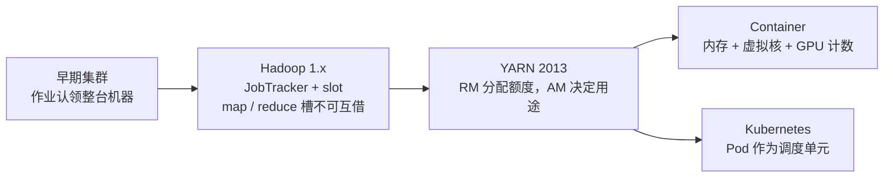
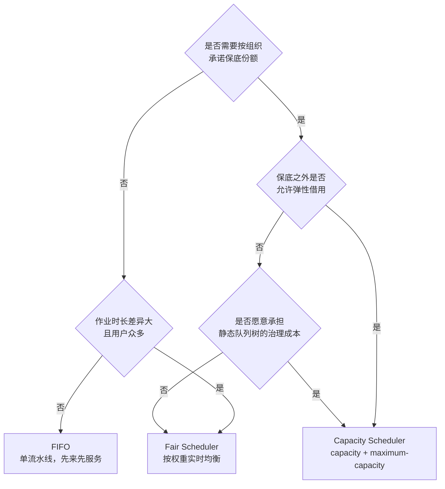
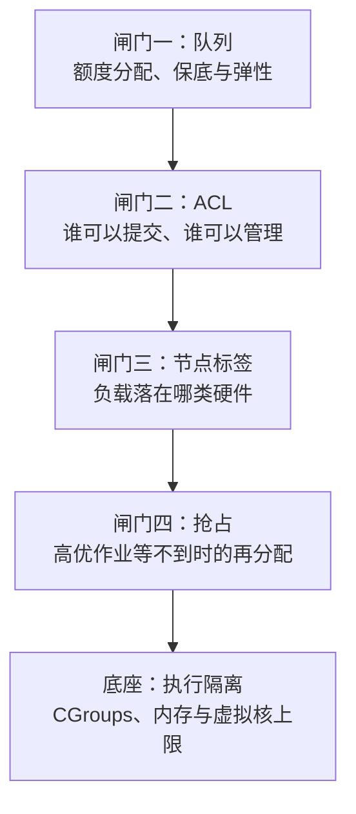
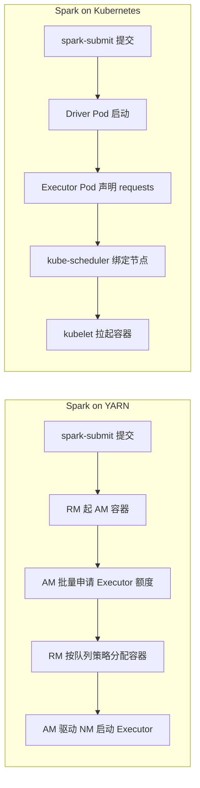
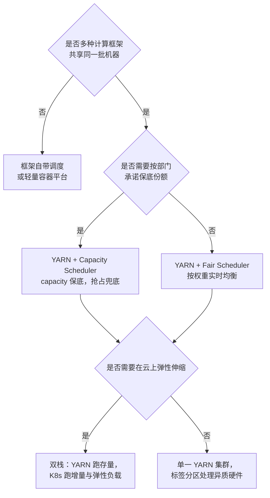

# 02 YARN：资源调度架构与多租户实践

**摘要：**

YARN 被记住的方式通常是“ResourceManager 管资源、NodeManager 管节点、ApplicationMaster 管作业”，但真正值得记住的是它做的那一次抽象——把集群的分配单位从机器换成可以谈判、可以记账、可以按队列治理的额度。这次抽象完成之后，多框架共享、租户隔离、调度权归属这三组矛盾才有地方安放。本文按综述与选型的视角重看 YARN：先说明它把什么从机器里抽了出来，再拆开三方角色的利益分歧，随后用“资源所有权归谁”这条线索区分 FIFO、Capacity 与 Fair 三种调度器的适用组织形态，接着把队列、ACL、节点标签、抢占当作四道彼此不可替代的边界逐一交代，最后与 Kubernetes 的资源模型做层级对照。核心判断有两条：保底、借用、收回这三件事必须变成可配置的治理对象，它们比调度算法本身更难；负载一旦弹性化、服务化、以 GPU 为中心，另一套抽象就更贴合，而在固定机器上贴着 HDFS 跑的离线批处理，仍然找不到比这更省心的答案。文末给出七条不该选 YARN 的反例和一张按组织形态展开的判据表。机制细节不在本文展开，指向仓库里已有的 YARN 深度专栏。

---

## 第 1 章 分配单位从机器变成额度

### 1.1 插槽时代的三个死结

在 Hadoop 1.x 的年代，集群的分配单位是机器，更准确一点说是**插槽（slot）**。JobTracker 兼任两件事：统计每台 TaskTracker 上还剩几个空的 map slot、几个空的 reduce slot，以及把一个作业的 Task 逐个派进这些槽里。这套设计在只有一个 MapReduce 框架、作业形态彼此相似的环境里运转得并不差，但它把三件事焊死在了一起：资源的计量单位、作业的生命周期、由谁决定 Task 跑在哪台机器上。

焊死之后的问题依次暴露。map slot 与 reduce slot 不能互相借用，map 阶段结束而 reduce 阶段尚未起势的那段时间，大量空闲的 map 槽借不出去，reduce 任务在排队；集群规模往上走，JobTracker 要维护数万个 Task 的心跳、重试与推测执行，单点压力逼近上限；更要紧的是，任何新框架想用这批机器，都必须把自己伪装成 MapReduce 作业。2014 年前后 Spark 与 Flink 相继成型，这个问题从隐患变成了阻塞。

YARN 给出的答案不是把 JobTracker 做得更强，而是把分配单位换掉。

### 1.2 额度意味着什么

一台 64 GB 内存、16 个核的机器，在机器视角下是不可分割的一份资产，要么整台给一个作业，要么空着；在额度视角下，它是“可以被切成若干份、每份有明确上限、上限之外不作承诺”的一片资源池。切出来的每一份就是容器（Container），容器带上自己的内存额度与虚拟核数，跑在哪个节点、跑多久、超了会怎样，都由一组明确的规则定义。所谓集群资源操作系统，说的就是这一层：RM 是只发额度的内核，AM 是自己决定怎么用额度的用户态进程，Container 是分配的最小单位。

这个转换看似只是换了个量词，实际上改了四件事。资源有了独立于作业的生命周期，容器可以先于作业存在、也可以比作业活得短；资源有了可加的计量口径，可以按队列累加、按租户结转；资源有了可谈判的接口，申请方报出“我要 20 个 4 GB 的容器”，供给方按策略决定给不给、给多少；资源也有了可插拔的语义，同一批额度可以被 MapReduce 拿去跑批、被 Spark 拿去跑 DAG，不需要为每个框架改一遍调度内核。

### 1.3 三组矛盾与它们的安放位置

额度一旦成为公共资源，三组矛盾立刻浮上水面，而 YARN 的架构几乎是对这三组矛盾的一一回应。

第一组是多框架共享。集群只有一批机器，MapReduce 的批作业、Spark 的迭代作业、Flink 的流作业峰谷并不重合，各建一套集群的代价是三套都按峰值配置，整体利用率钉死在低位。共享一套就必须回答“一个框架的作业能不能占用另一个框架的机器”，这引出了下一章的双层调度。

第二组是资源隔离。共享的反面是互相干扰，既包括物理层面抢 CPU、抢内存、抢磁盘 IO，也包括治理层面的“某个部门把集群吃干”。隔离不是一个开关，而是一组粒度不同的边界，队列、ACL、节点标签、抢占各管一段，谁也不能替代谁，这是第 4 章的主题。

第三组是调度权归属。资源给谁、按什么顺序给、给出去之后能不能收回，这三件事由中心决定还是由框架自己决定，决定了系统的上限与下限。三种调度器的差别，本质是三种**所有权模型**，这是第 3 章要拆的内容。

### 1.4 它在数据栈里的位置

把 YARN 放回数据栈，它的位置很清楚：HDFS 回答数据存在哪里、怎么保证不丢，YARN 回答计算在哪里跑、用多少资源。两者通过数据本地性（data locality）耦合——调度器的资源请求带三档宽松度，于是 Spark 的 Executor 会优先被放到存有它要读的 HDFS 块副本的节点上。这条耦合是后面所有选型讨论的前提：换掉 YARN 而不动 HDFS，本地性这一层就要重新设计。

下图把分配单位的演化路径画出来，可以看到每一次抽象的粒度都在变细，而治理的复杂度在同步上升。



本文的定位是综述与选型，机制细节——ResourceManager 的锁竞争、Container 启动的 RPC 全链路、Capacity Scheduler 的层级分配算法、CGroups 的隔离实现——已经在 [[大数据/Hadoop/Yarn/00 专栏导览|YARN 深度解析专栏]] 中逐篇拆过，这里不再复述；HDFS 一侧的架构与副本策略见 [[大数据/Hadoop/HDFS/00 专栏导览|HDFS 深度解析专栏]]。本文只处理那些单技术专栏不会回答的问题：什么时候该用它、三种调度器在什么组织形态下成立、它与 Kubernetes 的边界究竟画在哪里。

下表把插槽时代与额度时代放在同一组维度下对照，差异集中在“谁拥有决定权”和“资源能不能被复用”这两列。

| 维度 | Hadoop 1.x 的插槽 | YARN 的容器 |
|---|---|---|
| 分配单位 | 固定大小的 map / reduce 槽 | 可配置的内存与虚拟核额度 |
| 资源复用 | 槽类型互斥，空闲即浪费 | 同一节点可切给多个框架的多个容器 |
| 决定权归属 | JobTracker 决定 Task 落点 | RM 只给额度，AM 决定用途 |
| 框架接入成本 | 需改 JobTracker 内核 | 实现一个 AM 即可接入 |
| 故障域 | JobTracker 单点，全集群受影响 | AM 崩溃只影响单作业，RM 有 HA |
| 治理手段 | 基本没有，靠物理分集群 | 队列、ACL、标签、抢占分层治理 |

---

## 第 2 章 三方各怀心思：调度权为什么必须拆开

### 2.1 三种角色的利益函数

YARN 把调度拆成三方，不是为了分层好看，而是因为这三方的信息集与目标函数本来就不一致。

ResourceManager 手里握的是全局视图：哪些节点活着、每台还剩多少额度、哪些队列有保底、哪些应用在等。它只做“这一轮把额度给谁”的决策，依据是队列策略与公平性，而不是作业内部长什么样。让它去理解 Spark 的 stage 划分或者 Flink 的 slot 共享，等于把每个框架的领域知识塞进调度内核，内核就回不到“通用”这个定位上。

ApplicationMaster 手里握的是作业的局部视图：DAG 长什么样、哪些 Task 之间有 shuffle 依赖、哪些输入分片在本节点。这些信息对全局调度没有意义，对局部放置却是决定性的。Spark 的延迟调度（delay scheduling）之所以有效，正是因为 AM 知道再等一秒可能出现本地性更好的容器，而全局调度器没有耐心也没有依据做这个判断。

NodeManager 手里握的是单机的执行细节：容器起了没有、内存超了没有、本地化资源拉完了没有。它不做决策，只把决策执行到位并把状态如实上报。三方的接口就是“申请—分配—启动—汇报”四个动作。

### 2.2 双层调度的收益与账单

这种“中心分资源、框架分任务”的结构，在文献里被称为**双层调度（two-level scheduling）**，Mesos 与 YARN 是它的两个代表实现。收益有三条：调度内核不随框架演进而改动；框架可以用自己的领域知识做放置，本地性与依赖感知留在框架侧；中心的负载被框架的批量请求摊薄——AM 一次心跳报一批需求，而不是每个 Task 单独 RPC 一次。

账单同样清楚。AM 成了每个框架都要自己实现的组件，Spark、Flink、Tez 各写一份，容错逻辑（AM 挂了谁重启、重启后已分配的容器怎么办）也由框架自己承担；资源谈判是往返式的，AM 只能看到 RM 已经给它的容器，无法对全局做规划，于是“同时启动 200 个 Executor 才能开工”的作业会陷入先攒资源、攒不齐就释放、释放完再攒的循环；额度分出去之后，中心就失去了对它内部使用方式的控制，一个申请了 8 GB 却只用了 1 GB 的容器，在 RM 眼里仍然是满额的。

这些代价在 2013 年前后是可以接受的，因为当时的核心矛盾是“让多个框架共享同一批机器”，而不是“把利用率再挤出五个百分点”。

### 2.3 三种调度架构的坐标

把视野拉开，集群调度其实有三种形态，区别在于“全局决策权”被放在哪一层。

单体调度（monolithic）把决策权全部收在中心，Borg 与 Kubernetes 的 kube-scheduler 属于这一类：调度器看着全部待调度的 Pod，为每一个决定落点，全局最优容易做，但调度器必须理解它调度的东西。双层调度把“给多少”与“给谁用”分开，中心只管额度，框架管放置。共享状态调度（shared-state）则让多个调度器共享同一份集群状态，各自乐观地做决策，冲突了再重试，Google 的 Omega 是这一类的原型，它的出发点是“不同团队需要不同的调度策略，但又要共享一个集群”。

下图把三种形态的决策路径并排画出来，注意箭头终点落在谁身上——那就是决策权所在的位置。


三种形态没有绝对优劣，判据是调度决策需要多少领域知识、集群要被多少种策略同时治理。领域知识越重、策略越异质，把决策权往下放的理由越充分。

### 2.4 拆错的代价

如果 RM 直接调度 Task，就退回插槽时代，每接一个框架都要改内核；如果彻底去中心化，冲突重试的开销会随并发度上升，Omega 自己也是为多调度器并存的场景设计的，而不是给单一框架的高吞吐批处理用的。共享状态调度在大规模生产里几乎没有落地，说明这条路的复杂度超过了收益。

YARN 的选择因此可以总结为一句话：**把决策权放在拥有信息的那一层**——全局信息在中心，领域信息在框架，执行信息在节点，接口尽量窄。

三种形态的取舍落在决策权的位置上，排成表对照最直观。

| 架构形态 | 决策权位置 | 优势 | 代价 | 代表系统 |
|---|---|---|---|---|
| 单体调度 | 中心调度器 | 全局最优易做，运维面单一 | 调度器需理解负载语义，扩展点有限 | Borg、kube-scheduler |
| 双层调度 | 中心定额度，框架定用途 | 框架自治，内核稳定，接入成本低 | AM 需自研自容错，资源碎片与谈判延迟 | YARN、Mesos |
| 共享状态调度 | 多个调度器共享状态 | 策略可异质，避免中心瓶颈 | 冲突重试开销，正确性推理复杂 | Omega 原型 |

---

## 第 3 章 三种调度器：所有权、保底与均衡

### 3.1 判据是资源归谁，不是参数怎么调

调度器的文档通常以参数表的形式出现，于是选型被简化成照着模板抄一份配置。这种理解会误导人：三种调度器的差别不在参数多寡，而在它们对“资源归谁所有”的回答不同，**所有权**决定了竞争时谁先被满足、空闲时谁能借用、超用时谁被收回，参数只在既定所有权之下调节松紧。

FIFO 的回答是资源归队列：一条队，先来的先拿，拿不到就等。Capacity Scheduler 的回答是资源归组织：队列树按部门切分，每个队列有一份保底额度（capacity）与一份弹性上限（maximum-capacity），保底在竞争时兑现，上限在空闲时放行。Fair Scheduler 的回答是资源归作业：每个队列、每个用户都有一份按权重算出的应得份额（fair share），谁离份额差得远谁先补，集群永远朝着各自拿到应得比例的方向收敛。

三种回答对应三种组织形态，选型的第一步是判断自己的组织更像哪一种。

### 3.2 保底的真实语义

Capacity Scheduler 最容易被误读的地方是 capacity 的含义。它不是一个硬性预留，队列在集群空闲时不会被锁在 40% 的格子里，而可以一路用到 maximum-capacity；它也不是随时生效的承诺，只有当集群出现竞争、且该队列的实际用量低于保底份额时，保底才通过抢占被兑现。换句话说，capacity 是**竞争时才兑现的承诺**，maximum-capacity 才是任何时刻都生效的天花板。

这层语义带来两个直接后果。第一，保底的意义完全取决于抢占是否开启——不开抢占的容量调度器，保底只是分配时的优先级，其他队列先占满资源，低用量队列只能等别人自然释放。第二，maximum-capacity 设得越保守，弹性借用的空间越小，集群在低谷期的利用率就越低，很多集群利用率上不去，根子在这里而不是硬件。

Fair Scheduler 的 fair share 是另一个方向的语义。它是按权重实时算出的目标值，不是被保留的资源，因此某个队列空闲时，它的份额会被其他队列立即用掉，等它回来再按当时的差距重新补。这种永远朝均衡收敛的行为适合用户众多、作业时长差异大、边界不稳定的环境，但它不承诺“我这个部门一定拿得到 30%”，因为份额是计算结果而不是预算。

### 3.3 判据矩阵

下图给出调度器选择的最小决策路径，三个问题依次回答“要不要保底”“要不要弹性借用”“治理成本能不能承担”。



把三种调度器放在同一组判据下对照，可以更清楚地看到它们的边界。

| 判据 | FIFO | Capacity Scheduler | Fair Scheduler |
|---|---|---|---|
| 资源所有权归属 | 队列（整体一条队） | 组织（队列树按部门切分） | 作业与用户（按权重） |
| 保底语义 | 无 | capacity 为软保底，竞争时兑现 | minResources 可设下限，默认按权重算份额 |
| 弹性上限 | 无，队列可吃满全集群 | maximum-capacity 为硬天花板 | maxResources 可设，否则可吃满 |
| 竞争时的次序 | 先来先服务，头阻塞明显 | 按队列容量比例分配，队列内再按 FIFO 或优先级 | 离 fair share 差距最大的先补 |
| 抢占触发条件 | 不支持 | 队列用量低于保底且他队列超用时 | 作业或队列低于 min share 时 |
| 队列治理成本 | 低 | 中，队列树需预先规划，改动要 refreshQueues | 中低，支持按放置策略动态建队列 |
| 适配组织形态 | 单一流水线团队 | 多部门预算制，需要保底与账目 | 多用户探索型，边界流动 |
| 典型失效形态 | 大作业头阻塞小作业 | 队列碎片化，保底被天花板架空 | 权重配置失当，均而不公 |

### 3.4 三个常见错配

第一种错配是把 capacity 当硬配额用。管理员分好百分比之后，把 maximum-capacity 也设成同样的值，本意是防止互相占便宜，实际效果是集群永久按峰值切分，闲下来的资源谁也用不了，与分四套独立集群没有本质区别。容量调度器的价值有一半在弹性借用上，把天花板压到保底线上，等于主动放弃这一半。

第二种错配是用 user-limit-factor 去补队列内部的不公平。某个用户提交了几百个小作业、把队列额度吃满，其他人排队，于是把这个参数从 1 调到 2。它确实能缓解症状，却掩盖了更根本的问题——队列粒度与提交权限不匹配：一个队列里挤着几十个用户，说明队列本该拆开，或者本该换成 Fair Scheduler。

第三种错配是忽略 AM 的额度约束。maximum-am-resource-percent 控制 AM 能占用的资源比例，默认值在小作业密集的场景里会变成硬瓶颈：集群有大量空闲内存，新作业却因为 AM 额度用尽而排队。这个参数与队列容量是两套账，调队列容量解决不了 AM 排队。

一段典型的队列配置可以说明保底与弹性的关系，注意 capacity 与 maximum-capacity 的差距就是弹性空间。

```xml
<!-- capacity-scheduler.xml：保底 40%，竞争时可弹到 70% -->
<property>
  <name>yarn.scheduler.capacity.root.recsys.capacity</name>
  <value>40</value>
</property>
<property>
  <name>yarn.scheduler.capacity.root.recsys.maximum-capacity</name>
  <value>70</value>
</property>
```

同级子队列的 capacity 之和必须等于 100，这一点在改队列树时最容易出错：新增一个队列而忘记从兄弟队列挪出份额，RM 会直接拒绝加载配置。这个约束本身也说明容量调度器的世界观——集群是一块固定的蛋糕，先切分再谈借用。

---

## 第 4 章 多租户的四道闸门与一层底座

### 4.1 边界是四个，不是一个

谈多租户时最常见的简化是把“队列”当成隔离的全部，配好队列就认为租户问题解决了。队列管的是额度分配，而租户要的是四件不同的事：作业能不能进、进去之后能占多少、占住之后会不会被别人挤掉、负载能不能落在特定硬件上。这四件事分别由 ACL、队列、抢占、节点标签承担，彼此不可替代。

| 闸门 | 拦住什么 | 拦不住什么 | 典型失效形态 |
|---|---|---|---|
| 队列 | 额度分配与竞争时的次序 | 同一节点上容器之间的资源争抢 | 队列碎片化，每个队列的保底都吃不满 |
| ACL | 谁可以提交、谁可以管理队列 | 提交之后能占多少额度 | 权限给了但队列没配额，作业照样排队 |
| 节点标签 | 负载落在哪类硬件上 | 分区内部的利用率与共享 | 标签分区过细，跨区无法借用 |
| 抢占 | 高优作业等不到资源时的再分配 | 被抢占作业已完成的进度损失 | 阈值与保底不匹配，反复抢占抖动 |

### 4.2 队列：给“借”定价

共享集群的经济学很简单：不同租户的峰值并不同时出现，把负载叠在一套资源上，聚合后的峰值低于各自峰值之和，于是同样的硬件可以服务更多业务，这就是**统计复用（statistical multiplexing）**的收益。收益的另一面是排队：利用率越接近 1，等待时间的增长越不成比例，这是排队系统的基本性质，任何调度器都改不了。

多租户治理的本质，就是给“借”这件事定价。capacity 是保底价，maximum-capacity 是借用的上限，抢占把等待时间从高优租户转移给低优租户，节点标签则给某些租户划出不参与共享的专用区。定价越细，治理成本越高，收益却不一定同比例增长。

### 4.3 ACL：准入是主体问题，不是额度问题

ACL 解决的是“谁能进来”。容量调度器把提交权限与管理权限分成两套：提交权限决定哪些用户或组能往这个队列提交，管理权限决定谁能改队列配置、杀队列里的应用。把两者分开是有意的设计——业务方通常只需要提交权，容量与优先级不该由业务方自己改。

常见错误是只配提交权限、不配管理权限，队列配置的修改权落在超级用户手里，运维成为瓶颈；反过来把所有队列的提交权限设成 `*`，ACL 就形同虚设，租户边界只剩队列名字。正确用法是让“谁能进哪个队列”与组织架构对齐，额度治理与人员治理走同一套映射。

### 4.4 标签：用利用率换确定性

队列是在时间维度上分配资源，节点标签（node label）是在空间维度上切分资源。给一批带 GPU 的机器打标签、只允许特定队列访问，就得到一个物理隔离的分区；给一批高内存机器打标签，可以让大内存作业不必与普通作业抢节点。

代价是硬性的。分区之间不共享资源，一个分区空着也不能被借用，整体利用率必然下降，分区越多、每块越小越明显；标签容量还要单独规划，队列在某个标签上的 capacity 与它在默认分区上的 capacity 是两套数字，只配一套的后果是作业卡在等待状态，而集群看起来还有空闲。还有一个易漏的细节：没有指定标签的应用会跑在默认分区，即使它有资格访问标签分区——标签既是隔离手段，也是准入手段，应用侧不声明就用不上。

### 4.5 抢占：把等待转移给谁

抢占（preemption）是唯一在时间维度上重新分配资源的手段，它做的不是多加资源，而是**把等待转移给另一个租户**：某队列的实际用量低于保底、别的队列又超出了自己的保底，就从超出的队列里挑容器杀掉，把额度还给欠账方；公平调度器同理，只是基准换成 fair share 与 min share。

被抢占的代价并不对等。杀掉一个 MapReduce 的 map 任务，损失的是几分钟计算；杀掉一个 Spark 作业的 Executor，若 shuffle 数据已落盘，重启后还能复用，若还在内存里，整个 stage 要重算。抢占策略因此需要一组容忍度参数：哪些队列可以被抢、比例上限多少、两次抢占之间隔多久。配得松，抢占形同虚设；配得紧，低优作业会在启动与被杀之间反复抖动，实际吞吐比不抢还低。

下图把四道闸门与执行隔离的底座画在一起，可以看到越往下越接近物理现实，也越难在运行时调整。



### 4.6 底座：执行隔离决定了前面四道闸门的可信度

四道闸门都建立在“容器真的只用了它申请到的资源”这个假设上：CPU 若只是软隔离，申请了 2 个虚拟核的容器照样能吃满 16 个核，队列层面的公平就只是纸面公平；内存若只按申请值记账而不设硬上限，超用的容器会被内核的 OOM killer 挑中，表现为莫名其妙的退出。这套底座由 NodeManager 与 CGroups 提供，细节在 [[大数据/Hadoop/Yarn/07 YARN 资源隔离——CGroups 与 Linux Container Executor 的工程实现|资源隔离的实现]] 里拆过；从选型角度只需记住一个判断——CPU 密集作业与延迟敏感作业混跑、而隔离没开成硬限制时，无论队列怎么设计，尾延迟都会被邻居拖垮。

---

## 第 5 章 与 Kubernetes 的对照：两种资源观

### 5.1 层级不同，不是同类

把 YARN 与 Kubernetes 放在一起比较，最容易犯的错误是问“哪个更强”。两者的**抽象层级**并不相同：YARN 是资源分配器加作业运行环境，它的输出是“一个容器在这台机器上跑起来了”，容器里跑什么、跑完要不要重启、失败了要不要补，全部交给 AM；Kubernetes 是声明式期望状态系统，它的输出是“集群朝着你声明的状态收敛”，副本数、健康检查、滚动更新、服务发现都由控制器负责。

这个差别决定了两者的适用面。YARN 面向有明确起止的作业，Kubernetes 面向持续存在的服务，而 Spark 作业恰好可以表达成两者的任意一种，这也是大数据平台在两条路上都能走通的根本原因。

### 5.2 六处结构性差异

调度触发方式不同。YARN 是拉模型，AM 带着需求列表去问 RM 要资源，一次心跳报一批，天然自带限流；Kubernetes 是事件驱动的推模型，调度器 watch 到待调度的 Pod 就排进队列，积压时靠退避与优先级保护系统。拉模型对批处理的批量申请更友好，推模型对延迟敏感的在线负载更友好。

状态语义不同。YARN 的恢复单位是应用尝试（attempt），AM 挂了 RM 重起一个，之前分配的容器全部作废，适合失败重跑整个作业的批处理；Kubernetes 的恢复单位是期望副本，控制器发现实际与期望不符就补一个，适合失败只补一个实例的服务。

租户抽象不同。YARN 的队列是原生的一等公民，保底、弹性、层级、抢占都是内建语义；Kubernetes 原生的 ResourceQuota 只有硬上限，没有保底也没有借用，要做到队列保底加弹性借用，必须引入 Kueue 这类组件，用 ClusterQueue 的 nominalQuota 与 borrowingLimit 把旧语义重新实现一遍。**队列保底不是 Kubernetes 的原生能力**，这件事本身就是一条证据。

剩下的弹性、本地性、加速器三处一并排进表里：YARN 的节点静态注册、扩缩容以分钟计，Kubernetes 把节点做成可替换资源；本地性上 YARN 的调度器知道 HDFS 块在哪，Kubernetes 不知道；加速器上 YARN 只按整卡计数，Kubernetes 的设备插件配合 MIG 可以切片。

| 维度 | YARN | Kubernetes |
|---|---|---|
| 调度单元 | 容器（内存、虚拟核、计数型加速器） | Pod（一个或多个容器共享网络与卷） |
| 调度触发 | AM 拉取，心跳批量申请 | 事件驱动，调度器 watch 待调度 Pod |
| 状态语义 | 应用尝试，失败重跑整作业 | 期望副本，控制器持续收敛 |
| 租户治理 | 队列树内建保底、弹性、抢占 | Namespace + ResourceQuota，保底需 Kueue 等上层 |
| 弹性伸缩 | 节点静态注册，decommission 慢 | Cluster Autoscaler 与 Spot 实例成熟 |
| 数据本地性 | 调度器感知 HDFS 块位置 | 不感知，依赖亲和性与缓存层 |
| 加速器共享 | 计数型，整卡分配 | 设备插件与 MIG，可切分 |
| 运维面 | 与 Hadoop 生态一体 | 与云原生生态一体 |

下图把同一份 Spark 作业在两条路径上的流转画出来，左边是 YARN 的“AM 谈判”，右边是 Kubernetes 的“控制器收敛”，两条链的形状差异就是两种资源观的具体表现。



### 5.3 迁移的真实成本在治理语义

把作业从 YARN 迁到 Kubernetes，最容易被低估的部分不是调度接口——Spark 的 Kubernetes 后端已经可用，换个 master 参数就能跑；真正的工程量在租户治理语义的重建：按部门切分的队列树、每个队列的保底与天花板、谁能往哪个队列提交、哪些作业可以被抢占、GPU 节点只对特定团队开放。这些在 Kubernetes 上没有一一对应的原生对象，要落到 Namespace、ResourceQuota、RBAC、PriorityClass、NodeAffinity 与 taint 的组合上，再用 Kueue 或 Volcano 补上队列与抢占。

这条路径在 [[大数据/Spark/Spark-on-Kubernetes工程实践/01 Spark on K8s 架构全景：与 YARN 模式的本质差异|Spark on K8s 架构全景]] 中有更细的展开。选型时要问的不是“Kubernetes 能不能跑 Spark”，而是“现有的租户治理规则能不能等价实现，成本是多少”。

### 5.4 YARN 仍在的场景

第一类是存量深度耦合 HDFS 的离线集群。数据在 HDFS 上，计算贴着数据跑，本地性由调度器保证，把计算迁走意味着要么跨网络读、要么把数据也迁走，后者的成本远高于前者。

第二类是需要成熟队列治理、组织也习惯这套语义的集群。队列保底、弹性借用、抢占在容量调度器里是内建能力，迁到 Kubernetes 要拼接多个组件并自行验证语义等价，对以离线批处理为主的团队，这笔账算不过来。

第三类是 Kerberos 与 HDFS 权限体系稳定运行的合规环境，认证链路、代理用户、短路径读写都是现成的，迁到容器环境要重新设计凭据分发与身份传递。

第四类是规模极大、负载高度同质的单一集群。这类集群不需要容器的弹性，也不需要服务编排，稳定与可预测比灵活性更重要。

---

## 第 6 章 七条反例：这些场景不该选 YARN

讨论选型时，正面的判据往往不如反例有用。下面七条都来自“用错了地方”的典型形态，每一条都给出症状与替代方案。

第一条，小集群加单一流水线。二十个节点以内、只跑一类 Spark 作业的团队，上 YARN 要维护 RM、NM、队列树、标签、抢占一整套，换来的多框架共享能力一分用不上；容器最小分配粒度还会让小作业拿到远超所需的额度，碎片反而更多。这类场景用框架自带的集群模式更省事。

第二条，只有一个计算框架。YARN 的核心价值是让多个框架共享集群，只有一个框架时，AM 自定义放置策略这件事框架自己也能做，多一层调度只多一层故障面。判定方法很简单：两年内不打算引入第二种框架，就不该为共享付成本。

第三条，需要 GPU 细粒度共享。把一张卡切成四份给四个任务，或者按显存配额而不是整卡分配，YARN 的计数型资源模型做不到；拿 GPU 标签分区当方案，只能得到整卡独占、利用率低下的结果，该选的是支持 MIG 或时间片切分的容器平台。

第四条，需要弹性伸缩与 Spot 实例。YARN 的扩容要加机器等 NM 注册，缩容要走 decommission 等容器退出，这个节奏与云上按需起停、抢占式实例对不上，以成本优化为主要目标的集群不该选它。

第五条，常驻服务与在线负载。YARN 能跑长驻容器，但没有就绪探针、没有滚动更新、没有服务发现、没有副本控制器，把这些语义塞进 AM 里自己实现，等于重写一个糟糕的编排器。

第六条与第七条是一组。把队列当命名空间用，几十个队列各保底两个百分点，结果任何一个都吃不满，集群被切碎；开了抢占却没有保底账本，作业会在启动与被杀之间反复抖动。**队列数量应当由需要独立记账的组织单元决定**，抢占也该在有账本之后才打开。

| 反例场景 | 典型症状 | 根因 | 更合适的选择 |
|---|---|---|---|
| 二十节点以内单一流水线 | 运维开销大于收益，碎片多 | 多框架共享能力用不上 | Spark 集群模式或单机 local |
| 只有一种计算框架 | 多一层调度与故障面 | 共享需求不存在 | 框架自带调度或轻量编排 |
| 需要 GPU 细粒度共享 | 整卡独占，利用率低 | 计数型资源无法切分 | 支持 MIG 或时间片的容器平台 |
| 需要弹性与 Spot | 扩缩容慢，成本降不下来 | 节点静态注册 | Kubernetes 加自动伸缩 |
| 常驻服务与在线负载 | 无发布、无探针、无服务发现 | 缺少编排语义 | Kubernetes |
| 队列当命名空间用 | 每队列都吃不满，利用率低 | 队列粒度与治理单元错位 | 合并队列，用 ACL 分层 |
| 无账本的抢占 | 作业反复被杀，吞吐下降 | 保底与容忍度未设计 | 先建队列账本再开抢占 |

---

## 第 7 章 判据合成与演进判断

### 7.1 按组织形态而不是按技术指标选

把前面六章收拢，选型的第一判据不是集群规模，也不是性能数字，而是组织形态：资源是否按部门记账、是否有明确的保底承诺、作业时长是否高度异质、是否要在同一批机器上跑多种框架。这四个问题回答完，选择基本就定了。

下图是从组织特征到平台形态的总决策路径，注意每一个判断节点问的都是治理需求，而不是吞吐或延迟。



按需求特征汇总成表，可以直接对照使用。

| 需求特征 | 推荐形态 | 判据来源 |
|---|---|---|
| 多部门共享，需要保底与账目 | YARN 加容量调度器 | 保底只在竞争时兑现，抢占负责兜底 |
| 多用户探索型，边界流动 | YARN 加公平调度器 | 份额实时计算，谁闲谁多用 |
| 单一流水线，作业同质 | FIFO 或框架自带调度 | 队列树带来的是成本不是收益 |
| 需要 GPU 细粒度共享 | 容器平台加设备切分 | YARN 的加速器是计数型资源 |
| 需要按需弹性与 Spot | Kubernetes 加自动伸缩 | 节点生命周期静态与动态之别 |
| 存量 HDFS 共置的离线批处理 | 保留 YARN | 本地性是迁不走的资产 |
| 常驻服务与在线负载 | Kubernetes | 缺少发布、探针与服务发现 |
| 大规模单一框架集群 | 框架自带调度即可 | 双层调度的通用性用不上 |

### 7.2 两侧在向对方收敛

观察近几年的演进，会发现一个有意味的对称：YARN 在补 Kubernetes 早就有的能力，Kubernetes 在补 YARN 早就有的能力，**两侧在向对方收敛**。

YARN 这一侧补的是表达力。放置约束（placement constraints）让应用可以声明容器之间的亲和与反亲和、拓扑分布与基数要求，语义与 Kubernetes 的 nodeAffinity、topologySpreadConstraints 高度同构；自定义资源类型让 GPU、FPGA 乃至自定义设备成为一等资源；联邦（federation）用多个子集群加路由层突破单个 RM 的规模上限。这些功能的存在本身说明，YARN 的原始设计在异质资源与拓扑约束上留有空白。

Kubernetes 这一侧补的是批处理治理。队列保底、弹性借用、抢占、gang scheduling 在容量调度器里是内建能力，在 Kubernetes 上要靠 Kueue、Volcano、YuniKorn 这类组件重新拼装。Kueue 的 ClusterQueue 用 nominalQuota 表达保底、用 borrowingLimit 与 lendingLimit 表达借用，几乎是容量调度器语义的直译；Volcano 的 pod group 对应“要么全起、要么全不起”的作业语义。这些项目越成熟，越说明 Kubernetes 的原生租户模型对批处理不够用。

两侧收敛的方向不同，YARN 补的是表达力，Kubernetes 补的是治理语义，但两边都在往“资源额度 + 队列治理 + 拓扑约束”这个共同的中轴上靠。

---

## 结语

把 YARN 当成一个产品来看，它的黄金期已经过去；把它当成一次抽象来看，它给出的答案仍在被沿用。它证明了“资源可以从机器里抽出来”这件事可以被工程化，也证明了抽出来之后的治理问题——保底、借用、抢占、分区——比调度算法本身更难。它会不会消失取决于问题而不是产品：只要还有大规模离线批处理需要在固定的机器上共享、需要按部门承诺保底、需要贴着 HDFS 的数据跑，这套机制就有存在的理由；当负载变成弹性的、服务化的、以 GPU 为中心的，推力也不是来自 YARN 的缺陷，而是另一套抽象更贴合新的负载形态。后来者可以换掉实现，却换不掉这些问题。

---

## 参考资料

1. Vavilapalli V K, Murthy A C, Douglas C, et al. Apache Hadoop YARN: Yet Another Resource Negotiator. Proceedings of the 4th annual Symposium on Cloud Computing (SoCC), 2013.
2. Schwarzkopf M, Konwinski A, Abd-El-Malek M, Wilkes J. Omega: Flexible, Scalable Schedulers for Large Compute Clusters. Proceedings of EuroSys, 2013.
3. Ghodsi A, Zaharia M, Hindman B, et al. Dominant Resource Fairness: Fair Allocation of Multiple Resource Types. Proceedings of NSDI, 2011.
4. Hindman B, Konwinski A, Zaharia M, et al. Mesos: A Platform for Fine-Grained Resource Sharing in the Data Center. Proceedings of NSDI, 2011.
5. Apache Hadoop. Capacity Scheduler. https://hadoop.apache.org/docs/stable/hadoop-yarn/hadoop-yarn-site/CapacityScheduler.html
6. Apache Hadoop. Fair Scheduler. https://hadoop.apache.org/docs/stable/hadoop-yarn/hadoop-yarn-site/FairScheduler.html
7. Apache Hadoop. Using Node Labels. https://hadoop.apache.org/docs/stable/hadoop-yarn/hadoop-yarn-site/NodeLabel.html
8. Kubernetes. Resource Management for Pods and Containers. https://kubernetes.io/docs/concepts/configuration/manage-resources-containers/
9. Kubernetes. Resource Quotas. https://kubernetes.io/docs/concepts/policy/resource-quotas/
10. Kueue. Kueue Documentation: ClusterQueue 与配额借用. https://kueue.sigs.k8s.io/
11. Burns B, Grant B, Oppenheimer D, et al. Borg, Omega, and Kubernetes. ACM Queue, 2016.

---

> [!note] 思考题
> 1. 容量调度器的 capacity 是“竞争时才兑现的保底”，如果不开启抢占，这个保底还剩下什么含义？
> 2. 队列与命名空间都在解决“谁能用多少”，为什么 Kubernetes 原生只给了硬上限而没有保底，这个取舍的代价是什么？
> 3. 双层调度把放置权交给 AM，代价是 AM 必须自己攒资源。当作业需要同时启动两百个 Executor 才开工时，瓶颈在调度器还是在 AM 的谈判方式？
> 4. 节点标签带来确定性，也带来分区内不可借用的浪费。什么条件下这笔交换是划算的？
> 5. 把 YARN 上的租户治理规则迁到 Kubernetes，哪些规则能一一对应，哪些必须重新设计？请给出一个具体的映射清单。