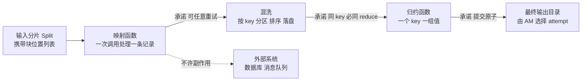
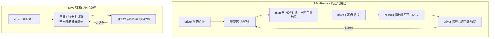
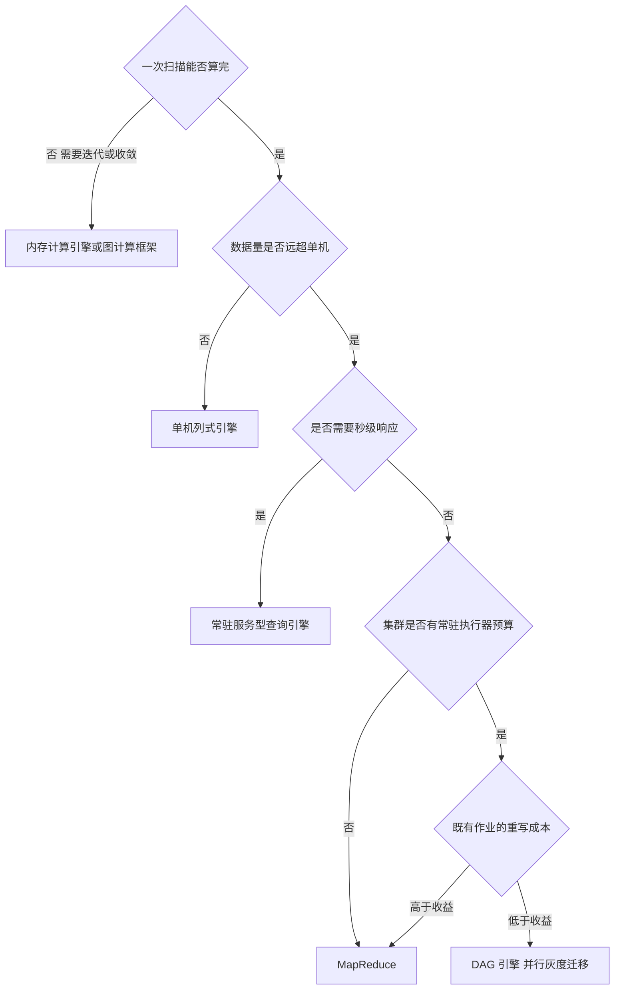

# 03 MapReduce：编程模型与执行引擎剖析

**摘要：**

MapReduce 是一个已经退场的引擎，也是一套仍在服役的语汇。它在 2015 年后交出默认执行引擎的位置，原因不是算得慢，而是两阶段的边界把所有中间结果都钉在了磁盘上。本文把它当作历史坐标来读：先拆开映射（map）、混洗（shuffle）、归约（reduce）三段各自的契约，说明它承诺了什么、又在哪些地方留了后门；再算清中间结果物化这笔账，指出两阶段之间必然落盘既是容错边界，也是成本来源；随后把迁移潮还原为表达力问题——迭代算法与图计算的跳数把物化成本乘到了无法忽视的量级；接着用三条判据区分 DAG 引擎与两阶段模型，给出今天仍适合 MapReduce 的四种场合与四类反例；最后回到它的学习价值，解释为什么理解它才能真正理解 shuffle 为什么昂贵。行文不做机制复述，机制细节交由对应的深度专栏，这里只做横向对比、代价核算与选型判断。读完之后应当能回答两个问题：MapReduce 究竟留下了什么，以及在什么样的约束下它仍然是合理的选择。

---

## 第 1 章 一份 2004 年的论文，定义了此后二十年的语汇

2004 年 12 月，旧金山，第六届 USENIX 操作系统设计与实现研讨会（OSDI）的议程上有一篇标题平淡的论文——MapReduce: Simplified Data Processing on Large Clusters。作者是 Google 的 Jeffrey Dean 与 Sanjay Ghemawat，论文不到二十页，没有提出新的算法，也没有给出新的理论，它做的只有一件事：把「在几千台机器上并行处理一批数据」从一个需要专家团队反复调通的工程，压缩成两个用户函数。

在它之前，并行计算的通行做法是显式消息传递（MPI、PVM）与并行语言（HPF、OpenMP）：程序员要自己决定数据怎么切、结果怎么汇总、某个节点中途死掉之后由谁重跑。这些问题在几十个节点的机群上还能靠经验处理，一旦规模上千，硬件故障就从意外变成常态，工程复杂度随之失控。论文提供的抽象因此显得锋利：用户只写映射与归约两个函数，剩下的并行化、数据分发、负载均衡、故障处理，由框架承担。

论文的工程含义常被简化成「移动计算而非移动数据」，但它真正的关键句是另一句：框架依赖映射与归约函数的**确定性**，才能用「重算」代替「回滚」。这句约束把容错的负担从用户代码挪走了，代价是模型必须对用户函数提出额外要求——同一段输入必须产出同一段输出，副作用要么可重复，要么干脆不存在。

论文给出的规模感是具体的：约 1800 台双路机器、每台 4GB 内存与两块 160GB 磁盘、千兆互联，10^10 条 100 字节记录（约 1TB）的排序在 891 秒内完成。这些数字在 2004 年足够震撼，但真正改变行业的是接口而不是数字——数字会被后来的硬件追平，接口会被后来的人继承。

论文落地成产品花了四年。2006 年，Doug Cutting 与 Mike Cafarella 的 Nutch 项目演化出 Hadoop，Cutting 同年进入 Yahoo 专职推进；2008 年 1 月 Hadoop 成为 Apache 顶级项目；2011 年 12 月 Hadoop 1.0.0 发布，把 MapReduce 与 HDFS 一起定型；2013 年 10 月 Hadoop 2.x 正式可用，资源管理被拆成独立的 YARN，MapReduce 从此只是 YARN 上的一个应用框架；2017 年 12 月 Hadoop 3.0 发布，此后主线转入维护。从论文到定型四年，从定型到不再被当作默认选择，又是四年。

下面这张时间线把这段演进压缩成一条轴，可以看出 MapReduce 的活跃期并不长，但它卡在了存储、调度、计算三层同时定型的那几年里。

```mermaid
%%{init: {'theme': 'dracula'}}%%
graph LR
    A["2003 GFS 论文<br/>SOSP"] --> B["2004 MapReduce 论文<br/>OSDI"]
    B --> C["2006 Hadoop 进入 Yahoo"]
    C --> D["2008 Hadoop 成为<br/>Apache 顶级项目"]
    D --> E["2011 Hadoop 1.0.0<br/>MapReduce 与 HDFS 定型"]
    E --> F["2013 Hadoop 2.x GA<br/>YARN 拆出资源管理"]
    F --> G["2014 Spark 与 Tez<br/>先后成为顶级项目"]
    G --> H["2015 前后 主流发行版<br/>默认引擎换成 Tez"]
    H --> I["2017 Hadoop 3.0<br/>主线转入维护"]
    I --> J["2026 现状<br/>引擎退场 语汇留存"]
```

四条遗产，构成本文展开的主线：其一，键值对三段式的接口契约，今天所有引擎的 map、flatMap、groupByKey、reduceByKey 都在这条线上；其二，分区函数与 key 的绑定，也就是「由 key 决定数据去向」这一决定权被写进了模型；其三，确定性重算的容错范式，它让没有检查点的大规模批处理成为可能；其四，数据本地性调度，YARN 的 locality 语义直接源自输入分片携带的块位置列表。

拿交通规则打比方：这篇论文没有规定车上装什么货，它规定的只是车道方向、路口让行次序，以及事故之后怎么清场；这套规则只适用于「车流单向、可以重跑」的路况，也就是批处理。这个限定很重要，因为本文后半部分要论证的淘汰，恰恰发生在这套规则管不到的路况上：迭代、交互、流式。

---

## 第 2 章 三段契约：模型承诺了什么，又在哪儿留了后门

### 2.1 映射：只对一条记录负责

映射函数的签名很窄：(K1, V1) 到一组 (K2, V2)。框架保证一次调用只看到分片（Split）里的一条记录，调用之间不共享状态，也不保证调用顺序与所在节点。这个窄签名换来的是任意重试：一个 map 任务失败，换一台机器把那个分片从头再跑一遍即可，不需要回滚任何已经生效的写操作。

副作用因此被挡在门外。若在映射函数里写了数据库插入或外部 HTTP 调用，重算一次就多写一次，而框架并不知道最终会采纳哪个任务尝试（attempt）的输出。这条禁令不是风格建议，是模型成立的前提。

组合器（Combiner）是模型给出的第一个合法后门：它允许在映射端先做一次局部合并，把 shuffle 数据量压下去。合法性来自归约语义本身——归约是「对一组值求函数」，只要这个函数满足结合律与交换律，局部合并就不改变结果。反过来，如果归约逻辑带顺序依赖（取中位数、取到达顺序的第一条、做累计差值），插入组合器就会静默改变语义，这是生产事故的常见来源，而不是实现 bug。

### 2.2 混洗：唯一带全局语义的阶段

混洗是模型里唯一承诺全局语义的阶段：同一个 key 的所有 value 一定进入同一个 reduce 调用，投放位置由分区函数决定，默认是 key 的哈希对 reduce 数量取模。

但这条承诺旁边站着三条「不保证」：组内 value 的顺序不保证，不同 reduce 之间的 key 范围不保证有序，分区是否均衡完全取决于 key 的真实分布。前两条决定了模型能做局部有序而不能做全局有序——要全局有序必须自己指定全序分区、并先采样划分边界；第三条决定了**数据倾斜**是模型的必然后果，默认哈希分区遇上长尾分布，本来就一定会倾斜。加盐、两阶段聚合这些手段，本质上是在契约之外加一层用户侧约定，正确性要由业务自己保证。

混洗也是唯一必然跨机器的阶段：map 输出留在节点本地盘，reduce 通过 HTTP 到每个 map 节点拉取属于自己分区的数据。成本结构在这里就定死了，后面的调优参数都只是在这几个支点上挪动。

### 2.3 归约：局部有序，全局无序

归约函数看到的是 (K2, 一组按 key 升序排列的 values)，每个 key 调用一次，处理完把结果写到 HDFS。所谓「全量排序」是个幻觉——排序只发生在单个 reduce 分区内部，跨分区无序。理解这一点，才能理解为什么在 MR 上做全局 Top-N 必须两轮作业：先采样定边界，再按边界分区，而不是加一个参数就能解决。

### 2.4 模型没有承诺的三件事

第一件是无副作用与 exactly-once。MR 的语义是 at-least-once 加确定性加原子提交，**输出提交**协议把这一点做圆了：任务先把结果写到 `_temporary` 目录，成功后由 ApplicationMaster 通过输出提交协议，把某个 attempt 的输出重命名（rename）到最终路径，而 HDFS 的重命名是元数据层面的原子操作。于是「执行」可能重复，「可见」只有一次。这是理解「MR 为什么不需要分布式事务」的关键。

第二件是迭代，第三件是状态保留：一次作业只有两跳，作业之间也不共享任何东西。

三段契约的承诺与代价可以逐项对照。

| 阶段 | 承诺 | 明确不保证 | 违反契约的后果 |
|---|---|---|---|
| 映射 | 分片内一条记录一次调用，可任意重试 | 调用顺序、所在节点、是否只执行一次 | 副作用被重复执行，结果不可重放 |
| 混洗 | 同 key 必进同一 reduce | 组内顺序、跨分区有序、分区均衡 | 依赖顺序的逻辑出错，或长尾任务拖垮作业 |
| 归约 | 每个 key 组一次调用，组内按 key 升序 | 跨 reduce 的全局顺序 | 误把局部有序当全局有序，Top-N 结果错误 |
| 输出提交 | 最终路径上只出现一个 attempt 的结果 | 中间目录不对外可见的时间点 | 依赖 `_temporary` 路径的采集任务读到脏数据 |

反过来说，如果缺了这套契约，回到显式消息传递的写法，那么每个团队都要自己实现分片、调度、失败检测、重传、负载均衡与提交原子性。2000 年代的 HPC 生态就是这个状态，一个 MPI 程序的调优与调试成本常常超过业务代码本身；而在千台规模的集群上，作业执行期间出现节点故障是预期事件，论文的实验部分正是按这个前提设计的。

三段契约可以类比成流水线上的三班交接：上一班把半成品按编号分区、排好序、码放在自己的工位上，下一班只按编号去对应工位取自己那一摞，不需要认识上一班的工人是谁。这里的「编号」就是 key 的哈希分区，「工位」就是 map 节点的本地磁盘；交接之所以必须落在盘上而不是留在记忆里，是因为下一班什么时候来、上一班的人还在不在，框架都不保证。

---

## 第 3 章 中间结果的物化：一处理所当然的落盘

### 3.1 落盘不是性能偏好，是拉取模型的前提

为什么 map 的输出不能直接推给 reduce，而非要落到本地盘再被拉走？答案藏在 reduce 的输入语义里：reduce 要处理的是某个 key 的全量值，它必须等到所有 map 都结束、并且从每个 map 节点取到属于自己分区的数据。MR 选择让 reduce 主动拉，而拉取的前提是数据在拉取发生时仍然存在；map 容器与任务生命周期绑定，任务一结束容器就可能被回收，所以输出只能落在节点本地盘。

这层落盘同时承担三个职责：它是容错边界，任务失败只损失当前分片的计算，重跑即可；它是节奏解耦，map 快、reduce 慢时不会反过来压住 map，反之亦然；它还是合并场所，多次溢写产生的有序文件经多路归并，才让 reduce 能流式处理一个巨大的 key 组而不用全量进内存。物化点还像中转仓库：货物先全部入库再发下一程，任何一段路塌了都能从库房补货，代价是每次进出库都要搬一遍。

要区分两种落盘。map 输出落节点本地盘，一份、无副本；而 Hive 这类多作业串联时，作业之间的输出落 HDFS，三副本。两者的量级不同，前者是磁盘带宽与序列化开销，后者还要叠加副本复制流量。多阶段 SQL 的 I/O 账、Tez 与 Spark 在物化点上的差异，机制细节见 [[大数据/Hive/04 执行引擎对比：MapReduce vs Tez 的本质差异|执行引擎对比：MapReduce vs Tez]]，本文只在判据层面使用其结论。

### 3.2 溢写的算术

一次 map 能产生多少溢写文件，是可以粗算的：环形缓冲区默认 100MB（`mapreduce.task.io.sort.mb`），溢写阈值默认 0.80，也就是攒到 80MB 就写一次盘；单个 map 输出 1GB，就要产生十余次溢写、再合并一次。这个算术解释了为什么 map 端参数的影响是阶跃式的——阈值附近，溢写次数会在个位数与两位数之间跳变。

| 参数 | 默认值 | 管什么 | 代价的方向 |
|---|---|---|---|
| `mapreduce.task.io.sort.mb` | 100 | 环形缓冲区的堆内存上限 | 调大减少溢写次数，抬高堆压力与 GC 时间 |
| `mapreduce.map.sort.spill.percent` | 0.80 | 缓冲区用到多少触发溢写 | 调高减少溢写，写入线程与溢写线程更易争锁 |
| `mapreduce.map.output.compress` | false | map 输出是否压缩 | 打开用 CPU 换磁盘与网络 |
| `mapreduce.reduce.shuffle.parallelcopies` | 10 | 每个 reduce 并行拉取的连接数 | 调高压满网络与 map 节点磁盘，调低拉取排队 |
| `mapreduce.job.reduce.slowstart.completedmaps` | 0.05 | 多少 map 完成后启动 reduce | 提前启动可重叠执行，但抢占资源、增加失败重取 |

这些旋钮的方向是一致的：把缓冲区调大、阈值调高、开压缩，都是拿内存与 CPU 换磁盘和网络；反方向则是拿 I/O 换稳定性。没有一组默认值能同时适配所有负载，这也是 MR 的调优经验至今仍被反复总结的原因。

### 3.3 物化点的谱系

把 MR、Tez、Spark、Flink 批模式排成一列，差别不在「要不要落盘」，而在「落盘点由谁决定」。MR 的落盘点由模型写死，每个作业边界必然全量物化；Tez 把落盘点交给 DAG 边的类型，同一条边上可以流水线也可以落盘；Spark 把落盘点交给 stage 切分，shuffle 边界落盘、窄依赖内部流水，迭代内的中间结果可以缓存复用；Flink 批模式把落盘点交给交换模式与检查点间隔。自由度依次增加，可预测性依次下降。

物化点后移的过程，可以看成一条自由度递增的光谱。

四条路线的分野可以压成一张对照表。

| 引擎 | 中间结果默认去向 | 物化时机 | 决定者 | 恢复单位 |
|---|---|---|---|---|
| MapReduce | map 输出落本地盘，stage 输出落 HDFS | 作业边界强制全量 | 模型写死 | 任务重试，阶段重跑 |
| Tez | 边的下游拉动，可落本地盘可流水线 | DAG 边界，可配置 | 边类型与 AM 策略 | 任务重试，Vertex 重跑 |
| Spark | shuffle 文件落本地盘，缓存驻留内存或磁盘 | stage 边界 | stage 切分与是否 persist | lineage 重算 |
| Flink 批模式 | 网络交换缓冲，溢出落本地盘 | 交换模式与 checkpoint | 交换模式与快照间隔 | 检查点恢复 |

**物化点**的自由度，是后来所有性能优化的空间来源；而这个自由度，恰恰是 MR 用「不许」换来的。它规定只有两跳，所以能承诺确定的资源画像：一个作业需要多少 map、多少 reduce、多少磁盘，提交前就能估出来。这个承诺在容量规划上有真实价值，代价是无法为任何「多一跳更省」的负载让路。

---

## 第 4 章 淘汰它的不是速度，而是迭代要几跳

### 4.1 迁移潮的官方叙事

2014 年前后，批处理引擎的格局开始重排：Spark 在 2014 年 2 月成为 Apache 顶级项目，同年 5 月发布 1.0；Tez 在 2014 年 7 月成为顶级项目，随后被 Hive 采纳为可选引擎；到 2015 年前后，主流 Hadoop 发行版把 Hive 的默认执行引擎换成了 Tez，云厂商的托管服务开始主推 Spark。流行叙述把这段历史概括为「新引擎快几倍」，这个量级在涉及多次 shuffle 的 SQL 上确实成立，但它描述的是结果，不是原因。

### 4.2 速度差的真正来源

拆开看，速度差只有两个来源：跳数减少，也就是物化点后移；以及每跳固定成本下降，也就是容器与 JVM 复用。这两件事都要求执行图不再由框架写死——只有引擎能自己决定哪些算子可以串在一起、哪些中间结果必须落盘，才谈得上把物化点往后挪。笔者以为，速度优势是表达力扩展的副产品；在这个意义上，淘汰的直接原因是速度，结构性原因是**表达力**。

检验这个判断可以用两个极端的负载。在单遍、无 shuffle 的负载上，两者的差距会被作业启动与 ApplicationMaster 拉起吃掉，Tez 甚至可能更慢；而在迭代与图遍历负载上，MR 不是慢，而是表达不了——它没有「保留上一轮状态」的语法。

### 4.3 跳数是乘数，不是加数

一个作业的成本可以近似写成「跳数 × 数据量 × 放大系数」。数据量翻倍是线性放大，**跳数**翻倍也是线性放大，但迭代算法的跳数本身就是几十到上百，两个因子相乘之后，MR 与 DAG 引擎的成本结构已经不在同一个量级。这不是「快几倍」的差别，是「能不能算完」的差别。

以 PageRank 这类迭代为例。MR 的写法是 driver 里写循环，每轮提交一个（实践中常常是两到三个串联的）作业，读取上一轮落在 HDFS 上的全量结果，算完再写回 HDFS，然后 driver 读一个聚合值判断是否收敛。每一轮都包含全量读、全量 shuffle、全量写、一次作业启动，收敛需要多少轮，这套开销就乘以多少轮。Spark 的写法是把邻接表缓存住，循环内只让每轮的贡献值走 shuffle，收敛判断读一个归约后的标量。

用一句话概括这个对照：MR 做迭代像每算完一页就把整本账重新誊抄一遍再翻回第一页，DAG 引擎像把账本摊在桌上翻页即可。前者的问题不是抄得慢，是抄写次数随页数增长。

其它迭代负载的量级类似。K-Means 每轮一次全量扫描，轮数取决于收敛；广度优先遍历的轮数等于图的直径，社交图与网页图的直径常是几十量级；强连通分量、标签传播的轮数同样在几十量级；逻辑回归这类需要多轮扫描的算法，每轮还要广播一次模型参数，shuffle 量与轮数同阶。

若某个作业迭代 100 轮、每轮中间结果 1TB（示例推算，不是实测基准），那么仅中间结果的 HDFS 写与读就各在 100TB 量级，再叠加三副本的复制流量，跑批窗口的绝大部分会被「把同一份数据反复搬过网络」占掉。

两条路径的差别画出来会更直观。

### 4.4 迭代代价的四个来源

把代价拆开，有四项，其中第三项最常被忽略。

| 代价来源 | 表现形式 | 是否随轮数叠加 | 缓解手段 |
|---|---|---|---|
| I/O 乘数 | 每轮中间结果全量读写 | 是，线性叠加 | 减少轮次，或改用可缓存的引擎 |
| 作业启动 | AM 拉起、容器排队 | 是，每轮一次 | 提高 map 完成比例阈值，重叠执行 |
| 收敛判定 | driver 读回结果算指标 | 是，每轮一次 | 把收敛判断做进作业内部的计数器 |
| 状态无法保留 | 活跃子集不能单独处理 | 是，后几轮仍扫全量 | 模型层面无法解决 |

### 4.5 表达力的缺口

于是可以用一张表把 MR 的能力边界钉住。有些负载不是慢，是根本无法表达。

| 负载形态 | 能否直接表达 | 根因 | 今天的对应物 |
|---|---|---|---|
| 迭代与收敛循环 | 否 | 一次作业只有两跳，循环外挂 | 内存计算引擎的缓存加循环 |
| 图遍历 | 否 | 轮数由图的直径决定，无活跃子集概念 | 图计算框架或内存计算引擎 |
| 多路连接 | 否 | 每个连接都要一轮物化 | DAG 引擎或 SQL 引擎 |
| 交互式查询 | 否 | 固定启动开销在秒级以上 | 常驻服务型查询引擎 |
| 流式与增量 | 否 | 只有批语义 | 流处理引擎 |

### 4.6 2008 年那场批评

回到 2008 年 1 月，数据库领域的两位老将 David DeWitt 与 Michael Stonebraker 写过一篇广为流传的短文，标题直白——MapReduce: A Major Step Backwards。他们的论点可以归为四条：没有 schema、没有索引、没有查询优化器、思想并不新（并行数据库二十年前就做过）。当时 Hadoop 社区的反驳同样直白：规模、容错、廉价硬件，才是真实约束。

十年之后回看，这场争论的双方各对了一半。MR 赢在工程可用性，它让不会写分布式程序的人也能在千台机器上跑作业，这一点并行数据库没做到；关系引擎赢在表达力，schema、索引、优化器后来被 Hive 与 Spark SQL 全部吸收回去，而今天真正被淘汰的，恰恰是「用两阶段模型去执行 SQL」这件事本身。一项技术的退场很少是被同维度的对手正面打败，多数是被「吸收其优点、补齐其缺口」的后来者接管。

---

## 第 5 章 DAG 与两阶段：分野不在图，而在边界由谁决定

### 5.1 两阶段本身就是一个 DAG

把 map、shuffle、reduce 画成图，它就是两个顶点、一条边的最小有向无环图（Directed Acyclic Graph，DAG）。所以「DAG 引擎优于两阶段模型」这种说法在字面上是错的——两阶段是 DAG 的一个特例，特例不会因为一般情形的存在而失效。真正的分野要细到三个问题：执行图的拓扑由谁决定，中间结果的物化点由谁决定，失败之后以什么为单位恢复。顺带说一段历史，2007 年微软研究院的 Dryad 已把数据并行程序表达成任意 DAG（见参考资料），只是它没在开源生态里活下来。

| 维度 | MapReduce | Tez | Spark | Flink（批模式） |
|---|---|---|---|---|
| 执行图 | 固定两阶段 | 通用 DAG | RDD 依赖图 | 数据流图 |
| 拓扑决定者 | 框架 | 优化器与 AM | 用户的算子链 | 优化器与并行度设置 |
| 物化点决定者 | 模型 | 边类型 | stage 切分 | 交换模式与快照 |
| 恢复单位 | 任务与阶段 | 任务与 Vertex | lineage 重算 | 检查点 |
| 资源形态 | 每任务容器，随作业释放 | AM 常驻，容器复用 | Executor 常驻 | TaskManager 常驻 |
| 可预测性 | 高 | 中 | 中低 | 中低 |
| 典型负载 | 单遍批处理 | 多阶段 SQL | 迭代与通用计算 | 流批一体 |

### 5.2 三条分野各自意味着什么

**拓扑决定权**方面，MR 用「不许」换来了「可预测」：同一个作业的 map 数、reduce 数、磁盘占用在提交前就能估出来，运维可以按作业数排容量。代价是无法为特定负载改变形状，哪怕它只需要一次扫描。

**物化决定权**方面，交给优化器之后性能上限提高了，但可预测性下降：同一段 SQL 在不同统计信息下可能生成不同的执行图，资源画像随之漂移，调参从「一次配置」变成「持续治理」。这一点在容量规划上是有代价的，很多团队把它折算成了「集群水位永远要留 20% 余量」。两种做法的差别类似固定时刻表的货车与实时编组的调度中心：前者可排班、可预测，后者灵活，但每一趟都要现场决策。

**恢复单位**方面，任务重试的代价最小、语义最简单；lineage 重算省去了物化，但一次失败可能回退多个 stage；检查点把恢复点变成显式配置，代价是周期性快照的稳定开销。恢复单位越小，重算越少，对状态管理的要求越高，这是一条没有免费午餐的曲线。

### 5.3 物化决定权交出去之后的新代价

把物化决定权交出去，并不会让物化成本消失，只是把它挪到了别处。Spark 的缓存要与计算争抢同一块内存，于是有了统一内存管理与溢写的折返，shuffle 文件的分区数与拉取并行度成为常设调参项，机制细节见 [[大数据/Spark/Spark-Shuffle与内存管理机制深度解析/01 为什么 Shuffle 是分布式计算的命门|为什么 Shuffle 是分布式计算的命门]]；Tez 依赖常驻的 ApplicationMaster 与容器复用，于是有了常驻资源的占用与单点暴露面；失败重算在 lineage 模型下会放大到多个 stage，于是有了缓存与检查点的取舍。

这些都不是缺陷，是权衡换了位置。复杂性不会消失，只会转移；MR 把它摆在明面上，代价是僵化，DAG 引擎把它收进优化器，代价是不可见。

---

## 第 6 章 今天仍适合 MapReduce 的四种场合

先说判据。选不选 MR，取决于四个变量：负载是不是单遍的，也就是一次扫描能否算完；数据规模是否远超单机；集群是否养得起常驻执行器；既有资产的重写成本是否低于迁移收益。四个变量里只要有两个指向「否」，结论基本就清楚了。打个不精确的比方，MR 像包机，起飞成本固定、坐满才划算；常驻执行器的引擎像班车，有固定班次、随到随走。包机的问题从来不在飞机，在起飞次数。

### 6.1 单遍超大规模批处理

譬如清洗、字段抽取、格式转码、敏感字段脱敏、冷数据归档，这类负载的共同点是一次扫描即可产出结果，没有连接、没有收敛循环。在这类负载上，DAG 引擎能省下的只有一次启动与一次物化的开销，而 MR 的确定性重算、成熟的运维手册、按作业精确计费的资源画像，反而是收益。风险在长尾任务：单遍负载一旦倾斜，慢任务会拖住整个作业，缓解手段仍是组合器与自定义分区。

### 6.2 养不起常驻执行器的集群

MR 的进程随作业生灭，作业结束资源全部释放；DAG 引擎要么依赖常驻的 ApplicationMaster 与容器池，要么需要执行器预热，两种形态都在空闲期占用资源。在夜间批处理、与非 Hadoop 负载混部、总内存只有几十 GB 的小集群上，这个差别是实打实的。判断标准很朴素：作业是间歇的、允许分钟级启动延迟、且没有交互式需求。

### 6.3 已经通过审计的既有资产

很多团队的 MR 作业不是为性能存在的，而是为合规存在的：处理逻辑经过审计，迁移需要重写与全量回归，Streaming 脚本用 Python 或 Perl 写成、不依赖 JVM 生态，老系统调用的还是 MR 专有 API。这类作业的迁移收益必须与「一次重写加一轮回归加一次重新审计」的成本对比；当作业本身一个月只跑几次时，结论常常是不迁。

### 6.4 超长作业需要分段可恢复

MR 每个阶段结束都物化，等于每一步天然带检查点：作业跑到第 20 小时节点故障，只需重跑当前阶段，前面阶段的结果还在。这条性质在超长作业上有实际价值，相关论证见 [[大数据/Hive/04 执行引擎对比：MapReduce vs Tez 的本质差异|执行引擎对比]]。不过它成立的前提是阶段划分本身合理——阶段越碎，检查点越密，物化开销也越大，这是一条反向的权衡。

| 场合 | 判据 | 收益 | 风险 |
|---|---|---|---|
| 单遍超大规模批处理 | 无连接、无迭代，一次扫描出结果 | 资源画像确定，运维路径成熟 | 长尾任务拖住作业 |
| 资源受限的间歇批处理 | 作业间歇、允许分钟级延迟 | 无常驻开销，作业结束即释放 | 启动延迟不可接受 |
| 已审计的既有资产 | 重写回归成本高于迁移收益 | 零迁移风险，合规链不断 | 长期背离社区路线 |
| 超长作业的分段恢复 | 单作业以小时计，失败重跑代价高 | 每阶段天然检查点 | 阶段过碎则物化开销上升 |

把判据串成一棵决策树，用起来更省事。

决策树只是把判据串起来，真正要算的是三笔账：跳数账，这个负载一共要几跳；启动账，一次作业的固定开销占比多少；迁移账，重写与回归的成本能否被收益覆盖。三笔账算完，多数场景的答案会自己浮出来，不需要争论「哪个引擎更先进」。

### 6.5 决定用它之后，先盯住这几个计数器

如果结论是继续用 MR，成本的可观测面集中在作业计数器上。

| 计数器或指标 | 健康区间 | 异常阈值 | 说明 |
|---|---|---|---|
| `MAP_OUTPUT_RECORDS / MAP_INPUT_RECORDS` | 0.5 到 2 | 大于 10 | 映射端输出膨胀，中间数据被放大 |
| `REDUCE_SHUFFLE_BYTES / MAP_OUTPUT_BYTES` | 接近 1 | 小于 0.8 | 部分 map 输出未被拉取，任务被重算 |
| `CPU_MILLISECONDS / GC_MILLISECONDS` | 大于 5 | 小于 2 | GC 占比过高，缓冲区应下调 |
| `FILE_BYTES_READ / HDFS_BYTES_READ` | 小于 0.1 | 大于 0.5 | 过度依赖磁盘溢写，内存不足 |
| 单个 reduce 输入字节 / 均值 | 小于 3 倍 | 大于 10 倍 | 数据倾斜，需加盐或二次聚合 |

---

## 第 7 章 反例：四类不该选它的负载

不妨反过来看。以下四类负载一旦用 MR 承载，症状会以固定形态出现，识别症状比记住结论更有用。

### 7.1 迭代算法与图计算

症状是：作业数量与迭代轮数同阶，driver 里出现手写的 while 循环和收敛判断，HDFS 上堆积着按轮次命名的中间目录，而且每轮耗时几乎不随数据量下降而缩短——因为每轮都在全量扫描。根因在第 4 章：模型没有保留状态的语法，迭代只能外挂。判断这类负载有个简单办法：如果伪代码里出现「重复直到收敛」，它就不该落在 MR 上。

### 7.2 交互式与低延迟查询

症状是：用户等 30 秒以上开始刷新页面，作业启动与资源排队占了总时长的可观比例，最终没人用它做即席分析。根因是固定开销在秒级到分钟级，而交互式分析的时间预算在秒级。把 MR 接到 BI 工具后面，结局一定是「能跑但没人用」，而没人用的报表等于没有。

### 7.3 小数据

症状是：作业跑了 40 秒，其中 35 秒花在 ApplicationMaster 启动、容器申请与 JVM 初始化上；数据量只有几百 MB，一台笔记本上的列式引擎就能在亚秒级算完。根因是成本结构里**固定开销**占主导，数据量越小于固定开销的比值越难看。判断标准很直接：如果数据能被单机内存或单机磁盘轻松容纳，先试单机引擎，再考虑分布式。

### 7.4 多路连接与复杂 SQL

症状是：一张报表要串起五六个作业，中间表没人清理，跑批窗口越来越长，报表口径变更一次要改一串作业。根因是两阶段模型表达不了多路依赖，每个连接都要一轮物化。这类负载是 DAG 引擎的主场，迁移收益通常在跳数上直接体现。

顺带还有一条：流式与增量。MR 只有批语义，连表达都做不到。

| 负载形态 | 可观测症状 | 根因 | 该换什么 |
|---|---|---|---|
| 迭代与图计算 | 作业数等于轮数，HDFS 中间目录按轮次堆积 | 无状态保留语法 | 内存计算引擎或图计算框架 |
| 交互式查询 | 首字节延迟秒级以上，使用率低 | 固定启动开销 | 常驻服务型查询引擎 |
| 小数据 | 大部分时间花在启动与申请容器 | 固定开销占比过高 | 单机列式引擎 |
| 多路连接与复杂 SQL | 一张报表串起多个作业，中间表失控 | 两阶段表达不了多路依赖 | DAG 引擎或 SQL 引擎 |
| 流式与增量 | 只能小时级出结果 | 只有批语义 | 流处理引擎 |

选型失误的多数形态并不是「选错了技术」，而是「没算清固定开销与数据量的比值」——拿货轮送一封信，问题不在货轮本身，在任务与载具的容量模型不匹配。

---

## 第 8 章 学习价值：理解它，才理解 shuffle 为什么昂贵

### 8.1 混洗的物理下限

把混洗的成本拆到物理层，只有四件事，它们构成了所谓的**物理下限**：序列化，把对象变成字节；重分布，跨网络搬运；排序或哈希，把同一个 key 聚到一起；暂存，内存装不下就落盘。这四件事与引擎无关，只与数据量、key 分布、网络带宽、磁盘带宽有关。任何引擎都不可能让混洗变便宜，只能改变做它的位置与次数。混洗像全城信件按邮编重新分拣：每封信都要离开原邮筒、集中到分拣中心重新归堆，分拣场地与来回运输就是省不掉的那部分成本。

这四件事串起来就是下面这条链路。

### 8.2 为什么它是最好的教材

因为它把混洗显式成一个阶段边界。溢写阈值、缓冲区大小、并行拉取数、map 输出压缩，这些参数直接摆在你面前；作业计数器里 `MAP_OUTPUT_BYTES` 与 `REDUCE_SHUFFLE_BYTES` 的比值直接告诉你数据放大了多少。现代引擎把这些收进优化器，成本没有消失，只是不可见了——你仍然能在 Spark 的 shuffle 文件与 Flink 的网络缓冲区里找到同一笔账。

### 8.3 三个可迁移的判据

| 判据 | MapReduce 里的形态 | 今天的对应机制 |
|---|---|---|
| 数据本地性 | 分片携带块位置，调度尽量同节点 | YARN 与 K8s 上的批处理仍按数据位置调度算力 |
| 确定性重算 | 函数确定，失败即重跑 | 流处理的幂等与可重放语义 |
| 物化边界 | 作业边界必然落盘，天然检查点 | shuffle 分区数、检查点间隔的取舍 |

笔者以为，三条判据里第三条最容易被低估。每个物化点都是一次交易：付出 I/O，换回「可以恢复」与「可以解耦」。调 Spark 的 shuffle 分区数、调 Flink 的检查点间隔，本质都是在这条曲线上选点，选点依据是「失败重算的代价」与「常规物化的代价」谁更低。理解了 MR 的这道算术，这些参数就不再是需要背的经验值。

### 8.4 痕迹

MR 的 ShuffleHandler 至今仍作为 YARN 辅助服务被其他引擎复用；Spark on YARN 换成了自己的外部 Shuffle 服务，但两段结构没变。Hive 的 map-only 作业仍是 MR 思想的直系；Spark 的 mapPartitions 与 reduceByKey 在语义上与 map 与 reduce 等价。引擎退场，接口留了下来，连不太体面的部分也留了下来——数据倾斜在任何引擎里都还得靠加盐处理。

---

## 结语：模型留下的，引擎没留下的

行文至此，开头那个问题可以回答了。MapReduce 留下的不是一台引擎，而是一套把「并行」化简成「可重算的局部函数」的契约，以及「由 key 决定数据去向」这条至今无人绕开的分区约定。它退场的原因也不是速度不够快，而是两阶段模型把物化点写死在作业边界上，于是任何需要多跳的负载都要为每一跳重复付一次读写与启动的账，而跳数恰好是算法属性，不是数据属性。

由此可以引出一条更一般的历史判据：判断一项技术的历史地位，看它的抽象被多少后来者继承，而不是看还有多少进程在跑。引擎会退场，语汇不会；语汇之所以留下，是因为它描述的物理约束没有变——混洗依然要跨网络、要序列化、要落盘，无论它藏在优化器的第几层。

---

## 参考资料

1. Dean, J., Ghemawat, S. *MapReduce: Simplified Data Processing on Large Clusters*. OSDI 2004. [PDF](https://static.googleusercontent.com/media/research.google.com/en//archive/mapreduce-osdi04.pdf)
2. Ghemawat, S., Gobioff, H., Leung, S.-T. *The Google File System*. SOSP 2003. [PDF](https://static.googleusercontent.com/media/research.google.com/en//archive/gfs-sosp2003.pdf)
3. Apache Hadoop. *MapReduce Tutorial*. [hadoop.apache.org](https://hadoop.apache.org/docs/stable/hadoop-mapreduce-client/hadoop-mapreduce-client-core/MapReduceTutorial.html)
4. Zaharia, M. et al. *Resilient Distributed Datasets: A Fault-Tolerant Abstraction for In-Memory Cluster Computing*. NSDI 2012. [PDF](https://www.usenix.org/system/files/conference/nsdi12/nsdi12-final138.pdf)
5. Isard, M. et al. *Dryad: Distributed Data-Parallel Programs from Sequential Building Blocks*. EuroSys 2007. [Microsoft Research](https://www.microsoft.com/en-us/research/publication/dryad-distributed-data-parallel-programs-from-sequential-building-blocks/)
6. DeWitt, D., Stonebraker, M. *MapReduce: A Major Step Backwards*. 2008. [原文存档](https://homes.cs.washington.edu/~billhowe/mapreduce_a_major_step_backwards.html)
7. Apache Tez. *User Guide*. [tez.apache.org](https://tez.apache.org/user-guide.html)

---

> [!note] 思考题
> 1. MR 用「确定性加重算」代替检查点，代价是用户函数必须无副作用；流处理引擎用检查点加幂等写入达到 exactly-once，代价是状态快照的稳定开销。如果让你为一个每天跑一次、单次 8 小时的全量 ETL 选容错方案，你会把这笔账算在哪一边？
> 2. 两阶段模型的一个隐性优点是资源画像可预测：提交前就能算出要多少容器，DAG 引擎把这个能力换成了执行效率。在多租户集群里，可预测性本身值多少钱，又该如何量化？
> 3. 本文把「跳数是算法属性而不是数据属性」当作 MR 退场的结构性原因。按这个判据，一个团队即使把数据量缩小十倍，迭代算法在 MR 上的成本结构也不会改善，这个推论在什么条件下不成立？
> 4. 加盐与二次聚合都在契约之外打补丁，却要由业务层保证正确性。如果由引擎在优化器层面自动识别并处理倾斜的 key，会引入什么新的风险？
> 5. 如果 2026 年重新设计一个「MapReduce 式」的编程模型，你会保留三段契约里的哪几段，又会把哪一段交给优化器决定，理由是什么。