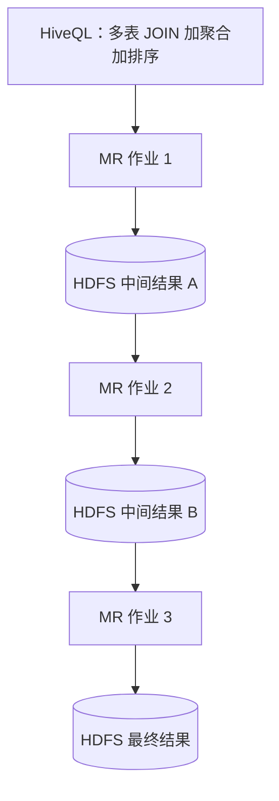
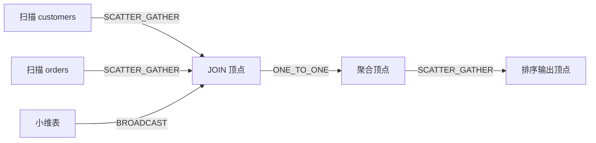
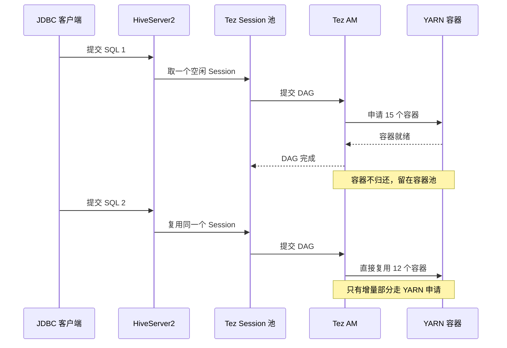
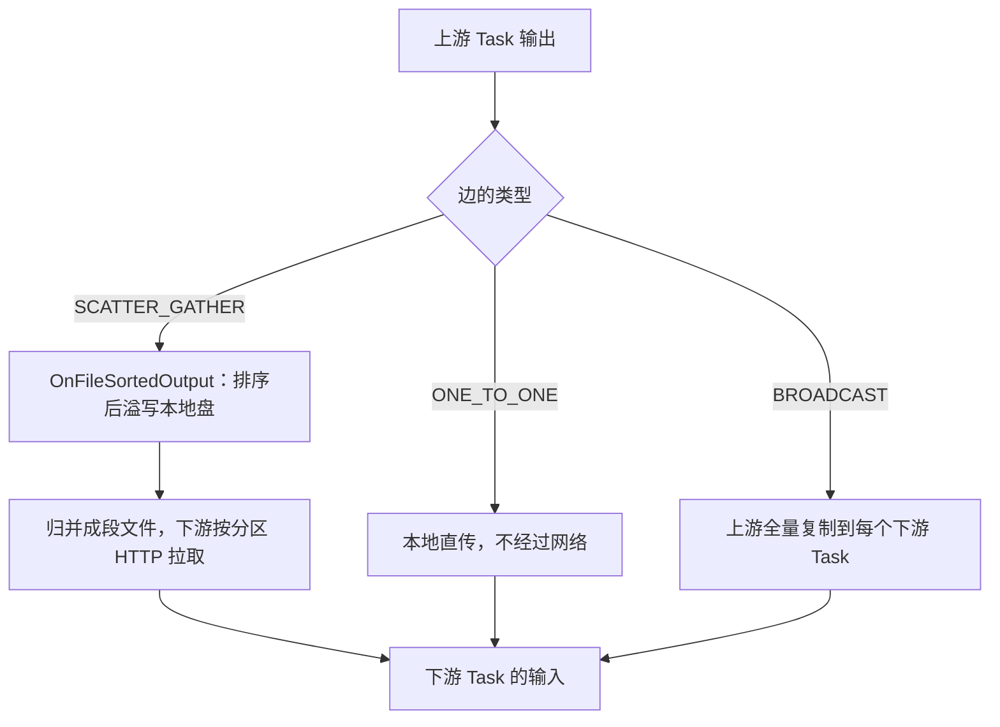
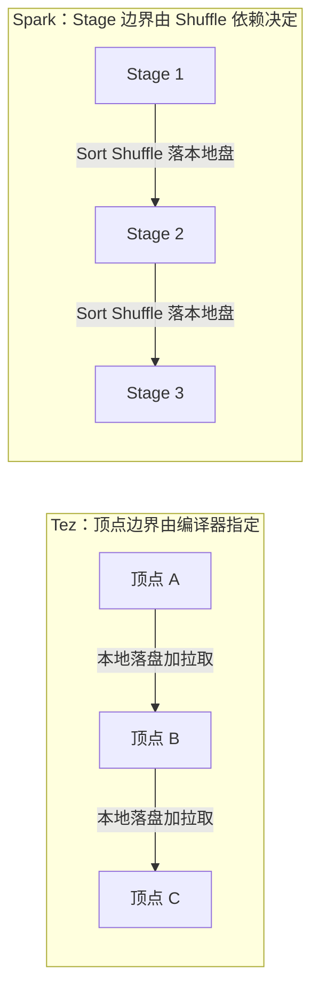
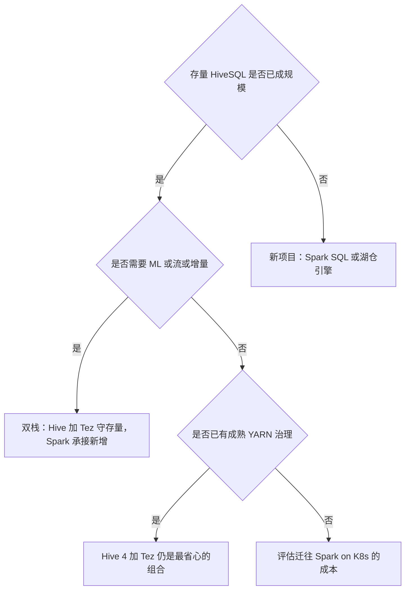

# 04 Apache Tez：被低估的 DAG 引擎与它的选型边界

**摘要：**

Tez 是 Hadoop 生态里最容易被归错类的组件：它常被当成"跑得更快的 MapReduce 插件"，而在工程上，它是一个把物理执行计划交给上层编译器、自己只负责调度与数据搬运的 DAG 运行时。本文不做机制全景，只回答一个选型问题——Tez 究竟省掉了什么，又为此付出了什么。文章从一条 HiveQL 被切成多个 MapReduce 作业的具体代价入手，拆开 Vertex 与 Edge 四个原语、容器复用与 Session、三种边背后的物理通路，指出 Tez 消除的是作业边界与 HDFS 物化，而不是磁盘与屏障本身，它也始终没有获得跨查询缓存与运行时自适应优化的能力，这既解释了它在单次大批量 SQL 上的稳定表现，也解释了它为什么进不了迭代式分析。随后本文把它与 Spark 放进同一张判据表，比较"减少落盘次数"与"让落盘更便宜、把计算做得更快"两条路线，解释为什么两者的优势区间几乎不重叠。最后给出 Hive 3/4 加 Tez 仍然成立的规模与场景、五条不该选它的反例，以及"存量不动、增量不选"的判断。

---

## 第 1 章 一条 SQL 被拆成几个作业

2013 年，Hortonworks 的一小组工程师在 YARN 之上起了一个新项目，名字取自印地语里的"速度"（Tez），目标直白得近乎粗暴：换掉 MapReduce 那套"一个作业只允许两个阶段"的执行模型。2014 年它成为 Apache 顶级项目，2015 年 SIGMOD 上的论文把它概括成一个统一的 DAG 应用建模与执行框架。此后十年，这个名字几乎不再出现在技术选型的讨论里，却又在每一套还跑着 Hive 的 Hadoop 集群上安静地运行。笔者以为，这种"无处不在但无人讨论"的状态，恰好说明它被误解得有多彻底。

要弄清 Tez 解决了什么，得先回到 MapReduce 给自己定下的那份契约。2004 年那篇 OSDI 论文面对的硬件现实是：几千台廉价机器组成的集群里，磁盘损坏与节点宕机是常态而非异常。于是 MapReduce 把"每一步的中间结果都写进持久化存储"当成容错的唯一手段——Map 输出落在本地磁盘，Reduce 输出写进 HDFS，作业与作业之间靠文件衔接。这个决定在 2004 年是合理的，因为当时能选的持久介质只有磁盘，能选的协调方式只有文件系统，把状态写下去、再读回来，是唯一不依赖内存可靠性的做法。

但 Hive 把这份契约用在了它从未设想过的场景上。一条带 JOIN、GROUP BY 与窗口函数的 HiveQL，在语义分析之后会变成一棵 Operator 树，Hive 的编译器按"能否合并进同一个 Map 或 Reduce 阶段"把树切开，于是每一个切分点都变成一次 HDFS 落盘、一个新 ApplicationMaster、一次队列排队、一批全新容器。一条中等复杂的报表 SQL 被拆成三到五个 MapReduce 作业是常态，遇到多表关联加子查询，七八个作业也不稀奇。

| 查询形态 | MapReduce 作业数 | 作业边界落盘次数 | Tez 顶点数 | 边界数据落在哪里 |
|---|---|---|---|---|
| 单表过滤加聚合 | 1 | 1 次（Reduce 输出） | 1 至 2 | 本地 |
| 两表 JOIN 加 GROUP BY | 2 | 2 次 | 3 | 本地 |
| 三表 JOIN 加子查询加排序 | 4 至 6 | 4 至 6 次 | 5 至 7 | 本地 |
| 多维报表（多组 GROUPING SETS） | 6 至 8 | 6 至 8 次 | 7 至 9 | 本地 |

上表的作业数取决于编译器的切分与优化规则，属于示例推算，只用来标定量级，不是任何一次实测的结论。真正要紧的是这些数字背后的代价结构：每一次作业边界，除了多一遍 I/O，还要再付三笔与计算无关的账——AM 启动（秒级）、YARN 队列排队（取决于集群负载，繁忙时可能远超计算本身）、每个 Task 的 JVM 冷启动与类加载（数百毫秒到数秒）。SQL 简单时，计算占大头，这些开销可以忽略；SQL 一复杂，作业数一多，固定的启动开销被乘上若干倍，延迟里越来越多的比例就花在"把任务支起来"而不是"把数据算完"上。



图中每一段箭头跨过一次 HDFS，就跨过一次三副本复制与一次跨机架流量；每一层方框都意味着一套新的 AM 与一批新的容器。2012 年前后 Hadoop 集群"CPU 利用率不高、作业排队很长"的典型画像，很大一部分就是这么来的：集群的吞吐被大量非计算时间吃掉了。

不妨反过来设想：如果 Tez 没有出现，或者某套集群坚持用纯 MapReduce，代价会以什么形式呈现。多表关联的报表会继续以"作业数"为单位付费，作业数随 SQL 复杂度线性增长，集群吞吐被大量 AM 启动与容器拉起吃掉；为了绕开这一点，工程上只能把复杂 SQL 拆成多条简单 SQL、用调度系统串起来，把本该由编译器完成的编排变成人肉编排。代价是双重的：延迟没有降下来，还多了一层调度状态要维护，中间表的生命周期、失败重试的幂等性、以及中间表累积后的小文件问题，全都被转移给了数据开发。Tez 的价值，就是把这一层人工编排收回编译器内部。

Tez 的切入点因此不是"让一个作业跑得更快"，而是**不再随 SQL 复杂度增长**。它把调度的单位从"编译器切出来的一段"提升为"整条 SQL"，中间所有的边由同一个 AM 统一编排，物化的介质从 HDFS 换成任务所在的本地磁盘。这一步改动听起来只是换了层调度，实际却同时改写了三件事：物化的位置、启动开销摊销的粒度、以及容错重算的边界。后面几章分别展开这三件事。

---

## 第 2 章 四个原语，与一次抽象泄漏

Tez 对外只给了四个概念，理解它们的关键是理解每个概念的职责边界，而不是记住名字。

| 原语 | 承担什么 | 不承担什么 | 设计意图 |
|---|---|---|---|
| DAG | 描述整条数据流的拓扑与依赖 | 不做算子级优化 | 让一次提交覆盖一条 SQL |
| Vertex | 计算单元，等于 Processor 加输入输出描述加并发度 | 不关心上游是谁 | 把 Map、Reduce、Join、Union 统一成同一种东西 |
| Edge | 上下游之间的数据通路，附带分发、持久化、调度三组属性 | 不实现具体的序列化格式 | 把 shuffle 从固定组件降到可配置属性 |
| Input/Output | 数据源与数据宿的插件描述 | 不内置 SerDe | 复用 Hive 生态，避免另造一套读写层 |

Vertex 就是"一段要并行跑的逻辑"，它由 Processor（业务代码，对 Hive 来说是一棵 Operator 树的片段）、输入描述、输出描述与并发度组成；Edge 就是"数据怎么从上游流到下游"。把这两者拼成一张有向无环图，就是一次作业的全部。

Input/Output 被做成插件而不是内建，也是一个刻意的选择。Tez 不自己定义序列化格式与文件布局，读什么、写什么全交给上层：Hive 传进来的是自己的 InputFormat 与 SerDe，Iceberg 传进来的是自己的表格式读取器。好处是 Tez 不必维护一张"支持哪些存储"的矩阵，坏处是它永远不知道自己读的是什么数据，也就无法像 Spark 那样在数据源层做下推优化。读写的智能被留在了上层，引擎只负责搬运。

MapReduce 是这张图的一个特例：两个顶点、一条散布收集边。Spark 的 RDD 图则是另一种抽象，它的单位是"不可变数据集加血缘"，允许运行时从血缘重算丢失的分区；Tez 的单位是"算子加连接"，一旦下游消费完，上游数据就没有再生的能力。这个差异看起来只是 API 风格，实际决定了两者容错能力的边界，后文还会回到这一点。



Tez 真正有意思的设计，是 Edge 上的三组正交属性：数据移动方式（`DataMovementType`，一对一、散布收集、广播）、数据来源方式（`DataSourceType`，持久化还是临时）、调度方式（`SchedulingType`，顺序还是并发）。三组属性一组合，就得到一条边的物理执行计划——要不要排序、要不要落本地盘、下游能不能在上游没跑完时就开始拉。

| 移动方式 | 语义 | 典型 SQL 形态 | 主要代价 |
|---|---|---|---|
| ONE_TO_ONE | 上游第 i 个输出给下游第 i 个 | 过滤、投影、本地聚合 | 几乎为零，可走本地直传 |
| SCATTER_GATHER | 按 Key 重分区，等价于 shuffle | JOIN、GROUP BY、ORDER BY | 序列化、排序、落盘、网络拉取 |
| BROADCAST | 上游全量复制给每个下游 | 小表参与的大表关联 | 内存占用与广播流量 |

这里就出现了 Tez 最值得玩味的一处取舍：**物理执行计划的决定权**被交还给了上层编译器。Hive 侧那些名字很长的配置构造器（`OrderedPartitionedKVEdgeConfig`、`UnorderedKVEdgeConfig` 一类），做的工作就是把"这条边要不要排序、用哪个 Output 实现、用哪个 Input 实现、压缩算法是什么"拼成一个 `EdgeProperty` 交给引擎。引擎不再猜"这里该不该排序"，编译器说该就该，说不该就不该。

性能正来自这里：排序是 shuffle 里最贵的一步，UNION ALL 这种根本不需要按 Key 分组的操作，在 Tez 里可以走不排序的通路，省掉的是整条排序链路；而 MapReduce 的 Shuffle 无论业务是否需要排序，都要走一遍排序与归并。反过来，控制权让出去也意味着**抽象泄漏**——引擎的 API 把 `OnFileSortedOutput` 这类内部实现类变成了公开契约的一部分，运行时想换一种更优的数据通路，就得让上层一起改；上层也只能在引擎给定的几种组合里挑，表达不了引擎没提供的新通路。接口一旦泄漏，引擎与调用者就绑成一对，谁也离不开谁，谁也难以单独演化。这一点在讲生态的那一章会变成决定性的证据。

代码层面的感受更直接。下面这段是 Tez DAG API 的典型用法，构造一张"扫描加聚合"的两顶点图。

```java
// 包路径：org.apache.tez.dag.api
// 一张两顶点的图，需要调用方自己写出每一条边的物理实现
DAG dag = DAG.create("demo");
Vertex scan = Vertex.create("scan",
        ProcessorDescriptor.create(ScanProcessor.class.getName()),
        200);                                            // 并发度由调用方决定
Vertex agg = Vertex.create("agg",
        ProcessorDescriptor.create(AggProcessor.class.getName()),
        50);
Edge edge = Edge.create(scan, agg, EdgeProperty.create(
        DataMovementType.SCATTER_GATHER,                 // 数据怎么分发
        DataSourceType.PERSISTED,                       // 中间数据是否持久化
        SchedulingType.SEQUENTIAL,                      // 下游能否提前启动
        OutputDescriptor.create(OnFileSortedOutput.class.getName()),
        InputDescriptor.create(OrderedGroupedKVInput.class.getName())));
dag.addVertex(scan).addVertex(agg).addEdge(edge);
```

这段代码里没有一处"优化"两个字，全是最朴素的物理决策：几个 Task、怎么分区、用哪个输出类、用哪个输入类。两个实现类（完整包名分别落在 `org.apache.tez.runtime.library.output` 与 `org.apache.tez.runtime.library.input` 下）被直接写进了 DAG 定义，这就是上一段说的抽象泄漏在代码里的样子——引擎把自己的内部结构当成了调用契约。

由此可以理解 Tez 的 API 使用者为什么只能是编译器。一个数据分析师面对这段代码，能做的只有把并发度调大调小；而 Hive 的 `TezCompiler` 面对它，能根据 Operator 树的形状算出该不该排序、该不该广播、该开多少并发。控制权的分布决定了谁会用这套 API，也决定了这套 API 不会有第二个用户群。

DAG 的切分与算子融合由 Hive 的 `TezCompiler` 完成，切的依据是 Operator 树里的 ReduceSink 边界，融合的依据是相邻算子能不能塞进同一个 Vertex；机制细节见 [[03 SQL 编译全链路：从 HQL 到 Operator Tree]]，此处不展开。

---

## 第 3 章 容器复用：把启动成本摊进一次会话

前文说过，MapReduce 每个 Task 都要新起一个 JVM，冷启动加类加载是秒级开销。Tez 的解法不是把 JVM 做小，而是让容器在任务结束后不归还给 YARN，留在 AM 维护的容器池里等下一个 Task 进来复用。这个机制本身不难，难的是它只在"有下一个 Task"的前提下才产生收益，于是 Tez 把它扩展成了 Session 模式：一个长期存活的 Tez AM，配一组长期持有的容器，供同一个 Hive 会话连续提交多条 DAG。



收益成立的前提被很多人忽略：复用发生在 Session 之内，跨 Session 不成立。Beeline 长连接、JDBC 连接池、调度系统固定会话这些用法能吃到全部红利；而 `hive -e` 每次一条命令、每个命令起一个新 Session 的用法，收益接近于零，因为 AM 与容器都重新来过。这也解释了同一个集群上两个团队对 Tez 的评价为什么能相差一个数量级——不是引擎不同，是调用路径不同。

| 参数 | 作用 | 参考默认值 | 选型含义 |
|---|---|---|---|
| `tez.am.container.reuse.enabled` | 顶点之间复用容器 | 开启 | 关掉它等于退回按 Task 起 JVM |
| `tez.am.container.idle.release-timeout-min.millis` | 空闲容器最短保留时间 | 10000 | 调大提高复用率，代价是占住资源 |
| `tez.am.container.idle.release-timeout-max.millis` | 空闲容器最长保留时间 | 60000 | 上限决定队列配额的峰值占用时长 |
| `hive.server2.tez.initialize.default.sessions` | HS2 启动时是否预热 Session | 关闭 | 打开后首查延迟骤降，但常驻资源上升 |
| `hive.server2.tez.sessions.per.default.queue` | 每个队列预置的 Session 数 | 1 | 多租户下要按队列配额分配 |
| `hive.prewarm.enabled` | 查询前预热容器 | 关闭 | 只对确定的重复查询有意义 |
| `hive.prewarm.numcontainers` | 预热容器数量 | 10 | 与查询并发度匹配，过大会空转 |

默认值以 Tez 0.10 线与 Hive 4 的默认配置为参考，各发行版普遍会覆盖，具体以对应版本的配置文档为准。

还有一个容易被低估的运维细节：Session 的生命周期由 HS2 管理，空闲回收由 `hive.server2.tez.session.lifetime` 一类参数控制。Session 一旦随 HS2 重启或超时失效，它持有的容器就会成批归还，下一次查询又要重新预热。多租户集群里因此存在一个微妙的平衡：Session 留得久，资源长期被占、别的租户排不上队；留得短，冷启动又回来。很多"Tez 时快时慢"的抱怨，根因不在引擎，在 Session 池的容量与回收策略没有跟上查询到达的节奏。

容器复用是一笔很典型的交换，用"常驻资源"换"启动延迟"，但账单不止一项。Tez AM 本身要占一到数 GB 内存与若干 vCore，即使一条查询都没有也在占；Session 绑定 YARN 队列，这部分配额在整个会话生命周期里都被预留，别的队列借不走；AM 是单点，Tez 虽然有 DAG 恢复能力，默认并未开启，AM 所在节点故障时往往整条 DAG 从头再来，这一点比 MapReduce 的"每个阶段一个持久化检查点"要弱。

最后是容器复用带来的脏 JVM 问题：同一个 JVM 反复执行不同查询的 Task，UDF 的静态状态、线程本地缓存、堆碎片都可能跨任务残留，引擎只能用独立的类加载器与线程上下文压低影响，却无法做到进程隔离那样的干净。

打个比方，容器复用像餐厅不撤桌：省掉了摆台与收台的时间，翻台率立竿见影，但上一桌的汤汁若没擦干净，下一桌客人是要吃到的。Tez 的应对相当于每换一桌就换一套餐具、擦一遍桌面，能防住大部分问题，却防不住桌面本身的磨损。对稳定性要求极高的核心报表，这种"复用但非隔离"的模型需要在选型时被明确认知，而不是等到某个 UDF 的静态计数器串了查询才发现。

Session 与 HiveServer2 生命周期的耦合细节见 [[01 HiveServer2 架构深度解析：从 Thrift 到 Session 生命周期]]，容器复用相关的调参实践见 [[10 Tez 调优实战：DAG 诊断、内存配置与数据倾斜治理]]。

---

## 第 4 章 三种边，三条物理通路

抽象层说完，回到物理层。Tez 的三种数据移动方式，各自对应一条完全不同的数据通路，理解这三条通路的差别，也就理解了 Tez 的性能上限与容错模型。



散布收集边是最常见的一条：上游 Task 把输出序列化进排序缓冲，缓冲满了就溢写成本地磁盘上的有序段文件，Task 结束时把多个段文件归并成每分区一份的输出，注册到 shuffle 服务上；下游 Task 启动后，按分区从所有上游节点的 shuffle 服务拉取，边拉边归并。这条链路里，`OnFileSortedOutput` 负责写，`OrderedGroupedKVInput` 负责读，Hive 的 JOIN、GROUP BY、ORDER BY 全部走它。关键点在于落盘位置是本地磁盘而不是 HDFS：排序过程可能有多次溢写与归并，但最终只在本地产出一份分区文件，不产生三副本，也不产生跨机架复制。

不排序的散布收集边是第二条：`OnFileUnorderedKVOutput` 配 `UnorderedKVInput`，数据仍然按分区写到本地、仍然靠 HTTP 拉取，只是跳过了排序与归并。UNION ALL 这类上游分区与下游分区天然对齐、业务又不需要 Key 有序的场景，用它能把 shuffle 里最贵的一段掐掉。这也正是上一章说的"编译器说了算"的具体兑现：MapReduce 没有这个选项，Tez 把它做成了一个可选的边。

第三条是一对一边，上游第 i 个输出直接喂给下游第 i 个输入，可以走本地直传，不产生网络流量。过滤、投影、以及"分区方式已经对齐"的算子链都走它，代价几乎可以忽略。Hive 编译器会尽量把不需要重分区的算子串成一对一边，这也是 Tez 能把多段算子融进一个顶点的原因。

围绕这三条通路，有两处工程上的细节值得展开。其一是压缩：`tez.runtime.compress` 默认开启，shuffle 数据用 Snappy 一类编码压过网络与磁盘，代价是 CPU，收益在网络带宽与磁盘吞吐成为瓶颈时尤其明显；这与 MapReduce 的 map 输出压缩是同一个思路，只是 Tez 把它设成了默认。其二是排序缓冲与排序器：`tez.runtime.io.sort.mb` 决定单个 Task 能用多少内存做排序，缓冲不足就多溢写几次，溢写次数直接乘在磁盘 I/O 上。

运维层面还有一处必须在选型时确认：散布收集边依赖 NodeManager 上的 shuffle 辅助服务，下游通过 HTTP 从上游节点拉数据，这意味着节点之间的端口连通性（服务端口与 SSL 端口）、主机名解析、以及启用 Kerberos 与 TLS 时的证书配置，都是这条链路能否成立的前提。容器化或跨机房的部署尤其容易在这里踩坑：一个被安全组拦住的端口，会让整条 DAG 卡在拉取阶段，而症状却表现为"任务一直 RUNNING 不结束"。这类问题与引擎性能无关，却常被误判成性能问题。

这里必须纠正两个流传很广的说法。

第一个说法是"Tez 不落盘"。事实是 Tez 的 map 输出永远先写本地磁盘，即便开了流水线式 Shuffle 也一样；它省掉的是 HDFS 这一层介质与三副本复制，不是磁盘写入本身。把"不落 HDFS"说成"不落盘"，会让人误以为 Tez 的容错模型是内存式的，进而误判它在节点故障时的行为。

第二个说法是"Tez 消灭了屏障"。事实是顶点边界依然存在：一条散布收集边要等上游产出足够的数据，下游才可能启动，这个等待就是屏障。Tez 提供了一种可选的流水线式 Shuffle（`tez.runtime.pipelined-shuffle.enabled`），让下游在上游尚未全部完成时就开始拉取，但它默认关闭，Hive 开发者在 10TB 规模的 TPC-DS 上测得的平均收益只有几个百分点（不超过 4%），而且与推测执行互斥——一旦某个 Task 变成慢任务，流水线反而会让整条链等它。所以更准确的说法是：Tez 消灭的是作业级屏障与 HDFS 物化，保留的是顶点级屏障与本地物化。

| 通路 | 排序 | 落盘 | 网络 | 适用形态 | 关闭/替代的代价 |
|---|---|---|---|---|---|
| 排序散布收集 | 是 | 本地磁盘 | 有 | JOIN、GROUP BY、ORDER BY | 无法绕开，只能调缓冲与压缩 |
| 不排序散布收集 | 否 | 本地磁盘 | 有 | UNION ALL、无需有序的聚合 | 需要编译器识别出可省排序 |
| 一对一 | 否 | 可省 | 无 | 过滤、投影、分区已对齐的链 | 分区不对齐时被迫退回散布收集 |
| 广播 | 否 | 否 | 有（复制） | 小表关联大表 | 小表估计错误会打爆下游内存 |

这个判断的价值在于它同时框定了两件事。性能上限方面，Tez 没有跨查询的数据驻留能力，任何两次查询之间的公共数据都得重算或重读，所以它的优化空间止步于"单条 SQL 内部的物化次数"，再往上必须借助 LLAP 那样把缓存做进常驻守护进程的另一层设计（见 [[07 Hive LLAP：低延迟查询加速技术]]）。容错模型方面，中间数据只有本地一份，节点故障意味着那部分输出永久丢失，只能重算对应的子图，所以 Tez 的失败恢复粒度比 MapReduce 粗，比 Spark 的血缘重算细，介于两者之间。

---

## 第 5 章 与 Spark 的错位：两种对待 Shuffle 的态度

把 Tez 和 Spark 放在一起比较，最常见的写法是"Tez 用磁盘、Spark 用内存"。这个说法似是而非，值得当面拆掉：Spark 的 Sort Shuffle 同样把 map 输出写本地磁盘，同样有溢写、归并与索引文件，同样要下游拉取；Tez 的中间数据同样在磁盘上。真正的差别不在介质，而在两条路线各自把优化做在了哪一层。

第一条差别是优化的责任归属。Tez 把物理计划的决定权交给编译器，优化发生在"生成计划时"——Hive 的 `TezCompiler` 决定切几个顶点、每条边走哪种通路、要不要排序，运行时只负责执行这份已经定好的计划。Spark 的优化分布在三个时点：生成计划时（Catalyst 的规则与代价模型）、生成代码时（Whole-Stage CodeGen 把一串算子编译成一段 Java 字节码，消灭虚函数调用与中间对象）、运行时（AQE 根据 shuffle 统计动态合并分区、拆分倾斜分区、调整 join 策略）。前者是一次性的静态决策，后者是"静态加动态"的复合决策。

第二条差别是跨查询的缓存能力。Tez 的复用只到容器层，容器里的堆状态在 DAG 结束后不被任何机制保留，两条查询之间的公共中间结果只能重算。Spark 有 cache 与 persist，能把 DataFrame 物化到内存或磁盘并跨查询复用；Hive 生态里对应的能力不在 Tez 层，而在 LLAP 层——常驻守护进程持有数据缓存与常驻执行器，Tez 只是把任务调度到这些守护进程上的那一层。这也解释了为什么"要交互式就用 LLAP"和"要通用就用 Spark"并不矛盾：它们解决的是不同层面的复用问题。

第三条差别是融合的粒度。两者都在 shuffle 边界切开，都把无 shuffle 的算子链融合掉；但 Tez 的融合由编译器在 Operator 树上做，融合的结果是一个 Vertex 里跑一棵算子树；Spark 的融合由 DAG 调度器按窄依赖做，配合代码生成把整条链编译成一个函数。前者保留了算子之间的边界（便于逐算子度量与替换），后者消灭了边界（便于压榨 CPU）。在一个"算子多、单算子逻辑重"的 ETL 里，前者的可观测性更好；在一个"算子多、单算子逻辑轻"的查询里，后者的执行效率更高。

再补一个常被忽略的判断依据：当一条 SQL 的结果集远小于输入、且只执行一次时，Spark 的缓存与 AQE 几乎派不上用场，两者的差距被压缩到 shuffle 与调度的实现细节上，Tez 的静态计划反而更可预测；当同一条 SQL 一天要跑几十次、每次都扫同一批分区时，Spark 可以把热点数据缓存起来，Tez 只能每次重读。也就是说，判断依据不是数据量，而是**重复度**——重复度低、体量大、一次成型，Tez 够用；重复度高、迭代多、结果被反复消费，Spark 的优势会迅速放大。



图中两张图的形状几乎一样，这恰恰是重点：**骨架是同一个**——在 shuffle 处物化，在物化点切开。差别在于 Tez 把"在哪里切"的权利交给编译器并止步于此，Spark 在这个骨架上又叠了运行时优化、代码生成与缓存。

| 判据 | Hive 加 Tez | Spark SQL | 判据背后的原因 |
|---|---|---|---|
| 单次大 ETL、多 JOIN、无迭代 | 不落下风 | 相当或更优 | 瓶颈在 I/O 与调度，两者的 shuffle 成本同源 |
| 需要反复迭代同一份数据 | 弱 | 强 | Tez 无跨查询缓存，Spark 有 cache 与 persist |
| 需要 ML、流、图 | 不可用 | 原生支持 | Tez 只做批，且不提供编程接口 |
| 需要 DataFrame、多语言、Notebook | 不可用 | 原生支持 | Tez 是编译器后端，不是分析工具 |
| 已有成熟 YARN 多租户治理 | 天然契合 | 需要额外适配 | Tez 只跑 YARN，队列、抢占、标签直接复用 |
| 部署在 K8s 或云原生弹性环境 | 不适用 | 一等公民 | Tez 的运行后端只有 YARN |
| 亚秒级交互查询 | 弱（除非 LLAP） | 中等 | 两者都不是 MPP，都得靠常驻进程补 |

这张表想说明的不是"谁更强"，而是两者的优势区间几乎不重叠：Tez 赢在"一次成型的大批量 SQL"，Spark 赢在"反复迭代的混合负载"。而现实中后者的场景数量远多于前者，这才是 Spark 全面覆盖的真正原因，不是某一项基准测试的胜负。

机制层面的逐项对比（边类型、JVM 启动、AM 数量、容错粒度）在深度专栏里已经写得足够细，见 [[04 执行引擎对比：MapReduce vs Tez 的本质差异]]；Shuffle 本身的物理机制见 [[01 为什么 Shuffle 是分布式计算的命门]]。本文只保留与选型相关的判断。

---

## 第 6 章 为什么它只活在 Hive 里

时间线摆开，答案就清楚了一半。2004 年 MapReduce 论文，2008 年 Hive 立项，2013 年 Tez 启动，2014 年 Spark 1.0 发布，2016 年 Spark 2.0 把 DataFrame 与 SQL 做成主路径，2024 年 Hive 4.0 移除了 Hive on Spark。Tez 在这条线上赢了什么、又错过了什么，一目了然。

第一层原因是客户结构。Tez 的 API 是给"写编译器的人"用的：定义一个 Vertex 要指定 Processor、输入、输出、并发度，画一张 DAG 要几十行代码，跑起来还得自己处理会话与资源。这个抽象层次对 Hive 的编译器是合适的，对数据分析师则完全不可用。于是 Tez 的客户从来只有编译器，而愿意为它写编译器的框架，一只手数得过来：Hive 是最粗的那条腿，Pig 是第二条，Cascading 一类是零散的第三方。Pig 的最后一次发布停在 2017 年（0.17.0），项目随后进入 Apache Attic，第二条腿就此消失。Tez 从未提供 REPL、DataFrame、机器学习库或流处理 API，它不是没来得及做，而是定位上就不做——它是引擎，不是平台。

第二层原因是运行后端。Tez 只能在 YARN 上跑，这在 2013 年是优势（Hadoop 集群的默认资源管理层），在 2020 年之后变成了枷锁。当企业的计算开始迁往 Kubernetes、当弹性伸缩要求把计算与集群解耦、当云厂商的托管服务以容器为单位计价，只支持 YARN 就意味着只能在"自建 Hadoop 集群"这个越来越小的池子里生存。Spark 从 2015 年起就同时支持 Standalone、YARN 与 Mesos，2018 年又把 Kubernetes 补上，后端的选择权本身成了它生态扩张的一部分。

第三层原因是社区带宽。Tez 的版本线长期停在 0.10.x，2024 年 9 月发布 0.10.4，其后还有零星维护版本，属于"修 bug、适配新 Hadoop"的节奏而不是"加新能力"的节奏。社区的主要精力放在 Hive 侧的适配与 LLAP 的调度插件上，引擎本身的演进趋缓。一个项目只要不再有新能力，它在新场景里的存在感就会自然衰减，这跟技术优劣无关。

第四层原因最微妙：Hive 4.0 移除了 Hive on Spark（HIVE-26134），`hive.execution.engine` 只剩 `mr` 与 `tez` 两个选项。这个参数的默认值在 Hive 2.0 之前一直是 `mr`，此后才改到 `tez`，文档与实现一度不同步（HIVE-28646）——这件事本身就说明 Tez 在 Hive 中的地位是"默认但不必强调"。

表面看移除 Spark 是 Tez 的胜利，它成了 Hive 唯一的现代执行后端；实际看这是**收敛而不是扩张**：Hive 本身的市场份额正在被 Spark SQL、Trino 与各类湖仓引擎分流，Hive 只剩一个后端，意味着 Tez 的地盘等于 Hive 的地盘，而这块地盘在缩小。Hive 4 的湖格式支持算是给 Tez 续了一口气，但也只是把它绑在了另一条同样在收缩的船上。

顺带说清一个容易混淆的关系：LLAP 不是与 Tez 并列的另一个引擎，而是挂在 Tez 上的另一层执行设施——它用常驻守护进程持有数据缓存与执行线程，再通过 Tez 的调度插件（`LlapTaskSchedulerService` 一类）把 Tez 的 Task 直接派发到这些守护进程里，绕开 YARN 的容器申请。这解释了为什么"想要低延迟就用 LLAP"与"底层还是 Tez"可以同时成立，也解释了 Tez 的社区精力为什么会被 LLAP 分走一部分：真正被持续优化的往往不是 DAG 引擎本身，而是它上面那层常驻设施。

| 生态位 | 时间窗口 | Tez 的应对 | 结果 |
|---|---|---|---|
| 通用批处理编程框架 | 2013 至 2016 | 定位为引擎，不提供 API | 被 Spark 的 RDD 与 DataFrame 覆盖 |
| 脚本式数据处理 | 2013 至 2017 | 依赖 Pig 承载 | Pig 停更进 Attic，入口消失 |
| 交互式分析 | 2014 至 2018 | 由 LLAP 补位 | LLAP 运维成本高，输给 Trino 与 MPP |
| 云原生与 K8s | 2018 至今 | 无后端支持 | 完全缺席 |

所以"为什么 Tez 只在 Hive 生态里活着"这个问题，答案不是"Hive 绑架了它"，而是它从未拥有过第二个足够大的调用方。**一个执行引擎的寿命取决于调用者**，而 Tez 把这个数字定格在了一。这不是工程失败，是生态位选择的必然结果：它选了"做别人脚下的地板"，当地基上的房子越来越少，地板自然就露出来了。

---

## 第 7 章 今天还值得用吗

把情绪拿掉，只看条件。判断 Hive 加 Tez 是否还值得用，笔者建议看四个维度：存量资产的形态（有多少 HiveQL 是别处跑不了的）、集群的形态（是否已有成熟的 YARN 多租户治理）、负载的形态（批、交互、迭代、流各占多少）、团队的形态（谁维护执行引擎这条链路）。四个维度里只要"存量资产"和"集群形态"两项都成立，Tez 就还有明确的存活理由。

仍然成立的情形有四种。其一，数千张表的 Hive 存量资产，迁移成本远大于性能收益，尤其是那些依赖 Hive ACID 事务表与 `MERGE` 语义的链路，换引擎意味着重写数据模型。其二，单次成型的大批量 ETL，多表关联、无迭代、对延迟不敏感，这类作业的瓶颈是 I/O 与调度，Tez 的静态物理计划没有任何运行时代价，表现稳定。其三，已有成熟 YARN 治理的集群，队列配额、抢占、节点标签、Kerberos 认证一整套都在运转，引入 Tez 不需要新增调度层，引入 Spark on K8s 则需要再造一套资源治理。其四，需要 LLAP 的交互式查询场景，LLAP 的任务调度插件就挂在 Tez 上，两者是同一套体系。

Hive 4 内置的 Iceberg 支持让 Tez 的边界外扩了一条：湖表上的批处理查询仍可由 Tez 执行，不必为了湖格式再引入一套引擎。但这条路径的竞争对手不是 Spark SQL，而是 Trino、Doris 这类更擅长交互的引擎，以及 Spark 在湖上的成熟生态；Tez 在这里能守住的是"已有的 Hive 批处理习惯"，守不住的是新增的分析入口。

| 场景 | 建议 | 理由 | 需要接受的代价 |
|---|---|---|---|
| 存量 Hive 数仓、日批 ETL | 继续用 Hive 4 加 Tez | 迁移成本高于收益，YARN 治理复用 | 引擎能力停滞，长期缺新特性 |
| 新增批处理、无 ML 与流 | 视团队栈二选一 | 两者都能做，选团队更熟的那条 | 双栈会推高运维复杂度 |
| 需要迭代计算、ML、流 | 选 Spark 或 Flink | Tez 无编程接口、无流模型 | 引入新的资源管理与权限模型 |
| K8s 为主、无 YARN | 不选 Tez | 运行后端不支持 | 需重构存储与认证 |
| 亚秒级交互查询 | 选 Trino 或 MPP | Tez 与 LLAP 都不是为点查设计 | 多一套服务与元数据同步 |



反例比正例更有信息量，下面五种情况不该选 Tez。

**新项目起步**。团队没有 Hive 存量、没有 YARN 治理包袱时，选 Tez 等于主动选择一个没有新特性、没有社区增量的引擎，日后每一次需求变化都要面对"这个引擎不做"的回答。

**需要机器学习、流处理或增量计算**。Tez 只做批，没有编程接口，没有流模型，也没有增量物化视图。这三件事在 2026 年已经不是加分项而是基线需求，缺一项就意味着要多引入一套系统。

**需要 DataFrame、多语言或 Notebook 交互**。Tez 是编译器后端，分析师碰不到它；Spark 的 PySpark、Scala、R、SQL 四种入口是它拿下数据科学团队的关键，也是 Tez 从未尝试补上的缺口。

**以 Kubernetes 为唯一运行环境**。Tez 只支持 YARN，这一条是硬约束，不存在"配置一下就能跑"的余地。

**数据量小、查询短**。Tez AM 的启动与常驻开销在小数据量下占比极高，一条秒级能跑完的查询，在 Tez 上可能要花十几秒等 AM 与容器就绪；这种规模更适合直接上单机或 MPP。

除了看反例，实践中更需要一个可操作的判断方法：笔者建议用"端到端对比"而不是"核心计算对比"：拿同一份数据、同一条 SQL，分别在 Hive 加 Tez 与 Spark SQL 上跑完整链路，把排队、AM 启动、会话建立、结果写出全部计入，再看总时长。很多团队得出的结论是两者相差不大，原因正是这些"引擎之外"的时间在两边都存在；真正拉开差距的，是跑第二次、第三次时 Spark 能复用缓存而 Tez 不能。至于规模边界，笔者的经验判断是：日增数据在 TB 级、作业以多表关联的批处理为主、对单条查询延迟不敏感的集群，Hive 4 加 Tez 完全撑得住；一旦查询模式转向"高重复、强交互、混合负载"，边界就到了。

从 Hive 加 Tez 迁到 Spark SQL，难的通常不是 SQL 语法（Hive 4 与 Spark 4 的 SQL 方言大体兼容），而是 UDF 的重写、ACID 事务表的行为差异、调度脚本与参数体系的重建、以及 Ranger 策略要按引擎重新适配。这些成本加起来往往超过"省下来的那部分查询时间"，这也是很多团队选了双栈而不是迁移的真实原因。

---

## 收束：引擎的退场方式

Tez 没有输掉性能竞赛，它输掉的是被调用的竞赛。它把 DAG 调度与容器复用写进了 Hadoop 的默认执行路径，此后 Spark 的 Stage 调度、Flink 的流水线执行讲的都是同一件事，只是讲给了更大的听众。它的退场方式很有代表性：不是被更强的同类打败，而是被更宽的生态绕过——当查询的生成权从"编译 HiveQL 的编译器"转移到"写 DataFrame 的分析师"时，地板还在，房子搬走了。

选型的问题因此可以被重新表述：不是 Tez 与 Spark 谁更快，而是你的查询由谁生成、你的团队维护哪条链路。存量不动、增量不选，除非那个增量本身就是更多的 HiveQL——这就是笔者对 2026 年这套组合的判断。

---

## 参考资料

1. [Apache Tez 官方文档](https://tez.apache.org/)
2. [Apache Tez 发布记录](https://tez.apache.org/releases/)
3. [Apache Hive 官方文档与配置属性](https://hive.apache.org/docs/latest/user/configuration-properties/)
4. [HIVE-26134：Hive 4 移除 Hive on Spark](https://issues.apache.org/jira/browse/HIVE-26134)
5. [HIVE-28646：`hive.execution.engine` 文档默认值滞后](https://issues.apache.org/jira/browse/HIVE-28646)
6. [Hive 用户邮件列表：pipelined shuffle 在 10TB TPC-DS 上的实测讨论](https://www.mail-archive.com/user@hive.apache.org/msg23059.html)
7. [Apache Iceberg：Hive 集成（含 Hive 4 内置支持）](https://iceberg.apache.org/docs/latest/hive/)
8. [MapReduce 原始论文：Dean 与 Ghemawat，OSDI 2004](https://research.google/pubs/mapreduce-simplified-data-processing-on-large-clusters/)
9. Saha, B. 等，《Apache Tez: A Unifying Framework for Modeling and Building Data Processing Applications》，SIGMOD 2015

---

> [!note] 思考题
> 1. Tez 把物理执行计划的决定权交给编译器换取性能，代价是接口泄漏与生态锁定。如果重新设计一次，你会把什么样粒度的控制权留给引擎、什么样粒度的留给调用方？
> 2. 容器复用省下了 JVM 启动成本，却也让不同查询共用同一个堆。除了类加载隔离与线程上下文，还有什么手段能降低这种"脏 JVM"风险？
> 3. Tez 保留了顶点级屏障，Spark 保留了 Stage 屏障，两者都没有消灭 shuffle。在你熟悉的业务里，shuffle 的真实成本里排序、网络、落盘各占多少？
> 4. Hive 4 移除 Hive on Spark 之后，Tez 成了 Hive 唯一的现代后端。这会让 Hive 生态更稳定，还是加速它被替代？
> 5. 一个只被一个上层框架调用的执行引擎，还有没有可能靠"被另一个框架重新发现"而复活？历史上有没有反例？