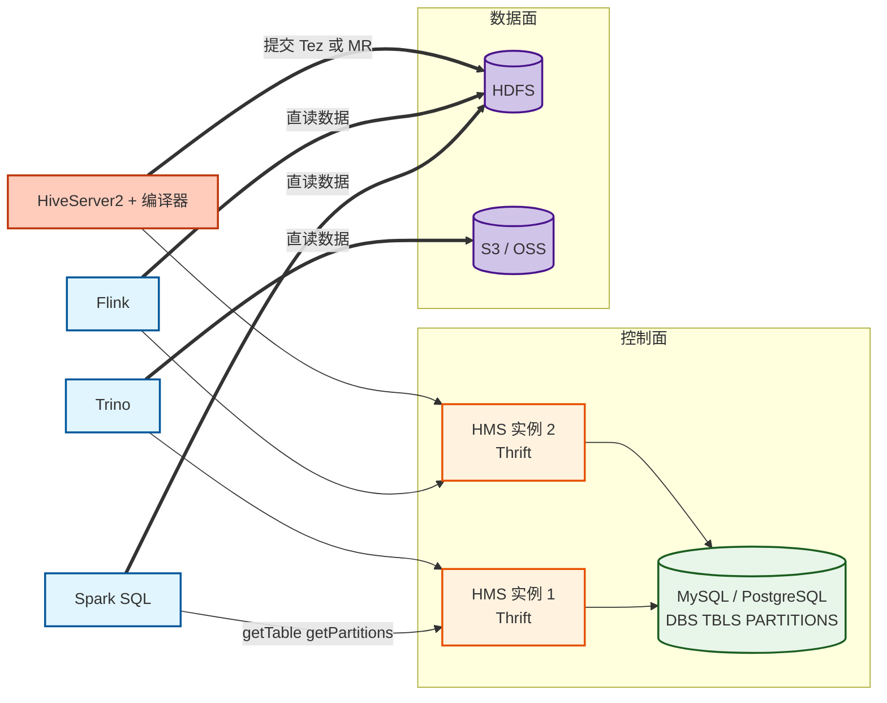
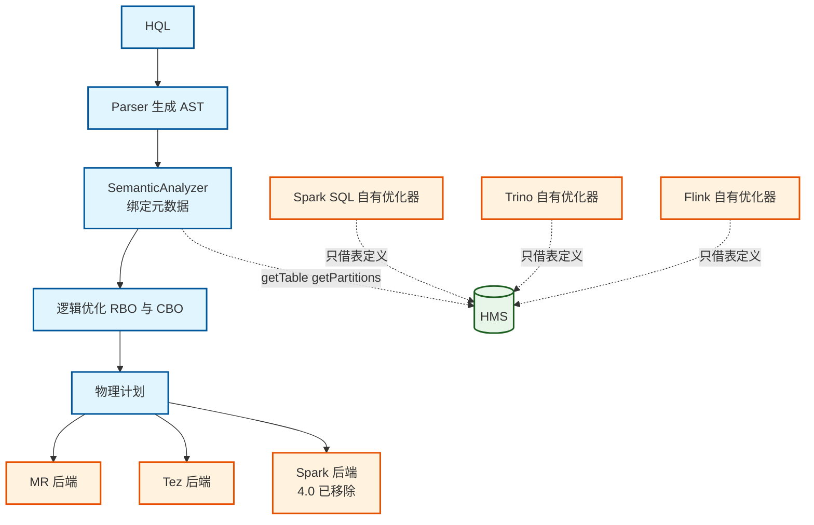
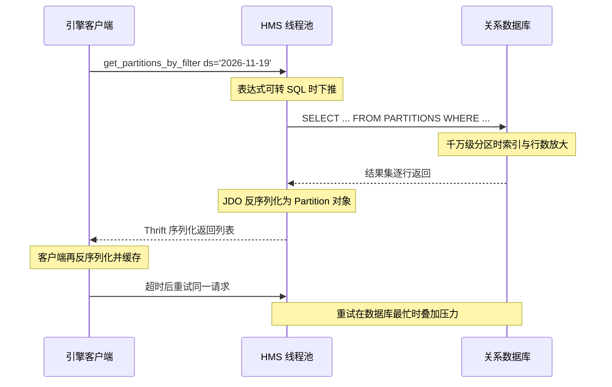
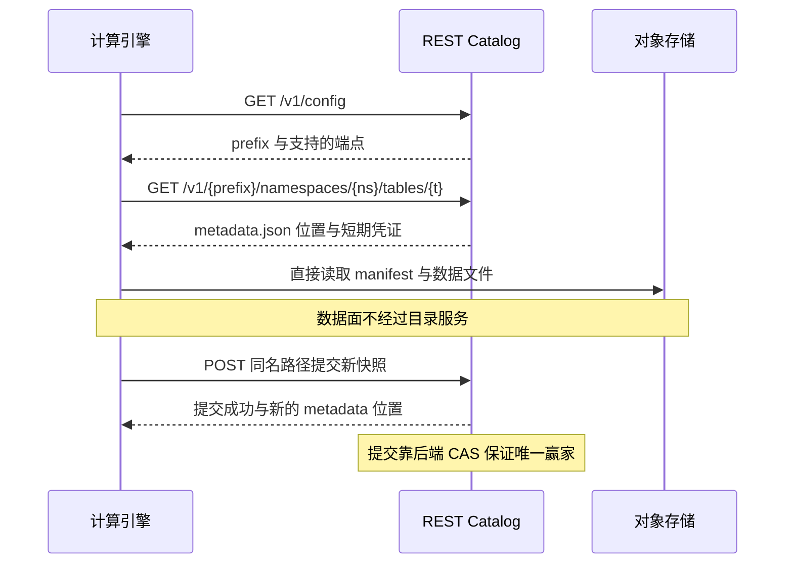
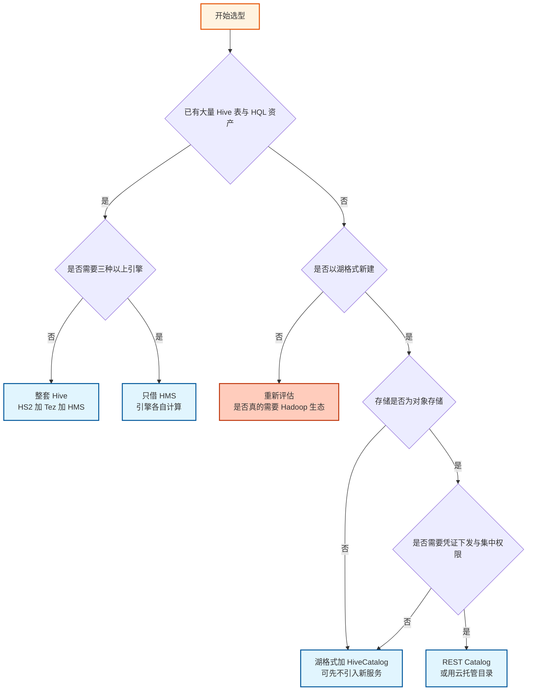

# 05 Apache Hive：HMS 作为元数据事实标准的由来与边界

**摘要：** 2026 年新建一个 Spark 作业去读 Hive 表，工程师往往只补一行 `hive.metastore.uris`，而这行配置指向的 Hive Metastore（HMS）已经不只是一款数据仓库产品的内部组件，而是 Spark、Trino、Flink 与各类湖格式共同依赖的目录服务。本文避开 Hive 的语法与运维细节，从"文件目录如何变成可查询的表"这一问题出发，先拆解表定义、分区、存储描述三件套，说明控制面与数据面分离为什么让它得以被所有引擎复用，成为跨引擎的既成事实；再清算它的结构性代价，包括伪高可用、Thrift 的版本与连接模型、对象存储的语义错配以及元数据爆炸；随后沿 MapReduce 到 Tez 到 Spark 再到外部引擎的解耦史，解释"引擎可替换、目录不可替换"这一粘性来源，并梳理它在湖仓时代服务化、变薄、桥接的三条演化路径，以及这些结构性代价在哪类负载下会集中爆发（高并发点查、事务更新、实时提交、元数据爆炸）；最后给出整套 Hive、只借 HMS、换 REST Catalog 三种用法的判据与四类反例，把讨论收敛为一个具体的追问：你的表定义应该存在哪里。

---

## 第 1 章 一个端口与三件套

2026 年，一个新建的 Spark 作业要读一张 Hive 表，工程师通常只做一件事：在配置里补上一行 `hive.metastore.uris = thrift://hms-01:9083`，然后回去写业务逻辑。这一行的含义远大于它的长度，它把某个计算引擎的元数据依赖，交给了一个 2009 年诞生于 Facebook、至今仍用 Thrift 暴露接口的目录服务（Hive Metastore，HMS）。

先把范围限定清楚：这里不讨论 HQL 怎么写、HiveServer2 怎么调 JVM、Tez 容器怎么复用，那些是 Hive 深度专栏的题目；本文只追问三件事：HMS 用什么样的抽象把文件目录变成表、这套抽象为什么成了整条数据栈的既成事实、以及在对象存储与湖格式的语境里它还够不够用。

### 1.1 三件套：表、分区、存储描述

HMS 做的事情说起来很朴素，它回答五个问题。表定义回答"这堆文件属于哪个库的哪张表、每列叫什么名字、是什么类型、顺序如何"；分区回答"数据按什么维度切成了多少块、每块对应哪个目录"；存储描述回答"这堆文件是什么格式、用什么反序列化、有没有分桶、是不是外部表"。前两个问题由 `DBS`、`TBLS`、`COLUMNS_V2`、`PARTITION_KEYS` 承载，第三个问题落在 `SDS` 与 `SERDES` 上。

分区要单独拎出来说，因为它同时埋下了后面的两处麻烦。分区键是**伪列**，它只存在于元数据里，不在任何一个数据文件里；因此 `WHERE ds = '2026-11-19'` 这类条件在编译期就能被翻译成"只取那几个目录"，整个裁剪过程不读一个字节的数据文件。这个设计把"目录命名约定"从人类经验变成了机器可执行的谓词，是 Hive 表能支撑起分区表的根本原因，也是它在对象存储上水土不服的伏笔——分区与目录绑定得太紧。

第四件东西常被忽略，却决定了 HMS 后来的命运：表参数（table parameters）。它是一张开放的键值表，Hive 自己用来存序列化属性与统计信息，后来的 Iceberg 用来存 `metadata_location` 指针。一张随时可以塞入私有键值的表，让新表格式不必修改 HMS 的 schema 就能寄存自己的元数据入口。

| 组成 | 承载的内容 | HMS 侧载体 | 主要消费者 | 变更代价 |
|---|---|---|---|---|
| 表定义 | 库名、表名、列名与类型、注释 | `DBS`、`TBLS`、`COLUMNS_V2` | 所有引擎的解析器 | 低，但会影响所有下游视图 |
| 分区 | 分区键、分区值、分区对应目录 | `PARTITION_KEYS`、`PARTITIONS`、`PARTITION_KEY_VALS` | 编译期的分区裁剪 | 高，一次 DDL 可能写入上万行 |
| 存储描述 | 路径、InputFormat/OutputFormat、SerDe、分桶 | `SDS`、`SERDES` | 执行引擎的读写算子 | 中，改 location 常导致"表在数据不在" |
| 表参数 | 序列化属性、统计信息、格式私有指针 | `TABLE_PARAMS` | 优化器、表格式实现 | 低，正是它让 Iceberg 得以寄生 |

打个比方，HMS 是一间图书馆的卡片目录：卡片上写书名、分类号、索书号与馆藏位置，书本身不在卡片里，不同读者拿着同一张卡片各自去书架取书。技术上的限定是，这张卡片不校验书是否还在架上——HMS 从不检查数据文件是否存在，schema-on-read 的校验发生在读取那一刻，这是它便宜的原因，也是"表存在但读不到"这类故障的来源。

### 1.2 物理形态：一个 JVM 加一个关系库

把这套抽象落地，HMS 的部署只有两样东西：一个 Java 进程（`HiveMetaStore`，跑 Thrift 服务，默认监听 9083）和一个关系数据库，生产上以 MySQL 与 PostgreSQL 为多，早期默认的 Derby 只适合单机试验。接口定义在 `metastore/if/hive_metastore.thrift`，服务端把请求交给 `RawStore`，由 `ObjectStore` 经 DataNucleus 的 JDO 落到关系库。

有一个性质必须记住：HMS 不代理数据。它只回元数据，字节由引擎自己从 HDFS 或对象存储读取。这个设计与 HiveServer2 形成对照——HS2 要维持会话、编译 SQL、把作业提交到 YARN，所以很难被别的引擎复用；HMS 只回答"表长什么样"，所以谁都能接。数据面与控制面的分离，是它能被所有引擎共享的架构前提。

图里实线是元数据流，双线是数据流。可以看出所有引擎只在控制面相遇，一次查询的元数据往返通常发生在前几秒，之后的字节传输与 HMS 无关；这也解释了为什么 HMS 的容量瓶颈几乎总是数据库，而不是它的 CPU。

不过要小心"无状态"这个词的边界。HMS 进程里是有缓存的：表对象、分区列表、统计信息都会缓存在堆内，多实例之间互不共享，DDL 之后的可见性依赖缓存 TTL 或事件通知。后面讨论并发 DDL 与跨引擎一致性时，这个细节会反复出现。

### 1.3 没有目录会退化成什么样

不妨设想一个去掉了 HMS 的集群：表就是一堆约定好的目录，工程师在代码里写 `spark.read.parquet("hdfs://ns/warehouse/db/tbl/ds=2026-11-19")`。单团队、单引擎、schema 稳定的时候，这样跑得很好，甚至比建表更快，但四处裂缝会依次出现。

第一处裂缝是路径即契约，分区命名、库表目录层级这些知识散落在每个作业里，任何一次重组目录都要改代码；分区发现退化为列目录，譬如 `ds>='2026-11-01'` 这样的条件只能先 list 再过滤。

第二处裂缝在授权，Ranger 这类系统按库、表、列、UDF 授权，这些对象都来自目录；没有目录只能按路径前缀授权，粒度粗且不稳定，改个 location 就要重配策略。

第三处裂缝是类型解释权分裂，同一个 Parquet 目录，Spark 会把 INT96 当时间戳，Trino 有自己的映射规则，没有目录里的 schema 声明作为仲裁，跨引擎结果不一致时只能靠人记忆去对账。

第四处裂缝是演进没有记录，加列、改类型、改分区键都没有单一事实来源，回滚时无从依据，事后追查"这个字段什么时候变的"只能翻任务日志。

把这四条放在一起，HMS 的真正产出就清楚了：**命名、契约、授权锚点**，它们都是作业之外的公共资产，所以无法用"直接读文件"替代。目录不是加速器，它是一份登记簿。

---

## 第 2 章 目录标准的前史：HCatalog 的失败与 standalone 的成功

理解 HMS 的地位，要回到它还叫 Howl 的年代。2009 年 Facebook 的团队在 VLDB 上发表 Hive 的论文，把 SQL 编译成 MapReduce 作业，让不写 Java 的分析师也能用 Hadoop。当时的表定义只是 Hive 自己的元数据，Pig 脚本与手写 MR 作业要访问同一份数据，得另写一份 schema。

2010 年前后，Facebook 内部把这些表定义抽出来做成 Howl，2011 年更名为 HCatalog，目标是让 Hadoop 上的所有工具共享"表"这个概念：HCatInputFormat、HCatOutputFormat、HCatLoader、HCatStorer 这套接口，本质上是在文件格式之上再套一层 schema。2013 年 HCatalog 并入 Hive 0.11，与 HiveServer2 出现在同一个时期。

有意思的是结局：HCatalog 作为独立项目消失了，它的接口却活了下来。原因并不复杂，HCatalog 的实现深度依赖 Hive 的 SerDe 与类型体系，两者同源同发布节奏，独立演进只会制造分裂成本；而当它被并回 Hive，"表定义可被外部工具读取"这件事就变成了 HMS 的功能，而不是一个产品的卖点。标准常常以这种形态诞生：**载体死了，接口留下了**。

真正的转折发生在 2018 年：Hive 3.0 通过 HIVE-19312 把 Metastore 拆成独立发布包（standalone-metastore），可以只跑 HMS 而不跑 HiveServer2，配置上只需调整少数几个任务线程与表达式代理参数。这一步的意义不在功能，而在节奏：HMS 从此有了自己的版本线，不必等着 HS2 与编译器一起发版。到了 Hive 4 时代，"HMS 4.x + HS2 4.x + Spark 与 Trino 各自的客户端库"这种混搭部署并不罕见，前提正是这次拆分。

| 方案 | 出现时间 | 目录载体 | 事务粒度 | 跨引擎能力 | 主要短板 |
|---|---|---|---|---|---|
| HCatalog | 2011 年 | Hive 元数据库 | 单表 DDL | 设计目标就是跨工具，实现绑死 Hive | 独立演进成本高，最终被并回 |
| HMS | 2009 年起，2018 年独立发布 | 关系数据库 | 单次 Thrift 调用 | 事实标准，几乎所有引擎都支持 | 单库瓶颈、Thrift 耦合、无 REST |
| Iceberg HiveCatalog | Iceberg 早期 | HMS 表参数存指针 | 单表原子提交 | 借 HMS 的跨引擎可达性 | 继承 HMS 的锁与 list 语义缺陷 |
| Iceberg REST Catalog | 2022 年随 Iceberg 1.0 发布 | 任意支持 CAS 的后端 | 单表原子提交 | 协议标准化，HTTP 可达 | 服务本身仍是单点，规范演进快 |
| Nessie | 2020 年前后 | 版本化存储（类 Git） | 分支与提交 | 多引擎支持 | 引入分支语义，运维与心智成本高 |
| AWS Glue Data Catalog | 2016 年 | 托管服务 | 单次 API 调用 | 兼容 Hive 元数据模型，另有 Iceberg REST 端点 | 云厂商锁定，能力受限于托管实现 |

```mermaid
%%{init: {'theme': 'dracula'}}%%
graph LR
    classDef era fill:#fff3e0,stroke:#e65100,stroke-width:2px;
    classDef turn fill:#ffccbc,stroke:#bf360c,stroke-width:2px;
    classDef lake fill:#e1f5fe,stroke:#01579b,stroke-width:2px;

    A[2009 Hive 论文<br/>SQL 编译成 MR]:::era
    B[2011 HCatalog<br/>表定义对外开放]:::era
    C[2013 并入 Hive 0.11<br/>接口成为 HMS 功能]:::era
    D[2016 Glue Data Catalog<br/>目录开始托管化]:::era
    E[2018 HIVE-19312<br/>standalone metastore]:::turn
    F[2022 Iceberg 1.0<br/>REST 目录规范]:::lake
    G[2024 Hive 4.0<br/>移除 Hive-on-Spark]:::turn
    H[2024 起 Unity Catalog Polaris<br/>REST 目录实现竞争]:::lake

    A --> B --> C --> D --> E --> F --> G --> H
```

这条时间线里有两个分水岭：2018 年的拆分让 HMS 成为独立产品，2022 年的 REST 规范让"目录"第一次有了不依赖 Thrift 的标准协议。前者巩固了 HMS，后者开始削弱它。

反过来说，如果 Hadoop 生态始终没有出现一个共享目录，多引擎时代每接入一个引擎就要重写一遍全部 DDL 与权限配置，引擎迁移会从"改一行配置"退化成"重建整本数据资产账本"。这个反事实解释了为什么即便在湖格式普及之后，HMS 依然没有被铲掉——它承载的是账本，不是计算。

---

## 第 3 章 解耦的另一半：引擎换了四代，接口没有动

很多人把 Hive 的历史读成一部执行引擎的失败史：MapReduce 被 Tez 取代，Tez 在批处理上又被 Spark 抢走，Hive 自己在 4.0 里干脆删掉了 Hive-on-Spark（HIVE-26134），`hive.execution.engine` 只剩 mr 与 tez 两个取值，MapReduce 路径也被标注为废弃（以对应版本文档为准）。但从目录的视角看，这四代引擎的每一次更替，都在加固同一件事。

| 代数 | 时间 | 谁把 HQL 编译成计划 | 谁执行 | 元数据来源 | 目录耦合度 |
|---|---|---|---|---|---|
| MapReduce | 2009 至 2014 | Hive 编译器生成多段 MR 作业 | YARN 上的 MR | HMS | 高，编译产物与 MR 阶段一一对应 |
| Tez | 2014 年起 | Hive 编译器生成 DAG | Tez AM 与容器 | HMS | 高，算子仍由 Hive 定义 |
| Hive-on-Spark | 2014 至 2024 | Hive 编译器生成 Spark 任务 | Spark | HMS | 中，两套运行时语义要对齐 |
| 外部引擎 | 2016 年起 | Spark SQL、Trino、Flink 各自的优化器 | 各自的执行器 | HMS 或 REST 目录 | 低，只借目录与方言 |

机制上的原因很直接：Hive 的编译链路被切成固定的五段——ANTLR 解析出 AST、语义分析绑定元数据、逻辑计划与优化、物理计划生成、提交执行。前四段与执行引擎无关，最后一段才是可替换的插槽。于是换引擎只需要换插槽，表、分区、权限、UDF、方言这些资产全部继承。这也是 Hive 在 4.0 里能相对轻松地砍掉 Spark 引擎的原因：砍掉的是插槽，不是资产。

由此得出一个反直觉的结论：Hive 每失去一次执行引擎的份额，HMS 的地位反而更稳固一分。因为替换引擎的成本是一个配置项加一个后端适配，而迁移目录的成本是全部表、全部分区、全部授权策略与全部下游作业。**粘性来自数据资产**，而不是产品体验。

这个判断有很具体的证据：`hive.execution.engine` 只出现在 Hive 自己的配置文件里，而 `hive.metastore.uris` 同时出现在 Spark、Trino、Flink 三份配置里——前者是 Hive 的私事，后者是整条栈的公共基础设施。

方言也算资产，不过是一种负债型的资产。HiveQL 的隐式类型转换、表名大小写不敏感、NULL 与空串的处理规则，被下游作业默认依赖了十几年；任何引擎想替代 Hive 都要复刻这些历史行为，这也是 Spark 与 Trino 各自维护一套 Hive 兼容开关的原因。

编译流程里只需要记住一件事：哪里碰元数据。Parser 纯本地工作；SemanticAnalyzer 才是重头，它为查询涉及的每张表调用 `getTable` 取列与存储描述，为分区表取分区列表，必要时再取列统计信息；逻辑与物理优化在元数据之外完成，但 CBO 的代价估算依赖前面取回的统计。一条复杂查询在编译期累积几十次元数据往返是常态。

这解释了一个常见误判：一条只扫一个分区的简单 SELECT 编译了三十秒，被归因为"优化器太弱"。多数时候真正慢的是那几十次元数据往返——分区数上万时，分区列表的序列化与反序列化本身就是重活；如果 `get_partitions_by_filter` 因为表达式不被直接 SQL 支持而退化成全量拉取，编译期就要等一次整表分区扫描。Hive 的优化规则集与代价模型、Tez DAG 的切分与调优、HS2 的会话管理，这些机制细节在 Hive 深度专栏里有逐层拆解：[[大数据/Hive/00 专栏导览|Hive 深度解析专栏]]，其中元数据模型见 [[02 Hive Metastore 深度解析：元数据体系与 HMS 高可用|HMS 元数据体系与高可用]]，编译链路见 [[03 SQL 编译全链路：从 HQL 到 Operator Tree|SQL 编译全链路]]，引擎差异见 [[04 执行引擎对比：MapReduce vs Tez 的本质差异|MR 与 Tez 的本质差异]]，优化器见 [[05 查询优化器：RBO 规则集与 CBO 代价模型|RBO 规则集与 CBO 代价模型]]。本文只借它们的一个结论：Hive 的价值重心已经从执行移到了目录。

---

## 第 4 章 代价清单：四处结构性弱点

HMS 的地位更多来自迁移成本，而非设计上的优越。把这份成本摊开看，四处弱点是结构性的，绕不过去，只能缓解。

### 4.1 伪高可用：切换在客户端，单点在数据库

Hive 官方文档对 Metastore 高可用的描述相当直白：每个 metastore 相互独立，不组成 quorum；做法是让它们共享一套复制的关系库，再给客户端配置多个 URI，客户端从列表第一个开始连，连不上就随机换一个，直到成功。也就是说，**故障切换发生在客户端**，服务端不存在选主，也不存在状态同步。

于是真正的单点下移到了数据库，主库故障时所有 HMS 同时不可写，DDL 全部阻塞；如果故障模式是数据库响应变慢而不是宕机，表现会更隐蔽——所有需要分区列表的查询一起变慢，而读数据的作业看起来还在跑。

备份策略同样落在数据库上，很多团队的 HMS 备份就是一个每日 `mysqldump`，恢复点目标是一天，恢复演练极少做。这一条在选择"只借 HMS"的方案时尤其要算进去：你省下的目录服务运维，其实转成了 DBA 的职责。

还有一层更隐蔽的问题：DDL 与并发查询之间没有全局协调。一个引擎正在删列，另一个引擎正在这张表上编译，两边读的是各自缓存里的旧 schema，报错信息往往指向列不存在，而不是"元数据变更"。这类问题不会体现在任何监控指标上，只能靠变更流程约束。

### 4.2 Thrift 的耦合：版本、连接与网络

Thrift 的好处是语言中立，Java、C++、Python 都能生成客户端，这也是 Presto、Impala 这类非 Hive 血统的引擎能接入的前提，代价同样明显。

第一处是版本，强类型 IDL 生成的代码被打进客户端 jar，接口一旦演进（请求对象化、批量取分区、统计信息接口拆分），老客户端配新服务端、或者新客户端配老服务端的组合就开始出问题。`hive.metastore.schema.verification` 默认是关闭的，这意味着版本不匹配也能连上，代价是把错误推迟到运行期的某个 `NoSuchMethod`。

第二处是连接模型，每个客户端进程维护一条或一小组 Thrift 长连接，请求在服务端线程池里执行（`hive.metastore.server.max.threads` 默认 1000），而每个元数据操作会开一个数据库事务、占一个数据库连接。所以数据库连接数约等于客户端进程数乘以每进程连接池大小，与用户数无关。几十个 HS2 实例、Spark Thrift Server 与调度器各自持有一小簇连接，就足以把 MySQL 的默认连接上限（151）吃干净，这时所有引擎会一起卡在"等元数据连接"上。

第三处是网络边界，Thrift 不是 HTTP，跨 VPC、过代理、走公网都不友好，HTTP 网关上的鉴权、限流、审计一概用不上。云厂商之所以要额外提供 Hive 兼容端点与 REST 端点，一半原因在这里。

第四处是超时带来的放大效应，客户端 socket 超时默认是 600 秒量级，而长尾请求一旦超时，客户端重试就会在数据库最忙的时候再压一层。分区数大的表上，一次慢查询能演变成重试风暴。

### 4.3 版本矩阵：三个版本号在打架

HMS 相关的版本号至少有三个：metastore 自身的 schema 版本、HMS 服务端的代码版本、客户端库的版本。三者可以互不相同，而相互之间的兼容性靠经验维护。

最典型的是 Spark，它内置的 hive-metastore 客户端版本通常落后于集群上的 HMS，需要显式设置 `spark.sql.hive.metastore.version` 与 `spark.sql.hive.metastore.jars` 去对齐，否则会在某些接口上撞异常。Trino 走的是自己的 Thrift 客户端实现，兼容性靠它自己跟进；Flink 的 HiveCatalog 又绑定了另一套依赖。

升级路径也不好走，standalone metastore 有自己的版本线，跨大版本升级要按顺序执行 schema 升级脚本，不能跳步；升级顺序还要考虑先库、再服务、后客户端的约束。真正难的不是升级动作本身，而是**多个引擎绑定同一份 schema** 时，升级窗口里谁先谁后、失败如何回滚。

另一个常被忽视的耦合点是事件通知。HMS 支持在 DDL 发生时投递通知事件，用于跨集群复制与外部系统同步，但这个能力默认不启用，多数引擎也不订阅，于是"另一个引擎什么时候能看到新建的表"这个问题，答案依旧是缓存过期。要把它做对，需要在服务端打开通知、在消费侧实现幂等的事件处理，再补一套事件丢失后的对账逻辑，三步的工程量常常超过当初选择共享 HMS 时省下的运维。

### 4.4 对象存储：三处语义错配

HMS 的存储描述隐含三个假设：目录即分区、重命名是原子操作、列目录便宜且结果一致。对象存储三条都不成立，重命名是复制加删除，列目录分页返回且可能不一致，斜杠只是前缀而不是目录。

后果之一在分区发现，依赖列目录来补分区的做法在对象存储上既慢又不完整，`MSCK REPAIR TABLE` 在桶很大时基本不可用。

后果之二是路径字符串的解释权分裂。表 location 在 HMS 里只是一个字符串，不同引擎用不同的 FileSystem 实现去解释它，scheme 或 endpoint 差一个字符，症状就是"表存在但读不到"。譬如用 `s3://` 还是 `s3a://`、endpoint 指向内网还是公网，这类问题在跨引擎场景里出现的频率远超预期。

后果之三在提交互斥，Iceberg 的 HiveCatalog 把元数据指针存进 HMS 表参数，并用 HMS 的 lock/unlock 接口保证提交互斥；而锁后端可能是 ZooKeeper，也可能是进程内内存锁，一旦选成后者又部署了多实例，互斥实际上并不存在（锁管理器的默认值随版本变化，以对应版本文档为准）。这类问题在测试环境不复现，只在并发提交的生产负载下偶发。

| 风险 | 典型表现 | 根因 | 缓解手段 | 能否根治 |
|---|---|---|---|---|
| 伪高可用 | 主库抖动时所有 DDL 与分区查询同时失败 | 多实例共享单库，无选主 | 库层主从与快速切换、DDL 变更窗口 | 否，除非换目录实现 |
| 连接模型 | 客户端进程一多就打满数据库连接 | 每请求一事务一连接，连接数与进程数成正比 | 收敛客户端进程、调小连接池、加缓存 | 部分，缓存只减少读 |
| 版本矩阵 | 升级后客户端报 NoSuchMethod | 三个版本号各自演进 | 显式对齐客户端库版本、开启 schema 校验 | 否，只能缩小窗口 |
| 对象存储错配 | 表存在但读不到、分区发现漏 | 重命名非原子、list 分页、scheme 字符串歧义 | 统一 scheme、用湖格式托管分区、REST 提交 | 部分，湖格式能绕开 |

这张图想说明的是放大发生在哪里：一次逻辑上的"取一个分区"，在服务端要变成一次可能扫大量行的 SQL、一次 JDO 对象化、一次 Thrift 序列化，在客户端还有一次反序列化与缓存写入。四个环节里任何一个被分区数放大，编译就会变慢，而慢的观感总是落在"SQL 编译"上。

---

## 第 5 章 湖仓时代的目录重构：从持有者到登记处

湖仓带来的最大变化不在文件格式，而在"表定义存在哪里"。

Hive 表把表定义放在 HMS 里，文件只是数据；Iceberg（[[大数据/数据湖/Iceberg/00 专栏导览|Iceberg 深度专栏]]）反过来，把表定义放进数据侧的 `metadata.json` 与 manifest、snapshot 文件，HMS 里只剩一个 `metadata_location` 指针。**指针化**之后，目录的职责从"持有表定义"退化为"原子地更新一个指针"，于是目录可以用任何支持比较并交换的后端实现：单机 JDBC 加文件锁、Nessie 的类 Git 分支、对象存储的条件写、或者一个 HTTP 服务。REST Catalog 就是最后一类的标准化。

2022 年 Iceberg 1.0 把 REST 目录规范随版本一起发布：`/v1/config` 做能力协商，namespaces 与 tables 端点做增删改查，向表路径 POST 完成原子提交。相比 Thrift，它解决了四件事。协议标准化，JSON over HTTP，任何语言都能实现，能过网关、能做鉴权限流；后端可替换，服务端用 MySQL、对象存储还是别的都可以；能力协商，`config` 返回前缀与支持的端点，客户端不需要预置协议版本；凭证下发与扫描规划，服务端可以发放短期凭证、把文件清单算好再返回，引擎不必持有长期密钥。

它没有解决的三件事同样清楚，REST 服务自身仍是单点，只是把 Thrift 的运维问题换成了 HTTP 服务的运维问题；规范演进由商业实现牵引，OAuth2、凭证下发、多表提交这些能力的优先级受大厂需求影响，自建实现要跟着版本走；对 Hive 表无效，Hive 的表定义天然在 HMS，REST 只能在外面加一层代理。

由此得到一条干脆的判据：REST Catalog 的前提是**表定义在数据里**。表还是 ORC 加目录的形态时，换 REST 只是多一跳，收益接近于零。

HMS 自身在往三个方向演化，服务化，把 MySQL 运维与版本升级外包给云厂商，Glue Data Catalog 的 Hive 兼容端点与 Iceberg REST 端点属于这一类；变薄，只保留指针、权限与事件通知，表语义交给湖格式，Iceberg 的 HiveCatalog 已是这种过渡形态；桥接，在 HMS 前面架一层 REST 网关，把新协议翻译成 Thrift 调用，让老表与新引擎共存，代价是双读的一致性与额外的故障点。

| 维度 | HMS | REST Catalog |
|---|---|---|
| 协议 | Thrift，强类型，需生成客户端 | HTTP 加 JSON，通用工具即可调试 |
| 表定义位置 | 目录内（关系库） | 数据侧，目录只存指针 |
| 支持的格式 | Hive 表为主，湖格式靠指针寄生 | 湖格式优先，Hive 表需桥接 |
| 事务粒度 | 单次调用，无跨表提交 | 单表原子提交，多表提交仍在演进 |
| 凭证模型 | 引擎自己持有存储凭证 | 服务端可下发短期凭证 |
| 扫描规划 | 引擎自己列文件 | 可下推到服务端 |
| 对象存储适配 | 依赖 rename 与 list 语义 | 可基于条件写与快照实现 |
| 运维负担 | 一个 JVM 加一个库，便宜 | 一个 HTTP 服务，规范演进快 |
| 生态锁定 | 事实标准，几乎所有引擎支持 | 实现分散，互操作性需验证 |

与 HMS 的取数链路相比，最大的差别是数据面彻底移出目录服务：目录只负责协商与提交，读文件与算清单都在引擎和对象存储之间完成。控制面变薄，才有可能承接秒级的提交频率。

---

## 第 6 章 选型：三种用法与四条判据

同样是"Hive 相关"，工程上有三种截然不同的用法，混淆它们是选型失误的主要来源。

第一种是整套 Hive，即 HiveServer2 加 Tez 加 HMS。适用面是大量存量 HQL 资产——视图、UDF、调度脚本、报表 SQL——加上小时级 SLA 的批处理 ETL，并且 Kerberos 与 Ranger 已经按库表列配好。它的优势是与 Hadoop 安全体系的无缝对接和成熟到乏味的行为可预测性；短板是交互式延迟，LLAP 能把秒级查询拉到亚秒级，但要在 YARN 上常驻资源，成本与复杂度都上一个台阶（LLAP 的机制与代价见 [[07 Hive LLAP：低延迟查询加速技术|Hive LLAP]]）。判据很直白：SQL 为主、数据量与计算同机房、团队有 Hadoop 运维能力。

第二种是只要 HMS，计算交给 Spark、Trino、Flink。适用面是多引擎共存且按场景分工——Spark 做批量 ETL，Trino 做交互式分析（见 [[中间件/Trino/00 专栏导览|Trino 深度专栏]]），Flink 做近实时入湖——同时不想维护两套目录。代价是所有引擎的客户端库要跟 HMS 版本对齐，DDL 由任一引擎发出后，其他引擎靠缓存 TTL 感知；并发 DDL 之间没有跨引擎协调。判据是表数量在数千量级、单表分区在数千量级、DDL 频率在分钟级以下。

第三种是换 REST Catalog，适用面很明确：湖格式为主、对象存储为主、需要凭证下发与扫描规划、需要多租户与集中权限、存在跨云或跨区域共享目录的需求。代价是多一个服务要运维（或用托管），规范演进要跟版本，而且 Hive 表仍然需要 HMS，形成**双目录并存**。判据是新项目、湖格式、对象存储、引擎不少于三种。

换目录还有一项容易被低估的成本：权限。Ranger 的策略是按库、表、列这些目录对象绑定的，目录一换，策略要么重配，要么在新目录服务里重建一套等价的授权模型；并行期内让两套授权保持一致，是迁移最容易出事故的位置。笔者见过的稳妥做法是先在只读场景切换，写路径留在原目录，等策略对账跑通再放开写。

| 判据 | 整套 Hive | 只借 HMS | REST Catalog |
|---|---|---|---|
| 表定义位置 | 关系库 | 关系库 | 数据侧加指针 |
| 引擎数量 | 一到两种 | 两到四种 | 三种以上 |
| 存储介质 | HDFS 为主 | HDFS 或对象存储 | 对象存储为主 |
| 表格式 | Hive 表 | Hive 表为主 | Iceberg、Paimon 等湖格式 |
| DDL 与提交频率 | 小时级 | 分钟级 | 秒级到分钟级 |
| 凭证管理 | 引擎持长期凭证 | 引擎持长期凭证 | 服务端下发短期凭证 |
| 团队能力 | Hadoop 运维 | 多引擎调优 | 服务开发与运维 |
| 主要风险 | 交互延迟与资源常驻 | 版本对齐与并发 DDL | 规范演进与双目录并存 |

存量迁移的现实路径通常分三步：先把 Hive 表原地迁移成 Iceberg 表，也就是把 ORC 文件注册进新的元数据而不搬数据，这一步的收益是事务与时间旅行，成本是所有下游引擎的读写路径要改；再进入双目录并存期，用视图或联邦查询统一入口；最后按引擎逐个切换，把 HMS 退化为只服务存量 Hive 表。回滚的难点在于老引擎读不了新格式，切换前要先确认每个消费方都有替代路径。

---

## 第 7 章 反例：四种撑不住的负载

选型判据讲的是"该选什么"，反例讲的是"什么时候任何用法都不成立"。下面四种负载在 HMS 上都不该硬扛。

高并发点查的形态是每秒数千次的 `getTable` 或 `getPartitions`，来源可能是 BI 看板的元数据刷新、API 服务每次请求都查一次表结构、或者 Flink 维表关联每次都去 HMS 取维表位置。HMS 的每次调用对应一个数据库事务，吞吐上限由数据库与网络决定，且没有跨进程的共享缓存。症状是 p99 缓慢上升、数据库 CPU 打满、线程池排队，最后所有引擎一起变慢。可行的做法是客户端缓存加 TTL、把维表改成定时批量加载，或者干脆换一个 KV 存储做点查——**HMS 不是点查服务**。

需要事务的更新，典型形态是 CDC 落地、按主键 upsert、要求读已提交隔离。Hive ACID 能用，但代价是 ORC 格式、分桶、compaction 运维与写放大，并发写同一分区的冲突处理也相当有限。更新比例一旦超过每天几个百分点、或者需要秒级可见，Hive 表就不该是答案；此时要么用湖格式的乐观并发与行级删除，要么直接上 OLAP 或 HTAP 引擎。Hive ACID 的机制与 compaction 治理细节见 [[06 Hive ACID 与 Compaction：事务机制与小文件治理|Hive ACID 与 Compaction]]。

实时链路则表现为 Flink 作业每隔几秒到几分钟提交一次快照，每次都触发目录提交。HMS 的 DDL 与提交是控制面操作，背后是数据库事务与锁，不可能按秒级承接几十个作业的提交频率。症状是 checkpoint 超时、提交排队、分区表膨胀，以及缓存不一致导致的"表不存在"。可行的方向是湖格式加 REST 目录，让提交走对象存储的条件写或独立的 HTTP 服务，HMS 只保留冷数据的目录。

元数据爆炸出现在按小时、按用户、按设备分区的表上，单表分区数可以到十万量级。症状是 `SHOW PARTITIONS` 分钟级、`MSCK REPAIR` 不可用、分区表的行数上亿、`getPartitions` 返回的列表在客户端反序列化时把 HS2 堆打爆。缓解手段是把裁剪下推到直接 SQL、限制单次返回量（`metastore.limit.partition.request`）、收敛分区基数；治本则是改分区策略，或者换湖格式，让分区信息落在元数据文件而非数据库行里。

| 反例 | 规模或频率特征 | 失败症状 | 该换成什么 |
|---|---|---|---|
| 高并发点查 | 每秒数千次元数据调用 | 数据库 CPU 打满、全栈变慢 | 客户端缓存、KV 存储、批量加载 |
| 事务型更新 | 每日更新比例高、要求秒级可见 | 写放大、compaction 追不上、冲突 | 湖格式乐观并发、OLAP 或 HTAP |
| 实时提交 | 秒级到分钟级快照提交 | checkpoint 超时、提交排队 | 湖格式加 REST 目录 |
| 元数据爆炸 | 单表分区十万量级 | 编译慢、堆溢出、DDL 分钟级 | 改分区策略、湖格式托管分区 |

> [!warning] 一种常见的误用形态
> 把 HMS 当成配置中心或维表服务：表结构里塞业务配置，维表数据靠每次查询去 HMS 取位置。前者让 schema 变更变成高风险操作，后者把控制面当数据面用。HMS 能承载这些用法，但那是在借用它的可达性，不是在用它被设计出来的能力。

---

## 第 8 章 权衡的位置

回头看，HMS 的胜利是**接口胜于实现**的胜利。它的接口不优雅，存储模型不先进，高可用是客户端凑出来的，对象存储的语义一条也没照顾到；但它是唯一一个所有引擎都愿意接、接起来只需一个端口的目录。标准形成的过程大抵如此，赢的往往不是最好的设计，而是最容易被所有参与方接受的那一个。

它的风险则几乎全部来自 2010 年的一个选择：把控制面放在关系数据库上。这个选择在当时是唯一理性的——没有成熟的分布式事务存储可用——但它把 HMS 的扩展性、可用性与升级路径全部绑在了数据库上。湖仓做的事情，本质上是把表定义从控制面搬回数据面，让目录退化成指针登记处；指针化之后，目录才第一次可以被替换。

所以选型的问题不是"Hive 好不好"，而是"你的表定义应该存在哪里"。存量 Hive 表的世界里，HMS 会长期存在，因为迁移一本账本的成本远高于换一个引擎；新建湖格式的世界里，REST 目录会长大，因为它把目录该负的责任收窄到了提交。两种世界并存的时间，大概率比任何一方预期的都长。

---

## 参考资料

1. Thusoo A., Sarma J. S., Jain N., et al. *Hive – A Warehousing Solution Over a Map-Reduce Framework*. VLDB 2009.
2. Apache Hive 官方文档：[AdminManual Metastore 3.0 Administration](https://hive.apache.org/docs/latest/admin/adminmanual-metastore-3-0-administration/)（standalone 模式与高可用客户端行为）。
3. Apache Hive JIRA：[HIVE-19312](https://issues.apache.org/jira/browse/HIVE-19312)（Standalone Metastore）、[HIVE-26134](https://issues.apache.org/jira/browse/HIVE-26134)（移除 Hive-on-Spark）。
4. Apache Iceberg 规范：[表规范](https://iceberg.apache.org/spec/) 与 [REST Catalog 规范](https://iceberg.apache.org/rest-catalog-spec/)。
5. Trino 文档：[Hive connector](https://trino.io/docs/current/connector/hive.html)（Thrift HMS 与 Glue 两类 metastore）。
6. AWS 文档：[Connecting to the Data Catalog using AWS Glue Iceberg REST endpoint](https://docs.aws.amazon.com/glue/latest/dg/connect-glu-iceberg-rest.html)。
7. Spark 文档：[Hive Tables](https://spark.apache.org/docs/latest/sql-data-sources-hive-tables.html)（`spark.sql.hive.metastore.version` 与客户端库对齐）。
8. 参数默认值来源：[HiveConf.java](https://github.com/apache/hive/blob/master/common/src/java/org/apache/hadoop/hive/conf/HiveConf.java) 与 [MetastoreConf.java](https://github.com/apache/hive/blob/master/standalone-metastore/metastore-common/src/main/java/org/apache/hadoop/hive/metastore/conf/MetastoreConf.java)，具体数值以所用版本文档为准。

---

> [!note] 思考题
> 1. 如果 HMS 当年选择了对象存储而非关系库作为元数据后端，它今天的位置会更强还是更弱？
> 2. 你的集群里，一次"简单查询编译慢"的故障，有多少比例最终归因到元数据侧而非优化器？
> 3. 湖格式把表定义搬进数据文件之后，目录服务的不可替代性还剩下什么？
> 4. 在多引擎共享一份 HMS 的组织里，DDL 变更的审批应该由哪个团队负责？
> 5. 如果只能保留一个元数据服务，你会保留 HMS 还是 REST Catalog，判断依据是什么？