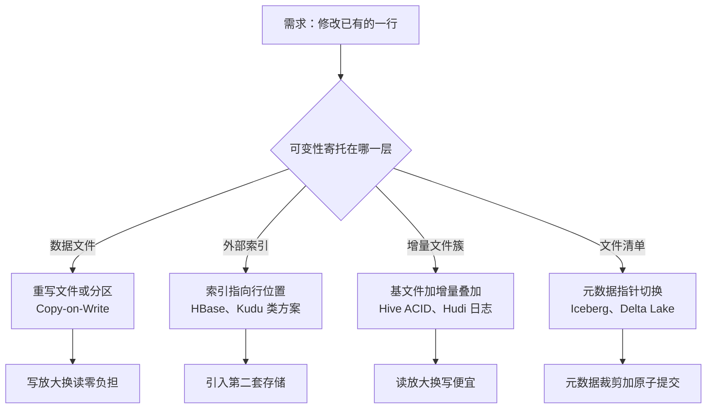
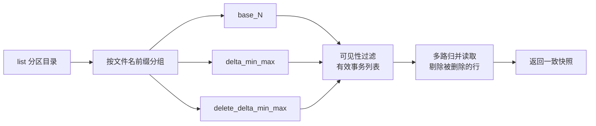
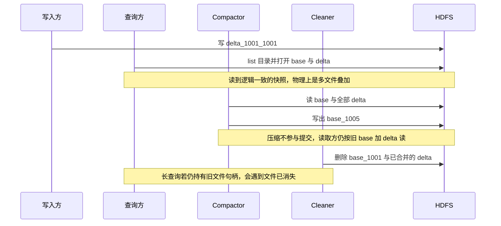
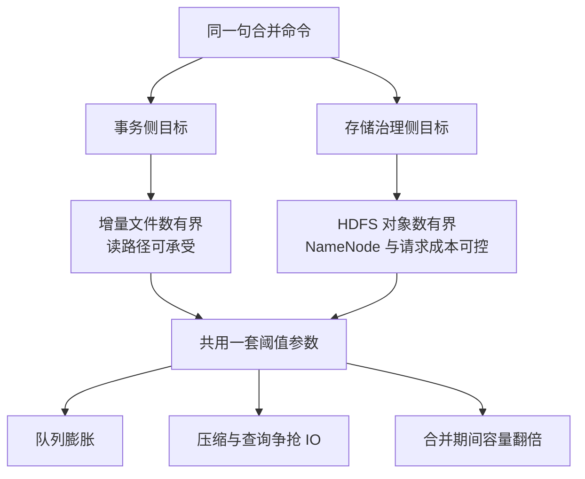
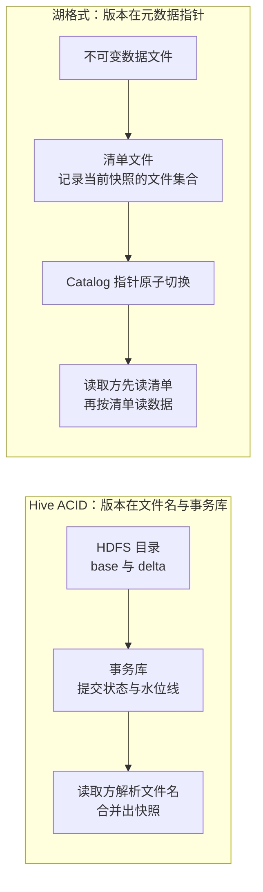
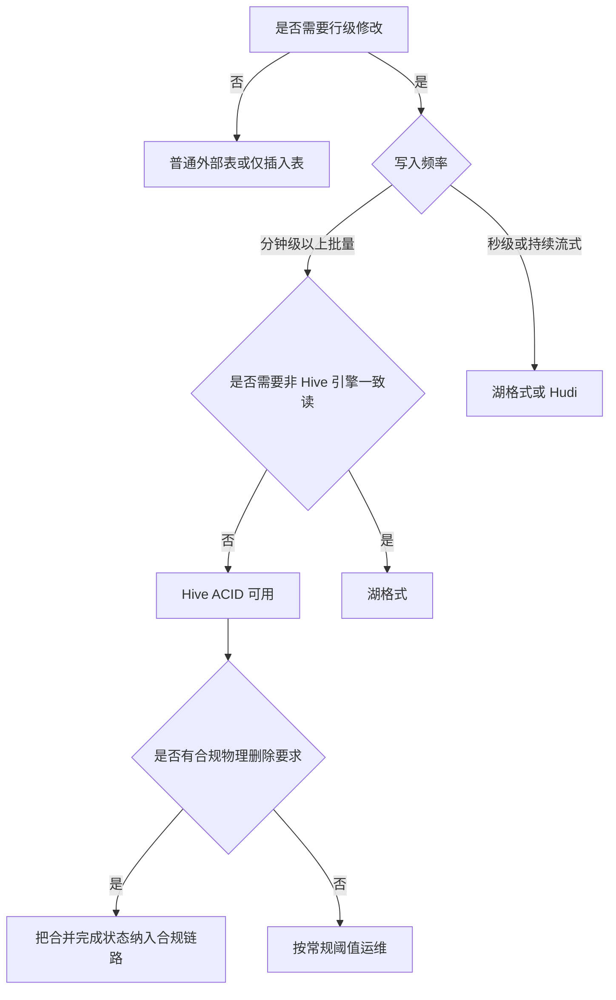

**摘要：**

HDFS 只认追加、不认改写，而数据仓库迟早要面对"改一行、删一行"的需求——增量加载、CDC 回灌、合规删除，三条需求殊途同归地指向同一个矛盾：在不可变文件系统上实现可变语义。Hive ACID 选了其中代价最直白的一条路：数据文件永不原地修改，每次变更另写一批增量文件，查询时把基文件与增量文件叠起来合并，再由后台的 Compaction 把碎片收回去。这条路线把写放大换成了读放大加后台运维，也把系统正确性的一部分责任交给了运维节奏——合并停了，数据依然正确，但读会一天天变慢。本文不重述 ACID 的文件布局与调度链路（那属于 Hive 深度专栏的领地），而是把这条路线与湖格式的元数据快照路线放在同一张判据表上：可变性寄托在哪一层、提交的原子性从哪里来、读放大由谁承担、并发仲裁发生在何处、后台维护是正确性的一环还是纯性能优化。在此基础上给出选型判据、六条不该选它的反例，以及 Compaction 在"事务正确性"与"小文件治理"这两个方向不一致的目标之间被迫做出的取舍。

---

## 第 1 章 账面不能涂改：从一张冲销凭证说起

老式手工记账有一条死规矩：已经入账的凭证不许涂改。记错了怎么办？另开一张红字凭证，把错的分录反向抵掉，月底再把所有凭证汇总进总账。原始凭证一张不动，账目照样能对上，审计的人顺着凭证号一路查下去，每笔改动都有出处。这套流程笨，但它同时满足了两件本来互相冲突的事——**改动可追溯**，以及**汇总账读得快**。

Hadoop 分布式文件系统（HDFS）的写入模型与这套记账规矩出奇地相似。文件通过 create、append、close 三个动作写入，一旦 close 就视为不可变；没有原地更新，没有把文件截断到中间某个位置的接口，也没有页级改写。副本校验、机架感知、追加写的一致性，全部建立在这个"写完即定稿"的前提上。要改文件里的一个字节，唯一正确的做法是重写一个新文件，把旧文件留在原地当历史。Hive ACID 几乎是上述记账流程的机械翻译：增量文件是红字凭证，基文件是总账，Compaction 是月底结账。

数据仓库偏偏是要反复改数据的地方。推动这件事的需求有三类，且彼此并不相同。其一是**增量更新**，ODS 层每天接进来的数据里可能有千分之几需要修正，为一个字段的订正重写整张表的分区并不现实。其二是**变更数据捕获（Change Data Capture，CDC）入库**，业务库的 binlog 回放到 Hive，天然是"一行一版本"的形态，没有行级语义就只能在下游用视图加窗口函数去重。其三是**合规删除**，欧盟通用数据保护条例（GDPR）于 2018 年 5 月生效，要求删除特定自然人的数据，删除必须落到存储层，而不能只是查询时过滤掉。

这里需要纠正一个常见的时间线误记：Hive 的 ACID 能力并非为 GDPR 而生。Hive 0.13（2014 年）引入事务表，当时只支持 INSERT；UPDATE 与 DELETE 在 0.14（2015 年初）就已可用，比 GDPR 生效早了三年多。合规需求真正改变的，是把"行级删除"从一项便利功能推成了刚性约束，也让删得干不干净这件事第一次被写进了审计条款。至于事务表内部的锁管理、写入路径、压缩调度这些机制细节，[[大数据/Hive/00 专栏导览|Hive 深度解析专栏]]里有逐层拆解，此处只关心路线选择。

如果当年不做这个能力，Hive 上的增量场景会退化成下面四种形态，而它们至今仍在很多集群里活着。

| 退化形态 | 做法 | 代价 | 何时仍然可用 |
|---|---|---|---|
| 全表或全分区重写 | 每次变更重跑一遍 ETL，覆盖写 | 写放大与表大小成正比，与变更量无关 | 表小、变更稀疏、批窗口宽裕 |
| 分区粒度重刷 | 只重写受影响的分区 | 分区内零星更新也要重刷整个分区 | 按天分区、更新集中在当天 |
| 拉链表 + 视图去重 | 只追加，查询时按主键取最新版本 | 每次查询都要全量扫描加聚合，且无法物理删除 | 只读分析、数据量中等、无合规要求 |
| CDC 回灌到下游 | 变更只留在业务库侧，Hive 只保留快照 | 变更延迟以天计，无法回答"昨天下午这一行是什么" | 只做趋势分析、不追明细 |

> [!note] 四种退化形态的共同点
> 它们都把"哪一行是最新的"这件事推给了查询时计算，或者推给了调度系统的重跑成本。ACID 表做的事情，是把这份计算挪到写入时与后台，让读取方拿到一份已经是最终形态的数据。

现实里的选择往往不是"要不要用事务表"，而是同一个集群里两种形态长期并存：核心明细表走事务表，宽表与集市走拉链表。哪种表用哪种形态，通常由下游消费者决定——报表团队要的是扫描吞吐，能接受拉链加视图；风控与对账要的是"某一行当前是什么"，等不了全量去重。理解这一点，才不会把路线选择当成一次性的技术决策，它更像是按消费者分层的一次划分。

---

## 第 2 章 四条路线：可变性寄托在哪一层

要让"新版本覆盖旧版本"成立，系统必须在某个地方记住这件事。这个"地方"只有四种候选：数据文件本身、指向行位置的外部索引、追加出来的增量文件簇、以及记录文件清单的元数据。围绕这四种载体，业界长出了四条路线，Hive ACID 只是其中一条。

| 路线 | 载体 | 代表实现 | 写的代价 | 读的代价 | 正确性依赖 |
|---|---|---|---|---|---|
| 重写数据文件 | 数据文件 | Copy-on-Write 类表、整分区覆盖写 | 被触及的文件或分区全量重写 | 无额外成本 | 文件替换的原子性 |
| 外部索引 | 索引系统 | HBase、Kudu、Phoenix 类方案 | 便宜，只改索引与数据块 | 需回查索引 | 第二套存储的可用性 |
| 增量文件叠加 | 增量文件簇 | Hive ACID、Hudi 的日志文件 | 最便宜，只写新增行与删除标记 | 随增量数量线性增长 | 文件名协议加后台合并 |
| 元数据快照 | 文件清单 | Iceberg、Delta Lake | 生成清单并原子换指针 | 元数据解析与裁剪 | Catalog 的原子提交 |

四条路线之间没有高下，只有代价放在哪里。重写路线把所有成本压进写路径，换来读路径的零负担，适合读远多于写、且写入本来就是整批覆盖的场景；外部索引把可变性外包给另一套系统，换来写入的灵活，代价是多了一个必须做高可用、必须有运维值班的组件；增量叠加把成本推到读路径与后台，写入因此可以做到很便宜；元数据快照则把"哪一版是当前版"这件事抽象成一个指针，读放大落在元数据层而不是数据层。

外部索引这条路在 Hive 生态里并非没有试过。把表映射到 HBase 的存储处理器曾经存在过，点查与按主键更新确实好用，但列式扫描、聚合、大表关联全部退化，最终只适合"按键取一行"的窄场景，进不了分析主线。这个结果说明了一件事：外部索引改变的不只是写入方式，而是整条查询执行路径的形态，它与分析型负载的契合度天然有限。

下面这张图把四条路线的分野画在一起，分岔点就是"可变性寄托在哪一层"。

不妨换个顺序看这件事：先问代价落在哪个环节，再看当年的技术栈允许哪些做法。Hive 在 2014 年选了第三条，原因并不复杂：当时能用的积木只有 HDFS、MapReduce（以及刚刚接入的 Tez）、ORC，还有已经承担了 schema 管理的 Hive Metastore（HMS）。没有表格式规范，HMS 也只管表定义而不管文件清单，引入外部索引等于凭空多出一套 HBase 的运维。增量叠加是**用现有积木能拼出来的最小改动**，代价的形状也因此被这个起点定死了：既然可变性放在文件层，读取方就必须自己解析文件、自己合并；既然合并发生在后台，运维就变成了正确性链路的一部分。

> [!info] 起点决定代价的位置
> 路线之争很少是技术优劣之争，多数是"手头有什么现成组件"之争。承认这一点，才不会把后来出现的湖格式当成对 Hive ACID 的否定——它解决的是另一组约束下的同一个问题。

---

## 第 3 章 协议藏在文件名里

增量叠加路线要回答一个绕不开的问题：读取方如何知道哪些增量属于自己该看见的版本。Iceberg 与 Delta Lake 的答案是一份自描述的元数据文件，Hive ACID 的答案是文件名。

Hive 给每个写事务分配一个全局递增的 64 位事务 ID。基文件命名为 base_N，含义是"截至事务 N 的完整快照"；增量文件命名为 delta_min_max，含义是"覆盖 min 到 max 这段事务区间的插入与更新"；删除标记单独成文件，前缀是 delete_delta。目录列表加上正则解析，就足以让读取方算出一份快照，不需要向 HMS 要任何文件级信息。譬如一个分区里躺着 base_1005、delta_1006_1008 与 delete_delta_1009_1009 三个文件，读取方据此就能推出该看哪一段事务、该剔除哪些行。

| 文件名形态 | 编码的信息 | 谁写入 | 谁消费 |
|---|---|---|---|
| base_N | 截至 N 的完整快照 | Compaction 作业 | 所有读取方 |
| delta_min_max | 区间内的新增与更新行 | 写入方的事务提交 | 所有读取方 |
| delete_delta_min_max | 区间内被删除行的定位信息 | 写入方的事务提交 | 所有读取方 |
| 事务库中的提交状态 | 哪些事务已提交、哪些活跃或回滚 | HMS 的事务管理器 | 可见性判定 |

把版本信息编码进文件名，是那个年代很"土"却很鲁棒的选择。HDFS 只有原子 rename 这一种提交原语，HMS 的元数据表也不适合存放逐文件的清单（行数会爆炸），文件名于是成了唯一不需要额外服务就能自解释的载体。副作用是读取方完全依赖目录列表，一旦某个分区攒下几万个增量文件，列表本身就成了 NameNode 的 RPC 热点。

协议一旦被文件命名固化，代价会在后面几年陆续显现出来：

- 目录列表成为读路径热点，单次查询的固定开销按文件数计，而不是按数据量计；
- 文件级统计信息无处安放，数据跳过只能靠分区裁剪，无法像湖格式那样按列的极值跳过文件；
- 协议演进要兼容全部历史文件，新增语义只能另立机制，而不能改一次规范版本了事。

三条副作用指向同一件事：把版本写进文件名，等于把灵活性换成了免依赖的鲁棒性。这个交换在只有 Hive 一个读取方时是划算的，读取方一多就变成负担。

读取路径的判定链条大致如下：先 list 分区目录并按前缀分组，再用一份称为有效事务列表（ValidTxnList）的三元组过滤——最大已提交事务号、最小活跃事务号、以及需要排除的异常事务集合——最后把可见的基文件与增量文件一起打开，在记录读取层做多路归并，顺手剔除删除标记命中的行。

这条链条里最值得留意的变量不是数据量，而是**增量文件的数量**。一次查询要打开 1 + k 个文件，这里的 k 是可见增量文件数；每个文件都要走一遍 NameNode 解析、DataNode 寻址、ORC 尾部元数据读取，归并过程还要在内存里维持多个行批。数据量翻倍只是慢一点，文件数翻十倍则可能让查询从秒级滑到分钟级，因为固定开销是按文件计的。于是"增量文件数"成了这条路线上的第一性能变量，而它完全由后台的 Compaction 决定——这就把话题推到了下一章。至于 ORC 的尾部索引与谓词下推如何与归并过程配合，[[大数据/Hive/08 ORC 与 Parquet：列式存储格式的内部结构与选型|ORC 与 Parquet 格式解析]]里有更细的展开。

---

## 第 4 章 合并是后台的事，正确性不是

关于 Hive ACID，流传最广的一句评价是"读到的可能是未合并的混合状态"。这句话作为物理描述是准确的，作为语义描述则完全错误，而把它当成语义问题会导出错误的运维结论。

语义上不存在混合态。快照隔离保证一次查询看到的是一份逻辑一致的版本，增量文件里未提交的部分不可见，已回滚事务的文件被排除，删除标记该生效就生效。物理上确实是多个文件叠在一起，但这只影响执行代价——打开几个文件、占多少内存、扫多少行——不影响结果。换句话说，合并滞后带来的是**变慢**，不是**读错**。

真正会读错的场景发生在绕过协议的时候。任何不理解增量协议的读取方——把表目录当普通 HDFS 目录直接读、用不支持事务表的引擎查、或者拿旧版本的 Hive 客户端连——看到的是基文件与全部增量文件的物理并集，于是已删除的行还在，同一行出现多个版本。这是正确性事故，成因不是合并滞后，而是读取方没有实现那套文件名协议。

合并为什么必须异步？因为它的成本结构与写入无关，而与分区大小成正比。一次合并要把分区的基文件与全部增量文件读一遍，按主键与桶序重排，再写出一份新的基文件——输入输出都是分区全量。若把这件事放进写路径，每次改一行都要重写一个分区，那就退化成重写路线了，增量叠加的全部价值也随之消失。异步是这条路线成立的前提条件，而不是一个可以优化的实现细节。

Compaction 本身分三档，选择哪一档，本质是在"减少文件数"与"重写多少数据"之间取点。

| 类型 | 输入 | 输出 | 减少文件数 | 回收被删空间 | 成本 |
|---|---|---|---|---|---|
| Minor | 若干增量文件 | 一个合并后的增量文件 | 是 | 否 | 低，只碰增量 |
| Major | 基文件加全部增量文件 | 一个新的基文件 | 是 | 是 | 高，重写整个分区 |
| Cumulative | 区间内的增量文件 | 合并后的增量文件，可跨多轮 | 是 | 部分 | 中等，Hive 4 起提供 |

三档里只有 Major 会真正回收删除所释放的空间，因为被删的行原本躺在基文件里，Minor 与 Cumulative 都不碰基文件。这一点在合规场景下有直接后果：执行 DELETE 之后，被删的行仍然物理存在于旧的基文件里，要等一次 Major 完成、Cleaner 再清理掉旧基文件，删除才算真正落地。审计如果按"DELETE 语句已成功返回"确认删除完成，就留了尾巴。

> [!warning] 清理的滞后是设计的一部分
> 旧基文件不会在合并完成后立刻消失，Cleaner 要等到确定没有更早的快照读取者，并且自身的调度周期到了，才动手删除。于是"改了但存储没降"会持续一段时间，这段时间里磁盘上同时存在新旧两份数据。把这段时间算进容量规划，是这条路线的基本功课。

---

## 第 5 章 一付动作，两套目标

同一句手动触发的合并命令，同时服务两个并不相干的目标：让增量文件数保持有界，以及让 HDFS 上的对象数保持有界。前者属于事务正确性的延伸，后者属于存储治理。两者方向一致，节奏与容忍度却差得很远。

事务侧只要求增量文件数别失控。几十个增量文件仍然能读，只是慢；它没有一个硬阈值，只有一条随文件数上升的成本曲线。存储治理侧的要求硬得多：HDFS 上每一个增量文件都是一个独立对象，NameNode 要为它维护元数据，查询的并行度要为它开任务，对象存储还按请求计费。于是治理侧希望阈值调低、合并更勤，事务侧只关心别拖到读不动。

两套目标共用一套阈值参数，冲突就出在这里。第一种典型形态是高频小批量写入：每五分钟一批，一天几百批，增量文件数线性增长，读耗时随之爬升，运维把触发 Minor 的增量文件数阈值调到个位数，压缩队列立刻膨胀，而压缩作业的并行度受限于 Metastore 进程内的 worker 线程数，于是队列积压，积压期间压缩与查询争抢磁盘带宽，读更慢。此时真正的问题不是参数没调好，而是这个写入频率本来就不适合这条路线。

第二种形态是容量紧张时的激进 Major。Major 执行期间新旧基文件并存，瞬时占用接近两倍分区大小，加上尚未清理的增量文件；一个为了治理小文件而发起的动作，反而制造了容量峰值。在配额卡得很紧的集群上，这个峰值足以触发写入阻塞，而阻塞又会让未提交事务堆积，反过来拖慢事务库。

第三种形态是合规删除与治理节奏的对撞。为满足"数据必须消失"的要求需要尽快跑 Major，但 Major 是全分区重写，代价最高；跑得越勤，对在线查询的干扰越大。合规窗口与业务低峰窗口能不能对齐，往往决定了这条路线在具体环境里是否可行。

还有一个容易被忽略的资源维度：压缩作业本身是要占集群资源的。它由 Metastore 派发，通常以 MapReduce 或 Tez 作业的形式运行，会消耗 YARN 队列容量与磁盘带宽，与同时段的查询共享同一批磁盘。把压缩调度到低峰、限定到独立队列，能缓解但不能根治，因为底层存储是共享的，队列隔离隔不开磁头。这也解释了为什么在很多集群里，压缩参数不是按"多久能合并完"来调，而是按"什么时候合并不打扰业务"来调。

| 目标 | 触发条件 | 典型动作 | 对另一侧的影响 | 取舍方向 |
|---|---|---|---|---|
| 读出得动 | 增量文件数超阈值 | Minor 压缩 | 只减文件数不减空间 | 阈值宜宽松，避免压缩作业常态化 |
| 回收空间 | 删除量积累或合规要求 | Major 压缩 | 全分区重写，瞬时容量翻倍 | 排在低峰，配合容量余量 |
| 控制对象数 | NameNode 压力或请求成本 | 调低阈值、加大并行度 | 队列膨胀，争抢 IO | 与其调参，不如换路线 |
| 数据落地删除 | 审计与合规确认 | Major 加 Cleaner 完成 | 需要可观测的完成状态 | 纳入合规链路，不能只看 DELETE |
| 降低对业务的干扰 | 压缩与查询同时在线 | 排入独立队列、限定并发 | 压缩吞吐下降，积压时间变长 | 队列隔离只缓解，共享磁盘是根因 |

与选型直接相关的参数并不多，只需要盯住几个决定"这条路线能不能跑起来"的开关。它们的具体默认值随版本变化，实施时应以对应版本文档为准。

| 参数 | 作用 | 与选型的关系 |
|---|---|---|
| 事务管理器实现 | 决定是否具备真正的并发与事务语义 | 必须启用基于数据库的实现，否则只有锁没有快照语义 |
| 压缩调度开关 | 决定 Metastore 是否扫描并派发压缩任务 | 默认关闭，必须显式打开，否则增量文件只增不减 |
| 压缩工作线程数 | 决定压缩的并行度与吞吐 | 与查询共享集群资源，规划时要预留 |
| 增量文件数阈值 | Minor 的触发条件 | 调得过低会让压缩常态化，压缩本身成为负载 |
| 增量占比阈值 | Major 的触发条件 | 决定空间回收的及时性，也决定容量峰值频率 |
| 清理器开关与周期 | 决定旧文件何时真正删除 | 关闭等于永不回收空间，合规场景必须开启 |
| 表创建默认属性 | 决定新建表是否为完整事务表 | 新版本默认偏向仅插入表，需要完整行级语义时必须显式声明 |

最后一行参数值得单独说明，因为它造成的困惑最普遍：新版本 Hive 把托管表的默认属性改成了仅插入（insert-only）表，这类表不需要压缩器、也不支持行级更新与删除。很多"建了事务表却不能 UPDATE"的现场问题，根因不是功能缺失，而是建表时没有显式要求完整事务属性。

---

## 第 6 章 改文件组织，还是改元数据层

湖格式走的是另一条路：不动数据文件的组织方式，把"哪一版是当前版"抽象成一份文件清单，提交时生成新清单并原子替换指针。这个动作在对象存储与分布式文件系统上都只需一次 rename 或一次条件写，代价与数据量无关。

两条路线的差异不止实现方式，而是把系统的哪些性质放在了哪里。判据比特性列表有用，下面这张表按判据排列。

| 判据 | Hive ACID | Iceberg | Delta Lake | Hudi |
|---|---|---|---|---|
| 版本信息存放位置 | 文件名加事务库 | Manifest 与快照元数据 | JSON 提交日志加检查点 | Timeline 加文件组 |
| 提交原子性的来源 | 事务库的状态机 | Catalog 指针原子切换 | 对象存储条件写或日志存储 | Timeline 文件写入 |
| 读放大发生在 | 数据文件层，随增量数增长 | 元数据层，可裁剪 | 日志层，靠检查点压缩 | 文件组与日志合并 |
| 并发仲裁位置 | HMS 依赖的关系库，锁与行竞争 | 提交冲突检测后重试 | 提交冲突检测后重试 | 时间线冲突检测或锁 |
| 是否支持时间旅行 | 无查询语义 | 支持按快照或时间点 | 支持按版本 | 支持按时间线 |
| 文件格式约束 | 基本限于 ORC | 开放，Parquet 与 ORC 皆可 | 开放 | 开放 |
| 后台合并的地位 | 正确性链路的延伸 | 纯性能优化 | 纯性能优化 | 读时合并型必需，写时复制型无需 |

两点差异对选型的影响最大。

其一是**并发仲裁的位置**。Hive ACID 把并发判断交给 HMS 背后那个关系库，好处是事务语义成熟、状态可审计、异常事务易于发现；代价是那个库成为全局写入路径上的单点，跨集群共享一张事务表几乎不可行，云上把元数据托管出去时也会遇到网络往返放大。湖格式把并发判断内化为提交冲突检测，没有中心化的行锁，靠重试消化冲突，代价是冲突率高的场景下重试成本会上升，且必须有一个能提供原子性的 catalog。

其二是**后台维护的地位**。Hive ACID 的合并是正确性链路的一部分——不合并，读路径会持续退化，直到不可用；湖格式的合并是纯粹的优化——不合并，读会慢，但结果不变、系统不会失灵。这个差别决定了运维压力的性质：前者是一个必须有人盯着的组件，需要有队列、有容量、有告警；后者是一件可以晚做的例行任务。

生态兼容性的差别是这条分水岭的直接后果。Hive ACID 把版本语义编码在文件命名约定里，任何读取方都必须实现同一套解析与合并逻辑，这事实上把表锁在了 Hive 系引擎里；湖格式把版本语义放进自描述的元数据，任何按规范实现的引擎读一遍元数据就能拿到一致快照，多引擎混读才成为可能。需要说明的是，湖格式的读取方同样要实现规范，差别在于规范是显式的、可版本化的、跨引擎共同遵守的，而不是一套隐含在目录布局里的约定。

存储介质的语义差别也在推着两条路线分开。HDFS 的 rename 是原子的，而对象存储上的"重命名"实际是复制加删除，不具备原子性，于是湖格式的提交协议要么依赖条件写，要么依赖外部 catalog 提供比较并交换的能力。这也解释了为什么湖格式几乎都离不开一个 catalog 实现——它在对象存储上替原子 rename 补位；而 Hive ACID 的提交本来就不靠 rename，它靠事务库里的状态机，所以它在对象存储上反而没有这层障碍，代价是绕不开那个关系库。

另一条容易被忽略的同族关系是：Hudi 的读时合并型（merge-on-read）存储本质上也是"增量加合并"，它把 Hive ACID 的朴素增量文件升级成了带时间线的文件组，于是同一个写入模型获得了时间旅行与增量拉取能力。如果业务喜欢 Hive ACID 的写入形态却又需要版本回溯，Hudi 是同族里更完整的实现。三者的架构级差异见 [[大数据/数据湖/Hudi/06 Hudi vs Delta Lake vs Iceberg——架构设计的本质差异与选型|湖格式三方对比]]，元数据三层结构与日志提交分别见 [[大数据/数据湖/Iceberg/02 元数据三层架构——Snapshot、Manifest List 与 Manifest File|Iceberg 元数据三层架构]]与[[大数据/数据湖/Delta-Lake-Lakehouse架构深度解析/02 事务日志 Delta Log：ACID 保证的基石|Delta 事务日志]]，本文不再复述。

---

## 第 7 章 判据、反例与不该选它的时刻

把前面的分析压成判据，选型问题就变成了几个具体问题的回答：写入频率是否高到需要把合并阈值调成个位数、读取方是否只有 Hive 系引擎、是否有合规意义上的物理删除要求、是否已有大量 ORC 事务表在跑。

| 场景 | 首要约束 | 建议路线 | 理由 |
|---|---|---|---|
| 已有 ORC 事务表、Hive 与 Tez 为主、批量写入 | 改动成本 | 继续用 Hive ACID | 机制已就位，迁移收益低于风险 |
| 新建表、多引擎混读（Spark、Trino、Flink） | 一致读 | 湖格式 | 元数据可被任意引擎解析，无需各自实现协议 |
| 分钟级以上批量更新、单一 Hive 生态 | 实现成本 | Hive ACID 可用 | 写入便宜，合并节奏可控 |
| 秒级或持续流式入湖 | 延迟与合并吞吐 | 湖格式或 Hudi | 增量文件增长快于合并速度，读会持续退化 |
| 需要版本回溯、审计回放 | 时间旅行 | Iceberg 或 Delta Lake | Hive ACID 不暴露版本查询语义 |
| 合规物理删除、容量紧张 | 删除落地与空间 | 湖格式，或为 Major 预留余量 | 合并期间容量翻倍，配额紧张时风险高 |
| 已有 Parquet 数据、不想改格式 | 格式约束 | 湖格式 | Hive ACID 基本限于 ORC |
| 点更新频繁、期望接近行存体验 | 写入并发 | 关系库或键值存储 | 事务库单点与锁竞争是硬约束 |
| 只有一个 Hive 读取方、写入批次可控 | 运维简洁 | Hive ACID | 没有多引擎需求时，协议开放性的收益用不上 |
| 数据需要被外部工具按目录直接消费 | 兼容性 | 普通外部表或湖格式 | 任何绕过协议的读法都会看到重复行 |

反例比判据更能说明边界。笔者以为，选型的真正难点不在技术清单的长短，而在把几个关键问题的答案问清楚，下面六条都是"看起来该选、实际不该选"的形态。

第一条，把它当行存用。写入并发一高，每次提交都要往事务库写事务记录与组件记录，锁竞争与行竞争集中在一个关系库上，这个库的写入能力就是整条链路的天花板。判据很朴素：如果写入模式已经接近在线事务处理，需要的是行存，而不是在文件系统上模拟行存。

第二条，需要时间旅行或版本回滚。旧基文件在清理之前确实还在，但没有任何查询语义能把它们暴露出来，而且合并一过就被删。审计要回答"上个月某一天的某个分区是什么样"，这条路线给不出答案。

第三条，表格式不是 ORC。基本限于 ORC 这一条，足以把大量存量 Parquet 表挡在门外；改造意味着重写数据，成本远高于换一条路线。

第四条，需要跨引擎一致读。不只是引擎支持列表的问题，任何绕过协议的读取方——命令行直接读目录、旧版本客户端、不支持事务表的查询引擎——都会看到重复行与未删除行，而这些读取方往往正是数据科学团队与外部工具。

第五条，持续流式写入。流式写入接口本身限制就多，批量小、只追加、对表结构有额外要求，而增量文件的产生速度很容易超过合并速度，最终表现是读越来越慢，压缩队列越来越长，参数怎么调都只是在推迟拐点。

第六条，默认属性没设对就断言"不能用"。新建的托管表默认偏向仅插入属性，没有行级更新能力也没有压缩器。这类问题不是路线缺陷，但它在评估阶段制造的误判极多，值得在测试前先确认表的实际属性。

六条反例压成一张速查表，症状比结论更容易在值班现场被认出来。

| 反例 | 现场症状 | 该换成什么 |
|---|---|---|
| 当行存用 | 提交延迟随并发上升，事务库 CPU 打满 | 关系库或键值存储 |
| 指望时间旅行 | 审计要某日快照，没有任何查询入口 | Iceberg 或 Delta Lake |
| 表格式非 ORC | 建表受限，或只能退化为仅插入表 | 湖格式 |
| 跨引擎一致读 | 其他引擎读到重复行与已删行 | 湖格式 |
| 持续流式写入 | 增量文件增长快于合并速度 | 湖格式或 Hudi |
| 默认属性未声明 | 表建好了却无法更新与删除 | 建表时显式声明事务属性 |

> [!example] 一个可以照抄的判定顺序
> 先问读取方有几个引擎，再问写入的批次密度，最后问删除是否具有合规含义。三个答案里只要有一个指向"多引擎""秒级""必须物理删除"，这条路线就该让位；三个都指向"单引擎""分钟级""逻辑删除即可"，它仍然是最省事的选择。

> [!note] 评估时需要落纸的四项
> 1. 存量数据的文件格式与是否可原地转换，这决定迁移是改元数据还是重写数据；
> 2. 读取方清单与各引擎对事务表的支持程度，这决定"表建好以后谁能读"；
> 3. 集群为合并预留的容量余量与时间窗口，这决定 Major 能不能跑得动；
> 4. 删除要求是否存在审计意义上的完成确认，这决定合并状态要不要纳入监控与报告。

---

## 结语：一条被时代越过的路线

Hive ACID 把可变性放在文件组织层，湖格式把版本放在元数据层。前者在 2014 年的组件约束下是唯一能拼出来的解，后者在对象存储与多引擎并存的年代更合身。这不是先进与落后的分野，而是两次不同的约束求解：一次要把关系库语义塞进只读文件系统，一次要把多引擎一致性塞进对象存储。

存量系统不必为潮流迁移。判断标准是三个问题的答案有没有变——读取引擎数量、写入批次密度、删除是否具有合规含义。三个都没变，继续用；只要有一个变了，就该重新算这笔账。迁移的现实路径无非双写加影子读再切换，或者借新版本提供的湖格式表做原地转换（具体支持范围以对应版本文档为准），两条路都要先把读取方盘点清楚，因为读取方才是这条路线真正的约束。

演变的方向倒是清晰的：版本语义从文件名搬进元数据，是**把隐含约定变成显式契约**的过程，而凡是能被显式表达的东西，才可能被多个系统共同遵守。至于谁是终局，目前仍然言之尚早——但只要存储层还只认追加，"把可变性寄托在哪一层"这个问题就不会消失，只会换个地方重新问一遍。

---

## 参考资料

- [Hive Transactions](https://cwiki.apache.org/confluence/display/Hive/Hive+Transactions)：事务表能力、限制与参数口径的官方说明
- [Hive Configuration Properties](https://cwiki.apache.org/confluence/display/Hive/Configuration+Properties)：并发、事务与压缩相关参数的默认值，随版本变动
- [Streaming Data Ingest](https://cwiki.apache.org/confluence/display/Hive/Streaming+Data+Ingest)：流式写入的约束与限制
- [ACID in Hive 0.13 设计文档](https://cwiki.apache.org/confluence/display/Hive/Design+docs/ACID+in+Hive+0.13)：增量文件与事务标识的原始设计取舍
- [HDFS Architecture](https://hadoop.apache.org/docs/stable/hadoop-project-dist/hadoop-hdfs/HdfsDesign.html)：仅追加写入模型的官方描述
- [Apache Iceberg Table Spec](https://iceberg.apache.org/spec/)：快照、清单与提交协议的规范文本
- [Delta Lake Protocol](https://github.com/delta-io/delta/blob/master/PROTOCOL.md)：事务日志与检查点的规范文本
- [Apache Hudi Timeline](https://hudi.apache.org/docs/timeline/)：时间线与文件组的组织方式
- 源码路径：`ql/src/java/org/apache/hadoop/hive/ql/txn/`（事务管理）与 `ql/src/java/org/apache/hadoop/hive/ql/io/orc/`（读写合并）

> [!note] 思考题
> 1. 如果 HDFS 支持原地随机写，Hive 还会长出增量叠加这条路线吗，还是会直接变成一套分布式关系库。
> 2. 合并滞后会让人误以为数据不一致，你能举出一个"看起来读错、实际读对"的现场现象，并说明怎么向业务方解释吗。
> 3. 在容量紧张的集群里为合规删除跑 Major，瞬时两倍占用和删除时限之间怎么排优先级。
> 4. 一个表同时被 Hive、Spark 与 Trino 读取，读者各自实现协议带来的维护成本，能否用统一的元数据层消除。
> 5. 湖格式把合并降级为可选优化之后，原先必须值班的运维动作变成了例行任务，这种"责任转移"是否也意味着性能问题更容易被忽视。
> 6. 若要把一张存量事务表迁到湖格式，读取方盘点和数据重写哪一步更可能成为真正的阻塞点。