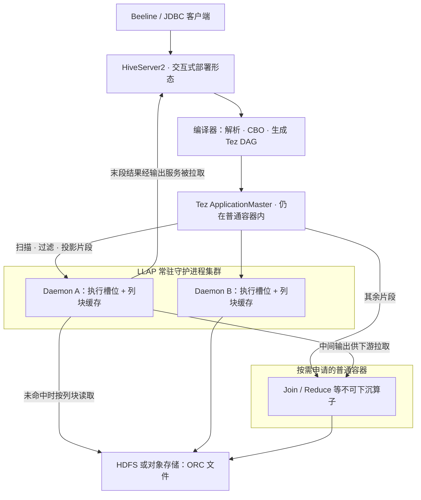
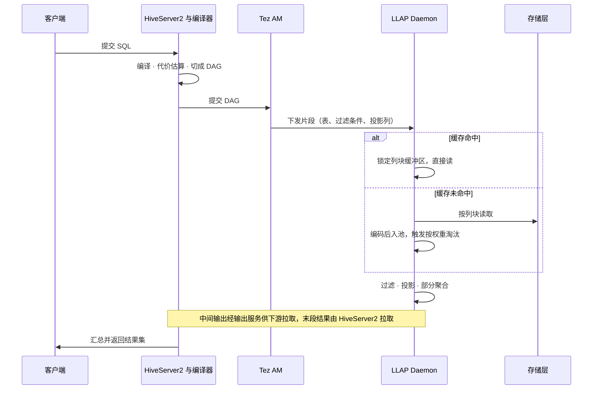
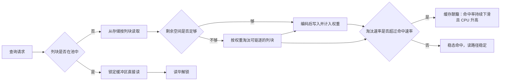
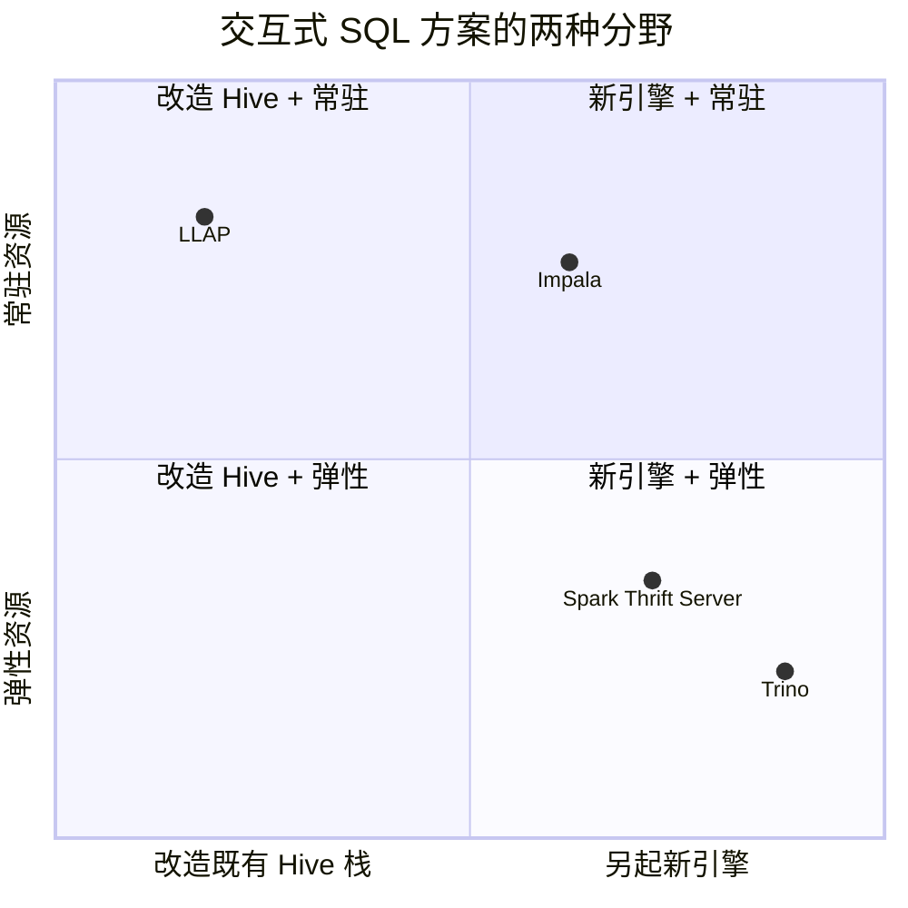
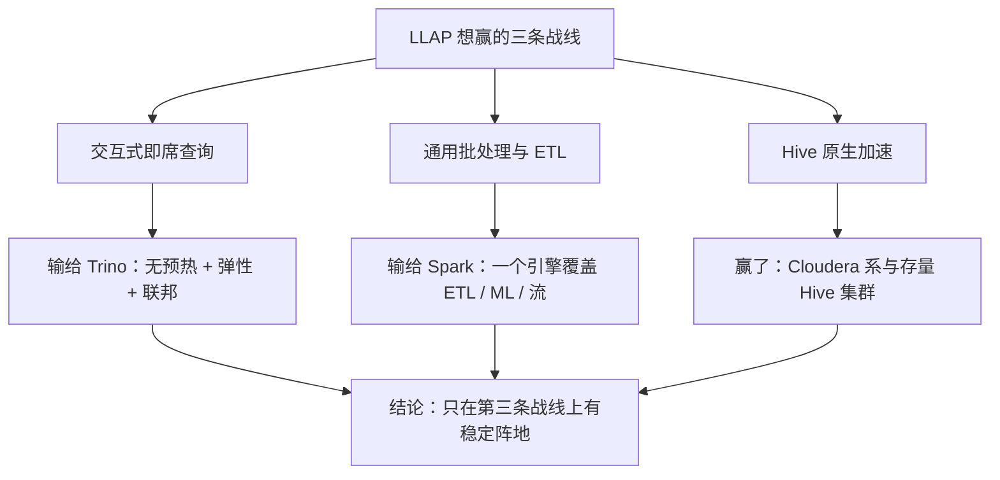
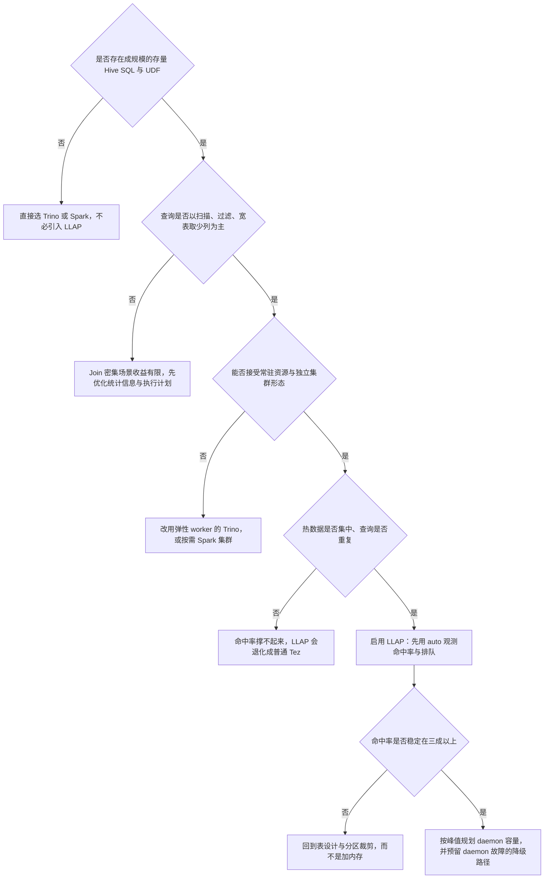

**摘要：**

LLAP（Low Latency Analytical Processing）常被概括成「给 Hive 加一层内存缓存」，这个说法漏掉了它真正的赌注：它把资源从按查询申请改成按集群常驻，用固定成本换掉每次查询的启动开销。本文按选型视角梳理这条路线：先拆开 MR/Tez 时代交互式查询延迟的三个来源——容器申请与 JVM 启动、重复的读取与解码、冷代码路径，再看 LLAP 用常驻守护进程、执行槽位与列块级缓存各自抵掉了多少；接着算它的另一本账——常驻实例长期占用队列配额、命中率被查询形状绑死、运维面从一套 HiveServer2 变成两套加一个集群管理器。横向对比 Presto/Trino、Impala 与 Spark Thrift Server 后，可以看出分野不在性能而在血统：LLAP 是改造 Hive，其余是另起引擎，这决定了它只能在「存量 Hive SQL + 热数据集中 + 愿意付常驻资源」三者的交集里立足。文末给出选型判据表、关键开关的语义与风险，以及云上弹性、混合负载、新项目三类反例；结论尽量落到判据上，便于与自家环境逐条对照。

---

## 第 1 章 三分钟的等待与一辆班车

2015 年前后的 Hive 处在一个尴尬的位置上。它已经坐稳了离线数据仓库这把椅子，HDFS 上的数据靠它定义 Schema，成百上千条 ETL 链路靠它的 SQL 编排，Hive Metastore 事实上成了整个 Hadoop 生态的目录服务；但交互式分析这块地盘正在被 Presto 与 Impala 拿走，原因并不神秘，分析师在 BI 工具里点一次筛选，等了三分钟才出结果，第二次点击就不愿意再等了。

那三分钟里，真正花在「算」上的时间并不多。一条 `SELECT ... WHERE ds = '...'` 在 Tez 上的完整链路是：HiveServer2 编译 SQL，做语义分析与代价估算，产出 DAG；DAG 提交给 ResourceManager；ResourceManager 按队列分配容器，NodeManager 拉起 JVM；Tez 运行时启动、加载类、初始化 Shuffle 服务、建立与 HDFS 的连接；直到这时候，第一个 ORC 文件的第一个 Stripe 才被读进来。查询结束，容器释放，进程退出。下一次查询，以上全部重来一遍——包括那些与 SQL 语义毫无关系、纯粹属于「基础设施开业」的步骤。

HIVE-7926 给出的答案在当时相当激进：既然开销主要来自「每次开业」，那就干脆不歇业，预先申请一批资源、让一批守护进程长期存活在数据节点旁边，查询来了直接投递进去执行。这套机制在 2016 年随 Hive 2.0 落地，名字叫 LLAP，官方文档里它同时被读作 Live Long and Process 与 Low Latency Analytical Processing，前一个名字更像玩笑，但也更准确地描述了它的形态。

用打车的比喻能看清这笔交易的结构。按需申请容器的 MR/Tez 是网约车：不养车，只在需要时下单，代价是等车时间不确定，司机上车前还要重新认一遍路。LLAP 是门口常停的一辆班车：座位固定、随时能走，但空驶的油钱照付，跑一趟两百公里的长途回来，车上备的货还得重新装。这笔交易的核心是**用固定资源换确定延迟**，理解这一点，后面所有的取舍都能推出来。

这篇文字不谈 LLAP 内部怎么实现。缓存如何编码、RowBatch 如何在进程间传输、Tez 的片段如何下发，这些内容在仓库的 Hive 深度专栏里已有拆解，机制细节见 [[大数据/Hive/04 执行引擎对比：MapReduce vs Tez 的本质差异|Hive 执行引擎对比：MapReduce vs Tez]] 与 [[大数据/Hive/10 Tez 调优实战：DAG 诊断、内存配置与数据倾斜治理|Hive on Tez 调优]]。笔者要回答的是三个选型问题：它在数据栈里占据哪个位置，它的代价账本长什么样，以及到了 2026 年还有什么场景值得把它搬出来。

---

## 第 2 章 它站在数据栈的哪个位置

先把定义收紧。LLAP 是一套常驻在 YARN 节点上的守护进程集群，每个 daemon 内同时扮演两个角色：一半是执行器，替 Tez 跑 DAG 里可以下沉的片段；一半是缓存，把磁盘上的列式数据按块留在自己的内存池里。它没有自己的 Catalog、存储格式与事务语义，SQL 仍然由 Hive 编译，权限仍然由 Ranger 或 Hive 自身的授权体系裁决，客户端仍然是 Beeline 与 JDBC。所以准确的定位是：**LLAP 是 Tez 的一种执行模式**。

有三条证据可以支撑这个定位。其一，它离不开 Tez：`hive.execution.engine` 不是 tez 的时候，LLAP 没有意义，也没法挂载；其二，它改的是物理读路径与片段执行位置，逻辑计划与优化规则仍是 Hive 那一套，`EXPLAIN` 出来的算子树不会因为开了 LLAP 而变化；其三，它对外暴露的仍是 HiveServer2 的接口形态，只是这个 HiveServer2 是「交互式」的部署形态，与跑批的那套是两套进程、两套配置、两套 HA。下图把一条查询的落脚点画在同一张拓扑上，开了 LLAP 之后改变的是哪些连线。



上图是判断 LLAP 生态位的关键：它的插入点落在 **DAG 生成之后、算子执行之前**。这意味着它能省掉的只有执行期开销，编译期的代价估算、Metastore 的元数据查询、Kerberos 的认证握手，一样都省不掉。很多关于 LLAP 的失望预期就来自这里——有人以为开了它所有查询都能进亚秒级。

把它与几种容易混淆的「加速手段」放在一起，判据就清楚了。

| 手段 | 缓存放在哪一层 | 缓存什么形态 | 跨查询复用 | 失效由谁负责 |
|------|--------------|------------|----------|------------|
| 操作系统页缓存 | 内核 | 文件页的原始字节 | 是，但不感知列与谓词 | 内核按内存压力驱逐，业务不可控 |
| 物化视图 | Hive 表 | 预聚合后的结果 | 是，需显式命中改写规则 | 刷新策略，过期即失真 |
| BI 层结果缓存 | 应用 | 查询结果集 | 是，粒度最粗 | 参数化与权限难对齐 |
| 本地磁盘缓存（如 Trino 的文件系统缓存） | 计算节点磁盘 | 文件片段 | 是 | 磁盘容量与 TTL |
| LLAP | daemon 堆外内存 | 列块级的压缩态数据 | 是，且感知列与谓词 | daemon 自己按权重淘汰，文件重写则失效 |

差别最大的是最后一行与第一行。页缓存是「无脑缓存整个文件页」，一次全表扫描会把真正热的数据挤出去，而且业务侧完全看不见；LLAP 缓存的是**列块级的压缩态数据**，命中判断能落到「这个文件的这一段、这几列」的粒度，因而列裁剪与谓词裁剪在缓存层就能生效——它是一层理解列式语义的缓存，容量更大的页缓存替代不了它。至于它具体怎么被 `LlapCacheAwareFs` 拦截、缓存键如何由文件路径与偏移构成、文件被重写后旧缓存如何整体失效，机制细节在 ORC 与 Parquet 的专栏里有对照说明，见 [[大数据/Hive/08 ORC 与 Parquet：列式存储格式的内部结构与选型|ORC 与 Parquet 的选型分析]]。

---

## 第 3 章 延迟是怎么被省掉的

要判断 LLAP 值不值，得先把它省掉的东西逐项列出来。MR/Tez 时代一条交互式查询的延迟由三段构成，每一段的量级不同，可压缩的空间也不同。

第一段是资源与进程的启动。ResourceManager 分配容器、NodeManager 拉起 JVM、Tez 运行时初始化，这一段在繁忙集群上波动极大，队列拥塞时能拖到几十秒。Tez 的容器复用（container reuse）只在同一个 DAG 内部有效，跨查询不复用，所以每个新查询仍然从零开始。第二段是读路径。即使数据被操作系统的页缓存命中，仍需走解压、ORC Stripe 解码、反序列化成行的流程，CPU 消耗不掉。第三段是冷代码路径。新启动的 JVM 里，热点方法还停留在解释执行，JIT 编译要跑几万次调用才触发，期间线程在分代 GC 与类加载上耗掉的时间，与业务逻辑无关。

LLAP 对这三段的处理方式各不相同：第一段用常驻 daemon 与**执行槽位（executor slot）**抵掉，查询只是把片段投递给已经在跑的线程池，容器申请与 JVM 启动归零；第二段用列块级缓存抵掉，命中时跳过磁盘读，并把解码推迟到真正需要的那几列；第三段靠进程常驻自然获得，热点路径长期处于 JIT 优化后的状态。三段的抵消方式不同，残留的形态也不同，这决定了优化时要看的是命中率与槽位排队，而不是单纯的 CPU 利用率。控制流与数据流摊开之后，三条路径的差别就落在时序上。



时序图里有一处容易被忽略的细节：命中之后也没有立刻返回。片段仍要在 daemon 内执行过滤与投影，仍要把结果经输出服务回传给 HiveServer2，仍要等 AM 汇总其余片段的输出。所以命中率带来的收益是「读路径归零」，不是「执行归零」。这也解释了一个经验现象：命中率在低位区间往上抬时延迟改善明显，越往上越钝化，因为剩下的时间已经被计算与调度占住。

缓存池的管理方式决定了命中率的天花板。LLAP 的淘汰策略是可插拔的，默认实现在 LRFU 一族上（同时兼顾最近使用与使用频次），并且区分「锁定」与「可淘汰」两类缓冲区——正在被查询读取的列块不能被驱逐，这是它能做到「淘汰时不影响在跑的查询」的原因，代价是极端情况下内存池会短暂无法满足新请求。把装入与淘汰的路径展开，颠簸从哪一步开始就看得见了。



这张图里有个闭环值得琢磨：淘汰会消耗 CPU，颠簸状态下每次未命中都要淘汰一批再装入一批，CPU 被进一步挤占，查询变慢，占着槽位的时间变长，排队又加剧。**缓存颠簸**会让 daemon 从加速器退化成减速器，它比单纯的未命中严重得多，属于必须设阈值告警的形态。

还有三条限定必须说清楚，否则对 LLAP 的期待会失准。

缓存的是压缩态与编码态的数据，并非解压后的宽表。这个选择换来更高的内存利用率与更大的有效缓存容量，代价是每次读取仍要解码，成本由被查询的列数决定。因此「宽表取三列」的场景收益最大，「窄表取全部列」的场景收益会被解码成本吃掉一部分。

Tez AM 与 DAG 编译仍在。LLAP 省掉的是每查询的容器与进程，省不掉每查询的 AM 与编译。在极短的小查询上，AM 启动与 CBO 取统计信息的开销反而成了主项，这就是 LLAP 也救不了「十万条秒级小查询」的原因。

下沉的算子范围有限。能进 daemon 的主要是扫描、过滤、投影与部分 map 端聚合，Join 的构建端、Reduce、Shuffle 的搬运仍在按需容器里完成。于是 LLAP 的收益与查询形状强相关：**扫描密集**的查询受益最大，Join 密集的查询受益被摊薄，因为该搬的数据一粒都少不了。

| 开销来源 | MR/Tez 路径 | LLAP 路径 | 残留成本 |
|---------|------------|----------|---------|
| 容器申请与 JVM 启动 | 每查询一次，队列拥塞时波动大 | 集群启动时一次，之后归零 | 槽位排队；daemon 故障时的重建 |
| 磁盘读与解码 | 每查询至少一遍 | 命中时跳过读，解码按列进行 | 未命中时的读；列数多时解码仍重 |
| 冷代码路径 | 每查询重新热一遍 | 长期热态 | 版本升级、daemon 重启后的重新预热 |
| AM 启动与 DAG 编译 | 每查询一次 | 仍然每查询一次 | 编译占比高的短查询无法受益 |
| 元数据与认证 | 每查询一次 | 仍然每查询一次 | 与 HMS、KDC 的交互不可避免 |

---

## 第 4 章 代价：把弹性换成了确定性

班车比喻里比油钱更贵的一项，是「座位必须提前买下」。LLAP daemon 以 YARN 长期服务的形式申请资源，申请的容量在整个生命周期内被占住，无论有没有查询。这个决定带来的直接后果是容量规划的逻辑变了：按需集群按「峰值 + 排队策略」规划，常驻集群按「峰值必须一次买够」规划，因为 daemon 不能像容器那样随负载弹性扩缩——扩一个 daemon 要重新走申请、启动、预热缓存的全流程，缩一个 daemon 则意味着丢掉它持有的全部缓存。

公开文档里能看到这种规划方式的影子。以云厂商的托管实现为例，默认配置会把 YARN 资源中相当大的一块（约六成这个量级）划给 LLAP daemon，剩余的才留给普通容器执行不可下沉的算子与其它作业；这个比例本身就说明了问题——它要求**按常驻重写过的资源模型**，顺手加一层缓存做不到。

与 YARN 队列策略的耦合是第二笔代价，也是最容易被低估的一笔。LLAP 守护进程必须拿到稳定配额，否则会出现两种故障：配额不足时 daemon 起不来，交互式查询直接不可用；配额被弹性作业抢占时，daemon 被杀掉，缓存清零，正在跑的片段失败重试。要为它做隔离，通常得配专门的队列、最小容量保证、必要时用节点标签把 daemon 钉在固定节点组上。这些配置与调度器语义强相关，机制细节见 [[大数据/Hadoop/Yarn/00 专栏导览|YARN 深度专栏]]；而一旦集群里同时存在「必须常驻」与「必须弹性」两类负载，调度器就从资源分配器变成了业务形态的仲裁者，这种耦合很难在后期拆开。

第三笔代价在缓存命中率上。命中率取决于查询模式与数据布局的乘积，没有哪个参数能直接把它调上去。反复扫同一批分区、只取少数几列、谓词落在分区键上的查询，命中率天然高；譬如全表扫描、日期跨度覆盖全表、每次都换列的探索式分析，命中率天然低，还会把别人缓存的热块挤掉。这意味着 LLAP 集群里存在一种隐性的资源竞争：不是 CPU 与内存的竞争，而是「谁的数据配留在内存里」的竞争，而这场竞争没有任何调度器在管。

第四笔代价是运维面。跑批的 HiveServer2 与交互式的 HiveServer2 是两套实例，Kerberos 主体、连接池、JVM 参数各自一套；LLAP 集群本身还需要一个管理器负责向 YARN 申请 daemon、维护 daemon 注册与存活、把查询路由到正确的 daemon；再加上 Hive 的工作负载管理（Workload Management）池化配置，出故障时的排查路径会从「一条链路」变成「三张拓扑图的交叉验证」。节点重启后的冷缓存是这类集群最典型的性能雪崩场景：进程起来了，查询能跑，但每个查询都在穿透到磁盘，监控上看不出错误，只有延迟曲线整体抬升。

最后一笔代价是版本与路线绑定。LLAP 只跟 Tez 走，它的收益完全建立在「继续用 Hive + Tez 跑 SQL」这个前提上。一旦组织决定把交互式查询迁到 Trino、把 ETL 迁到 Spark，LLAP 上的所有调优投入、缓存策略经验、容量规划模型全部作废——它不是一层可移植的中间件，而是长在 Hive 执行栈里的一个器官。

| 代价 | 表现形式 | 缓解手段 | 缓解后的残留 |
|------|---------|---------|------------|
| 常驻占配额 | 低峰空转、成本平坦 | 按峰值规划、按时段调 daemon 数量 | 调数量即丢缓存，需重新预热 |
| 队列耦合 | daemon 起不来或被抢占 | 专用队列、最小容量、节点标签 | 与弹性作业共存的调度复杂度 |
| 命中率依赖查询形状 | 全表扫描冲刷热块 | 按表/用户限制缓存占用、分池 | 隔离不彻底，竞争仍在 |
| 运维面扩张 | 两套 HS2 + 集群管理器 | 模板化部署、统一监控 | 排障路径变长，故障域变多 |
| 路线绑定 | 换引擎即投资归零 | 无 | 只能作为过渡期的加速手段 |

---

## 第 5 章 四类交互式 SQL 的分野

把 LLAP 与 Presto/Trino、Impala、Spark Thrift Server 摆在一起比较时，最容易犯的错是按「谁更快」排座次。它们的性能在具体场景下互有胜负，真正稳定的分野在三个维度上：血统（改造既有引擎还是另起引擎）、缓存语义（**预热式**还是无状态）、资源模型（常驻还是弹性）。把血统与资源模型这两条摆成象限，位置关系比性能数字更稳定。



象限图里没有「改造 Hive + 弹性」这一格的方案，这不是画图时的疏漏，而是结构性的空缺：改造既有执行栈意味着复用它的常驻形态，而 Hive 的弹性路径（按需容器）恰恰是 LLAP 要消除的东西。反过来，另起引擎天然带来弹性——它们本来就是为「一批工作进程，随负载增减」设计的。

| 维度 | Hive LLAP | Trino | Impala | Spark Thrift Server |
|------|-----------|-------|--------|---------------------|
| 与 Hive 的关系 | 同一执行栈，共用 Tez、SerDe、UDF | 只共用 Metastore 与表文件 | 只共用 Metastore 与 HiveQL 方言 | 共用 Spark 引擎与 Metastore |
| 执行模型 | Tez DAG 片段下沉到守护进程 | MPP + 流水线式的 Stage 执行 | MPP + 常驻 impalad 本地读 | 常驻 Spark 应用，多会话共享上下文 |
| 缓存语义 | 预热式列块缓存，命中即省读 | 核心无跨查询数据缓存 | 早期依赖操作系统页缓存，自管缓存后补 | 需显式 cache 或靠 shuffle 复用，非自动 |
| 资源模型 | 常驻，固定配额 | 弹性 worker | 常驻，与数据节点同址 | 弹性 Executor，驱动常驻 |
| 隔离能力 | 队列 + 工作负载池 | 资源组与查询队列 | 资源池与准入控制 | 最弱，共享同一 SparkContext |
| 迁移成本 | 近乎零，SQL 与权限体系不动 | 中，方言、UDF、部分语法需改写 | 中高，UDF 体系与方言差异明显 | 低，前提是已有 Spark 栈 |
| 生态位 | 存量 Hive 集群的加速插件 | 交互式查询的事实标准 | 与数据同址的本地化 OLAP | Spark 生态的 SQL 网关 |

Trino 的胜势来自**无状态**、弹性与联邦这三件事的组合。它不需要预热，冷查询的表现就是它的常态表现，这对 BI 的随机访问模式更友好——分析师的下一跳永远不可预测，预热模型假设的「热区稳定」在维度表频繁变更、指标口径天天调整的环境里经常不成立。它的 worker 可以随负载增减，代价是每次查询都要从存储端把数据拉一遍。这条路线适合什么样的组织，机制细节见 [[中间件/Trino/00 专栏导览|Trino 深度专栏]]，架构取舍见 [[中间件/Trino/01 Trino 全局架构——Coordinator Worker 与 MPP 执行|Trino 全局架构]]。

Impala 是与 LLAP 血统最近的对手：同样是常驻守护进程、同样与数据节点同址、同样把「本地读」作为核心武器，区别在实现栈——C++ 实现、自有的执行引擎、自有的 UDF 体系。它早期的缓存策略更依赖操作系统的页缓存（配合短路读绕过网络栈），自管的数据缓存是后补的，具体版本行为以对应版本文档为准。在笔者看来，选择 Impala 通常意味着接受一整套发行版绑定，在单一厂商主导的环境里不是问题，在混合生态里是负担。

Spark Thrift Server 的定位最容易被误解。它确实对外提供 HiveServer2 协议，也确实能跑交互式查询，但它的隔离模型是最弱的：所有会话共享同一个 SparkContext，一份 Executor 配置、一个广播变量空间、一套缓存池，某个会话把一张大表 cache 进来，其他会话的内存预算就一起被改写。它适合「已有 Spark 集群、想让 BI 工具连上来跑中等复杂度查询」的团队，不适合当成多租户的交互式网关。近年社区用 Spark Connect 这类解耦客户端与服务端的路径替代它，方向也是把「共享上下文」这个根源性约束拆掉，具体演进以官方版本文档为准。

LLAP 唯一不可替代的地方，是它和 Hive 共享同一条执行栈。同样的 SerDe、同样的 UDF、同样的授权与审计链路、同样的 SQL 方言细节（包括那些写在几十个脚本里的、只有 Hive 才认的语法），这些资产在迁移时是最贵的部分，往往比硬件贵。所以 LLAP 的比较对象不是「更快的引擎」，而是「迁移成本 + 更快的引擎」。

---

## 第 6 章 它为什么没有成为主流

LLAP 没有成为交互式查询的主流答案，这个判断今天已经没有争议。不过归因要小心，常见的两种说法都不够准确：一种说它不够快，另一种说它运维太复杂。前者站不住，命中率高的场景里它确实能把延迟压到秒级；后者只说对了症状，没说清机制。把三条战线并排摊开，谁在哪一局占先手就清楚了。



三条战线的胜负手各不相同，值得逐一对照。

| 战线 | 胜负手 | 证据形态 | 对 LLAP 的含义 |
|------|-------|---------|--------------|
| 交互式即席查询 | 冷查询表现、弹性、多数据源联邦 | BI 工具的随机访问模式，热区随业务漂移 | 预热模型的前提不稳定，优势被抵消 |
| 通用批处理 | 一个引擎覆盖 ETL、ML、流处理 | 组织在缩减引擎数量而非增加 | Hive on Tez 的批处理份额被 Spark 吸走 |
| Hive 原生加速 | 零迁移成本、复用既有权限与 UDF | 存量脚本、存量授权、存量调优经验 | 阵地真实存在，但用户群在收缩 |

真正让 LLAP 边缘化的是**部署形态**这件事，与单项性能指标关系不大。引入 Trino 的动作是「加一个服务」：起 coordinator 与 worker，配一个 Hive connector，指向同一个 Metastore，业务侧改个连接串就能试。引入 LLAP 的动作是「多一种集群形态」：要规划一批常驻节点的容量、要给它们专用队列、要部署交互式 HiveServer2、要维护 daemon 的存活与缓存预热、要做一套与按需集群不同的容量模型。前者的试错成本是一天，后者的试错成本是一个季度，组织在技术选型上的行为模式决定了这种差异会被放大。

三重前提的交集过窄是更深一层的原因。LLAP 要有意义，必须同时满足：存在成规模的存量 Hive SQL（否则没必要复用执行栈）、热数据以 ORC 这类它缓存得最好的格式为主（Parquet 的原生缓存是近几年才补的方向，见 HIVE-30059 的设计文档）、组织愿意为一个专用交互集群长期付常驻成本。三个条件全中的组织，通常是已经深度使用 Hive 多年、数据规模大到迁移成本难以承受、且有稳定报表负载的传统企业——这个群体在 2016 年很大，在 2026 年已经缩小。

云化把最后一个前提也拆掉了。存算分离之后，计算节点是临时的，缓存随实例消亡；对象存储没有 HDFS 的副本局部性，「把片段调度到持有数据副本的节点」这个亲和性假设失效；竞价实例被回收时，缓存清零，正在跑的查询失败重试。它的加速能力建立在**节点稳定**与**数据局部性**这两个物理前提上，而云原生架构恰好把这两条都改了。反过来，在对象存储上 LLAP 的缓存依然能挡住一部分网络延迟，所以它在云上不是完全无用，只是投入产出比远不如在物理集群上那么清晰。

表格式的演进正在改变 LLAP 缓存键的稳定性。它的缓存以「文件 + 偏移 + 列集合」为键，文件被重写就意味着旧缓存整体失效；而 Iceberg 这类表格式的常规运维动作（compaction、快照过期、分区演进）恰恰在持续重写文件。表格式的价值主张见 [[大数据/数据湖/Iceberg/00 专栏导览|Iceberg 深度专栏]]，两套机制的互动结果很清楚：湖仓化的表越活跃，LLAP 的缓存越难热起来。

---

## 第 7 章 今天该不该用：判据与开关

把前面的分析压成可以拍板的判据，大致是这样一张表。用法是从上往下逐条对照，任何一条落到「不满足」列，就先考虑替代方案，而不是加内存。

| 判据 | 满足时的判断 | 不满足时的替代 |
|------|------------|--------------|
| 是否有成规模的存量 Hive SQL 与 UDF | LLAP 的零迁移优势成立 | 新项目直接选 Trino 或 Spark，别为兼容性付代价 |
| 表格式是否以 ORC 为主 | 缓存路径最成熟，命中即省读 | Parquet 或湖仓表为主时先验证缓存收益 |
| 查询是否以扫描、过滤、宽表取少列为主 | 下沉算子覆盖面与收益都最大 | Join 密集或复杂聚合，先查执行计划与统计信息 |
| 热数据是否集中、查询是否重复 | 命中率有基础，预热有意义 | 探索式全表扫描，命中率撑不起来 |
| 能否接受常驻资源与独立集群形态 | 与队列、节点组、监控一并规划 | 云上弹性或按量付费为主的环境不建议 |
| 是否有能力维护交互式 HS2 与 daemon 集群 | 运维投入可摊薄 | 运维人力紧张时，托管 Trino 更划算 |
| Tez 版本是否与 LLAP 匹配 | 版本对齐，daemon 能正常注册 | 版本错配时先升级整条链路再谈加速 |

判据之外，几个开关的语义会直接影响结论。最要紧的是 `hive.llap.execution.mode`，它决定查询片段是否走 LLAP，取值包括 none、auto、map、all、only 五种：none 等于关闭；map 只把 map 类算子下沉；all 尽可能全部下沉，失败时回退到普通容器；only 与 all 类似但**禁止回退**，跑不了就直接报错；auto 则交给 Hive 按查询特征判断（only 这个选项自 Hive 2.2.0 起加入，见 HIVE-15135）。生产环境里 only 是个危险开关，它把「性能优化」变成了「可用性依赖」，daemon 全挂的时候查询直接失败，而不只是变慢。

auto 模式的判断条件也常被误解。它不只看查询能不能下沉，还要看查询是否可向量化、统计信息是否充分，对应 `hive.llap.auto.enforce.vectorized` 与 `hive.llap.auto.enforce.stats` 两个开关；这两个开关开着的时候，一个没收集统计信息的表可能整体退回按需容器执行，于是「开了 LLAP 却没变快」的抱怨就是这么来的。排查的第一步不是调内存，而是看这条查询到底有没有进 LLAP。

容量与并发的换算也需要先算清楚再动手。daemon 的容器内存是一个整体预算，内部拆成缓存、执行堆与预留三块（Hive 的配置文档对 `hive.llap.daemon.yarn.container.mb` 的说明就是「缓存 + 堆 + 预留」），缓存不是「有多少内存就都给它」；而并发能力由 `hive.llap.daemon.num.executors` 决定，它的默认值是 4 个执行槽位。据此可以做一次纯算术的示例推算：十个 daemon、每台四个槽位，全局并发片段上限是四十；若平均每条查询产生三个片段，则同时可支撑的查询量级在十余条，超过就开始排队。这里的数字是示例参数下的推算，用来演示容量模型，不代表任何真实集群的实测值。

| 参数 | 它实际影响的选择 | 需要注意的地方 |
|------|----------------|--------------|
| `hive.llap.execution.mode` | 查询是否走 LLAP、是否允许回退 | only 会让 daemon 故障升级为查询失败 |
| `hive.llap.daemon.yarn.container.mb` | daemon 的总体内存预算 | 缓存 + 堆 + 预留，三者此消彼长 |
| `hive.llap.daemon.num.executors` | 并发片段上限 | 加大提升并发但加剧内存与 CPU 争抢 |
| `hive.llap.io.memory.mode` | 缓存用哪种内存形态（缓存模式 / 关闭 / mmap） | 关闭后 LLAP 只剩「不启容器」这一项收益 |
| `hive.llap.io.cache.orc.alloc.min` | 缓存最小分配单元 | 与压缩块大小不匹配时会报分配过小（见 HIVE-10217） |

一次最小化的开启动作通常落在这样几个开关上，具体键名以对应版本为准：

```properties
# 先只观察，不强制回退策略：auto 让 Hive 自己判断哪些片段可下沉
hive.llap.execution.mode=auto
# daemon 侧：总内存预算 = 缓存 + 执行堆 + 预留，三者此消彼长
hive.llap.daemon.yarn.container.mb=98304
# 并发片段上限，直接决定排队开始的位置
hive.llap.daemon.num.executors=8
# auto 模式的两个强制条件，关掉会放宽覆盖面但收益不再有保证
hive.llap.auto.enforce.vectorized=true
hive.llap.auto.enforce.stats=true
```

示例中的数值只用于说明各开关的关系，容量仍需按实测命中率与排队长度回推。

还有一个格式层面的前提必须验证：LLAP 的缓存能力在 ORC 上最成熟，Parquet 的原生缓存是较晚才补的方向，社区为此专门出过设计文档（HIVE-30059）。如果目标表是 Parquet，先做小范围验证再谈容量规划，否则很容易出现「daemon 内存加了一倍、命中率没动」的局面。观测侧最该盯的是三个量：命中率、槽位排队长度、缓存内存水位。命中率长期低于三成基本说明查询形状不匹配，此时加内存只会让颠簸更贵；排队长度持续增长说明槽位不足，该扩 daemon 而不是调缓存；水位逼近上限则意味着淘汰会变得频繁，需要回流到容量规划。把这些判据串起来，就是一张可以照着走的路径。



最后那句「预留降级路径」是整个决策里最容易被跳过的一步。LLAP 把交互式查询的可用性与一批长期存活的进程绑定在一起，于是它必然需要回答一个问题：当这批进程集体不可用时，报表还能不能跑。可行的做法是保留一条通往按需容器的回退路径（把 execution.mode 设为 all 而不是 only）、保留一套能直连普通 HiveServer2 的连接配置、以及在监控上把「LLAP 可用性」与「查询延迟」分成两个独立的告警项。这些准备的成本不高，但没有它，LLAP 就从加速器变成了单点。

---

## 第 8 章 反例：几类不该选它的场景

反例比正面判据更能暴露边界。下面这几类场景里，LLAP 的问题不是「不够快」，而是它的前提根本不成立。

第一类是云上弹性环境与存算分离架构。计算节点按需创建、用完即弃，缓存随之消亡；对象存储没有副本局部性，把片段调度到「持有数据副本的节点」这件事在逻辑上就不存在；竞价实例被回收时不仅缓存清零，正在执行的片段还要重跑。这三条叠加之后，LLAP 的收益只剩下「省掉每查询的容器启动」一项，而这一项用「让计算集群在批查询期间保持热态」这类更简单的办法也能部分拿到。典型误用形态是：把 LLAP 部署在按时计费的弹性集群上，白天开着，夜间缩容，于是每天早上第一批查询全部穿透到对象存储，命中率从零开始爬升，爬升期间延迟比不开 LLAP 还差——因为多了一层要维护的 daemon。

第二类是混合负载共存的环境。ETL 的全表扫描与报表的点查共用同一个 daemon 池时，全表扫描会持续装入新列块、持续触发淘汰，报表依赖的热块被反复挤掉，结果是两边的表现都变差：报表延迟抬升，ETL 也没有因为 LLAP 而变快（它本来就不需要缓存）。工作负载管理（Workload Management）池可以按用户或查询特征限制并发与资源占比，但它限制的是「谁先跑」，管不了「谁的数据留在内存里」——缓存是进程级的共享资源，池化只能缓解冲突，不能消除冲突。要真正隔离，得按池划分独立的 daemon 组，成本立刻翻倍，这时候「要不要为报表单独买一套 Trino」这个问题会重新浮上来。

第三类是新项目。没有存量 Hive SQL、没有存量 UDF、没有存量授权配置时，LLAP 唯一的核心优势——零迁移成本——不成立，剩下的全是代价：常驻资源、运维面扩张、路线绑定。新项目在 2026 年有更省事的选择：交互式走 Trino，批处理与机器学习走 Spark，需要事务与增量则叠一层 Iceberg 之类的表格式。为一个尚未存在的工作负载预先支付常驻成本，是把确定性的支出押在不确定性的收益上。

还有一类边角场景值得提一句：极短查询的高并发。LLAP 消掉了容器与 JVM，但没消掉 Tez AM 的启动与 DAG 编译，而这两项在毫秒级查询里就是全部。有人把 LLAP 当成内存数据库来用，指望它承接每秒上千次的点查，结果发现瓶颈在 AM 与编译上，缓存命中率再高也无济于事。这类负载的正确工具是 OLAP 数据库或 KV 存储，不是给 Hive 加一层常驻进程。

| 反例场景 | 典型误用形态 | 可观察到的症状 | 更合适的做法 |
|---------|------------|--------------|------------|
| 云上弹性 / 存算分离 | 弹性集群上按时段开关 LLAP | 每日首轮查询延迟高于不开 LLAP | 无状态引擎 + 弹性 worker，接受冷查询代价 |
| 混合负载共存 | ETL 与报表共用同一 daemon 池 | 报表延迟抬升且 ETL 未见加速 | 物理分池，或把报表迁到独立引擎 |
| 新项目 | 为「未来可能的交互式需求」预建 LLAP | 常驻资源利用率长期低于两成 | 交互式 Trino、批处理 Spark，按需再议 |
| 极短查询高并发 | 把 LLAP 当内存数据库做点查 | 命中率很高但延迟仍不达标 | 换 OLAP 数据库，或做结果层缓存 |
| 版本长期不升级 | LLAP 与 Tez 版本错配 | daemon 注册不上或片段反复超时 | 升级前先在测试集群验证整条链路 |

---

## 结语：一笔关于确定性的交易

LLAP 的十年，是一条把「确定性」卖给 Hive 用户的曲线。它承诺的不是更快，而是可预测：资源提前买下，进程提前热好，缓存提前装填，于是延迟的方差被压小，代价是花出去的资源不再随负载浮动。这种交易在物理集群、稳定负载、存量 Hive 资产这三个条件同时成立时是划算的；条件缺一个，账就算不平。

它没能成为主流，原因不在实现质量，而在它选择的位置：它要求组织为一种能力单独养一种集群形态，而同期胜出的方案只要求加一个服务。**没有放之四海而皆准的方案**，只有与当下约束匹配的方案。今天回头看，LLAP 更像一次成功的局部优化与一次失败的形态竞争——它在自己那一小块地里仍然有效，那块地正在缩小而已。

---

## 参考资料

- [HIVE-7926：LLAP——面向查询片段执行、I/O 与缓存的常驻守护进程](https://issues.apache.org/jira/browse/HIVE-7926)
- [Apache Hive 官方文档：LLAP](https://cwiki.apache.org/confluence/display/Hive/LLAP)
- [Apache Hive 官方文档：Configuration Properties（LLAP 配置段）](https://cwiki.apache.org/confluence/display/Hive/Configuration+Properties)
- [LLAP 设计文档（LLAP design v3，PDF）](https://issues.apache.org/jira/secure/attachment/12790318/LLAP-design-v3.pdf)
- [HIVE-15135：为 LLAP 增加 only 执行模式](https://issues.apache.org/jira/browse/HIVE-15135)
- [HIVE-10217：LLAP 缓存未压缩 ORC 数据（缓存最小分配单元的约束）](https://issues.apache.org/jira/browse/HIVE-10217)
- [HIVE-30059：LLAP IO 原生 Parquet 缓存设计（PDF）](https://issues.apache.org/jira/secure/attachment/13084584/HIVE-30059-design.pdf)
- [Hive 4.1.0 API：LowLevelLrfuCachePolicy](https://svn.apache.org/repos/infra/websites/production/hive/content/javadocs/r4.1.0/api/org/apache/hadoop/hive/llap/cache/LowLevelLrfuCachePolicy.html)
- [Amazon EMR 服务端口清单（LLAP daemon Web UI 与输出服务端口）](https://docs.aws.amazon.com/emr/latest/ManagementGuide/emr-service-ports.html)
- [Trino 官方文档：架构概览](https://trino.io/docs/current/architecture/overview.html)

> [!note] 思考题
> 1. 如果 LLAP 没有把缓存做成列块级、而是缓存整条 Stripe，命中率的计算方式会怎样变化，它还能在 ORC 上获得现在这种收益吗？
> 2. 一个集群里同时存在「报表必须秒级」与「ETL 必须跑完」两类负载，你会选择物理分池、还是接受同一个 LLAP 池里的缓存竞争，判据是什么？
> 3. LLAP 保留 Tez AM 与 DAG 编译，这使它在极短查询上不划算；有没有办法在不改架构的前提下，把这段开销也摊掉一部分？
> 4. 存算分离把「数据局部性」这个前提拆掉之后，LLAP 的缓存还能挡住哪些开销，又挡不住哪些？
> 5. 如果今天要为一家已深度使用 Hive 的企业做交互式查询选型，你会用什么指标说服对方接受（或放弃）LLAP？
