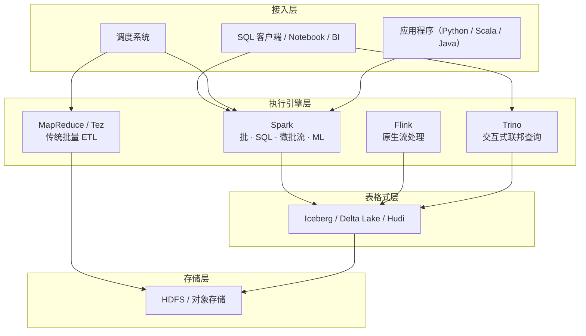
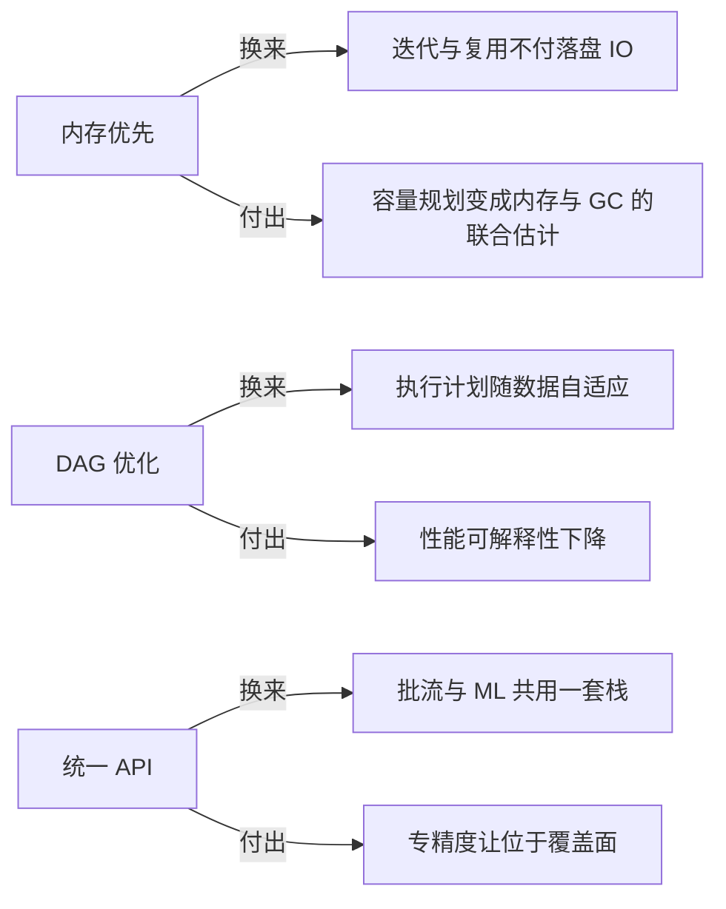
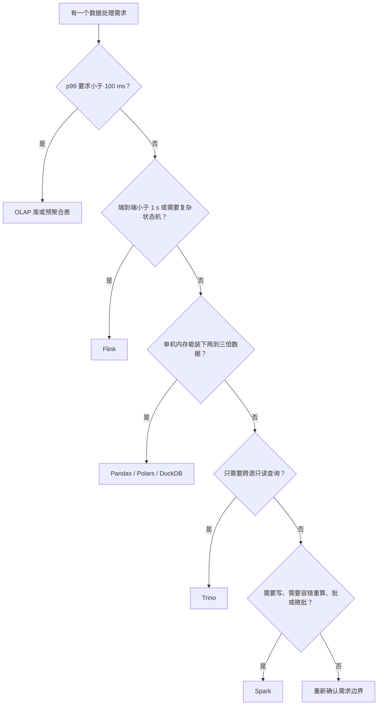
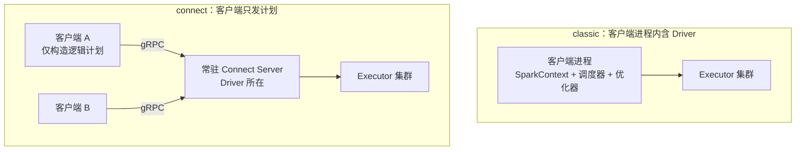
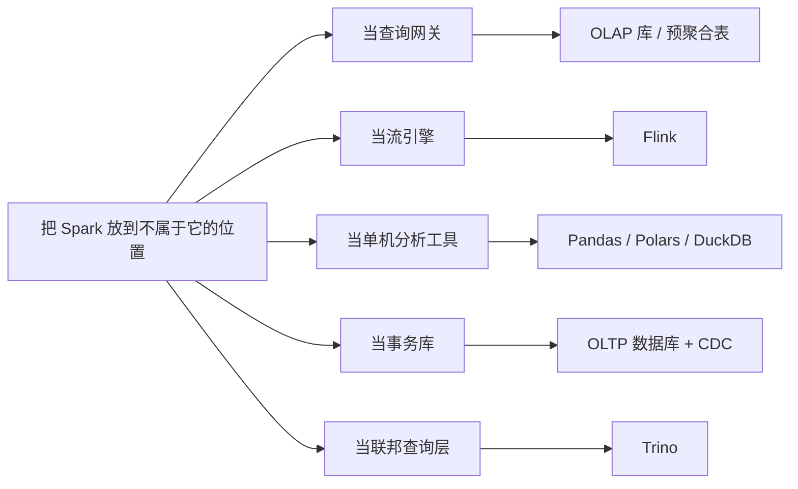

# 08 Apache Spark：通用引擎的生态位与选型

**摘要：**

Spark 常被当成"MapReduce 的内存版"来讲，这个说法解释了它快在哪里，却解释不了它为什么活到今天。论流式延迟它不如 Flink，论交互式点查它不如 Trino，论单机小数据的顺手它不如 Pandas，但它把批处理、SQL、微批流与机器学习放进了同一个执行引擎、同一份代码、同一套资源池，于是多数团队只需要维护一条技术栈。它的真实位置是延迟、规模、表达力三项约束下覆盖面积最大的那一格，而不是任何单项上的第一名。

本文不做机制拆解，只回答三个选型问题：Spark 在数据栈里究竟占哪一格，通用性换来的与付出的是什么；内存优先、DAG 优化、统一 API 这三段设计各自把哪种确定性换成了哪种能力，失效条件又在哪里；Spark 4.x 的 Spark Connect、ANSI 模式默认开启与推式 Shuffle 改变的到底是"怎么用"还是"怎么算"。末尾给出 Spark 与 Flink、Trino、MapReduce 的定位矩阵、一张判据表，以及五类不该选 Spark 的场景与一份误用速查。Stage 划分、内存池、Shuffle writer 的内部细节，留给 Spark 内核专栏。

---

## 第 1 章 一个不最快的引擎，如何成为默认选择

2009 年，伯克利 AMPLab 的一群人在讨论 MapReduce 的边界：它证明了"把计算搬到数据旁边"是对的，却也把"一次作业只许两阶段"写进了编程模型，于是任何需要多轮迭代的算法——PageRank、K-means、逻辑回归——都得把中间结果写回 HDFS 再读出来。一年后发表的 HotCloud 论文《Spark: Cluster Computing with Working Sets》给出了另一条路：让中间结果留在内存的工作集里，下一轮直接接着算。项目 2013 年进入 Apache 孵化器，2014 年成为顶级项目并发布 1.0。

如果只读这段历史，很容易得出"Spark 是 MapReduce 的内存加速版"的结论。这个结论解释了它在迭代型负载上的优势，却解释不了此后十年它为什么吃下了批处理、交互式 SQL、微批流、机器学习四条线——因为"更快"这件事在 2014 年之后就不再稀缺：Impala 更快地做 MPP 查询，Tez 更快地编排 Hive 作业，Flink 更快地做流。真正稀缺的，是通用执行层这个位置。

### 1.1 那个空位是怎么出现的

MapReduce 的成功带着一点反讽。它用"固定两阶段 + 落盘交接"换来了调度器的极简与容错成本的极低，这套取舍在 2004 年的硬件条件下几乎无可挑剔；但 Hive 把它当作 SQL 的执行后端之后，一条复杂查询会被拆成七八个作业串联，每两个作业之间的中间结果都要落一遍 HDFS。这个痛点不是某家厂商的私有困扰，而是 2010 年前后的行业共识，所以同一时期出现了三种解法：Tez 保留 MapReduce 的资源模型，把"作业串联"改成"一次提交的 DAG"；Impala 干脆绕开批处理，直接做内存 MPP；Spark 则把计算抽象成一批通用算子，把调度、内存、容错统统下沉到算子之下。

三条路线里只有 Spark 长成了通用引擎。原因不在它的抽象最优雅，而在它的抽象层次最高，容得下别人的负载：Tez 的 DAG 主要服务 Hive 的算子树，Impala 的执行模型服务单条 SQL，只有 Spark 的 RDD 与 DataFrame 是对"任意分布式计算"开放的。API 开放到什么程度，生态就能长到什么程度，这条规律在数据栈里反复出现。

### 1.2 通用性具体指三层

第一层是语言通用：Scala、Java、Python、R 与 SQL 都能驱动同一个引擎，客户端未必跑在 JVM 上，4.x 的 Connect 之后这一点被推到极致。第二层是负载通用：批、SQL、微批流、机器学习共用一套运行时，运维只需要看一类作业、一套 UI、一份日志。第三层是部署通用：YARN、Kubernetes、Standalone 都能托管，同一份作业可以在自建机房和云上集群之间平移。

这三层叠加起来，收益落在**技术栈数量**上，性能反而未必有提升。一个中等规模的数据团队，如果批用 Spark、流用 Flink、交互用 Trino、机器学习另起一套，需要维护四套资源池、四套权限、四套监控与四种排障经验；全押 Spark 只需要一套，代价是每一格的体验都不是最好。这个交换是否划算，取决于团队规模与负载谱，而不是取决于引擎本身的优劣。

### 1.3 它占住的那一格

把数据栈竖着切开，Spark 的位置很清楚。

这张图的读法是：接入层不关心底下是谁，表格式层关心谁能写、谁能读得高效，执行引擎层才是分档的地方。Spark 站在引擎层的"通用档"，向上兼容所有接入方式，向下能写全部主流表格式，这也是它在数据湖时代反而更重要的原因——表格式之争里，各方都需要一个中立的、能把数据写对写快的执行方，而 Spark 恰好是那个各方都支持的执行方。

按延迟分档来看，Spark 覆盖的区间比宣传里窄、比怀疑者认为的宽。

| 延迟档 | 典型量级 | 代表引擎 | 该档的失败代价 | Spark 是否覆盖 |
| :--- | :--- | :--- | :--- | :--- |
| 毫秒级点查 | 1~50 ms | Doris、ClickHouse、Trino 小查询 | 查询超时，重试即恢复 | 不覆盖 |
| 亚秒级流处理 | 10~500 ms | Flink | 从 checkpoint 恢复状态 | 不覆盖 |
| 秒级交互 SQL | 1~30 s | Trino、Spark SQL | 整段查询重试 | 覆盖 |
| 分钟级批 | 1~60 min | Spark、Tez | Stage 级重算 | 覆盖，主场 |
| 小时级批 | 数十分钟以上 | MapReduce、Spark | 作业级重跑 | 覆盖 |

表中延迟为量级示意，具体取决于集群规模与查询形态，不作为基准测试结论。

### 1.4 通用档的护城河与裂缝

通用引擎的位置一直在被专精引擎蚕食：交互式查询归了 MPP，低延迟流归了 Flink，连机器学习也在被独立的训练框架分流。它守住这一格靠两点，都与性能无关。一是迁移成本，一份已经跑通的血缘、权限、调度、监控与几十个下游报表，换引擎意味着整条链重做一遍，收益要先覆盖这笔支出；二是生态互补，数据湖的表格式、元数据服务、作业编排都默认提供 Spark 入口，选它就是选"不用额外说服任何人"。

裂缝同样清楚：当某类负载在组织内的占比高到可以独立支撑一条技术栈，通用档的性价比就开始崩。譬如风控这种要求秒级响应、作业数量又多的场景，全押 Spark 等于用批处理的骨架去承担流处理的职责，最后两边的体验都受损。所以通用与专精的分界线取决于**单点最优**能在业务上折算成多少钱，与技术的先进程度关系不大——折算得出来就该分裂，折算不出来就该继续通用。

---

## 第 2 章 三段取舍：每一段都在用确定性换能力

Spark 的设计可以压缩成三句话：把中间结果放进内存、把执行计划交给优化器、把所有负载放进同一个 API。每一句都是一次交换，而任何一次交换都有失效条件，选型时真正需要判断的是这些条件会不会在你的负载里出现。

### 2.1 内存优先：换掉的是落盘时刻表

MapReduce 把"什么时候落盘"写死在设计里：map 输出落盘，reduce 输出落 HDFS，中间没有商量的余地。Spark 把这个决定推迟到运行时，是否溢写、是否缓存、缓存在内存还是磁盘上，由内存池与存储级别在作业跑起来之后决定（细节见 [[大数据/Spark/读书笔记-spark内核/00 专栏导览|Spark 内核剖析]] 的 04 册）。

换到的好处很直接：迭代算法与多轮 join 不必为每一轮付一次 IO，同一份中间结果可以在多个 Action 之间复用，交互式探索时的等待从分钟级降到秒级。付出的部分则常被低估——容量规划从"磁盘够不够"变成"内存与 GC 能否撑住峰值"，失败模式从"慢"变成 OOM 与长尾溢写，可预测性下降。磁盘不够时你会收到一条明确的报错，内存不够时你收到的是任务变慢、GC 时间上升、少数 Task 拖住整个 Stage。

**失效条件**也不难界定：中间结果相对输入的比值稳定且不大，内存优先划算；比值随日期剧烈波动，今天 0.2 明天 0.9，那么峰值那天等于在用内存模拟磁盘落盘，只是更贵。此时该改的是分区策略与聚合方式，而不是继续加内存。

### 2.2 DAG 优化：换掉的是人能解释的计划

MapReduce 的 Stage 边界是编程模型给的，数得出来；Spark 的 Stage 边界是优化器算的，从 SQL 到 Catalyst 规则、到物理计划、再到 DAGScheduler 的划分，中间隔着好几层推导。用户写的是声明，跑的往往是另一份东西。

换到的是灵活性：join 顺序、谓词下推、分区合并、join 策略的切换都可以在运行时决定，人不必手工编排执行顺序，自适应查询执行（AQE）还会依据统计信息在 Stage 之间改主意。付出的是性能**可解释性**——同一段 SQL 两次执行的物理计划可能不同，作业变慢时不能只读代码，得读 plan、读 Spark UI、读 event log。调优知识因此从"懂原理"变成"会读证据"，这也是很多人觉得 Spark 难调的真实原因：不是参数太多，而是因果链太长。

失效条件同样清晰：需要稳定 p99、需要可复现 profile 的在线场景，自适应带来的抖动就是噪声。这类场景本身也不该由 Spark 承担，第 5 章会展开。运行时自适应的机制细节在 03 册里有逐层拆解，此处不再复述。

### 2.3 统一 API：换掉的是专精程度

Spark 对外有四层抽象：RDD、DataFrame、SQL、Structured Streaming。四层的语义并不一致，优化器能看懂的程度也不一致。SQL 与 DataFrame 走 Catalyst，谓词下推、列裁剪、代码生成都能生效；RDD 是任意函数的集合，优化器无从下手；用户自定义函数（UDF）一旦跨语言，还要多一层进程间序列化。

换到的是团队只需要学一套东西：批、流、机器学习共用同一套 API 习惯、同一套血缘采集、同一套权限模型。付出的是专精度——同一段逻辑，写成 SQL 与写成 Python UDF，性能差一个量级是常态。而多数团队的实际用法是"能用 SQL 就用 SQL，写不出来就套一个 UDF"，于是优化器最擅长的部分被 UDF 悄悄绕过，性能退回手写水平，使用者却以为自己在用同一个引擎。

一个可操作的判据：UDF 占比超过三成的作业，Spark 相对专精引擎的优势基本消失，这时候要么把 UDF 改写成内置函数，要么承认这个负载不属于 Spark 的强项。

三段取舍合到一张表里，失效条件是选型时最该对着看的一列。

| 设计选择 | 换到了什么 | 付出了什么 | 失效条件 |
| :--- | :--- | :--- | :--- |
| 内存优先 | 迭代与复用不付落盘 IO，中间结果可跨 Action 复用 | 容量规划从磁盘容量变成内存与 GC 的联合估计；失败从"慢"变成 OOM 与长尾溢写 | 中间结果与输入的比值大幅波动，溢写频发，退化为更贵的落盘 |
| DAG 优化 | join 顺序、下推、分区合并可运行时决定 | 性能可解释性下降，同一查询两次执行的计划可能不同 | 需要可复现 profile 与稳定 p99 的在线场景 |
| 统一 API | 批、SQL、微批流、ML 共用一套资源池与一套运维 | 四层抽象语义不一，UDF 绕开优化器 | UDF 占比高，或负载形态单一且已有专精引擎 |

### 2.4 与 MapReduce、Tez 的路线差异

把三条路线压成一句话：MapReduce 用固定两阶段与强制落盘，换调度器极简与容错成本最低；Tez 保留 MapReduce 的容器模型，用 DAG 编排把串联作业合为一次提交；Spark 把"阶段"本身降级为实现细节，交给优化器在运行时决定。三者的差别在 2010 年代中期就已定型，此后是工程打磨而非路线之争，所以今天讨论"Spark 会不会取代 MapReduce"已经没有意义——真正的问题是存量作业迁移的收益能不能覆盖风险。

执行模型与算子树的机制细节见 [[大数据/Spark/读书笔记-spark内核/00 专栏导览|Spark 内核剖析]]，MapReduce 与 Tez 各自的设计见 [[大数据/读书笔记-大数据概览/03 MapReduce：编程模型与执行引擎剖析|MapReduce 编程模型]] 与 [[大数据/读书笔记-大数据概览/04 Apache Tez：DAG 引擎与性能优化|Tez 的 DAG 引擎]]（这两篇只做定位，机制不在此重复）。

---

## 第 3 章 定位矩阵：四类引擎各自的分工

横向对比最容易写成特性罗列，那样得出的结论永远是"各有千秋"。有价值的对比必须先选定维度，而维度的选择本身来自失败代价：一个引擎在延迟、规模、表达力上妥协的那一端，恰好就是它出问题的方式。所以下面的矩阵按四个维度排——延迟档、单次数据规模、容错方式、写能力。

### 3.1 延迟档决定选型的第一刀

延迟要求是最硬的一刀，因为它决定的是架构而非参数。要求端到端一秒以内，能进这个区间的只有原生流处理引擎，微批再怎么调也进不去，因为每次微批都要走一遍作业规划与 Task 下发。要求交互式秒级返回，可选的是 MPP 类引擎，它们没有 Stage 级容错，失败就整段重试，用"不计代价地快"换"不保证跑完"。要求分钟级到小时级的批，才是 Spark 与 Tez 的地盘，这一档里容错重算比单点速度重要得多。

分档之后还要看第二刀：单次数据规模。Trino 在百 GB 级 join 上很快，但它没有为"洗牌数据比内存大一个数量级"的场景做设计，查询级 OOM 或超时是它的典型失败形态；Spark 恰恰相反，它的溢写路径就是为超出内存的洗牌准备的，代价是常态化的磁盘 IO。Flink 的数据规模受状态后端与 checkpoint 时长约束，状态越大，checkpoint 越久，恢复越慢。

### 3.2 一张按判据排的矩阵

| 维度 | Spark | Flink | Trino | MapReduce / Tez |
| :--- | :--- | :--- | :--- | :--- |
| 主定位 | 通用批处理与微批执行层 | 原生流处理与批流一体 | 交互式只读联邦查询 | 传统批量 ETL 与 Hive 后端 |
| 延迟量级 | 秒级 SQL，分钟级批 | 毫秒到亚秒 | 亚秒到数十秒 | 分钟到小时 |
| 单次规模承受力 | 强，溢写路径为超内存洗牌设计 | 强，受 checkpoint 时长约束 | 中，受内存与查询超时约束 | 强，受落盘次数约束 |
| 容错方式 | Stage 级重算 + 血缘 | checkpoint 状态恢复 | 整段查询重试 | 作业级重跑 |
| 写能力 | 完整，含湖表写入与溢出重写 | 完整，流式写入 | 弱，以读为主 | 完整但慢 |
| 表达力 | SQL / DataFrame / RDD / 微批流 / ML | DataStream / SQL / CEP / 有状态计算 | 以 SQL 为主 | 固定 map-reduce 编程模型 |
| 典型误用 | 当查询网关、当流引擎 | 拿来做大规模历史回溯批跑 | 跑小时级大 ETL | 需要多轮迭代的算法 |

矩阵里最容易被忽略的是"容错方式"一行。它决定了作业失败后的时间成本：Stage 级重算意味着失败一个 Task 只补那段血缘，整段重试意味着超时一次就白跑，作业级重跑意味着几小时的返工。对 SLA 敏感的作业，容错粒度比峰值速度更值得关注。

### 3.3 表达力的边界在第三层

定位矩阵里"表达力"一栏最容易被读成"谁的语法更丰富"，其实它问的是另一件事：当需求超出内置能力时，引擎还留了多少下探空间。Spark 留了三层——内置函数不够就用 DataFrame 组合，DataFrame 不够就写 UDF，UDF 还不够就退回 RDD 手写分区逻辑。每一层下探都让优化器失去一部分视野：UDF 对 Catalyst 是不透明的，列裁剪与谓词下推都停在 UDF 之前；RDD 干脆只有函数，连 schema 都没有。

Trino 的下探空间窄得多，它走的是 connector 加 SQL 函数，遇到复杂过程式逻辑只能靠很长的 SQL 或外部预处理；Flink 的下探空间宽，但下探之后要自己管状态与时间语义。这就形成一个可用的判据：如果业务逻辑里过程式代码的比例很高，Spark 的**表达力边界**更远；如果逻辑几乎都能用 SQL 表达，Trino 的轻量更有优势。判断错了方向的代价是双向的——拿 Trino 写复杂过程逻辑会写出难以维护的巨型 SQL，拿 Spark 跑高频小报表则白白背着 JVM 与调度开销。

| 下探层级 | 覆盖的负载 | 优化器可见度 | 性能位置 |
| :--- | :--- | :--- | :--- |
| 内置函数与 SQL | 绝大多数 ETL 与报表 | 完全可见，可做下推与代码生成 | 最优 |
| DataFrame 组合 | 需要程序式编排的逻辑 | 基本可见 | 接近最优 |
| 跨语言 UDF | 自定义计算、第三方库 | 不透明，谓词停在函数前 | 明显回退 |
| RDD 手写 | 任意计算、特殊分区与迭代 | 不可见 | 取决于实现 |

### 3.4 判据落到具体条件上

| 你的条件 | 首选 | 次选 | 不该选 |
| :--- | :--- | :--- | :--- |
| p99 小于 100 ms，查询模式固定 | OLAP 库（Doris / ClickHouse） | 预聚合宽表 + 缓存 | Spark |
| 端到端小于 1 s，或需要事件时间与状态机 | Flink | Flink SQL（降低开发量） | Spark 微批 |
| 数据能被单机内存装下两到三倍 | Pandas / Polars / DuckDB | Spark local 模式 | 分布式集群 |
| 跨多个数据源的只读联邦查询 | Trino | Spark（能读但不擅长长跑） | MapReduce |
| TB 级批 ETL，要容错重算，要写湖表 | Spark | Tez | Trino |
| 行级更新与短事务 | OLTP 数据库 | OLTP + CDC 入湖 | Spark（含 Iceberg、Delta 的行级写） |

决策树的价值在于它把"Spark 也很快"这类模糊判断换成了顺序问题：先卡延迟，再卡规模，再卡形态。绝大多数误用都发生在跳过第一个问题直接问"哪个引擎生态好"的时候。

---

## 第 4 章 Spark 4.x 改的是用法，不是算法

Spark 4.0 于 2025 年 5 月发布，本文以 4.3.0（2026-10-30）为版本口径，涉及默认值处一律以对应版本文档为准。这个版本最受关注的三项变化——Spark Connect、ANSI 模式默认开启、推式 Shuffle——有一个共同点：它们都不动 Stage 划分、内存池与 Shuffle 写路径。也就是说，4.x 改变的是"Spark 怎么被调用、出错时按什么语义出错"，而不是"Spark 怎么算"。这个判断很重要，因为它决定了升级的工作量与风险落在哪里。

### 4.1 Spark Connect：把 Driver 从客户端里拆出去

Connect 在 3.4（2023 年）引入，4.0 起提供了统一的开关 `spark.api.mode`，取值 connect 或 classic。需要澄清一个流传很广的说法：4.0 并没有把 Connect 设为默认，默认值仍是 classic，Connect 是显式选择而非被动接受。这一点在升级评估里必须分清，否则会误以为存量作业会自动换形态。

它的机制是把客户端与服务端之间的边界从"进程内调用"改成"协议调用"：客户端只负责构造未解析的逻辑计划，序列化为 protobuf 后经 gRPC 发给常驻的 Connect Server，由服务端完成解析、优化与执行。客户端因此不再持有 SparkContext，也不必与集群网络直连。

换到的好处集中在平台侧：Python、Go、Rust 都能写客户端而不必装 JVM；客户端与服务端可以独立升级，服务端换版本不必重装所有用户的本地环境；一个常驻 Server 可以服务多个 notebook 与多个租户，Driver 不再是"用户进程崩了作业就没了"。

付出的部分同样明确：能力边界由**协议白名单**决定，RDD API、部分累加器用法、自定义 UDF 的提交方式都受限，重度依赖底层 API 的存量作业迁移时会被卡住；调试链路多了一跳，看日志要分清客户端与服务端两侧；本地开发得先起一个 Server，哪怕只是写个 Hello World。

判断标准也清楚：多语言客户端、多租户 Notebook 平台、需要把执行引擎当作长期服务来运维的场景，Connect 的收益最大；单体 Scala 作业、重度依赖 RDD 与自定义序列化的，迁移收益有限，暂时留在 classic 更省事。

### 4.2 ANSI 默认开启：把静默错误变成显式失败

Spark 4.0 起 `spark.sql.ansi.enabled` 的默认值改为 true。行为变化集中在三类操作：数值溢出、除零、非法的类型转换。此前它们大多返回 null 然后继续跑，现在直接抛异常。

严格来说这不是性能变化，而是数据质量策略的变化。它改变的是错误暴露的时间点——以前脏数据会被静默写成 null，直到下游报表出现空洞才被发现；现在在写入之前就失败，处理成本从"追溯一周前的口径"降到"改一行 SQL"。跨引擎迁移也因此更顺，从其他遵循 ANSI 的数据库搬 SQL 过来，语义差异变小。

代价是存量作业的行为会变。凡是靠 null 兜底来容忍脏数据的处理逻辑，升级后会直接失败；迁移有两条路，把语义显式化（用 `try_cast`、`try_divide` 这类函数明确表达"允许失败并返回空"），或者用配置全局回退到旧行为。后者能止血，但不该作为长期方案，因为它把"数据质量策略"藏进了一个默认配置里。

升级前的正确动作是影子验证：把全量作业在关闭 ANSI 与开启 ANSI 两种模式下各跑一遍，统计失败率与结果差异，再决定逐个改造还是整体回退。这个动作的成本不高，但漏掉它的代价往往是一个凌晨的排障电话。

### 4.3 推式 Shuffle：物化阶段的流水线化尝试

推式（push-based）Shuffle 自 3.2 引入，开关是 `spark.shuffle.push.enabled`，默认关闭，且需要外部 Shuffle 服务（ESS）配合，早期只在 Spark on YARN 的部署形态下可用。

它的思路是把 Shuffle 的数据流向反过来：默认的拉模型里，每个 Reduce Task 主动向所有 Map 端发起 HTTP 请求，分区数一多，就变成几百万次随机小读；推模型让 Map 端把输出推送给远端的合并服务，由服务端把大量小分片合并成大块，Reduce 端再顺序读取。对分区数多、分片小的批作业，这一改动直接改善的是随机 IO 与连接数，而不是带宽。

需要强调的是它不动什么：Stage 边界不变，数据正确性不变，容错语义也不变——推送失败会回退到拉取路径。所以它是"物化阶段的优化"，不是执行模型的改写。判断是否值得开，看三个条件同时成立与否：Shuffle 分区数明显偏多、单分片数据量偏小、集群有可用的外部 Shuffle 服务。Kubernetes 上不部署 ESS 的集群，这个开关基本用不上。

### 4.4 三项变化的共同形状

| 变化 | 改的是哪一层 | 不动的是哪一层 | 升级动作 | 主要风险 |
| :--- | :--- | :--- | :--- | :--- |
| Spark Connect | 客户端与服务端的边界 | Stage 划分、内存池、Shuffle 写路径 | 显式设置 `spark.api.mode=connect`，改造客户端依赖 | 白名单外 API 不可用，调试多一跳 |
| ANSI 默认开启 | SQL 语义层 | 执行模型与性能特征 | 影子验证，把容错语义显式化为 try_ 系列函数 | 存量脏数据路径直接失败 |
| 推式 Shuffle | Shuffle 的数据流向与合并位置 | Stage 边界与容错语义 | 有 ESS 的 YARN 集群试点 | 无 ESS 的部署用不上 |

三项变化合起来看，升级到 4.x 的真实工作量在"语义对齐 + 客户端改造"，不在"重新调参"。反过来说，如果一次升级的性能收益是主要诉求，4.x 大概率给不了预期，因为执行模型没变；它的价值在于让 Spark 更容易被集成、更容易被平台化。

---

## 第 5 章 五类不该用 Spark 的场景

先看一个贯穿的例子。某团队有一张日更的订单宽表，MapReduce 时代凌晨跑四小时，迁到 Hive on Tez 后一个半小时，再迁到 Spark 后四十分钟（此处为量级示意，非任何集群的实测数据）。这张表随后被追加了两个需求：运营要在后台按订单号秒级查明细，风控要在支付环节实时拦截。两个需求都被塞进了同一个 Spark 集群，两个都以失败告终——前者把并发打满，后者始终压不进秒级。失败的原因不在调参，而在于把两种不属于这个引擎的负载放到了同一个位置上。

### 5.1 低延迟点查

Spark 的固定开销是架构决定的：作业提交、Driver 规划、资源协商、Task 下发，这一圈与数据量无关，即便查一行也要走完。这套设计是为了让大作业跑得稳，而不是让小查询跑得快，所以拿它做点查，延迟的地板由提交链路决定，调参只能优化地板之上的部分。

判据可以量化：p99 要求在 100 ms 以内，或者并发达到几十 QPS，就该换 OLAP 库，或者干脆把那几条常用查询预聚合成结果表。Spark 的职责是"把宽表算出来"，不是"把宽表查出来"，这两件事在架构上是分开的。最常见的误用形态是把 Thrift Server 当查询网关，让几十个并发 SQL 共享同一个 Executor 池——查询之间互相抢资源，长查询拖死短查询，最后谁都慢。

### 5.2 纯流式

Structured Streaming 的默认执行模型是微批，最小触发间隔受调度与提交开销约束；持续处理模式长期处于受限状态，不该作为选型依据。Flink 的事件时间、状态管理、checkpoint 与反压是为一等公民设计的，端到端毫秒级是它的设计目标而不是调优结果（机制见 [[大数据/Flink/Flink原理深度解析与性能优化/00 专栏导览|Flink 原理深度解析]]）。

这里有一条值得记住的分界：Spark 的批流一体是**一套 API**，Flink 的批流一体是**一套运行时**。前者意味着流作业与批作业共享同一份代码与同一套语义，后者意味着流作业可以用批的方式回放历史数据。两种一体化的落点不同，前者省的是维护成本，后者省的是正确性成本。

### 5.3 小数据

几 GB 以下的数据量，集群方案的开销占比会变得很难看：JVM 启动、序列化、任务调度、结果收集，这些固定成本与数据量无关，数据越小占比越高。同一台机器上，Pandas、Polars、DuckDB 往往更快，而且调试成本低一个量级——出错时看到的是一行 Python 栈，而不是一个 Stage 的失败摘要。

用 Spark local 模式跑小数据是合理的，但那属于"复用团队已有的习惯"，不是性能选择；一旦有人把它包装成"统一入口"，就会在小任务上付出集群的固定开销。判据很简单：数据能被单机内存装下两到三倍，先试单机工具，确有分布式需求再上集群。

### 5.4 强事务 OLTP

Spark 没有行级锁，也没有短事务提交的语义。Iceberg、Delta Lake 提供的是表级 ACID 与分析型并发控制，它解决的是"多个写入者如何不互相踩坏表"，不是"两条记录如何原子更新"。把湖表当行级事务库用，代价是每次提交都要重写数据文件与清单，逐条 upsert 会迅速把文件数推到不可维护的量级。

正确的位置是 OLTP 数据库加变更数据捕获（CDC），把变更流进湖表，让 Spark 只承担分析侧的批量写入与重写。

### 5.5 只为一条 SQL 的联邦查询

Trino 的定位是不搬数据的只读联邦查询，接一堆 connector，一条 SQL 跨三个源。为了这样一条查询去维护一套 Spark 集群与调度，运维面远大于查询面；反过来，用 Trino 跑小时级的大 ETL，也会撞上它没有 Stage 级容错的短板。两者在架构上是分工关系，谈不上替代。

| 症状 | 误用形态 | 正确位置 |
| :--- | :--- | :--- |
| 点查延迟从数百毫秒起，并发一上来全是排队 | 把 Thrift Server 或 Spark SQL 当查询网关 | OLAP 库或预聚合宽表 |
| 流式延迟始终压不到秒级，checkpoint 越调越频繁 | 用微批模拟原生流 | Flink |
| 几 GB 数据起二十个 Executor，一半时间在启动与序列化 | 把小数据搬上集群 | 单机 Pandas / Polars / DuckDB |
| 每条 upsert 都要重写文件，作业排队在 commit | 用湖表当行级事务库 | OLTP + CDC |
| 为一条跨源 SQL 维护一整套集群与调度 | 用 Spark 做联邦查询层 | Trino |

---

## 第 6 章 选型的落点

Spark 的位置可以用一句话概括：它是一个用**覆盖面积**换取单点最优的引擎。这个交换在负载谱宽、团队规模中等的组织里几乎总是划算的，因为省下的是技术栈数量与排障经验的分裂；但在负载形态单一、延迟要求苛刻、或者数据量小到不需要分布式的场合，同一份交换就是纯亏损。

判断的方法也不复杂：先按延迟档把候选砍到一两个，再看数据规模与容错要求排除掉不合适的，最后才比较生态与团队熟悉度。顺序反过来——先看生态再看延迟——得到的结论通常是"Spark 什么都能干"，然后在一个点查需求上撞墙。

4.x 的方向值得留意，但不必着急。Connect 若最终成为默认，Spark 的形态会从"一个库"变成"一个计算服务"，到那时选型的含义会变成选一个服务端点，而不是选一套依赖；不过就当前版本口径而言，默认仍是 classic，变化还没到质变。ANSI 默认开启与推式 Shuffle 更像两笔技术债的清算：前者把语义往标准上对齐，后者把物化阶段的随机 IO 往下压。它们都不改变执行模型，因此也不改变本文的定位结论——Spark 依然是那一格里覆盖最广、也最不极致的引擎，而这个位置在可预见的一段时间内没有替代者。

机制层面的问题——Stage 怎么切、内存怎么借、Shuffle 怎么写——请直接看 Spark 内核专栏，那 47 篇拆得比这里细得多，本文只负责说清楚"什么时候该用它、什么时候不该用"。

---

## 参考资料

- Zaharia, M., et al. "Spark: Cluster Computing with Working Sets." HotCloud 2010. <https://www.usenix.org/legacy/event/hotcloud10/tech/full_papers/Zaharia.pdf>
- Dean, J., Ghemawat, S. "MapReduce: Simplified Data Processing on Large Clusters." OSDI 2004. <https://research.google/pubs/pub62/>
- Databricks Blog: "Introducing Apache Spark 4.0"（2025 年 5 月）. <https://www.databricks.com/blog/introducing-apache-spark-40>
- SPARK-44444：4.0 起默认启用 ANSI 模式. <https://issues.apache.org/jira/browse/SPARK-44444>
- SPARK-50411：Spark Connect 作为默认 API 与 `spark.api.mode` 提案. <https://issues.apache.org/jira/browse/SPARK-50411>
- SPARK-30602：推式 Shuffle 的实现提案. <https://issues.apache.org/jira/browse/SPARK-30602>
- Apache Spark 配置参考（`spark.api.mode`、`spark.sql.ansi.enabled`、`spark.shuffle.push.enabled` 的默认值以对应版本文档为准）. <https://spark.apache.org/docs/latest/configuration.html>
- Trino 官方文档. <https://trino.io/docs/current/>
- Apache Flink 官方文档. <https://nightlies.apache.org/flink/flink-docs-stable/>

> [!note] 思考题
> 1. 如果把"技术栈数量"折成一个可估算的成本项，你们团队全押 Spark 与混合栈的差额大概是多少人日？
> 2. 你负责的作业里 UDF 占比多少？把它改写成内置函数后，性能变化是否符合本文的判断？
> 3. 一个要求 p99 200 ms 的点查需求落到你手上，你会先改架构还是先调 Spark 参数，理由是什么？
> 4. Spark Connect 默认仍为 classic，这个默认值如果在下个大版本翻转，你们的客户端代码需要改哪些地方？
> 5. 升级到 4.x 时，你打算用什么方式量化 ANSI 默认开启带来的失败率？