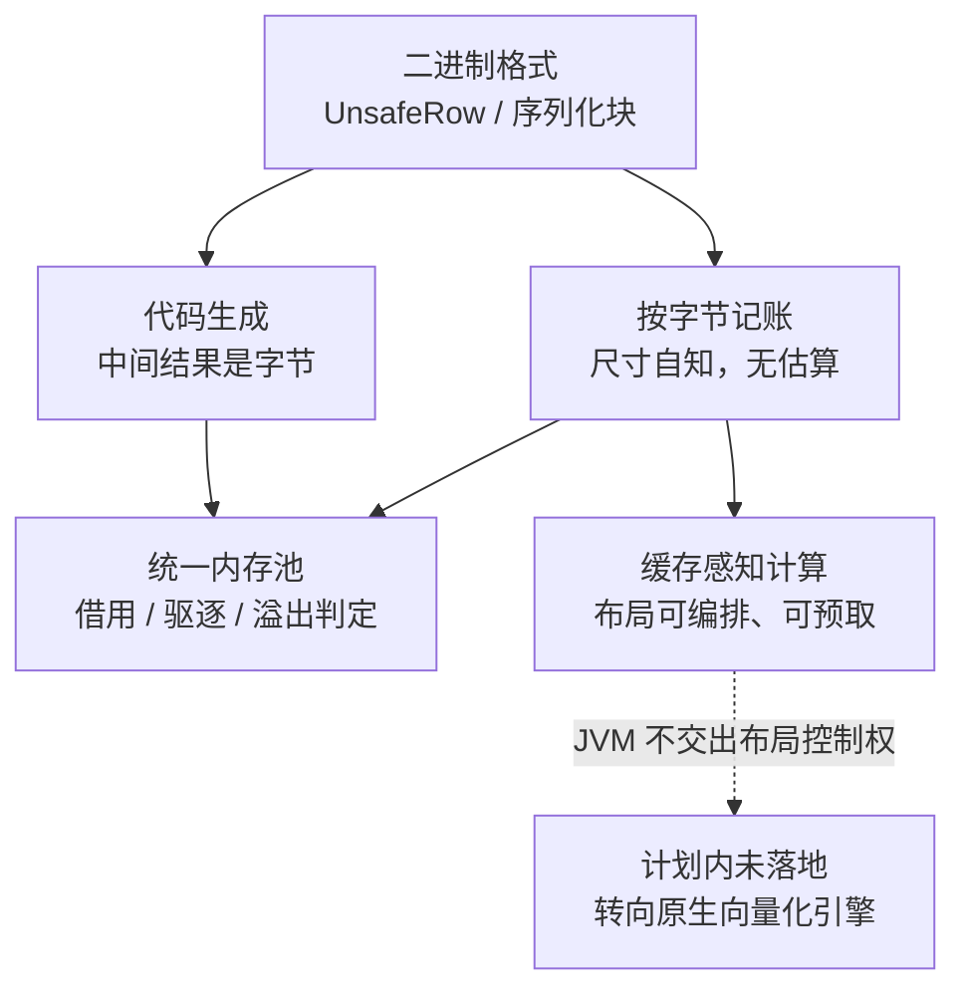
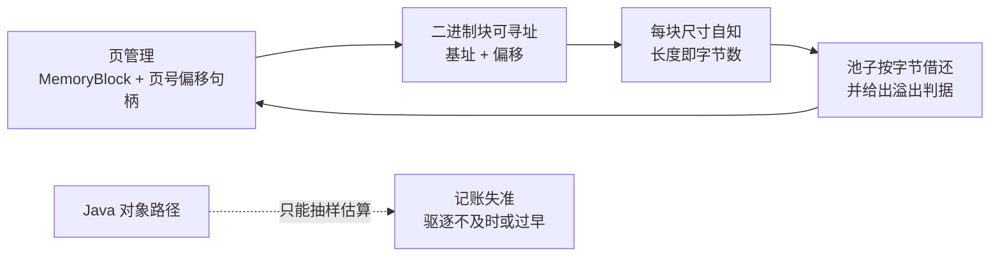
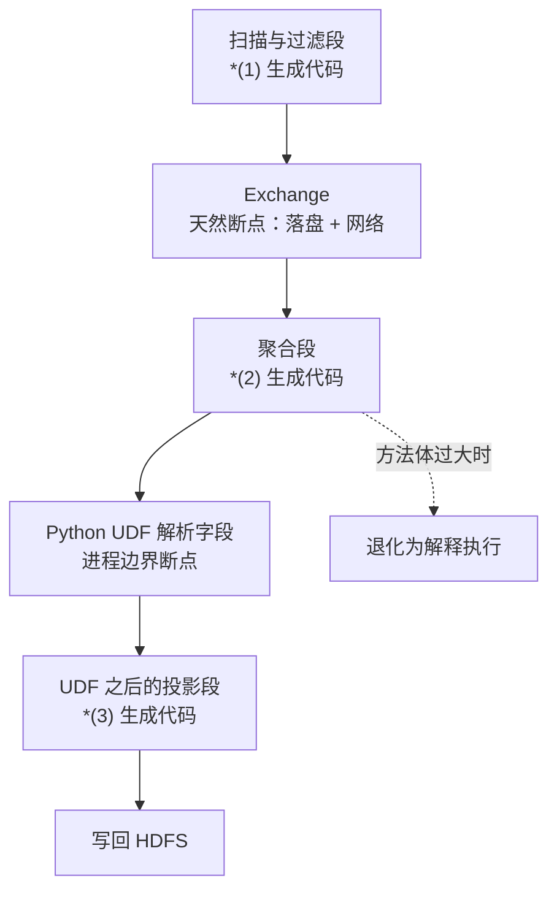
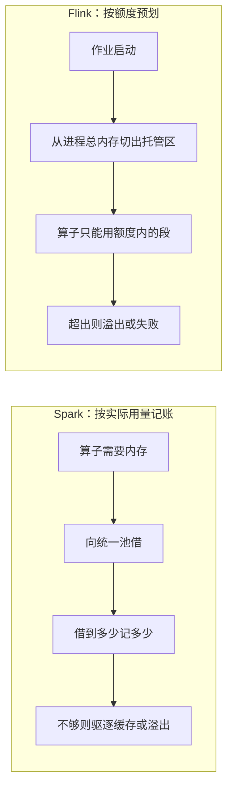
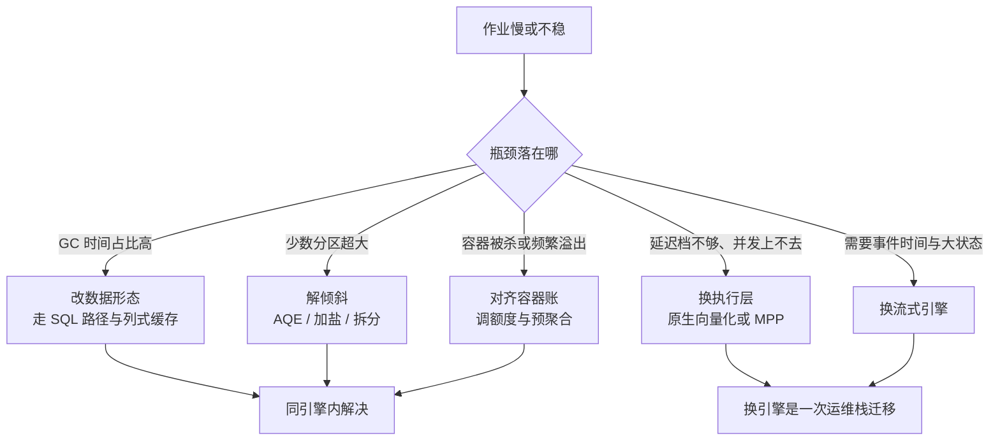

# 09 Spark 内存管理与 Tungsten 引擎：三个目标的结算与选型代价

**摘要：**

2015 年 4 月，Tungsten 立项时写下的三个目标——内存管理与二进制处理、缓存感知计算、代码生成——在后来的传播里被压缩成了一句"用堆外内存提速"。这篇文章做的是结算：三件事各自要拆掉什么，哪些已经变成今天的默认路径，哪一件最后发现地基并不归 Spark 所有。结算之后回答两层问题，一是统一内存池的收益为什么在构造上依赖序列化的二进制化，记账单位是字节，而字节数只有二进制格式自己才知道；二是 Whole-Stage Codegen 的融合边界落在哪里，UDF 为什么恰好压在边界上。最后把机制折算成选型语言：Spark 的内存画像为什么是"吃内存、怕 GC、必须预留堆外"，它与 Flink 的托管内存在记账方式上有何不同，四种调参数无效的情形分别指向什么问题，什么信号出现才值得换引擎。换来换去的边界也要说清：倾斜、数据形态、跨进程 UDF 这三类问题不会因为换了引擎而消失。机制细节不在本篇展开，由仓库内的 Spark 内核剖析与 Spark SQL 两套深度专栏承担。

---

## 第 1 章 三个目标，一条依赖链

### 1.1 2015 年的那次判断

2015 年 4 月，Databricks 公开了 Tungsten 项目，对应的 JIRA 编号是 SPARK-7075。立项描述里有一句判断需要单独说清：多数 Spark 负载的**瓶颈不在 I/O 与网络，而在 CPU 与内存**。这句话在当年并不显然——那几年硬件侧明明是利好的，10Gbps 网络在普及，SSD 阵列与条带化 HDD 把存储带宽推高了一个量级，优化器又能靠列裁剪与谓词下推把大量输入直接跳过，于是磁盘 I/O 在很多作业里已经不是主要成本；真正卡住的是 Shuffle 子系统里那两件 CPU 密集的事，序列化与哈希。

判断成立之后，路线的选择就顺理成章了：既然瓶颈在 CPU 与内存，那就把执行效率往硬件极限上推，而不是再去做一层 I/O 调度。Tungsten 因此不是一个单点优化，而是三条并行的改造线，原文的表述分成三块：

| 方向 | 原文表述的核心 |
| :--- | :--- |
| 内存管理与二进制处理 | 避免非瞬时的 Java 对象，改用二进制格式存放；用更密的数据布局省内存；按字节而不是启发式记账；对有类型信息的算子直接在二进制上操作，省掉序列化往返 |
| 缓存感知计算 | 为聚合、连接与 Shuffle 重写排序与哈希，让数据结构贴合内存层级 |
| 代码生成 | 更快的表达式求值与更快的序列化，用生成的代码代替虚方法分派 |

这三条常被并列着讲，好像可以分头推进、各拿各的收益。实际不是。它们之间有一条很硬的依赖链，理解这条链，后面关于"为什么某些调参永远无效"的讨论才有落脚点。

### 1.2 二进制是地基

第一件事的产物是一个新的内存表示：一条记录不再是一组堆上的对象，而是一段有固定布局的字节。字段按偏移寻址，变长字段存偏移与长度，定长字段直接内联。这段字节可以被哈希、被比较、被排序，而全程不需要构造任何 Java 对象。

一旦记录变成字节，第二件事才有了对象：按字节记账。池子里的每一次借还都以字节为单位，算一次哈希码不产生垃圾，排一次序不需要把行重新组装成对象再拆开。第三件事也才有了输入输出——代码生成要消灭的正是"算子之间把结果包成 `InternalRow` 再拆开"这个动作，如果中间结果本身就是字节，生成的代码可以直接把上游算出的字节写进下游的局部变量，融合才有意义。

所以真实顺序是：先统一货箱规格，再按货箱尺寸改记账方式，最后按新记账方式重排工位。三件事挤在同一个项目里，不是因为它们同等重要，而是因为前一件是后两件的前提。

### 1.3 第三条为什么走不通

缓存感知计算这一条最激进，它要的不只是"省掉对象开销"，而是"让数据布局顺从 CPU"。这要求引擎能控制内存里字节的排布、能确定性地发出预取、能把一个循环编译成向量指令。这三件事在 JVM 里一件也保证不了：对象布局由 JVM 决定，字段顺序可以重排，对齐与指针压缩随启动参数变化；预取没有语言级入口；自动向量化取决于 JIT 当次编译的取舍，同一个循环在不同负载下可能被向量化，也可能不被。

换句话说，第三条**要求对内存有所有权**，而 Spark 的厂房是租的——房东是 JVM，租约里写明垃圾回收随时可以搬动租户的家具。这一条后来并没有消失，只是换了施工单位，从引擎内部挪到了引擎外部，第 2 章会接着算这笔账。

### 1.4 为什么必须捆在一个项目里

分开推进在工程上更省事，但三者共享同一份中间表示，任何一件先动都会牵动另外两件。只做代码生成而不换行格式，生成代码仍要把结果包成行对象再拆开，收益能拿到一部分，天花板却压在对象分配上；只换行格式而不做代码生成，字节有了，逐行分派还在，等于换了一批更省内存的原料，机器没换。这也是为什么当年的路线是"一个项目三件事"，而不是三个独立的小项目。

更麻烦的一点是版本节奏。三件事的默认值必须在同一两个大版本里同时翻过来，否则用户会踩到"一半新一半旧"的组合：行是二进制的，缓存还在估大小；代码生成了，输入却是对象。Tungsten 从立项到整段代码生成默认开启，中间隔了一年多，这段时间里新老路径并存，正是这种节奏带来的过渡成本。

下图把三个目标与那条依赖链画在一起，虚线标出唯一一处断掉的地方。

> [!info] 分工
> 二进制行的字段布局、页表编码、`MemoryConsumer` 的借用与溢出路径，这些机制细节见 [[大数据/Spark/读书笔记-spark内核/00 专栏导览|Spark 内核剖析]]；`CollapseCodegenStages` 的折叠规则与生成代码的形态见 [[大数据/Spark/Spark-SQL深度解析与性能调优/07 Whole-Stage CodeGen：JVM 字节码级别的性能飞跃|Whole-Stage CodeGen]]。本篇只做结算与判据。

## 第 2 章 结算：两张图纸建成，一张改了施工单位

### 2.1 二进制：成了，但只覆盖有 schema 的那一半

今天回头看，第一件事落地得相当彻底，只是**覆盖到有 schema 的那一半**。`UnsafeRow` 是 SQL 与 DataFrame 路径上唯一被广泛使用的行格式，排序、哈希聚合、缓存、Shuffle 写端全都在字节上工作；缓存可以选列式，一块缓存的大小由 `getSizeInBytes` 直接给出，不再依赖估算。按字节记账这一条也兑现了：池子里的借还是字节，溢出判定是字节，`peakExecutionMemory` 是字节。

但它有一道清楚的边界：RDD API 不在其中。`map`、`flatMap`、`mapPartitions` 的签名是 `T => U`，泛型里没有任何类型信息，引擎不知道 `U` 有几个字段、哪个字段是定长，也就无从构造二进制布局。这不是实现难度的问题，而是抽象本身不携带信息。于是 Spark 内部长期并存两套表示，一条走字节，一条走对象，缓存、序列化、GC 的压力分布也随这两条路而不同。

### 2.2 代码生成：成了，而且成了默认

第二件事的落地比第一件更干脆。Spark 1.5 的发布说明里明确写着 Tungsten 的手工内存管理与表达式代码生成默认开启，可以用 `spark.sql.tungsten.enabled` 关掉；到了 Spark 2.0，整段代码生成（whole-stage code generation）也默认开启，由 `spark.sql.codegen.wholeStage` 控制。表达式级与整段级两层叠在一起的后果是：在大多数 SQL 计划里，算子之间那一次"把结果包成行对象"的动作被整个删掉了，行变成了生成代码里的局部变量，虚方法分派变成了直线代码，JIT 因此有机会把整段循环当成一个基本块来优化。

这是三项里收益最直接、也最容易被感知的一项——它不需要用户改任何东西，升级版本就自动生效。

### 2.3 缓存感知：没在引擎内部落地，而是换了实现者

第三件事的结局要绕一些。今天 Spark 里确实有贴着字节工作的排序器与堆外哈希表，前缀比较、页式分配、按分区追加这些手段都在用，但它们优化的是"少分配、少拷贝"，不是"顺着缓存行排布、循环展开、SIMD 并行"。真正意义上的缓存感知计算，后来是被另一批东西实现的：闭源的 Photon 引擎、以 Velox 为内核的 Gluten 插件、Arrow 的列式内核，以及一批从设计之初就把执行单元定成"一批列"的 MPP 引擎。

这个转移不是 Spark 社区放弃了这条路线，而是路线的可行性条件变了：只要执行仍在 JVM 里逐行进行，缓存感知的天花板就在 JVM 手里。想再往前走，只能把执行搬出 JVM——而这恰好是第三条目标的隐含要求，也是它当年没有写进立项描述的部分。

| 目标 | 立项时的承诺 | 2026 年的形态 | 结算 |
| :--- | :--- | :--- | :--- |
| 内存管理与二进制处理 | 消掉非瞬时对象、按字节记账、有类型算子直接在二进制上算 | SQL/DataFrame 路径全面二进制化，缓存与溢出按字节记账 | 达成，边界止于无 schema 的 RDD 路径 |
| 代码生成 | 更快的表达式求值与序列化 | 表达式级与整段级两层默认开启 | 达成，三项里收益最直接 |
| 缓存感知计算 | 为聚合、连接、Shuffle 重写排序与哈希，贴合内存层级 | 通用算法 + 堆外哈希表，预取、展开、SIMD 未进入 JVM 路径 | 未在引擎内达成，改由原生向量化引擎实现 |

这张表里有一处容易被忽略的细节。三项里两项成了默认，一项成了别人的生意，而公众记忆里留下的却是最容易被误读的一个词——堆外内存。堆外只是第一项的一个可选实现细节，默认关着，且并不覆盖聚合这类结构，把它当成 Tungsten 的代名词，后面几乎所有的调参失败都能追溯到这一处误读。

### 2.4 这笔结算对用户的含义

判断一项优化是否还在演进，可以看它的默认值。二进制格式与代码生成的默认值在 2015 至 2016 年之间就定下来了，之后十年没有翻覆，说明该拿的收益已经拿完，剩下的工作是修补边界；而缓存感知这一项的默认值根本不在 Spark 的配置里，它在另一批产品的部署文档里。这个差别对选型的意义很直接：指望通过升级 Spark 版本获得下一轮数量级的性能提升，方向是错的；下一轮提升来自执行层换成原生向量化，那是一次换引擎、换运维栈的动作，不是一次升级。

## 第 3 章 池子记的是字节，不是对象

### 3.1 一个池子要能借，先要能数

统一内存池的全部动作可以归结为借与还。借的时候要给一个数：`acquireExecutionMemory(numBytes, taskAttemptId, memoryMode)` 的入参是字节，池子的容量 M 与边界 R 也是字节，溢出判定的阈值还是字节。整套机制因此有一个隐藏前提：**每一份被记账的数据都必须知道自己的字节数**。

二进制格式天然满足这个前提。一条 `UnsafeRow` 的长度写在行头，一块序列化数据就是一个定长数组，页就是页。字节数是事实，不是估计，池子的账与真实占用因此可以对得上，驱逐、借用、溢出三个动作也都建立在一个可靠的数上。

Java 对象路径不满足这个前提。一个对象在图里占多少字节，粗略看是能算的——对象头、字段、对齐补齐，但真实堆里到处是共享引用、被 interned 的字符串、延迟填充的集合、按需扩容的数组；同一个对象被两个父节点引用时，遍历会重复计数，`SizeEstimator` 用采样加快速度，代价是引入误差。**估算与事实的差别**在这里被放大：池子的三个动作都建立在这个数上，数偏一点，账就偏一路。

### 3.2 估错的两种后果

估算偏差不是一个无关紧要的小问题，它会把池子的两种策略都带偏。

估小了，池子以为还有余量，驱逐不及时，缓存与执行一起往老年代里挤，真实占用超过 M 之后 JVM 才开始用 Full GC 收场，表现为作业跑得越久停顿越长。估大了，缓存被过早淘汰，而被淘汰的缓存不是"降到磁盘上一份快照"——RDD 缓存被驱逐之后，要用它就得重算上游血缘，代价可能是一次完整的 Shuffle 重放。

下表把三种形态的记账精度摆在一起，误差来源与后果一一对齐。

| 形态 | 谁在算字节 | 误差来源 | 账实不符时的表现 |
| :--- | :--- | :--- | :--- |
| `UnsafeRow` / 序列化块 | 数据自己，长度即字节数 | 基本没有 | 账实一致，策略按预期执行 |
| `MEMORY_ONLY` 的 RDD 缓存 | `SizeEstimator` 抽样推算 | 对象头与对齐假设、共享引用重复计数、懒加载结构未展开 | 偏小则驱逐滞后、老年代被撑满；偏大则缓存过早淘汰、触发重算 |
| 对象形态的聚合表 | 按消费者额度与条目数估算 | 键与聚合缓冲的对象大小不一 | 溢出时机漂移，内存指标与真实占用对不上 |

### 3.3 反过来，二进制也离不开池子

依赖是双向的。二进制块要能寻址，就需要一个稳定的落点；堆上的对象会被 GC 搬迁，任何跨分配的裸指针都不可靠，所以 Spark 把两种内存统一成"基址 + 偏移"，堆内时基址是对象引用，堆外时基址为空、偏移是绝对地址。页由一个任务级管理器发放，页号与页内偏移被打包进一个 64 位句柄，于是哪怕页被移动、被换出，句柄仍然有效。

再加一层：二进制块什么时候该溢出，也需要池子给判据。`MemoryConsumer` 向池子申请不到份额时会走溢出路径，把页写到磁盘再释放；没有池子的额度概念，二进制块就不知道自己的边界在哪，只能等 OOM。字节格式与池子因此互为条件，下图把这条回路画出来，右侧那条虚线是没有二进制的路径，它只能停在估算上。

### 3.4 一处具体的错位：聚合表

最能说明"记账绑在形态上"的例子是聚合。带聚合的 Shuffle 写端用的是可溢出的哈希表，这个结构继承 `Spillable` 时把内存模式写死为堆内，也就是说无论堆外池开多大，聚合缓冲的额度始终记在堆内执行池上。原因不神秘：聚合表里装的是键与聚合缓冲，要按 key 比较就得看得见键的内容，而堆外存放的是字节，比较之前得先解出对象。

回到那条贯穿本文的作业——把用户行为日志与渠道维表连接、按渠道与日期聚合出日报。它中间最大的内存消耗点正是这张聚合表，而它的溢出与否完全由堆内执行池决定。理解了这一点，就会明白为什么"给堆外加 8G"在某些作业上一点感觉也没有：那 8G 里没有一寸是分给聚合的。

### 3.5 记账精度给调参划的线

把这一章的结论翻译成操作：凡是"按实际用量记账"的结构，参数调整才能产生线性效果；凡是"按估算记账"的结构，参数调整的效果本身就是有噪声的。缓存走的是后一条路，因为它的尺寸来自估算，你以为调大 `storageFraction` 就能多留缓存，实际留下来的量取决于估算误差与淘汰时机的耦合；排序与 Shuffle 缓冲走的是前一条路，调大执行内存对溢写频率的影响是可预期的。

这也解释了为什么调优经验在不同作业之间迁移性很差。同一个参数在一份全 SQL 的作业上效果显著，换到一份混着 RDD 转换的作业上可能完全无效，差别不在参数本身，而在被记账的对象是不是二进制形态。**参数只对被记账的那一部分有效**，这句话是后面所有"调参无效"情形的共同祖先。

## 第 4 章 融合能化掉什么，断点在哪

### 4.1 生成代码消灭的三样东西

整段代码生成把一串相邻算子折进一个 Java 方法，收益来自三处被删掉的东西。第一处是虚方法分派，火山模型下每取一行都要跨一次 `next()`，十亿行就是十亿次多态调用；融合之后行变成了循环变量，调用变成了直线代码。第二处是中间行的物化，算子之间的结果不再先包成行对象再拆开，而是直接留在局部变量甚至寄存器里。第三处是循环边界，多个算子各自的循环被合并成一个，分支预测与 JIT 的优化窗口都变大了。

这三样都属于"每行一次"的开销，所以收益随行数线性放大，也随表达式复杂度放大。反过来说，如果一段计划每行只做一件很轻的事，融合的收益就有限，此时编译这段代码的成本反而可能盖过执行收益——这是后面讲方法体上限时要回到的一点。

### 4.2 断点一：数据交换

最硬的一类断点是跨 stage 的数据交换。`Exchange` 要把上游结果按分区落盘再经网络搬到下游，中间必然有一次物化，融合不可能跨过它——生成代码的局部变量没法穿过网络。计划里这一点看得很清楚：`*(1)`、`*(2)` 这类星号前缀标出可融合的区域，而 `Exchange` 节点没有星号，它就是段与段之间的接缝。

接缝本身不是问题，**接缝的数量决定融合收益的天花板**。一次多表连接加聚合的日报作业，经过 Shuffle 之后可能只剩两三段，融合的收益能吃到；而一个被反复 `repartition`、反复 `join` 的宽表加工链路，段数会涨到十几段，每段都很短，融合的边际收益迅速下降。

### 4.3 断点二：UDF 的两种断法

第二类断点是用户自定义函数，但它的成因有两种，后果也不一样。

跨进程的那一种断得最彻底。Python UDF 的数据必须离开 JVM 交给 Python 进程，再回填结果，中间要经过行到列式批的转换、序列化、进程间通信。这个断点不只是让代码生成停下来，它还在链路里插进了一段完全不受 JVM 优化的黑盒，一段计划里 UDF 越多，黑盒所占比例越高。Pandas UDF 用批量换掉了逐行，减少了穿越次数，但边界仍在。

JVM 内的那一种断得温和一些。Scala 写的 UDF 在 Catalyst 里被包成一个表达式，能否内联进生成代码取决于它有没有提供代码生成实现；没有提供的会退化为逐行解释执行（具体以对应版本源码为准），于是这一段被切成"生成 → 解释 → 生成"，接缝两侧都要把中间结果物化成行，入参与返回值还要拆包装箱。遗留的 Hive UDF 也是同类，它根本不认识 Catalyst 的表达式协议。

所以"UDF 一定打断融合"这句流行说法要加个限定：**跨进程的 UDF 是结构问题，JVM 内的 UDF 是概率问题**，量化方式也不同——前者按穿越次数付序列化与 IPC 的钱，后者按行数付装箱与虚调用的钱。

### 4.4 断点三：方法体上限与编译成本

第三类断点来自代码生成自身的物理限制。生成的 Java 方法要交给编译器变成字节码，单个方法有大小上限，折叠进来的算子越多、表达式越宽，方法体越容易顶到阈值。碰到阈值时框架的选择是退让：把这段降级为解释执行，或者按算子切分成多个方法。这个过程在日志里会留下痕迹，计划里也能看出来——本该带星号的一段突然没有了星号。

编译本身也不是免费的。生成、编译、加载一个类要花 driver 侧的 CPU 与 Metaspace，一个常驻应用跑几百条不同的 SQL，Metaspace 缓慢上涨是正常现象；反过来说，一个只跑几十行数据的小作业，编译开销可能比执行开销还大。这就是"代码生成不是免费午餐"的确切含义：它用一次性的编译成本换每行省下的开销，行数越多越划算。

下图是一段典型日报 SQL 被切开的样子，实线是必然的接缝，虚线是可能出现的降级路径。

### 4.5 数星号：一个可操作的判据

判断融合有没有生效，不需要读源码，看 `explain` 就够了：数星号段的个数，看关键算子有没有落在星号之内，看 `Exchange` 与 UDF 节点两侧的接缝位置。一个只有两段、且聚合落在段内的计划，融合收益基本吃满；一个被切成六七段、每段只有一个算子的计划，融合已经没有多少可省的，此时继续在 codegen 参数上折腾是徒劳的，该动的是 UDF 的密度或者链路的形状。

| 断点类型 | 典型节点 | 为什么断 | 断点处的代价 | 计划里的迹象 |
| :--- | :--- | :--- | :--- | :--- |
| 数据交换 | `Exchange`、重分区 | 跨 stage 必须物化 | 落盘、网络、反序列化 | 节点没有星号前缀 |
| 进程边界 | Python UDF、Pandas UDF、`mapInPandas` | 数据要出 JVM | 行转批、序列化、IPC、结果回填 | 出现 `ArrowEvalPython` 一类节点 |
| 解释退化 | 无代码生成实现的 `ScalaUDF`、遗留 Hive UDF | 无法内联 | 装箱、虚调用、中间行物化 | 该算子无星号，两侧段数增加 |
| 生成上限 | 折叠算子过多的单段 | 方法体字节码上限 | 整段降级为解释执行 | 日志里出现方法过大类告警 |

## 第 5 章 两个引擎，两套记账法

### 5.1 Spark 记的是"谁用了多少"

把 Spark 的内存模型概括成一句话：**它记的是实际用量**。算子要内存就向池子借，借到多少记多少，借不到时按可回收性决定谁能被抢——缓存可以驱逐，执行不能。这个设计的弹性很好，同一块内存在阶段之间可以在缓存与计算之间流动，峰值很少同时到来，浪费小。

代价是它不承诺上界。池子只保证池内的账不超，池外的账（用户代码建的对象、闭包捕获、反序列化中间结果、Netty 的直连缓冲）不归它管，而容器的账是按进程 RSS 记的。于是唯一的兜底手段是留余量：`spark.executor.memoryOverhead` 加上 `spark.memory.offHeap.size`，凑出一个比堆更大的容器申请值。余量留少了，失败形态是容器被杀，日志里只有一行调度器的通知，看不到 OOM 栈。

### 5.2 Flink 记的是"提前划给谁"

Flink 走的是另一条路。它在启动时就把进程总内存切开，托管内存是其中一块，算子要用大块内存只能从这块里拿，拿的是 `MemorySegment`，用完之后归还；RocksDB 状态后端、批处理的排序与哈希表都在托管区内工作。额度是硬的，超了不会去抢别人的份额，只能溢出或者失败。

这套记账法的收益是**上界接近硬约束**：进程总内存的配置近似等于 RSS 的上限，容器不会被莫名其妙地杀掉，延迟也更稳。代价是弹性差——网络、托管、框架各占一块，作业形态一变，原来的切分就可能不合身，需要重新配。这也是为什么 Flink 的调优文档里，内存配置永远排在第一章。

### 5.3 两种记账法的后果

两种记账法没有优劣，只有适配。宽依赖多、阶段间峰值错开的批处理，需要内存能在缓存与计算之间流动，Spark 的弹性正好；长跑、有状态、延迟要求稳定的流处理，需要上界可预期，Flink 的硬额度正好。反过来看各自的失败形态也很对称：Spark 最常见的现场是容器被杀与 Full GC 拉长，Flink 最常见的现场是反压、托管区不足与 checkpoint 超时。

下图把两套记账法并排画出来，左边是"按需借还"，右边是"先划后给"。

| 维度 | Spark 统一内存池 | Flink 托管内存 |
| :--- | :--- | :--- |
| 记账口径 | 实际用量，借多少记多少 | 启动时从进程总内存预划额度 |
| 越界谁承担 | 缓存可驱逐、执行可溢出，最后由容器兜底 | 额度内溢出，超出即失败 |
| 上界可预期性 | 低，靠 overhead 留余量 | 高，总进程内存近似硬上限 |
| 弹性 | 高，同一块内存可在缓存与计算之间流动 | 低，网络、托管、框架各占一块 |
| 适配负载 | 宽依赖多、阶段间峰值错开的批处理 | 长跑、有状态、延迟稳定的流处理 |
| 典型失败 | 容器被杀、Full GC 拉长 | 反压、托管区不足、checkpoint 超时 |

Flink 一侧的机制细节见 [[大数据/Flink/Flink原理深度解析与性能优化/03 Flink 内存模型深度解析|Flink 内存模型]]，本篇只用它作为对照面，不重复展开。

## 第 6 章 四种调参无效的情形

### 6.1 瓶颈在 GC 时，池子比例是无效旋钮

第一种情形最容易被误判。作业的 GC 时间占比高，老年代长期在九成上下，第一反应是把 `spark.memory.fraction` 从 0.6 调到 0.8，让池子大一点。这个动作通常让情况变坏：池子变大意味着留给非池数据的空间变小，而真正撑满老年代的往往是缓存下来的对象、Shuffle 缓冲以及用户代码里的大 Map，这些恰好不在池子的账上；同时老年代越大，Full GC 扫描的时间越长，停顿反而更明显。

这类问题的解不在比例上，在形态上：把对象形态的缓存换成列式缓存，把 RDD 链路上的转换挪进 SQL/Dataset 路径，减少每条记录的对象数量，让存活对象整体降下来。加内存也可能有效，但它有效的前提是"存活对象总量不变、只是空间不够"，而 GC 主导的场景里，存活对象总量往往正是问题本身。

### 6.2 瓶颈在倾斜时，内存是无效旋钮

第二种情形更常见。作业跑得慢，少数 task 拖几个小时，其余几分钟收工；监控上看不出内存吃紧，溢写为零，GC 正常，但加内存、加 executor、调并行度都没用，因为单个分区的数据量没有变，它仍然要在一个 task 里处理完。

**倾斜是分布问题，不是资源问题**，解法在分区与执行计划层面：AQE 的倾斜连接处理、加盐打散、拆分超大的分区、把热点键单独拉出来处理。加内存只可能把"因倾斜而溢出"变成一个不溢出的慢作业，慢的本质不动。

### 6.3 形态不在覆盖范围内时，堆外是无效旋钮

第三种情形来自覆盖范围。堆外内存只承接 Tungsten 管理的那些字节形态结构——排序页、部分缓存、序列化缓冲；RDD API 的对象、聚合表、用户 UDF 里的数据结构全在堆内。于是"堆外还有空闲、作业却 OOM"是完全可能的现场：堆外那块地没被使用，堆内那块地挤爆了。前面提到聚合表被固定在堆内记账，就是这条覆盖面里最典型的一处缺口。

### 6.4 只加 executor 内存，不同步改容器账

第四种情形是算术问题。容器申请的内存是几项之和，堆、堆外、overhead 各自独立；只调大 `spark.executor.memory` 而不动其余几项，容器需求变了，进程的堆外占用却没有相应余量，失败形态从"JVM 报 OOM"变成"容器被杀"。这是同一个越界换了个报错姿势，排查时如果把两类日志混在一起看，很容易误判成内存泄漏。

### 6.5 先确认瓶颈，再挑旋钮

四种情形有一个共同的前置动作：先判定瓶颈落在哪一层，再决定动哪个参数。GC 日志、溢写字节数、任务耗时的分布、容器的 RSS 曲线，这四样东西各管一层，看错了层，后面所有调整都在错误的对象上做功。一份 GC 时间占比个位数、溢写为零、但少数 task 耗时极长的作业，无论怎么调内存参数都不会变快，因为它的问题不在内存这一层。

这条判据也解释了为什么"参数模板"在组织内传播时经常失效。模板携带的是别人作业的瓶颈位置，不是你的；照抄之后唯一的确定收益是配置项变多了。

| 现象 | 常被调的参数 | 为什么无效 | 真正该动的地方 |
| :--- | :--- | :--- | :--- |
| GC 时间占比高、老年代长期满 | `spark.memory.fraction` 上调 | 池子变大挤压非池数据，老年代更满，停顿更长 | 改数据形态，减少存活对象 |
| 少数 task 长尾、整体资源空闲 | executor 内存、并行度 | 单分区数据量不变，内存不是瓶颈 | 解倾斜：倾斜连接、加盐、拆分分区 |
| 聚合溢写严重但堆外有余量 | `spark.memory.offHeap.size` | 聚合表固定在堆内记账 | 减小聚合粒度、提高并行度、预聚合 |
| 容器被调度器杀掉 | `spark.executor.memory` | 容器账为多项之和，堆外与 overhead 未同步 | 同步 overhead 与堆外额度，或关掉堆外 |

内存池的借用与驱逐规则、堆外三本账的细节见 [[大数据/Spark/读书笔记-spark内核/04_存储与容错机制/2. Spark内存管理模型深度解析|统一内存池]] 与 [[大数据/Spark/读书笔记-spark内核/06_性能调优实战/5. Spark_JVM性能调优|JVM 性能调优]]，聚合表为何固定在堆内见 [[大数据/Spark/读书笔记-spark内核/06_性能调优实战/7. Spark_Shuffle内存调优|Shuffle 内存调优]]。这一层不再往深处走，本章要给的只是"哪种旋钮在哪种瓶颈下必然无效"。

## 第 7 章 什么信号出现才该换引擎

### 7.1 三条信号

第一条信号是**延迟档**。Spark 的一次作业提交、计划编译、stage 调度、任务启动加起来有固定的开销，这个开销对分钟级 ETL 无所谓，对亚秒级查询就是全部。当业务要求变成"点开就出数"，问题已经不在内存模型上，而在执行层的形态上——列式存储、向量化执行、常驻的查询服务，这三样凑在一起才能把单查询压到亚秒。

第二条信号是执行的颗粒度。逐行执行的引擎，其单核吞吐受限于每行一次的分派与解析；当负载是宽表扫描配简单表达式，原生向量化引擎能拿到的收益是成倍的，而且这个收益与数据规模线性相关。反过来，如果负载的大头是复杂的 UDF、迭代算法、机器学习训练，换过去的收益会被重写成本吞掉。

第三条信号是有状态与事件时间。需要跨事件的时间语义、需要精确一次的状态恢复、需要长时间维持大状态，这些是流式引擎的原生设计目标，不是 Spark 微批能通过调参逼近的。

### 7.2 什么时候不该换

换引擎的诱惑通常出现在"慢"这个字上，但慢的成因里有一大半换引擎解决不了。

数据形态差是最常见的一类：小文件成灾、分区键选错、没有统计信息，这些在任何引擎上都会让查询退化成全表扫描与大量打开文件，换到新引擎只会把同样的痛苦换一个 UI 展示。倾斜也是同类，它是分布问题，不是执行器问题。业务核心逻辑写成了一大堆 Python UDF，换引擎意味着这些 UDF 要重写成原生实现或者换一种接法，收益先被重写成本抵消。还有一类是团队只在 Spark 上有运维积累，换引擎意味着监控、权限、调度、故障手册全部重来，这个成本经常被低估。

下面这张判据表按信号而不是按特性组织，最后一列专门写"不该换的情形"。

| 信号 | 候选方向 | 判据 | 迁移的主要成本 | 不该换的情形 |
| :--- | :--- | :--- | :--- | :--- |
| 单查询要亚秒、并发高 | 列式 MPP 引擎 | 点查与短查询占比高，数据已在列存 | 建模重做：分区、排序键、物化视图 | 数据形态差、无统计信息，换后同样慢 |
| 想拿 SIMD 与原生代码的收益 | Photon 类闭源引擎、Velox + Gluten 插件 | 宽表扫描配简单表达式，无重 UDF | 插件与版本强绑定，UDF 需原生实现 | 业务核心是跨进程 UDF，边界绕不过去 |
| 端到端毫秒、大状态、事件时间 | Flink | 状态与时间语义是一等需求 | 编程模型不同，运维栈另起 | 只是"看起来要实时"，微批已够 |
| 多源交互式探索 | Trino 类联邦查询引擎 | 数据分散、结果集小、探索性强 | 元数据与权限体系要接 | 需要大量写回与迭代计算 |

### 7.3 判断路径

把上面几条收成一张判断图：先分清瓶颈是在资源、在分布、还是在延迟档，前三类留在同一个引擎里解决，后一类才进入换引擎的分支。

## 第 8 章 结语

Tungsten 留给后人的其实不是堆外内存，而是一个更朴素的结论：**引擎的内存模型决定了它的性格，而性格一旦定型，就写在部署形态里**。Spark 选择了按实际用量记账、把上界交给余量去兜，于是它的部署文档里永远要有堆大小、堆外额度、overhead 三笔预算，它的失败形态里永远有容器被杀与 Full GC；Flink 选择了先划后给，于是它的调优第一章永远是内存切分，失败形态永远是反压与额度不足。

这三个目标的结算也说明另一件事：一项优化能不能长期演进，取决于它是否站在自己拥有所有权的那层地基上。二进制与代码生成站在 JVM 允许的范围内，于是成了默认；缓存感知要求 JVM 交出布局控制权，于是只能搬到别处去实现。判断一项技术接下来会往哪里走，看它有没有能力继续往下挖那层地基，比看它最近的版本说明更准。

## 参考资料

- Apache Spark JIRA SPARK-7075：Project Tungsten 立项描述与三个方向。https://issues.apache.org/jira/browse/SPARK-7075
- Databricks Blog（2015-04-28）：Project Tungsten: Bringing Apache Spark Closer to Bare Metal。https://www.databricks.com/blog/2015/04/28/project-tungsten-bringing-spark-closer-to-bare-metal.html
- Databricks Blog（2015-09-09）：Announcing Apache Spark 1.5，Tungsten 手工内存管理与表达式代码生成默认开启。https://www.databricks.com/blog/2015/09/09/announcing-apache-spark-1-5.html
- Apache Spark 配置文档：`spark.sql.codegen.wholeStage`、`spark.memory.fraction`、`spark.memory.offHeap.*` 的默认值。https://spark.apache.org/docs/latest/configuration.html
- Spark 源码：`sql/core/src/main/scala/org/apache/spark/sql/execution/WholeStageCodegenExec.scala`（`CollapseCodegenStages` 的折叠与断开条件）。
- Spark 源码：`core/src/main/scala/org/apache/spark/memory/UnifiedMemoryManager.scala`、`core/src/main/java/org/apache/spark/memory/TaskMemoryManager.java`。
- OpenJDK JEP 498：Warn upon Use of Memory-Access Methods in sun.misc.Unsafe，JDK 24 起对堆外访问路径发出弃用警告。https://openjdk.org/jeps/498
- Apache Flink 文档：Memory Configuration（托管内存与总进程内存的切分）。https://nightlies.apache.org/flink/flink-docs-stable/docs/deployment/memory/mem_setup/

> [!note] 思考题
> 1. 如果 `UnsafeRow` 的字段布局改成列式，统一内存池的借用规则需要跟着改吗？改哪一处。
> 2. 一段计划被切成五段，每段只有一个算子，此时 `spark.sql.codegen.wholeStage` 关掉会不会反而更快，为什么。
> 3. Python UDF 的进程边界与 Scala UDF 的解释退化，哪一种更值得重写成内置函数，判据是什么。
> 4. Spark 按实际用量记账、Flink 按额度预划，如果让 Spark 也改成预划，会失去什么。
> 5. 当一个作业的瓶颈同时包含倾斜与 GC，先动哪一个，依据是什么。
> 6. 缓存感知计算最终在 JVM 外实现，这个转移对"Spark 会不会被取代"这个判断有什么含义。