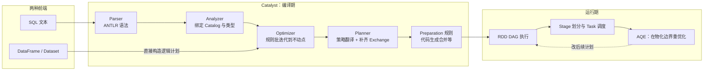
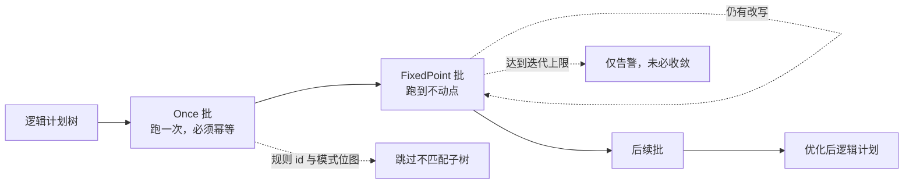
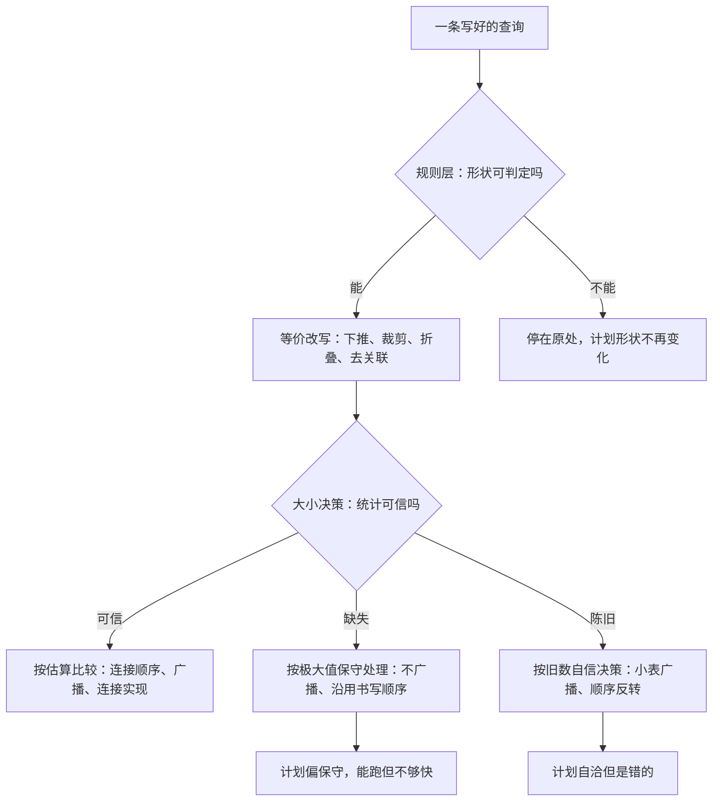
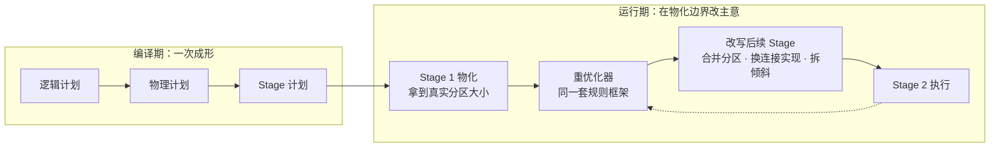
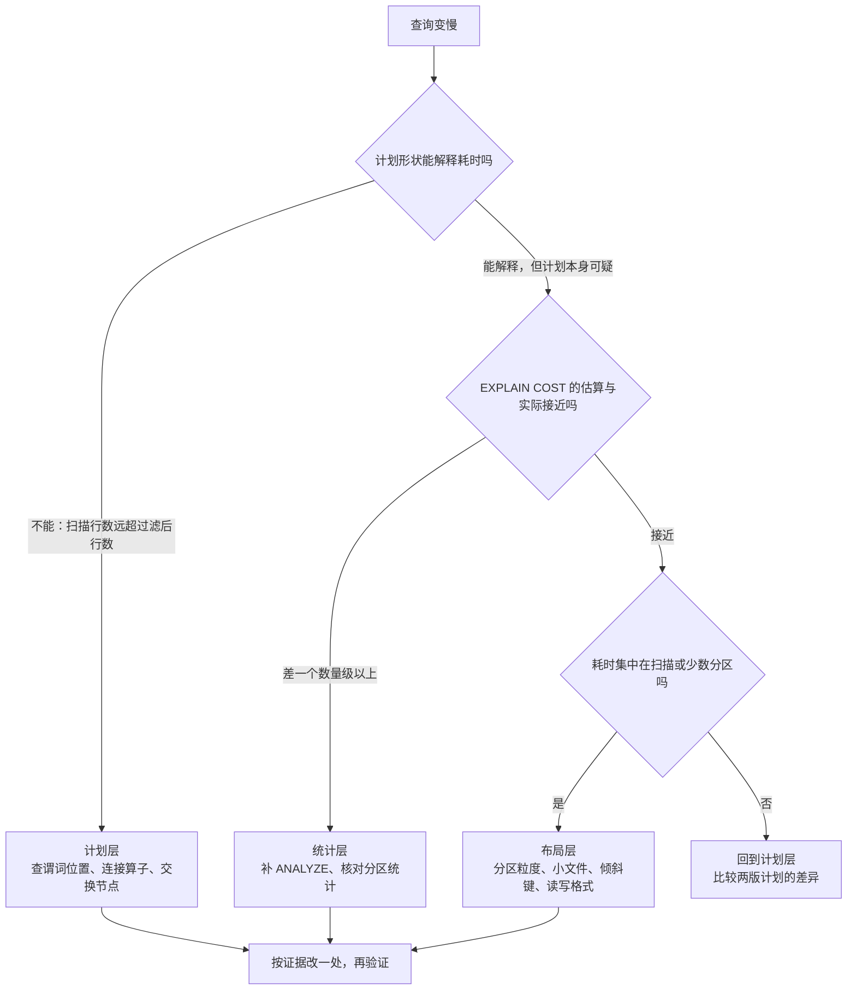

# 10 Spark SQL 与 Catalyst：可插拔优化器的能力边界

**摘要：**

关于 Catalyst 的多数介绍都从规则清单开始：谓词下推、列裁剪、常量折叠、连接重排，逐条背下来似乎就掌握了 Spark SQL 的性能。这条路径解释不了两件事——为什么语义相同的 SQL 换个写法执行计划就变了，以及为什么有些慢查询把参数翻遍也调不动。本文把 Catalyst 当成一个编译前端来读：它的结构性贡献不是规则多，而是把“优化器”从一段硬编码的逻辑序列改造成“树节点 + 规则 + 规则执行器”的可插拔结构，规则用宿主语言写、按批次反复应用到不动点，因此新增优化不必改内核。代价同样来自这层结构：它没有统一的代价模型与物理属性系统，计划的好坏取决于规则顺序、批边界与统计信息三件事能否对齐。

全文回答四个选型问题：四个阶段各自把什么从未知变成已知，这如何解释“换写法换计划”；规则与统计各自兜住哪类决策，统计缺失或陈旧时会发生什么；自适应查询执行是 Catalyst 的延伸还是替代；与 Calcite 系、Trino 的路线差别落在哪一层。末尾给出看计划、看统计、看布局的三层诊断判据，以及六类把优化器逼到边界之外的反例。机制细节留给 Spark SQL 深度专栏与 Hive 查询优化器专篇，此处只做定位与取舍。

---

## 第 1 章 一个被两种前端逼出来的编译层

2014 年 5 月 Spark 1.0 发布时，SQL 只是其中一个标注为 alpha 的模块。彼时 Hive 已经用两代优化器证明自己能吞下大多数离线 SQL：先是 0.11 时代那批以 `hive.optimize.*` 开关控制的重写规则，随后在 0.13、0.14 前后把代价优化建立在 Apache Calcite（最初叫 Optiq，2014 年进入 Apache 孵化器）之上。问题不在能力而在接口——Hive 的编译链是语法分析、语义分析、算子树重写、再交给执行引擎，规则集与开关是编译进发行版的固定清单，新增一条规则要改 Hive 源码，而且这条链只服务 SQL 这一种入口。

Spark 面对的是两种入口。SQL 文本要能被解析成一棵树，DataFrame API 也要能被组织成一棵树，两者还得共享同一份优化逻辑，否则同一个需求用两种写法会得到两种性能，这门语言就难有统一的性能预期。2015 年 SIGMOD 论文《Spark SQL: Relational Data Processing in Spark》给出的方案，是干脆不做“编译器”而做**编译框架**：两种前端先各自收敛成同一种逻辑计划（LogicalPlan），此后所有优化都表述为“一棵树变换成另一棵树”，规则用 Scala 的模式匹配书写，由框架反复应用直到没有规则再能匹配。本文以 Spark 4.3.0 为版本口径，涉及默认值处以对应版本文档为准。

### 1.1 规则驱动是被约束逼出来的选择

这个选择经常被讲成品味问题，其实是被约束逼出来的。2014 年的 Spark 没有可用的统计信息收集机制，`ANALYZE TABLE` 那套东西还留在 Hive 的地盘里，用户把 Parquet 文件直接指过来就能查，行数、列基数、空值比例一概未知。在这种前提下，任何以代价为中心的规划器都只能靠默认值猜，猜错一次就把计划带偏。规则不依赖数据，等价变换在任何数据上都成立，于是它成了唯一能“先跑起来”的优化方式。

代价优化并没有被放弃，只是被降级成了可选项：统计信息齐备时打开基于代价的优化（Cost-Based Optimization，CBO），不齐备时退回规则层，运行期再用自适应执行（Adaptive Query Execution，AQE）补齐。三种模式共存在同一个框架里，这件事比任何单条规则都更能说明 Catalyst 的设计取向——它优先保证“大多数查询在信息不全时也能得到不荒谬的计划”，而不是“信息齐备时得到最优计划”。

### 1.2 它在编译链上占的那一段

把 Spark SQL 的一次查询摊开，Catalyst 负责编译期，运行期不归它管。下图的分界线值得记一下，后文所有“优化器改不动某件事”的讨论都能在图上找到位置。



图上另有两处分界值得留意。DataFrame 入口绕过语法分析，但绕不过分析与优化，两种入口的优化质量本应一致，现实中不一致多半是写法让规则匹配不上；AQE 站在运行期却调用同一个优化器，这个细节决定了它是延伸而非替代。

### 1.3 这层位置买来的与付出的

买来的是维护成本。优化器从“一大段 if-else 流水线”变成“规则集合”，改一个优化行为的单位从“改内核、走发版”缩小到“加一个对象、写一个偏函数”，十年间社区往里堆了几百条规则，没有这层结构，这个量级的迭代无法维持。

付出的是可解释性与收敛性。规则之间的关系是隐式的：谁先谁后、哪一轮的产出喂给谁，靠批的顺序保证；规则越多，越难静态判断两条规则会不会互相抵消，于是框架外面长出幂等性检查、计划变更日志、规则白名单这些设施。可扩展性真正的载体，正是这套围绕规则运行的治理结构。

---

## 第 2 章 四个阶段，各自把什么从“未知”变成“已知”

四阶段的说法容易被当成流程背诵，其实每个阶段都在消灭一种特定的不确定性，而消灭不掉的残留恰好是后面阶段的事。理解这一点，“换写法计划就变”就不再神秘。

### 2.1 解析：把文本变成一棵还没绑定含义的树

解析（Parse）只回答语法问题：这段文本合不合语法、`SELECT` 后面跟了几个表达式。产物是一棵未解析逻辑计划，表名是字符串、列名是字符串、函数名也是字符串，没有任何一项能确认存在。这一步的失败形态最简单——语法错误，报错位置精确到行。

### 2.2 分析：把字符串变成有身份的对象

分析（Analyze）做三件事：把表名绑定到 Catalog 里的真实表，把列名绑定到带唯一 id 的属性，把函数名绑定到已注册的实现，同时推断每个表达式的数据类型，并在类型不匹配处插入隐式转换。这一步的产物是语义确定的逻辑计划，此后的所有变换都必须保持它的语义。

“计划看起来怪”的起点大多在这里。`WHERE dt = '2026-01-01'` 与 `WHERE dt = 20260101` 都在比较，但 `dt` 若是字符串分区列，后者会在分析阶段套上一层转换，分区裁剪匹配的形状随即改变；`a.id = b.id` 两侧类型不同时，插入的转换同样会改写连接条件的形态。

### 2.3 优化：只做等价变换，不碰数据

优化（Optimize）阶段的纪律很硬：只能做**等价变换**。规则批反复应用到不动点，产出仍然是一棵逻辑计划树，不读一行数据。正因为不碰数据，规则可以放心地激进重排；也正因为不碰数据，它无法回答“这两张表谁大”这类必须看数据才能回答的问题——那是统计信息的活。

### 2.4 物理规划：把“做什么”翻译成“怎么做”

物理规划（Physical Planning）把逻辑算子翻译成物理算子，选择连接实现，按物理属性要求补齐数据交换与排序，最后再跑一批准备规则（Preparation），把能合并的算子合并成一段代码。用户看到的 `explain` 输出，是这一阶段结束后的形态，而不是逻辑优化的结果。

| 阶段 | 输入到输出 | 消灭的不确定性 | 典型失败形态 | 用户可见的证据 |
| :--- | :--- | :--- | :--- | :--- |
| 解析 | SQL 文本 → 未解析逻辑计划 | 语法是否成立 | 语法错误，定位到行 | `queryExecution.logical` |
| 分析 | 未解析 → 已绑定逻辑计划 | 表、列、函数是否存在，类型是否相容 | 表或列不存在、类型转换失败 | `queryExecution.analyzed` |
| 优化 | 已绑定 → 等价优化计划 | 哪些等价重写还没做 | 极少失败，通常是没匹配上而不是报错 | `queryExecution.optimizedPlan` |
| 物理规划 | 逻辑计划 → 物理计划 | 用哪种实现、怎么交换数据 | 缺 Exchange 导致结果错、策略选错导致慢 | `queryExecution.sparkPlan` 与最终 `executedPlan` |

### 2.5 为什么换个写法计划就变

规则匹配的是**树的形状**，而形状由写法决定。语义相同、形状不同的三组例子，几乎覆盖了日常遇到的大半情况。

第一组是谓词的位置。`WHERE` 子句、`filter()` 最终都进 Filter 节点，形状一致；但 `HAVING` 在聚合之上，跨表的 `OR` 拆不开，位置决定了谓词能不能被推到扫描层。

第二组是表达式的可塑性。`id = 100` 与 `cast(id as bigint) = 100` 语义等价，但后者的左侧是函数调用，下推与分区裁剪都要判断它是否确定性、能否被反转。函数一旦不透明，规则就停在它前面，这也是 UDF 包裹连接键会把计划推向嵌套循环连接的原因。

第三组是连接顺序。未开启 CBO 时，多表连接只受保语义的重排影响，没有大小比较；不同的书写顺序会让中间结果差一个数量级，而计划不会替你改回来。

想确认一次查询在各阶段长什么样，`QueryExecution` 把五份计划都摊开在了同一个对象上。

```scala
val qe = df.queryExecution
qe.logical        // 解析产物：SQL 入口下是未绑定计划
qe.analyzed       // 名字与类型绑定完成
qe.optimizedPlan  // 规则跑完、物理规划之前的逻辑计划
qe.sparkPlan      // 策略翻译出的物理计划，交换与排序未必补齐
qe.executedPlan   // 补齐物理属性、合并代码块之后的最终计划
```

`explain()` 默认打印最后一份，`explain("extended")` 才把逻辑计划一并翻出。排障时先分清看的是哪一份，能省掉很多“我明明写了过滤条件”的争论。

---

## 第 3 章 可扩展性的真实载体：批、固定点与剪枝

把 Catalyst 的可扩展性归功于树节点（TreeNode）与规则（Rule）两个抽象，只说对了一半。树节点是一套遍历原语，规则是一个函数签名，这两样东西任何编译器前端都有；真正让“加一条规则”变成低风险动作的，是围着它们转的那套执行与治理机制。

### 3.1 四件套：偏函数、批、固定点、剪枝

第一件是**偏函数**。规则的签名只是“一棵树进、一棵树出”，但匹配用偏函数表达，不匹配时原样返回，因此规则可以任意叠加而不互相破坏接口——新增规则的最坏后果是“不生效”，不是“把别人的计划改坏”。

第二件是批（Batch）。规则按批组织，批的顺序固定，批内规则顺序也固定。**批边界是隐性契约**：前一批把子树整理成某种形状，后一批才能匹配；顺序一变，能触发的规则集合就变。

第三件是固定点。批的策略分两种，跑一次（Once）与反复跑到不动点（FixedPoint）。Once 批必须幂等，否则重复执行会得到不同计划，测试环境下会直接失败；固定点批则要防不收敛，迭代次数上限由 `spark.sql.optimizer.maxIterations` 控制，默认 100。

第四件是剪枝。每条规则在初始化时拿到一个规则 id，节点上用位图记录自己包含哪些模式，遍历时先看位图再决定要不要进入函数调用。少了这一层，几百条规则乘以每轮全树遍历，编译时间会膨胀到无法接受。

这四件东西首尾相接，就是规则执行器的完整形态：批决定顺序，固定点决定每批跑几轮，剪枝决定每轮看哪些子树。



```scala
// sql/catalyst/src/main/scala/org/apache/spark/sql/catalyst/rules/Rule.scala
abstract class Rule[TreeType <: TreeNode[_]] extends SQLConfHelper with Logging {
  // 规则 id 的唯一用途：配合节点模式位图跳过不可能匹配的子树
  protected lazy val ruleId = RuleIdCollection.getRuleId(this.ruleName)
  def apply(plan: TreeType): TreeType
}

// sql/catalyst/src/main/scala/org/apache/spark/sql/catalyst/optimizer/Optimizer.scala
protected def fixedPoint =
  FixedPoint(conf.optimizerMaxIterations,
    maxIterationsSetting = SQLConf.OPTIMIZER_MAX_ITERATIONS.key)
```

规则本体则是这样的形态：先按模式位图剪枝，再写匹配分支，分支内部只做局部改写。

```scala
// 示意：实际规则还要处理空值、确定性与输出列对齐，此处省略
object PushPredicateThroughNonJoin extends Rule[LogicalPlan] {
  override def apply(plan: LogicalPlan): LogicalPlan =
    plan.transformWithPruning(_.containsPattern(FILTER), ruleId) {
      case Filter(cond, project: Project) if cond.references.subsetOf(project.outputSet) =>
        project.copy(child = Filter(cond, project.child))
    }
}
```

### 3.2 治理设施才是可维护性的来源

规则一多，“为什么计划没变”就成了高频问题，框架外面因此长出一层治理设施，每一条都对应一个生产动作。

| 设施 | 配置项 | 解决的问题 | 使用时要注意 |
| :--- | :--- | :--- | :--- |
| 排除规则 | `spark.sql.optimizer.excludedRules` | 某条规则在特定负载下帮倒忙，先关掉止血 | 名字写错会被静默忽略，配置了不等于生效 |
| 计划变更日志 | `spark.sql.planChangeLog.level` 与 `.rules`、`.batches` | 看清哪条规则改了计划，改前改后各是什么 | 默认级别为 TRACE，量大，务必只开指定规则或批 |
| 迭代上限 | `spark.sql.optimizer.maxIterations` | 防止规则互相触发形成不收敛循环 | 超限默认只告警不失败，计划可能没收敛就跑 |
| 幂等性检查 | 测试期自动启用 | 抓 Once 批被重复执行却没有稳定的情况 | 只覆盖 Once 批，固定点批的抖动靠对比计划发现 |

### 3.3 这套结构的账要算在收敛性上

没有物理属性系统是第一个代价。其他规划器把分布、分区、排序做成可推导的类型，规划时按属性搜索实现；Catalyst 把属性留给事后的补齐规则，交换节点是“翻译完再补”，中间计划会短暂处于属性不满足的状态，规则必须小心别在这段窗口里做错判断。

没有全局代价模型是第二个代价。代价只出现在少数规则里——连接重排、连接策略选择、AQE 内部的代价评估器，其余决策靠阈值与形状。这让计划生成快且可预测，“最优”从来不是这个框架的目标。

第三个代价是规则演进成为升级风险。4.2 起合并子查询的规则由 `MergeScalarSubqueries` 改名 `MergeSubplans`，4.3 又换包名，而排除规则里写旧名字不报错，升级后“明明关掉了却还在生效”。4.1 起实验的单遍解析器（`spark.sql.analyzer.singlePassResolver.enabled`，默认关闭）意在减少固定点往返，等于承认开销落在遍历上。

打个比方，这套结构像装配车间的工位制：加工位容易，定好上游送什么、下游接什么即可；但工位顺序是整条产线的契约，调顺序要重新验证相邻工位的接口。规则作者改的是工位，维护者签的是产线。

---

## 第 4 章 规则兜结构，统计兜大小

规则与统计的分工可以用一句话概括：**规则处理形状，统计处理大小**。凡是“不需要看数据就能判定更优”的改写归规则，凡是“必须比较两边谁多谁少才能判定”的决策归统计。这条分界线比“RBO 与 CBO 谁更好”有用得多，因为它直接回答了某条慢查询该往哪个方向调。

### 4.1 规则能兜住的那一类

规则处理的都是可判定的等价变换：谓词推过连接与聚合、把用不到的列从扫描里摘掉、把能在编译期算完的表达式算完、把 `IN` 子查询改写成半连接、把空关系传播成空结果、把连续的投影合并。这些变换的正确性不依赖数据分布，任何一行数据都不会让它们从正确变成错误，所以它们可以在信息全无的情况下放心执行。

边界同样清楚：判定依赖表达式的形状。函数一旦不透明（自定义函数、正则、复杂的字符串解析），规则只能停在它前面；谓词一旦跨表，就没法拆给任意一边；外连接的外侧谓词不能下推，推了会改变空值填充的语义。

### 4.2 统计能兜住的那一类，以及 Spark 的默认姿势

需要比较大小的决策有一串：连接顺序、能否广播、连接实现、聚合是否两阶段、Shuffle 后多少分区。没有统计信息，这些只能靠默认值。

Spark 在这里的默认姿势常被误解。4.3 文档口径下，`spark.sql.cbo.enabled` 与 `spark.sql.cbo.joinReorder.enabled` 默认都是 false，绝大多数集群跑在“代价模块存在但默认不接入”的状态：广播与否由固定阈值（`spark.sql.autoBroadcastJoinThreshold`，默认 10MB）与大小估算决定，连接顺序基本沿用书写顺序。把它读成“CBO 效果不好”是误读，更准确的说法是把代价决策做成了**可选项**，默认只保留不会出错的启发式。

统计信息有三个来源，可信度与代价各不相同。

| 来源 | 提供什么 | 怎么获得 | 代价 | 什么时候不该信它 |
| :--- | :--- | :--- | :--- | :--- |
| 数据源元数据 | 文件级大小、行组与页的最小最大值、湖表的清单统计 | 读取时自动获得，无需额外命令 | 几乎为零 | 只覆盖存储层能表达的信息，跨文件聚合的基数是估的 |
| Catalog 统计 | 表级行数与字节数、列级基数、空值数、直方图 | `ANALYZE TABLE` 显式收集，落在 Metastore | 表级便宜，列级要扫数据 | 收集之后就冻结，数据每天增长而统计不动 |
| 运行期统计 | 物化后每个分区的真实字节数、行数 | AQE 在 Stage 边界采集 | 一轮额外的规划开销 | 它只对当前这次执行有效，不能沉淀给下一次 |

### 4.3 统计缺失与统计陈旧，是两种不同的故障

缺统计和有过期统计，后果方向相反，这一点决定了处置手法。

缺统计时，框架走保守路线：大小未知按极大值处理，广播判定因此倾向于“不广播”；行数未知则估算失真但不至于荒谬。表现是“不算错但不够好”，作业能跑完，只是慢。

统计陈旧时，框架会**自信地错**：表从 5MB 长到 2GB，统计里还是 5MB，于是它被广播到每个执行器，任务在拉取广播数据时超时或把内存打满。这类故障可怕在计划自洽、日志干净，唯一线索是 `EXPLAIN COST` 的估算行数与实际差几个数量级。写入侧还有一处：表大小与行数的自动更新默认关闭（`spark.sql.statistics.size.autoUpdate.enabled` 默认 false），“写完统计会自己变”这个假设不成立。

把两种故障放回决策链上，这条分界线在什么地方起作用就看得出来了。



| 决策 | 由谁决定 | 依赖什么 | 统计缺失或失真时的行为 | 怎么看出来 |
| :--- | :--- | :--- | :--- | :--- |
| 谓词能否下推 | 规则 | 表达式形状与确定性 | 不受统计影响，只看形状 | 扫描节点里有没有 Filter |
| 列能否裁剪 | 规则 | 输出列引用 | 不受统计影响 | 扫描节点的输出列数 |
| 多表连接顺序 | 规则（保语义重排）或代价（开启后） | 表大小、连接后行数 | 退回书写顺序，中间结果可能巨大 | 物理计划里连接的左右子树 |
| 是否广播 | 阈值加大小估算 | 关系字节数 | 未知按极大处理，倾向于不广播 | 有没有 BroadcastExchange |
| 连接实现 | 策略加大小估算 | 两边大小、连接类型、等值条件 | 退化到排序归并或嵌套循环 | 计划里的 Join 算子名 |
| 分区是否合并 | 运行期（AQE） | 物化后的真实分区大小 | 未开启则按固定分区数执行 | SQL 页面里的分区数变化 |

### 4.4 为什么有些查询“调不动”

把上面的分工合起来看，“调不动”通常落在三类原因上，处置方式完全不同。

第一类是规则门没开或形状不匹配。默认关闭的开关（例如连接重排）、被写法挡住的表达式（函数包裹连接键）、跨表拆不开的谓词，都属于这一类；看计划就能定位，改写法或显式开开关即可，不必动数据。

第二类是统计不可得或不可信。目录里没有列统计、统计停在上个月、分布与均匀假设冲突，都会让大小类决策失准；处置是先补统计或验证统计，盲目改阈值只是把一个错误换成另一个错误。

第三类是决策点不在优化器覆盖范围里。单键占比九成的倾斜、按天分区却要查三年、几十万个小文件、每行走一次 Python 自定义函数，这些在计划层面毫无破绽，因为优化器无从改写。此时该动的是数据布局、写入策略或计算模型，继续在优化器里找答案只会得到“计划没问题”这个正确而无用的结论。

---

## 第 5 章 自适应执行：延伸，不是替代

自适应查询执行常被描述成“Spark 3.0 之后的新优化器”，这会让人以为它和 Catalyst 是两套东西。实际情况更接近“**同一个优化器的第二次出场**”：AQE 在数据交换的边界把计划切成若干段，前一段物化后拿到真实分区大小，再用同一个框架改后续计划。

### 5.1 它复用的是同一套骨架

AQE 的优化器同样是规则执行器的子类，同样按批跑规则，同样有固定点与排除规则列表（`spark.sql.adaptive.optimizer.excludedRules`），甚至可以替换代价评估器（`spark.sql.adaptive.customCostEvaluatorClass`）。它没有引入新的计划表示，也没有绕开 Catalyst，只是在运行期多拿到了一类编译期不可能有的输入：每一段真实的输出大小。

它替代的是一个假设：编译期必须一次猜准。这个假设在 2015 年成立，因为当时没有别的信息可用；到运行期能测量时，就没有理由继续押注。



### 5.2 它能改的与改不动的

能改的四类事情有个共同前提：决策点位于数据交换之后。合并过小的分区、把排序归并连接换成广播哈希连接或 Shuffle 哈希连接、把倾斜分区拆开，这四件事都要先知道真实分区大小，正好是编译期猜不准的地方。

改不动的部分同样清楚：没有交换边界就没有重优化机会，扫描内部的谓词已经定型；倾斜优化只覆盖排序归并连接，连接做成广播哈希后倾斜会换一种形态出现；表达式不透明的，运行期照样不透明。

| 决策点 | 编译期是否已定 | AQE 能否改 | 说明 |
| :--- | :--- | :--- | :--- |
| 扫描谓词与分区裁剪 | 已定 | 不能 | 扫描是计划的第一段，没有前置物化可依据 |
| Shuffle 分区数 | 已定 | 能 | 按真实分区大小合并，目标大小可配 |
| 连接实现 | 已定 | 能 | 依据物化后的实际大小在排序归并与哈希之间切换 |
| 是否广播 | 已定 | 能 | 但只在运行时发现某一侧确实足够小的时候 |
| 倾斜分区处理 | 已定 | 能 | 仅针对排序归并连接，拆分或复制倾斜分区 |
| 聚合与窗口实现 | 已定 | 不能 | 没有可依据的中间物化点 |
| 连接键上的不透明表达式 | 已定 | 不能 | 形状问题，不是大小问题 |

### 5.3 代价是可复现性

AQE 最容易被低估的代价不是额外的规划开销，而是**计划不再可复现**。`explain` 给出的是提交执行时的初始计划，运行期改写后的最终计划只存在于 SQL 页面里；同一个查询两次执行的计划可能不同，因此“照着线上计划在本地区复现”这条路经常走不通。

这条代价在两类场景里变成真问题。需要稳定尾延迟的在线查询，分区合并的抖动就是噪声；拿计划做性能回归的团队，少了稳定基线就没法判断改动好坏。处置不是关掉 AQE 一刀切，而是先归类：抖动敏感就把分区目标与初始分区数固定，让合并输入稳定；对比困难就采集 SQL 页面的最终计划而不是 `explain` 的输出。

4.3 的文档里还有另一种趋势：AQE 的决策正被拆成越来越多的开关，连接转换与代价评估的细项都能单独控制。可配置性上去了，默认行为却更难一句话说清，这也是读计划比背参数可靠的缘故。

---

## 第 6 章 三条优化器路线：Catalyst、Calcite 系与 Trino

把 Spark 的优化器放到同类里看，最有价值的对比不是规则数量，而是“可扩展性的单位”和“代价决策的覆盖面”。三条路线恰好在这两个维度上画出了不同的边界。

### 6.1 三种边界画法

Catalyst 把可扩展性给了规则作者。规则直接操作宿主语言的树，能访问 Spark 的类型系统、表达式、元数据，加规则不必跨语言、不必序列化、不必翻译模型。代价是没有 trait 与约定（convention）系统，物理属性靠事后补齐；代价模型只覆盖少数几个决策点。

Calcite 系（Hive 4.x 的代价优化、Flink 的表 API 规划都建立在它之上）把可扩展性给了框架。它提供统一的关系代数表示、可推导的属性、基于 Volcano 与 Cascades 的搜索、可插拔的元数据与代价函数，接入方要做一次**跨模型翻译**：算子树翻成 RelNode，选中的计划再翻回来。翻译层薄则复用收益大，厚则每加一个语义特性都要同时改两边。

Trino 走第三条路：优化器自研、规则迭代应用，代价信息下沉到连接器。它不做全局搜索，只在连接枚举与分布选择上使用代价；统计由连接器提供，湖表连接器给清单级统计，普通数据库连接器借对方的元数据，给不出的靠默认值。这条路把优化质量与连接器的元数据质量绑在一起。

| 维度 | Catalyst（Spark） | Calcite 系（Hive CBO、Flink） | Trino |
| :--- | :--- | :--- | :--- |
| 抽象单位 | 宿主语言的逻辑计划树 | 关系代数节点（RelNode） | 自研的计划节点与算子 |
| 扩展单位 | 一条规则加进某个批 | 一条规则加进规划器，或换代价函数 | 一条迭代规则，或连接器提供的统计 |
| 代价覆盖 | 局部：连接顺序、连接实现等少数决策 | 全局搜索：等价计划空间内择优 | 局部：连接枚举与分布选择 |
| 物理属性 | 事后补齐交换与排序 | 属性与约定参与规划 | 属性推导加连接器声明 |
| 统计来源 | 数据源元数据、Catalog、运行期 | 元数据提供者与外部统计 | 连接器 |
| 典型失效 | 规则顺序变化、统计缺失或陈旧 | 翻译层与语义特性不同步 | 连接器给不出统计 |
| 适用判断 | 需要快速加规则、负载形态杂 | 已有关系代数模型、需要全局搜索 | 联邦查询、连接器生态广 |

### 6.2 没有更先进，只有边界画在哪

三条路线的差别不在工程水平，而在**把复杂度放在哪**。Catalyst 把复杂度放进了治理设施——规则多、批多、开关多，靠日志与测试兜住；Calcite 把复杂度放进了翻译层，接入者要维护两套模型之间的一致性；Trino 把复杂度放进了连接器，元数据质量直接决定计划质量。

这条判断在选型上有直接用处：痛点是业务语义表达不出来、要在引擎侧加规则，Catalyst 门槛最低；痛点是多源统计不统一、要全局规划，Calcite 系更合适；痛点是跨源只读、优化要跟着数据源走，Trino 更贴合。把三条路线当性能排名来比，结论只有“都在进步”。

---

## 第 7 章 诊断的三层判据：看计划、看统计、看布局

慢查询排障最常见的浪费，是在错误的层里找答案。三层判据的作用是尽早把问题归位：**计划层管形状，统计层管大小，布局层管分布与存储**。

### 7.1 先分层的理由

三层的失败形态不同：计划层的失败是“该做的改写没做”，证据是节点位置不对；统计层的失败是“该比较时用了错数”，证据是估算与实际差得离谱；布局层的失败是“怎么改写都快不了”，证据是计划干净、统计准确、耗时仍在扫描或某个分区。分层之后每层都有明确的验证动作，不必把参数挨个试一遍。



### 7.2 每一层该看什么

计划层的动作是读形状：扫描节点里有没有过滤条件、连接算子是哪一种、有没有不必要的交换、输出列是不是被裁到了最小。这一层几乎不需要统计信息，纯看结构。

统计层的动作是对数：用 `EXPLAIN COST` 或 `explain(mode="cost")` 看优化器估了多少行，再和实际处理的行数比；用 `DESCRIBE EXTENDED` 看 Catalog 里存的统计是什么时候的、覆盖了哪些列。差值大就补统计，差值小就把怀疑转回计划层。

布局层的动作是看数据：单个分区是否远超中位数、分区粒度是否匹配查询范围、文件数是否已多到元数据操作成为瓶颈。证据不在计划里，在执行详情与存储清单里。

| 症状 | 该看哪一层 | 具体动作 | 常见结论 |
| :--- | :--- | :--- | :--- |
| 扫描行数远大于过滤后行数 | 计划层 | 看过滤条件是否在扫描节点内 | 表达式挡住了下推，或分区列被函数包裹 |
| 连接算子为嵌套循环 | 计划层 | 看连接条件是否为等值、是否有函数包裹 | 连接键不可哈希，只能嵌套循环 |
| 出现大量交换节点 | 计划层 | 数一数 Exchange 的个数与位置 | 连接顺序不佳或分区策略冲突 |
| 估算行数与实际差几个数量级 | 统计层 | `EXPLAIN COST` 对比实际，查 Catalog 统计 | 缺列统计，或统计停留在写入前 |
| 广播数据拉取超时 | 统计层 | 看广播侧的真实大小与阈值 | 统计陈旧导致误判为小表 |
| 少数任务耗时是其余任务的数十倍 | 布局层 | 看分区大小分布与连接键分布 | 键值倾斜，需拆分或改分布 |
| 扫描本身就很慢且行数正常 | 布局层 | 看文件数、文件大小、读取的列数 | 小文件过多或读取列未裁剪 |

### 7.3 六类把优化器逼到边界之外的反例

下面六种形态在真实集群里反复出现，共同点是优化器没有犯错，问题本来就不在它的能力范围内。

| 反例 | 计划里的证据 | 根因 | 处置 |
| :--- | :--- | :--- | :--- |
| 用户自定义函数包裹连接键 | 连接退化为嵌套循环或笛卡尔积 | 表达式不透明，等值条件无法哈希 | 在函数外先物化出干净的连接键列 |
| 分区列与常量类型不一致 | 扫描节点里读全部分区 | 类型转换让分区裁剪匹配不上 | 常量显式转成分区列的类型，或统一建表类型 |
| 统计陈旧且开启了代价优化 | 小表被广播，广播拉取超时 | 表已长大，Catalog 里还是旧行数 | 对新分区收集统计，或临时关掉代价优化 |
| 查询嵌套过深 | 日志里出现迭代上限告警，计划未收敛 | 规则互相触发，固定点跑满次数 | 拆查询、开计划变更日志定位，把上限只当诊断手段 |
| 排除规则名字写错 | 配置已设，计划行为不变 | 未知规则名被静默忽略 | 用全限定类名，改版本后重新核对 |
| 宽表全列查询 | 扫描输出列等于表列数 | 列裁剪没有可裁剪的空间 | 只取需要的列，或建宽表视图按需投影 |

第四条值得多说一句。把 `spark.sql.optimizer.maxIterations` 调大能让告警消失，但**告警消失不等于计划收敛**，它只是把“跑满 100 轮”变成“跑满 500 轮”，编译时间成倍增长而计划未必更好。这个配置的正确用法是诊断：临时调大看是否收敛，确认后再拆查询结构。

### 7.4 三类不该把希望寄托在优化器上的场景

第一类是分布问题。单个键占九成数据，任何连接实现都只能让一个任务扛下九成工作量；拆分、加盐、单独处理热点键都发生在数据侧，优化器看不见也不该看见。

第二类是布局问题。按天分区却要回溯三年、几十万个小文件、每行跨进程调一次 Python 函数，代价在读取与序列化上，计划里只体现为“扫描干净但就是慢”；该改的是写入策略与文件组织。

第三类是语义问题。业务逻辑必须用外部库实现、必须做非确定性采样、必须逐行调模型推理，这些表达式天然不透明，优化器只能当黑盒。遇到这类需求，正确的问题是“这段逻辑能不能在进入 SQL 之前做完”，而不是“怎么让优化器看懂它”。

---

## 第 8 章 落点

Catalyst 留下的真正遗产，是把“改进优化器”这件事的单位缩小了：从修改内核的一个阶段，变成往某个批里加一个对象。这条设计让 Spark 在十年里堆出了与业务形态匹配的规则集合，也让“同一句 SQL 换写法计划就变”成为常态——**形状决定匹配，匹配决定改写的可能性**。

但**可扩展性不解决最优性问题**。代价决策默认关闭、统计要靠人维护、物理属性靠事后补齐，这三件事决定了计划质量的上限取决于两件优化器看不见的事：统计是否可信，数据布局是否合理。实际收益是排障顺序的变化——先看计划形状对不对，再看统计数字能不能信，最后才判断问题是否根本不在优化器手里。

4.x 的方向仍在同一框架内：减少遍历的实验、规则家族化与参数化配置、把更多决策推迟到运行期。这些动作都在承认同一个前提——编译期能确定的东西越来越少，而框架的价值恰恰在于让“运行时改主意”这件事不需要重写优化器。至于这条路能走多远，目前仍然言之尚早。

机制细节不必在本文里找：解析与分析、逻辑优化规则集、代价模型与连接重排、物理规划的策略选择、自适应执行的三种能力，都在 [[大数据/Spark/Spark-SQL深度解析与性能调优/00 专栏导览|Spark SQL 深度解析与性能调优]] 里逐层拆开（该专栏以 3.3、3.4 为基准，4.x 的规则改名与新开关需对照官方文档）；物理计划生成之后的 Stage 划分与调度归 [[大数据/Spark/读书笔记-spark内核/00 专栏导览|Spark 内核剖析]]；另一套实现见 [[大数据/Hive/05 查询优化器：RBO 规则集与 CBO 代价模型|Hive 查询优化器：RBO 与 CBO]]，那里的规则清单与统计维护更细，本文不重复。

---

## 参考资料

- Armbrust, M., et al. “Spark SQL: Relational Data Processing in Spark.” SIGMOD 2015. <https://people.csail.mit.edu/matei/papers/2015/sigmod_spark_sql.pdf>
- Apache Spark 4.3.0 文档：Performance Tuning（统计信息、连接策略、自适应执行、存储分区连接）. <https://spark.apache.org/docs/latest/sql-performance-tuning.html>
- Apache Spark 4.3.0 文档：Configuration（`spark.sql.cbo.enabled`、`spark.sql.autoBroadcastJoinThreshold`、`spark.sql.optimizer.excludedRules` 等默认值以对应版本文档为准）. <https://spark.apache.org/docs/latest/configuration.html>
- Apache Spark 源码：`sql/catalyst/src/main/scala/org/apache/spark/sql/catalyst/rules/Rule.scala`、`.../rules/RuleExecutor.scala`、`.../optimizer/Optimizer.scala`、`sql/catalyst/src/main/scala/org/apache/spark/sql/internal/SQLConf.scala`（迭代上限、计划变更日志、单遍解析器开关）. <https://github.com/apache/spark>
- SPARK-40193、SPARK-56677：合并子查询规则的收益测量与新配置族（4.2、4.3）. <https://issues.apache.org/jira/browse/SPARK-40193>
- Apache Calcite 文档：关系代数与规划器. <https://calcite.apache.org/docs/>
- Hive CBO 设计文档. <https://cwiki.apache.org/confluence/display/Hive/Cost-based+optimizations+in+Hive>
- Trino 文档：Cost-based optimizations、Adaptive plan optimizations（连接枚举依赖连接器统计）. <https://trino.io/docs/current/optimizer/cost-based-optimizations.html>

> [!note] 思考题
> 1. 你所在集群的 `spark.sql.cbo.enabled` 是默认值 false 还是被显式打开过？如果打开，统计信息的更新频率由谁负责？
> 2. 找一条你觉得“调不动”的慢查询，先只看计划形状与 `EXPLAIN COST` 的估算偏差，能把它归到三层里的哪一层？
> 3. 如果团队要往优化器里加一条自定义规则，你们能在不修改 Spark 发行版的前提下做到吗？卡在哪一步？
> 4. AQE 让计划不可复现，你们的性能回归基线是怎么采集的？采集的是 `explain` 输出还是 SQL 页面的最终计划？
> 5. 若把统计信息换成由湖表元数据自动维护，你认为哪些决策会立刻变好，哪些仍然不会变？