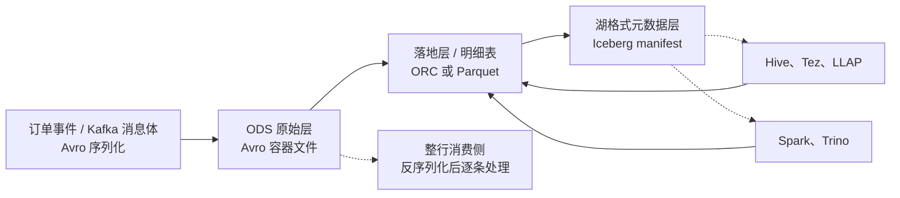
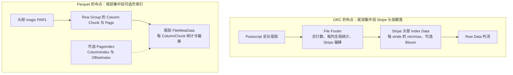
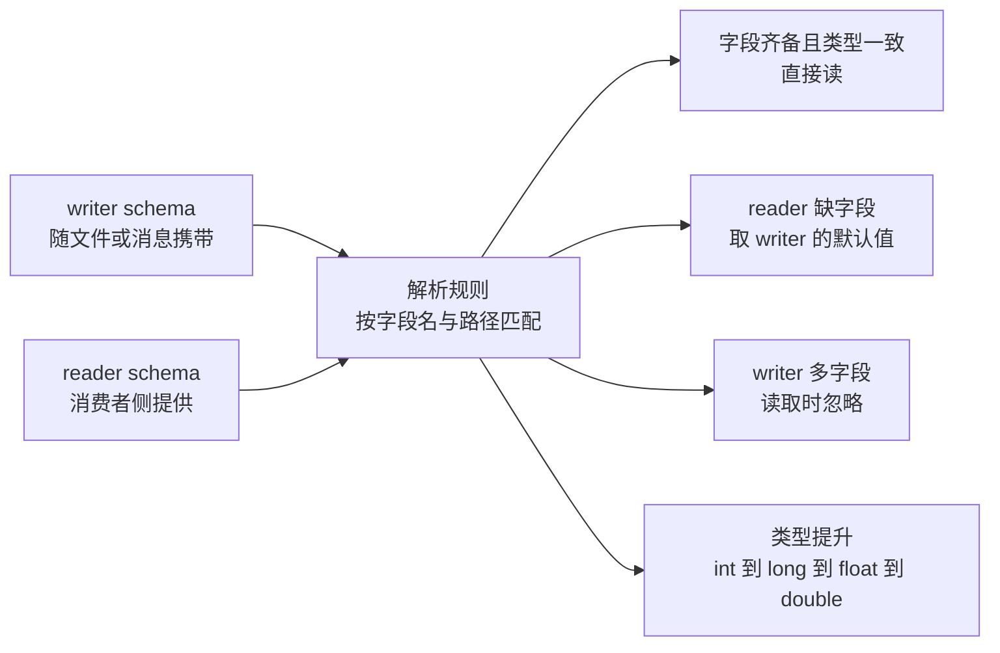
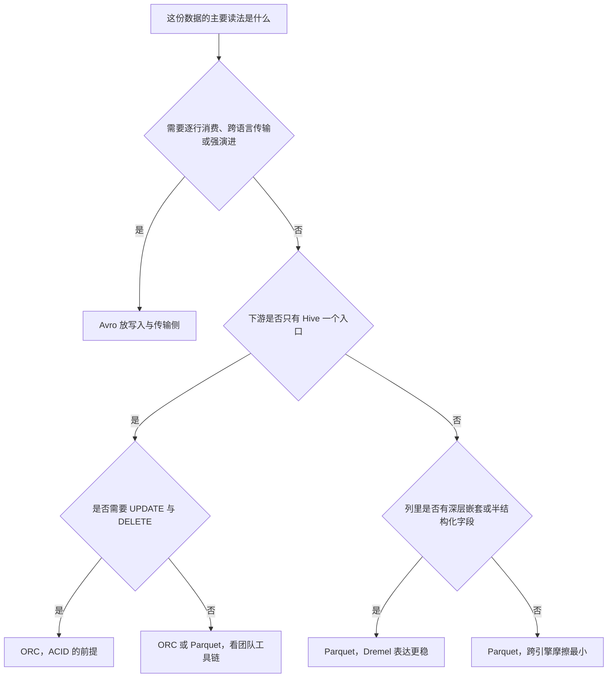

**摘要：** 讨论 ORC、Parquet、Avro 的取舍，容易停在"列存压缩好、行存写得快"这一类结论上，但真正决定一条查询要碰到多少字节的，是列式布局、统计信息与数据聚簇度三者叠加之后的合力，格式本身只负责把可能性摆到桌面上。这篇文字先把列式与行式的物理账本摊开，说明列式在投影选择性、同质数据的编码空间与批式处理三处占优，又在整行读取、宽表全列扫描与小文件三处退让；随后比较 ORC 与 Parquet 的出身如何写进各自的默认值——索引布点、统计粒度、嵌套表达与生态偏向，并指出"ORC 索引细、Parquet 索引粗"是一个需要附加前提才成立的旧结论。Avro 不参与这场比较，它占的是写入与传输侧的位置，schema 演进能力才是它真正的资产。后半部分处理编码与压缩之间的兑换率、谓词下推成立的四个前提，以及湖格式为什么要把文件级统计搬到元数据层。落地一节给出按引擎、按访问模式、按演进需求三组判据与四类典型反例，落点是一句不太好听的话：格式只让优化有可能，聚簇度与统计可信度决定它到底能省多少。

---

## 第 1 章 一次查询究竟碰到了多少字节

2013 年前后发生的两件事，把这条路线的格局定下来了大半。Hortonworks 的 Hive 团队把沿用多年的 RCFile 换成自家设计的 ORC，随 Hive 0.11 一起发布；几乎同一时间，Twitter 与 Cloudera 联合提出了 Parquet，把 Google 在 2010 年 VLDB 上发表的 Dremel 论文当作表达嵌套数据的理论基础，Cloudera 的 Impala 成为它最早的消费者。再往前推四年，Doug Cutting 已经在 Hadoop 里用 Avro 替掉了表达能力有限的 Writable 序列化。三种格式，三段互不重叠的出发点，后来却被摆进同一张选型表里反复比较，这件事本身就值得先拆开看看。

笔者用一张订单明细表贯穿全文：`orders`，四十列，按 dt 分区，单日两亿行，落在约两百个文件里。围绕它有三条查询与一条写入链路：日报类聚合、按订单号的点查、明细回灌导出，以及实时订单事件先写进 Kafka 再落表。同一条数据，四种读法，命中的字节数差了两个数量级，而格式能左右的只是这个差距里的一部分。

### 1.1 三条查询，三种命

日报查询是这样的：`SELECT status, SUM(amount) FROM orders WHERE dt = '2026-11-18' GROUP BY status`。它只要两列，外加分区列做过滤，四十列里的三十七列连碰都不必碰。

点查是另一种形态：`SELECT * FROM orders WHERE order_id = 'A1024...'`。它要一整行，而且过滤列是高基数的订单号，统计信息在这里几乎帮不上忙，真正决定成败的是能不能快速定位到那一行。

明细回灌则是第三种：`SELECT * FROM orders WHERE dt = ...`，整行、全列、顺序扫。它看上去最像"列式最不划算"的那种查询，实际却因为顺序 IO 与高压缩率而并不难看。

### 1.2 行式布局的三笔账

把一行四十列按顺序码放在一起，第一笔账是**读放大**。假设每行约八百字节，日报查询真正需要的 `amount`、`status`、`dt` 合起来不到三十字节，行式布局下每读一行仍要付八百字节的代价，放大约三十倍，多出来的部分读进内存之后被直接丢掉。

第二笔账在压缩上。同一行的四十列类型各异，整型、字符串、小数、时间戳交错排列，通用压缩算法在滑动窗口里看到的是几种不同分布的字节混在一起，只能按字节频次工作，学不到"这一列全是那三个枚举值"的规律。

第三笔账在跳读上。行式想跳过一部分行，只能按行宽逐行走，成本与行数成正比；分区裁剪把范围缩得很小之后，这笔开销反而成了主要成本。

> 打个比方，行式布局像搬家时按房间装箱：客厅的东西装一箱，卧室的装一箱，找一只杯子要拆开整只箱子，但搬起来省事，因为每只箱子自成一体。

### 1.3 列式布局的两笔账

列式布局把同一列的值连续码放，第一笔账立刻反转：投影只读需要的列块，三十七列不产生一次 IO；同列数据同质，编码器有语义可用，字典、游程、增量才有施展空间。这两笔收益彼此独立，却被合并成了"列式就是快"这一个印象。

第二笔账是代价，而且通常被忽略。取一整行时，列式要打开四十个列块、各自解码、再按行号拼装回去，seek 次数与解码次数都随列数线性增长；写入时要在内存里为每一列维护缓冲，攒够一批才能刷盘，写放大也随列数增长。列式并没有让成本消失，它完成了一次**成本转移**，把负担从读取端挪到了重建端与写入端。理解这条转移，后面很多"为什么换了格式还是慢"的困惑就不难解释了。

把三者放回数据栈里看，它们的位置关系比任何特性对照表都更能说明问题：

图上这条链把三者的位置说清了：Avro 站在写入与传输那一段，ORC 与 Parquet 站在落地与扫描那一段，湖格式在两者之上再叠一层元数据。它们不是同一格里的三个候选，而是流水线上的三个工位。

| 访问模式 | 选中列占行宽 | 行式要读的字节 | 列式要读的字节 | 谁占优 |
|---|---|---|---|---|
| 日报聚合（两列加分区） | 约 3% | 整文件 | 约 3% 的列块 | 列式，差距在十倍量级以上 |
| 高基数点查（整行） | 100% | 一次定位后读一行 | 四十个列块各来一次 | 行式，或干脆换引擎 |
| 明细回灌（整行全列） | 100% | 整文件 | 整文件加元数据 | 接近持平，列式靠压缩率小胜 |
| 极端宽表全列扫描 | 100% | 整文件 | 整文件加四十次 seek | 行式，列式反而不划算 |

表里的数字是同一套假设下的算术结果，不是实测值，但它把判据摆清楚了：列式的收益由选中列占行宽的比例决定，比例越小收益越大，接近百分之百时收益归零，还要倒付元数据与 seek 的成本。

---

## 第 2 章 IO 模式如何倒逼物理布局

### 2.1 读放大的算术

把上面的账写成式子更省事。设文件大小为 S，选中列占行宽的比例为 p，列式的元数据开销为 M，那么行式大约要读 S，列式大约要读 pS + M，收益是 (1−p)S − M。这个式子里没有出现"列式"这个词，只出现了 p 与 M，说明收益来自**投影比例**与元数据规模的对比，而不是来自某种格式的名声。

M 在小文件上会变得很难看。文件只有几兆时，列块个数与每个列块的最小读取单位（一个页、一段字节流）让实际读量远超 pS，压缩收益被固定开销吃掉，这就是"先治理小文件、再谈格式"不能颠倒的原因。

### 2.2 同质性与熵

列内同质带来三层收益。类型同质让编码器按列选算法，整型走位打包与增量、字符串走字典、布尔走位图，行式布局没有这个自由度，只能对混合字节流用同一种通用压缩；分布同质让相邻值相近或重复，游程与增量的效率远高于随机数据；统计同质让同一列的 min/max 在块内收敛得快，谓词下推的裁剪才有意义。

> 这像化验单按项目分试管：同一项指标放一支管，仪器一次读数就能看出分布规律；把全身指标混进一支管，仪器只能看到一锅粥。列式的压缩红利，本质上是把**同类相邻**变成了物理上真的相邻。

不过这三层收益重叠，不能相加。压缩率提高会让 pS 更小，但解压本身要付 CPU，省下的时间又还回去一部分，这段兑换率留到第五章算。

### 2.3 向量化是列式的副产品

列式布局让一批值在内存里连续存放，这件事对 CPU 的意义比对磁盘更大。按行处理时，每取一行都要做类型判断、虚函数调用、分支跳转，一千万行就是一千万次固定开销；按列处理时，引擎把一千零二十四行的某一列当成数组，用循环加 SIMD 一次算完，分支几乎消失，缓存行也被用满。

Hive 的 VectorizedRowBatch 与 Spark 的列式批处理做的是同一件事：把"逐行循环"换成"逐列数组运算"。要注意向量化是**引擎侧的能力**，格式并不自带。同样一份 Parquet 文件，关掉向量化读取再跑一遍，I/O 收益仍在，CPU 收益全无，整体可能只快一小截，于是有人得出"换格式没用"的结论——没开的是引擎开关。

### 2.4 列式在哪些情形下不占优

整行读取为主的访问，譬如详情页回查、风控要拿整条记录做判断、全字段导出，列式的四十次 seek 是净成本，行式或宽表引擎更合适。宽表全列扫描且选择性很低的分析，行式顺序读一遍的带宽利用率反而更高。写入密集的场景，小批、高频、带更新的写入让列缓冲攒不满，每次刷盘都是元数据与列块的双重开销，而列式的设计目标是"一次写、多次读"。强随机点查尤其按非聚簇键点查，统计能裁掉块却裁不到行，最终仍要解码整块，命中一行的代价与命中一万行差不多。

---

## 第 3 章 出身如何写进两个列式格式的默认值

### 3.1 一条为自家引擎铺的路，一条为通用印刷机做的版式

ORC 的出发点是替换 RCFile，为 Hive 自己的执行栈服务，所以它从第一天起就与 Hive 的执行模型、统计信息、事务、缓存互相迁就：CBO 从 HMS 拿列统计，ACID 表把删除增量写成 ORC，LLAP 缓存以 ORC 列块为键，向量化读取器也先为 ORC 写。格式与引擎是一家人的时候，许多细节靠默契解决，规范文档反而写得晚。

Parquet 的出发点不同。它要解决的问题是"同一份文件被不同引擎读"，参与者里有 Twitter 自己的数据处理栈，也有 Cloudera 的 Impala，于是它必须把话说明白：元数据用 Thrift 描述，嵌套用 Dremel 的重复级别与定义级别表达，编码方式写进公开规范，任何一个引擎照着规范实现就能读。**规范先行**是它为通用性付的代价，也是它在多引擎环境里被默认采用的原因。

这条差异会渗透到后面每一条差异里：ORC 的默认值为 Hive 调优，Parquet 的默认值为通用性调优，前者在 Hive 上开箱即用，后者在 Spark 与 Trino 上摩擦最小。

### 3.2 元数据布点：尾部集中与头部散落

ORC 的读法是从尾巴往头读：先读末尾定长的 Postscript 拿到 File Footer 长度与压缩方式，再读 File Footer，取总行数、每列全局统计与 Stripe 偏移；然后逐个 Stripe 读头部的 Index Data，里面按固定步长（默认一万行一个 row group）记录每列的 min/max 与位置，可选地还带布隆过滤器；最后才是 Row Data 与 Stripe Footer。

Parquet 的读法是"两头对齐"：文件以 PAR1 开头、以 FileMetaData 加 PAR1 结尾，后者集中放着 schema、每个 Row Group 的每个 Column Chunk 的偏移与统计。后来加入的 PageIndex 由 ColumnIndex 与 OffsetIndex 组成，把页级统计也写进文件，读取端据此可以在 Row Group 内部继续裁剪。两种结构的编码与索引实现，[[大数据/Hive/08 ORC 与 Parquet：列式存储格式的内部结构与选型|Hive 专栏第八篇]]已经逐层拆过，本文只取与选型相关的布点差异。

两种格式的元数据与索引落在文件的不同位置，这笔布点差异后来决定了它们在对象存储上的表现：

这笔布点差异的判据不在"谁更先进"，而在存储介质。HDFS 上 seek 便宜，ORC 多几次寻址几乎无感，还能换来更细的裁剪；对象存储上每次 GET 都有固定延迟，Parquet 一次顺序读拿到全部 Row Group 统计更省往返，ORC 分散的 Index Data 则要多几次请求。ORC 在 File Footer 里也保留了 Stripe 级统计，粗粒度裁剪不必读 Index Data，差别只在细粒度裁剪要多付几次请求。

### 3.3 索引粒度的旧结论与它的有效期

有一句流传很广的判断：ORC 的 row group 是一万行，Parquet 的 row group 是一百二十八兆、动辄百万行，所以 ORC 裁剪更准。这句话在 Parquet 还没有 PageIndex 的年代是成立的，那时候 Parquet 的裁剪确实止步于 Row Group。但 PageIndex 把页级（默认一兆量级）的 min/max 也写进文件之后，两者在能力上的差距就收窄到"默认配置与引擎实现"这一层：写入端要开、读取端要认，中间任何一环缺了，页索引都等于不存在。

反过来也有类似的过期结论："Parquet 的统计集中在尾部，一次读完所以更快"。这在统计量小时成立；当一个文件有上千个 Row Group、每列既有 ColumnChunk 统计又有页级索引、字符串统计还带截断后的上下界时，FileMetaData 会长到几兆，读它的成本与小文件问题叠在一起，反成负担。

评估一个格式的裁剪能力，要连着问三件事：写入端写了哪些统计，读取端用了哪些统计，统计自身的体量是否已经大到抵消收益。任何一问答不上来，格式对比就没有意义。这些默认值在不同版本间有过调整，以对应版本文档为准。

### 3.4 嵌套与类型系统

Parquet 对嵌套的表达来自 Dremel：把一棵树的每条根到叶路径拍平成一个列，用重复级别说明"这一层重复到第几个元素"，用定义级别说明"这一层出现过几次 NULL"，解码时按这两个整数把结构重建出来。这个编码的好处是任意深度都能无损表达，代价在解码侧——读到嵌套字段时，重建结构本身要花 CPU，复杂嵌套的读取代价会往行式的方向靠。

ORC 用 struct、list、map 这几类复合类型加每列独立流来表达嵌套，规范是支持的，但历史实现在深层嵌套、union、以及跨引擎的 schema 一致性上更保守，踩坑的概率高一些。判据不是"谁支持嵌套"，而是"这张表的嵌套有多深、由哪个引擎写、被哪几个引擎读"。

类型细节上还有一处容易静默出错：时间戳的时区语义、decimal 的精度与标度、无符号整数这些逻辑类型，两端映射不一致时读出来的值可能不对，过程却不报错。这类问题只能用真实数据对拍验证，文档保证不了。

### 3.5 生态偏向与互操作陷阱

生态偏向往往比技术差异更能决定结果。Hive 的 ACID 表把删除增量写成 ORC，是硬约束：要在 Hive 里做 UPDATE 与 DELETE，格式没得选。Iceberg 规范同时支持三种格式，但工具链与优化投入偏向 Parquet；Trino 与 Spark 对 Parquet 读路径优化更深，Hive 对 ORC 的向量化读与 LLAP 缓存配合最紧。

互操作陷阱通常出现在"写入端开了、读取端不认"这条缝里：布隆过滤器写进去了，读取引擎却只用 min/max；页索引写了，引擎版本还不支持；字符串统计被截断到前若干字节，上下界仍在范围内但精度下降，只能少跳、不会错跳；ORC 的 Stripe 统计与 Parquet 的 Row Group 统计单位不同，同一个文件换算出来的选择性估计差一截，CBO 的代价模型自然跟着偏。

| 维度 | ORC | Parquet | Avro | 这一列的判据 |
|---|---|---|---|---|
| 出身与设计目标 | Hive 原生，替掉 RCFile | 跨引擎共享，Dremel 表达 | 跨语言序列化，替掉 Writable | 谁写谁读，决定默认值向谁倾斜 |
| 元数据位置 | 尾部 Postscript 加 Footer，索引分散在 Stripe 头部 | 尾部 FileMetaData 集中，页索引可选 | 文件头 schema 加每块同步标记 | 介质 seek 便宜还是往返贵 |
| 裁剪粒度 | 一万行一个 stride，可加布隆 | Row Group 级，开启页索引后到页级 | 无统计，同步标记只解决分块 | 写入端与读取端是否同时就位 |
| 嵌套表达 | 复合类型加独立列流 | 重复级别与定义级别 | schema 直接描述嵌套 | 嵌套深度与跨引擎一致性 |
| 压缩与编码 | RLE v2 家族，整型编码丰富 | 字典与增量编码齐全，浮点有位平面重排 | 通用压缩，无列语义 | 列的数据形态决定编码是否生效 |
| 生态偏向 | Hive、Tez、LLAP、ACID | Spark、Trino、Iceberg 默认 | Kafka、RPC、ODS 原始层 | 格式选择常是引擎选择的从属决定 |
| 演进能力 | 加列容易，改类型难 | 加列容易，改类型难 | 读写 schema 分离，兼容性可判定 | 演进需求强时把压力放回传输层 |

---

## 第 4 章 Avro 不在同一条赛道上

### 4.1 行式的合理性

把 Avro 放进"列式格式对决"里当第三名，是一种错位。Avro 的设计目标是序列化：写路径只追加，不做列缓冲，序列化开销与字段数线性相关；读路径按整行反序列化，没有随机寻址，也不需要理解块结构。这套成本结构对"一次写、整体读"的管道天然匹配，与列式互为镜像。

它的出身也说明了这一点。2009 年 Doug Cutting 发起 Avro，动机是给 Hadoop 一套跨语言、schema 随数据走的序列化方案，替代表达能力有限的 Writable，次年成为 Apache 顶级项目。此后十几年，它在 Kafka 消息体、数据交换文件、ODS 原始层这些位置上站稳了，靠的从来不是扫描性能。

### 4.2 解析语法：演进不需要中心协商

Avro 最值钱的东西是 **schema 解析（schema resolution）**。写数据时把 writer schema 随数据带走，对象容器文件写在文件头，消息队列靠 Schema Registry 外置；读数据时消费者提供 reader schema，两套 schema 按一组规则映射：字段名与路径匹配，reader 缺的字段取 writer 的默认值，writer 多的字段忽略，类型允许 int 到 long 到 float 到 double 的提升，union 按分支匹配，字段改名靠 alias 兜住。

有了这套规则，演进不需要"版本协商中心"：生产者升级 schema，老消费者用旧 schema 照样读，新消费者用新 schema 读旧数据，只要变更落在兼容集合里，两边不必同时上线。

Avro 的解析规则可以用一张图收拢，它解释了这个格式为什么能在不改动消费者的前提下持续演进：

| 变更 | 新读者读旧数据 | 旧读者读新数据 | 备注 |
|---|---|---|---|
| 增加带默认值的字段 | 兼容 | 兼容 | 默认值必须可表达，且不能引用自身 |
| 增加不带默认值的字段 | 不兼容 | 兼容 | 旧数据无法为新字段提供值 |
| 删除带默认值的字段 | 兼容 | 兼容 | 旧读者用默认值补齐 |
| 删除不带默认值的字段 | 兼容 | 不兼容 | 旧读者找不到必填字段 |
| 字段改名 | 不兼容 | 不兼容 | 需要 alias 才能等价于"未变" |
| 类型提升 int 到 long | 兼容 | 不兼容 | 反向降级一律不兼容 |

这几行就是 Avro 兼容性的全部要点，也是它在 Kafka 生态里长期占据默认序列化位置的原因：变更是否安全，提交前用 schema 对比工具就能判定，不必等线上报错。

### 4.3 传输格式与落地格式的分工

把这条线拉直，两种格式的分工就清楚了：传输格式要的是写得快、字段不丢、能被不了解全貌的消费者解析；落地格式要的是扫得快、跳得准、压缩得狠。两个目标互斥：列式要求攒批与列缓冲，消息场景没有批可攒；行式要求整行连续，扫描场景希望按列跳过。

于是真实架构里两种格式同时存在，并非重复建设：原始层用 Avro 保留最完整的写入现场与 schema 历史，落地层用 Parquet 或 ORC 提供分析性能，中间由 ETL 转写一次；这次转写有成本，买到的却是两条流水线各自最优。

### 4.4 两种错配

第一种错配是把 Avro 当分析表的落地格式。列裁剪完全失效，因为每一列都要解出整行；谓词下推没有统计可依，文件里的同步标记只解决分块与校验，不解决裁剪；压缩只能整块做，压缩率也比列式低一截。数据量在百 GB 以内时尚可忍受，一旦到了需要交互式查询的规模，第一个月就会暴露。

第二种错配方向相反：拿 Parquet 或 ORC 当消息体的序列化格式。列式写入要按列攒批，单条消息场景下每列一个缓冲的固定开销远大于收益，每条消息本身又是一个"小文件"，元数据占比直接爆炸。Kafka 的批次机制能缓解一部分，但那是在用批处理格式模拟流式序列化，代价与复杂度都不划算。

---

## 第 5 章 编码与压缩：压缩比不是读速

### 5.1 两层压缩，顺序不能反

列式文件的体积是两层处理的结果：先用字典、游程、增量、位打包把数据变成规整的字节序列，再用通用压缩算法（Snappy、LZ4、ZSTD、Zlib）压一遍。顺序不能反，因为通用压缩器只认字节频次，看不到列语义；列编码的价值就在于把语义冗余（同一枚举反复出现、相邻值只差一个增量）翻译成字节冗余。

于是有个反直觉的结论：决定文件大小的往往不是压缩算法，而是写入端的列编码参数与数据排列顺序。同一份数据用同样的 ZSTD 级别压，按 cust_id 排序写与随机写，体积能差出一截，因为前者让相邻值相近，增量编码与字典都更有效率。

### 5.2 编码族谱与它吃的数据类型

| 编码 | 对什么数据有效 | 什么时候失效 | 出现在哪 |
|---|---|---|---|
| 原值编码（PLAIN） | 高基数随机字符串、已压缩的二进制 | 有重复或有序时浪费空间 | 两种列式格式的兜底 |
| 字典编码 | 低基数列，譬如状态、渠道、城市 | 基数超过字典上限后退回原值，同一列在不同块可能编码不一致 | ORC 与 Parquet 都有 |
| 游程编码（RLE） | 连续重复、有序低基数、布尔、NULL 位图 | 高频交替的取值让游程变碎 | ORC 的 RLE v2、Parquet 的混合编码 |
| 位打包与帧内偏移 | 取值范围小的整数，譬如月份、状态码 | 范围大的随机整数 | 两种格式的整数编码 |
| 增量编码（DELTA） | 单调递增的 ID、时间戳、前缀相同的字符串 | 乱序或大幅跳变的序列 | ORC 的 DELTA 模式、Parquet 的增量变体 |
| 位平面重排 | 浮点列，指数位高度相似 | 数值跨度极大时收益下降 | Parquet 的浮点编码 |
| 布尔位图 | 布尔列与空值标记 | 稀疏且随机 | 两种格式都用于标记流 |

这张表可以直接当诊断用：看到某列压缩率异常低，先去问这列的数据形态是不是落到了"失效"那一列，再去怀疑压缩算法。

### 5.3 解压是每字节都要付的 CPU 成本

读取一个列块的耗时可以拆成四段：读 I/O 按压缩后的字节计，解压按解压后的字节付 CPU，解码还原字典与游程，最后填充列批供向量化算子使用。压缩比的账，就藏在这几段的分摊比例里：

压缩比越高，第一段越省，第二段越贵，这就是两者的**兑换率**，像把衣物抽真空塞进行李箱，塞得越紧，到了住处取出来越费时间。举个刻意简化的例子：假设一个列块未压缩时一百兆，读带宽二百兆每秒；算法甲压缩比五比一、解压吞吐五百兆每秒，读二十兆用零点一秒、解压一百兆用零点二秒，合计零点三秒；算法乙压缩比八比一、解压吞吐二百五十兆每秒，读十二点五兆用零点零六秒、解压一百兆用零点四秒，合计零点四六秒。**压缩比高六成，总耗时反而多五成**。这个例子的数字是推算，不是实测，但它说明的道理成立：只看文件大小选压缩算法，方向就是错的。

环境会改变这条兑换率。本地磁盘或跨机房带宽吃紧时，高压缩比划算，省下的是最贵的资源；对象存储按流量计费时，压缩比直接换钱；共享 CPU 集群里解压快的算法更稳，因为 CPU 被抢占时，尾延迟恶化的幅度与解压时长成正比。这也是 Snappy 与 LZ4 守得住默认值的原因，它们的设计目标就是解压吞吐；ZSTD 的位置在两者之间，用接近 Snappy 的解压速度换到接近 Zlib 的压缩比，新一代默认值便慢慢向它倾斜。

### 5.4 压缩比虚高的几种来源

第一种是数据倾斜。某一列百分之九十九是同一个值，压缩比自然漂亮，但这份漂亮来自数据没有信息量，换一份真实分布就消失；拿它做基准，测的其实是"这份数据有多无聊"。

第二种是重复冗余。导出时把分区列 dt 写进每一行，整列变成同一常量，压缩比立刻好看；做法是把它留在分区路径里。

第三种来源是小样本。几百兆的样本里前缀重复率高，几个 TB 的真实数据里前缀就散了，字典也会溢出。

第四种来源是统计口径：只算"压缩后大小除以原始文本大小"，不算解码与解压的 CPU，于是往一个 CPU 已经打满的集群里引进了更慢的方案。

---

## 第 6 章 谓词下推成立的四个前提

### 6.1 统计放在哪一层

统计可以放在三个位置，各自解决的问题不同。文件内部（ORC 的 Footer 与 Index Data、Parquet 的 FileMetaData 与 PageIndex）解决"这个块要不要读"；元数据服务（HMS 的表与分区列统计）解决"这个表大约多少行、值域多宽"，供 CBO 估代价；湖格式的清单文件（Iceberg manifest 里的列级上下界、空值数、记录数）解决"这个文件要不要打开"。

| 统计位置 | 粒度 | 谁消费 | 主要成本 |
|---|---|---|---|
| 文件内 Footer 与块索引 | 文件、Row Group 或 Stripe、页 | 各引擎自己的读取器 | 每个文件都要打开并解析尾部 |
| 元数据服务列统计 | 表或分区 | CBO 代价模型 | 需要显式采集，容易过期 |
| 湖格式清单文件 | 每个数据文件 | 查询规划器 | 元数据自身要维护与压实 |

Hive 的列统计要靠 `ANALYZE TABLE` 采集，机制与代价模型的细节见 [[大数据/Hive/05 查询优化器：RBO 规则集与 CBO 代价模型|RBO 规则集与 CBO 代价模型]]，这里只借它一个结论：统计过期比统计缺失更危险，规划器会相信一个错的数。

### 6.2 统计可信吗

**统计存在不等于可用**。字符串的上下界在写入时往往被截断到前若干字节，截断之后的下界仍不大于真实最小值、上界仍不小于真实最大值，正确性不受影响，但区间变宽，能跳过的块变少。decimal 的比较、时间戳的时区语义、无符号整数与有符号整数的映射，同样会让统计的语义在跨引擎时偏移。

更常见的情况是统计根本没写：老文件、搬迁来的文件、写入端没开页索引的文件，读取端再聪明也只能退化成全扫。

### 6.3 谓词可评估吗

谓词下推（Predicate Pushdown）的第一道关在引擎侧：过滤条件能不能被改写成存储层可评估的形式。函数包裹列（`date_format(dt, 'yyyy-MM')`）、隐式类型转换（字符串列与数字比较）、自定义函数、跨列的 OR、`LIKE '%x%'` 这类后缀匹配，都会让下推失效。前缀匹配 `LIKE 'x%'` 一般能转成上下界比较，这是它和下推兼容的原因。

这些失效点与格式无关，却决定了统计能不能派上用场。换成 Parquet 之后查询没变快，常见的原因是谓词本来就没法下推。

### 6.4 数据有聚簇度吗

格式只提供"块级统计"这个工具，效果取决于块内数据的分布，也就是**聚簇度**，好比仓库门口的货位台账：台账记得越准，越能在门口就把不需要的货挡下。按 dt 分区、按 cust_id 排序写入，每个 Row Group 的 cust_id 上下界都很窄，谓词能跳掉绝大多数块；随机写入时每个 Row Group 的上下界都覆盖全域，统计退化成噪声，跳不掉任何东西。

这一点最容易被误算到格式头上：换格式治不好它，重排数据才行。反过来说，团队若已做好排序与聚簇，ORC 与 Parquet 之间那点裁剪粒度差异便无足轻重。

### 6.5 湖格式为什么接管了这件事

文件格式的统计是"文件内部私有"的：每个引擎都要自己打开文件、解析尾部、按自己的方式理解统计。跨引擎、跨版本、跨对象存储时这套约定就露馅——同一个文件，A 引擎能裁到页，B 引擎只能裁到文件，C 引擎因为版本旧干脆全扫。

湖格式把统计抬到开放的元数据层。以 Iceberg 为例，manifest 为每个数据文件记录列级上下界、空值数、记录数，规划阶段先读 manifest 裁文件，不必打开数据文件的尾部；隐藏分区让谓词与目录布局解耦，分区演化不必改 SQL；行级删除用单独的删除文件表达，避免整文件重写。机制细节见 [[大数据/数据湖/Iceberg/00 专栏导览|Iceberg 深度专栏]]，与 Delta、Hudi 的三方取舍见 [[大数据/数据湖/Hudi/06 Hudi vs Delta Lake vs Iceberg——架构设计的本质差异与选型|湖格式三方对比]]。

代价同样存在：元数据本身成了要维护的对象，manifest 会膨胀，快照保留与小文件合并变成常态运维，规划阶段读 manifest 也是一次新的 IO。湖格式把统计从各引擎的私事，变成了**可以被统一治理的公共设施**。

| 下推失能的表现 | 根因 | 该由谁处理 |
|---|---|---|
| 过滤条件写了却仍全表扫 | 谓词被函数包裹或隐式转换 | 改 SQL，别改格式 |
| 只裁到分区，裁不到文件 | 分区键与过滤键不一致 | 重设计分区或引入湖格式的隐藏分区 |
| 文件内裁不掉任何块 | 块内数据乱序，上下界覆盖全域 | 写入端排序或聚簇 |
| 高基数等值点查很慢 | 上下界对高基数列无效，未开布隆过滤器 | 开布隆，或改用支持点查的引擎 |
| 页索引没生效 | 写入端未开或读取端版本旧 | 对齐写入与读取两侧的版本 |
| 统计看着有值但估得离谱 | 列统计过期或截断 | 重新采集，或缩短统计生命周期 |

---

## 第 7 章 选型判据与四类反例

### 7.1 按引擎

下游引擎以 Hive 为唯一入口、并且需要 UPDATE 与 DELETE，格式没得选，ORC 是 Hive ACID 的前提，机制细节见 [[大数据/读书笔记-大数据概览/06 Hive ACID 与 Compaction：事务机制与小文件治理|Hive ACID 与 Compaction]]。多引擎共享同一份数据、以 Spark 与 Trino 为主，Parquet 的摩擦最小。Flink 的 FileSink 三种都能写，选哪个由下游消费者决定。

### 7.2 按访问模式

投影窄、扫描大、聚合多，是列式的主场，Parquet 与 ORC 都可以，差异落在引擎实现上。整行读为主、或者存在高并发点查，别在文件格式层面求解，应该换存储引擎：KV、宽表、OLAP 引擎都能给出一行一次寻址的能力，文件格式给不了。

明细回灌这类整行全列的顺序扫描处于中间地带，两种格式差距不大，精力应放在文件大小与 Row Group 尺寸上。

### 7.3 按演进需求

schema 频繁变化、消费者众多，让 Avro 承担传输，湖格式记录落地层的演进，改动被挡在落地层之外，分析侧查询不必跟着重写。需要时间旅行、行级删除、并发写入，选湖格式，文件格式退为它的内部实现细节。规范与兼容性规则见 [[分布式架构/数据密集型系统架构实战/04 编码与演化：Schema 演进与数据兼容性的工程实践|编码与演化]]。

### 7.4 四类反例

频繁整行读的典型形态，是把明细表直接当详情服务的存储。每次请求按主键取一行，列式要打开几十个列块，延迟被 seek 与解码推高。做法是另建一份面向点查的存储供详情页读，列式表只服务分析。

小文件的典型形态是流式写入不加合并。单文件只有几兆时，Row Group 或 Stripe 只有一个，块级统计只剩一个区间，裁剪等于没有；每个文件还要读一次尾部，任务一多，元数据读取本身就成了瓶颈。顺序是先合并、调大块尺寸，再谈格式。

行级更新的典型形态是把列式表当 OLTP 表用。列式的写放大与列数成正比，更新一行要重写它所在的整块；高频更新应该交给湖格式的删除文件或读时合并表，或者干脆留给 OLTP 数据库。

schema 频繁变化的典型形态，是半结构化字段每两周加一个。列式格式加列容易、改类型与改名难，跨引擎读更容易踩坑；这类场景让 Avro 与湖格式承担演进，把变化挡在落地层之外。

把上面三组判据收成一条路径，路径本身比结论更有用：

| 场景 | 建议 | 判据 | 主要代价 |
|---|---|---|---|
| Hive 主导、要事务更新 | ORC | ACID 只认 ORC | 绑定 Hive 生态，写入需分桶与合并 |
| Spark 与 Trino 多引擎共享 | Parquet | 读路径优化最深的引擎最多 | 页索引与布隆要靠写入端与读取端对齐 |
| 深层嵌套的事件与 JSON | Parquet | 重复级别与定义级别无损表达 | 嵌套解码耗 CPU，复杂结构接近行式代价 |
| 消息体与 ODS 原始层 | Avro | 读写 schema 分离，兼容性可判定 | 分析扫描几乎无裁剪能力 |
| 频繁小批写入 | 先合并写入文件 | 块级统计需要足够多的块 | 引入合并任务与延迟 |
| 时间旅行与行级删除 | 湖格式加列式文件 | 元数据层承担表语义 | 元数据运维与小文件治理成为常态 |

---

## 结语

三种格式的争论长期没有结论，是因为它把三个层次的问题混在一起问：物理布局的 IO 模式、编码与压缩的兑换率、表语义的演进与治理。第一层决定扫描能省多少字节，第二层决定省下的字节要用多少 CPU 换，第三层决定这些优化能不能被规划与治理。ORC 与 Parquet 在第一层几乎同源，在第二层各有偏好，在第三层都要靠湖格式补位；Avro 站在另一条流水线上，负责写入与传输那一段。

真正值得记住的判断只有一句：格式让裁剪有可能，聚簇度与统计可信度决定它有多大用。选型时把所有精力押在格式名字上，忽略写入端的排序、块尺寸与统计开关，最后得到的往往是一份"选对了格式却依然很慢"的表。

## 参考资料

- [ORC 规范](https://orc.apache.org/specification/)：Stripe、索引与编码的官方定义。
- [Parquet 文件格式文档](https://parquet.apache.org/docs/file-format/)与[编码说明](https://github.com/apache/parquet-format/blob/master/Encodings.md)：Row Group、Page 与各编码方式。
- [Avro 规范](https://avro.apache.org/docs/current/specification/)：对象容器文件格式与 schema 解析规则。
- Melnik, S. et al. "Dremel: Interactive Analysis of Web-Scale Datasets." VLDB 2010，[论文页面](https://research.google/pubs/pub36632/)，Parquet 嵌套编码的理论来源。
- [Apache Iceberg 规范](https://iceberg.apache.org/spec/)：manifest 中的列级统计与分区演化规则。
- [Hive 语言手册 ORC 章节](https://cwiki.apache.org/confluence/display/Hive/LanguageManual+ORC)：表属性、索引步长与压缩配置。
- [Zstandard 文档](https://github.com/facebook/zstd)与 [Snappy 项目](https://github.com/google/snappy)：两种压缩器的设计目标与吞吐取向。

> [!note] 思考题
> 1. 如果一个团队的查询九成是整行点查、一成是聚合，把明细表换成 Parquet 能带来什么，又会损失什么？有没有比换格式更省事的做法？
> 2. 页索引把 Parquet 的裁剪粒度拉到页级，但它要求写入端与读取端同时就位。在你的环境里，怎么验证这两端真的都开了？
> 3. 压缩比与解压吞吐的兑换率取决于存储介质与 CPU 余量。如果集群从本地 HDD 迁到对象存储，默认压缩算法应该往哪个方向调，为什么？
> 4. Avro 的 schema 解析让演进不需要中心协商，但对象容器文件会把 writer schema 写进每个文件。当文件数以百万计时，这份重复的 schema 值不值？
> 5. 湖格式把文件级统计抬到元数据层，代价是元数据自身要维护。什么规模下这笔账开始划算，什么规模下反而更贵？