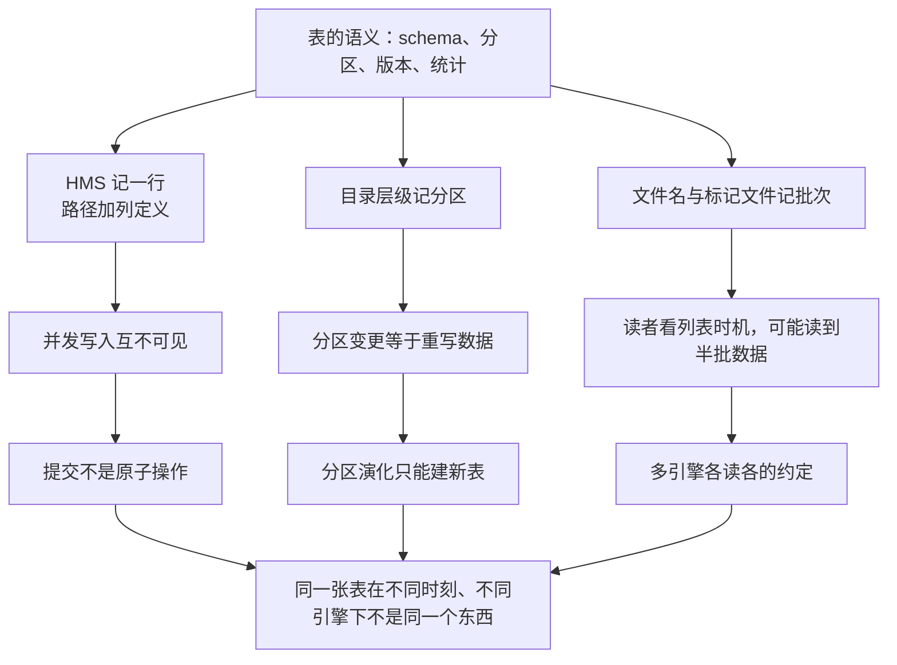
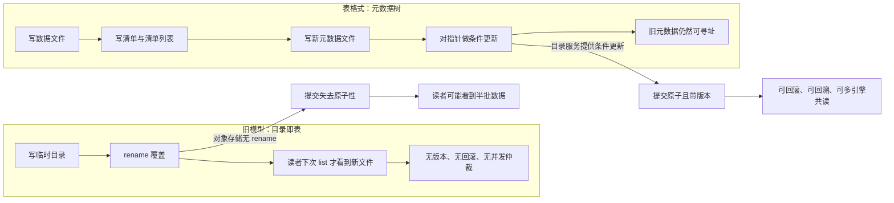
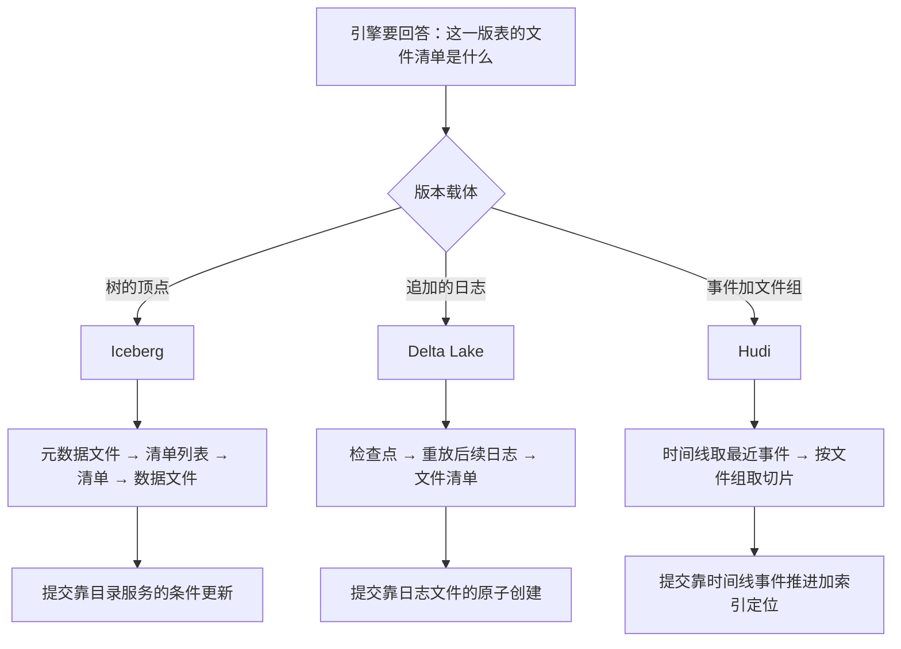
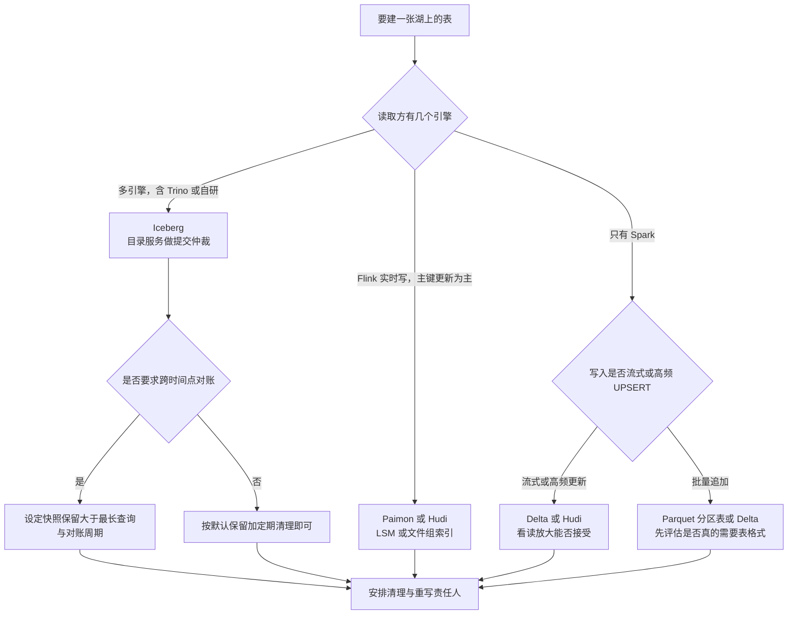

**摘要：**

一张 Hive 表拆开来看是三样东西拼起来的：Hive Metastore（HMS）里的几行记录、存储上的目录层级、以及文件名里约定俗成的版本痕迹。这套拼法在只有一个引擎、只做批量追加的年代够用，但当并发写入、多引擎读取、分区演化与合规删除同时压上来，它开始漏水——目录不是事务对象，对象存储上的重命名根本不原子，两个写入方互相看不见对方的存在。表格式（table format）这一层要处理的就是这件事：把表从目录里拆出来，变成一棵可以原子替换的元数据树，加一组不可变的快照。本文不重述 Iceberg 的元数据三层结构与提交协议，那部分机制细节在 Iceberg 深度专栏里有逐层拆解；这里把三条路线摆到同一张判据表上——Iceberg 的元数据树、Delta Lake 的事务日志、Hudi 的时间线与文件组，各自的并发仲裁发生在哪里，时间旅行的成本结构如何，小文件治理由谁承担，生态绑定有多紧。在此之上给出按引擎生态、写入模式、回溯需求三条轴划分的选型判据、四类不该上车的场面，以及这一层抽象新增的维护账单。

---

## 第 1 章 目录就是表，这份约定借了二十年

2008 年 Hive 在 Facebook 内部起步，2010 年成为 Apache 顶级项目。它把 SQL 带进 Hadoop 分布式文件系统（HDFS）的方式很朴实：一条建表语句在 HMS 里记一行，写下一个路径；一次分区写入，就是在那个路径下新建一层目录，再把分区列的值写进目录名。这套做法在当年的约束下几乎是最优解——不需要任何额外服务维护文件清单，目录结构本身就是索引，而 HDFS 的 list 在那时足够快。

但它把表语义拆散到了好几个互不权威的地方。把这件事列清楚，后面的所有设计动机都能对上号。

| 语义要素 | 在 Hive 里存在哪 | 由谁维护 | 失效时的现场 |
|---|---|---|---|
| 表名与根路径 | HMS 的表行 | 建表 DDL | 目录被手工挪走后，查询报路径不存在 |
| 分区成员 | HMS 的分区行，外加一层目录 | 写入方或 MSCK 修复 | 目录有新数据但 HMS 未登记，查询看不见 |
| 列名与类型 | HMS 的列定义，外加文件自描述 | DDL 与写入方各自维护 | 两侧不一致时，报错发生在读的运行时 |
| 版本与历史 | 没有承载方 | 没人维护 | 任何引擎都无法回答"昨天此时表长什么样" |
| 文件清单与列统计 | 没有承载方 | 没人维护 | 只能 list 目录后逐个打开文件尾 |
| 分区方案 | 目录层级本身 | 建表时一次定死 | 想换分区粒度，只能新建表再搬数据 |

表格里最值得盯的是第三行。分区值以字符串形式存在目录名里，HMS 里存一份类型定义，数据文件里又是一份自描述的 schema，三份东西的权威性谁都不比谁高。一个 `int` 型分区列写成 `dt=20261119` 与 `dt=2026-11-19` 都能建目录，Hive 在多数路径上靠字符串转换兜住，Spark 与 Trino 各有各的转换规则，于是同一张表在不同引擎下给出不同结果这件事，在 Hive 表上是常态而非事故。

秩序缺失后，工程上长出过一批补丁，且它们至今在很多集群里活着：譬如把变更写成拉链表，查询时按主键取最新版本；用 `_SUCCESS` 之类的标记文件表示"这一批可以读"，靠调度系统保证同时只有一个作业写同一分区；按天切目录、只做追加，把"改一行"变成"新开一天"。这些补丁有效，但它们都是约定，而约定是引擎私有的——每多接一个引擎，就多翻译一份约定。

> [!quote] 一条备忘
> 目录即表并非错误设计，它只是把表的语义押在了文件系统的一种行为上，而那个行为在对象存储上从来不存在。

把推理推到极致会更清楚：如果没有人需要并发写、没有第二个引擎、不需要回到过去，那么目录即表是极其廉价的设计，HMS 到 HDFS 之间连一次多余的元数据读取都没有。代价只在需求变化时一次性暴露出来。2018 年前后，Netflix 面对的就是这个场景：同一个数据湖上跑着 Spark、Presto、Flink 多个引擎，S3 上没有任何"目录原子重命名"，而作业之间要并发读写同一批表。

下面这张图描述的是需求压进来之后，旧约定逐步失效的链条。

---

## 第 2 章 多出来的那一层：一棵树和一组快照

表格式做的事情可以压缩成一句：把"表"从一个位置的集合，换成一个元数据树的顶点加一组不可变文件。这句话听着抽象，拆开就四个职责，每个职责各自对应一类此前没人负责的语义。

| 层 | 存什么 | 解答了哪个此前无解的问题 |
|---|---|---|
| 目录服务（Catalog） | 表名到一个元数据文件路径的映射 | 表的当前版本放在哪里，谁有权改它 |
| 表元数据 | schema、分区规格、快照列表、表属性 | 表在某个时刻的完整定义是什么 |
| 清单 | 快照包含哪些清单文件，以及每个清单的分区与列范围 | 这一版由哪些文件构成，能不能先裁掉一大批 |
| 数据文件 | 记录本身，写完不可变 | 存储格式与表语义彻底解耦 |

关键变化发生在提交那一步。旧模型里，提交的原子性依赖一次目录操作——先写临时目录，再 rename 覆盖。HDFS 上这条路径可行，因为 rename 是 NameNode 里一次原子的元数据变更；对象存储上没有这个概念，键前缀构成的"目录"只是字符串的公共前缀，复制加删除是两步，中间失败就会留下半个表。

新模型把原子性搬到**一个键的条件更新**上：写完全部新文件后，用一次带前置条件的写入把指针从旧元数据换成新的，成功即提交，失败即整体不可见。HDFS 的 rename、S3 的条件写、HMS 的表锁、关系库的行锁，都能承载这个条件更新——这一层的可移植性正是从这里来的。

> [!info] 类比：从书架到卡片目录
> 旧模式是按书架位置找书，书在哪一格本身就是信息；新模式是一张可以随时替换的卡片目录，卡片上写着这一版总共有哪些书。目录能留旧版、能同时存在两版、能只换其中一页而不动书架。代价是卡片目录自己也是一份需要维护的资产，会变厚、会写错、会被误删。

由此白拿四样能力，它们的成本都不在这一层——成本在上一层，也就是"谁来仲裁指针的替换"。

把这四样能力与它们各自依赖的环节画在一起，能看出复杂度被推到了哪一侧。

| 能力 | 实现机制 | 需要谁配合 |
|---|---|---|
| 原子提交 | 指针条件更新，读者要么看到旧版要么看到新版 | 目录服务提供条件更新原语 |
| 快照隔离与时间旅行 | 旧快照的元数据不被覆盖，只是不再被指向 | 保留策略决定能回溯多远 |
| 分区演化 | 分区规格带编号写进清单，老数据按老规格解释 | 引擎按规格分别裁剪 |
| 多引擎同读 | 协议以文档发布，实现者不依赖特定引擎代码 | 各引擎按规范实现，而非按某家行为实现 |

第三行值得多说一句。隐藏分区（hidden partitioning）之所以成立，就是因为分区不再是"目录名里那个字符串"，而是清单里一个带规格编号的元组：写入时引擎按表达式算出分区值，查询时按同一套表达式做裁剪，用户不必在 `WHERE` 里手写分区列。分区方案改了，老清单仍按老规格解释，新数据按新规格写，两种规格在同一张表里共存。这套机制从数据结构到裁剪算法在 [[大数据/数据湖/Iceberg/02 元数据三层架构——Snapshot、Manifest List 与 Manifest File|Iceberg 元数据三层架构]]与 [[大数据/数据湖/Iceberg/03 Hidden Partitioning——告别分区列陷阱|Hidden Partitioning]]里逐层拆过，此处只关心它带来的选型后果：分区策略从"建表时的一次性决策"变成"可以随数据形态演进的配置"，这在 Hive 体系里是没有对应物的能力。

把这份能力记在账上，也把负债记在同一页。多出来的这一层本身是一批文件，它们会膨胀、会被并发写坏、会需要清理；指针放在哪里，从"不用想"变成"必须选"。这两个问题构成后面两章的骨架。

---

## 第 3 章 指针、日志与时间线：三种记法

三条路线解决的是同一个问题，但把"当前版本是什么"记成了三种完全不同的东西。理解差异不必逐个背特性，只要盯住每个方案里"版本信息长在哪个载体上"。

**Iceberg 记一棵元数据树。** 一次提交是：读当前元数据文件拿到版本号，写新数据文件，写指向这些文件的清单，写汇总清单的清单列表，最后用一次条件更新把元数据文件从版本 N 换成 N+1。旧元数据原封不动地留在存储上，快照里带着父快照的编号，版本关系因此形成一条可回放的链。

并发仲裁完全落在目录服务上：HiveCatalog 借 HMS 的表锁把提交串行化，JDBC 与 REST 类实现分别用数据库行锁与 ETag 前置条件实现同一语义。冲突时写入方要重读元数据、重写清单，数据文件通常可以复用，但清单必须按新的基版本重算。读路径是自上而下的一层层裁剪：元数据文件给出快照，清单列表给出每个清单的分区与列范围，清单给出每个数据文件的统计与状态。这条路线的机制细节在 [[大数据/数据湖/Iceberg/04 事务与并发控制——乐观锁与 Optimistic Concurrency|Iceberg 并发控制]]里有更完整的推演。

**Delta Lake 记一本流水账。** 每个提交在 `_delta_log` 下新建一个按序号命名的 JSON 文件，内容是一组动作记录：新增了哪些文件、移除了哪些、schema 与协议有无变化、这次提交是谁做的。当前版本不是某个指针，而是"把日志从某个起点一路重放下来"的结果。提交的原子性来自存储对"仅当文件不存在时创建"的保证——同一个序号的日志只有一个写入者能建成，谁先建成谁赢。为了让重放不至于是全量的，日志会周期性折叠成 Parquet 检查点，默认每 10 次提交一份，重放只需从最近的检查点开始。

冲突消解比另外两家更细：纯追加的提交可以和几乎任何并发提交并存，覆盖或删除类的提交撞上并发写则通常要失败重试。日志与检查点协议的原文在 [[大数据/数据湖/Delta-Lake-Lakehouse架构深度解析/02 事务日志 Delta Log：ACID 保证的基石|Delta 事务日志]]里。

**Hudi 记一条时间线。** `_hoodie` 目录下是一条单调推进的事件序列，每个事件（instant）有时间戳与动作类型：提交、增量提交、压缩、清理、回滚，状态在等待、进行中、已完成之间迁移。数据不像前两家那样"每次提交产出一批新文件"，而是被组织进文件组（file group）：一个组有稳定的标识，跨多次提交产出多个文件切片，每个切片由基文件与若干日志文件构成。

写入方先用索引把记录映射到文件组，再追加或合并到该组，于是提交的语义是"时间线上推进一个事件"，而不是"换一个指针"。读一个快照，就是为每个文件组找到不晚于目标事件的最近切片；写时复制的表只读基文件，读时合并的表还要把日志叠上去。时间线的分层与事件语义在 [[大数据/数据湖/Hudi/03 Timeline 机制——Hudi 事务与增量语义的核心|Hudi Timeline 机制]]里有完整说明。

下面这张图把三种载体画在同一屏上，分岔点是"当前版本从哪读出来"。

三种记法可以直接对照。判据不是"谁更强"，而是每一列回答的是"这一层把复杂度放在了哪里"。

| 维度 | Iceberg | Delta Lake | Hudi |
|---|---|---|---|
| 版本载体 | 元数据树，根是可替换的元数据文件 | 追加式事务日志加周期性检查点 | 全局时间线加文件组索引 |
| 提交原子性来源 | 目录服务的前置条件更新 | 日志文件"仅当不存在时创建" | 时间线上事件的状态推进 |
| 并发模型 | 乐观并发，按基版本检测冲突 | 提交串行化，按操作类型消解冲突 | 乐观并发，文件组级冲突检测 |
| 冲突的典型处理 | 重读元数据与清单后重试 | 追加类自动合并，覆盖类常需失败重试 | 同组冲突则回滚该事件 |
| 时间旅行单元 | 快照编号或时间戳 | 日志版本号或时间戳 | 事件时间 |
| 读放大主要来源 | 元数据文件与清单的解析 | 日志重放，缺列统计时读文件尾 | 读时合并的基文件加日志叠加 |
| 写放大主要来源 | 写时复制重写受影响文件 | 写时复制重写受影响文件 | 日志文件小而多，靠压缩回收 |
| 小文件治理手段 | 数据文件重写与清单重写 | 优化命令与数据跳过布局调整 | 压缩与聚簇，按调度触发 |
| 生态绑定 | 规范独立，实现最多 | Spark 侧最完整，高级特性单侧先行 | 写入路径与 Spark、Flink 耦合最紧 |

换一个填法会更贴近日常提问：把读者真正会提的几类需求逐条落到三家上，落点差异比维度罗列更直观。

| 需求 | Iceberg | Delta Lake | Hudi |
|---|---|---|---|
| 按时间点读 | 指回旧快照 | 重放到指定版本 | 取不晚于该事件的文件切片 |
| 回滚一个提交 | 指回父快照 | 恢复到旧版本 | 回滚对应事件 |
| 改分区方案 | 新增分区规格，老数据沿用旧规格 | 视版本与特性而定，常需重写或聚簇 | 常需重写或聚簇 |
| 行级删除 | 写删除文件，或重写受影响文件 | 删除向量，或重写受影响文件 | 写日志文件，读时合并 |
| 按区间增量读 | 快照区间读，变更日志表在较新版本提供 | 依赖变更数据流特性 | 时间线原生支持 |

---

## 第 4 章 三种记法带来的三个真实差别

看清载体之后，三件工程后果才会浮出来：提交仲裁者的位置决定了你要多部署什么，时间旅行的成本结构决定了你能回溯多远，治理动作的归属决定了运维的节奏由谁掌控。

**仲裁者的位置，决定部署形态。** Iceberg 的提交必须有条件更新，所以它一定依赖一个目录服务：可以是 HMS，可以是关系库，可以是一个 REST 服务。这条依赖是它多引擎能力的来源——所有引擎对着同一个目录服务做条件更新，语义天然一致；也是它的部署负担——共享一个 HMS 数据库在云上与多租户场景里并不方便，权限模型还停留在表与列，而不理解文件级清单。REST Catalog 的动机就在这里：把"名字解析、提交仲裁、权限判定"收拢成一个服务，共享点从数据库换成一份协议，顺带获得多表提交与跨引擎统一入口的空间。Delta 这一侧需要的只是存储层对原子创建的支持，HDFS、S3、ADLS 都能给出，于是它不需要额外服务，代价是提交必须串行、冲突消解逻辑写在各个引擎实现里，非 Spark 引擎要追齐语义并不轻松。Hudi 把时间线放在存储上，但写入路径强依赖索引与文件组布局，写的一侧与布局耦合最紧，所以"谁写的"直接决定了"谁能正确地继续写"。

**时间旅行的成本结构，决定它能回溯多远。** Iceberg 的旧快照的清单都还在，指过去就能读，定位是一次路径查找；代价不在这条路径上，而在保留策略——留得越多，元数据文件里那份快照列表越长，每次读表都要多解析一段，规划时间随之上升。Delta 的回溯要重放日志，检查点让重放的条数有界，能回溯的窗口由日志保留时长决定，超出窗口的版本物理上不可达。Hudi 能回溯到哪个事件，取决于时间线归档到哪，归档之后按旧时间查询会直接失败。三家都能"看昨天"，但"能看多久、看多快"由清理配置决定，而这些配置的默认值几乎总比业务方以为的短——这类误会通常要到某次对账需要回看两个月前的状态时才被发现。

**治理动作的归属，决定谁在维护这条链路。** 写时复制的路线每次改动都产出新文件、留下旧文件，文件数与快照数只增不减，治理靠独立作业跑重写与优化；读时合并的路线把"写小"当成设计选择，代价前置到压缩调度上。真正要问的是治理停了会怎样：文件数涨上去，规划变慢、对象存储请求费用上涨，但查询结果依然正确；这与 [[大数据/读书笔记-大数据概览/06 Hive ACID 与 Compaction：事务机制与小文件治理|Hive ACID 的合并]]不同——那里的合并状态会直接决定读到的物理形态，而湖格式把治理降级成了性能与成本的优化项。降级不是免责，只是把责任从"正确性"挪到了"可用性与成本"，而后者恰恰更容易被忽视。

| 治理动作 | 作用对象 | 停止执行后的后果 | 触发方式 |
|---|---|---|---|
| 过期快照 | 旧快照及其独占的元数据 | 元数据文件堆积，规划变慢，存储涨 | 手动或调度 |
| 孤儿文件清理 | 未被任何快照引用的数据文件 | 存储只涨不降，失败作业的残留永久占位 | 手动，需保护窗口 |
| 数据文件重写 | 小文件、被删数据占比高的文件 | 文件数与扫描开销上升，删掉的空间不回收 | 手动或调度 |
| 清单重写 | 碎片化的清单文件 | 规划阶段要打开过多清单，读放大 | 手动或调度 |
| 日志检查点 | 事务日志的重放长度 | 每次读表都要重放更多日志 | 自动，按提交次数 |
| 时间线归档 | 事件历史 | 旧时间点不可回溯，增量读窗口收窄 | 自动，按保留配置 |

---

## 第 5 章 这一层的账单：元数据也是文件

把元数据存成文件，换来的是无中心、可并发读、可移植；付出的是"每次提交写多个小对象"这件事的利息。利息在三个地方累计。

第一处是快照数。每次提交都产生一份新的元数据文件，里面带着全部历史快照的列表。按每分钟一批写入估算，一天是 1440 次提交，一个月约 4.3 万次；即使每次提交只额外产生三个元数据对象，一个月也是十几万个元数据文件（此为示例推算，不是实测值）。在 HDFS 上，每个小文件都是 NameNode 的一个 inode，目录 list 的耗时按对象数增长；在对象存储上，每个对象都是一次请求，延迟与请求费用一起上涨。更隐蔽的一处是元数据文件自身的大小——它承载全部快照的历史列表，提交越频繁，这份 JSON 越长，而每次读表都要先把这份 JSON 完整解析一遍。

第二处是清单碎片。一次小批量写入只新增几个数据文件，却要新增一个清单文件来记录它们，清单文件和清单列表的条目数随提交次数增长；查询的规划阶段要按分区与列统计裁剪清单，清单越多，裁剪本身的开销越不可忽略。这就是"提交频率"与"规划时间"之间的借债关系：写得越细粒度，读的时候要看的目录结构越厚。

第三处是并发读写与清理之间的时间窗。清理通常分两步：先过期旧快照，再清理孤儿文件。顺序不能反——先清孤儿会把仍被旧快照引用的文件删掉；而孤儿清理的保护窗口必须大于最长写入作业时长与集群时钟偏差之和，否则一个还在跑的作业刚写完数据、尚未提交，文件就被当成孤儿收走。这类事故的现场很难判断：作业报的是读不到文件，而根因是一次几小时前执行的清理。

> [!warning] 保留窗口是一份契约，不是参数
> 快照保留时长与查询的最长执行时间之间存在强耦合。把一个跑十小时的报表任务放在保留一小时的集群上，失败是必然的，只是时间问题。容量规划时要把"最多能回溯多久"和"最长查询跑多久"写进同一份约束。

Catalog 的耦合是另一笔账，且它与上面三处方向的相反——前面三处是存储上的债，这一笔是服务上的债。Iceberg 在 HMS 里只借一行（表名到元数据文件路径），其余全在存储上，结构上已经很轻；错位之处在于 HMS 是为 Hive 设计的：提交仲裁要拿表锁，而 HMS 背后是一张被所有引擎共享的关系库；权限模型按库、表、列授权，对"文件级清单"没有概念，于是行级权限与列级权限只能落在引擎侧；多租户环境下让所有引擎共享一个 HMS 数据库，在云上也不合算。REST Catalog 正是在这个错位上长出来的：把目录服务抽成独立进程，提交仲裁在服务内用更合适的手段完成（版本号、ETag、事务），权限与命名也归到服务里统一裁决，存储只负责放文件。这条路并非没有代价，服务本身成了一次新的可用性投入，只是这笔投入比共享一个元数据库更可控。

把上面几条放在一起，选型时的第一个问题其实不是"选哪家"，而是"谁来承担这一层的运维"。湖格式不像 Hive 表那样"建好就不用管"，它从上线第一天起就需要有人安排清理、重写、压缩的节奏，而节奏定错时的表现是渐进的变慢，不是立刻的报错。

---

## 第 6 章 迁移：三种上车方式，三种失败姿势

存量 Hive 表要迁到表格式上，业内主要有三条路，选错一条的代价往往要一年后才显形。

**原地接管**。把已有目录注册成一张表格式的表，数据一个字节都不搬，只是补一份元数据。它的吸引力在于快——TB 级表可以在分钟级完成注册，下游 SQL 一行不用改。代价藏在两处：老数据文件里没有列级统计（`null_count`、`lower_bounds`、`upper_bounds`），规划阶段拿不到这些信息，谓词下推退化成"打开文件再判断"，于是迁移后最常见的反馈是"怎么反而变慢了"；另一处是快照的起点——迁移前的历史不可回溯，时间旅行只能退到接管那一刻，这与很多人对"表格式能回滚"的预期不符。

**影子表**。新建表格式表，与旧表双写，同时回填历史，追平后切读。它解决的是原地接管没有统计信息的问题（新写的数据自带统计），也能做真正的灰度。代价是双份存储、双份写入成本与一个必须收敛的一致性窗口：回填跑得比增量写入慢时，窗口永远追不平，最后变成一笔越拖越大的债。这类迁移最容易被低估的是"追平"这个动作本身要占用多少资源——它是一次全量读加一次全量写。

**停机重写**。停业务，把数据整体 `INSERT OVERWRITE` 进新表。最干净，统计、快照、分区演进一次性对齐；也最贵，停机窗口与数据量成正比，并且回滚只能靠事前备份。适合可停机的小体量或刚好在做的机房迁移。

| 方式 | 停机 | 存储成本 | 迁移后统计可用 | 可回滚到迁移前 |
| :--- | :--- | :--- | :--- | :--- |
| 原地接管 | 无 | 仅元数据 | 否，需重写才补齐 | 否 |
| 影子表 | 无 | 双份，持续到追平 | 是（新写部分） | 是（旧表还在） |
| 停机重写 | 有，与体量成正比 | 迁移期双份 | 是 | 仅靠备份 |

迁移之前有四项核对，任一项没答上来就先别动数据：
- 下游有多少作业直接读目录路径而不是读表名，这些必须先改
- 历史回溯需求到哪一天，这决定是原地接管还是必须重写
- 最长查询跑多久，它决定了快照保留窗口的下限
- 谁来承担合并与清理的日常节奏，没有主人就别上线

| 判据 | 指向原地接管 | 指向影子表 | 指向停机重写 |
| :--- | :--- | :--- | :--- |
| 可停机性 | 不能停 | 不能停 | 能安排窗口 |
| 体量 | 大 | 大 | 小到中 |
| 对统计信息的依赖 | 低（无谓词下推需求） | 高 | 高 |
| 下游依赖数 | 少 | 多，需灰度 | 少 |

回滚成本也要提前算清，它和上面的选择直接相关：

| 方式 | 回滚动作 | 回滚耗时 |
| :--- | :--- | :--- |
| 原地接管 | 卸掉元数据，退回目录表 | 分钟级 |
| 影子表 | 把读切回旧表 | 分钟级 |
| 停机重写 | 从备份恢复 | 与体量成正比 |

三条路共同的失败姿势是同一个：把迁移当成一次性任务做完就撒手。表格式上线之后，清理旧快照、重写小文件、压缩清单这三件事需要按节奏持续做，节奏由写入频率与查询时长共同决定。迁移完成那天，恰恰是这套运维真正开始的那天——这一点在原地的 Hive 表上是没有的，它的维护节奏是"加分区"，而表格式的维护节奏是"安排合并"。

---

## 第 7 章 选型：三条轴，一张判据表

选型判据只有三条轴，但每一条都问得出具体答案，不必依赖"谁更先进"的印象。

第一轴是引擎生态：谁要读，谁要写。只有 Spark 一处读写，与 Spark、Trino、Flink 三处并读，加上自研引擎直连，是完全不同的约束。第二轴是写入模式：只追加的批量导入、UPSERT 式的变更回灌、还是分钟级甚至更高的流式写入。第三轴是回溯与回滚需求：只是偶尔查一下昨天的数据，还是要按任意时间点对账、要在写错之后整体回滚一个提交。

| 场景 | 首选 | 判据 | 次选与说明 |
|---|---|---|---|
| 多引擎共读一张表，写入集中在 Spark | Iceberg | 规范独立、各引擎实现最齐，提交仲裁统一在目录服务 | 若已有成熟 Delta 环境且读取方都在 Spark 系，Delta 更省事 |
| Spark 为唯一引擎，深度使用 Structured Streaming | Delta Lake | 写入路径与 Spark 贴合最紧，检查点与流式提交配合成熟 | Iceberg 亦可，需接受提交路径多一跳 |
| 分钟级流式入湖，要求读时低延迟与增量消费 | Hudi | 时间线原生支持增量读，读时合并把写放大压到最小 | 若写入是 Flink 且要主键更新，Paimon 的 LSM 路线更贴 [[大数据/数据湖/paimon/00 专栏导览|Paimon 专栏]] |
| CDC 回灌，频繁按主键 UPSERT | Hudi 或 Paimon | 索引先把记录定位到文件组，更新不重写整个文件 | Iceberg 需靠行级删除加合并读，写放大更高 |
| 批量 ETL，每天或每小时一批，需要回溯与回滚 | Iceberg | 快照粒度清晰，回滚一个提交就是指回旧快照 | Delta 的版本回溯同样直接 |
| 合规删除，必须物理删除并可审计 | Iceberg 或 Delta | 删除动作与清理动作可分离，能给出"何时真正落盘"的证据 | Hudi 需依赖清理与压缩的完成状态 |
| 云上多租户，目录服务不能共享数据库 | Iceberg 配 REST Catalog | 目录服务成为独立可扩展的服务，权限与命名集中裁决 | 自建目录服务有可用性成本，需评估 |

表里没有出现"性能更好"这类判据，因为在这一层上性能的差异主要来自治理水平而非协议本身：同样规模的表，清理与重写安排得当的一方总是更快，与选哪家关系不大。三方对比的完整视角在 [[大数据/数据湖/Iceberg/06 Iceberg vs Delta Lake vs Hudi——格式开放性与生态广度对比|Iceberg 生态对比]]与 [[大数据/数据湖/Hudi/06 Hudi vs Delta Lake vs Iceberg——架构设计的本质差异与选型|Hudi 视角的三方对比]]里各有展开，这里只保留可执行的判据。

下面的决策图把三条轴串起来，落点是"谁承担治理"而非"谁功能多"。

---

## 第 8 章 四种不该上车的场面

反例比正例更有信息量，因为误用湖格式的代价往往不是"慢一点"，而是凭空多出一条需要长期值守的运维链路。

| 场面 | 为什么不该 | 更合适的选择 | 误上的代价 |
|---|---|---|---|
| 数据总量在 TB 级以下，单引擎读写 | 表格式解决的问题一个都不存在 | 分区良好的 Parquet 表，或直接用 Hive 表 | 多一份目录服务、清理作业与压缩调度的维护 |
| 纯 Hive 生态且短期内不改 | 所有读者都是 Hive SQL，没有 CDC，也没有合规删除 | 继续用 Hive 事务表或拉链表 | 迁移要重写数据或原地转换，读者还要升级版本 |
| 毫秒级高并发点查 | 湖格式的规划阶段注定不适合按主键取单行 | ClickHouse、Doris、Kudu、HBase 一类 | 并发一上来规划开销就压垮查询，参数怎么调都不够 |
| 秒级微批加单行更新，且没人管清理 | 每次提交写多份元数据，膨胀速度超过治理能力 | 实时数仓，或 Paimon 这类面向流的存储 | 元数据文件数以万计，规划时间吃满，最后要停机重建 |

第一类误用最常见，也最容易被"技术先进"的叙事推着走。判断标准很直白：把需求逐条对照第 1 章那张表——并发写入、多引擎、分区演化、版本回溯，四条里有几条是真的？一条都没有，引入表格式等于给一个原本不需要运维的数据管道加上三项例行任务，而收益全部落在"以后可能会需要"上。

第二类误用的问题在迁移成本的结构。湖格式的迁移从来不是"改一个建表语句"，它要动的是存量数据的组织方式与所有读者的版本。读取方往往比写入方更难改，因为写入方通常只有一两个作业，读取方可能散落在报表、风控、对账十几个下游里。读者盘点的结果常常是：技术债并不在存储格式上，而在下游对 Hive 表行为的隐式依赖上。

第三类误用的根因是对层级的误判。湖格式是分析型扫描器，它的读路径是先解析元数据、再裁剪清单、再打开文件，这条链路的固定开销以毫秒到几十毫秒计，与数据量无关。用它做点查，等于每查一行都先读一次目录；即便做元数据缓存，也改不了它面向扫描的设计取向。

第四类误用是"把湖格式当数据库"的变体。单行更新在写时复制的表上意味着重写整个文件，在秒级频率下每次提交都产出一个新文件与三份元数据对象，一个月就能把元数据文件堆到十万量级；而清理作业一旦跟不上，规划阶段要先读一份几兆字节的元数据文件，再展开几千个清单。这类现场最后通常以"停机重建表"收场，而重建的代价又把当初省下的时间全数收回。

> [!example] 一个可以照抄的判定顺序
> 先数读取方引擎个数，再看写入是批量还是流式，最后问回溯窗口由业务还是由运维决定。三个答案指向"单引擎、批量、偶尔看昨天"，就不必引入这一层；只要有一个指向"多引擎""流式""按时间点对账"，就进入第 6 章的判据表，并同时指定清理的责任人。

---

## 结语：一层薄目录，换一个位置

表格式这一层的全部贡献，可以概括成给对象存储补了一份可原子替换的目录，顺带把表的历史变成了可寻址的对象。它没有让存储变快，也没有让写入变简单，它做的是把"表是什么"这个问题从目录结构的隐含约定里取出来，写成一份可以被多个引擎共同遵循的协议。

三条路线是三种目录形态：树的顶点、日志的末尾、时间线的最近事件。选哪一种是选"谁来仲裁提交、谁来承担治理"，而不是选谁更先进。Iceberg 在规范独立性上占优，于是把部署负担交给目录服务；Delta 在 Spark 生态里最省事，于是把跨引擎语义的追齐成本留给别人；Hudi 把写放大压到最小，代价是读路径与运维节奏都更复杂。这三笔交换没有一笔是免费的，选择只是决定由谁来付。

至于这一层会不会继续变薄，目前仍然言之尚早。可以确定的是，只要存储层还只能追加、不能原地改写，"表"和"文件"之间就需要有人来翻译，而这层翻译无论叫什么名字，都得承担同样的账。

---

## 参考资料

- [Apache Iceberg 官方文档](https://iceberg.apache.org/docs/latest/)：表规范、分区演化与维护过程的官方口径
- [Iceberg Table Spec](https://iceberg.apache.org/spec/)：元数据文件、清单与快照的规范文本
- [Iceberg REST Catalog Spec](https://iceberg.apache.org/rest-catalog-spec/)：目录服务接口与提交语义的规范
- [Delta Lake Protocol](https://github.com/delta-io/delta/blob/master/PROTOCOL.md)：事务日志、检查点与冲突消解的规范文本
- [Delta Lake 文档：并发控制](https://docs.delta.io/latest/concurrency-control.html)：隔离级别与冲突分类的官方说明
- [Apache Hudi Timeline](https://hudi.apache.org/docs/timeline)：事件类型、状态迁移与归档的官方说明
- [Apache Hudi 文档：并发控制](https://hudi.apache.org/docs/concurrency_control)：写入冲突检测与文件组语义
- [Hive Transactions](https://cwiki.apache.org/confluence/display/Hive/Hive+Transactions)：Hive 事务表能力与限制，作为对照基线
- [Apache Paimon 文档](https://paimon.apache.org/docs/master/)：LSM 路线的主键表与变更日志语义
- 规范与实现均以对应版本文档为准；本文涉及的保留时长、检查点间隔等默认值随版本变动

> [!note] 思考题
> 1. 如果对象存储从一开始就提供原子重命名，Hive 的目录即表模型还会不会漏水，表格式这一层是否仍有必要存在。
> 2. 三条路线的提交仲裁分别落在目录服务、日志文件与时间线上，把这三种仲裁方式放到跨机房部署的场景里，各自的失败模式会有什么不同。
> 3. 快照保留窗口与最长查询时长之间的契约，如果由业务方而不是运维来定，会出现什么样的责任真空。
> 4. 一个只有 Spark 的团队为了"以后可能多引擎"提前引入 Iceberg，这笔预付的运维成本在什么条件下才算划算。
> 5. 读时合并把写放大换成了读放大，在对象存储按请求计费的环境里，这个交换的账该怎么算。
> 6. 如果清理与压缩永远跟不上写入，湖格式最终会退化成什么形态，这与当初想摆脱的 Hive 目录模型有何异同。