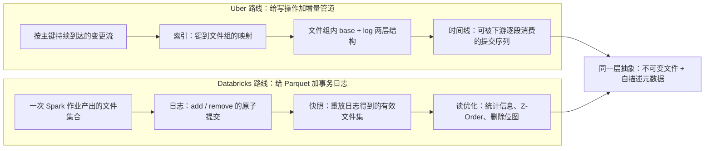
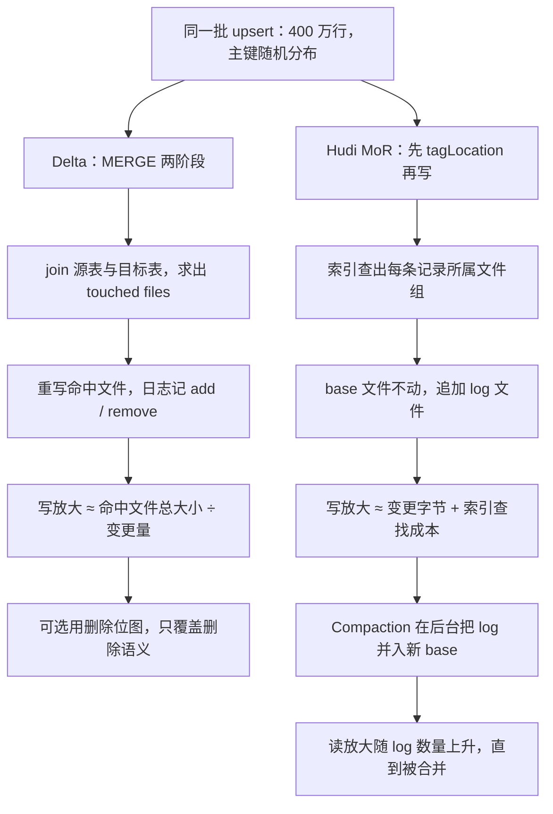
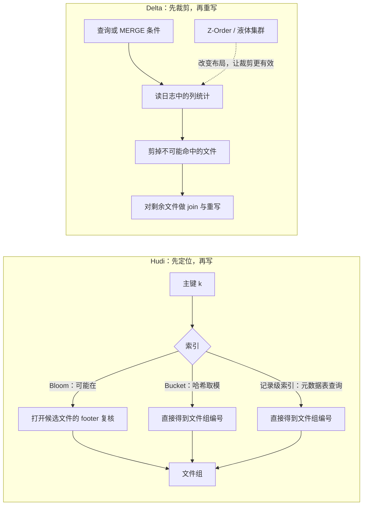
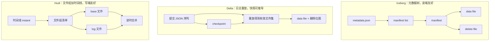
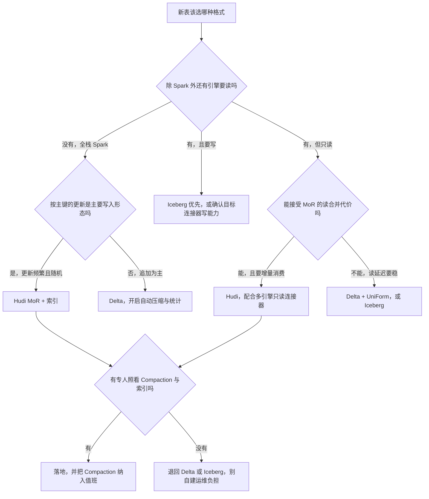

# 13 实时数据湖：Delta Lake 与 Apache Hudi 核心机制

**摘要：**

Delta Lake 与 Apache Hudi 常被并列为「实时数据湖的两种表格式」，但二者回答的并不是同一个问题：Delta 把一批 Parquet 文件包装成可以原子提交的版本，Hudi 把一批更新包装成可以按时间线增量消费的管道。前者出身于 Spark 作业写对象存储的一致性问题，后者出身于 Uber 按主键持续更新的数仓困境，而出身会写进各自的存储布局：Delta 以文件为提交单位，更新靠重写命中文件或删除位图完成；Hudi 以文件组为单位，更新先落日志、再由 Compaction 合并成新的 base 文件。前者把代价压在文件布局与读端维护上，后者把代价压在索引查找与后台合并上，两种账单迟早都要有人付。本文不复述两者的内部机制——事务日志、文件组、索引、Compaction 在各自的深度专栏里已有完整拆解——而是沿写路径做一次代价对照，把 Iceberg 拉进来做三方判据，讨论 Catalog 统一与跨引擎读的真实成熟度，最后给出按写入形态、读取引擎、增量消费需求、团队运维能力四问的选型表，并列出五类不该上表格式的场面。结论是：读的一侧正在被标准抹平，写的一侧仍是各家引擎的方言，选型的实质是挑一条与自身写入形态贴合、且团队养得起的路径。

---

## 第 1 章 两份出身证明

2016 年底，Uber 的数据平台团队面对一张持续膨胀的行程表：司机位置、行程状态、计价参数以流的形式不断写入，同一条行程在几分钟内会被更新若干次，而分析人员要求这张表读出来就是最新状态。当时可用的只有 Hive 分区表，一次更新意味着把一个分区读出来、改掉、再写回去；若不愿付这份代价，就只能改成纯追加，把去重的工作推给每一个下游读者。

Hudi（Hadoop Upserts Deletes and Incrementals）是为这道题写的：它把记录主键与「这条记录落在哪个文件」的对应关系记在索引里，把每次写入记在一条时间线上，让「改一条记录」不必惊动整张表。项目 2017 年开源，2019 年进入 Apache 孵化器，2020 年成为顶级项目，2024 年 12 月发布 1.0。

2019 年，Databricks 在 Spark + AI Summit 上推出 Delta Lake，要解决的是另一道题：Spark 往对象存储写数据的正确性。一个作业写了三百个文件，中途失败，目录里留下两百个半成品；两个作业同时往同一张表写，事后谁也说不清哪些文件算数；分析师跑查询时正好撞上写入，于是读到一半新、一半旧的数据。对象存储没有目录锁，也没有原子的多对象提交，这些语义只能由表格式自己补上。

Delta 的答案是把数据库的预写日志搬过来：`_delta_log` 里每次提交是一个 JSON，列出本次新增了哪些文件、作废了哪些文件，读者先重放日志得到「当前有效的文件集合」，再去读文件。Delta Lake 1.0 于 2020 年发布，3.x 系列补齐了删除位图、液体集群等能力，4.0 在 2025 年发布。

| 维度 | Delta Lake | Apache Hudi |
|---|---|---|
| 诞生背景 | 2019 年，Databricks 出品，Linux 基金会托管 | 2016 年 Uber 内部，2017 年开源，2020 年成为 Apache 顶级项目 |
| 原始问题 | Spark 批流作业写对象存储的原子性与一致性 | 按主键的 record 级更新，以及变更的增量消费 |
| 提交的中心对象 | 一次提交 = 一组文件的增删 | 一次提交 = 若干个文件组的一次版本推进 |
| 服务对象 | Spark 作业与托管湖仓平台 | 数据库变更捕获（CDC）、轨迹、状态类持续 upsert 流 |
| 元数据落点 | `_delta_log` 的 JSON 与 checkpoint | `.hoodie` 时间线、索引与文件组清单 |
| 强项所在 | 读优化、生态简单、Spark 集成深 | 写放大控制、按主键定位、增量拉取 |

把两行字并排看，两者的差异不在功能清单上，而在「谁承担**写代价**」这句默认条款里。Delta 默认写入是成批的、批内的记录彼此无关，于是一次提交可以看作对文件集合的集合运算；Hudi 默认写入是流的、每条记录都带着主键，于是每次提交必须回到「这条记录原来住在哪个文件组」这个问题上。



两条路线在上方汇合，这也是它们能与 [[大数据/数据湖/Iceberg/02 元数据三层架构——Snapshot、Manifest List 与 Manifest File|Iceberg 元数据三层架构]] 并称「表格式」的原因：都把「哪些文件构成这张表」从事先约定的目录结构里抽出来，交给一份可原子替换的元数据来回答。差别在于元数据被设计成什么形状，以及写的一方要在提交前付出多少准备工作。

机制细节不必在这里重讲。事务日志的 action 结构与 checkpoint 生成见 [[大数据/数据湖/Delta-Lake-Lakehouse架构深度解析/02 事务日志 Delta Log：ACID 保证的基石|Delta 事务日志]]，MERGE 的两阶段执行与删除位图见 [[大数据/数据湖/Delta-Lake-Lakehouse架构深度解析/04 DML 操作深度解析：MERGE、UPDATE 与 DELETE 的实现机制|Delta DML 实现]]，文件组与 CoW / MoR 的存储布局见 [[大数据/数据湖/Hudi/02 存储类型深度解析——CoW vs MoR 的设计权衡与适用场景|CoW 与 MoR 的权衡]]，索引类型与 HoodieKey 见 [[大数据/数据湖/Hudi/04 Upsert 写入路径——Index 机制、HoodieKey 与 Bucket Index|Upsert 的索引路径]]。本文关心的是：当一张表同时被写入与读取，这些设计各自把代价推到了哪里。

## 第 2 章 写入被假设成批，还是流

Delta 的**提交边界**由作业边界决定，一次 `MERGE`、一次 `INSERT INTO`、一个 Structured Streaming 的微批，产出一个日志版本，版本号是单调递增的整数，读者按版本号取快照，时间旅行也按版本号回退。这个模型把「一批写入」当成不可分割的单元，批内不关心记录的先后，也不假设同一条主键在批内出现几次——出现多次时由 SQL 语义决定结果。

Hudi 的提交边界由时间线上的一个 instant 决定，每个 instant 有请求、进行中、完成三个状态，写入方在提交前必须先向时间线申请一个 instant，提交完成后把它标成完成，而读者的快照查询只认已完成的 instant。这套状态机是为并发写与故障恢复准备的：一个写到一半崩掉的 instant 停在 inflight 状态，回滚任务把它清掉，读者根本不会看到它。

Hudi 1.0 把时间线的存储从目录树换成了 LSM 结构，让「往前翻很久」这类查询不必去列举海量小文件。

两种边界带来两种并发模型，Delta 用乐观并发控制（Optimistic Concurrency Control）：写者各自基于自己读到的版本生成提交，提交时以「在日志目录下原子创建第 N+1 号文件」作为裁决，谁先创建成功谁赢，输的一方重读最新版本再试。这套做法在 HDFS 或本地文件系统上很干净，但在对象存储上没有免费的原子创建，需要在外面挂一个协调服务，数据湖厂商常见的做法是 DynamoDB 锁表或对象存储的条件写能力。

Hudi 把这个矛盾显式化成锁提供者（Lock Provider）：ZooKeeper、Hive Metastore、文件系统锁任选其一，配合乐观并发或 1.0 引入的非阻塞并发控制（Non-Blocking Concurrency Control），让冲突推迟到查询期或 Compaction 期再解决。

假设不同，失败恢复的形状也不同，Delta 的失败通常表现为「数据文件已经写进目录，但日志没有提交」——这些**孤儿文件**不影响任何读者，靠 `VACUUM` 按保留期清理；重跑一次作业是安全的，因为上一次的提交根本没有生效。Hudi 的失败可能停在日志文件写入之后、commit 标记之前，回滚要清理已写的 log 与未完成的文件切片，逻辑比 Delta 复杂，换来的是它能保证「同一主键在时间线上只有一条演进记录」这件事。

时间旅行的粒度同样被假设决定，Delta 以版本号与时间戳双索引，读者可以精确指定「第 100 版」或「昨天下午三点之前的最新一版」；Hudi 以 instant 时间为刻度，可回退到某个 commit，也可以按 `as.of.instant` 查询。两者在能力上接近，差别在元数据的增长速度：Delta 每个版本至少一个 JSON，读快照时要么重放、要么依赖 checkpoint；Hudi 每个 instant 若干标记文件，1.0 后用 LSM 时间线收敛数量。版本打得越密，Delta 的日志目录长得越快，这是它后来引入自动 checkpoint 与日志清理的直接原因。

一个具体的账可以说明「批」与「流」的假设差在哪：假设每天要往一张表里改四百万行，改动在一天内均匀发生。若按「批」处理，可以让变更在内存里攒够一批，一次提交命中几百个文件，写放大被批次摊薄；若按「流」处理，变更每几秒就来一次，每一次都小到不足以摊薄任何东西，于是系统必须换一条路——先把变更写进一个便宜的地方，让读的人或后台任务再合并。

Hudi 的读时合并（Merge-on-Read，MoR）表正是这条路的制度化版本，Delta 的删除位图则是同一思路在「删除」这一种子集上的局部实现。

## 第 3 章 写路径对照：代价由谁承担

要看清 Delta 与 Hudi 的分野，最有效的办法是拿同一批 upsert 分别走一遍。设一张订单表两亿行、约 1.6 TB、128 MB 一个 Parquet 文件，也就是一万二千个文件左右；每天约有四百万行发生变更，占全表 2%，每行约 500 字节，变更量约 2 GB。这组数字是为了把写放大算清楚而取的示例推算，不是任何一种实现的实测值。

Delta 的 `MERGE` 分两步：先用源表与目标表做一次 join，找出「被命中」的文件；再把这些文件整个读出来、合并、写回新文件，最后在日志里记一条 add / remove。命中多少文件，取决于变更主键与分区、聚簇键的相关性。若变更主键在时间上均匀撒开、而表按日期分区，命中的就是全表一万二千个文件，当天重写的字节数约 1.6 TB，相对 2 GB 的变更量是数百倍的**写放大**。若变更集中在最近几天的分区，真实订单系统里更常见的是这种形态，命中比例可能降到 5%，重写量约 80 GB。

删除位图能把「只删不改」的变更压成一次位图写入，但整行更新仍然要碰数据文件——位图记录的是「哪一行不该被看见」，不是「哪一行变成了什么」。

Hudi 走的是另一条：它的提交单位是文件组（File Group），一个文件组由一个 fileId、一个 base 文件和一串 log 文件构成，同一个主键永远被路由到同一个文件组。upsert 时，索引负责把每条记录翻译成「属于哪个文件组」，于是 base 文件原地不动，变更被追加进 log，写放大接近 1。代价被推到读端与后台：快照查询要把 base 与 log 合并，log 越多合并越慢；Compaction 任务定期把 log 并回新的 base 文件，一次合并的写量取决于被合并文件组的大小，而不是变更量。

写时复制（Copy-on-Write，CoW）表则放弃 log 这一层，更新时直接重写受影响的 base 文件，行为上接近 Delta，但因为有文件组作为固定锚点，重写的范围被精确限定在命中文件组内，不必做全表 join 去发现命中集合。下图把两条写路径并排展开，看同一批记录在两个系统里各自留下什么。



对照的落点不是「谁更快」，而是「代价记在谁的账上」。Delta 把账单开给了写入作业：命中文件多、单文件大、更新比例高，都会让一次 MERGE 变成一次大规模重写。Hudi 把账单拆成两张：一张给索引查找，每次写入都要回答「这条记录在哪」；一张给后台合并，**Compaction** 是必须被调度、被监控、被给资源的常驻任务。

用一个比喻说，Delta 像一个只在台账上改页码的仓库——货架上的箱子从不打开，但每次盘点都要重新确认哪些箱子算有效；Hudi 像一个给每个货位固定编号的仓库——改一件货只动这一个货位，代价是货位里会积压一层层便签，得有人定期把便签誊清。

| 对照维度 | Delta Lake | Apache Hudi |
|---|---|---|
| 提交单位 | 文件集合的增删（add / remove action） | 文件组内的一次版本推进（commit / deltacommit） |
| 更新实现 | 重写命中文件；删除可走删除位图 | CoW 重写文件组；MoR 追加 log，Compaction 后台合并 |
| 写放大来源 | 命中文件总大小、单文件大小、更新比例 | 索引查找、log 追加、Compaction 的批量重写 |
| 读放大来源 | 小文件过多、日志过长、位图积累 | MoR 的 log 合并、文件组内碎片 |
| 定位机制 | 无记录级定位，靠 join 与统计裁剪求命中集合 | 索引给出主键到文件组的映射 |
| 后台维护 | OPTIMIZE、VACUUM、checkpoint、日志清理 | Compaction、Clean、Clustering、归档时间线 |
| 失败恢复 | 孤儿文件无害，重跑作业即可 | 回滚未完成 instant，需清理 log 与文件切片 |

写放大的控制手段两边都有，但侧重完全不同。Delta 侧的手段是「减少命中文件的面积」：按高频过滤列分区、用 Z-Order 或液体集群把相关行聚到同一批文件、把文件调大到能摊薄一次重写、开启删除位图让删除不落数据文件。Hudi 侧的手段是「减少落盘字节」：选 Bucket 索引避免查找开销、把 log 文件大小与 Compaction 触发阈值配对、用 Clustering 重整文件组、对只改少数列的场景用部分更新。两套手段解决的不是同一个约束，把它们混着用往往两头不讨好。

## 第 4 章 索引：定位器与统计器的分工

Hudi 的索引是一份「键到位置」的映射，粒度是记录级：给定 HoodieKey，它要回答的是「这条记录属于哪个文件组」。默认的布隆过滤器（Bloom Filter）索引把每个数据文件的键集合压成一个位数组存在文件 footer 里，查找时读候选文件的布隆过滤器，判「一定不在」或「可能在」，后者需要打开文件确认。假阳性率决定了要多读多少个文件，也决定了 upsert 的延迟下限；分区内文件越多、键分布越随机，布隆索引的性价比越差。

Bucket 索引换了一个思路：按主键哈希直接算出文件组编号，写入时不需要查找，代价是桶数在表创建时定死，扩容只能靠重新分桶；它适合主键均匀、桶数可预估的表。Hudi 1.0 又补了记录级索引与表达式索引，前者把「键到文件组」持久化在元数据表里，省掉每次写入重复扫描 footer 的开销，后者把分区这件事从目录约定变成可演进的索引定义。

Delta 没有这样一份映射，它的**定位**靠**统计器**：每条 add action 里带着文件的记录数、列级最小值、最大值、空值数，查询计划据此做数据跳过（Data Skipping）；文件数多、列统计覆盖的列有限时，剪枝效果取决于查询条件是否正好落在被统计的前若干列上。Z-Order 与液体集群改变的是数据布局，让「经常一起被查的值」落在同一批文件里，从而让统计裁剪更有效——它们优化的是「命中文件数」，不是「记录定位」。

Delta 也支持列上的布隆过滤器索引，但那份索引的粒度仍然是文件，用途是让等值过滤少扫文件，而不是让 upsert 少读文件。下图把两种定位链路并排展开，差别在查找发生在写入时还是查询时。



这两种机制的代价公式不一样，选型时要看哪一项在增长。索引的成本随「键空间 × 文件数」增长：布隆索引每次 upsert 都要读候选文件的 footer，候选文件数随分区内文件数线性上升；记录级索引把这份成本转成元数据表的一次点查，但元数据表本身要维护、要合并、要在多写者场景下保持一致。统计器的成本几乎为零，写入时顺手算出来，但它的收益随「查询条件与统计列的匹配度」下降：只在非统计列上过滤、或者更新主键完全随机，统计器帮不上忙，MERGE 仍然要把命中文件全读一遍。

一个常见的错配是拿 Delta 的布隆过滤器索引去救高频 upsert：索引确实让「找某一行」变快，但 MERGE 的瓶颈在「重写命中文件」，不在「判断文件是否含某个值」，加索引只是让读路径少扫几个文件，写路径的字节数一点没少。另一个方向的错配是给 Hudi 配了 HBase 索引却没人维护 HBase：全局索引把定位做到毫秒级，代价是多一套需要高可用、需要监控、需要跟表数据对齐的外部系统，一旦它和表数据不一致，重复记录与丢更新会一起出现。

| 手段 | 所属 | 粒度 | 建立时机 | 主要代价 | 失效情形 |
|---|---|---|---|---|---|
| 列统计与数据跳过 | Delta | 文件 | 写入时自动生成 | 统计列数有限，长字符串截断 | 过滤列不在统计范围内 |
| Z-Order / 液体集群 | Delta | 文件布局 | OPTIMIZE 或写入时增量维护 | 重写数据、额外的聚簇作业 | 聚簇键与查询模式漂移 |
| 删除位图 | Delta | 文件内行号 | DML 时写入 | 位图积累，读时合并 | 整行更新仍需重写文件 |
| 布隆过滤器索引 | Hudi | 文件（键集合） | 写入时随文件生成 | 假阳性导致多读文件 | 分区内文件过多、键随机 |
| Bucket 索引 | Hudi | 文件组（哈希路由） | 建表时定桶数 | 桶数固定，扩容要重分布 | 主键倾斜、桶数预估错误 |
| 记录级索引 | Hudi 1.x | 记录 | 元数据表持续维护 | 元数据表维护与一致性 | 元数据表未开或落后 |
| 外部 KV 索引 | Hudi | 记录 | 写入时同步写外部系统 | 多一套高可用系统要运维 | 外部系统与表数据不一致 |

## 第 5 章 增量消费：时间线序列与变更流

「实时数据湖」这个词里的实时，一半指写入延迟，另一半指下游能不能只读变化。Hudi 的时间线天生就是一份变更序列：每次提交在时间线上占一个位置，增量查询给定起止 instant，返回这段时间内被改动过的记录；三种模式分别给「变更后的最新状态」「变更前后的镜像」「纯变更记录」，下游把消费到的 instant 存成 checkpoint，重启后从 checkpoint 续读，配合提交的原子性做到精确一次。这套语义是 Hudi 立项时的第一需求——Uber 的派生表要按小时增量刷新，而不是每天全量重跑。

Delta 的对应能力是变更数据流（Change Data Feed，CDF）：在建表时或事后打开 `delta.enableChangeDataFeed`，此后每次写入把变更记录额外写进 `_change_data` 目录，读的时候用版本区间拉取，得到带 `_change_type` 的行。它覆盖了「读变化」，但有三个边界需要提前知道：开关必须在产生变更之前打开，历史数据不会自动补出 CDF；CDF 是额外的物理写入，对写路径有可见的成本；它的语义是「版本区间」，消费方要自己维护**版本水位**，而不是像时间线那样有一个天然的流式消费位点。

```python
# 同一条「只读变化」的需求，两种消费方式
# Delta：按版本区间拉，消费位点由下游自己保存
(spark.read.format("delta")
      .option("readChangeFeed", "true")
      .option("startingVersion", 100)
      .option("endingVersion", 105)
      .table("orders"))

# Hudi：按 instant 区间拉，语义是「这段时间提交过什么」
(spark.read.format("hudi")
      .option("hoodie.datasource.query.type", "incremental")
      .option("hoodie.datasource.read.begin.instanttime", "20261119080000")
      .option("hoodie.datasource.read.end.instanttime", "20261119090000")
      .load("/warehouse/orders"))
```

| 能力 | Delta CDF | Hudi 增量查询 |
|---|---|---|
| 开启方式 | 表属性 `delta.enableChangeDataFeed`，需在变更发生前开启 | 时间线天然记录，无需额外开关 |
| 消费单位 | 版本区间（startVersion / endVersion） | instant 区间（begin / end instant time） |
| 返回内容 | 变更行 + 变更类型，可含前后镜像 | 变更后的记录快照、变更镜像或纯变更记录 |
| 历史回补 | 开启之前的历史无法补出 | 受 Clean 保留策略限制，可回退的窗口由保留期决定 |
| 典型下游 | 镜像同步、审计、增量物化 | 增量 ETL、派生表刷新、流式消费 |
| 主要成本 | 变更文件的额外写入与存储 | 时间线保留、Clean 与增量读的合并开销 |

选型时这一维常被低估，若下游只是「另一张表要跟着更新」，两边都能做；若下游是一串层层派生的增量管道，Hudi 的「按提交序列消费加位点管理」省掉的是一整层调度胶水；若下游要的是可审计的变更明细，CDF 的变更类型字段更直接。

反过来的边界同样要认：两边能回溯的窗口都受保留策略约束，`VACUUM` 或 Clean 把旧文件删掉之后，历史增量就再也没有了，任何声称「可以永远回放」的方案都是在拿存储成本换承诺。

## 第 6 章 三方对照：读标准，写方言

把 Iceberg 拉进来，三者的差别会显出一种规律，Iceberg 的出发点是 Netflix 的多引擎困境：同一张表要同时被 Spark、Presto、Hive 读，元数据不能绑在某一个引擎的目录约定上。于是它的元数据是一棵树：表级 metadata 文件指向一个 manifest list，manifest list 指向若干 manifest，manifest 里记录每个数据文件及其列统计与分区，删除用单独的 delete file 表达。这份结构的可解析性极强，任何引擎只要实现读规范就能读表，因此 Iceberg 成了「开放表格式」这个词最标准的注脚。

Delta 的元数据是一条日志流，读者通过重放得到快照；Hudi 的元数据是「时间线 + 文件组清单 + 索引」。三者都能被外部引擎读，但读的代价不同：Delta 读的是纯 Parquet 加一份日志，只要连接器实现了日志解析，读路径与原生引擎几乎等价；Iceberg 读的是纯 Parquet 加一份清单树，同样轻；Hudi 的 CoW 表读起来也轻，MoR 表则必须先合并 log，非 Spark 引擎的连接器要么只支持读优化查询、跳过 log 从而看到旧数据，要么在查询期做合并、延迟不可控。下图把三者的元数据形态并排展开，差别落在写端与读端。



这张图给出的判据是「谁的读路径对陌生引擎更友好」。三种格式真正标准化的是元数据与读路径，写路径从来没有被标准化过——Spark 的写实现、Flink 的写实现、Trino 的写实现各自独立，连「同一个格式的两次并发提交如何裁决」都要靠 catalog 或锁服务兜底。所谓「格式开放」，落到实处就是**读的开放**，写仍然是各家引擎的**方言**。

理解这一点，就能解释 Delta 的统一格式（UniForm）为什么是「输出适配」而不是「写路径统一」：表仍然是 Delta 表，写入仍走 Delta 的提交路径，只是在提交时额外生成一份 Iceberg 元数据，让 Iceberg 生态的引擎能读。Hudi 的多引擎同步同理，把表信息同步到 Hive Metastore 或元数据表，让别的引擎能发现并读它。三者都在往「读端互认」的方向走，谁也没打算把写路径让出去。

| 判据 | Iceberg | Delta Lake | Apache Hudi |
|---|---|---|---|
| 设计初衷 | 多引擎共享同一份元数据 | 给批流写入补上事务语义 | 让按主键的更新与增量消费高效 |
| 元数据形态 | 元数据树（metadata / manifest / data） | 提交日志 + checkpoint | 时间线 + 文件组 + 索引 |
| 删除与更新 | 删除文件（位置删除 / 等值删除），写路径由引擎实现 | 重写文件或删除位图 | CoW 重写文件组，MoR 追加 log |
| 写放大 | 取决于引擎实现的删除策略 | 随命中文件面积增长 | MoR 低，Compaction 期集中偿还 |
| 多引擎读 | 最成熟，连接器最多 | Spark 原生，其余靠连接器与 UniForm | Spark / Flink 双原生，其余多为只读 |
| 流式写入 | Flink、Spark 均有实现，能力随引擎 | Spark 结构化流最成熟 | Spark 与 Flink 均为一等公民 |
| 生态依附 | 云厂商与查询引擎普遍支持 | Databricks 生态最深，开源内核可用 | 流式湖仓与 CDC 场景，Cloudera 等发行版 |
| 运维负担 | 元数据与小文件治理交给引擎 | 日志清理、checkpoint、OPTIMIZE | Compaction 调度、索引选型、Clean |

三方对比的细节在 [[大数据/数据湖/Hudi/06 Hudi vs Delta Lake vs Iceberg——架构设计的本质差异与选型|湖格式三方对比]] 与 [[大数据/数据湖/Iceberg/06 Iceberg vs Delta Lake vs Hudi——格式开放性与生态广度对比|Iceberg 视角的三方对比]] 里各有展开，Iceberg 的并发控制与快照隔离见 [[大数据/数据湖/Iceberg/04 事务与并发控制——乐观锁与 Optimistic Concurrency|Iceberg 并发控制]]。这里的结论只是一句：三者的功能在趋同，路径依赖没有消失，选型的实质是选一条与自身写入形态贴合的路径。

## 第 7 章 Catalog 与跨引擎：湖仓一体的现实

「湖仓一体」在 PPT 上是存储与计算的统一，在工程上是三件互不相关的事：谁能发现这张表、谁能读这张表、谁能写这张表。发现靠目录（Catalog），读靠连接器，写靠引擎实现，三者的成熟度差得很远。

目录这一层目前有三条主要路线，第一条是 Hive Metastore（HMS），它把表定义成「一组分区的路径集合」，Delta 与 Hudi 都能往里注册，优点是几乎所有引擎都认识它，缺点是元数据的并发与扩展性停留在上一代，分区多、表多的时候它会先成为瓶颈。

第二条是 Databricks 的 Unity Catalog，Delta 是它的原生格式，表的权限、血缘、发现都由它托管，开源版本也已放出，但它对非 Databricks 运行时的心智负担不小。第三条是 Iceberg 社区主导的 REST Catalog 规范，把「目录」抽象成一组 HTTP 接口，Trino、Spark、Flink 都在实现对它的支持，它正在变成跨引擎的公共接口；Delta 与 Hudi 通过 UniForm 或同步机制把自己的表暴露给这类目录，属于**借道**而非原生。

读这一层的成熟度可以用一张矩阵粗略刻画，具体能力以对应版本的连接器文档为准。

| 读取引擎 | Delta Lake | Apache Hudi | 备注 |
|---|---|---|---|
| Spark | 原生，能力最全 | 原生，能力最全 | 两者的一等公民都是 Spark |
| Flink | 社区连接器，能力与版本跟进较慢 | 原生读写，流式读成熟 | 流式湖仓场景 Hudi 更顺手 |
| Trino / Presto | 官方连接器，只读 | 官方连接器，只读 | MoR 表的合并代价由连接器承担 |
| Hive | 外部表可读，能力受限 | 依赖 Hive Sync 注册外部表 | 适合兜底查询，不适合当主路径 |
| StarRocks / Doris | 通过外部表或连接器只读 | 部分版本支持只读 | MoR 表性能视实现而定 |
| DuckDB / 单机分析 | Delta 扩展可读 | 基本无支持 | 分析小样本时的便利路径 |

矩阵里最值得盯的一格是「Flink 读 MoR」，流式写入用 Hudi、流式读取也用 Hudi 时，这条链路是原生打通的；一旦换成「Hudi 写、Trino 读」，读的一方要么接受读优化视图，从而看不到最新 log，要么在查询期做合并，从而让延迟随 log 数量上升。这正是 MoR 的结构性代价：它把「写便宜」换成了「读需要知道自己在读哪一层」，跨引擎时这个知识必须由连接器补上，而连接器的实现质量参差不齐。

Delta 的跨引擎问题在另一个位置：读很容易，写几乎只有 Spark 一条路。Trino 的 Delta 连接器只读，Flink 的 Delta 连接器长期由社区维护、版本兼容性落后于 Spark 实现，Hive 只能当外部表读；Delta Kernel 这类项目的目标是把「读日志、解码文件」的逻辑从 Spark 里抽出来做成库，让别的引擎不必复刻 Spark 的实现，但它解决的是读的一侧，写仍然绑定在 Spark 与 Databricks 运行时上。于是「Delta 生态简单」这句话要加一个限定：简单的前提是你整个栈都在 Spark 系里。

## 第 8 章 选型判据：四个问题定去留

把前面的对照压成可执行的判断，只需要问**四个问题**，顺序不能颠倒。第一个问题是写入形态：这张表以追加为主，还是以按主键的更新、删除为主；更新是集中在少数分区，还是均匀撒在全表。第二个问题是读取引擎：除了 Spark 还有谁要读，读的一方能不能接受 MoR 的合并代价。第三个问题是下游消费：是否有一串派生表需要按提交增量刷新，还是只需要偶尔的全量与快照。第四个问题是团队能力：有没有人能长期照看 Compaction、索引选型、日志清理与目录服务。

| 判据 | 倾向 Delta Lake | 倾向 Apache Hudi | 说明 |
|---|---|---|---|
| 写入形态 | 追加为主，或更新集中在少数分区 | 按主键持续 upsert，更新率高于 1% | 更新越随机、比例越高，索引的收益越大 |
| 写入频率 | 分钟级微批、小时级批 | 秒级到分钟级的持续写入 | 两端都不适合每秒一提交 |
| 读取引擎 | Spark 为主，或可接受 UniForm 输出 | Spark 与 Flink 双读，或能承受 MoR 合并 | 非 Spark 引擎读 MoR 需确认连接器能力 |
| 增量消费 | 下游只要变更明细或镜像同步 | 下游是层层派生的增量 ETL 管道 | 位点管理比版本区间省一层胶水 |
| 并发写者 | 少量写者，冲突可重试 | 多写者，需要锁服务或非阻塞并发 | 写者越多，提交裁决越关键 |
| 团队能力 | 运维面小，愿意接受托管特性绑定 | 有专人照看 Compaction 与索引 | 索引选型是长期决策，不是一次配置 |
| 生态约束 | 已在 Databricks 或 Spark 栈内 | 已在 Flink 流式栈或多引擎读场景 | 迁移成本常大于格式差异 |

判据按顺序串起来，就是下面这棵从写入形态出发的决策树。



四个问题里最容易被跳过的是第四个，因为格式的运维成本不属于「部署时的一次性投入」，而是长期负债：Hudi 的 Compaction 一旦停摆，MoR 表的读延迟会从秒级退化到分钟级；Delta 的日志与小文件一旦没人清理，快照构建与查询规划会一起变慢。**养得起**比理论上更优更重要。

## 第 9 章 反例：五类不该上表格式的场面

表格式解决的是「不可变文件上的表语义」，凡是这个前提不成立的场面，它提供的价值就会被自身的运维成本吃掉。下面五类是笔者认为最容易踩的高频误用。

第一类是单一引擎、纯追加、没有更新需求的场面，一张只被 Spark 读、只被批作业追加、按日期分区的宽表，直接写 Parquet 目录就够了。表格式带来的是 ACID、时间旅行、模式演进与统计信息，代价是日志目录、checkpoint、`VACUUM`、目录服务与版本兼容性。若这张表的写入本来就是「整分区覆盖加重跑」，原子性由分区级覆盖提供，日志并没有补上什么缺口。

判断标准很简单：如果删掉表格式之后，唯一的损失是「查不了历史版本」，那就不该为它付长期的运维账。

第二类是高频率的小批量写入，每分钟甚至每几秒提交一次，每次只写几千行。Delta 侧每天会产生上千个版本，日志目录膨胀、checkpoint 频繁、小文件堆积，`OPTIMIZE` 追不上写入速度；Hudi 侧每个 instant 都要推进时间线、都要写标记文件，Compaction 队列会持续积压。这类负载的正确解法是先把变更攒批，把提交间隔调到分钟级，或者换一条为「持续小写」设计的路径——消息队列承接写入，湖表按分钟级微批落地，对流式明细有强需求的场景则考虑 LSM 结构的流式湖仓格式，Paimon 在后一类场景里更贴合。

第三类是需要极致并发提交的场面，同一张表上跑几十个写者，每个写者都独立提交。Delta 的乐观并发会让冲突率随写者数量快速上升，重试成本变成主要开销，对象存储上还得额外维护锁表；Hudi 依赖锁提供者，锁服务本身会成为瓶颈，非阻塞并发能把冲突推迟，但读端要承担「读到未解决冲突」的复杂度。这种场面应该先问「为什么要这么多写者」，多数情况下按业务域拆表、或把写入收敛到一个服务，比在表格式层面硬扛更划算。

第四类是只读的合规归档，冷数据要留七年、只允许审计查询、不允许改动。表格式的时间旅行与保留策略在这里反而制造矛盾：保留策略越长，存储成本越高；`VACUUM` 一执行，历史版本就消失，而合规要求往往不允许「数据还在磁盘上但查不到」。这类数据用纯 Parquet 加分区目录归档、再配一份独立的元数据清单，成本与可控性都更好。

第五类是团队没有 Spark 与流式运维能力的场面，Delta 的写入路径几乎绑在 Spark 上，越用它的高级特性，绑定越深；Hudi 的索引选型、Compaction 调度、Clean 策略需要有人持续判断，配错一次可能几周后才在读延迟上显形。若团队既没有 Spark 调优经验、也没有流式作业的值班能力，那么无论选哪个，最后都会退化成一堆没人敢动的配置。

| 反例场景 | 典型现象 | 后果 | 更合适的做法 |
|---|---|---|---|
| 单引擎纯追加 | 表只有 Spark 读，写入整分区覆盖 | 日志与目录运维成本高于收益 | 分区 Parquet + 元数据清单 |
| 高频小批量写 | 每分钟一个版本，小文件持续增长 | 日志膨胀，合并任务追不上 | 攒批到分钟级，或消息队列加流式湖仓 |
| 极致并发提交 | 数十个写者，冲突重试频繁 | 提交成功率下降，锁服务成瓶颈 | 按域拆表，写入收敛到单一服务 |
| 只读合规归档 | 七年留存，只允许审计查询 | 保留策略与成本互相冲突 | 分区 Parquet 加独立清单 |
| 无 Spark 运维能力 | 配置照抄，无人照看后台任务 | 读延迟劣化后无人定位 | 选托管服务，或先补运维能力 |

这五类反例有一个共同点：失败不是发生在「格式不支持」，而是发生在「格式的**代价没人付**」。表格式把数据湖从「文件集合」抬升成「表」，抬升的每一步都需要有人维护它的元数据；把它当成一个装上就不用管的组件，是这类项目最常见的翻车方式。

## 第 10 章 结语

Delta 与 Hudi 的分歧可以压缩成一句话：写代价压在提交那一刻，还是分摊到索引与后台合并上。前者换来读路径的简单与生态的收敛，后者换来更新与增量消费的效率。三方对照再叠上 Iceberg 之后，剩下的判断其实只有两条：读的一侧正在被标准抹平，写的一侧仍然是各家引擎的方言；以及任何表格式的收益都要用长期的元数据运维来兑付。

由此再看「实时数据湖」这个说法，它的现实含义是写入、元数据提交与下游消费三者的延迟被压到**同一个量级**，而非「数据实时可见」。三个环节里任何一环掉队，整条链路就退回批处理。选型的落点不在格式的新旧，而在团队愿意为哪一环持续投入。

---

## 参考资料

1. The Apache Software Foundation. [Apache Hudi 成为顶级项目公告](https://news.apache.org/foundation/entry/2020/page/7)，2020-06-04。
2. Vinoth Chandar. [Announcing Apache Hudi 1.0 and the Next Generation of Data Lakehouses](https://hudi.apache.org/blog/2024/12/16/announcing-hudi-1-0-0/)，2024-12-16。
3. delta-io. [Delta Lake 4.0.0 Release Notes](https://github.com/delta-io/delta/releases/tag/v4.0.0)，2025-06。
4. delta-io. [Delta Lake 3.2：Liquid Clustering 正式可用](https://delta.io/blog/delta-lake-3-2/)。
5. Uber Engineering. [Building a Large-scale Transactional Data Lake at Uber Using Apache Hudi](https://www.uber.com/blog/apache-hudi-graduation/)。
6. Armbrust, M., et al. [Lakehouse: A New Generation of Open Platforms that Unify Data Warehousing and Advanced Analytics](https://www.cidrdb.org/cidr2021/papers/cidr2021_paper17.pdf). CIDR 2021。
7. [Delta Lake 官方文档](https://docs.delta.io/latest/index.html) 与 [Apache Hudi 官方文档](https://hudi.apache.org/docs/overview)。
8. [Apache Iceberg 表规范](https://iceberg.apache.org/spec/)。

---

> [!note] 思考题
> 1. 若订单表的更新集中在最近三天的分区，Delta 的 MERGE 命中文件比例会显著下降，此时还需要 Hudi 的索引吗？请从写放大与运维成本两面估算。
> 2. 一张 Hudi MoR 表被 Trino 读、被 Flink 写，读优化视图与快照视图看到的差异会在什么业务场景下变成事故？
> 3. 如果团队决定只保留一种表格式，哪些能力可以靠外围系统补回来，哪些补不回来？
> 4. Delta 的 CDF 与 Hudi 的增量查询都能「读变化」，前者的提前开启约束对数据回补流程意味着什么？
> 5. 在 Catalog 层选 Hive Metastore、Unity Catalog 还是 REST Catalog，这个决定与表格式选择之间有多少耦合？