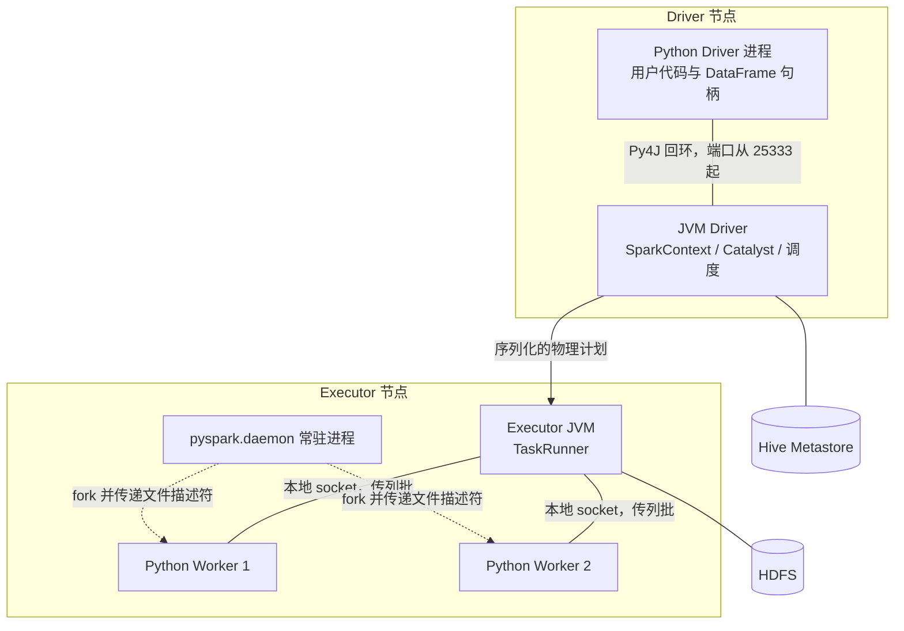
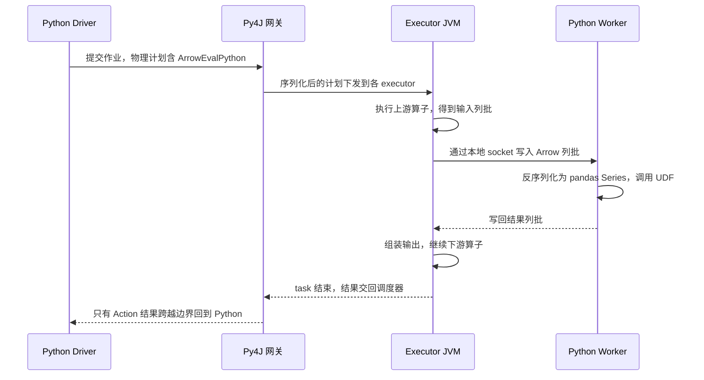
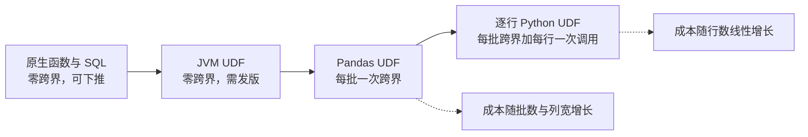
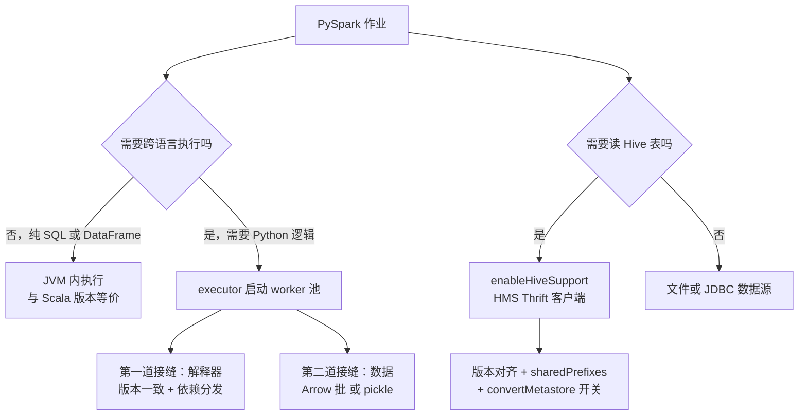
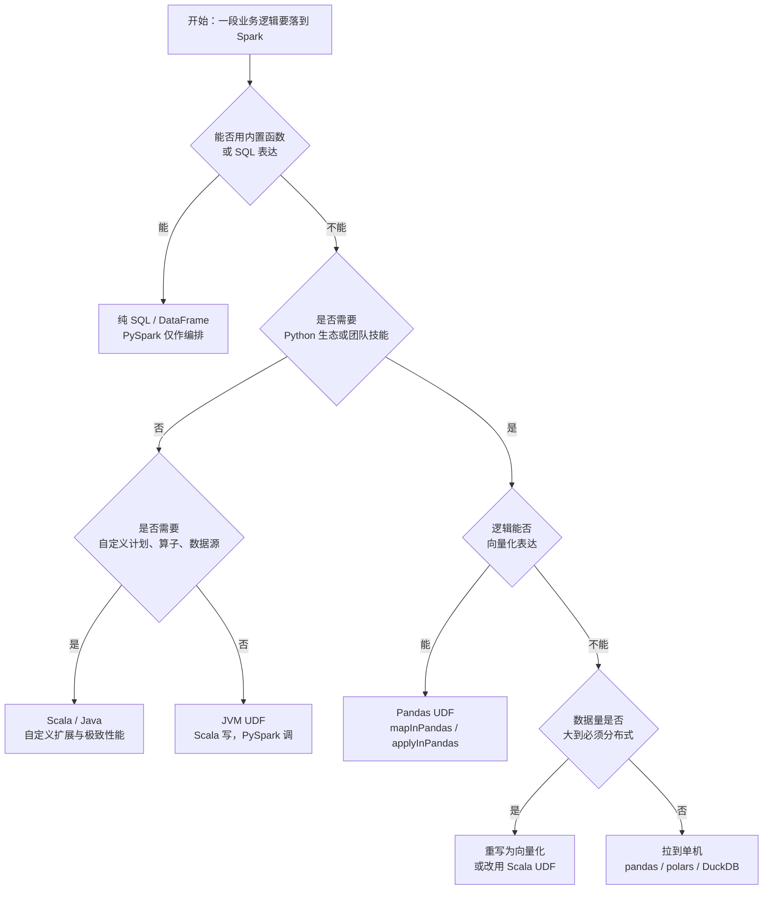

**摘要：**

PySpark 常被当成「Spark 的 Python 语法糖」，于是性能讨论往往落在「Python 比 Scala 慢」这种粗糙结论上。真实的分界线不在语言，而在进程：driver 上一条 Py4J 控制通道，executor 上一个 Python worker 池，两者之间隔着一条只能传字节的本地 socket。

先给一个结论：不做跨语言计算时，PySpark 与 Scala 的执行计划逐字相同，成本只在两条接缝上产生。本文沿着这两条接缝做选型分析：分别算清控制面与数据面各自的成本结构，再看数据过界的四类通道与它们的价目表，然后拆开 UDF 这个黑盒——它如何切断 Catalyst 的 codegen、下推与代价估计，以及为什么 Pandas UDF 能把成本降一个量级而不是把语言换掉。Hive 一侧有两件事要分开看：作为 HMS 客户端的版本与类加载对齐，以及 Python 解释器本身的版本与依赖分发，后者才是 PySpark 在 Hadoop 集群上最先撞上的墙。用成本模型说明向量化程度才是决定 UDF 倍数的变量，再给出三条边界——PySpark、纯 SQL、Scala 各自成立的判据，以及五类不该把计算搬进 Python 的反例，落点尽量停在判据上，便于与自家环境逐条对照。

---

## 第 1 章 一条聚合语句里的两套语言

一个分析师在 Jupyter 里写下三行 PySpark：读一张 Hive 分区表，按天和渠道分组，算一个自定义的加权指标。这条语句从敲下回车到结果打印，中间穿越了两次语言边界、三类进程，但代码里看不出来。几乎所有关于 PySpark 性能的困惑都源于这个不可见，于是讨论很容易滑向「Python 慢」这种既不准确也无从下手的结论。

笔者更愿意用报关来打比方。数据是货物，JVM 是关内，Python 是关外。绝大多数货物根本不需要出关：`select`、`filter`、`join`、`groupBy`、窗口函数这些操作，全部在 JVM 里被翻译成同一棵 Catalyst 树，走同一套 Tungsten 与全阶段代码生成。只有当你要求「执行一段 Python」时，货物才需要报关、装箱、清关、再运回来，而报关的成本不取决于货物值多少钱，取决于**批次的多少与每批的行数**。一车货一次报关，和一箱货一次报关，通关费是一样的。

这个比喻也解释了历史。2013 年前后 PySpark 立项时，摆在面前的选项有三个：用 JNI 把 CPython 嵌进 JVM，自己写一套跨语言 RPC，或者借一个现成的 Java-Python 桥。JNI 的代价是崩溃会带走整个 JVM，自研 RPC 的代价是没人愿意长期维护两套协议实现，于是工程上选了第三条——Py4J，一个基于反射与 socket 的通用桥接库。它零侵入、不改 Spark 内核、不需要 Java 胶水，代价是控制通道成了单线程同步调用，并完整继承到了今天。

一个必要的范围限定：本文谈的是经典 PySpark（`pyspark` 通过 Py4J 驱动一个 JVM 后端）的执行模型，Spark Connect 的远程客户端模式在第 2 章末尾单独对照。机制细节——血缘、规则集、Shuffle、内存池——在 [[大数据/Spark/读书笔记-spark内核/00 专栏导览|Spark 内核剖析专栏]] 与 [[大数据/读书笔记-大数据概览/10 Spark SQL 与 Catalyst 优化器|Spark SQL 与 Catalyst]] 里已有逐层拆解，本文只取它们的结论作为判据。

## 第 2 章 控制面：driver 上的一根管子

先看 driver 侧的进程布局。`spark-submit` 启动的是 JVM（`org.apache.spark.deploy.SparkSubmit`），JVM 进程里跑着 `SparkContext`、DAGScheduler、TaskScheduler 与整个 Catalyst；Python 解释器是另一个进程，由 `pyspark` 的启动逻辑拉起。两个进程之间是一条 TCP 回环连接：JVM 侧起一个 `GatewayServer`（Py4J 的默认端口从 25333 开始），Python 侧作为客户端连上去，拿到一个 `JavaGateway` 对象。

方向感容易搞错，值得说清。控制指令是 Python 发往 JVM 的：你写的每一个 `df.filter(...)`，都是 Python 侧把参数序列化、通过 socket 发给 JVM、由 Py4J 用反射调到某个 Java 方法、再把方法返回的 Java 对象包装成一个可在 Python 侧持有的引用。反向通道也有一条，JVM 可以回调 Python 定义的对象方法，PySpark 用它同步作业状态、处理累加器更新。于是这条管子是双向的，但**同一时刻只有一次调用在飞**——它是同步的，Python 线程在等 JVM 返回。

由此得到第一个判据：Python 侧的 `DataFrame` 不是数据容器，是一个句柄。它内部只有两样东西，指向 JVM `DataFrame` 的引用，以及一份在 Python 侧解析出来的 schema。数据一直待在 executor 的 JVM 堆里，Python 侧从来没有持有过它。这个事实推出一条重要结论——不做 UDF 的 PySpark 作业，执行计划与 Scala 版本**逐字相同**，同样的 Catalyst 规则、同样的自适应查询执行、同样的代码生成。所谓「PySpark 慢」，在纯 SQL 与纯 DataFrame API 的场景里根本不成立。

那么成本藏在哪里。藏在调用的次数上。单次跨语言调用的开销在微秒到亚毫秒量级，一次两次可以忽略，但两种写法会把它放大到肉眼可见。

第一种是 Python 循环里操作 DataFrame。一个典型写法是逐列清洗：读入 60 个字段，然后在 for 循环里调用 60 次 `withColumn`，每次加一个 `when` 或一次类型转换。从 Python 侧看这只是 60 次方法调用，开销可忽略；真正的代价在 JVM 侧——每次 `withColumn` 都往逻辑计划上叠一层 `Project`，60 层之后 analyzer 与 optimizer 要在一棵深树上反复做自底向上的变换，递归深度、计划体积与表达式树都在膨胀。

极端情况下会出现优化器迭代次数耗尽、计划打印截断、甚至 `StackOverflowError`。修法不在调参，在写法：把 60 次合并成一次 `select`，或者用 `functools.reduce` 把列表达式组合成单层投影。

第二种是 driver 侧的往返式编程：先 `collect()` 出一批结果，在 Python 里算一遍，再 `createDataFrame` 送回去，再算，再取。这种写法把数据来回搬了四次，两次完全没必要，中间那步 Python 计算本可表达成列表达式或 SQL。它的问题不只是慢，而是把可在 executors 上并行的计算缩成了 driver 单进程的串行计算。

还有一个容易被忽略的放大器：`count()`、`take()`、`show()` 每一个都是独立的作业提交。探索阶段没什么，但自动化脚本里反复 `count()` 判空就变成反复全量扫描，解法是把判断挪进同一个作业。

| 调用类型 | 频率量级 | 单次代价 | 放大后的典型症状 |
|---|---|---|---|
| 逻辑计划构建（`select`/`filter`/`join`） | 一次作业数十到数百 | 一次 socket 往返加反射 | 循环构建导致计划层数膨胀，编译时间暴涨 |
| Action（`count`/`collect`/`show`） | 一次作业数次 | 一次完整作业提交与调度 | 循环里反复触发扫描，作业数翻倍 |
| 元数据读取（`df.schema`、`columns`） | 少量 | 首次跨进程，之后本地缓存 | 在循环里重建 schema 或反复解析 |
| UDF 注册与序列化（`udf()`、`pandas_udf()`） | 一次作业数十 | 函数字节码序列化并随任务分发 | 闭包捕获大对象，任务体积膨胀 |

Spark 4.x 引入的 Spark Connect 把这条管子换掉了。客户端不再持有 JVM 引用，而是通过 gRPC 与一个独立的 Spark 服务端会话通信，控制面从「本地反射调用」变成「protobuf 消息」。变化有两处：客户端与服务端可以有不同的 Python/JVM 版本，也不必共享同一台机器；以及 `_jvm`、`_jsc` 这类直接摸 JVM 对象的写法彻底失效，依赖它们的库会断。

不过 Connect 改的是控制面，executor 侧的 worker 模型没有变，UDF 的代码仍要送到集群执行，跨进程搬运仍在：它对调用放大改善有限，对客户端环境耦合的改善则是根本性的。版本细节以对应版本文档为准。

## 第 3 章 数据面：executor 上的 worker 池

控制面只传指令，货真价实的数据搬运发生在 executor 上，这一侧的模型比 driver 侧更容易被误解。

executor 是 JVM 进程，这一点没有例外——即使你的作业全是 Python UDF，executor 里跑的仍然是 JVM，Python 只是它拉起的子进程。当一个 task 的物理计划里出现了 Python 相关算子（`ArrowEvalPython`、`BatchEvalPython`，或者底层的 `PythonRDD`），JVM 侧的执行器会通过 `PythonWorkerFactory` 去要一个 Python 进程。

这里有一个值得拆开的细节：Python 进程不是每个 task 现起的。默认配置是 daemon 模式（`spark.python.use.daemon`），executor 启动时拉起一个 `python -m pyspark.daemon` 作为常驻守护进程，它绑定一个本地端口并等待 JVM 连接；每个需要 Python 的 task 到来时，daemon 派生（fork）出一个 worker，把 worker 的 socket 端通过文件描述符传给 JVM，此后 JVM 与这个 worker 直接对话，daemon 退回后台。task 结束后，如果 `spark.python.worker.reuse` 为真（默认），worker 不会被销毁，而是回到池里等待下一个 task。

值得记住的是：Driver 与 Executor 之间只有一条标着「计划」的箭头。

复用的意义常被低估。一个 worker 的生命周期里，`import pandas`、`import numpy`、编译正则、加载一个几百兆的模型，这些一次性成本只付一次；摊到成百上千个 task 上之后，它就从「显著」退化成了「噪声」。反过来，`spark.python.worker.reuse=false` 或者 worker 频繁崩溃重建时，这笔冷启动成本会回到每个 task 上，量级在百毫秒（这是量级估计，取决于依赖的多少），对于只有几十毫秒计算量的短 task 来说，占比会非常难看。

池的深度与并行度直接相关。一个 executor 上能同时跑几个 Python task，上界是 `spark.executor.cores`——每个 worker 内部同一时刻只执行一个调用栈，这是 GIL 决定的，加内存不提高并行度。

所以当作业里 Python UDF 占比很高时，你会看到一个反直觉的现象：executor 的 CPU 核数很多，但 CPU 利用率上不去，瓶颈是「同时只有这么多 worker 在工作」。这时候加核有用，加内存没用；如果连核都加不了，只能增加分区数让更多 executor 参与，或者把计算改写成不跨界的表达式。

内存是另一个必须掰开算的地方。Python worker 的内存完全不在 JVM 的堆里，它和 Arrow 的堆外缓冲、JNI 分配一起，挤在容器的非堆部分，也就是 `spark.executor.memoryOverhead` 覆盖的那块空间（默认取 384MB 与堆大小的 10% 中较大者，具体以对应版本文档为准）。

`spark.executor.pyspark.memory` 可以给 Python 部分单独设一个上限，但它不改变记账方式——上限仍然是容器内的一个子额度，不是额外申请的资源。超了会怎样：YARN 的 cgroup 内存限制会直接把进程杀掉，表现是 worker 退出码 137、日志里一句 `Python worker exited unexpectedly`，task 失败、重试，然后同样的批次再把新的 worker 撑爆，形成看起来像「无限重试」的循环。

排这类故障要先分清两件事。JVM 堆溢出报 `java.lang.OutOfMemoryError: Java heap space`，方向是调 `spark.executor.memory`、减少缓存、降低并行度；worker 被杀报的是退出码与容器 kill 事件，方向是压小批大小、限制 UDF 内的缓存，或设置 `spark.executor.pyspark.memory` 让它更早暴露。两者方向几乎相反，混在一起调只会来回震荡。

还有一个观察面上的麻烦：Python 侧的异常穿越到 JVM 时，会被包成 `Py4JJavaError` 里嵌一个 `PythonException`，堆栈是 JVM 栈与 Python traceback 拼接的，第一次见到很难读。worker 的 stderr 混在 executor 日志里，UDF 里的 `print` 也在那里，那是调试 Python 逻辑时唯一能看到内部状态的地方。

图上有一条容易看漏的线：从 Driver 到 Executor JVM 之间传的是计划，不是数据；从 Executor 到 Worker 之间传的才是数据。这也解释了为什么纯 SQL 作业的 PySpark 与 Scala 版本开销一致，以及为什么 UDF 越多，图上那条「本地 socket」的线就越粗。

## 第 4 章 过界的数据：四类通道的价目表

把所有跨越语言边界的数据流动归类，其实只有四种，它们的编码方式、触发条件和失败行为各不相同，混在一起谈就会得出错误的优化结论。

第一类是**控制指令**。它不携带数据，只携带方法名与参数，走 Py4J 的反射通道。前面说的调用放大属于这一类，优化手段是减少调用次数，与序列化格式无关。

第二类是**结果回传**。`collect()`、`take()`、`toPandas()` 触发它，方向是 executor 到 driver 再到 Python。从 Spark 3.x 起 `toPandas` 有一条 Arrow 快路径，把结果以 Arrow 流一次性传到 Python 侧再构造 pandas 对象，而不是逐行 pickle 成 `Row` 列表（见 SPARK-23030）。它的成本与结果集大小成正比，判据很朴素：能聚合就不要回传，一个「先拉回本地再算平均」的写法等于把分布式计算退化成单机计算。

第三类是**转换边界**，即 `createDataFrame(pandas_df)` 与 `toPandas()` 这一对。这里有一组配置值得单独记住：`spark.sql.execution.arrow.pyspark.enabled` 控制它是否走 Arrow，在 3.x 系列默认关闭，需要显式打开；`spark.sql.execution.arrow.pyspark.fallback.enabled` 默认打开，含义是「Arrow 转换失败时静默退回 pickle」。

后者是这一章最值得警惕的一条。静默回退意味着你的作业在数据类型变更后会悄悄慢一个量级，日志里没有异常、没有警告，只有耗时曲线突然抬高。触发回退的常见原因是 Arrow 转换器不支持的嵌套类型、精度超限的 Decimal 与某些 Map 联合类型。开了 Arrow 就要盯两件事：`toPandas` 耗时是否稳定，schema 是否引入了不支持的复杂类型。

这里必须澄清一个流传很广的误判：Pandas UDF 的 Arrow 通道不依赖这个开关。`pandas_udf` 天生就是 Arrow 传输的，它只需要环境里有 `pyarrow`，与 `spark.sql.execution.arrow.pyspark.enabled` 无关。那个开关只管 pandas 与 Spark DataFrame 的互转。混为一谈会得出「打开开关就能加速 UDF」这种无效结论。

第四类是**UDF 的数据面**，方向是双向的，编码有两种：`BatchEvalPython` 走逐行 pickle，`ArrowEvalPython` 走 Arrow 列批。这一类的成本结构与前三类不同，下一章单独拆。

| 通道 | 触发点 | 编码 | 成本与结果规模的关系 | 失败与回退行为 |
|---|---|---|---|---|
| 控制指令 | 任一 DataFrame 方法调用 | 反射加参数序列化 | 与数据量无关，与调用次数成正比 | 超时抛 `Py4JNetworkError`，网关不可达 |
| 结果回传 | `collect`/`take`/`toPandas` | 3.x 起优先 Arrow 流，否则逐行 pickle | 与结果集大小成正比，全量进 driver 内存 | 结果过大导致 driver OOM，或回退到慢路径 |
| 转换边界 | `createDataFrame(pandas_df)` | Arrow 或 pickle | 与传入数据量成正比 | 类型不支持时静默回退，性能骤降无告警 |
| UDF 数据面 | Python UDF / Pandas UDF | pickle 逐行 或 Arrow 列批 | 与行数、列宽、批大小相关 | 批过大导致 worker OOM，退出码 137 |

Arrow 到底省了什么，值得说精确。它省的不是计算，是每行一个 Python 对象的构造与销毁。逐行 pickle 的路径上，一行要变成 `Row` 对象、被编码、在另一端解码成新的对象图；Arrow 的路径上，整列数据是一块连续的列式缓冲，Python 侧通过 `pyarrow` 包装成 `pandas.Series`，底层与 numpy 共享同一片内存。JVM 侧仍要做 `UnsafeRow` 到 Arrow 向量的逐值填充，这依然是 O(n)，但它是紧凑的顺序写，与被 GC 追着跑的 n 次对象分配不是一个量级的常数因子。

批大小因此是个真实的权衡。`spark.sql.execution.arrow.maxRecordsPerBatch` 默认 10000 行一批：批越大，固定开销（socket 往返、批头解析、pandas 包装）摊得越薄，单批内存峰值越高。宽表下 10000 行的 Arrow 缓冲已能到几十兆，反而该调小；窄表调到几万行也无妨。依据是单批字节数，不是行数。

还有一个实验性的开关 `spark.sql.execution.arrow.pyspark.selfDestruct.enabled`，转换完成后立刻重置 Arrow 内存池，能把长时间运行中 RSS 只涨不落的现象压下去，代价是那块内存不能复用。它默认关闭，属于出问题再打开的止血手段。

## 第 5 章 黑盒：UDF 切断了什么

把 UDF 讲成「多一次序列化」并不够，真正要紧的是它对优化器的破坏。

Catalyst 的优化建立在一个前提上：它看得懂表达式。`col("a") + 1 > col("b")` 是它认识的结构，于是它可以重排、可以折叠常量、可以把谓词推到数据源、可以据此估算代价。一个 Python UDF 在分析阶段变成了 `PythonUDF` 表达式，语义是「调用一段外部代码」，优化器对它一无所知。物理计划阶段，一条专门的规则（`ExtractPythonUDFs`）会把这些表达式从逻辑树里「提」出来，变成独立的 `ArrowEvalPython` 或 `BatchEvalPython` 节点，位置尽量靠近输出端，以减少需要穿过它的行数与列数。

这个「提出」动作带来三个后果。

第一，**全阶段代码生成被切断**。`ArrowEvalPython` 是一个独立节点，它前后的算子里，`WholeStageCodegen` 会被它隔开，各成一段。原本可以被融合成一个循环的「扫描、过滤、投影、计算」，在 UDF 处出现了物化边界：前面一段算完，把结果写进列批，交给 worker，等结果回来，再开始下一段。这不是免费的，中间结果要真实地占内存。

第二，**谓词与列裁剪被限制**。你能做的只是让 UDF 少看行、少看列——把过滤条件写在 UDF 之前，把 UDF 需要的列限制到最小。但做不到的是让 `WHERE udf(x) = 1` 变成一个可以用索引或分区剪枝的下推谓词。优化器只能把它当作 UDF 之后的一层 `Filter`：全量扫描、全量计算、事后过滤。把筛选逻辑塞进 UDF 内部是最坏的一种写法，因为它把「可以下推到存储层的工作」变成了「在 Python 里逐行判断」。

第三，**代价估计失效**。`PythonUDF` 在优化器眼里是一个默认常数代价，与实际计算量无关，于是 join 顺序、广播阈值附近的判断、「该不该物化」的决策都会受影响。当 UDF 参与 join 条件时，CBO 给出的计划可能明显偏离最优，而它自己并不知道。

确定性与随机性是一个相关但更隐蔽的坑。`F.udf` 默认把函数声明为确定性的，于是优化器可以做常量折叠、可以做公共子表达式消除——同一个 UDF 调用在计划里出现两次，可能被合并成一次。

这在纯函数上是正确的优化，但如果你在 UDF 里调了 `random`、读了时间、访问了外部状态，合并就会让两次调用产生相同结果，与直觉不符。正确的做法是把它显式声明为非确定性，代价是优化器放弃这些机会。这是语义正确性与性能之间一次不可回避的选择，选错了会得到「偶发的、只在特定计划下复现」的数据错误。

行数也要分开看。标量 UDF 不改变行数、只改变值，因此基于 shuffle 统计的自适应查询执行仍然有效。但 `applyInPandas` 与表生成函数可以改变行数，它们在计划里不透明，优化器不知道会吐出多少行；这类算子位于 join 之前时，AQE 依据的统计就失真，重分区与广播决策会建立在错误基数上。

最后一个层面是类型映射。UDF 收到的数据已经被翻译过一遍：`timestamp` 在 JVM 侧是微秒精度的 long，到 pandas 侧是纳秒精度的 `datetime64`；整型列一旦出现 null，会被升格成 `float64`；`decimal` 的精度决定它是 `object` 还是定点数组。同一个函数在纯 pandas 上测试通过、在 Spark 上结果不同，多数时候不是业务逻辑错，而是这几处映射的差异。这也是唯一无法靠调参解决的问题，只能把类型当作契约来对待。

## 第 6 章 代价阶梯与它的尽头

把可选方案排成阶梯，每一级的价格结构不同，判断依据也就清晰了。

阶梯的最底端是**原生函数与 SQL**，包括 `pyspark.sql.functions` 里的几百个函数、窗口、聚合、以及 `from_json`、`regexp_extract`、`get_json_object` 这类看起来像「字符串处理」的能力。它们的成本与 Scala 版完全一致，因为它根本不跨越边界，而且能被 codegen、向量化与下推完整覆盖。

往上一级是**JVM UDF**，用 Scala 或 Java 写、打成 jar、通过 `CREATE FUNCTION` 注册，Python 侧用 SQL 字符串调用。它仍然在 JVM 里执行，没有跨进程通信，通常可以进代码生成，代价是要走一次发版流程。这是「性能与工程成本」之间最常被忽视的一级，很多团队直接从原生函数跳到了 Python UDF，跳过了这一级。

再往上是**Pandas UDF**，也就是向量化的 Python UDF：Arrow 批传输，一批数据调用一次函数，函数体拿到的是 `pandas.Series`。最后是逐行 Python UDF，Arrow 或 pickle 传输，但每一行调用一次 Python 函数。

| 阶梯层级 | 跨界次数 | 每行成本 | 可被优化器处理 | 适用判据 |
|---|---|---|---|---|
| 原生函数与 SQL | 零 | 与 JVM 算子同量级 | 完整：下推、codegen、CBO | 任何能用内置函数表达的语义 |
| JVM UDF | 零 | 有装箱与调用开销 | 大部分：可进 codegen | 需要 JVM 生态，且愿意承担发版 |
| Pandas UDF | 每批一次 | 向量化后的单行成本 | 仅剩节点级提取与列裁剪 | 逻辑可用 numpy/pandas 向量化表达 |
| 逐行 Python UDF | 每批一次，但每行一次函数调用 | 解释器单行成本加对象构造 | 几乎为零 | 逻辑无法向量化且数据量可控 |

成本模型可以写得很直白。设行数为 n、批大小为 b，每批的固定开销为 `C_ipc`（序列化、socket、批头处理），单次 Python 调用开销为 `c_call`，向量化后的单行开销为 `c_vec`：

- 逐行 Python UDF 的耗时大约是 `(n/b)·C_ipc + n·c_call + n·c_obj`；
- Pandas UDF 的耗时大约是 `(n/b)·C_ipc + (n/b)·c_wrap + n·c_vec`。

两者的差在第一项之外的常数因子上：逐行版本是 n 次解释器调用与对象构造，向量化版本是 n 次 C 层循环。如果 `c_vec` 比 `c_call + c_obj` 小一个数量级以上，整体就能落在「快一个量级」这个区间；小得不多时，收益就只剩 IPC 与对象构造省下的那部分。所以「Pandas UDF 快一个量级」这个说法的前提是逻辑真的被向量化了，而不是把逐行循环换成 `Series.apply`。

这一条值得展开，因为它是实践中最常见的自欺。`pandas_udf` 的函数体里写 `s.apply(lambda x: ...)` 或者一个显式的 for 循环，Arrow 只是把传输优化了，`apply` 内部仍然是逐元素调用 Python 函数，耗时与逐行 UDF 接近，只省掉了每行一次跨界往返的固定成本。

真正的向量化是让计算落在 numpy 的数组运算、pandas 的字符串方法（底层是 C 的向量化实现）、或是 `scipy`/`sklearn` 这类本身就按数组写的库上。写之前先问一句：这段逻辑在单机 pandas 里能不能不写 `apply`；答案是否定的话，Pandas UDF 带来的收益也有限。

阶梯还有三个「尽头」，是在这个框架内做到头的几种形态。

一是**把批再放大**。`mapInPandas` 与 `applyInPandas` 让函数一次拿到一个迭代器或一整个分组的数据，模型加载、JIT 编译、正则编译这些固定成本被进一步摊薄。`applyInPandas` 尤其适合「每组的处理可以整体用 pandas 表达」的场景，譬如对每个用户的时间序列做一次 `resample`。代价是单批或单组必须整个进内存，分组倾斜时某个大组会直接把 worker 撑爆，所以它通常要与「先切分大组」或「限制单组行数」配套使用。

二是**把查表搬出 UDF**。UDF 里逐行查一个字典、调一次 HTTP 接口、连一次数据库，是隐性成本最常见的来源。前两种里，字典可以广播成小表然后 join，接口调用则无法搬走——这时候问题的性质变了，它不再是「用哪种 UDF」，而是「这段计算该不该放进 Spark 的分布式循环里」。

三是**把逻辑推回 JVM**。把热点逻辑用 Scala 重写、打成 jar、在 PySpark 里注册成函数，或者反之，把 Java 生态里现成的 UDF 借给 Python 用（`CREATE FUNCTION ... AS 'com.example.Udf' USING JAR`）。后一种做法在 Hive 环境里格外实用，Hive 的 UDF 体系积累了大量的脱敏、解析、编码函数，PySpark 可以直接复用而不必用 Python 重写一遍，机制细节见 [[大数据/Hive/09 UDF 开发体系：GenericUDF、UDAF 与 UDTF 全解|Hive UDF 开发体系]]。

## 第 7 章 第二条接缝：Hive 的两件事

PySpark 与 Hive 的关系被文件名里的「集成」两个字掩盖了，实际上它是两条互不相干的接缝，各自的故障形态完全不同。

第一条接缝是**目录**。`enableHiveSupport()` 的实质，是把会话状态里的 in-memory catalog 换成 `HiveExternalCatalog` 加一个 `HiveClient`，后者通过 Thrift 连到 Hive Metastore 服务。此后 `spark.sql("select * from db.tbl")` 的表解析走的是 HMS 里的元数据，与 Hive 共享同一份目录。版本对齐是第一道坎：`spark.sql.hive.metastore.version` 声明 Metastore 的版本，`spark.sql.hive.metastore.jars` 决定 jar 从哪来——`builtin` 用 Spark 内置的那一份，`maven` 从 Maven 仓库拉，`path` 指向预先放好的目录。内置版本只覆盖有限的几个，当集群的 HMS 是另一个大版本时必须切到后两者，否则会遇到类找不到或方法签名不匹配。

类加载是第二道坎。Hive 的 jar 与 Spark 自带的库在同一进程里共存，`spark.sql.hive.metastore.sharedPrefixes` 是一张「必须共享」的例外清单，典型成员是各数据库的 JDBC 驱动与日志库，解决的是「驱动类只能有一份副本」的问题。清单配错的症状很有辨识度：连得上 HMS，一查表就报 `ClassCastException` 或 `NoSuchMethodError`。机制细节见 [[大数据/Hive/02 Hive Metastore 深度解析：元数据体系与 HMS 高可用|HMS 元数据体系与高可用]]。

第三条是读路径的开关，也是最容易被忽视的性能开关。`spark.sql.hive.convertMetastoreParquet` 与 `convertMetastoreOrc` 默认开启，含义是表定义来自 Hive、读取时用 Spark 原生 reader 而非 Hive 的 SerDe。原生 reader 能用文件尾部统计做裁剪与下推、能向量化读；退回 SerDe 就是逐行反序列化。只有表用了自定义 SerDe、或需要严格复现 Hive 语义时才应该关。格式层面的差异见 [[大数据/Hive/08 ORC 与 Parquet：列式存储格式的内部结构与选型|ORC 与 Parquet 的选型]]。

安全上下文在这条接缝上有一个顺带的好处。Kerberos 认证、delegation token、HMS 侧的 SASL 全部发生在 JVM 侧，Python 进程只发 SQL 字符串，自身不持有凭据，跨语言模型没有扩大攻击面。写侧则要单独核对：Hive 的 ACID 事务表在 Spark 侧长期以读为主，写能力的支持范围随版本变化，以对应版本文档为准，事务与压缩的治理见 [[大数据/读书笔记-大数据概览/06 Hive ACID 与 Compaction：事务机制与小文件治理|Hive ACID 与 Compaction]]。

第二条接缝是**解释器**，这才是 PySpark 在 Hadoop 集群上最先撞上的墙，也是它与 JVM 语言最本质的差别：你不仅要分发 jar，还要分发一个 Python 解释器与整套第三方依赖。

第一道硬约束是版本一致。driver 与 executors 上的 Python 必须主次版本一致，否则启动即报 `Python in worker has different version ... than that in driver ...`，原因是 pickle 协议与 C 扩展的 ABI 不保证跨次版本兼容。而集群系统自带的 `python3` 往往是发行版锁定的老版本，开发机却是新的，这个错配几乎必然出现。

配置入口有三个，容易混：`spark.pyspark.driver.python` 管 driver 侧，`spark.pyspark.python` 管 executor 侧，环境变量 `PYSPARK_PYTHON` 会覆盖后者。cluster 部署模式下 driver 也跑在集群里，只配一个是不够的。

依赖分发有三条路，各有前提。最常见的是 `--archives` 打包虚拟环境：`spark-submit --archives venv.tar.gz#environment` 配合 `--conf spark.pyspark.python=./environment/bin/python`。这里的相对路径不是笔误——归档在每个 executor 的工作目录下解压，配置必须相对于工作目录。

前提是环境可重定位：`venv` 创建的 `bin/python` 往往是指向系统解释器的符号链接，打包后在目标节点上悬空，正确做法是让解释器自包含，或改用 `virtualenv`、`conda-pack` 这类以可重定位为目标的工具。第二条是 `conda-pack`，一条命令生成可搬迁的 tar.gz，解压即用。第三条是把纯 Python 依赖打成 wheel 放进 `spark.files` 用 `PYTHONPATH` 挂上，只适合依赖极少、无 C 扩展的场景。

这里有一条反直觉但重要的约束：不要往分发的虚拟环境里 `pip install pyspark`。PySpark 自身的库来自 `SPARK_HOME/python/lib/pyspark.zip`，由 spark-submit 按集群版本分发；虚拟环境里再装一个不同版本的 pyspark，会让 worker 侧的客户端代码与 JVM 侧的服务端代码错配，症状是各种难以解释的序列化错误与方法缺失。

| 事项 | 关键配置 | 常见错误 | 后果 |
|---|---|---|---|
| 解释器版本 | `spark.pyspark.python`、`spark.pyspark.driver.python` | 只配 executor 侧，或依赖系统 `python3` | 启动即报版本不一致，作业无法运行 |
| 虚拟环境分发 | `--archives`、`spark.yarn.dist.archives` | 用绝对路径引用解释器；venv 不可重定位 | worker 启动失败，报解释器不存在 |
| conda 环境 | `conda-pack` 加相对路径 | 打包时未清理前置路径 | 解压后 import 失败 |
| HMS 客户端版本 | `spark.sql.hive.metastore.version`、`jars` | 用 `builtin` 对接大版本不一致的 HMS | 类缺失、方法签名不匹配 |
| 类加载共享 | `spark.sql.hive.metastore.sharedPrefixes` | 漏配 JDBC 驱动或日志库 | 连接成功但查询时报类型转换异常 |
| 读路径 | `spark.sql.hive.convertMetastoreParquet`、`convertMetastoreOrc` | 为兼容自定义 SerDe 而全局关掉 | 退回逐行反序列化，扫描性能下降 |

作为历史对照，Hive 早期用 `TRANSFORM ... USING 'script.py'` 把每行通过管道送给外部脚本，是「每行一次进程间管道」，成本随行数线性放大，也没有常驻进程摊薄启动开销。PySpark 的 worker 池是「每核一个长驻进程、按批走 socket」，只在批的粒度上付固定成本。这也解释了为什么「用脚本处理 Hive」的老经验不能直接搬过来。

## 第 8 章 账本：内存、CPU 与可见性

把前面几章的结论收成一页账本，才好在具体作业上做判断。

内存要分三处记。JVM 堆归 `spark.executor.memory`，装 Spark 自己的东西：缓存、shuffle 缓冲、执行中的批。非堆部分归 `spark.executor.memoryOverhead`，装 Python 解释器、pandas 的中间副本、Arrow 堆外缓冲与 JNI 分配。第三处常被忘记：UDF 内部自己攒的东西——缓存字典、模型、连接池，不在任何 Spark 参数的管辖内，只能靠代码约束。

CPU 的账更反直觉。JVM 侧算子可以多线程，Python 侧只能靠多个 worker 进程，于是 Python 部分占比升高时，executor 会从「核多的机器」退化成「只有几个核在忙」。加 `spark.executor.cores` 能提高并发上限，加内存不能；核数到顶后，增加分区数与 executor 数量是唯一出路。

可见性的账最让人难受。Spark UI 的 SQL 页能看到 `ArrowEvalPython` 节点占了多少时间，这能回答「UDF 是不是瓶颈」；但它看不到 UDF 内部，看不到哪一行慢、哪一次分配大。要看内部，只能用 `spark.python.profile` 让 worker 侧跑 cProfile 并 dump 到 executor 本地目录，或者在 UDF 里手工埋点。事件日志里没有 Python 侧的细分指标——不是配置没开，而是数据本来就没跨过那条边界。

这就是 PySpark 调优比 Scala 调优难的结构性原因：不是参数多，而是观测面被进程边界切成两半，A 侧仪表盘上看到的是 B 侧问题的投影。

## 第 9 章 三条边界的画法

选型的判断可以压成一句话：**计算留在 JVM 时，PySpark 与 Scala 没有性能差别；差别只由跨界的次数与每次搬运的行数决定**。围绕这句话，三条边界就比较好画了。

| 维度 | 纯 SQL / DataFrame | PySpark 加 Pandas UDF | Scala / Java |
|---|---|---|---|
| 性能上限 | 与 Scala 相同 | 由 UDF 密度与向量化程度决定 | 与 SQL 相同，UDF 部分最优 |
| 表达能力的缺口 | 内置函数覆盖不到的领域逻辑 | 几乎无缺口，Python 生态全部可用 | 需要 JVM 库或自己实现 |
| 团队成本 | 最低，分析师可直接改 | 中，数据科学团队可直接改 | 高，需要平台或后端工程师 |
| 变更半径 | 改一行 SQL 即生效 | 改 Python 代码即生效，无需发版 | 改 jar 并发布，版本管理成本最高 |
| 自定义扩展 | 不支持 | 只能通过加载 jar 间接支持 | 完整支持：规则、算子、数据源 |
| 环境依赖 | 无 | 解释器版本与虚拟环境分发 | jar 分发与版本对齐 |

第一条边界在「用不用 Python 逻辑」上。能用内置函数、SQL、窗口函数表达的计算一律不要用 UDF，理由不是性能玄学，而是优化器的可见性：内置表达式可下推、可剪枝、可参与代价估算，UDF 全都不行。这条边界划在语义层，与数据量无关。

第二条边界在「Python 逻辑能不能向量化」上。能向量化的，写 Pandas UDF 或 `mapInPandas`/`applyInPandas`；不能向量化且数据量很大的，应该考虑用 Scala 重写、或者把这段计算挪出 Spark。这一条最容易被绕过，因为它要求先评估自己的代码，而不是先选工具。

第三条边界在「需要不需要碰内核」上。自定义 Catalyst 优化规则、自定义物理算子、DataSource V2 连接器、自定义 Encoder 与序列化——这些扩展点只存在于 JVM 侧，PySpark 没有任何通道能达到，只能通过 `spark.sql.extensions` 与 jar 加载间接使用别人写好的实现。需要自己写的时候，语言选择已经没有余地。

实际工程里最常见的形态不是三者选一，而是**混合**。用一个具体例子说明：一个推荐特征管道，输入是 Hive 里的行为宽表，输出是特征宽表。join、去重、窗口聚合、按天分区写回这些占了 80% 的计算量，全部用 SQL 表达，留在 JVM；剩下 20% 是一个用 Python 写的模型推理，输入是一张窄表（用户 ID 加几十个浮点特征），这一段写成 `mapInPandas` 或 Pandas UDF，一次批处理几千行。这种「SQL 主干 + Python 窄腰」的形态，性能上接近全 JVM 实现，工程上又留住了 Python 生态，是笔者见过的最稳妥的分工。

还有一类工具值得对照：pandas API on Spark（原 Koalas）。它提供 pandas 风格的接口，底层仍把操作翻译成 Spark 计划、在 JVM 上执行。判据很清楚：用它的 DataFrame 级 API（`merge`、`groupby`、`fillna`），那会翻译成 JVM 算子；避开 `apply` 类 API，那等价于 Python UDF。把它当成「pandas 语法糖加 JVM 执行」，而不是「pandas 的分布式加速版」，判断就不会跑偏。

## 第 10 章 反例：五类不该把计算搬进 Python 的场景

行级解析密集的清洗。用 Python UDF 做正则提取、JSON 解析、手机号脱敏、URL 规范化，输入动辄几十亿行。这类工作几乎都能用内置函数替代：`regexp_extract`、`from_json`、`get_json_object`、`split`、`translate`，它们都能进代码生成。判断方法很简单：把 UDF 换成内置函数后跑一遍，如果耗时降了一个量级，说明原来那部分是纯粹的跨界开销。真需要 JVM 库里没有的解析能力，写 Scala UDF 也比 Python UDF 划算。

单机装得下的数据。几千万行、几个 GB 的宽表，在单机上用 pandas、polars 或 DuckDB 处理通常比 Spark 快，因为提交、调度、序列化、shuffle 落盘这些固定成本无法在这个规模上摊薄。把这类任务塞进 Spark 往往不是为了算得快，而是为了复用同一套调度与目录，那是工程统一性的诉求，明说即可。

需要自定义优化规则或物理算子。给优化器加一条规则（譬如改写 join、补某个函数的下推能力）、实现自定义算子、写 DataSource V2 连接器，这些只有 JVM API。PySpark 侧没有任何办法注入，只能打包成 jar 用 `spark.sql.extensions` 加载。如果团队的诉求是「深入优化执行计划」，语言选择在第一步就定了。

需要精细内存控制。自己管理堆外内存、控制溢写时机、自定义序列化格式——这些能力集中在 Tungsten 的 `UnsafeRow`、`TaskMemoryManager` 与内存池里，全是 JVM 内部结构，Python 侧看不到也管不了，机制见 [[大数据/Spark/读书笔记-spark内核/04_存储与容错机制/1. Spark内存管理机制|Spark 内存管理机制]]。PySpark 里能做的只是限制 `spark.executor.pyspark.memory` 与压小批大小。

毫秒级延迟的流式处理。Structured Streaming 的微批越小，Python worker 的每批固定开销（socket 往返、批头处理、pandas 包装）在总耗时中的占比就越高。当批间隔压到秒级以下，这部分常数会变成主要成本。低延迟流处理的选型在 [[大数据/读书笔记-大数据概览/19 Apache Flink：流处理与批流一体|Flink 与批流一体]] 里有对照，这里的判据只有一条：延迟目标进入亚秒级，就不要指望在 Python 侧做重计算。

## 结语：两本账，一条判据

PySpark 的十年，是把「两种语言」这件事尽量做得不可见的十年。Arrow 把逐行搬运改成了列批搬运，Pandas UDF 把逐行调用改成了向量化调用，Spark Connect 把本地桥接改成了远程服务端，每一步都在削同一个东西：跨界的固定成本。

但成本没有被消灭，只是被推到了别处：藏在 UDF 的不可优化性里，藏在 worker 池的内存记账里，藏在解释器版本与依赖分发的工程负担里。所以要不要用 PySpark，最后落在三件事上：这段计算能不能留在 JVM，这段 Python 逻辑能不能向量化，这个团队能不能承担解释器分发的运维成本。前两件决定性能上限，第三件决定它能不能长期活下去。

至于性能数字，本文一个都没有给。跨界的成本与数据形状、批大小、列宽、Python 版本强相关，任何脱离具体数据分布的倍数都不可信，唯一有效的做法是在自己的数据上把 UDF 换成内置函数跑一遍，看差值。**没有放之四海皆准的方案**，只有与当下约束匹配的方案。

## 参考资料

- [PySpark Usage Guide for Pandas with Apache Arrow](https://spark.apache.org/docs/latest/api/python/user_guide/arrow_pandas.html)
- [Spark SQL 配置项：`spark.sql.execution.arrow.*` 与 `spark.sql.hive.*`](https://spark.apache.org/docs/latest/configuration.html#spark-sql)
- [Spark 官方文档：Hive Tables](https://spark.apache.org/docs/latest/sql-data-sources-hive-tables.html)
- [Spark 官方文档：Running Spark on YARN（archives 与 py-files 分发）](https://spark.apache.org/docs/latest/running-on-yarn.html)
- [Spark 官方文档：PySpark 环境变量与解释器配置](https://spark.apache.org/docs/latest/api/python/getting_started/install.html)
- [SPARK-22216：PySpark 与 Pandas 互操作改进（Arrow 序列化总任务）](https://issues.apache.org/jira/browse/SPARK-22216)
- [SPARK-21190：SPIP——Python 向量化 UDF](https://issues.apache.org/jira/browse/SPARK-21190)
- [SPARK-23030：用 Arrow 降低 `toPandas` 收集时的内存消耗](https://issues.apache.org/jira/browse/SPARK-23030)
- [Py4J 官方文档：Python 与 JVM 之间的桥接机制](https://www.py4j.org/)
- [Hive 官方文档：Metastore 管理与配置](https://cwiki.apache.org/confluence/display/Hive/AdminManual+Metastore+Administration)
- [conda-pack：打包可重定位的 conda 环境](https://conda.github.io/conda-pack/)

> [!note] 思考题
> 1. 如果一个作业的物理计划里出现了三处 `ArrowEvalPython`，Spark 会在它们之间插入物化边界；把这三处合并成一次 `mapInPandas` 调用，会更快还是更慢，取决于什么？
> 2. `spark.sql.execution.arrow.pyspark.fallback.enabled` 默认打开，使得类型不支持时静默回退。如果你所在团队要禁用这个回退，用什么方式能在上线前发现所有会触发回退的 schema？
> 3. 一个 UDF 里调用了 `random()` 但没有声明为非确定性，在什么条件下优化器会把它合并成一次调用，这种错误为什么难以在测试中发现？
> 4. 分发虚拟环境与分发 jar 相比，多出来的运维成本具体落在哪些环节？如果集群节点的系统 Python 版本无法统一，有没有办法绕开版本一致这条硬约束？
> 5. 当作业 80% 的时间花在 `ArrowEvalPython` 节点上，你会先怀疑向量化程度不够、还是先怀疑批大小不合适，用什么实验区分这两者？