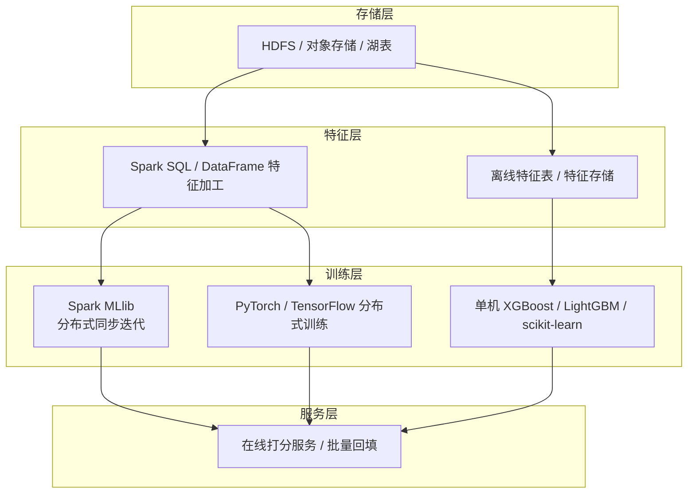
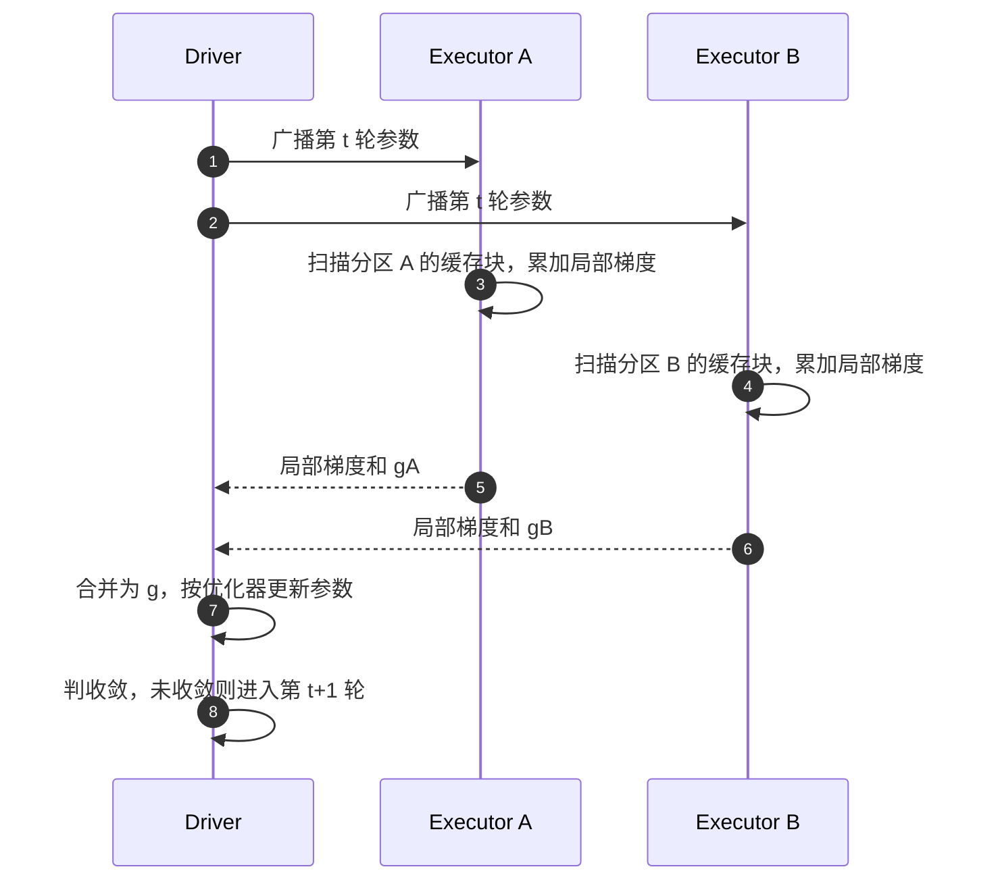
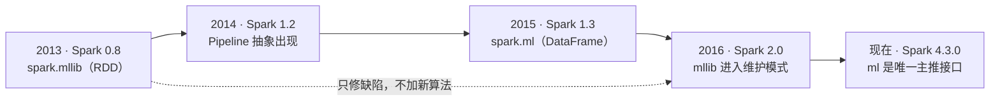
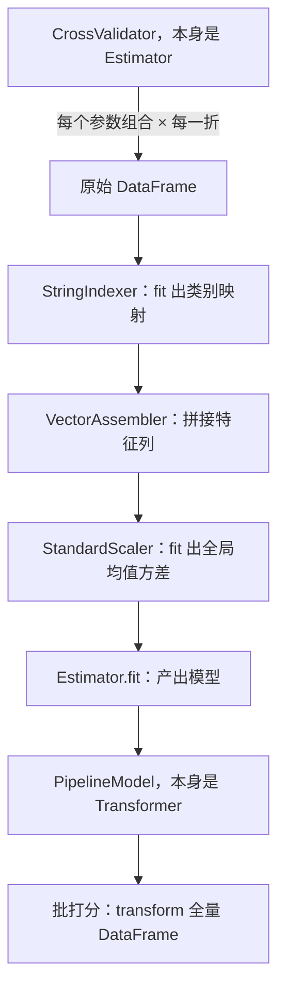
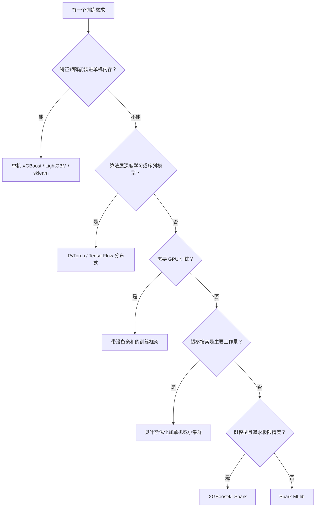

# 15 Spark MLlib：分布式训练的代价与选型边界

**摘要：**

MLlib 常被当成"Spark 上的 scikit-learn"，这个说法解释了它的接口形态，却解释错了它的位置。它的真实身份是一套把迭代型算法改写成分布式作业的训练层：买下的是"数据不必搬出集群"这一件事，付出的则是通信、内存与扫描次数三笔账；换来的收益是样本量，而不是模型质量。这三笔账算清楚了，选型判断基本也就出来了。单机 XGBoost 或 LightGBM 在特征矩阵装得进内存时往往更快，这是设计取舍的结果，不是实现水平的问题。

本文不教算法，只回答选型问题：分布式训练的成本结构由什么决定，什么样的问题落在 MLlib 的经济区间里；RDD 侧的 `spark.mllib` 为什么会冻结、DataFrame 侧的 `spark.ml` 为什么成了唯一主线；Pipeline 把训练流程变成可持久化对象的收益与代价分别落在哪里；线性模型、树模型与交替最小二乘三种算法族的分布式适配形态有何不同；XGBoost4J-Spark 与 LightGBM on Spark 凭什么比 MLlib 快。末尾给出四维判据表、一张决策树与五类不该用它的场合。算法实现与内核细节，留给 Spark 的深度专栏。

---

## 第 1 章 一次训练要搬多少数据

2013 年秋，Spark 0.8 的发布公告里多出第四个模块：MLlib。同一年，伯克利的另一组人把 MLbase 写成了研究议程，讨论怎样把机器学习做成一套声明式系统；而工业界当时的主流做法还是两头分化——要么在 R 与 MATLAB 里处理几百万行，受单机内存的天花板约束，要么用 Hadoop 上的 Mahout 跑 TB 级数据，受每轮落盘的代价约束。MLlib 落在这两端之间，而它要挤掉的位置，恰好是中间那段最难走的路。

要看懂它的定位，得先看清 Mahout 的失败形态。Mahout 在 2010 年成为 Apache 顶级项目，它把协同过滤、聚类、分类铺在 MapReduce 上，接口并无问题，问题出在执行模型：MapReduce 的一次作业只许两个阶段，中间结果必须落 HDFS。一条需要三十轮才收敛的 PageRank，就是三十个作业首尾相接，每一轮把上一轮的全量中间结果写回磁盘再读出来。算法层面的迭代是数学需要，工程层面的迭代却成了磁盘带宽的放大镜——同一份数据被读了三十遍、写了三十遍，每多一轮就多付一次全量搬家的钱。

MLlib 给的答案是让中间结果留在内存的工作集里，把"三十个作业"折叠成"一个作业里的三十次循环"。这个答案能成立，靠的是 Spark 早先定下的两条设计：RDD 的血缘（lineage）让中间结果可以缓存、丢了再按血缘重算，调度器允许作业内部反复迭代而不必重新提交。所以 MLlib 从第一天起就不是"Spark 上的一包算法"，而是"把迭代算法重新设计成分布式作业"这一命题的产物。

### 1.1 它买下的是搬运费，不是准确率

反过来问一句：没有 MLlib，一个 TB 级的训练任务会退化成什么样子。常规的三条路是抽样子集用单机库训练，牺牲的是样本量带来的精度；把数据导出到一台大内存机器上训练，牺牲导出带宽与数据合规边界；在 MapReduce 上重写迭代算法，牺牲时间。三条路的共同点是，它们都在为"数据与算力不在同一个地方"付搬运费。

MLlib 的位置就落在这笔搬运费上。它把训练搬到数据旁边，让"读一次、算多轮"在同一个作业内完成，但它并不承诺更好的模型：同样的逻辑回归，在数据装得下的前提下，单机 scikit-learn 收敛更快、调参更顺手、诊断信息更友好。这一点若不讲清楚，很容易把"分布式"误读成"更先进"——分布式训练换来的确定收益是**样本量**，而不是模型质量，更不是准确率。

这里用一句比喻收一下：MLlib 相当于把厨房建在仓库旁边，不必每天把食材运回家；但它的灶具不如家里的全（没有深度学习框架的自动微分与 GPU 支持），火候也不如家里好调（无法单步观察每一轮梯度）。数据量不大时，把菜运回家做反而更快。

### 1.2 它占住的那一格

把机器学习的流水线竖着切开，训练只是中间一层，而这一层内部还有三种不同的落点。



图里三条训练路径的差别，不在于谁的算法更先进，而在于数据与算力之间的相对位置：T1 把算力放到数据所在的分区里，T2 把数据搬到单机内存里，T3 把数据搬到 GPU 显存里。三条路径各自对应一类数据规模，而 MLlib 只在 T1 那一格里有意义。

同时也该看清它**不覆盖**的部分：模型服务、特征存储、实验追踪、模型注册，这些都不在 MLlib 的职责范围内，它从来不以平台的完备性为目标。

### 1.3 三代训练位置的横向对照

把 Mahout、MLlib 与单机框架放在同一把尺子上量，判据是"每轮迭代的成本落在哪里"，而不是"支持多少种算法"。

| 维度 | MapReduce 上的 Mahout | Spark MLlib | 单机 XGBoost / LightGBM |
| :--- | :--- | :--- | :--- |
| 数据落点 | HDFS，每轮读写一遍 | 集群内存，装不下则溢写磁盘 | 单机内存 |
| 每轮成本 | 一次全量落盘加一次全量读取 | 一次全量扫描加一次参数同步 | 一次内存遍历，没有跨机通信 |
| 可承受数据量 | 极大，受磁盘带宽与作业数约束 | 大到单机装不下、小到值得并行的区间 | 单机内存的一到两倍 |
| 算法覆盖 | 迭代型批算法为主 | 经典统计与 ML 算法较全，不含深度 | 树模型极强，线性与深度看具体库 |
| 调参效率 | 极低，一轮作业以分钟计 | 中，一次 fit 数十秒到数分钟 | 高，单次以秒计，可交互试错 |
| 典型失效 | 轮数一多就跑不动 | 特征矩阵缓存不下，越跑越慢 | 数据超出内存即中断 |

这张表里最容易被读错的是"可承受数据量"一行。它不是一个能力上限，而是一个经济区间：数据装得下时 MLlib 不是最优，大到特征矩阵必须溢写时也不是最优。它真正占优的是"数据大到单机装不下、又还没大到每轮扫描不可承受"这一小段，落进去的项目不多，但一旦落进去，别的方案都很别扭。

---

## 第 2 章 分布式训练的三笔账

分布式训练不是把单机训练除以节点数。单机的一轮是"扫一遍内存"，分布式的一轮是"扫一遍集群，再对齐一次参数"，这两件事的成本结构完全不同。三笔账分别是通信、内存与扫描次数，它们共同决定了 MLlib 的经济区间，也解释了它在很多场景下为什么不如单机。

### 2.1 参数同步：每轮都要过一次屏障

MLlib 的迭代是同步的。以二分类逻辑回归为例，无论优化器取 L-BFGS 还是 SGD，一轮迭代的形状都差不多：Driver 持有当前参数，把它广播到各个 Executor；每个 Executor 用自己的分区数据算出局部梯度，或者局部损失加梯度；结果回到 Driver，合并成全局梯度交给优化器更新，然后进入下一轮。

这个形状决定了通信量的量级是参数量乘分区数再乘轮数。单看数字并不吓人——一千维的稠密权重只有几 KB，一百轮广播下来也不到一 MB——但三个因子各自都可能爆掉。特征维度到百万级时，权重向量变成数 MB，广播与聚合都成了 Driver 的网络瓶颈，而 L2 正则化会把梯度向量压成稠密向量，稀疏存储省下的那点空间一起消失；分区数上千时，一次聚合意味着上千个连接同时打向 Driver，树形聚合（`treeAggregate`）正是为这件事准备的，它把归约拆成多层，先让 Executor 之间两两合并，最后才汇总到 Driver，代价是多一次网络跳数、多一轮序列化；轮数则由收敛速度决定，特征尺度差异过大时，L-BFGS 的轮数能被推到几百轮，此时通信量与总扫描量一起翻倍。



真正难绕开的，是那个屏障本身。Spark 的容错建立在"血缘可重算"之上：某个分区的中间结果丢了，就顺着血缘重算那一段。这套机制要求每一轮迭代在逻辑上独立、可重放，于是同步更新几乎是唯一自洽的选择——所有分区必须在同一份参数上算梯度，否则血缘重放会得到不同结果，容错语义就塌了。异步更新（各 worker 拿稍旧的参数往前走，用参数服务器汇总）能显著重叠通信与计算，Dean 等人在 2012 年的 Downpour SGD 里验证过这条路；代价是梯度陈旧、收敛分析变复杂，还需要一份独立于 Spark 的共享参数存储。这就是大规模稀疏训练常常要引入 Angel 一类系统的缘故，Spark 自己不会变成异步的。

### 2.2 内存驻留：特征矩阵必须一直在

第二笔账更隐蔽。迭代的前提是同一份数据被扫很多遍，若每遍都从 HDFS 重读，分布式带来的加速会被 IO 吃干净——这就是几乎所有 MLlib 示例第一段代码都写着 `cache()` 的缘故。

驻留的内存需求要按"装下特征矩阵"来估，而不是按"装下原始数据"来估，这里面有个容易反直觉的地方：稀疏化能把特征矩阵压小一个数量级。一千万行、一千维的稠密 float32 特征矩阵约 40 GB（此处为示例推算，不是任何集群的实测），单机放不下；若每行只有百分之一的非零项，改成稀疏向量后每行只剩十个（索引与值）对，量级降到 GB 级，一台中等配置的机器就装得下——到这里，分布式的必要性已经消失了。反过来，稠密的高维特征，譬如 one-hot 展开后的类别列，会把特征矩阵撑得比原始文本还大，这是"数据明明不大却训练不动"的常见来源。

缓存装不下的后果不是"变慢"，而是"结构性变慢"。Spark 的缓存有驱逐策略，Executor 内存不足时部分分区会被淘汰；下一轮扫到被淘汰的分区，就要顺着血缘从源头重算，而源头可能是 HDFS 上一堆小文件。表现出来是前几轮正常、第 N 轮起每轮耗时成倍增长，日志里往往只有频繁 GC 的痕迹，看不到"重算"两个字。后文的误用速查表会单列这一条。

### 2.3 迭代收敛：每轮一次全量扫描

第三笔账是扫描次数，它由收敛判据与算法性质共同决定。L-BFGS 每轮要做线搜索，线搜索里可能多次计算目标函数值，若没有把函数值与梯度放在同一次遍历里算出，扫描次数就会成倍增加；SGD 一侧则要权衡批量大小，批量越大每轮扫得越多、轮数越少，总扫描量守恒，变的是通信次数。

三笔账合起来就描出了 MLlib 的经济区间：数据大到单机装不下，轮数不多，参数量也可控。三条同时成立时它划算，任意一条不成立，方案就该往后走一步。

| 成本项 | 随什么增长 | 可用的缓解手段 | 缓解不掉的部分 |
| :--- | :--- | :--- | :--- |
| 参数同步 | 参数量 × 分区数 × 迭代轮数 | 树形聚合、稀疏权重、收紧收敛容差 | 每轮至少一次全局屏障 |
| 内存驻留 | 行数 × 特征维度 × 副本因子 | 稀疏化、降维、调整缓存级别 | 缓存被驱逐后按血缘重算 |
| 迭代扫描 | 数据量 × 迭代轮数 | 提前停止、更好的特征尺度 | 每轮必须把数据过一遍 |

这张表的最后一列是选型的真正依据：缓解手段只能优化常数项，缓解不掉的部分才是这套方案的结构性成本。判断该不该用 MLlib，问的其实就是"你能不能接受每轮一次全局屏障、每轮一次全量扫描、缓存装不下就重算"这三件事。

---

## 第 3 章 两条 API 主线的分岔

MLlib 内部有两条并行的 API 主线，历史上它们一度并存，如今只剩一条是主推。这条分岔线本身就是一份选型教材，因为它记录了"算法库"与"查询引擎"两种思路的碰撞。

### 3.1 一条被冻结的主线

`spark.mllib` 是 2013 年的原始接口，数据抽象是 RDD：`RDD[LabeledPoint]`、`RDD[Vector]`，算法直接吃这些类型。`spark.ml` 是 2015 年 Spark 1.3 引入的 DataFrame 接口，特征被组织成 DataFrame 里的一列向量，算法吃的是 DataFrame。按 Spark 官方 MLlib 指南的表述，自 2.0 起 RDD 侧的 API 进入维护模式，主推的机器学习接口转为基于 DataFrame 的 `spark.ml`，新算法只在后者一侧增加。



这条线之所以走到冻结，不是因为它写得不好，而是因为它的抽象层次太低，低到优化器看不见它。RDD 里装的是函数，函数对 Catalyst 不透明：列裁剪、谓词下推、表达式代码生成，这些让 Spark SQL 快起来的规则，遇到 RDD 上的闭包一律失效。于是同一个意图的两种写法会拉开明显差距：读 Parquet 时只取三列，DataFrame 侧由优化器自动完成，RDD 侧得靠人手保证。机制层面的细节在 [[大数据/Spark/Spark-SQL深度解析与性能调优/03 Catalyst 逻辑优化：Rule-Based Optimizer 的核心规则|Catalyst 逻辑优化]] 里拆得很细，这里只需要记住一个判断：**优化器可见度**直接决定 IO 能省多少。

### 3.2 为什么 DataFrame 一侧必然胜出

三条理由，力度递进。

第一条是 schema。DataFrame 带列名与类型，特征工程因此可以被描述成"在既有表上增删列"，而不是"把手写的 map 函数拼起来"。这一条看似只是写法差异，实际决定了后面两条能不能成立。

第二条是持久化。RDD 的模型保存靠 Java 序列化，跨版本、跨语言都脆；`spark.ml` 的模型是一个目录，里面带 metadata 与 Parquet 格式的参数，能被别的进程读出参数值。模型从"一个 Java 对象"变成"一份可检查的数据"，可运维性从此不同。

第三条是生态合流。DataFrame 同时是 Spark SQL 与 Structured Streaming 的数据抽象，`spark.ml` 因此能直接吃流式 DataFrame，也能把训练结果写回湖表；Python 侧按批列式交换也比 RDD 的逐条 Pickle 省得多，具体程度随版本变化，以对应版本文档为准。RDD 侧做不到这些，它只能活在批处理的世界里。

| 维度 | spark.mllib（RDD） | spark.ml（DataFrame） |
| :--- | :--- | :--- |
| 数据抽象 | `RDD[LabeledPoint]` / `RDD[Vector]` | DataFrame，特征收在一列向量里 |
| 优化器可见性 | 不可见，闭包对 Catalyst 不透明 | 可见，可做列裁剪、谓词下推、代码生成 |
| 流程组织 | 无，靠人手串联 | Pipeline，Estimator 与 Transformer 组成有向无环图 |
| 持久化 | Java 序列化，跨版本易碎 | 带 metadata 的目录，可 save/load 并可读参数 |
| 跨语言 | 逐条记录走 Pickle | 按批列式交换，程度随版本而定 |
| 维护状态 | 2.0 起维护模式，只修缺陷 | 主推接口，新算法只在此侧 |
| 迁移阻力 | — | 少数算法覆盖有缺口，默认参数行为有差异 |

### 3.3 迁移时真正会踩的坑

从 `mllib` 迁到 `ml`，表面上只是换类型，实际有三处会咬人：算法覆盖上有缺口，少数统计与降维工具只在 RDD 侧完整；默认语义有差异，同一个逻辑回归两侧对标准化与截距的处理并不一致，直接搬参数会得到不同的模型；评估口径也不同，RDD 侧的指标是独立函数，`ml` 侧的 Evaluator 绑定在 DataFrame 上，混用会因标签编码不同而算错。

这三处都不是文档能一句话带过的，所以迁移的正确姿势是"逐模型对拍"：同一份数据、同一组超参，两侧各跑一次，比较系数、截距与预测分布；对拍通过之后再谈性能，否则容易把语义差异误判成性能问题。

---

## 第 4 章 Pipeline：把训练流程变成可持久化对象

`spark.ml` 真正区别于 `spark.mllib` 的，不是接口形态，而是 Pipeline 这层抽象。它把"特征工程 + 训练"从一段脚本变成一个对象，这个变化听起来像封装糖，实际改变了协作方式。

### 4.1 四个角色与一条递归

Pipeline 里有四个角色：Transformer 有 `transform` 方法，把一列变成另一列；Estimator 有 `fit` 方法，吃 DataFrame 吐出一个 Transformer；Model 是特殊的 Transformer，由 fit 产出；Evaluator 负责打分。关键在于 Pipeline 自身的类型：Pipeline 是 Estimator，PipelineModel 是 Transformer。这条递归让它能被任意嵌套——交叉验证器本身是 Estimator，它内部 fit 的正是 Pipeline，于是"网格搜索"与"流程编排"可以自由组合。



### 4.2 相对单机库的结构性差别

拿 scikit-learn 的 Pipeline 做对照，Spark 的 Pipeline 有三处不是"更好用"，而是"能做的事不一样"。

第一处是 fit 阶段的分布式聚合。标准化需要全局均值与方差，类别编码需要全局频次，PCA 需要全局协方差，这些东西在单机库里要求全量数据进内存；Spark 侧走一次分布式聚合就能拿到，代价是一次全量扫描。这一条决定了可处理的上限：高基数类别特征在单机库里很快撞到内存墙，在 Spark 侧只是慢一次。

第二处是训练与推理共用同一个对象。PipelineModel 把编码器与模型绑在一起持久化，线上打分手里的类别映射与训练时是同一份，不会出现"训练用索引 3、线上用索引 5"的错位。单机库的 Pipeline 也有类似能力，差别在对象能去哪儿：Spark 的 PipelineModel 能存进 HDFS，能被另一个作业加载，也能直接 transform 一个 TB 级 DataFrame。

第三处是交叉验证的并行粒度。参数组合乘折数的每一次训练在 Spark 上是一个独立任务，可以按 `parallelism` 并发；单机库的网格搜索靠多进程，受一台机器的核数约束。

```scala
// 把编码器放进 Pipeline，而不是在管线外先做一遍预处理：
// PipelineModel 持久化时会把 StringIndexerModel 一起保存，
// 线上打分用的类别映射与训练时是同一份，不会因为重新 fit 而错位。
val pipeline = new Pipeline().setStages(Array(
  new StringIndexer().setInputCol("city").setOutputCol("cityIdx")
    .setHandleInvalid("keep"),
  new VectorAssembler().setInputCols(Array("cityIdx", "amount"))
    .setOutputCol("features"),
  new LogisticRegression().setMaxIter(100).setRegParam(0.01)
))
val model = pipeline.fit(train)
model.write.overwrite().save("hdfs:///models/lr-v3")
```

### 4.3 这层抽象的账单

代价同样是三笔。其一，每个 stage 都是一次全量物化，Pipeline 越长，一次 fit 的扫描次数越多，中间结果还可能被反复计算，缓存策略比单机库里更需要人操心。其二，stage 之间靠字符串列名耦合，没有编译期检查，改一个列名往往要到运行时才炸。其三，自定义 Transformer 有额外约束，JVM 侧的实现类必须能被所有节点加载，Python 侧的自定义组件还要一层包装。

| 能力 | 换来的东西 | 付出的代价 |
| :--- | :--- | :--- |
| fit 阶段分布式聚合 | 高基数编码、全局标准化可行 | 每个 stage 一次全量扫描 |
| 训练与推理同一对象 | 预处理与模型不会错位 | 对象带版本，跨版本加载易碎 |
| 交叉验证可嵌套 | 流程与超参可以一起搜 | 参数组合 × 折数 次重训 |
| 列名即契约 | 无需编译期检查也能跑通 | 改列名要到运行时才暴露 |

这张表里最容易被低估的是最后一行。Pipeline 的强类型优势在 Scala 侧还能靠 Dataset 的 case class 找回一部分，Python 与 SQL 侧完全没有，于是"跑到第三个 stage 报列不存在"成了最常见的故障形态；应对办法不是加强 review，而是给每个 stage 的输出列名做常量收敛，并在 CI 里跑一个最小样本的端到端 fit。

---

## 第 5 章 三个算法族，三种分布式形态

算法能不能在分布式环境里跑好，取决于它"可分解的粒度"。粒度粗到一行一个子问题，通信就便宜；粒度细到每个样本都要同步，通信就压过计算。MLlib 的算法族大致落在三个位置。


### 5.1 线性模型：把梯度加起来

线性模型的分布式化在数学上最直接：目标函数是各样本损失之和，梯度自然可加。每个 Executor 用自己的分区算局部梯度，Driver 把局部梯度加起来，交给优化器更新。MLlib 早期把这一步写成 `aggregate`，后来换成 `treeAggregate`，差别只在归约的拓扑，不在数学。

真正决定成本的是参数向量的形状。稠密低维时，一轮的通信与计算相比可以忽略，线性模型在 MLlib 上跑得很顺；稀疏高维时情况反过来——L2 正则项让梯度必须按稠密向量处理，百万维的权重向量每轮都要广播一次，通信成了主项。

SGD 的分布式化还有一层同步语义的问题。同步 mini-batch 的分布式 SGD 在数学上等价于大批量 SGD，收敛行为随批量增大而变化，步长需要重调；异步 SGD 能省掉屏障，但会引入梯度陈旧，且需要一份跨作业存活的参数存储。MLlib 选了同步这条路，代价写在 2.1 节里，收益是容错语义干净——这一点在选型时值得强调：**收敛更快的模型**与**失败能自动重算的作业**是两个诉求，在 Spark 上不容易同时满足。

### 5.2 树模型：把直方图聚合起来

树模型的分布式化靠两件事：分箱与直方图。连续特征先按分位数采样切成不超过 `maxBins` 个桶（该参数默认值以对应版本文档为准），候选分裂点因此从"每个样本值"降到"每个桶边界"，数量与样本量脱钩；然后每个分区对每个特征的每个桶累积统计量，归约成全局直方图，再在全局直方图上枚举分裂点、算增益。

这个设计让树模型的每层成本变成"一次全量扫描加一次直方图归约"，深度为 d 的树就是 d 次。对比单机实现，差距在这一处最明显：XGBoost 把数据预先整理成列块，直方图在内存里反复复用，通信次数为零；MLlib 每层都要把分区上的直方图序列化后送到归约层，层数越多，这笔开销占比越高。数据装得进单机内存时，比较的其实是"内存内遍历 d 次"与"集群上扫描 d 次再加 d 次通信"，前者赢面很大。

还有一层差距不在性能而在能力。MLlib 的树实现对类别特征与缺失值的原生支持较弱，类别通常要先 one-hot，缺失值要先填；XGBoost 与 LightGBM 把这两件事做进了分裂逻辑，直方图本身就是稀疏感知的。这属于工程完备性的差距，调参调不出来。

### 5.3 ALS：把全局优化拆成很多小方程

交替最小二乘（Alternating Least Squares，ALS）是三种算法里分布式收益最高的一种，原因在它的数学结构。协同过滤要分解一个稀疏评分矩阵，ALS 的做法是交替固定一侧：固定物品因子矩阵，每个用户的因子就是一个独立的最小二乘问题，规模是 rank 乘 rank，闭式解，一次 Cholesky 分解即可；解完所有用户，再交换角色解物品。

"每个用户一行独立求解"这件事，恰好对上 Spark 的分区模型：广播物品因子矩阵，各 Executor 只处理自己分区里的用户，互不通信；一轮结束只汇总一次因子矩阵，规模是用户数乘 rank。通信量与 rank 成正比，与样本量无关。

隐式反馈版本（Hu、Koren 与 Volinsky 在 2008 年提出的那套建模）把这套结构用得更彻底：把缺失当作置信度极低的负样本，预计算物品侧的 Gram 矩阵，每轮只需更新一侧，用户侧仍是独立求解。这是 ALS 至今在推荐场景里被大量使用的技术原因——它把"推荐"这件看起来需要全局优化的事，拆成了一堆可并行的小方程。

但 ALS 也有它自己的账单。它是交替优化，非凸，结果依赖初始化，随机种子固定才可复现；rank 调大能提升表达力，但每个用户的求解成本按 rank 的三次方涨，rank 过大时单行求解反而成了瓶颈；冷启动没有内建解法，新用户或新物品只能靠特征回退或者干脆不出。这些问题与分布式无关，是算法本身的性质。

| 算法族 | 可分解的粒度 | 每轮通信量 | 分布式收益 | 典型失效 |
| :--- | :--- | :--- | :--- | :--- |
| 线性模型 | 样本级梯度累加 | 参数量 × 分区数 | 中，随特征维度上升而下降 | 高维稀疏时梯度被迫稠密化 |
| 树模型 | 特征 × 桶的直方图 | 桶数 × 特征数 × 层数 | 低到中，层数越多越贵 | 数据装得下时不如单机实现 |
| ALS | 用户或物品的一行 | 因子矩阵，与 rank 成正比 | 高，接近线性加速 | rank 过大时单行求解变慢 |

---

## 第 6 章 外部框架为什么能更快

既然树模型的分布式收益有限，工业界的做法就很自然：把 XGBoost 与 LightGBM 搬进 Spark 作业里，让它们负责训练，Spark 负责数据准备与调度。这条路在多数场景下比 MLlib 的 GBT 快，原因值得单独说清楚。

### 6.1 三种集成模式

把外部框架接进 Spark，有三条技术路线，成本与适用面各不相同。第一条是把数据汇总到 Driver，用框架的单机接口训练，通信只有一次 gather，速度最快，前提是数据装得进 Driver 内存。第二条是每个分区各自训练一个模型，最后投票或平均，通信为零，但每个模型只见一片数据，本质上是分布式 bagging 而不是分布式 boosting，精度损失常常无法接受。第三条是框架自己接管进程间通信，数据留在各 Executor，只交换直方图或梯度——XGBoost4J-Spark 用 rabit 做全归约，LightGBM 的 Spark 绑定走类似的 socket 通信。

| 模式 | 数据落点 | 通信形态 | 适用规模 | 失败形态 |
| :--- | :--- | :--- | :--- | :--- |
| 汇总到 Driver 单机训练 | 全量拉到 Driver | 一次 gather | 单机内存装得下 | Driver 内存溢出 |
| 按分区分别训练 | 留在各 Executor | 无 | 数据大但精度要求不高 | 每个模型只见一片数据 |
| 框架原生分布式 | 留在各 Executor | 全归约，只传直方图 | 单机装不下的中等规模 | 原生层失败无法按分区重试 |

第三条是主流，也是真正"比 MLlib 快"的那条。它快的机理不神秘：一是直方图只传桶级统计量，大小与样本量无关，与桶数有关；二是单机侧的数据布局为缓存友好做了专门优化，列块预排序、梯度与海森矩阵按列连续存放；三是列采样降低了每层的计算量，而分布式侧不需要为此多付通信。三件事叠加，通信开销被压到"每轮几百 KB 到几 MB"的量级，而 MLlib 的每层归约要搬运的是分区上的完整直方图。

### 6.2 代价落在运维面上

集成带来的收益在训练速度，代价几乎全在运维与工程边界上。

部署是第一道坎。原生库要分发到每个 Executor 的可加载路径，镜像、路径、架构三者有一个不对，作业就在启动阶段失败，错误信息通常只有一行原生库加载失败，看不出根因。版本兼容是第二道坎，Spark 版本、框架版本、Python 版本构成一个三维兼容矩阵，升级任意一维都要重新验证。第三道坎是重试语义：Spark 的重试以 Task 或 Stage 为单位，而原生训练是一个整体进程，某个 worker 失败之后整轮训练都得重来，所谓"Stage 级重算"在这里帮不上忙。

第四道坎在 Pipeline 集成度上。XGBoost4J-Spark 提供 Spark 侧 Estimator，可以进 Pipeline，也能被 CrossValidator 包起来，但每个参数组合都要重启一次分布式训练，启动开销比 MLlib 的同名流程高；组合一多，网格搜索的时间大半花在启动与数据重分布上。

| 维度 | MLlib GBT | XGBoost4J-Spark | LightGBM 的 Spark 绑定 |
| :--- | :--- | :--- | :--- |
| 通信方式 | 每层一次 Spark 归约 | rabit 全归约，传直方图 | 进程间 socket 通信 |
| 类别特征 | 一般需先 one-hot | 支持，细节以版本文档为准 | 原生支持 |
| 缺失值 | 一般需预处理 | 原生支持 | 原生支持 |
| Pipeline 集成 | 原生 | 提供 Spark Estimator | 提供 Spark Estimator |
| 部署复杂度 | 低，随 Spark 一起分发 | 中，原生库需分发 | 中，依赖额外依赖包 |
| 失败形态 | 慢但可预测 | worker 内存不足即中断 | 原生层崩溃，日志难读 |

这张表指向一个更一般的规律：外部框架把训练内核做到了极致，代价是把集成成本推给了使用者。选型时要问的不是"哪个模型更准"，而是"这个团队的运维能力能不能兜住这套依赖"。

---

## 第 7 章 判据与反例：它不该出现的五个位置

前面几章拆的是成本结构，这一章把它压成可用的判据。四个维度依次是数据规模、模型类型、推理形态与团队熟悉度，顺序不能颠倒——先卡规模，再卡类型，最后才轮到熟悉度。

### 7.1 四个维度与一张判据表

数据规模这一刀最硬。判据不是"数据有多少 TB"，而是"特征矩阵能不能常驻集群内存"：能常驻，分布式训练不至于每轮重算血缘；不能常驻，MLlib 的每轮全量扫描就变成不可承受的成本，此时要么加大内存、要么降维稀疏化、要么换框架。多数项目在这一步就已经出局。

模型类型这一刀次之。线性模型、广义线性模型、梯度提升树、随机森林、KMeans、朴素贝叶斯、ALS、FP-Growth 这些在 MLlib 里都算成熟，够用；深度学习、大 embedding、序列模型不在它的覆盖内，硬凑只会得到一堆积木。

推理形态这一刀常被忽略。MLlib 的模型能导出，但导出之后怎么服务是另一件事：Spark 的推理延迟地板由作业提交链路决定，即便是 local 模式也带着 JVM 与调度的固定开销；要求低延迟就必须把模型搬到服务框架里，或者导出成 MLeap、ONNX 之类的中间表示。反过来，批打分场景下 transform 一遍 TB 级 DataFrame 很顺手。

团队熟悉度是最后一刀，也最容易被高估。团队已在 Spark 上做 ETL，用 MLlib 省下的是"另一套运行时"；团队是 Python 数据科学背景，sklearn 与 XGBoost 更快出结果，转 MLlib 的收益抵不过学习成本。

| 你的条件 | 首选 | 次选 | 不该选 |
| :--- | :--- | :--- | :--- |
| 特征矩阵能装进单机内存两三倍 | 单机 XGBoost / LightGBM | Spark local 模式复用习惯 | 多节点 MLlib |
| 数据在湖表里，算法属 LR / GBT / ALS / KMeans | Spark MLlib | 特征抽样后单机训练 | 手写 MapReduce |
| 需要 GPU 与自动微分 | PyTorch 加分布式训练 | TensorFlow 加 Horovod | MLlib |
| 需要低延迟在线打分 | 模型导出后由服务框架加载 | MLeap / ONNX 中转 | 每次请求起一个 Spark 作业 |
| 需要精细超参搜索 | Optuna / Hyperopt 贝叶斯优化 | Spark 上并行独立 trial | CrossValidator 穷举 |
| 十亿级样本、千级特征、树模型 | XGBoost4J-Spark | 采样后单机训练 | MLlib GBT |
| 团队只有 Python 数据科学背景 | scikit-learn / XGBoost | PySpark 加 pandas UDF | 直接铺开 MLlib 全套 |

把四个维度折成一次顺序判断，就是下面这棵树。



决策树的价值在于把"MLlib 支持很多算法"这类模糊印象，换成一组顺序问题。绝大多数误用都发生在跳过第一个问题、直接问"MLlib 能不能跑"的时候——它能跑，但跑得不对。

### 7.2 五个不该用它的位置

**数据装得进单机内存**。这是最常见的一类误用。分布式的固定开销——JVM 启动、任务序列化、调度、每轮通信——与数据量无关，数据越小，占比越高。五个节点的集群训练两千万行，可能比一台笔记本慢，而排查成本高一个量级：出错时看到的是 Stage 失败摘要，而不是一行 Python 栈。判据很简单，特征矩阵能压进单机内存的两三倍，就先试单机。

**需要深度学习**。MLlib 没有卷积、循环网络或注意力结构的训练能力，也没有自动微分；这不是"暂时缺失"，而是设计坐标之外。正确的位置是 PyTorch 或 TensorFlow 加分布式训练框架，Spark 继续负责上游的数据准备与特征工程。

**需要 GPU 大规模训练**。Spark 的调度单位是 Task，不感知显存；Spark 3.0 之后能申请 GPU 资源，但那解决的是"把 GPU 分给任务"，不解决"多卡之间的梯度同步"。真正的多卡训练要靠 NCCL 一类的集合通信与设备亲和调度，这些不在 Spark 的执行模型里。

**需要精细超参搜索**。交叉验证器的机制是穷举：参数组合乘折数，每一次都是完整重训。搜索空间稍大一点，成本就按组合数线性膨胀，而且大部分组合落在明显更差的区域。贝叶斯优化（Optuna、Hyperopt 之类）用几十次试验就能定位到好区域，在单机或小集群上往往更省时间，也更省集群。

**要求低延迟在线打分**。Spark 的延迟地板由提交链路决定，即使 local 模式也躲不开 JVM 与调度；把 Spark 作业塞进请求路径，p99 会被提交开销支配。正确做法是把模型与预处理一起导出，交给在线服务框架加载，Spark 只负责离线训练与批量回填。

| 症状 | 误用形态 | 正确位置 |
| :--- | :--- | :--- |
| 五个节点训练两千万行，比笔记本还慢 | 小数据上分布式 | 单机训练 |
| 训练指标正常，线上效果掉一截 | 训练与推理的预处理不在一处 | 整体持久化 PipelineModel |
| 第 N 轮起每轮耗时成倍增长 | 缓存被驱逐后按血缘重算 | 提高缓存级别或降维稀疏化 |
| 网格搜索跑了两天还没出结果 | 交叉验证穷举加全折重训 | 贝叶斯优化或缩小搜索空间 |
| 原生训练失败后重试仍然失败 | 把原生训练放进 Spark 重试链 | 独立作业加外部重试 |
| 模型加载报版本不兼容 | 跨 Spark 版本加载旧 PipelineModel | 锁定训练与推理的版本 |

---

## 第 8 章 选型的落点

MLlib 的位置可以用一句话概括：它是一层**把经典机器学习算法接到分布式数据上的执行层**，买的是数据不搬家，付的是每轮一次屏障与一次全量扫描。这个交换在"数据已经在 Spark 里、模型属于经典算法族、迭代轮数与参数量都可控"的场合几乎总是划算的，因为省下的是另一套运行时与另一次数据搬运；在特征矩阵能装进单机内存、或者模型需要 GPU 与自动微分的场合，同一份交换就是纯亏损。

判断的顺序比判断本身更重要：先问数据能不能装进单机，再问算法在不在它的覆盖内，最后才比较调参效率与部署形态。顺序反过来，先问"MLlib 支持什么"，再找工作负载去套，通常能得到一个跑得动但调不动的模型。

至于它会不会被取代，笔者的判断是位置会长期稳固，边界会长期清晰。Spark 4.x 的演进方向——Connect、Arrow 化、pandas UDF——都在改善"怎么用"，没有动"怎么算"：训练内核仍是 JVM 侧的同步迭代模型，GPU 与自动微分不在它的路线上。所以它会继续停在那格位置上，成为一个不需要惊喜、也不容易出错的默认选项；而"默认选项"这四个字，恰恰是选型时最容易被误读成"最优解"的地方。

机制层面的问题——内存池怎么分、Shuffle 怎么写、Stage 怎么切——请直接看 [[大数据/Spark/读书笔记-spark内核/00 专栏导览|Spark 内核剖析]]，那里拆得比本文细得多，本文只负责说清楚什么时候该用它、什么时候不该用。

---

## 参考资料

- Meng, X., Bradley, J., Yavuz, B., Sparks, E., Venkataraman, S., Liu, D., Freeman, J., Tsai, D., Amde, M., Owen, S., Xin, D., Xin, R., Franklin, M., Zadeh, R., Zaharia, M., Talwalkar, A. "MLlib: Machine Learning in Apache Spark." JMLR 17(34), 2016. <https://jmlr.org/papers/v17/15-237.html>
- Kraska, T., Talwalkar, A., Duchi, J., Griffith, R., Franklin, M., Jordan, M. "MLbase: A Distributed Machine-learning System." CIDR 2013. <https://www.cidrdb.org/cidr2013/Papers/CIDR13_Paper118.pdf>
- Chen, T., Guestrin, C. "XGBoost: A Scalable Tree Boosting System." KDD 2016. <https://arxiv.org/abs/1603.02754>
- Ke, G., Meng, Q., Finley, T., Wang, T., Chen, W., Ma, W., Ye, Q., Liu, T. "LightGBM: A Highly Efficient Gradient Boosting Decision Tree." NIPS 2017. <https://papers.nips.cc/paper/6907-lightgbm-a-highly-efficient-gradient-boosting-decision-tree>
- Hu, Y., Koren, Y., Volinsky, C. "Collaborative Filtering for Implicit Feedback Datasets." ICDM 2008. <https://ieeexplore.ieee.org/document/4781121>
- Dean, J., Corrado, G., Monga, R., et al. "Large Scale Distributed Deep Networks." NIPS 2012. <https://papers.nips.cc/paper/4687-large-scale-distributed-deep-networks>
- Li, M., Andersen, D., Park, J., Smola, A., Ahmed, A., Josifovski, V., Long, J., Shekita, E., Su, B. "Scaling Distributed Machine Learning with the Parameter Server." OSDI 2014. <https://www.usenix.org/conference/osdi14/technical-sessions/presentation/li_mu>
- Apache Spark MLlib 指南（`spark.mllib` 维护模式说明与 `spark.ml` 主推接口）. <https://spark.apache.org/docs/latest/ml-guide.html>
- Apache Spark ML Pipelines 文档（Estimator、Transformer、交叉验证）. <https://spark.apache.org/docs/latest/ml-pipeline.html>
- Apache Spark 配置参考（`spark.ml.tree.maxBins` 等默认值以对应版本文档为准）. <https://spark.apache.org/docs/latest/configuration.html>
- XGBoost 官方文档（Spark 集成与分布式训练参数）. <https://xgboost.readthedocs.io/en/stable/tutorials/spark.html>
- scikit-learn 官方文档（Pipeline 与 GridSearchCV 的单机语义，用于对照）. <https://scikit-learn.org/stable/modules/compose.html>

> [!note] 思考题
> 1. 你们线上训练的作业，特征矩阵到底占了集群内存的多少？这个数字如果没算过，先算一次再谈选型。
> 2. 如果要求"训练失败必须自动重算"，异步更新这条路还留了多少空间，代价落在哪里？
> 3. 把 CrossValidator 换成贝叶斯优化，训练次数能降多少，评估口径又该怎么保证可比？
> 4. 团队里同时存在 MLlib 与 XGBoost4J-Spark 两套训练链路时，模型注册与版本回滚该按什么粒度管？
> 5. 如果哪天 Spark 的训练内核被换掉，本文的哪一条判据会先失效？