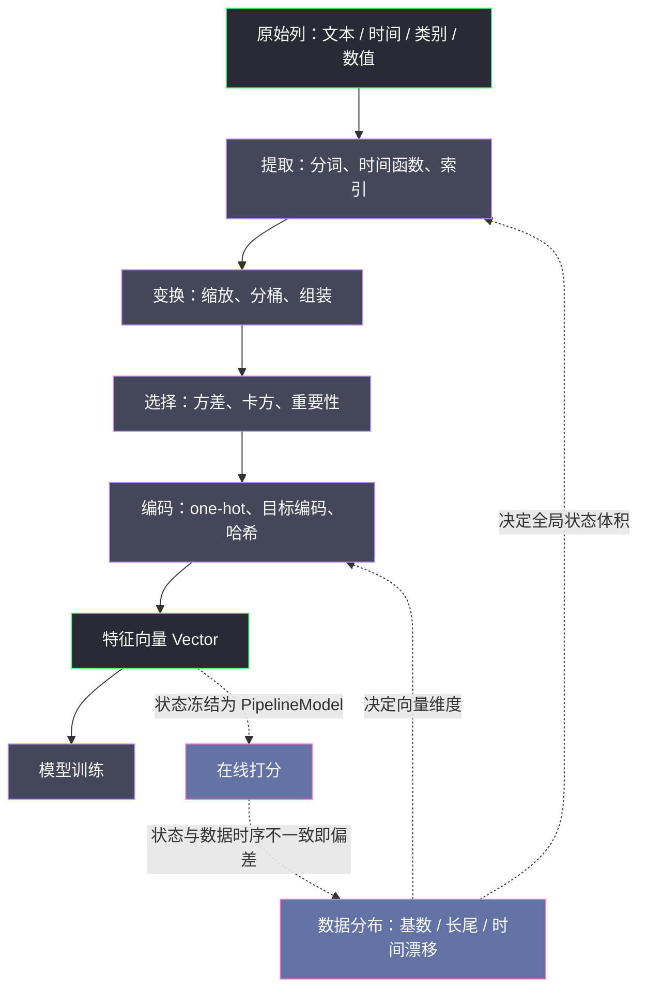
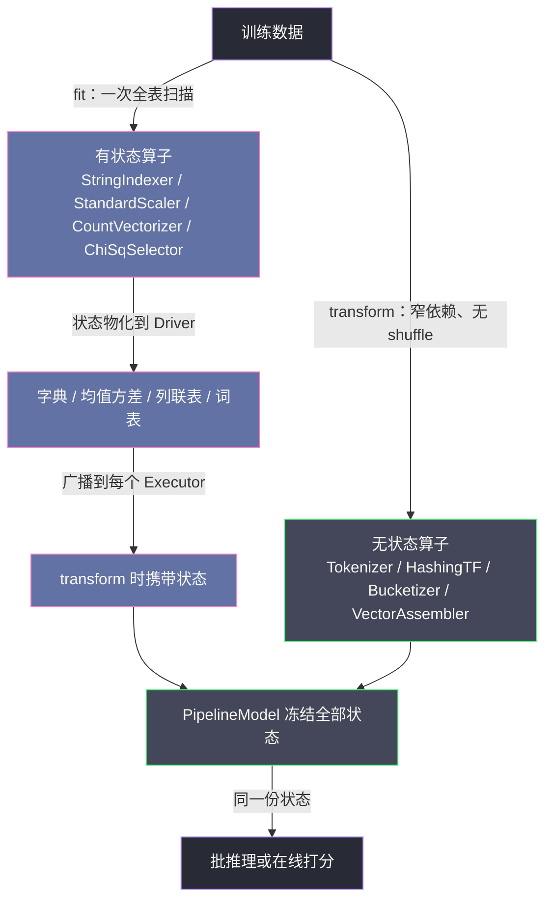
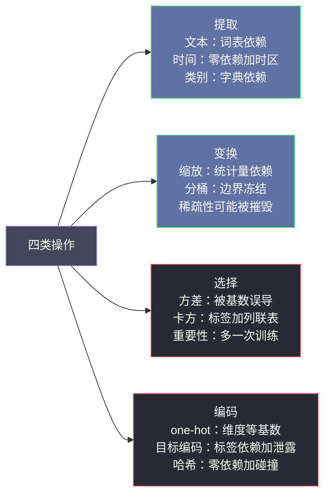
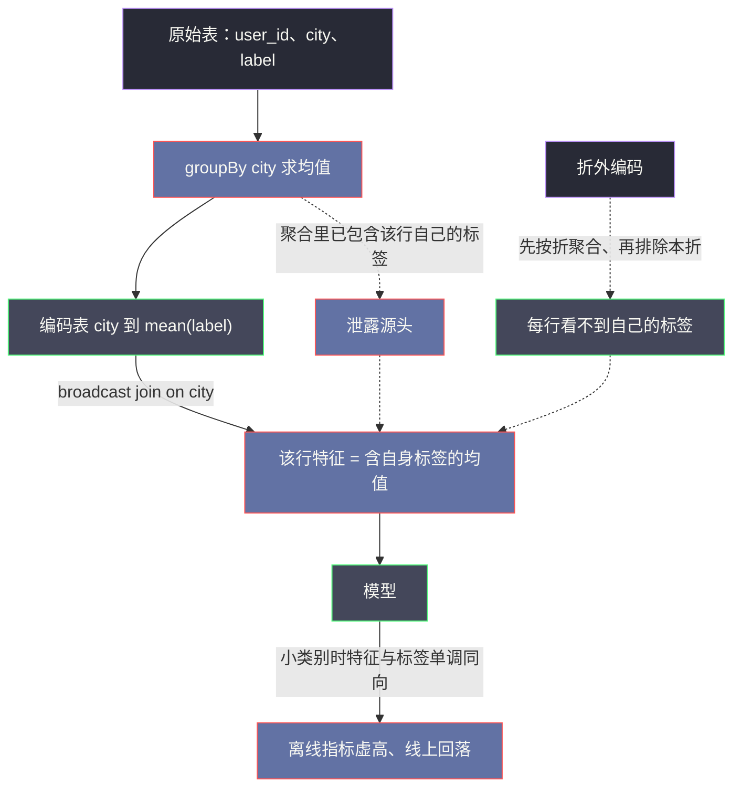
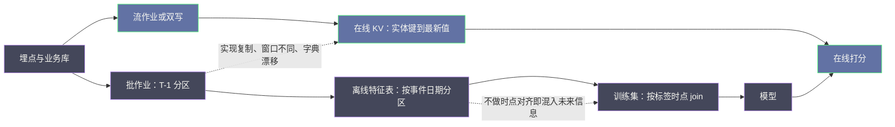
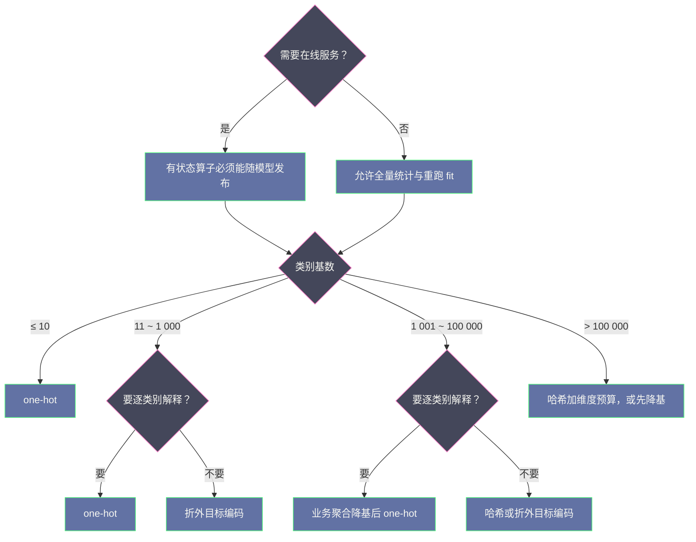

# 16 Spark 特征工程：四类操作的代价与编码选型

**摘要：**

特征工程在大数据栈里常被讲成一份算子清单，清单本身解释不了真正让人返工的现象：同一种编码在小表上是几十维、到用户画像表上变成十万维；同一个目标编码离线验证很漂亮、上线后掉点；同一段 Pipeline 批训练没问题、搬到在线服务上数值对不上。本文把特征工程当成一份成本结构来读，先给出分布式环境下「全局依赖」这条隐形计费项，用 fit 与 transform 的分界说明为什么每个有状态算子都是一次全表扫描加一次状态广播；再用基数这个量纲解释同一种操作的代价为何差几个数量级；随后逐类拆解提取、变换、选择、编码的代价画像。哈希与目标编码各占一章，前者主动放弃可解释性换掉一次全量扫描，后者把标签混进特征、在分布式 join 上引发泄露。末两章落到训练-服务偏差、特征存储的边界与三组选型判据。组件怎么调，Spark MLlib 篇写得更细，本文只回答为什么贵、什么时候不该用。

---

## 第 1 章 一个 one-hot 的两种命运

同一个 `OneHotEncoder`，作用在两张表上，命运可以完全不同。一张是订单表里的支付渠道，取值不过六种，编码之后每行多出五个浮点数，谁也不会注意到；另一张是用户画像表里的城市字段，取值十万级，编码之后每行是一个长度十万的稀疏向量，训练从十几分钟涨到几个小时，模型 AUC 反而掉了。算子、参数、代码完全相同，差别只在数据分布——这就是特征工程在大数据环境里最真实的分界线：逐行可算的动作，代价却由分布、基数和全表统计共同决定。

### 1.1 代价记在三本账上

第一本是单行账，一条样本变成什么形状。文本从一列变成几百维词频向量，类别从一列变成 K 维独热向量，时间戳拆成小时、星期几、是否节假日三列，这些直接决定后续每个 stage 的序列化体积、shuffle 数据量与模型参数规模。稀疏表示能压小一些，但很多下游算法不接受稀疏输入，一旦转稠密就翻倍再翻倍。

第二本是全局账，也就是 fit 阶段必须看到多少行。`StringIndexer` 要统计类别频次，`StandardScaler` 要算均值与标准差，`ChiSqSelector` 要为每个特征构建与标签的列联表，它们都不是逐行能算的，必须在全表上聚合一次、把结果收回 Driver、再广播给每个 Executor。类别数从十涨到十万，字典从几百字节涨到兆级，广播与反序列化的开销就从可以忽略变成每个 task 启动前先建一张哈希表。

第三本是服务账，训练时算出的状态能不能原样搬到在线。训练侧可以坦然地对全表做统计，服务侧只拿得到一条请求，于是要么把状态冻结进模型随模型发布，要么在服务端另写一份重算逻辑，后者正是训练-服务偏差的源头。三本账的传导关系是：分布决定状态体积，状态体积决定 fit 与广播的开销，状态的冻结方式又决定服务端能否复现同一套数值。



### 1.2 与深度专栏的分工

机制细节见对应深度专栏，本文只做代价层面的横向比较：特征组件与算法的接口见 [[大数据/读书笔记-大数据概览/15 Spark MLlib：分布式机器学习算法实现|Spark MLlib 篇]]，join 与聚合的物理代价见 [[大数据/Spark/Spark-SQL深度解析与性能调优/10 数据倾斜：诊断、根因与系统性解决方案|数据倾斜]]，广播与内存的账见 [[大数据/Spark/Spark-Shuffle与内存管理机制深度解析/10 生产调优手册：从症状到根因的系统性诊断|Shuffle 调优手册]]。那边回答「怎么用、内部怎么算」，本文只回答「在不同数据形状下贵在哪里」。

---

## 第 2 章 全局依赖：fit 与 transform 的分界

Spark MLlib 把特征处理拆成 `Transformer` 与 `Estimator` 两个接口，这个拆分看上去只是 API 设计，实则是整套成本结构的来源：Transformer 的 `transform` 只依赖当前行，Estimator 的 `fit` 必须看全表。一条 Pipeline 里混着两类 stage，代价曲线完全不是一个形状。

### 2.1 三类全局依赖

任何一行样本需要看到「其他行」的信息，本文称之为**全局依赖**。按信息的形状分成三类，每一类在分布式环境里都有自己的账单。

| 依赖类型 | 典型组件 | fit 产出的状态 | 状态规模 | 是否用标签 |
|---|---|---|---|---|
| 字典 | `StringIndexer`、`CountVectorizer`、`OneHotEncoder`（维度）、`QuantileDiscretizer`（边界） | 类别清单、词表、分位点边界 | 与基数或词表大小成正比 | 否 |
| 统计量 | `StandardScaler`、`MinMaxScaler`、`MaxAbsScaler`、`Imputer`、`PCA` | 均值方差、最值、填充值、协方差矩阵 | 线性统计量很小；PCA 是 d 的平方 | 否 |
| 标签相关 | `ChiSqSelector`、手写目标编码、按模型重要性选特征 | 列联表、类别均值、重要性排序 | 列联表与基数乘标签类数成正比 | 是 |

三类依赖不在一个量级上。字典类的状态体积由基数决定，十万类别广播出去是几十兆字节的字符串加索引，每个 task 反序列化都要重建哈希结构；统计量类通常小得多，但 PCA 例外，它要算 d×d 的协方差矩阵，维度上万时单个矩阵就是几百兆字节；标签相关的最贵，因为它把标签拖进了 fit，训练与服务两侧对标签可见性的理解一旦不一致，泄露和偏差会同时出现。

### 2.2 一次 fit 的真实开销

`fit` 在物理计划上是一次全表聚合：各分区并行算局部频次或局部和，经 shuffle 合并到少量分区，结果 collect 到 Driver 生成模型，模型再随下一个 stage 的 task 广播出去。这条路径有三笔开销省不掉——扫一遍源数据、一次按类别或列的 shuffle、一次把状态物化到 Driver 再分发。

`Pipeline.fit` 把这件事放大成链式重复。Pipeline 对 stage 逐个 fit，每次 fit 之前先用已 fit 好的 stage 对训练集做 transform；训练集若没缓存，第 N 个 stage 的 fit 会沿 lineage 重算前 N-1 个 stage，等于把源数据又扫一遍。这就是「算子都很快、整条流程却慢得离谱」的来源：十个 stage 的 Pipeline 在未缓存时可退化成十次全表重算，缓存后退化成十次全表扫描加若干次 shuffle，差距常在一个数量级以上。



### 2.3 分界线的两端

站在无状态一侧的算子，逐行可算、可任意分片重放、可流式执行，也可以在线用同一份代码实现；站在有状态一侧，每加一个就多一次全表扫描、多一份必须随模型发布的状态，也多一次「训练时的数据」与「服务时的数据」能否对上的拷问。`PipelineModel` 把这份状态冻结成可序列化的资产，让服务端不必重算统计量，代价是把训练时刻的数据分布钉死在模型里——字典不会自己更新，边界不会自己漂移，均值不会跟着业务走。线上大量特征事故，都可以追溯到**状态冻住了、数据活着**这对矛盾。

---

## 第 3 章 基数：最容易被忽略的量纲

类别字段的**基数**（Cardinality，不同取值的个数）不出现在任何配置项里，却同时决定了向量维度、字典体积、模型参数数量、树模型的可用分裂点，以及服务端字典能不能维护。

### 3.1 同一个编码，差几个数量级

独热编码的维度约等于基数减一（Spark 3.x 起 `OneHotEncoder` 默认 `dropLast=true`，省掉最后一个类别以避免设计矩阵共线）。基数从 10 涨到 10 万，维度涨一万倍，代价却分三段：基数在十以内时维度可忽略，编码与否对训练时间没有可测差别；基数到几千时维度进入模型参数，十万维的线性模型就是十万个系数，每个 task 都要持有完整参数向量，正则化从可选项变成必需品；基数到十万级，问题从「维度大」变成「状态大」加「下游稠密化」。

举一个纯算术的例子，数字仅作推算。一亿行、基数十万、每行一个非零元，稀疏表示下行内只有几个字节；只要有一处把向量转成稠密，单行就是十万个双精度浮点、约 800 KB，一亿行合计到 PB 量级。这也是很多作业在 `StringIndexer` 之后正常、加上 `StandardScaler` 就 OOM 的原因——中心化把原本的零全变成非零，**稀疏性**在数学上当场消失。

### 3.2 基数分层与编码选择

| 基数区间 | one-hot 维度 | 每行非零元 | 主要代价 | 更合适的编码 |
|---|---|---|---|---|
| ≤ 10 | ≤ 9 | 1 | 可忽略 | one-hot，保留 `dropLast` |
| 11 ~ 1 000 | 10 ~ 999 | 1 | 维度进模型参数，线性模型需正则 | one-hot，或目标编码 |
| 1 001 ~ 100 000 | 1 000 ~ 99 999 | 1 | 字典广播、树模型增益被稀释、稠密化后爆炸 | 哈希、目标编码、先按业务降基 |
| > 100 000 | > 100 000 | 1 | 字典无法常驻、参数规模失控 | 哈希加维度预算，或弃用该特征 |

第三行最容易被误读。很多团队的做法是「先 one-hot，维度不够再想办法」，但维度一旦上万，问题已不在特征层：树模型每次分裂只在一个类别上判断，十万维独热等于把一次分裂的信息量摊到十万个几乎全零的列上；线性模型则靠正则把系数压回零。同一个字段，基数 50 时 one-hot 是正解，基数十万时它只是把问题从特征层推到模型层。

另一个被忽略的后果是字典的可维护性。`StringIndexer` 默认按频次从高到低排序（`stringOrderType` 的默认值），索引编号与数据分布绑定：重训一次，类别顺序可能整体位移，旧模型学到的系数不能直接复用。**索引不是分类编号，它是数据分布的投影**，这一点在第 7 章讨论漂移时会反复出现。

---

## 第 4 章 四类操作的代价画像

按依赖类型和输出形状，特征处理可归为提取、变换、选择、编码四类。逐类看代价会发现，同一类目内部的差异往往比类目之间更大——同为「变换」，`Bucketizer` 与 `StandardScaler` 不是一个量级；同为「编码」，哈希与目标编码在服务端的可行性正好相反。

### 4.1 提取：把非结构化变成可计算

文本提取的代价几乎全在词表。`Tokenizer`、`RegexTokenizer` 无状态，逐行切词；接上 `CountVectorizer` 或 `IDF` 就有了字典依赖：fit 扫全表统计词频、按频次排序、把词表收到 Driver，而 Driver 是单点。语料从百万文档涨到十亿文档，这里成为整条 Pipeline 最容易 OOM 的位置。`HashingTF` 是例外，它没有 fit，代价换成碰撞，第 5 章展开。

时间提取的代价看起来是零，`to_timestamp`、`hour`、`dayofweek` 全是逐行函数。但时区是隐性全局状态：`spark.sql.session.timeZone` 决定 `hour()` 把哪个时刻算成几点，训练集群与在线服务默认时区不同，同一个事件时间戳就会落进不同的小时桶。这类偏差不报错，只让线上指标悄悄变差。

类别提取就是 `StringIndexer`，代价在字典。真正的坑在未登录类别，`handleInvalid` 三种取值对应三种失效形态：`error` 让服务端在新类别出现时直接抛异常，`skip` 整行丢弃，`keep` 统一映射到 `numLabels` 这个额外下标。三种都不是优雅降级，只是把问题推到了别处。

### 4.2 变换：改的是分布，动的是稀疏性

缩放类算子的依赖是统计量，`StandardScaler` 要均值与标准差，`MinMaxScaler` 要最小最大，`MaxAbsScaler` 要最大绝对值，都是逐列聚合，状态小但 fit 仍是一次全表扫描。差别藏在对稀疏性的处理上：`MaxAbsScaler` 做的是除以常数，零乘任何数还是零，稀疏结构得以保留；`StandardScaler` 在 `withMean=true` 时做减法，原本的零全变成非零，稀疏结构被彻底摧毁。

分桶类里，`Bucketizer` 完全无状态，边界由人给出，适合有业务含义的切分；`QuantileDiscretizer` 需要近似分位数，是有状态的，而分布式分位数本身就是近似算法，边界一旦冻结也不再跟随分布漂移。业务分布变化之后，等频分桶会退化成等宽甚至空桶，这个过程没有任何告警。

### 4.3 选择：便宜的是统计，贵的是标签

方差类最便宜，逐列聚合方差、按阈值过滤，不需要标签，一次扫描即可；问题在语义上——one-hot 列的方差等于 p(1-p)，p 是这个类别出现的频率，高基数下绝大多数类别频率极低、方差接近零，阈值会把它们一次性全过滤掉，选择器变成了「自动删除所有稀有类别」的机器。

卡方类需要标签，为每个特征维度构建与标签的列联表，再按统计量排序取前 K 个。高基数 one-hot 下每个类别就是一列，列联表数量等于基数，同时还面对**多重检验**问题：一万个纯噪声列在显著性水平 0.05 下，期望有约五百个「显著」的假阳性（示例推算），不做校正的卡方选择会把这些噪声当作有效特征交给模型。

按模型重要性选特征最贵，要先训练一个模型，再从树的增益里读出重要性。它的隐性成本是选择偏差：在全量训练集上选完特征再做交叉验证，验证集信息已经通过选择渗进了特征集，评估会系统性偏乐观。正确做法是把选择放进每一折的管道内部，代价是训练次数成倍增加。

### 4.4 编码：维度与可解释性的交换

编码直接决定特征矩阵的形状：one-hot 把基数换成维度，目标编码把基数压成一维并携带标签信息，哈希把任意基数压成固定预算的维度。三者代价摆成一张总表。

| 操作类 | 代表组件 | 全局依赖 | fit 产出 | 单行输出变化 | 可解释性 | 在线可复用 |
|---|---|---|---|---|---|---|
| 提取-文本 | `Tokenizer`、`HashingTF`、`CountVectorizer`、`IDF` | 哈希类无；词表类有 | 词表、IDF 向量 | 一列变维度向量 | 哈希差、词表好 | 哈希天然可，词表需冻结 |
| 提取-时间 | `to_timestamp`、`hour`、`dayofweek`、周期编码 | 无（时区是隐性配置） | 无 | 一列变若干列 | 好 | 需统一时区 |
| 提取-类别 | `StringIndexer` | 有，类别频次 | 类别到索引映射 | 字符串变数值下标 | 好 | 需随模型发布 |
| 变换-缩放 | `StandardScaler`、`MinMaxScaler`、`MaxAbsScaler` | 有，均值方差或最值 | 统计量 | 分布改变，稀疏性可能消失 | 中 | 需随模型发布 |
| 变换-分桶 | `Bucketizer`、`QuantileDiscretizer` | `Bucketizer` 无；等频分桶有 | 边界数组 | 连续值变离散下标 | 好 | 边界需冻结 |
| 选择-方差 | `VarianceThresholdSelector` | 有，但不用标签 | 保留列集合 | 维度下降 | 好 | 选择结果并入模型 |
| 选择-卡方 | `ChiSqSelector` | 有，且用标签 | 列联表、选中列 | 维度下降 | 好，但受多重检验影响 | 同上 |
| 选择-重要性 | 树模型 `featureImportances` | 有，需要先训练 | 模型 | 维度下降 | 好 | 同上 |
| 编码-one-hot | `OneHotEncoder` | 有，维度由 fit 决定 | 类别数 | 一列变 K−1 维 | 好 | 维度需冻结 |
| 编码-目标 | 手写聚合加 join | 有，且用标签 | 类别均值表 | 一列变一维 | 差 | 需冻结并版本化 |
| 编码-哈希 | `HashingTF`、`FeatureHasher` | 无 | 无 | 一列变固定预算维度 | 差 | 函数相同即可一致 |



---

## 第 5 章 哈希：用碰撞换掉一次全局扫描

哈希技巧（Hashing Trick）在单机上只是省内存的小把戏，放到分布式环境里价值完全不同：它把「先扫一遍拿字典」这个全局依赖，换成了一次纯粹的逐行函数调用。

### 5.1 机制：字典可以被函数替代

传统词袋要先统计词表，把每个词映射到固定下标，这个过程必须看到全部语料。哈希技巧跳过统计，直接对词本身做哈希再对维度取模得到下标：同一个词永远落在同一个桶里，不需要任何记忆。`HashingTF` 用 32 位 murmur3 哈希取值，再对 `numFeatures` 取非负模，默认 `numFeatures` 为 2 的 18 次方（262 144）。

这套机制在分布式里有三个后果。transform 变成无状态，可以放在流式作业里增量执行，也可以对单个分区重放而不影响结果；训练与在线共用同一份函数，不必把词表搬到服务端，也就没有「训练时词表版本 A、服务时版本 B」这类偏差；词表规模不再受 Driver 内存限制，日志、URL、用户输入这类开放词表可以直接进特征。

### 5.2 代价：碰撞与不可解释

**碰撞**是确定的代价。不同词落进同一桶，值被累加，信息不可逆地混合；桶数固定，词表越大碰撞越多。用生日问题的泊松近似估算量级（示例推算）：十万个 token、二十六万个桶，平均每桶 0.38 个 token，约三成 token 会与别的 token 共享一个桶，期望碰撞对数约两万。碰撞不是随机伤害——高频词会把低频词淹掉，而长尾词的区分度往往更高。

`numFeatures` 因此不是一个可以随便填的参数，它是**维度预算**：调大降低碰撞，代价是每行维度、下游按维度展开的模型参数、稠密化后的单行内存全部跟着涨；调到几千，碰撞会让特征几乎失去区分能力。工程上通常按「每行非零元数量」与「模型能承受的维度」两头夹逼，而不是按精度指标去搜。

第二个代价是不可解释。哈希之后无法回答「这个桶里是哪些词」，风控、审核、内容安全这类需要给出理由的场景，哈希编码等于放弃归因能力。

### 5.3 与词表方案的判据

| 判据 | `HashingTF` | `FeatureHasher` | `CountVectorizer` | `StringIndexer` 加 `OneHotEncoder` |
|---|---|---|---|---|
| 输入 | 分词后的数组 | 多列，类别或数值列 | 分词后的数组 | 单个字符串列 |
| 是否需要 fit | 否 | 否 | 是，需要词表 | 是，需要类别清单 |
| 输出维度 | `numFeatures`，默认 262 144 | `numFeatures`，默认 262 144 | 词表大小 | 基数（默认 `dropLast` 时减一） |
| 是否可逆 | 否 | 否 | 是 | 是 |
| 新词或新类别 | 自动映射到桶 | 自动映射到桶 | 未登录词被忽略 | 依赖 `handleInvalid` |
| 训练与服务一致性 | 同一函数，天然一致 | 同一函数，天然一致 | 需冻结词表 | 需冻结模型 |
| 适用 | 文本、日志、开放词表 | 宽表多类别列 | 需要词表分析 | 低基数类别 |

需要强调的是，`HashingTF` 省下的并不是向量本身的内存——维度由 `numFeatures` 决定，可能比真实词表还大；它省的是字典的构建、物化、广播与版本同步。判断该不该用，就看这几件事在架构里是不是真痛点：词表要人工审查、要反查、要跨作业共享，那就别省这一步；词表只用来喂模型，就没有留下来的理由。

---

## 第 6 章 目标编码：泄露发生在 join 的那一侧

目标编码（Target Encoding，也叫均值编码）是为高基数类别准备的降维手段：用类别对应的标签均值代替类别本身，K 维 one-hot 被压成一维，且这一维直接携带标签信息，树模型尤其喜欢。它的全部麻烦都来自「直接携带标签信息」这一点。

### 6.1 泄露的算术

设类别 c 有 n 行，标签之和为 S，平滑后的编码值为 (S + prior × m) / (n + m)，prior 是全局正例率、m 是平滑权重。行 i 的特征里含有 y_i / (n + m) 这一项，权重与类别样本数成反比。n 很大时这点渗漏被平均掉；n 很小时，比如类别只有一行，编码值就是 (y_i + prior × m) / (1 + m)，它是 y_i 的单调函数——幅度不大，但单调性足以让树模型把这一行分到它「应该」去的那一侧。泄露的关键从来不是幅度，是单调。

留一编码试图用「减去自己」修掉它：用 (S − y_i) / (n − 1) 作为特征。这在固定类别下是 y_i 的仿射函数，模型只要看到特征值就能反解出标签，泄露不是变小而是变得更规整。这个做法在业界被反复重新发现又反复踩坑，原因在于它看起来太像「正确的修正」。

### 6.2 分布式 join 如何把泄露藏起来

目标编码在 Spark 里通常写成 groupBy 加 join：先按类别聚合出均值表，再 join 回原表。这个物理计划在 Spark UI 上非常漂亮——小表广播、没有 shuffle——也正因为漂亮，没人会去怀疑它。

泄露发生在 join 的那一侧：聚合表按类别算，而每一行的标签都已计入它所属类别的均值。Spark 不替你把这行从聚合里剔除，它只负责把键对上。单机实现里同样的逻辑也泄露，但分布式实现让它更容易规模化地被忽略：聚合与回填是两个独立操作，中间隔了一次写表或一次 shuffle，看起来是两个干净的动作。



### 6.3 折外编码在 Spark 里怎么写

正确做法是**折外编码**（Out-of-Fold）：把数据切成 K 折，每一行的特征只用其他折的数据算；折号必须确定性生成，且同一实体必须落在同一折，否则同一用户的多行会跨折相互泄露。实现上最省的办法是只做一次聚合，把「按类别」与「按类别加折号」两级统计都算出来，用总量减去本折量得到折外量，再把 K×C 行的小表广播出去 join，一次 shuffle、一次广播、一次 join 完成全部 K 折。

```python
K, m, prior = 5, 20.0, 0.1            # m 为平滑权重，prior 为全局正例率
df = df.withColumn("fold", pmod(hash(col("user_id")), lit(K)))   # 同一实体必须同折
per_fold = df.groupBy("city", "fold").agg(
    sum("label").alias("s_f"), count(lit(1)).alias("n_f"))
total = per_fold.groupBy("city").agg(
    sum("s_f").alias("s"), sum("n_f").alias("n"))
enc = total.join(per_fold, "city").withColumn(
    "enc", (col("s") - col("s_f") + prior * m) / (col("n") - col("n_f") + m))
df = df.join(broadcast(enc.select("city", "fold", "enc")), ["city", "fold"])
```

代价可以逐项数出来：多一列折号、多一次按类别与折的 shuffle 聚合、多一份 K×C 行的状态、多一次广播 join。K×C 未必落在广播阈值以内——十万类别乘五折是五十万行，按每行几十字节算是几十兆字节，已超出默认阈值（以对应版本文档为准），只能显式广播或退回 shuffle join，代价立刻上一个台阶。

### 6.4 折外之后的三个遗留问题

其一，小类别退化。类别样本数小于 K 时，其他折里可能一条记录都没有，编码值退化成先验值，字段对所有小类别都失去区分度；平滑权重 m 能缓解抖动，也把弱信号一起抹平。

其二，分组与时间。随机按行分折在时序数据上等于用未来预测过去，必须改成按时间切折，聚合也只能用标签时点之前的数据；这一步做错，泄露会以「离线很好、线上崩」的形态出现，且比行内泄露更难查。

其三，服务期的分布偏移。在线没有标签，只能用全量数据算出的编码表；训练时每行看到的是 K−1 折数据算出的值，方差比全量值大，常规做法是训练完用全量重算一份给服务用，接受这点偏移。编码表同时要冻结、版本化、按固定周期刷新，刷新频率与训练频率不一致本身就是偏差源。

| 做法 | 行内是否含自身标签 | 泄露程度 | 训练期额外代价 | 服务期可用性 |
|---|---|---|---|---|
| 全量均值编码 | 含，权重一除以样本数 | 高，小类别近乎标签本身 | 一次 groupBy | 直接可用 |
| 留一编码 | 不含，但固定类别下可反解 | 极高 | 一次 groupBy 加自连接 | 需另算全量表 |
| K 折外编码 | 不含 | 低，受折划分质量影响 | 一次 shuffle、广播 join、K×C 状态 | 需全量重算一份表 |
| 折外加平滑与噪声 | 不含 | 最低 | 同上，另加扰动与种子管理 | 需表版本与刷新周期 |

MLlib 至今没有内置的目标编码器（是否存在以对应版本文档为准），实践里全是手写聚合加 join 或第三方库。手写就意味着第 2 章那些全局依赖全部由使用方承担：状态多大、什么时候刷新、服务端用哪张表，都没有框架兜底。

---

## 第 7 章 训练-服务偏差与特征存储的边界

**训练-服务偏差**（Training-Serving Skew）指同一语义的特征在训练链路与服务链路上算出的值不同。它不是某个组件的问题，而是「特征工程的状态被冻结、被处理的数据是活的」这对矛盾的必然产物。

### 7.1 偏差的六种来源

| 来源 | 典型表现 | 机制 |
|---|---|---|
| 实现复制 | 离线 SQL 与在线 Java 各写一份，口径慢慢漂移 | 同一语义两份代码，无共享定义 |
| 时间语义 | 批用 T-1 分区，在线用实时值；两侧时区不同 | 特征的时间基准不一致 |
| 聚合窗口 | 离线取近 30 天，在线取近 7 天 | 窗口参数没写进特征定义 |
| 字典漂移 | 训练后新增城市，`StringIndexer` 报错或落到未知桶 | 字典冻结、数据是活的 |
| 缺失值 | 离线填均值，在线填零 | `Imputer` 的统计量没随模型发布 |
| 特征版本 | 定义改过，训练表没重算 | 版本没写进表名或元数据 |

六种里**字典漂移**最隐蔽，因为它可以完全不报错。`StringIndexer` 设成 `keep` 时，未登录类别统一映射到 `numLabels`，`OneHotEncoder` 在 `dropLast=true` 下把越界下标编码成全零向量；而全零向量恰好也是被 `dropLast` 省掉的那个类别的编码。于是未知类别与最后一个类别在特征空间里完全同形，模型把所有新城市当成同一个老类别，效果悄悄退化，日志一行异常都没有。

### 7.2 特征存储真正在解决什么

特征存储（Feature Store）的动因常被简化成「让离线在线特征一致」，更准确的说法是它把特征从代码里提出来变成一份有主键、有时间的资产：离线侧物化成按事件日期分区的历史表，在线侧物化成按实体键索引的最新值，训练集按标签时点做**时点正确**（Point-in-Time Correct）的 join。时点正确是它最实质的贡献：没有它，训练集用「截至今天的最新特征」匹配「三个月前的标签」，特征里混进了标签之后才发生的信息，离线指标虚高且极难自查；它把 join 条件从「实体键相等」提升为「实体键相等且特征时点不晚于标签时点」。

Spark 在这里的位置很清楚：它是批计算引擎，负责把原始事件算成离线特征表，再配合物化任务推到在线 KV；一致性归存储层的主键与物化调度管。本文与特征存储的边界也在这里——本文讨论特征怎么算、算什么、算多久，它讨论算好的特征放哪、怎么按时点对齐、谁来刷新。



### 7.3 什么时候不需要它

特征存储不是默认配置，而是一笔有门槛的投资：两套存储、两份计算、一条持续对账的链路，外加特征归属与命名治理的组织成本。下列情形里，这笔投资大概率收不回来。

| 判据 | 不需要特征存储 | 需要特征存储 |
|---|---|---|
| 模型数量 | 单模型、单次训练 | 多模型复用同一批特征 |
| 服务形态 | 离线批量打分 | 在线低延迟打分 |
| 时点要求 | 没有回溯对齐需求 | 特征必须按标签时点对齐 |
| 团队规模 | 一人维护整条链路 | 多团队共建共享特征 |
| 一致性风险 | 偶发偏差可接受 | 离线与在线指标必须可对账 |

还有一个常被忽略的替代方案：如果离线与在线用同一套 SQL 引擎（批流一体的同一份查询），「两份实现」这个最大的偏差来源就消失了，特征存储的必要性会下降一大截。它省掉的是复制，不是时点正确——时点仍要靠按分区对齐或表格式快照来保证，后者的机制可以看 [[大数据/数据湖/Delta-Lake-Lakehouse架构深度解析/06 Time Travel：数据版本管理与回溯查询|Delta Lake 的 Time Travel]]。

---

## 第 8 章 选型判据：三张表与一棵树

判据可以收敛成三个问题，按优先级依次问：字段的基数多大，需不需要在线服务，需不需要逐类别可解释。三者有先后——基数决定编码方式，在线需求决定状态归属，可解释性反向约束前两个的结论。

| 基数 | 首选编码 | 备选 | 明确不要用 |
|---|---|---|---|
| ≤ 10 | one-hot，保留 `dropLast` | 目标编码（若与标签强相关） | 哈希，收益抵不过不可解释 |
| 11 ~ 1 000 | one-hot 或目标编码 | 哈希（维度预算可控时） | 直接当数值特征 |
| 1 001 ~ 100 000 | 哈希、折外目标编码、先按业务降基 | 频次编码 | 高维 one-hot 后接稠密变换 |
| > 100 000 | 哈希加维度预算 | 业务聚合到上级粒度 | one-hot、全量字典广播 |

| 在线需求 | 可用做法 | 不该出现的写法 |
|---|---|---|
| 纯离线打分 | 全部算子，包括 PCA、卡方选择、目标编码 | 无 |
| 在线且状态可随模型发布 | 冻结进 `PipelineModel` 的索引器、编码器、缩放器 | 服务端重算统计量 |
| 在线且状态不可携带 | 哈希、固定边界分桶、时间函数、手写映射表 | 频次字典、动态词表 |
| 在线且要求秒级新鲜度 | 无状态算子加流式聚合 | 把批作业当作唯一特征来源 |

| 可解释性要求 | 编码选择 | 代价 |
|---|---|---|
| 逐类别可解释（风控、审核） | one-hot 加系数或卡方排名，必要时分桶后 one-hot | 维度随基数增长 |
| 只需整体可解释 | 折外目标编码，可画类别均值曲线 | 泄露风险与表版本管理 |
| 不需要逐特征解释 | 哈希，或 MLlib 之外的嵌入表示 | 无法反查桶内类别 |

三个问题交叉之后，选型路径大致是这样一棵树。



### 8.1 与相邻技术的对照

特征工程不只有 Spark 一条路。把候选方案摆在一起时，判据是数据形态、全局依赖的解法与在线能力，而不是「谁的算子多」。

| 方案 | 适合的数据形态 | 全局依赖怎么解 | 在线能力 | 典型不该选 |
|---|---|---|---|---|
| Spark MLlib 特征组件 | 数据在 HDFS 或湖上、TB 级批训练 | fit 一次，状态随 `PipelineModel` 发布 | 需自行搬运状态 | 数据只有几 GB、需交互式反复试特征 |
| 单机 pandas 加 scikit-learn | 单机内存装得下 | 内存里直接算，无作业调度开销 | 需自行序列化 | 数据超单机内存、需要大表 join |
| 数仓 SQL 宽表 | 特征以 SQL 表达，按分区天然对齐时点 | 每次重算，没有状态概念 | 需物化到 KV | 需要 ML 组件与 Pipeline 语义 |
| Flink 流式特征 | 秒级新鲜度、事件时间窗口 | 状态后端承载 | 原生在线 | 需要回刷多年历史训练 |
| 特征存储（如 Feast） | 多模型复用加在线低延迟 | 定义与物化分离，按时点 join | 原生 | 单模型、纯离线 |

表里最值得多看一眼的是第二行。Spark 的分布式开销在数据量不足时完全是负收益：一次作业的调度、序列化、task 启动加起来是秒级到十秒级的固定成本，几百兆数据在单机上做同样的标准化可能只要几百毫秒。判断门槛不在「是否用了大数据平台」，而在「单机内存装不装得下、需不需要跨表 join」。

---

## 第 9 章 反例：七种把特征工程做成负债的写法

前面几章讲代价从哪来，这一章反过来列把代价放大到失控的形态，每一条都能在真实仓库里找到对应代码，且大多看起来完全合法。

第一种是高基数类别直接 one-hot。十万维独热进模型，训练时长随维度上涨，树模型每次分裂只在一个类别上判断、增益稀释到选不出有效分裂，线性模型则靠正则把系数压回零；症状是训练变慢而效果变差。

第二种是目标编码不做折外，或先编码后切交叉验证。前者让行内标签进入自身特征，后者让验证集信息通过编码渗进训练集；若用留一编码，模型甚至能把特征反解成标签。上线掉点时团队常归因于「线上分布不同」，根因却在编码那一次 join。

第三种是数据量不大却坚持在 Spark 上做全量统计：几十个 stage、每个 stage 一次全表扫描加一次调度，几百兆数据跑完可能比单机 pandas 慢一个数量级。第四种是推理时重跑 fit：把统计量算在请求路径上，同一用户相邻两次请求可能拿到不同特征值，延迟从毫秒级涨到秒级。

第五种是把 `StringIndexer` 的输出当数值特征直接喂给线性模型。索引是按频次排序产生的整数，没有大小含义，模型却会把它当连续变量，学出「索引 5 比索引 3 大」这种不存在的序关系；这个错误在快速试验阶段特别常见，因为索引列看起来确实是个数字列。

第六种是在全量数据上先选特征、再做交叉验证：选择阶段看过验证标签，分数系统性偏乐观，正确做法是把选择器放进 Pipeline 在折内 fit。第七种是让训练期字典处理线上新类别而不做监控：`keep` 叠加 `dropLast` 时未登录类别与最后一个类别编成同一个全零向量，模型把新城市当成老城市，指标缓慢下滑而日志安静。

| 反例 | 症状 | 机制原因 | 正确做法 |
|---|---|---|---|
| 高基数直接 one-hot | 训练变慢且效果变差 | 维度等于基数，增益被稀释 | 哈希、目标编码、先降基 |
| 目标编码不做折外 | 离线高、线上低 | 行内标签进入自身特征 | K 折外加平滑，按实体或时间分折 |
| 小数据上做全量标准化 | 耗时远超预期 | 每个 stage 一次全扫与调度开销 | 单机处理或先聚合 |
| 推理时重跑 fit | 延迟抖动、结果漂移 | 服务端统计量随请求变化 | 冻结 `PipelineModel` |
| 把索引当数值特征 | 学到虚假序关系 | 索引由频次排序决定 | one-hot 或目标编码 |
| 先全量选特征再交叉验证 | 评估偏乐观 | 选择阶段看过验证标签 | 选择放进折内 |
| 训练期字典处理线上新类别 | 静默退化或直接报错 | `handleInvalid` 与 `dropLast` 的组合语义 | 哈希或无状态编码，加未知类别监控 |

---

## 第 10 章 结语

特征工程在分布式环境里的复杂度没有消失，它从算法转移到了三个地方：全局依赖带来的全表扫描与状态广播，基数带来的维度与字典膨胀，以及状态冻结之后与活数据之间的时序落差。三处都不在算子文档里，也不是调参能解决的。

判断一段特征工程写得好不好，看它把这三笔账记在了哪：无状态算子把账记在函数上，有状态算子把账记进模型，目标编码把账记进一张需要版本化的表，特征存储把账记进主键与时点。账记在哪里，决定了它能被谁复用、什么时候失效。

至于选哪一种，判据回到基数和在线需求这两件最朴素的事上：能装在单机里就别上集群，能无状态就别引入字典，能折外就别赌指标。选型没有高下，只有代价放在哪一侧更划算。

---

## 参考资料

1. Apache Spark. Machine Learning Library (MLlib) Guide — Feature Extractors, Transformers, and Selectors. [链接](https://spark.apache.org/docs/latest/ml-features.html)
2. Apache Spark. ML Pipelines（Estimator、Transformer 与 PipelineModel 的语义）. [链接](https://spark.apache.org/docs/latest/ml-pipeline.html)
3. Apache Spark. `HashingTF` 与 `FeatureHasher` API（`numFeatures` 默认 2^18、多列哈希与非负取模语义）. [HashingTF](https://spark.apache.org/docs/latest/api/python/reference/api/pyspark.ml.feature.HashingTF.html)、[FeatureHasher](https://spark.apache.org/docs/latest/api/python/reference/api/pyspark.ml.feature.FeatureHasher.html)
4. Apache Spark. `OneHotEncoder` API（`dropLast` 默认值与未知类别编码为全零）. [链接](https://spark.apache.org/docs/latest/api/python/reference/api/pyspark.ml.feature.OneHotEncoder.html)
5. Micci-Barreca D. A Preprocessing Scheme for High-Cardinality Categorical Attributes in Classification and Prediction Problems. ACM SIGKDD Explorations, 2001（目标编码的原始表述与平滑思路）. [链接](https://dl.acm.org/doi/10.1145/507533.507538)
6. Sculley D. et al. Hidden Technical Debt in Machine Learning Systems. NeurIPS 2015（管道丛林、胶水代码与训练-服务偏差）. [链接](https://papers.nips.cc/paper/2015/hash/86df7dcfd896fcaf2674f757a2463eba-Abstract.html)
7. Google. Rules of Machine Learning: Best Practices for ML Engineering（训练与服务特征一致性、时点问题）. [链接](https://developers.google.com/machine-learning/guides/rules-of-ml)
8. Feast. Documentation — Feature Views、Offline/Online Stores 与 Point-in-Time Joins. [链接](https://docs.feast.dev/)

---

> [!note] 思考题
> 1. 你们线上模型的输入字典上一次更新是什么时候，更新之后有谁核对过特征分布的变化？
> 2. 如果把目标编码的平滑权重从 20 改到 200，小类别上的离线指标会怎么变，这是真实提升还是泄露减弱？
> 3. 一亿行、基数十万的用户 ID 字段，你们打算用哈希还是先聚合成活跃度分档，判据是什么？
> 4. 训练集与在线服务如果共用同一份 SQL 定义，时点对齐还需要额外做什么？
> 5. 当特征存储的离线表与在线 KV 对不上账时，你希望系统在哪个环节告警？