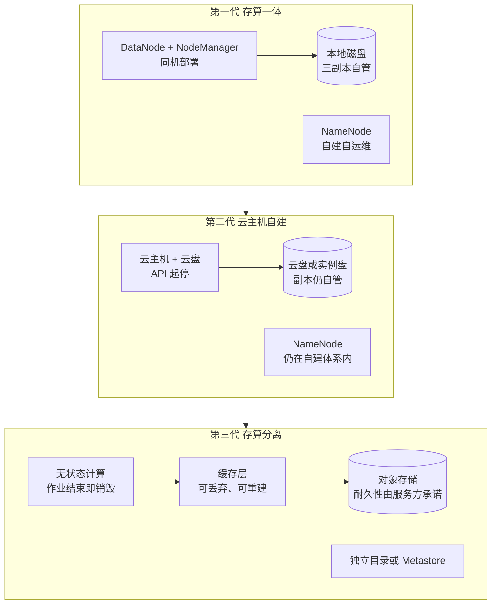
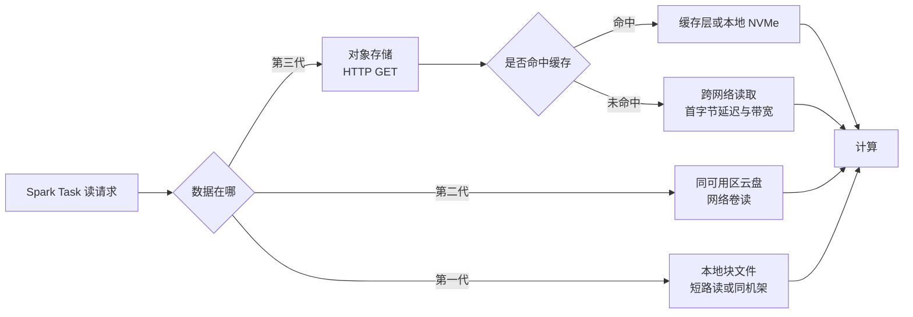
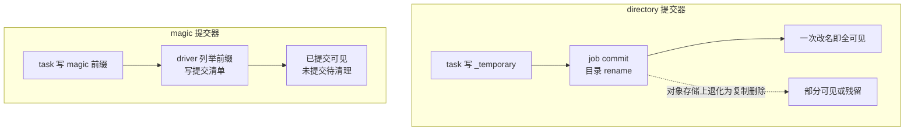
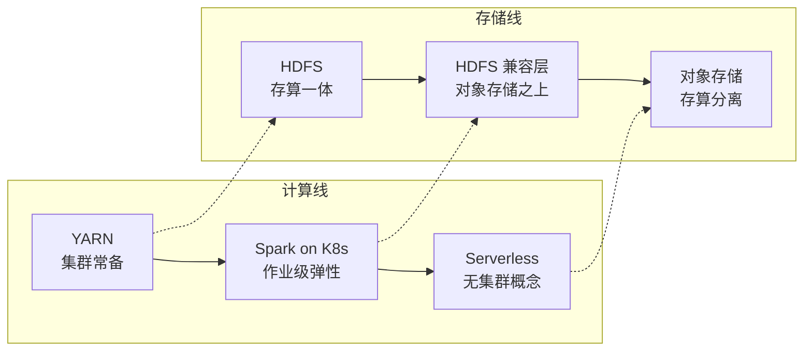
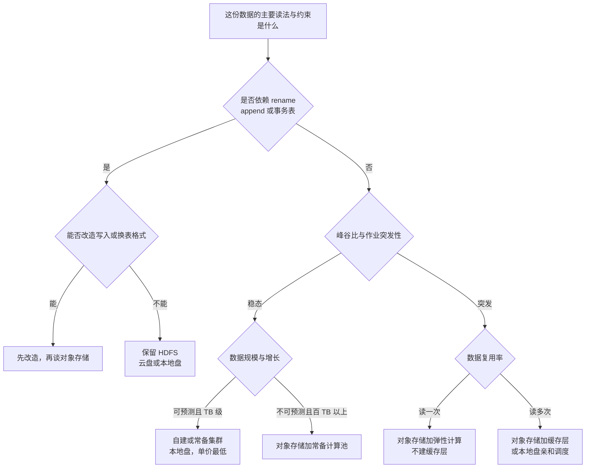

# 17 Hadoop 云部署模式：三代形态的边界与选型代价

**摘要：**

Hadoop 的云部署很少是一次干净的迁移：多数团队只是把机柜换成了云主机，少数团队一步跨到对象存储加弹性计算，两者共用"上云"这一个词，却是两种完全不同的形态。分清这两种形态不能看机房归属，要看存储所有权、计算生命周期与元数据位置这三个耦合点解开了几个。本文按解耦程度把形态分成三代——自建存算一体、云主机上自建、对象存储加弹性计算——逐代结算它修好了什么、又留下了什么，主线落在第三代的四笔账：本地性丢失、临时数据仍要落本地盘、rename 语义缺口、元数据服务换了一个新瓶颈。随后讨论让分离真正可用的四块补丁（一致性收敛、提交器三代演进、缓存层、表格式把提交上移），折算成成本结构与锁定风险，再说明计算云原生与存储云原生为什么可以不同步，最后给出选型判据、一棵决策树与五种常见的误用。机制细节不在本篇，HDFS 与 Spark on K8s 两套深度专栏各自承担。

---

## 第 1 章 三代形态：解耦发生在哪一层

2006 年 Hadoop 从 Nutch 里分出来时，问题很具体：一份放不进单机的数据，怎么用一堆随时会坏的廉价机器存下并算完。此后二十年形态改了三次，每次都不是把同一件事做得更好，而是把一组旧问题换成一组新问题，这条替换关系是本篇的主线。

先要把分类口径拧正。按"是否在云上"划分，会把两件不同的事混成一件：很多团队所谓上云，只是把机柜换成了云主机，NameNode 还是自己管，三副本还是自己付钱，故障手册一个字没改；反过来，一些跑在自己机房的集群用的是对象存储与存算分离，形态上已经属于第三代。分界不在谁的机房里，而在下面三个耦合点被解开了几个。

- **存储介质的所有权**：数据落在谁的盘上，副本或纠删码由谁维护，坏盘之后由谁触发重建。
- **计算实例的生命周期**：一台机器能不能在作业跑完之后消失，下一次作业换一批新的。
- **元数据的位置**：谁记着有哪些文件、每个文件多大、放在哪，这本账放在自建进程里，还是托管数据库里，还是干脆下放到数据文件本身。

| 形态 | 存储所有权 | 计算生命周期 | 元数据位置 | 一句话判据 |
| :--- | :--- | :--- | :--- | :--- |
| 第一代 存算一体 | 自建磁盘，副本自管 | 与存储节点同生共死 | 自建 NameNode | 数据只在计算节点的盘上 |
| 第二代 云主机自建 | 云盘或实例本地盘，副本仍自管 | 机器可由 API 起停，数据随之迁移 | 自建 NameNode | 机器弹性了，数据仍黏在机器上 |
| 第三代 存算分离 | 对象存储，耐久性由服务方承诺 | 完全无状态，按作业起停 | 独立目录服务或 Metastore | 计算消失后数据还在，且不必搬 |

表里第二行与第三行的差别最要紧。第二代机器随时能起，但数据黏在机器上：扩容要先加机器再等 Balancer 搬块，缩容要等数据搬走才能关机，搬的每一块都走网络、都计费。所以第二代拿到的是半个弹性。

不妨借图书馆打个比方。第一代像书摆在阅览室书架上，走两步就拿到；第二代像总馆搬到城郊，馆藏还是自己的，看一趟要坐车；第三代像书寄存在公共书库，阅览室只留少量副本。副本是理解三代差别的钥匙——前两代里它是可靠性的实现手段，要自己设计、维护、付费；到第三代副本从视野里消失，你能做的只剩缓存。

> [!info] 分工
> HDFS 的 Pipeline 写入、租约、机架感知与 NameNode 内部结构见 [[大数据/Hadoop/HDFS/00 专栏导览|HDFS 架构深度解析]]；Spark 在 K8s 上的 Pod 生命周期、RSS 与 Spot 容错见 [[大数据/Spark/Spark-on-Kubernetes工程实践/00 专栏导览|Spark on Kubernetes 工程实践]]。本篇只结算形态边界与选型，不重复这两处的机制细节。

下面这张图把三代形态与三个耦合点画在一起，注意第三代那条从计算到缓存、再到对象存储的链路：缓存层是它唯一保留的本地性载体，也是它不再需要自己维护副本的证据。



还有一处常被忽略的尺度：谁承担搬数据的成本。第一代靠人，第二代靠 Balancer 加云盘扩容、钱让账单出，第三代数据根本不搬、搬的是计算。所以判断一次改造是否真进入第三代，只看一件事：给计算加一小时容量，是否需要移动任何一份持久数据。不需要就算进了，需要就还在前两代里打转。

## 第 2 章 代际的问题转移：修好的与弄坏的

Hadoop 在 2006 年的赌注，是把可靠性从硬件挪到软件：单盘、单机故障当常态，用三副本与重算吸收掉。赌注成立的前提是磁盘便宜、网络贵，于是把计算推到数据所在的机器上——送 jar 到数据旁边，而不是送数据到 jar 旁边。这套逻辑后来被总结成"移动计算比移动数据便宜"，它是第一代全部设计的出发点，也正是第三代要拆掉的那一句。

第一代真正解决的是用软件可靠性替代硬件可靠性、以及水平扩展，代价写在容量规划上：采购、到货、上架、装系统、加进集群，一圈几个月，而峰值可能只持续两周，于是集群按峰值建设，平时一半机器空转；机架与电力密度一旦定死，扩容只能整排加。

第二代解决的是资源获取速度。2009 年前后云厂商开始提供托管 MapReduce 服务，之后在云主机上自装一套 Hadoop 成了更常见的做法：采购变成一次 API 调用，扩容从季度变成小时。但它没有解开数据与机器的绑定关系，于是留下一批具体问题。

- **副本成本与写放大**：云盘是网络卷，三副本意味着一次写入在网络上写三份、在存储上付三份钱；降副本或启用纠删码（Hadoop 3 的 EC，RS-6-3 把存储开销从 3 倍压到 1.5 倍）能省钱，代价是小文件与随机读变差、重建时 CPU 与网络压力集中。
- **数据搬动仍是瓶颈**：缩容要先搬块，扩容要等 Balancer 填平，跨可用区搬还要付流量费。云盘扩容是秒级 API，HDFS 填平是小时级后台任务，两者速度不匹配。
- **机架感知退化**：云上拿不到物理机架，能用的只有可用区与子网，机架语义被迫降级成可用区语义，副本跨机架变成副本跨区，跨区流量在账单上是另一栏。
- **实例与盘的生命周期错配**：实例本地盘随实例销毁而丢，云盘能跟实例走但要重新挂载，"节点故障"与"数据丢失"不再等价，这是第二代集群最容易在夜间告警里失守的地方。

第三代解决的是这四条的根：数据不动，计算来去。作业结束后集群可以整个消失，下一次换一批实例，只在对象存储上留下结果，弹性从开机器变成起作业，计费单位从节点小时细到作业秒。代价同样具体：第三代把前两代最不需要操心的四件事变成了日常——本地性、临时数据的落地、rename 语义、元数据 QPS。前两代里这四件事几乎不需要想，因为数据就在本地、目录就是目录、NameNode 就是账本。

| 代际 | 修好的问题 | 遗留或新引入的问题 | 代价最终落在谁身上 |
| :--- | :--- | :--- | :--- |
| 第一代 | 用软件可靠性替代硬件可靠性；水平扩展 | 扩容以月计；按峰值建设；机架与电力约束 | 资本支出与机房 |
| 第二代 | 资源获取从采购变成 API；扩缩容到小时级 | 三副本写放大；Balancer 搬数据；机架感知退化；实例与盘生命周期错配 | 云账单与运维 |
| 第三代 | 数据不搬、计算随作业起停；弹性到分钟级 | 本地性丢失；临时数据仍需本地盘；rename 语义缺口；元数据换瓶颈；请求计费 | 工程复杂度与平台能力 |

三代的共同点是复杂度逐层下移：操作系统把可靠性推给分布式文件系统，分布式文件系统把资源推给云服务，云服务最终把语义判断推回给用的人——你得知道对象存储到底保证了什么。所以判断一次升级是否值得，问的不该是它解决了什么，而是它把成本挪到了哪个团队身上。

## 第 3 章 分离的四笔账：本地性、网络、rename、元数据

### 3.1 本地性：缓存只能救重复读

HDFS 的读快，一半因为副本就在本机或同机架，另一半因为短路读这类绕过 DataNode 进程、直接读本地块文件的优化。到对象存储，每次读都是一次 HTTP 请求加一段网络传输，原来由内核页缓存与 DataNode 承担的事，转给了 S3A 客户端、页缓存和缓存层三家分担。

先分清三种读：一次性扫描、多次复用、随机点查。缓存只能救第二种，收益等于命中次数减一乘以数据量；第一种的命中率恒等于零，第三种要的是毫秒级延迟，而对象存储的首字节延迟与连接复用无关。

损失也不均匀。宽表顺序大 IO 受影响最小，单流带宽足够把网络打满；受影响最大的是反复迭代的算法（每轮重读上一轮的中间结果）与反复探测的小表（广播之后本地仍要读源）。这解释了为什么不少团队迁到对象存储后作业时长变化不大，请求数与出口流量却翻了几倍。

### 3.2 网络与临时数据：无盘计算是误解

一个常见误解是存算分离之后计算节点不需要盘。事实相反：shuffle 文件、溢写、广播变量、作业 jar 与依赖包，全都要落在计算节点的本地盘上。这些数据生命周期以作业为单位，短则几秒、长则几小时，放到对象存储上等于让每次 shuffle 都走一遍 PUT 与 GET，既慢又贵。所以第三代的准确画法是**持久数据在对象存储，临时数据在本地盘**：计算节点不是无盘，是盘上的数据可以随实例一起丢弃。

这也决定了实例选型。带本地 NVMe 的机型在 shuffle 密集的作业上有优势，代价是数据不可持久；只用云盘的机型更灵活，但 shuffle 的 IOPS 与带宽要靠卷规格买。

### 3.3 rename：一个语义缺口牵动整条提交链路

HDFS 的 rename 是 NameNode 上的一次元数据改写，O(1)、原子、立刻可见；对象存储没有目录，键是扁平字符串，rename 一个目录只能退化成逐个键复制再删除，O(n)、非原子、中途失败留下半个目录。这个缺口牵动整条提交链路：MapReduce 的输出提交器靠 rename 把 `_temporary` 里的任务输出一次性挪到最终目录，以此实现"要么全有要么全无"；Hive 的 `LOAD DATA` 与 `INSERT OVERWRITE` 也依赖改名；一些团队的表迁移脚本还在用 rename 做原子切换。

依赖目录语义的工具链同样会在这里打滑：把目录当成实体去遍历、删除、判断存在性的脚本，在对象存储上要么变慢（每次判断都要 list 前缀），要么行为不一致（空目录不存在）。下面这张表把这几处语义差异摆在一起。

| 语义 | HDFS | 对象存储（S3 类） | 受影响的环节 |
| :--- | :--- | :--- | :--- |
| rename | 元数据操作，O(1)、原子 | copy + delete，O(n)、非原子 | 作业提交、LOAD DATA、表切换 |
| 目录 | 实体，可空、可列举 | 无实体，只有键前缀 | 存在性判断、空目录、遍历 |
| append | 支持追加（语义受限） | 不支持，只能整对象覆盖 | 日志汇聚、事务表、WAL |
| list | 目录列举，快 | 前缀列举，1000 键一页，按次计费 | 分区发现、提交校验、清理任务 |
| 权限 | POSIX 风格 ACL 与 KMS 透明加密 | 桶策略 + IAM + 服务端加密 | 多租户、审计、合规 |
| 一致性 | 强一致 | 2020-12 起单对象强一致，跨对象无事务 | 写后读、并发提交 |

### 3.4 元数据：瓶颈从内存换成 QPS 与连接数

第一代与第二代的元数据瓶颈是 NameNode 的堆内存：每个文件、每个块、每个副本在堆里都有对象，几千万文件就能把它逼到 Full GC。第三代把瓶颈换掉了：对象存储的元数据由服务方承担，客户端的压力转移到 LIST 上——一次 LIST 最多返回 1000 个键，列一个百万文件的目录要上千次请求，每次都在账单上记一笔；请求速率也有配额（AWS 文档给出的参考口径是每个前缀每秒 3500 次写、5500 次读），超了就是 503 加退避重试。

另一处新瓶颈是 Metastore。它从跟 NameNode 同机的进程变成独立部署、后端托管数据库的服务，于是连接数、慢查询、主库写入成为新的容量上限；分区膨胀到几十万之后，分区列举与裁剪的耗时从毫秒级爬到秒级。湖格式把分区信息下放到 manifest，等于把这本账又挪了一层。

### 3.5 四笔账互相牵连

四笔账不能分开算。为绕开 rename 改用 magic 提交器，就要接受提交依赖 list 强一致；为让 list 变快而合并文件，就要接受更粗的并行度；为补本地性而上缓存，就要接受缓存自身的成本与失效逻辑。四块补丁解决的是同一问题的四个侧面。



## 第 4 章 让分离可用：四块补丁与它们的新账

### 4.1 一致性：2020 年 12 月的那次切换

对象存储长期被诟病的是写完立刻读可能读不到、列目录可能缺文件。2020 年 12 月，AWS 宣布 S3 对所有新写入提供强一致：PUT 之后 GET 立刻可见，LIST 强一致，覆盖写与删除也强一致。这条变更把生态里一大类补丁变成了历史——EMRFS 的 consistent view 用 DynamoDB 维护文件清单来保证列表一致，强一致落地后已不再需要；但存量集群上那张表还在，每次列举仍要查一次，这是一笔可以清偿的技术债。

要分清的是**强一致不等于事务**：单对象读写一致了，跨对象原子性、目录改名的原子性、多写者隔离仍然没有。所以 rename 缺口不会因强一致消失，提交器仍是必需品，只是它依赖的语义从"rename 原子"换成了"list 强一致"。

### 4.2 提交器的三代演进

directory 提交器是最老的一代：任务把输出写进 `_temporary/<attempt>/` 下，job commit 时把整个目录 rename 到最终位置。HDFS 上这是一次元数据操作，几乎零成本；对象存储上它退化成 O(n) 的复制加删除，几万个文件就是几万次请求，中途失败还留下部分可见的输出。算法 v2 让任务直接写最终目录、只在提交时改一次名，把复杂度从与文件数成正比降到常数——但这个常数依赖 rename 原子，在对象存储上不成立，v2 反而更容易暴露"半成品可见"。

staging 提交器把发布从文件系统语义里拿出来：任务先写未提交的对象，或者先落到本地暂存区，提交时由 driver 汇总一份清单再统一发布，代价是要维护暂存区与清理逻辑。

magic 提交器把输出写到带 magic 前缀的目录下，job commit 时 driver 列出前缀、写一份提交清单，未提交的部分由清理任务删除。它不依赖 rename，只依赖 list 强一致与删除幂等，于是在 S3 上把 job commit 变成一次列举加几次小写入。代价是要求存储实现与 S3 语义足够接近，兼容存储启用前必须逐项验证，magic 目录的残留还要额外清理。

第四代思路不在文件系统层面，而是把提交上移到表格式：Iceberg 用新的 metadata 文件替换旧版本，Delta 在 `_delta_log` 里写一次条件更新，Hudi 在 timeline 上追加一个 instant。共同点是把提交从目录改名换成**元数据指针的原子替换**，文件系统只需能原子地创建对象，或者由 catalog 提供条件更新；代价是提交语义绑在表格式上，非表格式的原始文件输出仍要回到前三种方案。这套机制见 [[大数据/数据湖/Iceberg/04 事务与并发控制——乐观锁与 Optimistic Concurrency|Iceberg 的乐观锁与并发控制]]。

| 方案 | 提交动作 | 依赖的存储语义 | 适用 | 主要代价 |
| :--- | :--- | :--- | :--- | :--- |
| directory | 目录 rename | 原子 rename | HDFS、本地盘 | 对象存储上 O(n)，残留难清 |
| staging | 暂存区加清单发布 | 原子创建对象 | 对象存储 | 暂存区管理与清理 |
| magic | list 前缀加提交清单 | list 强一致、删除幂等 | S3 及语义接近的实现 | 兼容性验证、magic 目录残留 |
| 表格式 | 元数据指针原子替换 | 原子创建或 catalog 条件更新 | 有表格式的写入 | 只覆盖表内数据，绑定格式 |

选型时真正要改的只有三处：用哪个提交器、暂存区放在哪、提交依赖什么语义。下面这份配置是 S3A 上的最小改动面。

```xml
<!-- 三档取值：directory、partitioned、magic，按写入文件数与失败恢复容忍度选 -->
<property>
  <name>mapreduce.outputcommitter.factory.scheme.s3a</name>
  <value>org.apache.hadoop.fs.s3a.commit.S3ACommitterFactory</value>
</property>
<property>
  <name>fs.s3a.committer.name</name>
  <value>magic</value>
</property>
<property>
  <name>fs.s3a.committer.magic.enabled</name>
  <value>true</value>
</property>
```

下图把两种提交动作并排放在一起，左边那条路径的成败取决于 rename 是否原子，右边那条只取决于列举是否可信。



### 4.3 缓存层：把本地性从所有权降级为缓存

这是第三代最重要的一次语义转换。前两代里数据在本地是一种所有权关系：盘是你的、副本是你的、丢了是你的责任。第三代把本地性变成了缓存，可以有、可以没有、随时可丢、丢了重拉。这个降级听上去是损失，实际是把不可丢弃的约束换成可丢弃的约束，工程上第一次可以用命中率谈本地性，而不是用"必须同机"这种不可妥协的条件。

三种缓存形态定位不同。分布式缓存层（Alluxio 这类，由 AMPLab 的 Tachyon 演化而来）在计算与对象存储之间加一层带命名空间的服务，worker 用本地盘缓存，解决多作业共享热数据，代价是多了一个有状态服务要运维。基于对象存储的 POSIX 文件系统（JuiceFS 这类）把元数据放在独立引擎、数据放在对象存储，解决既要 POSIX 语义又要对象存储容量，代价是元数据引擎成为新的有状态依赖。节点本地缓存不需要额外服务，命中率靠调度亲和，代价是不可跨节点共享。

要不要上缓存层，判据只有一个：同一份数据在一段时间内被读几次。读一次的作业，缓存只增加一次写入成本；读十次的，缓存把十次网络读变成一次；读一百次但每次只碰一小部分的，缓存要支持块级或行组级局部缓存才有用，整文件缓存反而浪费。

| 形态 | 缓存粒度 | 恢复的本地性 | 新增的有状态组件 | 不该用的情形 |
| :--- | :--- | :--- | :--- | :--- |
| 节点本地盘 | 块或文件 | 单节点、单作业 | 无 | 作业跨节点、复用率低 |
| 分布式缓存层 | 块级、集群共享 | 集群级，多作业共享 | Master 与 Worker | 没有运维有状态服务的能力 |
| 对象存储上的 POSIX 层 | 文件或块 | 对应用透明 | 元数据引擎 | 写入密集且 rename 频繁 |
| 表格式的聚簇与排序 | 文件级 | 减少扫描量，不降延迟 | Catalog | 一次性扫描、没有谓词 |

### 4.4 补丁的代价：从硬件运维到语义运维

四块补丁把分离从不可用变成可用，但每块都新增一个需要有人懂的组件：提交器要有人知道 magic 残留怎么清，缓存要有人盯命中率，表格式要有人管元数据与小文件，一致性要有人判断某个存储算不算 S3 兼容。第一代运维是换盘与调 JVM，第三代是读语义文档与对账单——复杂度没减少，它从硬件层挪到了语义层。

## 第 5 章 账单与锁：成本结构与锁定风险

### 5.1 计价维度变了，优化目标就变了

自建机房的账是容量账：买多少核、多少 TB，按三到五年摊，用不用都在那里，像买断一个车位。第三代的账是流量账：存储按 GB·月，请求按次，计算按秒，出网按 GB，像计时停车。计价维度一变，优化目标就变：自建时代优化利用率，云上优化扫描字节与请求数。

小文件在这里换了计价单位。HDFS 上一百万小文件的代价是 NameNode 堆内存与列举的 RPC；对象存储上同样的代价是每次 PUT 一次请求、每次读一次请求、每次列目录上千次请求。同一个问题，前两代用内存与 GC 度量，第三代用账单度量，这也是上云之后小文件治理紧迫性反而上升的原因——它从性能问题变成了财务问题。

### 5.2 三个反直觉

第一，存储成本通常上升而不是下降。对象存储单价低，但加上请求费、缓存层、为兼容语义保留的暂存区，总账往往不比自建低。存算分离真正省的是计算，让计算成本跟着负载走而不是按峰值常备。这笔交易的实质是**用存储的确定性换计算的弹性**。

第二，闲置数据仍然要付费，卸载还要付出口费。自建机房里，三年前的冷数据放在旧机器上，边际成本接近电费；对象存储上它按 GB·月持续计费，拉到本地或换一个云还要付传输费。于是"删数据"第一次成为一项正经的架构工作。

第三，缓存层是一笔新的固定成本，不随作业量线性变化，命中率不高时就是纯亏。很多团队上缓存层是在补一个本可以通过改数据布局解决的问题，譬如把随机读改成按聚簇键顺序读，扫描量降下来之后缓存就不必要了。

| 成本项 | 第一代 自建 | 第二代 云主机 | 第三代 存算分离 |
| :--- | :--- | :--- | :--- |
| 存储 | 硬件摊薄加机房电力 | 云盘容量加三副本写放大 | 对象存储字节加请求加缓存 |
| 计算 | 按峰值常备，利用率低 | 按节点小时，弹性受数据搬动牵制 | 按秒或按作业，弹性充分 |
| 网络 | 内网基本免费 | 跨可用区计费 | 跨区、跨云、出网全部计费 |
| 运维人力 | 硬件、系统、集群全套 | 集群与云资源两套 | 语义、账单、缓存、元数据四套 |
| 闲置成本 | 机器空转 | 节点空转 | 冷数据也要按字节付费 |
| 退出成本 | 迁到新硬件 | 迁到另一云 | 出口费加目录服务迁移 |

### 5.3 锁定藏在目录服务里

第三代的锁定不在计算上，Spark 作业换一个云照样跑；锁定藏在三处：目录服务（把表、权限、血缘纳入托管）、专有的存储实现（对象存储之上的兼容层与优化提交器）、以及围绕它们长出来的工具链。这三处用了就很难拆，不是接口不可替代，而是替换要重做权限与血缘。

锁定的成本通常不在迁移当天爆发，而在三种场景里：多引擎共享同一份数据、需要跨云容灾、监管要求数据落在特定地域。评估锁定风险可以问一个具体问题：把计算迁到另一个云，是否需要重写目录、权限与提交链路。需要，就是锁住了。

### 5.4 私有云里的第三代

合规要求会把一部分团队推回私有云。私有云做存算分离需要一套 S3 兼容对象存储，于是四笔账原样出现，只是服务方从云厂商变成自己的存储团队：rename 与 LIST 的语义要看实现，强一致要靠版本与配置确认。这是国内不少云原生大数据项目的真实形态——形态进了第三代，语义保障退回了自己验证。

加密与审计也要重新对账。HDFS 的透明加密由 KMS 与 NameNode 配合完成，密钥与路径绑定；对象存储走服务端加密，客户端看到的是桶级策略。前者审计到路径与用户，后者到请求与键，合规评审要的"谁能读、读过什么"需要重新拼装。

## 第 6 章 两条云原生线：计算与存储可以不同步

前面五章谈的是存储侧形态，计算侧另有一条独立的演进线：从 YARN 到 K8s，再到不做集群抽象的 Serverless。两条线经常被当成一件事讲，实际可以分开走，大部分团队也是分开走的。判据不在谁更先进，而在各自的瓶颈落在哪。

| 组合 | 典型形态 | 适用 | 主要代价 |
| :--- | :--- | :--- | :--- |
| 计算一体、存储一体 | YARN 加 HDFS，机房或云主机 | 数据规模稳定、延迟敏感、必须自建 | 弹性差，扩容以月计 |
| 计算一体、存储分离 | YARN 加对象存储（托管 Hadoop 服务的默认形态） | 先解决存储弹性，计算沿用既有运维 | 本地性丢失，计算仍受 YARN 容量约束 |
| 计算分离、存储一体 | K8s 加 PVC 或本地盘上的 HDFS | GPU 训练、统一调度、数据不出机房 | 存储复杂度没降，只是换了编排器 |
| 计算分离、存储分离 | K8s 或 Serverless 加对象存储 | 弹性优先、作业形态多样 | 四笔账全付，需要成熟平台团队 |

第三行最容易被误认。把 HDFS 装进 K8s 的 StatefulSet、用 PVC 挂云盘，看上去是云原生，实际三个耦合点一个没解：数据还在自己的盘上，副本还是自己管，NameNode 还是自己运维。它把第一代内核装进第三代的壳里，代价是两套运维都要付。这套组合在 GPU 训练或数据不能出机房的场景里能同时拿到统一调度与本地性，但不该被当成云原生化的终点。

两条线为什么可以不同步？因为计算侧要解决的是谁分配资源、作业怎么起停，存储侧要解决的是数据放在哪、语义够不够用，两者唯一的交点是作业读数据的路径。K8s 化不改变数据在哪，存算分离也不要求计算跑在 K8s 上——托管 Hadoop 服务用 YARN 加对象存储跑了十几年，就是最好的反例。下图把两条线并排画出，虚线是常见的搭配，不是必然的绑定。



不同步时最需要注意的是中间态成本。计算已 K8s 化而存储仍在 HDFS 上，扩缩容仍受数据搬动牵制，K8s 的弹性只能用在作业级；存储已对象化而计算还在 YARN 上，容量规划仍是瓶颈，只是瓶颈从磁盘挪到了内存。选择不同步，就要接受那个瓶颈还在且清楚它在哪。K8s 侧的落地细节见 [[大数据/Spark/Spark-on-Kubernetes工程实践/06 存储与 Shuffle：PVC、HostPath 与 Remote Shuffle Service|存储与 Shuffle]] 与 [[大数据/Spark/Spark-on-Kubernetes工程实践/08 资源优化：Spot 实例、Gang Scheduling 与容量规划|资源优化]]。

## 第 7 章 选型：五个判据与一棵决策树

### 7.1 五个判据

第一是复用率：同一份数据被读几次。这是决定要不要缓存、要不要本地性的第一判据。ETL 全量扫描与探索式分析要用两套策略，用一套策略服务的团队最后两头都不满意。

第二是弹性需求：峰谷比与作业的突发性。峰谷比接近 1 的稳态负载，自建或常备集群单价最低；峰谷比大、作业突发的，按秒计费才有意义。

第三是延迟档：亚秒、秒级、分钟级、小时级。对象存储的首字节延迟在几十毫秒量级，缓存层能压到个位数毫秒，本地盘更低；要求亚秒点查时，对象存储加缓存仍不如本地盘加列存。

第四是语义依赖：是否需要 rename、append、目录、文件锁、事务表。有强依赖的，要么保留 HDFS，要么先改造写入链路，再谈迁移。

第五是合规与团队能力：数据能否出机房、审计粒度要求，以及团队里有没有人能读懂提交器与 S3A 的文档。最后一条最常被忽略，却是第三代落地失败的最常见原因——形态选对了，没人能运维。

| 判据 | 落向第一代或第二代 | 落向第三代 | 备注 |
| :--- | :--- | :--- | :--- |
| 数据规模 | 几 TB 到几十 TB，增长可预测 | 百 TB 以上，增长不可预测 | 规模不是决定因素，增长曲线才是 |
| 复用率 | 读一次或读法固定 | 多作业共享、读多次 | 决定缓存层有没有收益 |
| 弹性 | 峰谷比接近 1 | 峰谷比大、作业突发 | 按秒计费才有价值 |
| 延迟档 | 亚秒点查、交互式 | 分钟级批处理 | 缓存能改善不能替代 |
| 语义依赖 | rename、append、目录、事务 | 只读或整文件写 | 有依赖先改造再迁移 |
| 合规 | 数据不得出机房 | 允许公有云或专属云 | 私有云可做第三代，但语义自证 |
| 团队能力 | 有 HDFS 与 YARN 运维积累 | 有平台团队管提交器、缓存、目录 | 缺这条，形态再好也运维不动 |

### 7.2 决策树

把上面几条收成一张判断图：先问语义依赖，有硬依赖的先改造或留在原形态；没有的再分稳态与突发，稳态看规模与增长，突发看复用率。



### 7.3 迁移顺序与验证指标

从第一代往第三代迁通常分四步：先把只读的、无状态的下游作业切到对象存储，让读路径先通；再把写入改成提交器方案并验证提交原子性；然后把元数据迁到托管服务或表格式目录；最后把计算从常备集群换成弹性集群。每一步都要留回滚路径，读切了写不切、写切了元数据不切，任意一步都可以单独退回。

验证指标不是"能不能跑通"，而是四组数：作业时长的 P50 与 P99、对象存储请求数（GET、PUT、LIST 分开看）、出口与跨区流量、提交失败与残留文件数。前两组决定性能，后两组决定账单与正确性。不少迁移在跑通之后宣布完成，半年后才发现请求费是计算费的两倍。

## 第 8 章 反例：五种不该走的路

### 8.1 小数据强上云原生

十来个 TB、每天几个作业、团队三五个人的场景里，四笔账一分不少：提交器要配、缓存层要评估、账单要拆、语义要验证，而弹性几乎用不上——峰谷比接近 1，作业跑在夜里的窗口里。这种场景下一台大内存机器加本地 NVMe、或一个常备小集群，成本与复杂度都更低；如果只是想让人直接看数，单机列式引擎往往比 Spark 集群更快。判断线不在数据量本身，而在弹性收益是否大于四笔账。

### 8.2 需要 POSIX 语义却选了对象存储

三类东西会在这里翻车，它们的共同点是要的是文件系统语义——原子改名、追加、flush——而不是一个只认键值的对象接口。一类是依赖 append 与 rename 的日志汇聚与事务表：事务表的历史实现依赖文件系统的 flush 与 rename，对象存储不提供，官方文档长期把对象存储上的事务表列为不支持（Hive 4 有改进，边界以对应版本文档为准）。一类是依赖随机读写与 WAL 的 HBase，Compaction 与 Region 分裂都要靠 rename，这也是当年 HDFS 不够用而 HBase 另起一套存储引擎的原因，机制见 [[大数据/HBase/01 HBase 的诞生——为什么 HDFS 不够用，列族存储的设计哲学|HBase 的诞生]]。第三类是把目录当实体用的老脚本。硬迁过去，得到的是一个能跑但语义靠运气的系统。

### 8.3 需要极致本地性却做存算分离

迭代式算法、图计算、交互式查询，共同点是每读一次都要低延迟，这正是缓存救不了的部分：缓存能提高命中率，但首字节延迟与网络往返是结构性的。这类负载的正解是本地 SSD 加调度亲和，把计算放到数据旁边，而不是把数据搬到计算旁边再赌命中。

### 8.4 把上 K8s 当成云原生化

K8s 只解决资源分配与作业编排，不改变数据在哪、语义够不够用。在 K8s 上用 PVC 跑 HDFS，得到的是两套运维、一个内核；它在特定场景里有价值，但不该被当成减少了复杂度的方案。

### 8.5 多云伪解耦

以为对象存储天然可移植，忽略目录服务与专有存储实现的锁定，结果"多云"只停留在对象存储这一层，目录、权限、血缘仍然绑在一个云上。真要做多云，代价是放弃托管目录、自己维护一套跨云元数据层，这通常不划算。

| 反例 | 触发信号 | 后果 | 替代做法 |
| :--- | :--- | :--- | :--- |
| 小数据强上云原生 | 数据 TB 级、峰谷比接近 1、团队三五人 | 四笔账照付，弹性用不上 | 常备小集群或单机列式引擎 |
| 要 POSIX 却选对象存储 | 依赖 append、rename、事务表、随机写 | 语义靠运气，故障难复现 | 保留 HDFS，或先改造写入链路 |
| 要极致本地性却做分离 | 迭代算法、图计算、交互式查询 | 每轮都付网络延迟，缓存救不了 | 本地 SSD 加亲和调度 |
| 把 K8s 当云原生 | 在 PVC 上跑 HDFS | 两套运维、一个内核 | 认清中间态边界，别当终点 |
| 多云伪解耦 | 只搬了对象存储，目录还在一个云 | 迁移时重做目录与权限 | 先评估目录服务的可替换性 |

## 结语

三代形态的边界不由"在不在云上"决定，而由三个耦合点解开了几个决定：存储的所有权、计算的生命周期、元数据的位置。第一代把可靠性交给软件，第二代把资源获取交给 API，第三代把本地性从所有权降级成缓存。最后这一跳把"数据必须和计算在一起"这条硬约束，换成了命中率这个可度量、可妥协、可以按钱买的软指标。

代价也在这里：软指标要有人调，四笔账要有人对，语义要有人验。所以选型要回答的不是哪一代更先进，而是这份数据的读法配得上哪一代的代价。

## 参考资料

- Apache Hadoop 文档：S3A Committers（directory、staging、magic 三种提交器与配置项）。https://hadoop.apache.org/docs/stable/hadoop-aws/tools/hadoop-aws/committers.html
- Apache Hadoop 文档：Amazon S3 与 S3A 的语义、性能与故障排查。https://hadoop.apache.org/docs/stable/hadoop-aws/tools/hadoop-aws/index.html
- AWS 官方博客（2020-12-01）：Amazon S3 Update — Strong Read-After-Write Consistency。https://aws.amazon.com/blogs/aws/amazon-s3-update-strong-read-after-write-consistency/
- AWS 文档：Amazon S3 性能优化最佳实践（前缀请求速率参考口径、LIST 1000 键分页）。https://docs.aws.amazon.com/AmazonS3/latest/userguide/optimizing-performance.html
- AWS 文档：Amazon EMR 的 EMRFS 与 consistent view 说明。https://docs.aws.amazon.com/emr/latest/ManagementGuide/emr-fs.html
- Apache Hadoop 文档：HDFS 纠删码（Erasure Coding）与 3.x 存储策略。https://hadoop.apache.org/docs/stable/hadoop-project-dist/hadoop-hdfs/HDFSErasureCoding.html
- Apache Iceberg 规范：快照提交与元数据替换。https://iceberg.apache.org/spec/
- Delta Lake 协议：`_delta_log` 事务日志与提交规则。https://github.com/delta-io/delta/blob/master/PROTOCOL.md
- Apache Hive 文档：ACID 事务表与对象存储的限制说明。https://hive.apache.org/
- Alluxio 文档与 JuiceFS 文档：缓存层与元数据引擎的定位差异。https://docs.alluxio.io/ 与 https://juicefs.com/docs/zh/community/introduction/
- Apache Spark 文档：Running Spark on Kubernetes 与相关配置。https://spark.apache.org/docs/latest/running-on-kubernetes.html

> [!note] 思考题
> 1. 一份数据一年只被读两次、每次都是全量扫描，缓存层能贡献什么，成本又落在谁头上。
> 2. S3 在 2020 年底完成强一致之后，提交器为什么仍然是必需品，强一致与原子提交差在哪一步。
> 3. 团队已经在 K8s 上用 PVC 跑了一套 HDFS，这套组合在什么条件下值得保留，什么条件下应该退出。
> 4. 请求计费让"小文件"从性能问题变成财务问题，这会如何改变你对文件合并任务的优先级判断。
> 5. 监管要求数据不得出机房时，第三代还能不能做，需要自证哪些语义。