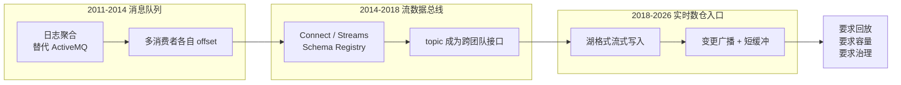
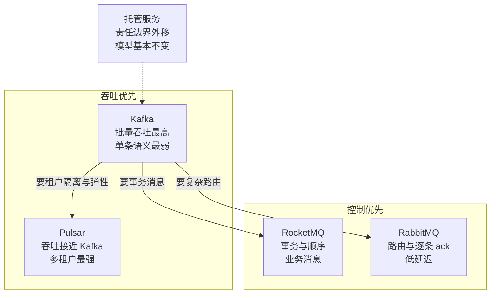
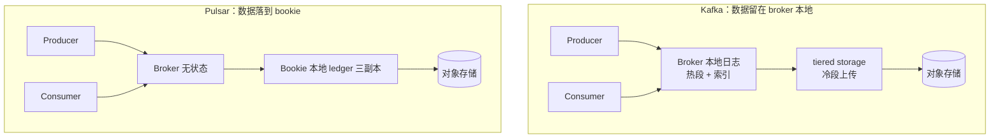
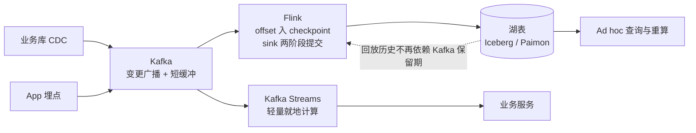
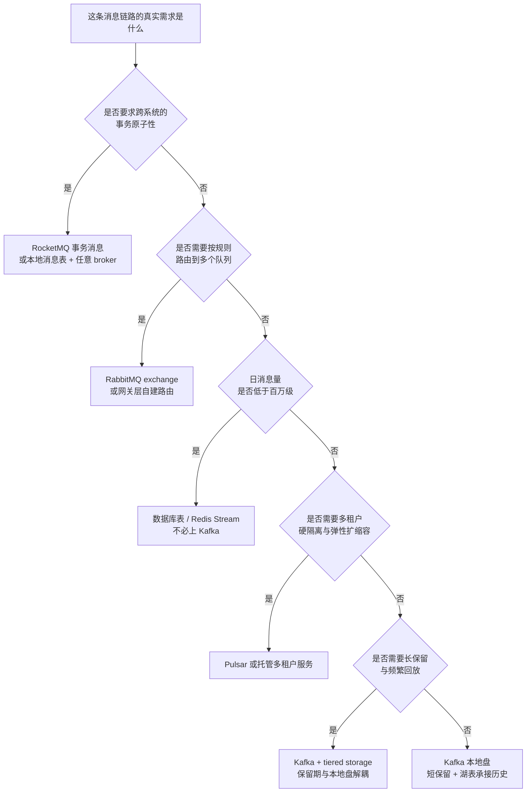

**摘要：** 讨论 Kafka 的选型，容易滑向两种省事的结论：要么拿吞吐量一句话把它推给所有异步场景，要么拿"它不是真正的消息队列"一句话把它排除在业务消息之外。这篇文字换个问法，只看它在数据栈里的位置怎么变——从替掉 ActiveMQ 的消息队列，到承载全公司 topic 的流数据总线，再到实时数仓的落地入口。三次漂移由同一组机制支撑，顺序写、零拷贝、分区并行；三次漂移也把同一笔账放大，为了吞吐它放弃了单条消息级别的语义。接着把它与 RocketMQ、Pulsar、RabbitMQ 以及托管服务摆进同一张定位矩阵，说明四者其实不在同一条赛道上；再看存算分离那场争论，Pulsar 拆服务与 Kafka 先修元数据面、后动数据面，两刀切的位置并不相同；最后处理与流处理引擎的耦合，解释 Kafka 加 Flink 为什么成了默认架构，Kafka Streams 的位置又到哪为止。落地一节给出五轴判据表、一棵决策树和六类反例。机制细节交由 Kafka 深度专栏，这里只回答该不该选、以及选它的代价记在谁账上。

---

## 第 1 章 一个组件，三种身份

先给一个贯穿全文的场景。一家做连锁零售的公司，三家门店的订单、库存变更、以及 App 埋点都往同一套 Kafka 里写：订单事件被风控、实时报表、离线数仓三条链路同时消费；库存变更只给实时补货服务用；埋点数据在 Kafka 里停七十二小时，供次日凌晨的重算任务回放。这套用法在 2026 年看来平淡无奇，但它把 Kafka 的三个身份同时用上了，而这三个身份对系统的要求并不一致。

理解这种不一致，比记住任何一组参数都重要。笔者后面反复回到这个场景，因为它同时暴露了 Kafka 的长处与短处：多下游各自回放是它的长处，把 Kafka 当存储用是它的短处。

### 1.1 起点是替掉一条臃肿的管道

Kafka 2011 年由 LinkedIn 开源，最初的动机写在 Kreps 等人的 NetDB 论文里：日志类数据要同时喂给实时处理、离线数仓、监控与搜索四条下游，用当时那类队列做，每增加一条下游就要么复制一份消息，要么让几条下游争抢同一个队列的消费位置。两种做法都不可持续，前者让存储成本随下游数量线性增长，后者让下游之间彼此牵制。

Kafka 的答案是把消息留在一份可重读的日志里，每个消费者各自维护偏移量，读到哪里是自己的事，与别人无关。这个改动看上去只是加了"重读"能力，实际改的是组件之间的责任划分：生产者不再关心有多少消费者，消费者不再需要和邻居协调进度。

打个比方，Kafka 像一块公共黑板，而不是一张传阅的便条。便条看完就没了，黑板上的字写上去之后谁想看、什么时候看、看几遍都行，代价是黑板要足够大，擦除只能按时间统一进行，不能照顾某个人的进度。

### 1.2 第二个身份：全公司的流数据总线

Connect、Streams、Schema Registry 在 2015 年前后陆续就位，Kafka 的角色从"两个系统之间的管道"变成"公司内部的集成层"。此时 topic 名字成了接口，schema 成了契约，一个新的分析团队只要订阅一个 topic 就能接入，不必和上游团队谈 RPC 接口、排联调档期。

问题也随之换了位置。队列时代问的是"消息有没有送到"，总线时代问的是"这个 topic 归谁管、字段能不能加、保留期谁定、schema 变更通知谁"。这些不是 Kafka 的缺陷，而是它从组件升格为基础设施之后必然承接的治理问题，只不过 Kafka 本身并不提供答案，得靠外部的 Schema Registry、元数据平台或者一份内部规范来补。

总线身份还带来一个隐性变化：写入方从"知道下游是谁"变成"不知道下游是谁"。这提高了接入效率，也让任何一个字段改动都可能悄悄影响一个意料之外的消费者。

### 1.3 第三个身份：实时数仓的落地入口

湖格式的流式写入器成熟之后，实时链路的形态稳定成 Kafka → 计算引擎 → 湖表。Kafka 在这条链路里承担变更广播与短缓冲，湖表承担可回放的历史，两者的分工一旦确立，Kafka 的保留期就不必再设得很长。

这个变化对选型是好事，它把 Kafka 从"兼任存储"的重负里解放出来。但入口的身份又带来另一个要求：回放。数仓重算、模型回溯、故障后补数，都要靠 offset 回退重读一段历史，而这份能力恰恰是日志模型给的，别的消息系统想补就得额外做一份归档。

三种身份叠在同一个集群上，矛盾就出现了：队列身份要求低延迟与逐条可控，总线身份要求契约与治理，入口身份要求容量与回放，而 Kafka 用同一套机制去满足三者的八成。这是它成功的来源，也是它被抱怨的来源。

### 1.4 漂移的账单落在谁头上

第一笔账单是 topic 的归属。总线身份让任何团队都能建 topic，于是命名、保留期、分区数这些决定散落在几十个团队手里，几个月之后就没人说得清哪个 topic 还在被消费。这份成本不在 Kafka 里，在组织流程里。

第二笔账单是"用 Kafka 当存储"的错觉。日志模型支持重读，很容易让人把保留期当成归档策略，把三天拉到三十天，然后在磁盘账单上发现三副本乘出来的数字。日志能重读，不等于它是便宜的存储。

第三笔账单是隔离的边界。Kafka 的配额作用在客户端与用户维度，能限制写入速率，但做不到按租户硬隔离资源；一个批量回灌的消费者照样可以把 broker 的页缓存全部挤掉，影响同一个集群上的所有租户。

第四笔账单是治理工具的外置。schema 演进、血缘、数据质量这些能力由 Schema Registry、元数据平台、质量平台分别承担，它们与 Kafka 是并列关系而不是从属关系。总线身份带来的治理要求，最终要靠一整套周边设施去满足，而这份设施并不随 Kafka 一起安装。

三个身份对能力的要求并不重合，把它们压在一套机制上，代价分布在下表几行里。

| 身份 | 它真正要求的能力 | Kafka 用什么接住 | 暴露出来的问题 |
|---|---|---|---|
| 消息队列 | 低延迟投递、失败重试、按条确认 | 分区日志 + 消费者组 | 无单条确认，重试必然队头阻塞 |
| 流数据总线 | 契约管理、多团队共享、容量隔离 | topic + 配额 + Schema Registry | 治理能力在外部，集群本身只给逻辑隔离 |
| 实时数仓入口 | 长保留、可回放、与湖表对接 | 日志语义 + 分层存储 | 保留期一长，三副本本地盘的成本失控 |

---

## 第 2 章 吞吐那笔交易，条款写在语义里

Kafka 的高吞吐不是秘密，秘密在于它为这份吞吐签了哪些条款。多数选型讨论只比较"每秒多少万条"，不看条款，等到业务要求"这条消息只能重投一次"或者"这条消息延后三十秒再投"的时候，才发现合同里没有这一项。

### 2.1 换来的吞吐是真实的

顺序追加把随机写变成顺序写，页缓存让读打在内存上，sendfile 让数据不进用户态，分区把并行度下放给客户端。这几条叠加的效果是，单集群的吞吐上限主要由网卡与磁盘带宽决定，而不由消息条数决定。机制细节见 [[中间件/Kafka/02 日志存储引擎——Segment、索引与零拷贝|日志存储引擎]] 与 [[中间件/Kafka/01 Kafka 全局架构——Broker、Topic、Partition 与消息流转|Kafka 全局架构]]，此处不再展开。

值得记住的是这份吞吐的性质：它是**批量吞吐**，不是单条延迟。攒批越大，单条消息在客户端排队的时间越长，端到端的 p99 会被 linger 与 fetch 长轮询一起推高。

### 2.2 付出的语义是三条

第一条是**没有单条确认**。acks 是批次级别的语义，一批里的第 17 条因为格式问题被 broker 拒掉，客户端看到的只是整批失败然后重发；幂等生产者解决的是重发产生的重复，不解决"只重发那一条"。

第二条是**没有选择性重试**。分区内严格有序，一条消息处理失败就会挡住它后面所有消息，这就是队头阻塞。绕开的办法是在应用层把失败消息转到重试 topic 或死信 topic，隔一段时间再拉回来，本质上是自己搭了一套重试队列，而重试顺序与原始顺序的对应关系由业务自己维护。

第三条是**没有延迟投递**。Kafka 不提供"多少秒后可见"的语义，延迟消息要么用多级 topic 加一个搬运服务模拟，要么让消费端自己 sleep，而 sleep 会占住整个分区。延迟队列在老牌 broker 里是产品特性，在 Kafka 里是一个需要自建的项目。

### 2.3 顺序性是分区内的局部属性

"Kafka 保证顺序"这句话被引用得太随意。准确的表述是：同一个 key 落进同一个分区，分区内有序；跨分区完全无序；分区数一旦改，key 到分区的映射就不再稳定，改动前后的消息顺序不构成一条连续序列。

交易类业务因此背上一条硬约束：分区数不能随手加，key 的选择等于把业务的有序边界刻进物理布局。反过来，如果业务其实不需要全局有序，那么按分区并行就是纯粹的收益，这也是大多数日志与埋点场景的真实情况。

### 2.4 补偿手段与它们的前提

幂等消费是最常用的补偿，它要求一个带唯一键的去重表，并且去重表与业务写要么在同一事务里，要么在同一个库上，否则"处理成功但去重记录没写"这类裂缝照样漏。

Kafka 自己的事务把"写多个分区 + 提交 offset"包成一个原子操作，作用域严格限制在 Kafka 内部；跨库跨系统仍然要业务侧的两阶段提交或者本地消息表，这一点与别的消息系统没有本质差别。

KIP-932 引入的 share group 把逐条 ack、投递次数计数、失败重投带进 Kafka，方向上是在补齐队列语义，具体成熟度以对应版本文档为准。它说明连 Kafka 自己也开始承认，纯日志模型覆盖不了所有消费形态。

| 能力 | Kafka 的现状 | 常见替代做法 | 替代做法的主要代价 |
|---|---|---|---|
| 单条消息确认 | 批次级 acks | share group（新） | 消费端模型变化，位点语义改为逐条跟踪 |
| 选择性重试 | 不支持 | 重试 topic + 死信 topic | 顺序被打乱，需要业务侧去重 |
| 延迟投递 | 不支持 | 多级延迟 topic + 搬运服务 | 多一跳调度，精度受搬运周期限制 |
| 优先级队列 | 不支持 | 拆多个 topic 按优先级隔离 | 消费端要分别处理，公平性靠配额 |
| 事务消息 | 仅限 Kafka 内部 | 本地消息表 / 业务 2PC | 业务侵入，补偿逻辑要自己兜底 |
| 单条大消息 | 受批次与页缓存约束 | claim check，消息存对象存储只传引用 | 多一次对象存储往返与清理责任 |

---

## 第 3 章 四个物种，不在同一张图里

把 Kafka、RocketMQ、Pulsar、RabbitMQ 放进一张表对比参数，结论往往是"Kafka 吞吐最高、RabbitMQ 延迟最低"，这种结论没有决策价值，因为四者对"消息"这件事的定义本来就不同。笔者更愿意按"它在系统里承担什么角色"来区分。

### 3.1 RocketMQ：把事务写进主线

RocketMQ 从阿里的交易场景长出来，事务消息用半消息加回查实现，顺序消息与延迟消息都是产品级能力。它的设计重心在"业务消息"这四个字上：一条消息发出去，要么和本地事务一起成功，要么一起失败，中间状态有回查兜底。

代价落在别处。它为顺序与事务付出的结构开销，使得它在极端堆积与海量 topic 场景下不如 Kafka 从容；国际化生态与周边工具链的厚度也小于 Kafka。

判据很直接：业务消息要求本地事务与消息发送原子，并且团队已经在使用这一系中间件，那么选它的边际成本最低。

### 3.2 Pulsar：用两层拆分换弹性与多租户

Pulsar 把 broker 做成**无状态**的，消息落在 BookKeeper 的 bookie 上，租户、命名空间、主题三层命名把多租户做成一等公民，队列与流用同一套订阅模型表达，exclusive、shared、failover、key_shared 四种订阅覆盖从点对点到并行的全部形态。

它解决的是 Kafka 里最难做的两件事：单个租户的容量与故障不会直接影响别人，以及扩缩容只动计算层。代价是组件多了一层，运维与排障的知识面翻倍，读路径上多出的那一跳也会写进尾延迟。

### 3.3 RabbitMQ：路由是它的本行

AMQP 的 exchange 提供 direct、topic、fanout、headers 四种路由，消息级 ack、优先级队列、TTL 加死信交换机可以组合出延迟队列。它的强项是"消息该去哪"，不是"消息能堆多少"：堆积到百万级之后，内存与磁盘的换入换出会让性能明显下滑。

如果需求是"一条消息按规则分发给若干个队列，某些队列延迟处理，失败可重投"，RabbitMQ 的表达式远比 Kafka 简洁，硬用 Kafka 模拟这套路由，等于用错了工具。

### 3.4 托管服务：责任边界变了，模型没变

云上的选择分两类。一类**保留 Kafka 模型**，把 broker 运维、版本升级、扩缩容、跨可用区部署交出去，客户端代码一行不改，代价是配额、网络与成本结构的锁定。另一类**换了模型**，Kinesis 用分片做并行单位，分片带固定写入配额，扩容要 reshard，这套语义与 Kafka 的分区扩容并不等价，迁移时并行度规划得重新做一遍。

两类服务都不会替你解决语义问题：逐条确认、延迟投递、复杂路由，托管版 Kafka 同样没有。

| 维度 | Kafka | RocketMQ | Pulsar | RabbitMQ |
|---|---|---|---|---|
| 吞吐量级 | 最高，靠批量 | 高 | 高，受 bookie 写路径约束 | 中，堆积后退化明显 |
| 端到端延迟 | 毫秒到几十毫秒，受攒批影响 | 毫秒级 | 毫秒级，尾延迟略高 | 亚毫秒到毫秒 |
| 顺序性 | 分区内有序 | 队列级有序，支持顺序消息 | 分区内有序，订阅类型可选 | 队列内有序 |
| 事务消息 | 仅 Kafka 内部事务 | 产品级事务消息加回查 | 事务消息 | 无，靠 publisher confirm |
| 多租户 | 逻辑隔离加配额 | 逻辑隔离 | 租户与命名空间为一等公民 | vhost 隔离 |
| 运维负担 | 中，KRaft 后下降 | 中 | 高，两层组件 | 低到中，单机即可起步 |
| 典型落点 | 日志、埋点、数仓入口 | 交易与业务消息 | 多租户平台、统一消息服务 | 任务分发、复杂路由 |

把上表压成一张定位图，四个组件各自占的角就清楚了：横轴是"单位时间能搬多少数据"，纵轴是"单条消息能被控制到多细"。

Kafka 自身的机制细节（Broker、Topic、Partition 的映射，ISR 与 Rebalance，KRaft 的选主）已经由 [[中间件/Kafka/00 专栏导览|Kafka 架构与原理专栏]] 完整覆盖，本文只在影响选型的地方引用结论。轻量场景若只是要一个进程内的队列，[[中间件/Redis/Redis进阶教程/07 Redis 消息队列——从 PubSub 到 Stream|Redis Stream]] 这类方案的上手成本远低于部署一套 Kafka。

---

## 第 4 章 存算分离：两家拆的不是同一刀

"Pulsar 是存算分离，Kafka 不是"这句话流传很广，但它把两件不同的事混成了一件。拆开看，Pulsar 拆了两刀，Kafka 先修了元数据面、再动数据面，各自留下的账单完全不同。

### 4.1 Pulsar 的第一刀拆的是服务

broker 与 bookie 分离之后，broker 不再持有数据，扩缩容只动计算层，某个 broker 挂掉只影响它正在服务的连接，不影响数据的落点。这一刀拆掉的是"服务与数据的绑定"，但 bookie 仍然用本地盘、仍然存三副本，数据面其实没动。

第二刀是分层存储，把旧 ledger 搬到对象存储，只有这一刀才真正让存储容量与本地磁盘解耦。

### 4.2 Kafka 先修的是元数据面

KRaft 把元数据从 ZooKeeper 收回，controller quorum 用 Raft 选主与复制，集群规模的上限从"ZK 能扛多少 watcher"变成"controller 能扛多少元数据"。它改的是**控制面**，数据路径一点没动，broker 仍然把日志写在自己的盘上。

Kafka 4.x 只支持 KRaft，ZooKeeper 模式移除。这个决定不可逆，升级路径要提前演练，因为回退到 ZK 模式没有官方通道。

### 4.3 tiered storage 才动数据面

KIP-405 切的是第二刀，它才真正动到**数据面**：把超过阈值的日志段上传到远端对象存储，本地只保留热段与索引。收益是保留期与本地盘容量解耦，七十二小时甚至三十天的保留不再需要按三副本去乘磁盘。

代价在上传与冷读两侧。上传占用 broker 的网络与后台线程，段越小上传越频繁、对象存储的请求成本越高；冷读则完全依赖对象存储的带宽与延迟，数仓重算这类大规模回放会把冷读打成峰值，此时 broker 的本地缓存策略是否配合，决定了回放任务能不能在预期时间内跑完。

按提案文档的说法，KIP-405 自 Kafka 3.9 起被标记为生产可用，更早的版本应当按实验特性对待，这个时间点决定了"现在能不能用"这个问题的答案。

### 4.4 两种拆分各自的账单

Kafka 的账单是局部性被打破。数据一旦不在本地，读取延迟就不再是磁盘的事，而是网络与对象存储的事；同时段的尺寸、上传并发、冷读缓存三者要一起调，任何一项单独调都调不好。

Pulsar 的账单是多一层组件。写路径上多一跳（broker 汇齐后交 bookie 多数派确认），尾延迟比本地追加高；运维上要同时管 broker、bookie、ZooKeeper 或 etcd 三套东西，故障定位的路径更长。

规模是这笔账的分水岭。日增数据在几十 GB 量级、保留七天以内，本地盘的成本根本不构成问题，分层存储带来的复杂度纯属负担；日增到 TB 量级、保留期按周甚至按月计，不做分层就是在为历史数据买三份高价磁盘。

| 方案 | 拆的是哪一层 | 扩缩容代价 | 冷读延迟 | 运维组件数 | 合适的规模 |
|---|---|---|---|---|---|
| Kafka 纯本地盘 | 不拆 | 加机器要迁分区，搬数据量大 | 本地盘，可控 | 少 | 保留期短、日增量小 |
| Kafka KRaft 加分层存储 | 元数据面 + 数据冷层 | 加 broker 只扩热层容量 | 走对象存储，受带宽约束 | 少 | 保留期长、回放频繁 |
| Pulsar broker 与 bookie 分离 | 服务层 | 扩 broker 秒级，扩 bookie 要搬 ledger | bookie 本地盘，稳定 | 多 | 多租户、弹性要求高 |
| Pulsar 加分层存储 | 服务层 + 数据冷层 | 同上，冷数据不进 bookie | 走对象存储 | 多 | 长保留 + 多租户 |

两种拓扑的差别，落到图上就是数据落在谁家磁盘上。

---

## 第 5 章 与流引擎的耦合：默认为什么是 Kafka 加 Flink

实时链路的默认组合是 Kafka 加 Flink，这个默认不是厂商推出来的，而是两个组件在接口层面互相迁就的结果。理解耦合点在哪，才能判断换掉其中一个的代价。

### 5.1 耦合点在 offset 与两阶段提交

Flink 的 Kafka source 把消费位点当状态存进 checkpoint，sink 端用两阶段提交把结果压到 checkpoint 完成之后才真正提交。这样"读到的位置"和"写出的结果"落在**同一个快照**里，故障恢复时两边一起回退，端到端精确一次才成立。

这套约定是 Kafka 与 Flink 一起长的，两边都为对方改过东西。换一个消息系统，同样的语义要重新设计一遍，这也是新引擎接入 Kafka 时最省事、接别的系统时要额外做适配的原因。具体实现见 [[大数据/Flink/Flink从入门到实战/08 Flink 与 Kafka 端到端精确一次实战|Flink 与 Kafka 端到端精确一次]]。

### 5.2 Kafka Streams 的位置边界

Kafka Streams 是一个库，不是一个集群。它跑在业务进程里，并行度受 topic 分区数约束，状态存在 RocksDB 并由 changelog topic 做容错，部署形态就是普通的 Java 应用。这个定位让它在"轻量、就地、拓扑简单"的场景里非常划算：没有独立集群要运维，没有资源调度层，扩容就是多起几个实例。

边界也在这里。它不适合复杂事件处理、不适合跨多个外部系统的大状态关联、不适合需要独立于业务扩容的重计算作业，因为这些都需要一个独立的资源管理层，而库没有这一层。拓扑一复杂，调试与观测的成本会迅速超过收益。Kafka Streams 与 Connect 的更多细节在 [[中间件/Kafka/09 Kafka Connect 与 Kafka Streams|Kafka Connect 与 Kafka Streams]]。

### 5.3 入口那一层正在被湖格式接管

实时数仓的标准链路稳定成 Kafka → Flink → 湖表之后，分工就明确了：Kafka 负责变更广播与短缓冲，湖表负责可回放的历史与批量读取。Paimon 这类面向流式写入的湖格式甚至把 changelog 生产做进了写入路径，让"流读湖表"不再需要额外的归档环节，思路见 [[大数据/数据湖/paimon/04 Changelog Producer——CDC 语义的流式生产与消费|Paimon Changelog Producer]]。

这个分工对 Kafka 是减负，对选型是提示：如果链路里已经有湖表承担历史，就没必要把 Kafka 的保留期设成一周，那是拿三副本本地盘去存本可以放对象存储的数据。反过来，如果团队还没有湖表，让 Kafka 兼任存储是短期可行的，但要清楚这笔钱花在了哪里。

### 5.4 三条正在合流的演进线

第一条线是补齐队列语义。share group 把逐条确认与投递计数带进日志模型，等于承认单一消费范式不够用。它如果能稳定下来，"业务消息该不该用 Kafka"这个问题的答案会松动，但补偿逻辑仍然不会消失，只是从应用侧往 broker 侧挪了一段。

第二条线是 Kafka 与湖表的分工收敛。分层存储解决容量问题，湖表的 changelog 解决流读问题，两者叠加之后，"消息系统要不要长保留"这个问题会变成"谁来承担历史"，而不是"Kafka 能留多久"。

第三条线是运维门槛下降。KRaft 把元数据面收进自身体系，托管服务把 broker 运维交出去，结果是自建 Kafka 的启动成本在降低，而它的运维重点从"把集群跑起来"转向"把 topic 治理好"。

三条线合起来看，Kafka 正在变成数据基础设施的默认底座：它不必是每一类消息的最优解，但它是那个"先接进去、以后再优化"成本最低的选项。这个位置比"最快的消息队列"要稳固得多。

---

## 第 6 章 判据、决策树与六类反例

前面几章分别处理了身份、语义、竞品与存储，最后一步是把这些结论压成可用的判断工具。笔者倾向于五条轴，因为再多就会退化成参数对比。

### 6.1 五条轴的问题清单

吞吐问的是峰值与均值各多少，以及增长曲线是线性还是有拐点；延迟问的是 p99 而不是平均值，攒批与长轮询会把尾延迟拉开一个数量级；顺序问的是有序边界在哪里，是全局、按业务键还是根本不需要；事务问的是原子操作的范围，是"多个 topic 一次写"还是"数据库提交与消息发送一起成功"；多租户与运维问的是隔离要求与人力预算。

五条轴里，真正能一票否决的通常是**延迟**和**事务范围**。业务要求亚毫秒延迟或者跨系统事务消息时，Kafka 无论怎么调都到不了，此时讨论吞吐没有意义。

| 轴 | 要问清的问题 | 倾向 Kafka 的答案 | 倾向其他方案的答案 |
|---|---|---|---|
| 吞吐 | 峰值多少，是否要保留长期数据 | 十万条每秒以上，允许批量延迟 | 千条每秒以内，无需集群 |
| 延迟 | 要求的是 p99 还是平均 | 接受十毫秒级抖动 | 要求亚毫秒或确定性延迟 |
| 顺序 | 有序边界在哪一层 | 按业务键分区内有序即可 | 需要全局严格有序 |
| 事务 | 原子范围跨不跨系统 | Kafka 内部多分区原子 | 数据库提交与发消息必须一起成功 |
| 多租户 | 租户之间是否要硬隔离 | 逻辑隔离加配额足够 | 需要按租户计费与硬配额 |
| 运维 | 有没有专职人力 | 有平台团队或直接买托管 | 无可运维人力，要求零运维 |

### 6.2 一棵可以照着走的决策树

决策树的顺序很重要，先排除不合适的，再比较合适的，因为反例的判定成本远低于容量规划。

### 6.3 六类不该用的场面

把反例独立成节，是因为它们比正面判据更容易被忽略。选错 Kafka 的项目，往往不是算错了吞吐，而是根本没意识到自己的需求里有另一类语义。

| 反例 | 典型形态 | 硬用 Kafka 的后果 | 更合适的做法 |
|---|---|---|---|
| 低延迟点对点 | 服务间 RPC 式调用，要求 p99 稳定在个位数毫秒 | 攒批与长轮询把尾延迟拉高，调小又丢吞吐 | gRPC 直接调用，或轻量消息通道 |
| 复杂路由 | 一条事件按十几种规则分发到不同队列 | topic 数量爆炸，路由逻辑挤在消费端 | RabbitMQ exchange，或网关层统一路由 |
| 消息级重试与延迟队列 | 支付回调重试、订单超时关闭 | 重试 topic 与搬运服务自建，顺序与去重自担 | RocketMQ 延迟消息，或专门的任务调度 |
| 极小规模 | 每日几千条任务消息 | 三节点集群加监控的运维成本高于收益 | 数据库表 + 定时任务 |
| 单条大消息 | 图片、PDF、大 JSON 走消息体 | 页缓存被大消息挤占，批次与压缩失效 | claim check，只传对象存储引用 |
| 强多租户平台 | 对外提供消息服务，按租户计量与隔离 | 逻辑隔离做不到资源硬边界 | Pulsar 租户模型，或每租户独立集群 |

其中"低延迟点对点"这一类最容易被误判。团队看到 Kafka 也在做服务间通信，就把它当成 RPC 的替代，结果发现一次调用的往返里包含了生产端攒批、broker 落盘、消费端拉取的完整链路，而这些环节每一个都在为吞吐让路，没有一个在为延迟让路。

"极小规模"这一类则常出现在团队想提前统一技术栈的时候。技术上没有错，但一套三节点集群加监控、加升级、加故障演练的固定成本，摊在每天几千条消息上并不划算，等到量起来再迁也不迟。

### 6.4 四个与选型绑定的配置边界

多数 Kafka 参数属于调优范畴，交给 [[中间件/Kafka/08 Kafka 性能优化——吞吐量调优与延迟分析|Kafka 性能优化]] 处理即可。但有四个参数的性质不同，它们在项目开始时就决定了架构形态，事后再改要么不可逆，要么要停机迁移。

保留期的性质是选型决定。它决定 Kafka 是缓冲还是存储，也决定要不要上分层存储；定成三十天而没开 tiered storage，等于用三副本本地盘买归档空间。

分区数的性质是不可逆。分区只能加不能减，加分区会改变 key 到分区的映射，破坏既有的有序边界，所以它必须在第一个生产版本之前定下来。

副本数与最小同步副本是一组兑换率。它们决定持久性的下限，也直接决定磁盘成本，把 min.insync.replicas 设成 2 而集群只有两个副本，等于把可用性押在单点不故障上。

单条消息上限的性质是边界声明。它一旦被业务突破，页缓存、批次与压缩的收益会同时衰减，此时正确的动作是改 claim check 而不是把它调大。

| 配置 | 选型含义 | 设错的后果 |
|---|---|---|
| retention.ms 与 retention.bytes | Kafka 是缓冲还是存储 | 保留期过长而没分层，磁盘成本失控；过短则无法回放补数 |
| num.partitions | 并行度上限与有序边界 | 后期加分区打乱 key 映射，顺序承诺失效 |
| replication.factor 与 min.insync.replicas | 持久性下限与成本 | 设置不匹配时要么丢数据，要么写入不可用 |
| max.message.bytes | 单条消息的边界声明 | 大消息挤占页缓存，批次与压缩失效 |

---

## 结语

Kafka 的争论长期没有结论，因为争论双方在说不同的东西：一方谈的是搬运效率，一方谈的是消息语义。它在搬运效率上几乎没有对手，在消息语义上让掉了很多，这两个判断可以同时成立。

真正影响决策的，是把自己的需求归到哪一种身份上。当成总线与入口用，它的吞吐、回放与生态都是净收益；当成业务消息队列用，就要准备好为逐条确认、重试与延迟投递自建补偿，并且清楚这笔自建成本最终落在应用侧。位置漂移带来的不是能力缺失，而是责任转移：Kafka 把治理与语义的担子交给了使用它的人。

## 参考资料

- Kreps, J., Narkhede, N., Rao, J. "Kafka: a Distributed Messaging System for Log Processing." NetDB 2011，[论文 PDF](https://notes.stephenholiday.com/Kafka.pdf)，Kafka 最初的设计动机与日志抽象。
- [Apache Kafka 官方文档](https://kafka.apache.org/documentation/)：生产者、消费者、事务与分层存储的配置语义。
- [KIP-405: Kafka Tiered Storage](https://cwiki.apache.org/confluence/display/KAFKA/KIP-405%3A+Kafka+Tiered+Storage)：冷段上传与远端读取的设计提案。
- [KIP-500: Replace ZooKeeper with a Self-Managed Metadata Quorum](https://cwiki.apache.org/confluence/display/KAFKA/KIP-500%3A+Replace+ZooKeeper+with+a+Self-Managed+Metadata+Quorum)：KRaft 的动机与范围。
- [KIP-932: Queues for Kafka](https://cwiki.apache.org/confluence/display/KAFKA/KIP-932%3A+Queues+for+Kafka)：share group 与逐条确认的设计。
- [Apache Pulsar 文档](https://pulsar.apache.org/docs/)：分层存储、多租户命名空间与订阅类型。
- [Apache RocketMQ 文档](https://rocketmq.apache.org/docs/)：事务消息、顺序消息与延迟消息的实现约定。
- [RabbitMQ 路由与交换机文档](https://www.rabbitmq.com/tutorials/amqp-concepts)：exchange 类型、死信与 TTL 组合。
- [Amazon Kinesis Data Streams 文档](https://docs.aws.amazon.com/streams/latest/dev/introduction.html)：分片模型与容量单位。

> [!note] 思考题
> 1. 如果把 Kafka 的保留期从三天改成三十天，成本增加主要落在磁盘、网络还是运维人力上？换成 tiered storage 之后这个答案会怎么变？
> 2. Kafka Streams 作为库的定位，在什么规模下会比 Flink 更划算？如果拓扑里出现了两个外部数据源的 join，这个优势还在吗？
> 3. 你的业务里，"分区内有序"这个承诺是否足够？如果不足够，是谁在应用层补上了全局有序，代价是什么？
> 4. Pulsar 的多租户模型要求租户与命名空间在写入前就规划好。这个前置设计的成本，在什么组织规模下才值得付？
> 5. 如果 KIP-932 的 share group 成熟，Kafka 能替代 RocketMQ 的业务消息场景吗？哪些能力仍然补不上？