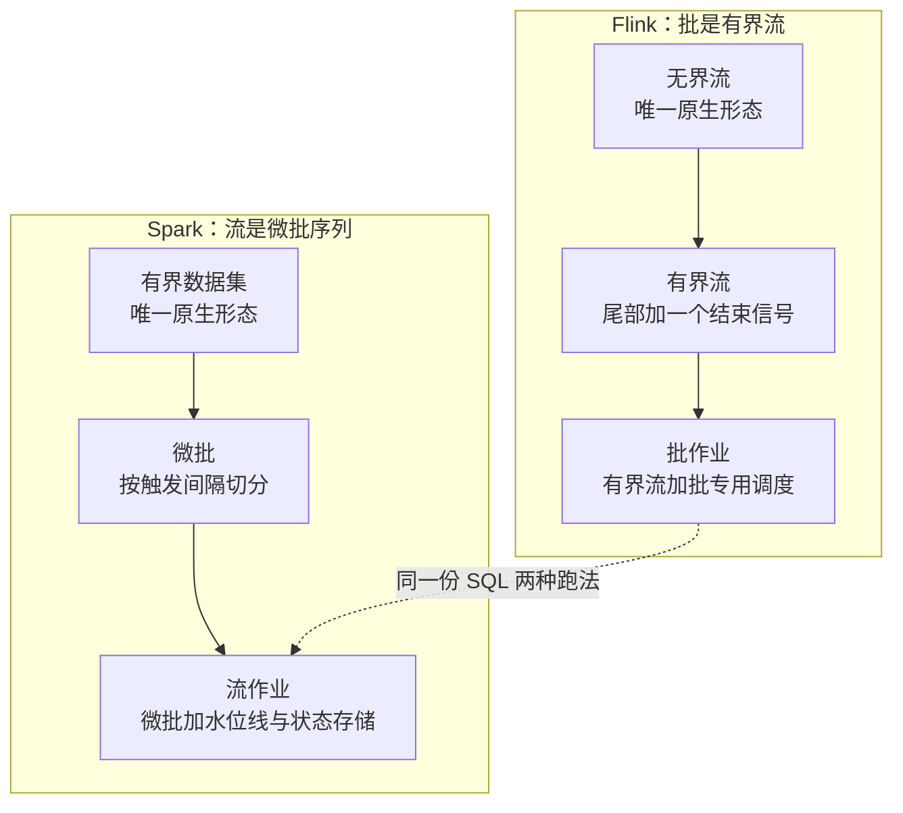
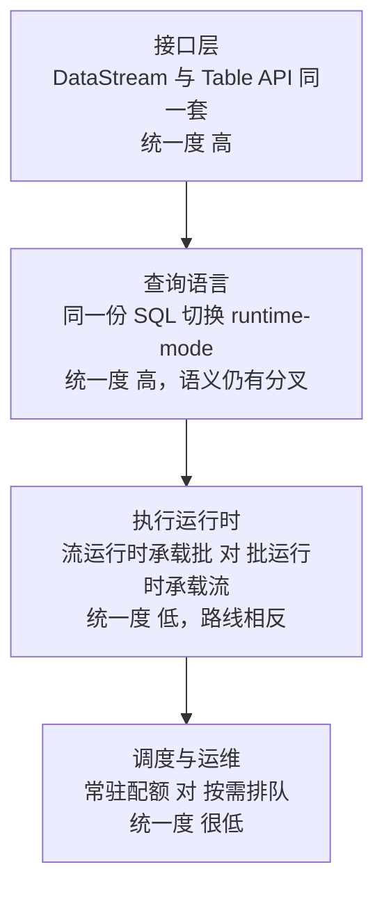
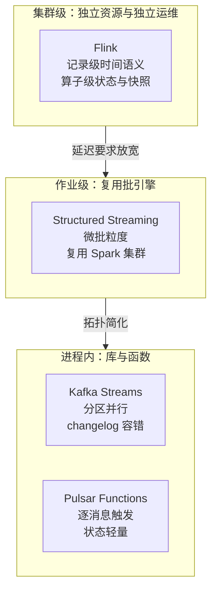
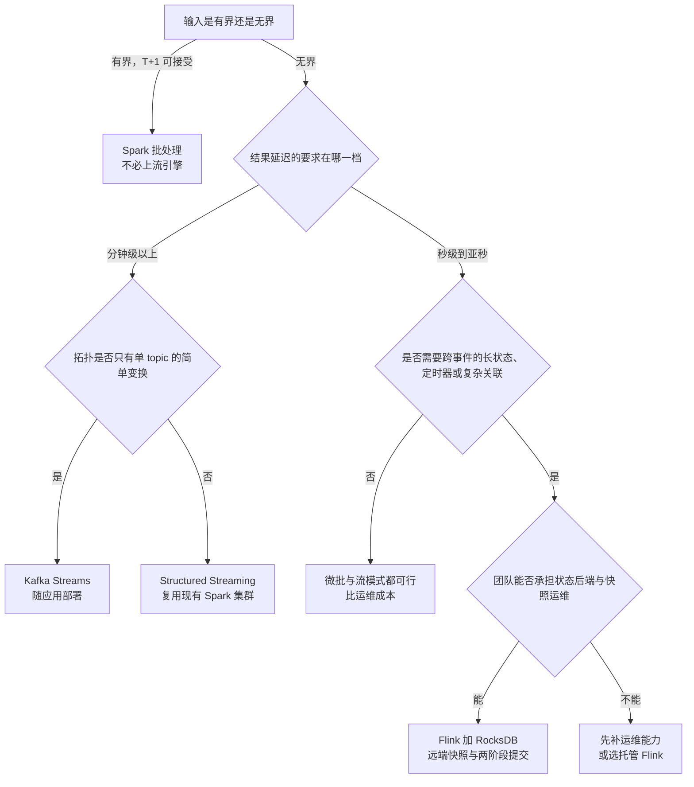

**摘要：**

讨论流处理引擎，常见的问法是"谁的延迟更低、吞吐更高"，这个问法绕开了真正的分岔：一批数据在系统里被当成什么。Flink 把批看成有界的流，Spark 把流看成连续的微批，两个方向互为反演，于是同一个事件时间在两边落地成不同粒度的一致性承诺——Flink 的刻度是一条记录与一个定时器，微批的刻度是一个批次。这篇文字只写这条分岔带来的能力差与代价：水位线为什么只能在记录级推进、分布式快照为什么几乎是精确一次的唯一通路、状态后端与快照存储为什么把运维复杂度写进长期账单、常驻资源为什么与离线作业的按需弹性相反。接着评估批流一体究竟统一到了哪一层，SQL 层的统一与运行时的统一并不是同一件事；再把 Flink 与 Structured Streaming、Kafka Streams、Pulsar Functions 摆进同一张定位矩阵，给出五轴判据、一棵决策树与四类反例。机制细节交给 Flink 深度专栏，这里只回答该不该选，以及选了之后账记在谁头上。

## 第 1 章 批与流：两种互为反演的还原论

先立一个贯穿全篇的场景。一家做演出票务的公司，三个系统共用同一份订单事件：大屏上的实时成交看板、下单链路里的风控拦截、次日凌晨跑的财务对账。三条链路在 2026 年都算常规配置，但它们对"这笔订单什么时候算数"给出的答案并不一致，而这份不一致恰好落在流处理引擎要回答的第一个问题上。

### 1.1 同一个词下面压着两套本体论

流这个词在两边指的是不同的对象。Flink 的文档里，流是唯一的第一性形态：一条没有尽头的记录序列，可以有界也可以无界，批只是有界这个特殊情形。Spark 的文档里，第一性形态是一批有界的数据集，它天然会结束，流则是把无穷序列切成一段一段有界数据、依次提交。

两种说法的物理世界是同一个，本体论却相反。一边把**无穷**当原生、把**结束**当特例；另一边把结束当原生、把无穷当极限逼近。它不是术语口味之争，而是决定了引擎的默认假设：状态该有多大、作业该活多久、失败之后该恢复什么。

### 1.2 把批收进流里

把批看成**有界流**，收益主要不在批这一侧，在语义的连续性上。事件时间、水位线、状态、快照、精确一次这套机制在有界输入上不必重写，只是退化成更简单的情形：输入结束时水位线自然推到无穷，窗口全部触发，快照变得可有可无，因为批作业失败重跑通常比从快照恢复更快。

用录音作比，Flink 眼里的批是一段有始有终的直播，直播该有的机制一样不少，只是播到结尾就停了。同一份 SQL 换一个 `execution.runtime-mode` 就能从流切到批，切掉的是调度与交换方式，不是正确性的论证。

### 1.3 把流切成批

反方向的选择把流拆成一串批。早期 DStream 是 RDD 序列，Structured Streaming 是增量查询计划的连续执行，形式变了，本体没变：每一个微批都是一次有界计算，批与批之间靠偏移量与状态存储衔接。

这个选择的工程收益很实在。执行器、调度器、优化器、故障恢复全部复用批处理那一套，团队已经会调 Spark 作业，多学的东西不多。代价是把流性拆成若干需要额外模拟的能力：水位线要在批边界推进，定时器要在批提交时检查，精确一次要靠在批边界上绑定偏移与输出。

用视频帧作比，**微批**是给流定一个帧率，帧率越高越接近连续，每一帧仍然是静止的。事件时间要求的是按事件自己的坐标计算，而不是按帧的坐标，帧率再高也只是逼近。

### 1.4 分岔的判据：谁承担模拟成本

| 维度 | 批是有界流 | 流是微批序列 |
|---|---|---|
| 原生形态 | 无界流 | 有界数据集 |
| 批的地位 | 有界这一特例 | 原生形态本身 |
| 流的地位 | 原生形态本身 | 极限逼近的结果 |
| 边界如何确定 | 输入尾部的水位线推到无穷 | 触发间隔切出的批边界 |
| 时间语义归属 | 引擎内建，记录级推进 | 附加机制，批级推进 |
| 失败恢复单位 | 算子状态的快照点 | 一个未提交批的重放 |
| 模拟成本落在谁身上 | 批作业退化为更简单的流 | 流作业承担后加的语义 |

表的最后一行是要点。包含关系里，流的能力是免费继承的；极限逼近里，流的能力是**逐项模拟**的，而且模拟成本随流性增强而上升：延迟要求越低、状态越大、乱序越严重，逼近的代价越高。这也是为什么两款引擎在批场景下性能差距有限，在流场景下差距会被状态与时间语义放大。

### 1.5 两种默认假设长出的产品性格

顺着这条线，两款引擎的性格可以推出来。Flink 的默认假设是数据会乱序、作业会常驻、状态会很大，于是它把本地状态、快照、基于信用的流控当成一等公民来设计。Spark 的默认假设是数据可重跑、作业会结束、状态应当有限，于是它把重放、幂等写、批大小控制当成主要手段。

两个默认假设都没有错，错的是拿其中一个去解释所有场景。数据可重跑这个前提在离线数仓里成立，到了交易链路上就不成立：一笔成交已经扣了库存、发了短信，重跑十万条历史只能产生十万条不可撤回的副作用。

## 第 2 章 事件时间与水位的粒度之争

### 2.1 处理时间在票务场景里的三个漏洞

处理时间读起来最省事：事件到达算子时打一个时间戳，窗口按它切。它在监控大盘、容量看板这类场景足够用，一旦要跟钱对上，三个漏洞会同时出现。

其一，重放不幂等。同一份消息重放两遍落在不同窗口，统计值不同，而票务补数恰恰靠重放。其二，反压改变结果。下游慢下来的那十分钟，事件在窗口里堆积的方式变了，看板数字随之漂移，没人解释得清同一天的客流为何在两个时刻显示两个值。其三，口径无法对齐。离线报表按业务时间归属，实时按到达时间归属，两者永远差一截，差值还随流量波动。

具体形态是这样：用户 13:59:30 下单，支付渠道的回调 14:00:20 才到。实时看板把这笔成交记进 14:00 的分钟窗口，对账报表按支付时间把它记为前一日的最后一笔。两条链路都没算错，错在它们对"何时"的定义不同。

### 2.2 水位线是一份承诺

事件时间把何时还给事件本身，代价是要回答另一个问题：一个窗口什么时候可以关闭。没有答案的话，窗口只能永远开着，或者按墙上时钟关闭，那就退回处理时间了。

**水位线**是这个答案：一条时间戳为 t 的水位线，意思是事件时间不晚于 t 的记录预期不会再来了。下游算子取所有输入通道的最小值，任何一个分区停滞都会把整条链路的水位线拖住。

承诺就可能有假。数据源空闲、分区倾斜、上游算子阻塞，都会让水位线停在原地，窗口迟迟不关闭，延迟从秒级涨到分钟级。Flink 提供 `withIdleness` 这类开关去标注空闲分区，本质是让上游承认这个分区暂时没有数据，别拿它当承诺。机制细节见 [[大数据/Flink/Flink原理深度解析与性能优化/07 Flink 时间与 Watermark 底层机制|时间与 Watermark 底层机制]]。

### 2.3 一个点与一个区间

两种还原论在这里第一次显出能力差。Flink 的水位线是**记录级**的：可以随每条记录推进，也可以按固定间隔推进，粒度由用户配置；状态更新、定时器触发、窗口计算都挂在这条推进线上，最小粒度是一条记录。

微批的水位线是**批级**的：每个批次结束时取本批内最大的事件时间减去允许延迟，得到新的水位线；状态更新与超时检查也发生在批边界。批间隔设成一秒，时间语义的最小刻度就是一秒；设成十秒，就是十秒。

这句话要读准，微批并不是不能做事件时间，Spark 从 2.x 起就支持事件时间、水位线与有状态聚合。差别在刻度的量化方式：微批的现在是区间，Flink 的现在是点。凡是需要按记录触发的语义，譬如每笔订单在三十分钟未支付时自动关闭、某个用户连续五笔支付失败后立即限流，微批都得把检查推到批边界去做。

Spark 4.x 引入的实时模式把微批的延迟下限继续往下压，但它有算子覆盖范围与语义强度的约束，成熟度以对应版本文档为准。这也从侧面说明：要把延迟压到毫秒档，引擎最终仍得回到记录级流水。

### 2.4 迟到数据落在哪里

水位线之后到达的记录叫迟到数据。Flink 的处理分三层：**允许延迟**让窗口在关闭后再等一段时间，迟到记录仍能更新结果并重新触发输出；超出允许延迟的记录走**侧输出流**，交给另一条链路补救；再往外只能靠离线重算。

三类补救的代价递增。允许延迟延长状态保留时间，窗口状态要多留一份；侧输出要多一条链路、多一份存储、多一套值班；离线重算最贵，等于承认实时链路的结果不可信。

微批的处置位置不同。append 模式下，水位线之后的记录直接丢弃；update 模式可以在结果表上更新，但对应的窗口状态已经被清理，更新只能作用在聚合结果上，落不到明细行上。票务对账要求每一笔都能追到订单号，这一层差别就把选择权锁死了。

| 能力 | Flink 流模式 | Spark 微批 | Kafka Streams |
|---|---|---|---|
| 水位线推进粒度 | 记录级，可配置间隔 | 批级，每批结束推进一次 | 处理时间为主，可基于分区时间推进 |
| 定时器粒度 | 按 key 的事件时间定时器 | 批边界检查 | 无通用定时器，靠窗口与标点 |
| 迟到数据位置 | 允许延迟内重算，超期走侧输出 | append 模式丢弃，update 模式改结果表 | 窗口关闭即丢弃 |
| 窗口状态保留 | 到允许延迟结束 | 到水位线越过窗口 | 到窗口关闭 |
| 延迟下限的决定因素 | 水位线推进策略与乱序容忍度 | 批触发间隔 | 提交间隔与缓存刷写 |

### 2.5 这条差异在选型里的权重

如果业务只要求一分钟内看到大致数，粒度差异可以直接忽略，微批的运维成本更低、团队更熟。一旦命中下面三类要求之一，粒度就变成硬约束：结果要能和财务逐笔对账、状态要在小时级时间窗上维护、迟到数据一条都不能丢。票务场景三条全占。

反过来，很多被当成实时需求的场景并不命中这三条。次日经营会的看板、按小时更新的推荐特征、五分钟粒度的运力监控，微批完全够用，硬上 Flink 只是把运维账单提前一年交。

## 第 3 章 状态与快照：精确一次为什么要分布式地做

### 3.1 状态是成本中心

无状态转换在流里没有多少意思，真正值钱的是记住刚才发生了什么。风控要记住同一用户在五分钟内的下单次数，去重要记住已处理的订单号，流表关联要把维表缓存在本地，会话窗口要记住每个会话的起点。这些都是状态。

状态一旦进入设计，三个问题跟着来：状态放哪、状态多大、故障后怎么恢复。三者的答案共同决定这个引擎能不能用在长周期、大状态的场景里，也决定了运维团队要背多少新知识。

### 3.2 1985 年的那个答案

分布式系统里没有全局暂停这回事。想给一整套算子拍一张一致的照片，不能靠大家停下来，因为停下来本身需要协调，协调期间数据还在流。

Chandy 与 Lamport 在 1985 年给出的办法是反过来做：**不暂停计算**，而是在数据流里插入一个标记，每个算子收到标记时把本地状态写到存储，再把标记转发给下游。标记之前到达的记录都已处理完，标记之后的一条都没处理，所以每个算子拍下的状态在逻辑上属于同一个瞬间。

用传送带作比，车间不能停机，于是在传送带上放一面旗子，每个工位看到旗子就给自己手头的半成品拍张照。所有工位的照片合起来，就是旗子经过那一刻整条产线的状态。

### 3.3 屏障与三笔代价

Flink 把这个标记叫屏障，由 JobManager 里的检查点协调器周期性注入。屏障沿数据流下行，算子在收到所有输入通道的屏障之前，会先把先到通道的数据缓冲起来，等齐了再一起拍快照，这个动作叫**对齐**。具体实现见 [[大数据/Flink/Flink原理深度解析与性能优化/06 Flink Checkpoint 机制深度解析|Checkpoint 机制]]。

第一笔代价是对齐期间的缓冲。先到屏障的那一侧不能再处理数据，否则快照不一致，于是数据堆在缓冲区，反压沿链路往上游传。

第二笔是快照时长与反压的耦合。状态越大、对齐越久，检查点超时的风险越高；超时之后作业重启，恢复又要重放积压数据，积压越多恢复越久。

第三笔是**恢复时间**的预算。快照越大，从远端存储拉回来的时间越长。非对齐快照（Flink 1.11 引入）把在途数据一起写进快照，省掉对齐的等待，换来更大的快照体积与更长的恢复，等于用恢复时间换正常处理时的延迟平稳。

三笔代价是同一个机制的三个侧面，选型时经常只看到第一笔。真正操作起来第三笔最难缠，它把故障恢复时间从一个运维指标变成架构指标，直接决定状态规模的上限。

### 3.4 微批走的是另一条路

微批不做状态快照，它做批重放。每个批次的输入偏移、输出提交位置与状态变更绑定在批边界上，失败时从最后一个已提交的批次重来。批是有界的，重放一个批就是重跑一次有界计算，结果可重建，所以状态本身不需要被一致地拍下来。

这条路的前提是批足够小、重放足够便宜。批越大，重放越久；批越小，提交与协调的固定开销占比越高。精确一次的成本被转移到批大小这个参数上，而批大小又要同时满足延迟要求，两个目标天然打架。

另一处差别在状态的可演进性。批重放模型里状态是执行过程的副产物，版本升级通常要靠从源头重算或者清状态重启；快照模型里状态是一等公民，savepoint 让作业可以在保留状态的前提下改代码、改并行度，代价是序列化兼容性要严格管理，改一个状态字段就可能让旧快照读不回来。

### 3.5 端到端的三段

引擎内部的精确一次不等于端到端的精确一次。一条链路有三段：从消息队列读到的位置、算子内部的状态、往外部系统写出的结果。三段里有一段游离在快照之外，语义就退化成至少一次或者更弱。

Flink 的做法是把 source 的偏移量当作算子状态存进快照，sink 端用两阶段提交：检查点期间先预提交，把结果写到临时位置或者开启事务但不提交，检查点完成后才真正提交。跨系统的事务协调没有免费实现，落地细节见 [[大数据/Flink/Flink从入门到实战/08 Flink 与 Kafka 端到端精确一次实战|端到端精确一次实战]]。

### 3.6 三条路径的账

| 路径 | 一致性来源 | 恢复粒度 | 代价记在哪个参数上 |
|---|---|---|---|
| Flink 分布式快照 | 全局一致的算子状态切面加两阶段提交 | 快照点，增量恢复 | 状态规模与快照频率 |
| Spark 微批重放 | 批边界绑定偏移与提交，重放未提交批 | 一个批次 | 批大小与重放时间 |
| Kafka Streams | 本地 RocksDB 加 changelog topic，事务型生产者 | 任务与分区 | changelog 写入放大与分区数 |

三者都能做到精确一次，差异在代价的落点。Flink 记在状态规模与快照频率上，Spark 记在批大小与重放时间上，Kafka Streams 记在 changelog 的写入放大与分区数上。选型时该问的是自己更容易承受哪一种代价，而不是谁更精确。

## 第 4 章 三张长期账单：常驻、状态与反压

### 4.1 常驻：资源生命周期绑在作业上

批作业的资源模型是申请、用完、归还，流作业不是。一条流作业从上线到下线一直在跑，占用的 slot 数量由峰值决定，空闲时段照占。这是流处理的本质，不是 Flink 的缺陷，但它把成本结构从按次计费改成按月计费。

以票务的实时看板为例，数字为示例推算，只用于说明量级：四十个 slot、每个 slot 四核十六 G，一年不间断运行，就是四十乘四核乘八千七百六十小时的固定占用。同样的算力如果交给按需的批作业，实际使用时间可能只有三分之一。

Spark 在这件事上的优势不在流，在混部：同一个集群的容量可以在批作业之间流转，流作业常驻吃一份，剩下的仍能被离线任务填满。Flink 也支持混部，但流作业对资源的占据更刚性，session 集群上多作业共享 TaskManager 时，一个作业的状态后端与内存配置会牵制邻居。

### 4.2 状态后端：内存与磁盘不是二选一

**堆内存后端**把状态放在 JVM 堆里，读写快，受 GC 与堆大小约束，状态一大就出现长时间 Full GC，反压与延迟一起抖。RocksDB 后端把状态放在本地磁盘的 LSM 结构里，堆里只留缓存与索引，状态可以远大于内存，代价是每次读写都要过序列化与磁盘。两条路的取舍与 [[大数据/Flink/Flink原理深度解析与性能优化/05 Flink 状态后端深度解析|状态后端]] 里的细节一致。

判据是状态规模与访问模式：状态在几 GB 以内、访问频繁、对延迟敏感，堆后端更合适；状态到几十 GB 以上、访问有明显的热冷分布，RocksDB 更合适。中间地带只能靠压测，靠估算一定会偏。

状态还会长胖。key 的基数、窗口长度、去重表保留期，三者任何一个估计错误，状态都会在几周后膨胀到设计值的数倍。Flink 提供状态 TTL，但 TTL 是读时清理加后台 compaction，不是定时删除，所以它只能减缓膨胀，不能承诺上限。

### 4.3 快照存储：一份被低估的账单

快照的存储放大等于保留份数乘状态大小。全量快照下，一份 200 GB 的状态、保留最近三份，就是 600 GB 的远端存储，加上每次上传的网络与请求开销。增量快照把放大压到变化的 SST 文件上，但上一份快照的文件仍然存在，删除策略要跟保留策略一起设计。

在 HDFS 上，这份账单表现为小文件与目录数；在对象存储上，表现为 PUT 与 LIST 请求的次数与延迟。后者在状态文件很多时更明显：一次快照可能产生成百上千个对象，列举与清理的接口成本会超过存储本身。

恢复时间是另一侧。从远端拉回状态、重建 RocksDB、重新对齐水位线，这个过程随状态规模线性增长，通常以分钟计。状态到几百 GB 时，故障恢复的 SLA 要以十分钟为单位来定，而这段时间下游看到的是数据延迟而非报错，很容易被漏掉。

### 4.4 反压：一条链路级联的现象

**反压**在 Flink 里不是异常，是流控的正常表现。基于信用的流控把下游的消费能力反馈给上游，上游按信用发送，信用耗尽就停。问题不在机制，在定位：反压会沿算子链一路传回 source，监控上看到的是 source 反压百分之百，真正慢的可能是三个算子之后的那个 sink。

定位要逐算子看繁忙度与反压时间，把第一个出现反压的算子找出来，再看它的下游。调优手段有限：加并行度、改 key 分布、拆分算子、把同步 IO 换成异步、调缓冲区与网络参数。任何一种都要求作业重启，而重启又要先做 savepoint。

反压与检查点会互相放大。对齐期间缓冲区被占满，反压加剧；反压导致数据在通道里堆积，检查点超时；超时触发重启，恢复期间数据积压更多。这条正反馈是流作业最常见的稳定性故障形态，也是必须留资源余量这条经验的来源。

### 4.5 弹性的边界

Flink 改并行度需要 savepoint、停止、以新并行度恢复。key group 的划分让状态可以在新并行度下重新分配，前提是算子不依赖固定并行度，譬如硬编码的分片逻辑就会破坏这个前提。Reactive Mode 与自适应调度器在往自动扩缩的方向走，但状态重分布这一步绕不开，所以弹性是分钟级而不是秒级。

这一点与 Spark 的对比要小心措辞。Spark 的批作业是秒级到分钟级的按需起停，流作业同样是常驻，但它的资源来自一个本就在跑的集群，容量池可以在批与流之间调度。Flink 的常驻更彻底，扩容也更贵，两者的差别是调度模型的差别，不是谁更先进的差别。

| 成本项 | 放大因子 | 常见缓解手段 | 缓解后仍然留下的成本 |
|---|---|---|---|
| 常驻资源 | 并行度乘峰值时长 | 混部、降低副本、按峰谷分时调度 | 峰值时段之外的空转 |
| 状态存储 | key 基数乘窗口长度乘保留期 | 状态 TTL、增量快照、拆分作业 | 本地盘容量与 compaction 抖动 |
| 快照存储 | 保留份数乘状态大小 | 增量快照、缩短保留、分离 savepoint | 恢复时长与远端读带宽 |
| 反压调优 | 算子链长度与数据倾斜 | 加并行度、异步 IO、拆链 | 必须留的资源余量 |
| 人力 | 状态后端与快照的专业度 | 平台化、托管服务 | 平台团队本身的编制 |

## 第 5 章 批流一体：究竟统一到了哪一层

### 5.1 一体化的四层

**批流一体**被用得太宽。拆开看至少有四层：编程接口、查询语言、执行运行时、调度与运维。四层的统一难度差得很远，达成度也差得很远，讨论一体化成了没有之前，先要说清问的是哪一层。

### 5.2 接口与 SQL：统一得最彻底

DataStream API 用同一套算子表达有界与无界输入，有界输入在流模式下就是会结束的流。SQL 层走得更远：同一份查询改一个 `execution.runtime-mode` 就能在批模式与流模式下执行，批模式用阻塞式交换与排序，流模式用管道式交换与增量计算。

统一到这个程度，收益是实的：实时与离线链路共用一份 SQL，口径不一致这个老问题在源头上被压掉一半。语义差异没有消失，只是从写法不同变成同一条 SQL 在两种模式下行为不同：批模式下状态 TTL 与定时器没有意义，失败恢复是整作业重跑而不是从快照续跑，排序在有界输入上确定、在无界输入上不能用。

### 5.3 运行时：两条相反的路

运行时的统一是另一回事。Flink 让流运行时承担批：有界流跑在流运行时上，加上批专用的调度、交换与内存管理。Spark 让批运行时承担流：微批跑在批调度上，加上水位线、状态存储与提交协议。

两条路都在自己的母语上加**方言**，谁也没有做到一套运行时、两种语义、同一套正确性论证。判断标准可以写得很硬：同一段逻辑在有界输入与无界输入上，能否共享同一份容错论证。两边的答案都是不能完全共享，差别只在于哪一侧的方言更厚。

### 5.4 调度与运维：最难动的一层

运维层的一体化几乎没动。流作业的部署形态是常驻集群，session、application 与已不推荐的 per-job 三种模式各有配额含义；批作业的部署形态是按需提交，资源靠排队去抢。两套模型的成本核算、优先级、SLA、告警阈值都不一样。

团队习惯是另一道坎。写离线 SQL 的人习惯跑完看结果，写流作业的人习惯上线看延迟，两种心智模型对应两套值班流程。工具可以统一，流程需要时间，这段时间里两套系统必须并行。

### 5.5 收益与边界

到 2026 年，一体化的收益集中在两处：一份逻辑两种跑法，以及湖表的双向读写，也就是流式写入与批量读取共用一份存储。这两处已经落地，是真收益。

没有落地的是一套运维。多数公司的实时链路与离线链路仍然跑在两套集群、两套调度、两套值班表上，Flink 让两条链路的**口径**更容易对齐，没有让它们合并。把一体化理解成可以少养一套系统，是这类项目最常见的预期错位。

## 第 6 章 四个物种：引擎、方言、库与函数

### 6.1 先把流处理引擎这个词拆开

Flink、Structured Streaming、Kafka Streams、Pulsar Functions 经常被放进同一张表比延迟与吞吐，结论通常是 Flink 最强。这种比较没有决策价值，因为四者的执行体形态不同：集群、批引擎上的流方言、库、函数运行时。并行单位、状态归属、部署责任这三个维度一旦确定，延迟档与运维成本也基本被决定。

### 6.2 Flink：集群级，状态在计算节点本地

Flink 的并行单位是 key group，状态跟着 key group 走，本地磁盘持有热状态，远端存储持有快照。这套形态适合长周期、大状态、要求独立扩缩容的作业；代价是要有人管集群、管状态后端、管快照存储、管反压，四项能力缺一项就会在某个深夜以检查点持续失败的形式找上来。

### 6.3 Structured Streaming：批引擎上的流方言

它的执行体是 Spark 作业，并行单位是分区，状态存在 executor 的 state store 并在检查点目录持久化。优势在复用：同一个集群、同一套 SQL、同一批调优经验，团队不必为流再建一套能力。

边界在延迟与状态自由度。微批的延迟下限由批间隔决定；有状态算子的种类与状态模型的演进不如 Flink 灵活；与外部系统的精确一次要靠事务 sink 或幂等 sink，连接器生态跟着 Spark 的节奏走。它最舒服的位置是已经重度使用 Spark 的公司，用一条流链路换掉一堆离线补数任务。

### 6.4 Kafka Streams：库，不是集群

它跑在业务进程里，并行度受 topic 分区数约束，状态在本地 RocksDB，靠 changelog topic 做容错，精确一次用事务型生产者实现。部署形态就是普通 Java 应用，没有独立集群要运维，扩容就是多起几个实例。

边界在拓扑复杂度与跨系统能力。单个 topic 的过滤、映射、聚合、流表关联都很顺；拓扑一复杂，调试与观测的成本迅速上升；跨多个外部系统的大状态关联，它没有资源管理层可用。把它当成轻量级就地计算更准确，见 [[中间件/Kafka/09 Kafka Connect 与 Kafka Streams|Kafka Streams 与 Connect]]。

### 6.5 Pulsar Functions：逐消息触发的函数

它是按消息触发的轻量计算单元，适合路由、字段清洗、简单聚合，状态能力有限，不适合长窗口与复杂关联。价值在于把计算下沉到消息系统内部，省掉一次跨系统搬运。

### 6.6 延迟档不是数字，是语义档

延迟档位容易被理解成毫秒数，实际上它是结果何时可见的语义承诺。秒级档意味着可以攒批、可以等水位线；亚秒档要求更小的批或者记录级流水；毫秒档通常要放弃批处理带来的吞吐优化，还要在容错机制上做妥协。

三档对应三级成本台阶。秒级档微批就能满足，运维成本最低；亚秒档基本只有记录级引擎能做，运维成本跳一级；毫秒档要付的是吞吐与容错强度的代价，非对齐快照这类技术就是为这一档准备的。把需求落到档位上，比对着 benchmark 比毫秒数有用得多。

| 维度 | Flink | Structured Streaming | Kafka Streams | Pulsar Functions |
|---|---|---|---|---|
| 执行体 | 独立集群 | Spark 作业 | 应用内库 | 消息系统内的函数 |
| 并行单位 | key group 与算子并行度 | 分区 | 分区，客户端实例数 | 函数实例数 |
| 延迟档 | 亚秒到毫秒 | 秒级，受批间隔约束 | 毫秒到亚秒 | 毫秒到亚秒 |
| 状态能力 | 算子级 keyed state、定时器、超大状态 | 有状态算子有限，RocksDB state store | 本地 RocksDB 加 changelog | 轻量，随函数存储 |
| 精确一次 | 快照加两阶段提交 | 批重放加幂等或事务 sink | 事务型生产者 | 取决于连接器 |
| 运维成本 | 高，需专职平台 | 中，复用现有集群 | 低，随应用发布 | 低到中 |
| 生态 | 连接器与 CDC 最全，SQL 自成体系 | 与 Spark 离线生态同源 | Kafka 原生，跨系统弱 | 跟随 Pulsar 生态 |
| 典型落点 | 复杂实时链路、流式数仓 | 已有 Spark 体系内的准实时 | 单 topic 就地变换 | 路由与轻量清洗 |

## 第 7 章 判据、决策树与四类反例

### 7.1 五条判据

判据不宜太多，超过五条就退化成参数对比。笔者用的是这五条：时间语义的刻度、状态的生命周期、结果的正确性要求、资源的经济性、团队的能力边界。

五条里真正能**一票否决**的通常是前两条的后半段。要求逐笔对账意味着水位线之后的数据不能丢，要求跨小时的状态意味着状态后端必须有磁盘，这两条一旦成立，微批与库形态的方案就先出局了。

| 判据 | 要问清的问题 | 倾向 Flink 的答案 | 倾向其他方案的答案 |
|---|---|---|---|
| 时间刻度 | 结果要按事件时间对齐，且迟到数据不能丢 | 是，且乱序严重 | 否，按到达时间近似即可 |
| 状态生命周期 | 状态要跨小时级窗口、规模在几十 GB 以上 | 是 | 否，状态可随批清空 |
| 正确性 | 端到端逐笔精确一次，且明细可追 | 是 | 允许幂等去重或至少一次 |
| 资源经济性 | 能否承受峰值常驻与专用运维 | 能，或可买托管 | 不能，要复用现有集群 |
| 团队能力 | 有无人能管状态后端与快照 | 有平台团队 | 无，只有应用开发 |

### 7.2 决策树

顺序很重要，先排除不合适的，再比较合适的，因为反例的判定成本远低于容量规划。

### 7.3 四类反例

把反例独立成节，是因为它们比正面判据更容易被忽略。选错引擎的项目，往往不是算错了吞吐，而是根本没意识到自己的需求里没有流。

| 反例 | 典型形态 | 硬上 Flink 的后果 | 更合适的做法 |
|---|---|---|---|
| 批为主的场景 | T+1 报表、历史重算、特征回填 | 常驻资源为一天一次的作业买单 | Spark 批处理，失败重跑模型简单 |
| 极简 ETL | 字段映射、过滤、单 topic 聚合 | 集群、状态后端、监控的固定成本远超收益 | Kafka Streams，随应用进程部署 |
| 纯离线报表 | 数据集市、固定口径的周期性统计 | 状态与水位线全部闲置，只剩运维负担 | Hive 或 Spark SQL，调度器成熟 |
| 无状态运维能力 | 团队只有应用开发，没有平台值守 | 检查点失败、状态膨胀、反压定位无人接 | 托管服务，或先选微批方案 |

### 7.4 反例为什么常被忽略

批为主的场景最容易被误判。团队看到实时两个字就想到 Flink，其实次日九点的经营会报表只需要在凌晨跑完，用 Spark 批处理既省钱又省人，失败重跑一次的成本可以忽略。流引擎的价值在结果随时间持续变化，不在结果跑得快。

无状态运维能力这一类最隐蔽。它不体现在架构图上，体现在半年后的某次故障里：检查点持续失败、作业反复重启、状态越来越大、延迟越堆越高，而团队里没有人知道该先看哪一个指标。评估这类项目时，问一句谁能在凌晨三点定位反压，比看任何 benchmark 都准。

## 结语

Flink 的位置可以用一句话概括：它把时间语义与状态容错做成了引擎的内建能力，代价是把运维复杂度也内建了进来。这两件事是同一枚硬币，选它就得同时收下。

真正需要判断的是自己的需求落在哪一档。逐笔对账、长状态、乱序严重，这三条同时成立时，Flink 之外的选择都会在某处留下裂缝；三条都不成立时，微批或者一个库的性价比更高，硬上集群只是提前支出了运维预算。批流一体带来的收益是口径统一，不是系统合并，把这两件事分开看，预期就不会错位。

## 参考资料

- [Apache Flink 官方文档](https://flink.apache.org/)：事件时间与水位线、状态后端、检查点与批流一体的配置语义。
- Carbone, P., et al. "Apache Flink: Stream and Batch Processing in a Single Engine." IEEE Data Engineering Bulletin, 2015，[论文 PDF](https://asterios.katsifodimos.com/assets/publications/flink-deb.pdf)，批流一体的设计动机。
- Carbone, P., et al. "Lightweight Asynchronous Snapshots for Distributed Dataflows." arXiv:1506.08603，[论文](https://arxiv.org/abs/1506.08603)，Flink 快照机制的原始描述。
- Chandy, K. M., Lamport, L. "Distributed Snapshots: Determining Global States of Distributed Systems." ACM Transactions on Computer Systems, 1985，全局快照的理论来源。
- Akidau, T., et al. "The Dataflow Model: A Practical Approach to Balancing Correctness, Latency, and Cost in Massive-Scale, Unbounded, Out-of-Order Data Processing." VLDB 2015，[论文](https://research.google/pubs/pub43864/)，事件时间与水位线语义的通用化表述。
- [FLIP-76: Unaligned Checkpoints](https://cwiki.apache.org/confluence/display/FLINK/FLIP-76%3A+Unaligned+Checkpoints)：非对齐快照的动机与在途数据入快照的取舍。
- [FLIP-134: Batch Execution on DataStream](https://cwiki.apache.org/confluence/display/FLINK/FLIP-134%3A+Batch+Execution+on+DataStream)：`execution.runtime-mode` 与批流接口统一的提案。
- [Structured Streaming Programming Guide](https://spark.apache.org/docs/latest/structured-streaming-programming-guide.html)：微批执行、水位线与有状态算子的语义边界。
- [Kafka Streams 文档](https://kafka.apache.org/documentation/streams/)：状态存储、changelog 与事务型生产者的精确一次实现。
- [Pulsar Functions 文档](https://pulsar.apache.org/docs/functions-overview/)：逐消息函数模型与状态存储的边界。

> [!note] 思考题
> 1. 如果把票务看板的统计口径从到达时间改成事件时间，延迟会从秒级涨到多少？这个涨幅是业务能接受的吗？
> 2. 微批把时间语义的刻度量化到批边界，如果把批间隔从十秒压到一百毫秒，代价会转移到哪几个指标上？
> 3. 非对齐快照用恢复时间换正常处理时的延迟平稳，这个交换在什么状态规模下会反过来不划算？
> 4. 你的团队能说清"谁在凌晨三点定位反压"吗？如果说不清，选型时应该往哪个方向退一步？
> 5. 批流一体解决了口径不一致，却没有省掉一套运维。在你所在的组织里，这两件事的收益与成本各占多少？