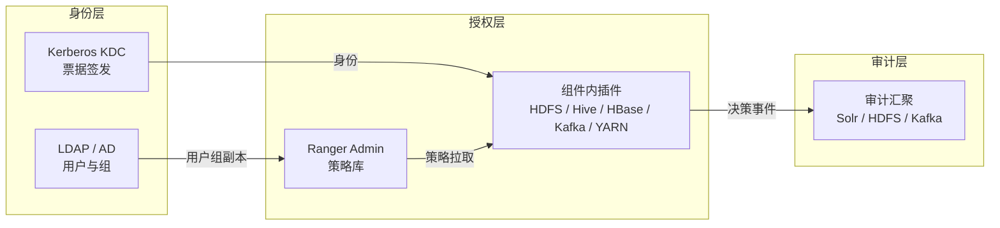
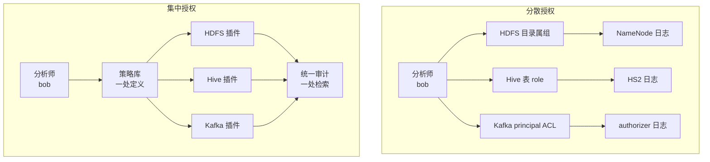
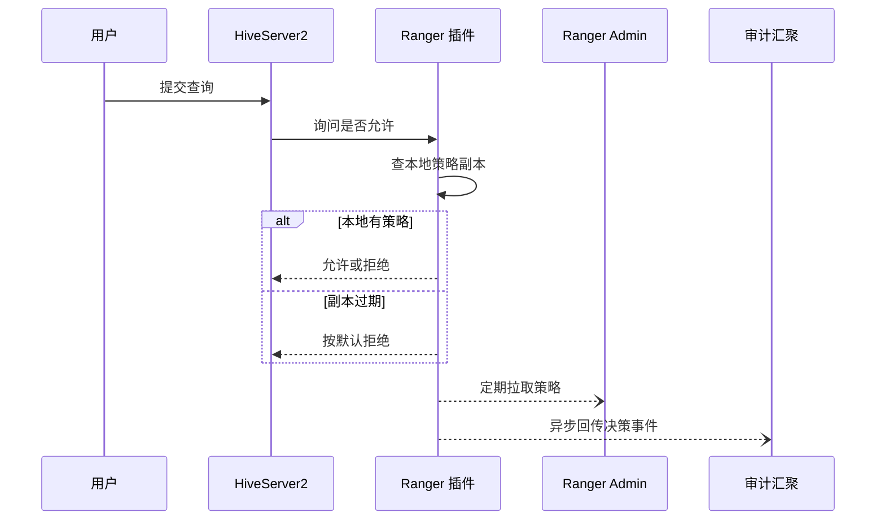
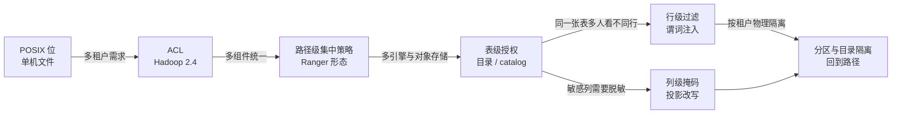
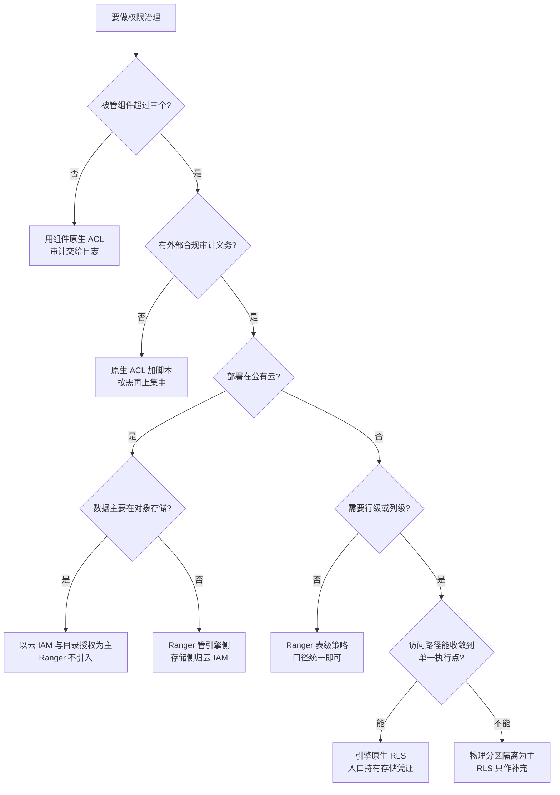

**摘要：**

讨论大数据安全选型，最容易滑向两句省事的结论：上了 Kerberos 就安全了，上了 Ranger 就合规了。这两句都跳过了问题分层——认证回答你是谁，授权回答你能做什么，审计回答你做过什么，Ranger 只答后两道，它消费身份而不产生身份。这篇文字先把这个边界画清楚，再处理一个更实际的问题：为什么多组件集群需要一套集中式授权，而不是让 HDFS、Hive、HBase、Kafka、YARN 各管各的 ACL。中间拆解 Ranger 的旁路结构——插件做执行点、中央策略库做决策，这套不改源码的改造换来了部署成本，也让插件质量与版本耦合变成一笔分期付款。随后把它与 Kerberos 的分工摆开，说明两者都不是对方的替代；再把 Sentry、Hive 标准授权、云厂商 IAM、湖格式目录授权摆进同一张矩阵，解释权限模型为什么正从文件路径迁到表、再迁到行与列。行级与列级权限的两种实现路径各自付什么账，也单列一章。最后给五条判据、一棵决策树与六类反例。机制细节交由安全与认证专栏，这里只回答该不该选、以及选它的代价记在谁账上。

---

## 第 1 章 三道问题，它只答后两道

先给一个贯穿全文的场景。一家做消费金融的公司，数据团队不到四十人，集群三百来个节点，链路却是齐的：App 埋点先进 Kafka，明细落 HDFS 上的 Hive 表，用户画像进 HBase，跑批在 YARN，报表从 Hive 出。某天风控团队的新同学要查一张订单宽表，报错 `Permission denied: user=bob, access=READ_EXECUTE, inode="/warehouse/ods/order_detail"`；运维把 HDFS 目录的属组改掉，能读了，Hive 那头又抛 `HiveAccessControlException`；再加 role 之后，数据仓库同事说 Kafka 那个 topic 的消费组也进不去。一条链路上三套报错、三个组件、三份维护责任，而没有人手上有一张表能回答「bob 到底有什么权限」。

### 1.1 三件事被混成了一件事

大数据安全在教科书里被拆成三层，**认证**（Authentication）回答「你是谁」，**授权**（Authorization）回答「你能做什么」，**审计**（Audit）回答「你做过什么」。在单机系统里这三层往往由一层内核代码加一份系统日志顺手办掉，在分布式数据栈里却被拆散到十几个进程里，每一段都得单独选型。

这三层像机场的三道工序：核验证件、检查随身物品、留下记录。三道工序的窗口各排各的队，谁也替不了谁——把查行李的窗口当成能验证件的窗口，只会让队伍排错地方。

HDFS 的 POSIX 位与 ACL 只答授权，身份来自 `UserGroupInformation` 从 Kerberos 或环境变量解析出来的用户名与组；Hive 的 `HiveAuthorizer` 只答授权，身份来自连接时的会话用户；Kafka 的 ACL 只答授权，身份来自 SASL 认证后的 principal。审计则各写各的：NameNode 的 audit log、HiveServer2 的查询日志、Kafka 的 authorizer 日志，格式不同、落盘位置不同、保留期也不同。

混成一件事的代价，通常不是漏配了什么，而是买错东西。以为上了 Kerberos 就安全了，其实只是关上了「随便起个用户名」这道门，门后的房间照样人人可进；以为上了 Ranger 就合规了，其实审计证据链还散在五个日志目录里，一次专项检查要把它们拼起来就得几天。表 1-1 把三层与 Ranger 的覆盖关系摆开。

| 层次 | 要回答的问题 | 典型机制 | Ranger 是否覆盖 |
|---|---|---|---|
| 认证 | 你是谁 | Kerberos 票据、LDAP/AD、SASL 与 TLS 双向认证 | 否，只消费身份，不产生身份 |
| 授权 | 你能做什么 | 集中策略库加组件内插件 | 是，核心能力所在 |
| 审计 | 你做过什么 | 审计事件汇聚与检索 | 是，随插件一并产生 |
| 身份治理 | 谁属于哪个组 | LDAP/AD 目录服务 | 部分，UserSync 只做同步 |

### 1.2 一条必须划清的边界

Ranger 的插件在鉴权时需要知道「当前用户是谁」，这个用户名来自组件的安全上下文，而安全上下文来自 Kerberos 或 LDAP。Ranger 自己也维护一份用户与组的表，但那是 UserSync 从 LDAP/AD 同步过来的副本，作用是让管理员写策略时能从下拉框里选人，不是身份源。换句话说，Ranger 只回答「把身份 X 放到资源 Y 上给什么权限」，至于 X 是谁、由谁签发、怎么证明，它一概不参与。Ranger 在这条链上是**身份消费者**，不是身份源。

这条边界在选型上有一处很实际的后果：若集群根本没开 Kerberos，Ranger 能拦住「用错身份访问」，却拦不住「伪造身份」。Hadoop 非安全模式下客户端可以自称任意用户名（`HADOOP_USER_NAME` 环境变量即是一例），Ranger 照样会按这个自报的名字评估策略，然后照实放行。策略库再严密，也是架在一个可伪造的输入上。

### 1.3 两种最贵的误判

第一种是用授权补认证。见到越权访问的第一反应是加策略、收紧目录，但根因在非安全模式下用户名可伪造，补多少策略都是在补一个漏底的桶。

第二种是用认证补授权。上了 Kerberos 之后所有服务都要票据，看起来严丝合缝；但票据只证明「他是 bob」，bob 在 Hive 里能查哪些库、哪些表、哪些列，仍取决于 Hive 自己的授权配置。Kerberos 不做权限判断，它的世界里没有表这个概念。

真正的关系是**分层依赖**：认证给授权一个可信输入，授权给审计一个可判定的结果，审计反过来给前两者提供追责证据。缺哪一层，另外两层都会退化成摆设。

这张图上有一条容易被忽略的箭头：身份直接从 KDC 流向插件，绕过了 Admin。Admin 手上没有身份，只有身份的名字；理解这一点，后面对比各方案的授权粒度时就不会错位。

---

## 第 2 章 五本账本与它们各自的方言

集中式授权的必要性，讲成「统一管理更省事」是空话。要看清它到底解决了什么，得先看分散状态下每个组件各自记的是什么账。同一个「权限」，在这五个组件里有五种写法，五种主体模型，五套变更方式。

### 2.1 同一个词，五种含义

| 组件 | 授权单位 | 主体模型 | 策略存放 | 变更方式 |
|---|---|---|---|---|
| HDFS | 路径与 inode | owner / group / other，外加 ACL 条目 | NameNode 元数据 | `chmod`、`setfacl` |
| Hive | 库、表、列、role | user / group / role | Metastore 的授权表 | `GRANT`、`REVOKE` |
| HBase | namespace、表、列族、列限定符 | user / group | ACL 表与 Coprocessor 状态 | `grant`、`revoke` |
| Kafka | topic、消费组、集群 | principal（`User:xxx`） | 元数据存储或 Authorizer 后端 | `kafka-acls.sh` |
| YARN | 队列、应用 | user / group | 调度器配置与应用的 ACL | 改配置、提交时声明 |

五行的差异不在细节，而在「资源」这个词的切法。HDFS 的资源是 inode，Hive 的资源是 HMS 里的一条元数据，Kafka 的资源是一个逻辑 topic，三者在存储、元数据、网络三个平面上各切一刀，彼此没有映射关系。

同一份业务数据往往同时存在于这三个平面上：一张 Hive 表对应 HDFS 上一个目录，上游还对应一个 Kafka topic。授权的对象在三个平面上被切成了三份，这才是「权限难以对齐」的根源。

### 2.2 三笔成本

**口径不一致**。给 bob 开一张 Hive 表的读权限，不等于他能读底层文件；反过来把 HDFS 目录的 ACL 放开，所有绕过 HiveServer2 的工具——Spark 直读、Hive CLI、自己写的 MapReduce——都跟着放开了。

**审计不统一**。合规检查要回答的是「谁在什么时候看过客户的身份证号」，这个答案要跨组件拼。五套日志、五种格式、五个保留策略，拼一次要几天，过了保留期就再也拼不出来。

**变更半径大**。一名员工转岗，涉及的权限变更散落在五个组件的若干个对象上；权限回收更麻烦，加策略的人离职了，没人知道当初一共加过哪几处。集中式授权省下的从来不是策略条数，而是「人脑里的那张对照表」。

### 2.3 集中之后换到了什么

把策略从组件里搬进一个中央库，表面看是换了个编辑界面，实际换了三样东西。策略的编辑对象从「资源」变成「三元组」——谁、对什么、能做什么；权限的观测对象从「日志」变成「决策」，每次鉴权留下一条带用户、资源、动作、结果的结构化记录；管理的动作从「改 N 处」变成「改一处、等生效」。

这三样换来的能力是同一件事：让「权限是否正确」从一件要跨组件对齐的事，变成一件能在一张表里评审的事。审计能按用户、按资源、按时间三个维度随便切，权限回收能按人一次做完，新增一个组件时策略模型还能复用。这是集中式授权的真实收益，也是它值得付运维成本的唯一理由。

### 2.4 双写：两套口径共存时的半通故障

即使上了 Ranger，多数集群仍同时存在两份策略：Ranger 里的 Hive 表策略，与 HDFS 上的路径属组或 ACL。原因很实际——底层目录要留给 ETL 服务账号读写，而表权限要面向分析师，两套策略分别服务两类主体。

两套策略留下一道缝，缝的学名叫**执行点不一致**。Hive 表策略允许而 HDFS 目录策略拒绝时，走 HiveServer2 的查询能过，走 Spark 直读的作业会挂，表现为「同一个用户有的入口能用、有的不能用」；HDFS 放开而 Hive 收紧时更危险，任何绕过 HS2 的客户端都能读到本不该读的数据，而且没人会收到报警。

修法只有两类。要么把所有访问**收敛**到同一个执行点，关掉直读通道，只留 HS2 或网关入口；要么承认两个执行点存在，用同一个源生成两份策略，保证口径一致。前者损失灵活性，后者增加治理成本，这一取舍在判据一节还要回到。

---

## 第 3 章 旁路改造的账单

Ranger 在 2014 年成为 Apache 顶级项目时，Hadoop 生态已经有一批组件各自长出了授权能力，此时再做一套「把组件重写一遍」的方案已经没有市场。Ranger 选的是另一条路：不去改组件的授权实现，而是把判定逻辑挂到组件本来就留好的扩展点上。

### 3.1 插件是旁路，不是关卡

数据面完全不经过 Ranger Admin。用户请求进 HiveServer2，HS2 调用进程内的 Ranger 插件，插件拿本地缓存的策略副本直接给裁决；Admin 只在后台被插件周期性拉取，这条路径和业务请求的路径是两条。策略判定发生在组件进程内，策略的编辑与存储在进程外，这个结构通常被叫作**旁路**。

打个比方，这不是在楼门口加一道岗，而是给每栋楼装一个外挂读卡器：读卡器定期从中央控制室取规则表，刷卡时本地判断，楼的电路一根没动。改造量因此很小，代价是每栋楼用的是不同厂商按不同图纸做的读卡器，稳定性自然参差。

### 3.2 拉模式与那三十秒

插件不等推送，自己定时拉。策略变更后最长要等一个拉取周期才生效，默认量级是三十秒，可按服务调整；叠上 Admin 侧的提交、插件侧的解析与索引构建，实际窗口常是分钟级。

为什么选拉不选推，理由在组件的数量与网络的不可靠。推送要求 Admin 维护一张「谁在线、谁的版本是多少」的账，任一组件重启都要补推，漏推一次就是永久不一致；拉模式把状态留在组件侧，组件重启后自己拉一次就对齐了。这是笔典型的**最终一致性**交易——用「生效时间不确定」换掉「在线状态要维护」。

对选型的意义很直接：若权限回收的时效是硬性合规要求（比如离职当天必须失去访问），这个窗口要单独评估，配强制刷新接口或缩短周期都行，但不能默认它立即生效。

### 3.3 不改源码换来了什么

插件形态之所以能在 Hadoop 生态铺开，是因为改动全压在组件已有的扩展点上：HDFS 走 NameNode 的 `INodeAttributeProvider`，Hive 走可插拔的 `HiveAuthorizer`，HBase 走 RegionServer 的 Coprocessor，Kafka 走 `Authorizer` 接口，YARN 走自己的授权扩展。这些口子是组件本来就留好的，插件挂上去不改组件一行代码，也就不必维护一份 Hadoop 或 Hive 的私有分支。

这一点的分量在选型时容易被低估。Hadoop 生态里改源码的分支最终都会死掉：集群升级一次要重打一次补丁，而集群升级的频率远高于安全需求变更的频率，两个节奏一对不上，分支就成了升级的阻塞项。

### 3.4 分期付款：插件质量与版本耦合

代价落在两处。其一是插件质量参差：Hive 插件成熟度最高，行级过滤、列级掩码、基于标签的策略都在这一侧先落地；HDFS 插件主要覆盖路径与命令，粒度与它管的资源一样粗；Kafka 与 YARN 插件的能力边界基本等于组件原生授权。选型时不能把「Ranger 支持 X 组件」读成「Ranger 对 X 有和 Hive 一样细的控制」。

其二是**版本耦合**：插件活在组件的类路径里，组件大版本升级时插件要跟着升，插件版本又反过来要求 Admin 的最低版本。这类耦合不会一次爆发，而是在每个升级窗口里收一次费。

| 维度 | 收益 | 代价 |
|---|---|---|
| 部署改造 | 不改组件源码，升级路径不受阻 | 插件与组件版本需要成对验证 |
| 策略下发 | 组件重启自愈，无需维护在线状态 | 生效窗口分钟级，回收不实时 |
| 覆盖范围 | 一套模型管十余种服务 | 各插件能力差异大，粒度不可假设 |
| 审计 | 决策结构化，一处检索 | 审计存储成为新的单点与容量负担 |
| 运维对象 | 策略集中评审 | 多出 Admin 服务、元数据库与审计存储三件运维物 |

注意图中的两条虚线：策略拉取与审计回传都是异步的，与业务请求不同步。这决定了 Ranger 的故障模式——Admin 挂掉不影响已有策略继续生效，但新策略下发不了；审计存储挂掉不影响鉴权，但证据链会断一段。

---

## 第 4 章 Kerberos 管进门，Ranger 管进屋之后

### 4.1 两种失败长得不一样

认证失败的表现是「进不去」：`GSSException`、`No valid credentials provided`、票据过期、客户端与 KDC 的时钟偏移超出容忍窗口。授权失败的表现是「进去了但不让动」：`Permission denied`、`HiveAccessControlException`、`TopicAuthorizationException`。

这两类报错的排查路径几乎不重叠，把它们混进同一个工单讨论，多半会在错误方向上耗掉半天。分清的第一步是看错误发生在建立连接还是在使用资源，第二步是看报错里有执行鉴权判断的类名。

| 维度 | Kerberos | Ranger |
|---|---|---|
| 回答的问题 | 你是谁 | 你能做什么 |
| 依赖方向 | 被授权机制消费 | 消费认证结果 |
| 配置单位 | principal、keytab、票据 | policy、role、资源表达式 |
| 生效时间 | 票据生命周期，小时级 | 策略拉取周期，秒到分钟级 |
| 单点所在 | KDC 与票据签发 | Admin、元数据库、审计存储 |
| 缺失后果 | 身份可伪造，越权无从追责 | 权限不可控，审计拼不出证据链 |

### 4.2 身份传递链上的那处真空

Hadoop 里有处真空格外常见：服务账号代理。YARN 容器里的任务由 NodeManager 以某个账号拉起，HiveServer2 以服务账号连 HDFS，此时 HDFS 看到的「用户」是谁，取决于 `doAs` 与 delegation token 的使用方式。代理环节没做对时，Ranger 在 HDFS 侧看到的是服务账号，于是所有租户共享同一份权限，策略配得再细也没有意义。

这也解释了为什么「Kerberos 打通了」与「授权生效了」之间还有一段工程：认证保证身份真实，代理传播保证身份在链路上不被替换，授权才有一个可信输入。认证链的机制细节与代理传播的实现，见 [[大数据/安全与认证/03 Hadoop 安全模式：Kerberos 集成全链路解析|Hadoop 安全模式]]，身份在 Java 侧的载体见 [[大数据/安全与认证/01 Java 安全基石：UserGroupInformation 与 Subject 深度解析|UGI 与 Subject]]。

### 4.3 谁也不是谁的替代

Kerberos 不提供表级授权，它手上只有 principal 与票据；Ranger 不提供身份证明，它信任组件传进来的那个字符串。只上 Kerberos 的集群，等于人人拿到了门禁卡却没有房间权限表；只上 Ranger 的集群，等于房间权限表贴得整整齐齐，而门禁卡可以随便复印。

所以「两者都要」不是厂商凑套餐，是两个不同层的必需品。真正会出错的地方在中间那一段——身份在代理与转发中被替换掉，而两侧的日志各记各的，谁也看不出来。

---

## 第 5 章 权限正在从门牌号搬到货架上

路径级授权（path-based）成立的前提有三个：数据只由 HDFS 这类有目录语义的存储承载，访问都经过同一个文件系统客户端，表与目录一一对应。这十年里，三个前提逐个松动。

### 5.1 三个前提各自松动

存储先变。对象存储没有目录，前缀只是名字的一部分，`rename` 退化成复制加删除，路径策略在 S3 上必须重写成前缀匹配，原子性也跟着下降；桶级策略与对象级策略之间还有一层 IAM 的权限收敛逻辑，与 HDFS 的 inode 模型完全是两种东西。

访问路径再变。同一份表数据被 Hive、Spark、Flink、Trino、Presto 和一堆 Python 脚本读，每个引擎有自己的鉴权开关，路径策略只能覆盖「经过 HDFS 客户端」的那部分。引擎越多，漏出去的口子越多。

表与文件的对应关系最后变。Iceberg、Delta 这类表格式引入快照与清单文件，一张表的当前状态是一组 manifest 的集合，而不是一个固定目录。路径策略此时只有两个选择：放宽到整个表根目录，丧失文件级控制；或者跟着快照文件跑，运维不可能扛住。

**授权对象**的迁移于是不得不发生：资源的概念从 inode 换成表，再从表换到行与列，锚点一层层往上收。

这张图上有一条反向箭头值得看：行级与列级走到极端，最后又回到物理隔离。这不是妥协，而是因为细粒度逻辑隔离的执行点太多、太分散，收敛不了的场合只能用成本换确定性。

### 5.2 替代者名单

Sentry 是这条线上最值得回看的失败样本。它由 Cloudera 在 2013 年前后开源，思路与 Ranger 相反——策略集中存放，由它自己的服务端主动推送给 Hive 与 HDFS 客户端。推送的好处是生效快，坏处是系统要维护在线状态，组件重启与网络分区都可能丢策略；它的策略模型也更贴着 Hive 与 HDFS 两家，Hortonworks 与 Cloudera 合并之后生态重心转向 Ranger，Sentry 随后停止了活跃演进，代码移入 Apache Attic。

它留下的教训比它的功能更重要：集中式授权的成败不在策略模型，而在被管组件的覆盖面与升级节奏能不能跟上。

| 方案 | 授权粒度 | 授权点在哪 | 主体来源 | 主要短板 |
|---|---|---|---|---|
| Apache Ranger | 库表列行加掩码，因插件而异 | 组件内插件 | LDAP/AD 同步 | 云上被 IAM 挤压，插件质量不一 |
| Apache Sentry | 库表列与 URI | 集中策略加推送 | LDAP | 已归档，生态萎缩 |
| Hive 标准授权 | 库表列加 role | HiveServer2 内 | Metastore 角色 | 只覆盖 Hive，无行级 |
| 云目录与 IAM | 桶前缀、表、列、行 | 云服务控制面 | 云账号与角色 | 跨云不可移植，生态绑定 |
| 湖目录服务 | catalog、schema、表、行列 | 目录服务 | 统一身份源 | 各引擎对行级支持不一 |

### 5.3 为什么表级赢了，行级还在路上

**表级授权**赢的原因不是它更先进，而是它把授权点放到了目录这一层，而目录在云上是天然的托管服务。Glue Data Catalog、Unity Catalog、Hive Metastore 都是「表定义记在哪、权限就记在哪」，授权的对象与元数据的对象重合，就不再需要一套独立的策略库去跟元数据对齐。这是结构上的省事，比功能上的强大更耐用。

行级与列级慢，是因为执行点不在目录而在查询引擎。行过滤要注入谓词，列掩码要改写投影，两者都要求引擎在编译阶段留出钩子。Hive 通过 `HiveAuthorizer` 留了这个钩子，Spark 与 Trino 各有各的留法，但每个引擎的表达式能力、对子查询与 UDF 的处理、join 之后列引用的解析规则都不一样。同一份「只看本部门数据」的规则，在三个引擎上往往要写三份、验三次，还可能有一份悄悄失效。

### 5.4 湖格式不是授权系统

一处流传很广的误读：上了 Iceberg 就有表级权限。Iceberg 规范定义的是表元数据、快照、清单的格式与提交协议，它既不定义主体，也不定义授权决策。权限要么落在目录层——谁可以向哪个 namespace、哪张表提交；要么落在引擎层——谁能查哪些行与列。

目录层的授权正随着 REST Catalog 的标准化形成新的落点：Polaris 与 Unity Catalog 把授权做进目录服务，Nessie 这类分支式目录则把授权与分支、提交绑在一起，这是近两年最值得跟的一条线。选型时要问的问题因此变得很具体：你的表级权限记在哪一份元数据里？若权限记在 Ranger、元数据记在 HMS、数据在对象存储，三处不一致时谁说话？这个问题在传统 Hadoop 集群里有现成答案（以 HDFS 路径为准），在湖仓上没有，必须自己定，而且要写进规范。

---

## 第 6 章 行与列的价码

### 6.1 两条实现路径

视图（view）路径：为每个租户建一套视图，视图里写死 `WHERE dept = current_dept()` 与列的投影子集，只授权视图、不授权基表。这条路引擎无关，一份策略能跨 Hive、Spark、Trino 生效。

代价有四条。视图方案像给每个部门各开一套模具：模具本身不贵，贵在基表每改一次，所有模具都得重新开一遍。视图数量随租户与表数相乘增长，一百个部门乘五十张表就是五千个对象；基表列变更要同步维护视图定义；权限校验要在视图与底层表两处都把住，任何一处漏掉（基表仍可直接查）就全线失守；以及视图只解决读，写语义覆盖不了。

原生 RLS 路径：策略下发到引擎，引擎在编译期把行过滤谓词注入执行计划、把列掩码改写成投影表达式。Ranger 的 Hive 插件走的就是这条，前提是 Hive 侧通过 `HiveAuthorizer` 暴露了接口。好处是策略集中、覆盖面精确，还能表达基于属性的动态条件（部门、地域、时段）；代价是只对该引擎有效，且注入的谓词会改变执行计划——分区裁剪可能失效、谓词下推可能被阻断，性能与裸表查询不是一回事。

| 维度 | 视图方案 | 引擎原生 RLS |
|---|---|---|
| 跨引擎一致性 | 好，一份定义多引擎生效 | 差，每个引擎各写一份 |
| 对象数量 | 随租户乘表数膨胀 | 策略条数，与表数量级相近 |
| 维护成本 | 基表变更要改视图 | 策略集中改，引擎侧无需动 |
| 可绕过性 | 基表一旦可直查即失守 | 仅在该引擎内有效 |
| 写操作覆盖 | 不覆盖 | 部分覆盖，取决于插件 |
| 性能影响 | 视图展开后通常可优化 | 谓词注入可能阻断下推 |

### 6.2 绕过：一致性的真正命门

行级权限最容易被绕过的地方不在引擎，而在另一半访问路径。Hive 侧配好了行过滤，可同一份数据就在 HDFS 上，一个 Spark 作业 `spark.read.parquet("hdfs://.../order_detail")` 就把过滤连同列掩码一起绕开。列掩码同理，直读文件拿到的永远是明文。

所以行级权限的选型判断不能停在「引擎支不支持 RLS」，要往前问一句「这份数据的所有访问路径是否都收敛到支持 RLS 的执行点」。收敛的做法有三种。

一是**物理隔离**，把不同租户的数据按目录或分区切开，用路径权限兜底，敏感程度越高越靠这条。二是网关收敛，所有查询走同一个入口，只有这个入口持有存储层凭证，具体形态见 [[大数据/安全与认证/05 Apache Knox 网关深度解析|Knox 网关]]。三是收掉直读能力，只给分析师开放 SQL 入口，作业账号单独管理。前两条损失灵活性，第三条依赖组织纪律，三条都不便宜。

### 6.3 列掩码与行过滤不是一件事

列掩码改的是看到的值——身份证号显示后四位、手机号打星；行过滤改的是看到的行的集合——只看本部门。前者是展示层约束，后者是数据隔离，混为一谈会出事。

给分析师配了列掩码，以为他看不到敏感字段，但他可以用被掩码的列做聚合反推：`COUNT(DISTINCT)` 的分布、`AVG` 的取值范围、分组后的计数差异，本身就是信息泄露。掩码降低的是**误用面**，不是隔离强度。真要隔离，靠的是行过滤与物理切分。

### 6.4 该不该为行级权限买单

如果租户之间是客户级隔离（不同公司、不同医院、不同学校的家长），行级权限不够用，必须物理或逻辑分库，因为逻辑隔离的绕过路径永远存在。

如果租户之间是同一组织内的部门隔离，行级权限是合适的形态，收益也能覆盖成本。如果只有少数几张宽表需要按部门切分，视图的成本远低于搭一套 RLS 平台——这也是最常见的形态：为五张表上一整套行级授权体系，换来的复杂度不如直接建五个视图。

---

## 第 7 章 判据、决策树与六类反例

### 7.1 五条判据

| 判据 | 要问的问题 | 倾向集中式授权 | 倾向原生 ACL |
|---|---|---|---|
| 组件数量 | 被管组件是否超过三个、是否跨技术栈 | 是，且还在增加 | 单一组件，或组件间无共享数据 |
| 审计义务 | 是否要能检索「谁看过什么」的证据链 | 有外部合规审计与内部追责 | 只做故障排查，日志够用 |
| 变更频率 | 权限申请与回收是否每周都在发生 | 高频，且有专人审批 | 一年几次，脚本可维护 |
| 细粒度需求 | 是否需要行级过滤与列级掩码 | 需要，且引擎支持注入 | 表级够用，视图即可满足 |
| 部署形态 | 自建、专有云还是公有云 | 自建或专有云 | 公有云先看 IAM 与目录授权 |

### 7.2 一棵可以照着走的决策树

树上的分支都是二选一，但真实场景常常卡在最后两问之间：能收敛一部分、收敛不了一部分。此时的做法是按数据敏感度分层——敏感度最高的那部分强制走收敛入口，其余保留放宽，而不是要求全集群一步到位。

### 7.3 六类不该用的场面

| 场面 | 为什么不该 | 替代做法 |
|---|---|---|
| 只有单一组件，比如一个小 Hive 集群 | Admin、元数据库、审计存储三件运维物的成本高于收益 | 用 Hive 的 role 与标准授权，审计看 HS2 日志 |
| 已有云 IAM 统一管控 | Ranger 管不到对象存储的桶级权限，双系统并存必然出现「谁说了算」的歧义 | 以 IAM 与目录服务为唯一真源，不引入第二套 |
| 需要跨云同一套策略 | 插件绑定组件版本，跨云意味着多套 Admin 与多套插件 | 策略即代码，在外部生成各云与各组件的策略 |
| 需要行级权限但目标引擎不支持 | RLS 只在一个引擎生效，其余路径全绕过，形成纸面合规 | 物理分区加视图，或把查询收敛到单入口 |
| 组织没有可信身份源 | UserSync 无输入，策略里的组名与真实组织脱节 | 先补身份治理，再谈集中授权 |
| 团队没有能力维护 Admin 与元数据库 | 安全组件自身成为单点，故障时既不能鉴权也查不了审计 | 用托管服务，或退回原生 ACL 并接受审计分散 |

### 7.4 与机制专栏的分工

本篇只用到 Ranger 的几个结构性结论：插件形态、拉模式、策略模型的三元组、审计通道的异步性。策略评估引擎的内部实现——策略匹配的索引结构、Deny 与 Allow 的优先级、标签策略与 Atlas 的联动、行过滤谓词的注入细节——以及插件在各组件的挂载点与配置项、Admin 的部署形态与容量调优，见 [[大数据/安全与认证/04 Apache Ranger 权限管控体系深度解析|Ranger 权限管控体系]]；整套安全栈从 Kerberos 到 Hadoop 安全模式再到 Ranger 与网关的串联，见 [[大数据/安全与认证/00 专栏导览|大数据安全与认证专栏]]。那边回答「它怎么做到」，这边只回答「什么时候值得选、选了之后代价记在谁账上」。

---

## 结语

Ranger 的争论常常没有交集，因为一方在谈多组件的权限能不能管住，另一方在谈权限模型该不该长在文件路径上。前一个问题的答案在 2026 年依然是肯定的——自建 Hadoop 生态里，它是覆盖组件足够多、审计链路足够完整的选项；后一个问题的答案正在变成否定——授权的锚点已经从目录搬到表，又正往行与列上搬。

真正决定选型的不是 Ranger 好不好，而是自己的授权锚点在哪一层。锚点在路径上，它是顺手的工具，代价是双写与绕过；锚点在表上，应当先看目录一侧的授权能力，再决定它是主力还是补丁；锚点已经落到行与列上，问题就变成能不能把访问路径收敛到一个支持 RLS 的执行点——收敛不了，任何行级方案都只是纸面合规。

## 参考资料

- [Apache Ranger 官方文档](https://ranger.apache.org/)：插件列表、策略模型与审计目标的配置语义。
- [Apache Ranger 源码仓库](https://github.com/apache/ranger)：`agents-common` 与 `security-admin` 两个模块的职责划分。
- [Hadoop HDFS 权限与 ACL 指南](https://hadoop.apache.org/docs/stable/hadoop-project-dist/hadoop-hdfs/HdfsPermissionsGuide.html)：POSIX 位、ACL 与超级用户语义。
- [Hive SQL 标准授权](https://cwiki.apache.org/confluence/display/Hive/SQL+Standard+Based+Hive+Authorization)：role、列级授权与授权管理器的配置方式。
- [Kafka 授权与 ACL](https://kafka.apache.org/documentation/#security_authz)：principal 模型、Authorizer 接口与 ACL 命令行。
- [HBase 访问控制](https://hbase.apache.org/book.html#hbase.accesscontrol.configuration)：AccessController Coprocessor 与 ACL 表。
- [Apache Sentry（Attic）](https://attic.apache.org/projects/sentry.html)：项目归档记录，推送式策略分发的历史形态。
- [AWS Lake Formation 文档](https://docs.aws.amazon.com/lake-formation/)：目录级权限、LF-Tags 与行列级数据过滤器。
- [Databricks Unity Catalog](https://docs.databricks.com/en/data-governance/unity-catalog/index.html)：三级命名空间下的 GRANT、行过滤器与列掩码。
- [Apache Iceberg 规范](https://iceberg.apache.org/spec/)：表元数据、快照与清单结构，以及规范中不含授权定义的边界。
- [Apache Polaris](https://polaris.apache.org/)：REST Catalog 形态的目录服务与授权落点。
- [Trino 的 Ranger 访问控制](https://trino.io/docs/current/security/ranger.html)：查询引擎侧接入集中策略的配置方式。

> [!note] 思考题
> 1. 如果你的集群同时存在 Hive 表策略与 HDFS 路径策略，怎么判断两份策略当前是否一致？有没有办法用一次扫描把不一致的对象列出来？
> 2. 策略拉取窗口是三十分钟，而合规要求离职当日收回权限，你会缩短周期、加强制刷新，还是改走网关做实时拦截？三条路的代价分别落在谁身上？
> 3. 湖仓里「以 HDFS 路径为准」这个默认答案失效之后，权限与元数据不一致时应该以哪一方为准？这个决定要不要写进平台规范？
> 4. 行级过滤依赖谓词注入，注入之后分区裁剪失效、查询变慢，业务方抱怨时你会怎么权衡？
> 5. 如果三年后所有查询都走同一个网关，Ranger 这类插件形态还存在吗？它的价值会转移到哪一层？