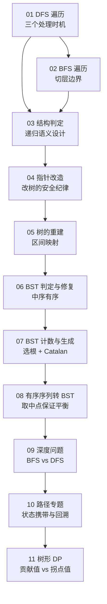

# 二叉树专栏导览：从遍历到树形 DP 的五条主线

**摘要：**

在线性表、栈与队列专栏里，我们处理的核心对象是"连续区间""相邻元素关系"与"局部状态管理"；进入二叉树之后，问题的抽象层级会明显上升——**数组和链表的遍历大多沿一条线向前推进，而二叉树天然是一种分叉结构**：一个节点既要看自己，也要看左右子树，还要处理"从根到叶""从叶到根""按层推进""按中序有序"等不同观察视角。本专栏不追求"背几种遍历顺序"，而是围绕**遍历、构造、搜索树、路径与深度、指针重连**五条主线，建立一套稳定的分析框架——**把整体问题拆成左右子问题，并在回溯时完成信息汇总**。全文示例代码统一使用 Go 语言。

---

## 专栏定位

**讨论范围**：二叉树的遍历（DFS/BFS）、结构判定、指针改造、重建、二叉搜索树（BST）、深度、路径与树形 DP。不展开红黑树、B 树等平衡树的工程实现（仅在必要时提及）。

**写作取向**：每篇从"朴素解法"或"约束"出发，逐步推导优化解，重点回答**"为什么这样解"**。对每种技巧，都交代其适用前提、失效场景与边界反例。

**语言约定**：示例代码以 **Go** 为主。Go 的递归闭包与切片语法，恰好能让"函数返回什么、状态如何携带"这两件事写得格外清晰。

---

## 专栏目录

### 第一部分：怎么看树（遍历）

| 序号 | 文章标题 | 核心话题 | 覆盖题目 |
|------|----------|----------|----------|
| 01 | 深度优先遍历：前序、中序、后序与递归迭代统一框架 | 三个处理时机、迭代写法的控制流、Morris 遍历 | 144、94、145 |
| 02 | 广度优先遍历：层序、倒序层序与锯齿层序 | 切层边界、只改呈现不改遍历 | 102、107、103 |

### 第二部分：怎么改树（结构与判定）

| 序号 | 文章标题 | 核心话题 | 覆盖题目 |
|------|----------|----------|----------|
| 03 | 二叉树结构判定：相同树、对称树与平衡二叉树 | 平行比较、镜像比较、后序汇总 | 100、101、110 |
| 04 | 二叉树指针操作：展开链表与填充右侧指针 | 改指针前先保存、借 Next 遍历、哑节点兜边界 | 114、116、117 |

### 第三部分：怎么造树（重建与 BST）

| 序号 | 文章标题 | 核心话题 | 覆盖题目 |
|------|----------|----------|----------|
| 05 | 二叉树重建：前序+中序、后序+中序的构造逻辑 | 区间映射三问、哈希表加速 | 105、106、889、1008 |
| 06 | 二叉搜索树判定与修复：Validate BST 与 Recover BST | 全局上下界、中序递增、逆序对定位 | 98、99、230 |
| 07 | 二叉搜索树的数量与生成：Unique BST I-II | 选根视角、Catalan 数、笛卡尔积生成 | 96、95、894 |
| 08 | 有序序列转平衡搜索树：数组与链表两种输入 | 取中点保证平衡、模拟中序构造 | 108、109 |

### 第四部分：深度、路径与树形 DP

| 序号 | 文章标题 | 核心话题 | 覆盖题目 |
|------|----------|----------|----------|
| 09 | 二叉树深度问题：最小深度、最大深度与 BFS-DFS 取舍 | 最小深度陷阱、最近优先用 BFS | 104、111、543 |
| 10 | 根到叶路径专题：Path Sum、Path Sum II 与数字累积 | 路径状态设计、回溯撤销、前缀和 | 112、113、129、437 |
| 11 | 树形 DP 进阶：二叉树中的最大路径和 | 贡献值 vs 拐点值、全局答案 | 124、687 |

合计覆盖 **25 余道高频面试题**，横跨 Google、Meta、Amazon、字节跳动、阿里等一线大厂的高频考点。

---

## 阅读路径

专栏的组织逻辑是**先建立"怎么看树"的基础，再沿"改树 → 造树 → 深度与 DP"三条支线逐层深入**：

---

## 贯穿全专栏的两条主线

**主线一，树题的难度不在遍历方式，而在"递归函数的语义设计"。** 遍历顺序只决定"何时处理当前节点"；真正决定难度的，是"函数接收什么、返回什么"。**先定义函数语义，再写代码**——这是所有树题的第一条纪律。

**主线二，"把整体问题拆成左右子问题、在回溯时汇总"是树题的通用骨架。** 从最大深度到最大路径和，从平衡树到直径，它们共享同一副骨架：**递归左右子树 → 用左右结果更新全局答案 → 返回供父节点使用的贡献值**。把这副骨架握住，多数树题都只是它的变形。

---

## 专栏阅读建议

1. **第 01、02 篇必读**：它们建立了"怎么看树"的两套基本模型（三个处理时机、切层边界），后续所有题都建立在其上。
2. **判定与改造（03、04）**：理解"递归语义设计"与"改树的安全纪律"。
3. **重建与 BST（05-08）**：重点理解"区间映射"与"中序有序"这两个降维工具。
4. **深度与 DP（09-11）**：这是最容易拉开差距的部分，重点理解"贡献值 vs 拐点值"的区分。
5. **亲自动手**：每篇讲完，建议先不看代码，自己在 LeetCode 上独立实现一遍。

---

## 关联专栏

- **栈与队列专栏**（[[01 栈的基础应用：括号匹配、最长有效括号与逆波兰表达式]]）：树的 BFS/DFS 与栈、队列直接相关；Morris 遍历与"就地借用"思想同源。
- **搜索专栏**（[[01 BFS 与 DFS 全景导览：搜索算法的本质与适用边界]]）：树是搜索的基础模型，图搜索是其推广。
- **动态规划专栏**（[[01 动态规划思想导论：从暴力递归到记忆化搜索再到 DP 表]]）：树形 DP 是动态规划在树上的特化。
- **线性表专栏**（[[01 线性表全景：数组与链表的本质与工程权衡]]）：有序链表转 BST（第 08 篇）直接依赖链表操作。
