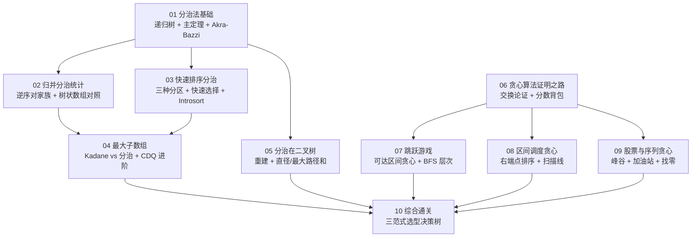

# 分治与贪心专栏导览：从递归树到交换论证的选型地图

**摘要：**

分治（Divide and Conquer）与贪心（Greedy）是动态规划之外最常被考察的两大算法范式，它们与 DP 构成了"问题拆解三兄弟"：分治把问题切成**互不重叠**的子问题（每个子问题只算一次，无需记忆化），贪心在每一步直接锁定**局部最优**并证明它能延伸为全局最优，而动态规划则在子问题**相互重叠**、决策相互制约时登场。本专栏从主定理与递归树的数学骨架出发，沿"归并分治统计（逆序对家族） $	o$ 快速排序分区与快速选择 $	o$ Kadane 与分治对照 $	o$ 二叉树上的重建与路径分治 $	o$ 交换论证与区间调度贪心 $	o$ 跳跃游戏与序列贪心"的主线逐层递进，覆盖 30 余道经典 LeetCode 题目，全专栏示例代码统一采用 **Golang** 实现。

---

## 专栏目录

| 序号 | 文章标题 | 核心话题 | 覆盖代表题目（LeetCode） |
|------|----------|----------|--------------------------|
| 01 | [[01 分治法基础：递归树与主定理——分治的思维骨架]] | 分治三要素、递归树推导、主定理三情形、Akra-Bazzi 推广、尾递归消除与 MapReduce 工程身影 | 53、169、236 及概念全景 |
| 02 | [[02 归并分治精讲：逆序对的多种面孔]] | 归并合并阶段的双指针统计、逆序对/翻转对/区间和三题、树状数组+离散化对照 | 315、493、327 |
| 03 | [[03 快速排序分治框架：分区的力量]] | Lomuto/Hoare/三路分区、荷兰国旗、快速选择、Introsort 与 pdqsort 工程演进 | 75、215、973 |
| 04 | [[04 最大子数组问题：Kadane 算法与分治视角]] | 跨中点合并、Kadane 线性扫描、乘积双轨、环形正难则反、CDQ 分治与线段树节点四元组 | 53、152、918 |
| 05 | [[05 分治在二叉树：重建与最长路径]] | 前序+中序/中序+后序重建、直径与最大路径和、前序+后序（答案不唯一）、最大二叉树与前序构造 BST | 105、106、543、124、889、654、1008 |
| 06 | [[06 贪心算法：从直觉到证明的严格之路]] | 贪心反例、交换论证法、贪心 vs DP 边界、分数背包证明、分发糖果/数组拆分/反悔式贪心 | 135、561、1405、455 |
| 07 | [[07 跳跃游戏系列：维护可达区间的贪心艺术]] | 可达区间贪心、BFS 层次视角、青蛙过河 DP、跳跃游戏 III/IV/VII | 55、45、403、1306、1345、1871 |
| 08 | [[08 区间调度贪心精讲：覆盖、不重叠与最少箭头]] | 按右端点排序的交换论证、合并区间、视频拼接、删除被覆盖区间、会议室 II 扫描线 | 435、452、56、1024、1288、253 |
| 09 | [[09 股票与序列贪心：多次交易、加油站与柠檬水找零]] | 峰谷贪心、加油站环形定理、柠檬水找零、身高重建队列、摆动序列/最优除法/最小移动 | 122、134、860、406、376、553、453 |
| 10 | [[10 综合通关：分治与贪心的选型模式与面试总结]] | 三范式三角关系、选型决策树、复杂度速查、高频错误盘点、三范式对照实战 | 全专栏复盘 |

---

## 学习路径图

---

## 关联专栏

- **动态规划专栏**（[[01 动态规划思想导论：从暴力递归到记忆化搜索再到 DP 表]]）：贪心是 DP 在"边际收益单调"时的退化特例，分治与 DP 的分野在于子问题是否重叠。
- **排序与查找专栏**（[[01 排序算法原理全景：从 O(n²) 到 O(nlogn) 的演进之路]]）：归并排序与快速排序正是本专栏两大分治骨架的原型。
- **二叉树专栏**（[[05 二叉树重建：前序+中序、后序+中序的构造逻辑]]）：二叉树重建的分治细节在本专栏第 05 篇进一步深化。
