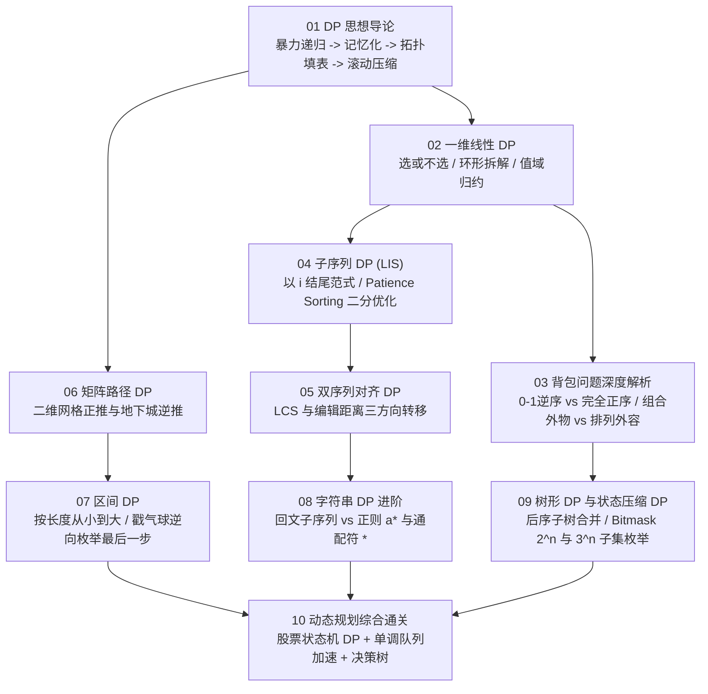

# 动态规划专栏导览：从递归记忆化到面试通关

**摘要：**

动态规划（Dynamic Programming，简称 DP）是算法面试中区分度最高、也是让最多工程师望而生畏的领域。初学者常见的困境在于将每一道 DP 题都当成孤立的脑筋急转弯——背下了状态转移方程，却不知道"状态维度是怎么从暴力递归的参数里长出来的"、"为什么有的背包必须逆序遍历而有的必须正序遍历"、"为什么有的题外层枚举物品而有的题外层枚举容量"。本专栏彻底摒弃"直接抛出神秘 `dp` 数组定义"的填鸭式讲法，严格沿着**"暴力回溯搜索（暴露重叠子问题） $\to$ 自顶向下记忆化搜索（Pruning Redundant Subtrees） $\to$ 自底向上拓扑填表（Tabulation） $\to$ 滚动空间压缩与单调结构加速"**的四阶演进链路，带你打通线性 DP、背包 DP、子序列 DP、双序列对齐 DP、网格路径 DP、区间 DP、正则自动机 DP、树形与状态压缩 DP 以及股票状态机 DP 九大核心疆域。全专栏示例代码统一采用 **Golang** 编写。

---

## 专栏定位与核心演进逻辑

动态规划不是魔术，它的本质只有八个字：**记住过去，不再重算**。
任何一道动态规划问题的推导，都必然回答以下五个层层递进的工程问题：
1. **阶段与决策是什么**：如果用最朴素的递归回溯去枚举所有合法方案，每次递归调用需要做哪几个分支决策（如"选或不选"、"枚举哪一个分割点"）？
2. **可变参数与无后效性状态是什么**：为了唯一确定剩余子问题的最优解，递归函数签名 `dfs(...)` 里最少需要携带哪几个参数？这些参数直接定义了 `dp` 数组的维度；
3. **重叠子问题在哪里**：为什么不同决策路径会汇合到完全相同的参数元组上，把指数级的递归树坍缩成多项式规模的有向无环图（DAG）？
4. **拓扑填表方向怎么定**：当把递归改写为循环填表时，当前状态依赖哪几个方向（左、上、左上、更短区间、子树、子集掩码）？如何安排循环内外层顺序以确保"被依赖的状态一定先算完"？
5. **空间与时间还能怎么压榨**：当第 `i` 阶段只依赖第 `i-1` 阶段时如何用滚动数组降维？当转移方程出现区间极值或单调查找时，如何结合二分查找（LIS $O(n \log n)$）或单调双端队列优化？

---

## 专栏目录

| 序号 | 文章标题 | 核心话题 | 覆盖代表题目（LeetCode） |
|------|----------|----------|--------------------------|
| 01 | [[01 动态规划思想导论：从暴力递归到记忆化搜索再到 DP 表]] | 递归树与 DAG 坍缩、最优子结构与无后效性、四阶推导法、正推与逆推等价性、矩阵快速幂 | 509、70、746、198、1137、322 |
| 02 | [[02 一维线性DP：「选或不选」框架与打家劫舍系列]] | 相邻互斥约束、环形数组破环成链、值域聚合归约（Delete and Earn）、带多状态的粉刷与翻转 | 198、213、740、2140、91、256、801 |
| 03 | [[03 背包问题深度解析：0-1背包、完全背包与空间压缩]] | 0-1 背包逆序与完全背包正序的内存覆盖证明、组合数（外物内容）vs 排列数（外容内物）、二维费用与分组背包 | 416、494、474、1049、322、518、377、279、139 |
| 04 | [[04 子序列DP：最长递增子序列与O(nlogn)优化]] | "以 `i` 结尾"状态范式、耐心排序（Patience Sorting）与 Dilworth 定理、`tails` 二分维护、二维偏序信封嵌套 | 300、354、673、53、152、368、1048 |
| 05 | [[05 最长公共子序列与字符串编辑距离]] | 双序列二维网格对齐、LCS 与 Levenshtein 编辑距离三向转移、滚动行与左上角 `prev` 暂存、子序列计数 | 1143、72、583、712、97、115、1092 |
| 06 | [[06 矩阵路径DP：网格出发的二维状态转移]] | 网格 DAG 拓扑序、首行首列障碍物截断、正推失效时的逆向 DP（三角形与地下城最低初始血量）、双人同步摘樱桃 | 62、63、64、120、174、221、931、741 |
| 07 | [[07 区间DP：戳气球、矩阵链乘与「从小区间到大区间」]] | 为什么必须按区间长度从小到大枚举、戳气球"枚举最后一个避免邻居耦合"的逆向建模、石子合并与同色打印 | 312、664、132、1039、1547、486 |
| 08 | [[08 字符串DP进阶：回文子串、正则与通配符匹配]] | 回文子串（中心扩展）vs 回文子序列（区间 DP）、正则表达式 `a*` 与通配符 `*` 的自动机状态消除与驻留 | 5、647、516、1312、10、44 |
| 09 | [[09 树形DP与状态压缩DP：树上决策与位运算加速]] | 树上后序遍历状态汇总、监控二叉树三态机、集合位掩码（Bitmask）TSP 与 $O(3^n)$ 子集枚举 `(sub-1)&mask` | 337、968、124、847、1125、691、1986 |
| 10 | [[10 动态规划综合通关：高频模式识别与面试决策树]] | 买卖股票全家族（有限状态自动机 DP）、单调队列优化 DP、八大考场高频翻车陷阱、20 道核心母题全景图 | 121、122、123、188、309、714、1696 |

---

## 学习路径图

---

## 关联专栏

- **搜索专栏**（[[10 搜索算法面试通关：模式识别与优化策略总结]]）：自顶向下的记忆化搜索（Top-Down Memoization）正是连接 DFS 回溯与自底向上 DP 表的桥梁。
- **二叉树专栏**（[[11 树形 DP 进阶：二叉树中的最大路径和]]）：树形 DP 建立在二叉树后序递归遍历的信息汇聚框架之上。
- **滑动窗口专栏**（[[07 单调队列优化滑动窗口：O(n) 求窗口极值的艺术]]）：当线性 DP 的状态转移方程需要在定长历史窗口内求极值时，单调双端队列可将转移耗时从 $O(k)$ 降至均摊 $O(1)$。
