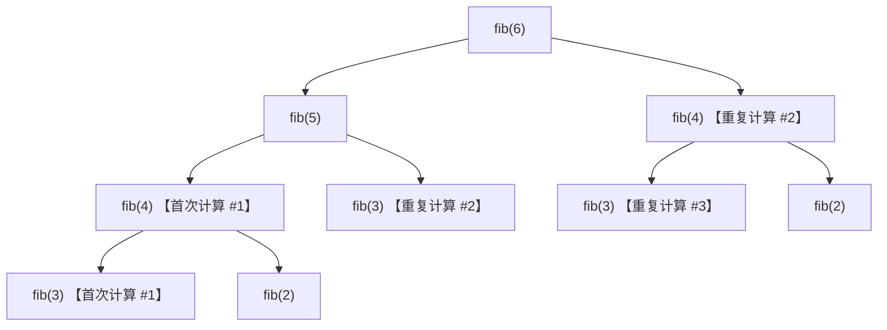
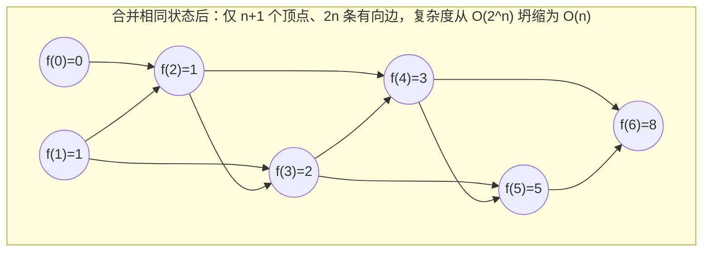
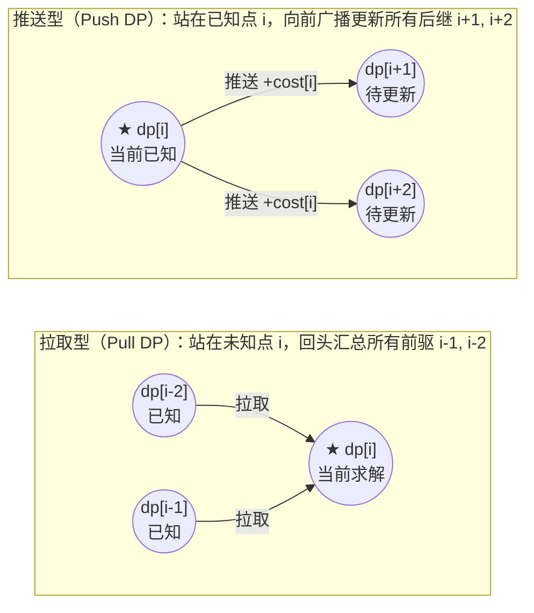

# 动态规划思想导论：从暴力递归到记忆化搜索再到 DP 表

**摘要：**

绝大多数算法初学者对动态规划（Dynamic Programming，简称 DP）的恐惧，源于教科书与题解中那种"神来之笔"式的写法——开篇直接丢出一句"定义 `dp[i][j]` 表示……，状态转移方程为……"，却只字不提这个状态定义究竟是怎么想出来的。实际上，动态规划在人类思维中从来不是一步登天写出来的，它是对**暴力递归搜索（Brute-Force Recursion）**实施工程重构的自然产物。本文以斐波那契数列（LeetCode 509）、爬楼梯（LeetCode 70）、最小花费爬楼梯（LeetCode 746）与打家劫舍（LeetCode 198）为解剖样本，完整演示从**指数级递归树 $\to$ 识别重叠子问题 $\to$ 自顶向下记忆化搜索（Top-Down Memoization） $\to$ 自底向上拓扑填表（Bottom-Up Tabulation） $\to$ $O(1)$ 滚动空间压缩**的五阶推导流水线，并严格界定最优子结构、无后效性与拓扑依赖顺序三大理论支柱。

---

## 第 1 章 剥去神秘外衣：为什么朴素递归会发生指数级爆炸？

### 1.1 从斐波那契递归树的灾难说起

斐波那契数列（LeetCode 509）的数学递推定义简洁明了：$F(0) = 0, F(1) = 1$，且当 $n \ge 2$ 时 $F(n) = F(n - 1) + F(n - 2)$。如果直接照着数学公式翻译成递归函数：

```go
package main

// fibNaive 朴素递归：时间复杂度 O(1.618^n)，当 n = 45 时即需数十亿次调用
func fibNaive(n int) int {
	if n <= 1 {
		return n
	}
	return fibNaive(n-1) + fibNaive(n-2)
}
```

为什么这段只有 6 行的代码在 $n = 45$ 时就会卡死？让我们把 `fibNaive(6)` 的真实调用轨迹画成一棵**递归展开树（Recursion Tree）**：



请看上图中触目惊心的冗余：
- 为了算 `fib(6)`，左分支 `fib(5)` 辛辛苦苦把 `fib(4)` 及其整棵子树完整算了一遍；然而因为函数没有记忆，等轮到右分支调用 `fib(4)` 时，程序把刚才算过的一切忘得干干净净，又把整棵 `fib(4)` 子树原封不动地重算了一遍；
- 更往下看，`fib(3)` 被重复展开了 3 次，`fib(2)` 被重复展开了 5 次。设调用总次数为 $T(n)$，满足 $T(n) = T(n-1) + T(n-2) + 1$，特征方程解出的增长率是黄金分割比 $\phi = \frac{1+\sqrt{5}}{2} \approx 1.618$，时间复杂度高达 **$\Theta(\phi^n) \approx O(2^n)$**。

### 1.2 动态规划的第一块基石：重叠子问题（Overlapping Subproblems）

审视上面的 `fib(6)` 递归树：虽然树上的**节点总数**随着深度呈指数级膨胀（$\Theta(\phi^n)$），但这棵树上真正出现过的**不同参数状态（Distinct States）**一共有几个？
只有 `fib(0), fib(1), fib(2), fib(3), fib(4), fib(5), fib(6)` 这区区 **$n + 1$ 个**。

这就是动态规划赖以诞生的第一个核心现象——**重叠子问题（Overlapping Subproblems）**：
> 在问题的递归拆解过程中，不同的决策分支路径会反复交汇到**参数完全相同**的子问题上。如果我们把相同参数的子问题合并为同一个顶点，原本拥有 $\Theta(2^n)$ 个节点的指数级**递归树（Tree）**，就会瞬间坍缩为一张仅有 $O(n)$ 个顶点的**有向无环图（Directed Acyclic Graph，简称 DAG）**。



---

## 第 2 章 从暴力递归到 O(1) 空间的五阶演进流水线

一旦看清了"动态规划就是在子问题 DAG 上每个顶点只算一次"，任何一道 DP 题目都可以按照一套机械化、零跳跃的**五阶演进流水线**推导出来。下面我们以经典的 **LeetCode 70：爬楼梯**（每次可爬 1 阶或 2 阶，求到达第 $n$ 阶的方法总数）为例，手把手走完这五步。

### 2.1 第一阶：定义递归子问题与最后一步决策（暴力搜索）

站在终点第 $i$ 阶楼梯上往回看，你的**最后一步**只有两种互斥且完备的可能：
1. 从第 $i - 1$ 阶迈了 1 步上来（此前到达第 $i - 1$ 阶共有 `dfs(i - 1)` 种走法）；
2. 从第 $i - 2$ 阶迈了 2 步上来（此前到达第 $i - 2$ 阶共有 `dfs(i - 2)` 种走法）。
根据加法原理，`dfs(i) = dfs(i - 1) + dfs(i - 2)`，边界为 `dfs(0) = 1, dfs(1) = 1`。

### 2.2 第二阶：挂上缓存表——自顶向下记忆化搜索（Top-Down Memoization）

为了阻止 `dfs(i)` 被重复展开，我们开一个长度为 $n + 1$ 的缓存切片 `memo`（初始化为 `-1` 或 `0` 代表"尚未计算"）。每次进入 `dfs(i)` 时，**先查表，若已算过则直接 $O(1)$ 返回；若未算过，则算完后在返回前写入 `memo[i]`**：

```go
package main

// climbStairsMemo 第二阶：自顶向下记忆化搜索（递归 + 缓存剪枝）
// 时间复杂度：O(n)（每个状态 i 仅首次访问时展开一次），空间复杂度：O(n)（memo 数组 + 递归栈）
func climbStairsMemo(n int) int {
	memo := make([]int, n+1)

	var dfs func(i int) int
	dfs = func(i int) int {
		if i <= 1 {
			return 1
		}
		if memo[i] != 0 {
			return memo[i] // 命中缓存，直接剪断整棵重复子树
		}
		memo[i] = dfs(i-1) + dfs(i-2)
		return memo[i]
	}

	return dfs(n)
}
```

### 2.3 第三阶：按拓扑序脱掉递归壳——自底向上填表（Bottom-Up Tabulation）

观察第二阶的 `dfs(i)`：计算 `memo[i]` 只依赖于比它小的 `memo[i-1]` 和 `memo[i-2]`。
既然我们已经知道了 DAG 的拓扑顺序是**从小到大（$0 \to 1 \to 2 \to \dots \to n$）**，为什么还要劳烦 CPU 压入 $n$ 层函数调用栈去自顶向下探底、再在回溯归途中填表呢？
直接把 `memo` 数组改名为 `dp` 数组，写一个从 `i = 2` 到 `n` 的正序 `for` 循环，按照拓扑依赖顺序直接填表，就能完全省去递归栈开销：

```go
package main

// climbStairsDP 第三阶：自底向上 DP 表（消除递归调用栈开销）
// 时间复杂度：O(n)，空间复杂度：O(n)
func climbStairsDP(n int) int {
	if n <= 1 {
		return 1
	}
	dp := make([]int, n+1)
	dp[0], dp[1] = 1, 1
	for i := 2; i <= n; i++ {
		dp[i] = dp[i-1] + dp[i-2]
	}
	return dp[n]
}
```

### 2.4 第四阶：只留滑动窗口视野——滚动变量空间压缩（Space Optimization）

再看第三阶的转移方程 `dp[i] = dp[i-1] + dp[i-2]`：当我们在算第 `i` 阶时，只需要看前两阶 `dp[i-1]` 和 `dp[i-2]` 的值，至于更早的 `dp[0] .. dp[i-3]` 永远不会再被读取了。
因此，我们用两个滚动整型变量 `prev2`（代表 `dp[i-2]`）与 `prev1`（代表 `dp[i-1]`）交替向前滚动，即可将空间复杂度从 $O(n)$ 压缩至严格的 **$O(1)$**：

```go
package main

// climbStairs 第四阶：滚动变量空间压缩，时间 O(n)，额外空间严格 O(1)
func climbStairs(n int) int {
	prev2, prev1 := 1, 1
	for i := 2; i <= n; i++ {
		prev2, prev1 = prev1, prev1+prev2
	}
	return prev1
}
```

### 2.5 第五阶：常系数齐次线性递推的终极加速——矩阵快速幂 $O(\log n)$

如果面试官追问："当 $n = 10^{18}$ 时，$O(n)$ 的循环也会超时，怎么在 $O(\log n)$ 时间内算出第 $n$ 项斐波那契数或爬楼梯方案数（对 $10^9+7$ 取模）？"
由于每一步转移 `(prev1, prev2) -> (prev1 + prev2, prev1)` 是一个标准的线性变换：

$$\begin{bmatrix} F(n) \\ F(n-1) \end{bmatrix} = \begin{bmatrix} 1 & 1 \\ 1 & 0 \end{bmatrix} \begin{bmatrix} F(n-1) \\ F(n-2) \end{bmatrix} = \begin{bmatrix} 1 & 1 \\ 1 & 0 \end{bmatrix}^{n-1} \begin{bmatrix} F(1) \\ F(0) \end{bmatrix}$$

利用二分快速幂在 $O(\log n)$ 次 $2 \times 2$ 矩阵乘法内算出转移矩阵的 $n - 1$ 次幂，即可将线性 DP 进一步压至对数时间：

```go
package main

type mat2x2 [2][2]int64

func mulMat(a, b mat2x2, mod int64) mat2x2 {
	var c mat2x2
	for i := 0; i < 2; i++ {
		for k := 0; k < 2; k++ {
			for j := 0; j < 2; j++ {
				c[i][j] = (c[i][j] + a[i][k]*b[k][j]) % mod
			}
		}
	}
	return c
}

// climbStairsMatrixLogN 第五阶：矩阵快速幂，时间复杂度 O(log n)，空间复杂度 O(1)
func climbStairsMatrixLogN(n int64, mod int64) int64 {
	if n <= 1 {
		return 1
	}
	res := mat2x2{{1, 0}, {0, 1}} // 单位矩阵
	base := mat2x2{{1, 1}, {1, 0}}
	for exp := n; exp > 0; exp >>= 1 {
		if exp&1 == 1 {
			res = mulMat(res, base, mod)
		}
		base = mulMat(base, base, mod)
	}
	return res[0][0]
}
```

---

## 第 3 章 动态规划的三大理论基石：最优子结构、无后效性与拓扑序

并不是所有能写成递归的问题都能改成动态规划。一个问题要能用动态规划求解，它的状态设计必须同时满足三条铁律：

### 3.1 基石一：最优子结构（Optimal Substructure）

**定义**：原问题的最优解，必然可以由其子问题的最优解推导组合而成；换言之，当我们站在最后一步做决策时，只需向子问题索要它的**最优值**，而不需要索要它的次优值或全量候选集。

- **正例（最短路径与最小花费爬楼梯 LC 746）**：若从起点 $0$ 到台阶 $n$ 的最省体力走法最后一步是从 $n - 1$ 迈上来的，那么它在 $0 \to n - 1$ 这一段所走的路径，必然也是从 $0$ 到 $n - 1$ 的最省体力走法（否则把前半段换成更省体力的走法，总花费还能更低，矛盾）。
- **反例（含负数的子数组最大乘积 LC 152，若只维护单一最大值）**：如果只定义 `dp[i]` 为以 `i` 结尾的最大乘积，当 `nums[i] = -2`（负数）时，它需要乘以前面 `i - 1` 结尾的**最小（最负）乘积**才能负负得正变成最大值。只维护 `maxDP[i]` 不满足最优子结构，必须**同时维护最大乘积 `maxDP[i]` 与最小乘积 `minDP[i]`** 才能闭合最优子结构（详见第 04 篇）。
- **反例二（有环图上的最长简单路径问题）**：从 $A$ 到 $C$ 的不重复顶点最长路径，不能由 $A \to B$ 的最长简单路径与 $B \to C$ 的最长简单路径直接拼接，因为两段路径内部可能使用了同一个顶点导致违规。

### 3.2 基石二：无后效性 / 马尔可夫性（No Aftereffect / Markov Property）

**定义**：一旦某个状态的参数确定下来，**它是如何从过去走到这个状态的（历史路径细节），对未来的决策与代价毫无影响**；同样地，未来的决策也绝不会反过来推翻或修改已经算好的过去状态的值。

> [!warning] 实战准则：当发现"有后效性"时，怎么修复状态定义？
> 在面试中，如果你发现"光知道前 $i$ 个元素的最大收益不够，因为我不知道第 $i$ 个元素到底有没有被选中（或者当前涂了什么颜色、手里有没有持有股票），而这会影响第 $i+1$ 个元素能不能选"，这说明你当前的**状态参数维度不够，丢失了影响未来的关键上下文**。
> **修复方法永远只有一招——升维（扩充状态参数）**：把那个会影响未来的关键变量（如 `0/1` 是否选中、`0/1/2` 当前颜色、剩余交易次数 `k`）直接加进 `dp` 数组的下标维度里，使状态恢复无后效性。

### 3.3 基石三：状态依赖图无环（DAG Topological Order）

自底向上填表的本质，是在状态依赖构成的**有向无环图（DAG）**上按照**拓扑序（Topological Sort）**依次求值。如果状态 `A` 依赖状态 `B`，同时状态 `B` 又反过来依赖状态 `A`（出现有向环），单纯的 DP 填表就会陷入死锁（此时通常需要转化为图的最短路 Dijkstra/BFS，或高斯消元解方程）。

---

## 第 4 章 状态定义的精确性演练：最小花费爬楼梯与零钱兑换

### 4.1 精确区分"到达 `i` 的代价"与"从 `i` 迈出的代价"（LeetCode 746）

**题目描述**：给你一个整数数组 `cost` ，其中 `cost[i]` 是从楼梯第 `i` 个台阶向上爬需要支付的费用。一旦你支付此费用，即可选择向上爬一个或者两个台阶。你可以选择从下标为 `0` 或下标为 `1` 的台阶开始爬楼梯。请你计算并返回达到楼梯顶部的最低花费。

这道题是检验状态定义基本功的绝佳试金石：
- 楼梯有 `0, 1, ..., n - 1` 共 $n$ 个台阶，那么**"楼梯顶部（楼顶）"在哪里？在下标 `n` 处**（越过最后一个台阶 `n - 1` 才算登顶）；
- 我们明确定义状态 **`dp[i]` 表示：双脚刚刚踏上第 `i` 阶台阶（尚未支付 `cost[i]` 继续往上迈）时的最低累计花费**；
- **初始条件**：因为题目允许免费直接空降在台阶 `0` 或台阶 `1` 起步，所以 **`dp[0] = 0, dp[1] = 0`**；
- **状态转移**：要踏上第 `i` 阶（$2 \le i \le n$），要么从第 `i - 1` 阶支付 `cost[i - 1]` 迈 1 步上来，要么从第 `i - 2` 阶支付 `cost[i - 2]` 迈 2 步上来：
  $$dp[i] = \min\big(dp[i - 1] + \text{cost}[i - 1], \; dp[i - 2] + \text{cost}[i - 2]\big)$$

```go
package main

// minCostClimbingStairs LeetCode 746：明确定义 dp[i] 为到达台阶 i 的最小累计花费，楼顶为下标 n
// 时间复杂度：O(n)，额外空间复杂度：O(1)
func minCostClimbingStairs(cost []int) int {
	prev2, prev1 := 0, 0 // dp[0] = 0, dp[1] = 0
	for i := 2; i <= len(cost); i++ {
		cur := min(prev1+cost[i-1], prev2+cost[i-2])
		prev2, prev1 = prev1, cur
	}
	return prev1
}
```

### 4.2 记忆化搜索 vs 自底向上 DP 在多分支决策中的对照：零钱兑换（LeetCode 322）

为了体会第二阶（记忆化搜索）与第三阶（自底向上填表）在面对 $k$ 个分支选择时的完全等价性，我们提前预览第 03 篇的核心母题——**LeetCode 322：零钱兑换**（给定面额数组 `coins` 和总金额 `amount`，求凑成总金额所需的最少硬币个数）：
- 定义子问题 $f(x)$ 为凑出金额 $x$ 所需的最少硬币数；
- 对最后一枚选用的硬币面额 $c \in \text{coins}$ 进行穷举：
  $$f(x) = 1 + \min_{c \in \text{coins}, \, c \le x} f(x - c)$$

请对照阅读下面两段分别用**自顶向下记忆化**与**自底向上填表**写出的 Go 代码，感受它们是如何在同一张状态 DAG 上殊途同归的：

```go
package main

// coinChangeTopDown 写法 A：自顶向下记忆化搜索（memo[x] 编码：0 未算，-1 无解，>0 最少硬币数）
func coinChangeTopDown(coins []int, amount int) int {
	memo := make([]int, amount+1)

	var dfs func(rem int) int
	dfs = func(rem int) int {
		if rem == 0 {
			return 0
		}
		if rem < 0 {
			return -1
		}
		if memo[rem] != 0 {
			return memo[rem]
		}

		minCoins := amount + 1
		for _, c := range coins {
			sub := dfs(rem - c)
			if sub >= 0 && sub+1 < minCoins {
				minCoins = sub + 1
			}
		}
		if minCoins > amount {
			memo[rem] = -1
		} else {
			memo[rem] = minCoins
		}
		return memo[rem]
	}

	return dfs(amount)
}

// coinChangeBottomUp 写法 B：自底向上 DP 表（初始化不可达哨兵为 amount + 1，防止 +1 溢出）
func coinChangeBottomUp(coins []int, amount int) int {
	dp := make([]int, amount+1)
	for i := 1; i <= amount; i++ {
		dp[i] = amount + 1 // 安全无穷大哨兵：最坏全用 1 元硬币也只需 amount 枚
	}

	for x := 1; x <= amount; x++ {
		for _, c := range coins {
			if x >= c && dp[x-c]+1 < dp[x] {
				dp[x] = dp[x-c] + 1
			}
		}
	}
	if dp[amount] > amount {
		return -1
	}
	return dp[amount]
}
```

### 4.3 工程决策：什么时候优先写"记忆化搜索"，什么时候优先写"自底向上 DP 表"？

| 评估维度 | 自顶向下记忆化搜索（Top-Down） | 自底向上 DP 填表（Bottom-Up） |
|----------|--------------------------------|-------------------------------|
| 思维自然度 | **极高**（直接照着原问题递归拆解写，无需操心填表顺序） | 需先人工理清拓扑依赖方向（正序、逆序或按区间长度） |
| 稀疏状态剪枝 | **只计算从起点真正可达的有效子状态**（状态稀疏时更快） | 会把整个网格/数组里的所有状态无脑填满 |
| 常数开销与栈风险 | 有递归函数调用开销，深度 $> 10^5$ 时有栈溢出风险 | **纯循环+连续内存访问，CPU 缓存极度友好，常数最小** |
| 滚动空间压缩 | **不支持**（`memo` 表必须保留全量历史状态备查） | **完美支持**（可将 $O(n)$ 压为 $O(1)$，将 $O(mn)$ 压为 $O(n)$） |
| 推荐首选场景 | **区间 DP、树形 DP、数位 DP、状态转移拓扑序极度扭曲的题** | **一维线性 DP、背包问题、双序列 LCS/编辑距离、网格路径** |

---

## 第 5 章 初学者四大高频翻车陷阱

1. **【陷阱一】求最小值 DP 时用 `math.MaxInt` 作无穷大哨兵，导致 `dp[i-c] + 1` 整数溢出变负数**：
   - 在 Go 语言中，`math.MaxInt + 1` 会直接回绕成负无穷 `math.MinInt`，随后的 `min(dp[i], dp[i-c]+1)` 就会把这个错误的负数当成最小值选走。
   - **铁律**：求最小值的不可达哨兵一律设为 **`math.MaxInt32 / 2`（即 `0x3f3f3f3f`）**，或结合业务上界设为 **`amount + 1`**。
2. **【陷阱二】记忆化搜索中用 `0` 表示"尚未计算"，而合法答案本身恰好也可能是 `0`（或 `-1`）**：
   - 如在 `coinChangeTopDown` 中，如果某个不可达状态 `rem` 的计算结果是 `-1`，而你没把 `-1` 区分记录进 `memo`（仍留着 `0`），那么每次遇到这个无解状态都会重新展开整棵无解子树，直接退化回 $O(2^n)$ 超时。因此 `memo` 的"未计算哨兵值"必须严格与所有可能的合法返回值（含无解返回值）区分开。
3. **【陷阱三】混淆"考虑前 `i` 个元素的全局最优"与"强制以第 `i` 个元素结尾的局部最优"**：
   - 在打家劫舍（LC 198）中，`dp[i]` 代表前 `i` 间房的全局最优，故最终答案直接是 `dp[n-1]`；而在最长递增子序列（LC 300）或最大子数组和（LC 53）中，`dp[i]` 代表**强制以 `nums[i]` 结尾**的最优解，最终答案必须对全数组取 **`max(dp[0 .. n-1])`**。
4. **【陷阱四】在未画清二维依赖方向前盲目改写一维滚动数组，覆盖了下一列还要用的旧值**：
   - 记住：永远先写出能通过编译和样例的二维/一维完整 `dp` 数组版，看清 `dp[i][j]` 到底依赖 `dp[i-1][j-1]`（左上）、`dp[i-1][j]`（正上）还是 `dp[i][j-1]`（正左），再决定内层循环是正序、逆序还是需要额外一个 `prev` 变量暂存左上角。

---

## 第 6 章 深度进阶：拉取型填表（Pull DP）、推送型刷表（Push DP）与最优路径还原

在真正走进后续九大专项之前，还有两项贯穿整个动态规划领域的底层工程内功必须在导论篇打牢：**其一是状态转移的两种对偶写表方向（Pull DP vs Push DP）**，**其二是如何在只求出了最优标量值 `dp[n]` 之后，把具体的最优决策序列（Path Reconstruction）还原出来**。

### 6.1 拉取型填表（Pull / Gather DP）vs 推送型刷表（Push / Scatter DP）

在前面的爬楼梯与最小花费爬楼梯中，当我们计算 `dp[i]` 时，站在未知的状态 `i` 上，回头去读取已经算好的前驱状态 `dp[i-1]` 和 `dp[i-2]`：

$$dp[i] \leftarrow f(dp[i-1], dp[i-2])$$

这种"站在终点向起点要数据"的写法，称为**拉取型转移（Pull DP，或称填表法）**。

与之完全等价的对偶写法是**推送型转移（Push DP，或称刷表法）**：
当我们站在一个**刚刚已经算妥的已知状态 `dp[i]`** 上时，主动枚举从状态 `i` 出发下一步能迈向哪些未来的后继状态（如 `i + 1` 和 `i + 2`），用当前手里的 `dp[i]` 去更新（贡献给）那些未来状态：
- `dp[i + 1] = min(dp[i + 1], dp[i] + cost[i])`
- `dp[i + 2] = min(dp[i + 2], dp[i] + cost[i])`



**什么时候该用 Pull DP，什么时候该用 Push DP？**
- **90% 的常规题首选 Pull DP（拉取型）**：因为 Pull DP 对 `dp[i]` 只做一次集中赋值，非常适合改写为滚动变量（如 `prev1, prev2`）以及配合单调队列优化；
- **当"谁能跳到 `i`（前驱集合）"极难反推，而"从 `i` 能跳到哪（后继集合）"一目了然时，果断用 Push DP（刷表法）**：譬如在 **LeetCode 403：青蛙过河**、**LeetCode 2140：解决智力问题（正向写时）**，或者图上的状态压缩转移（从 `mask` 枚举下一个未选元素 `j` 刷向 `mask | (1 << j)`）中，站在当前状态往外广播后继比站在终点猜前驱要自然十倍。

下面给出 **LeetCode 746：使用最小花费爬楼梯** 的推送型刷表法（Push DP）实现，请与第 4.1 节的拉取型代码对照阅读：

```go
package main

import "math"

// minCostClimbingStairsPush LeetCode 746 推送型刷表法 (Push DP)：站在已知的台阶 i 向前更新 i+1 与 i+2
func minCostClimbingStairsPush(cost []int) int {
	n := len(cost)
	dp := make([]int, n+1)
	for i := 2; i <= n; i++ {
		dp[i] = math.MaxInt32 / 2
	}
	// dp[0] = 0, dp[1] = 0 已默认就绪

	for i := 0; i < n; i++ {
		// 从当前已知的 dp[i] 支付 cost[i]，向前推送更新 i+1 和 i+2
		if dp[i]+cost[i] < dp[i+1] {
			dp[i+1] = dp[i] + cost[i]
		}
		if i+2 <= n && dp[i]+cost[i] < dp[i+2] {
			dp[i+2] = dp[i] + cost[i]
		}
	}
	return dp[n]
}
```

### 6.2 动态规划的"黑匣子回放"：如何输出具体的最优决策路径？

在面试中，当你写出 10 行 DP 代码算出最小花费或最少硬币数后，面试官十有八九会追问一句：
> **"如果我不仅要你返回最小花费的数值，还要你把具体踩了哪几个台阶（或者具体选了哪几枚硬币）的切片返回出来，你的代码该怎么改？"**

首先要清楚：**一旦你做了第 2.4 节的 $O(1)$ 滚动空间压缩（把整个 `dp` 数组砍成了两个变量 `prev1, prev2`），历史轨迹就被彻底抹除了，无法还原路径**。
因此，当题目要求输出具体方案时，必须**保留完整的 `dp` 数组**，并采用以下两种标准路径回溯手法之一：

1. **手法 A（显式前驱指针数组 `from[i]`）**：
   - 在填表计算 `dp[i]` 时，每当某个前驱分支 `prevIdx` 刷新了 `dp[i]` 的最优值，就顺手在伴随数组里记下一笔 **`from[i] = prevIdx`**（就像 Dijkstra 最短路里的 `parent` 数组）；
   - 填表结束后，从终点 `cur = n` 开始顺藤摸瓜执行 `cur = from[cur]` 一路退回起点，最后将收集到的路径反转即可；
2. **手法 B（不额外开 `from` 数组，直接利用 `dp` 表逆向对账）**：
   - 连 `from` 数组都不用开，直接拿着填好的 `dp[0 .. n]` 表，从终点 `cur = n` 往回看：检查 `dp[cur]` 到底等于 `dp[cur - 1] + cost[cur - 1]` 还是等于 `dp[cur - 2] + cost[cur - 2]`？哪一条等式成立，就说明当初的最优决策是从哪一个前驱走过来的，直接将 `cur` 退回该前驱继续对账：

```go
package main

import "slices"

// minCostWithPath 算最小花费的同时，利用已填好的 dp 表零额外数组逆向对账还原踩过的台阶序列
func minCostWithPath(cost []int) (minTotal int, steps []int) {
	n := len(cost)
	dp := make([]int, n+1)
	for i := 2; i <= n; i++ {
		dp[i] = min(dp[i-1]+cost[i-1], dp[i-2]+cost[i-2])
	}

	// 从楼顶 cur = n 逆向对账回溯至起点 0 或 1
	for cur := n; cur > 1; {
		if dp[cur] == dp[cur-1]+cost[cur-1] {
			steps = append(steps, cur-1)
			cur = cur - 1
		} else {
			steps = append(steps, cur-2)
			cur = cur - 2
		}
	}
	slices.Reverse(steps)
	return dp[n], steps
}
```

### 6.3 实战演练：整数拆分——从记忆化拆解到自底向上 DP（LeetCode 343）

为了全面检验本章建立的五阶演进法，我们再看一道初看毫无头绪、按五阶法却能顺理成章推出来的经典题——**LeetCode 343：整数拆分**：
**题目描述**：给定一个正整数 `n`（$2 \le n \le 58$），将其拆分为**至少两个**正整数的和，并使这些整数的乘积最大化，返回你可以获得的最大乘积。

- **按最后一步拆出的第一块正整数 $j \in [1, i - 1]$ 穷举**：
  当我们要把正整数 $i$ 拆成至少两个正整数之和时，枚举拆出来的第一个正整数为 $j$（$1 \le j < i$），剩下的部分是 $i - j$。对于剩下的 $i - j$，有两种选择：
  1. **不再继续拆分**：直接作为单个数 $i - j$ 与 $j$ 相乘，乘积为 **`j * (i - j)`**；
  2. **继续拆分为至少两个数**：其最大乘积由子问题 **`dp[i - j]`** 给出，总乘积为 **`j * dp[i - j]`**。
- 状态转移方程脱颖而出：
  $$dp[i] = \max_{1 \le j < i} \Big\{ \max\big(j \times (i - j), \; j \times dp[i - j]\big) \Big\}$$

```go
package main

// integerBreak LeetCode 343：枚举拆出的第一个正整数 j，比较 (i-j 不拆) 与 (i-j 继续拆 dp[i-j])
// 时间复杂度：O(n^2)，空间复杂度：O(n)
func integerBreak(n int) int {
	dp := make([]int, n+1)
	dp[2] = 1

	for i := 3; i <= n; i++ {
		for j := 1; j <= i/2; j++ {
			best := max(j*(i-j), j*dp[i-j])
			if best > dp[i] {
				dp[i] = best
			}
		}
	}
	return dp[n]
}
```

### 6.4 导论篇核心概念与方法论速查表

| 核心维度 | 关键结论与操作准则 | 典型反例或注意事项 |
|----------|--------------------|--------------------|
| **重叠子问题** | 递归树中不同分支汇合到相同参数，树坍缩为 DAG | 归并排序/快速排序子问题互不重叠，属于分治而非 DP |
| **最优子结构** | 原问题最优解可由子问题最优解直接组合得出 | 含负数最大乘积只记最大值不满足，需同时记 `(max, min)` |
| **无后效性** | 状态参数足以决定未来，与到达该状态的历史路径无关 | 若历史选择限制未来，必须把该限制变量升维加入状态下标 |
| **Pull vs Push** | Pull 站终点拉前驱（易滚动压缩）；Push 站起点推后继 | 图上状压或跳跃步长复杂时用 Push DP 更直观 |
| **方案路径还原** | 保留完整 `dp` 表，从终点逆向验证哪条转移等式成立 | 一旦做了滚动数组空间压缩，无法直接还原路径 |

### 6.5 进阶拓展：第 N 个泰波那契数（LC 1137）与跳台阶的 $k$ 步滑动窗口优化

当递推关系从二阶斐波那契 $F(n) = F(n-1) + F(n-2)$ 推广到三阶泰波那契（**LeetCode 1137**：$T_n = T_{n-1} + T_{n-2} + T_{n-3}$）时，滚动变量相应从 2 个扩展为 3 个 `t0, t1, t2 := 0, 1, 1`，每轮执行 `t0, t1, t2 = t1, t2, t0 + t1 + t2` 即可在 $O(1)$ 空间内完成。

更一般地，如果面试官问出广义爬楼梯问题：**"每次最多可以向上爬 $k$ 个台阶（即 $1, 2, \dots, k$ 步均可），求到达第 $n$ 阶的方案数"**，朴素的转移方程需要对前 $k$ 项求和：

$$dp[i] = \sum_{j=1}^{\min(i, k)} dp[i - j]$$

如果每次都写内层循环累加这 $k$ 项，时间复杂度是 $O(nk)$。但结合我们在《滑动窗口》专栏学过的**定长窗口增量更新思想**，你会立刻发现：`dp[i]` 其实就是 `dp` 数组上前 $k$ 个元素的滑动窗口和。当从 $i$ 推进到 $i + 1$ 时，窗口右边新纳入了 `dp[i]`，左边滑出了 `dp[i - k]`，因此只需一行递推公式：

$$dp[i] = 2 \cdot dp[i - 1] - dp[i - k - 1] \quad (i > k)$$

时间复杂度瞬间从 $O(nk)$ 降回与 $k$ 无关的严格 $O(n)$。这就是把滑动窗口的"增量差分"融入动态规划状态转移的经典范例，在第 10 篇的前缀和优化 DP 中我们还将看到它的更多威力。此外，在编译器指令调度、数据库查询优化器（如基于 System R 自底向上动态规划的 Join Order 选择算法，用子集掩码枚举连接树的左右子集）以及语音识别的 Viterbi 解码器中，本章建立的"识别重叠子问题 DAG $\to$ 状态无后效性封装 $\to$ 按拓扑序递推并记录前驱指针回溯最优路径"五阶流水线，都是支撑现代工业软件底座的核心算子。在编译器的指令调度与寄存器分配阶段，Bellman-Ford 式的 DAG 最长路径递推同样遵循本章的五阶流水线；在数据库查询优化器中，System R 的自底向上动态规划用位掩码枚举连接关系子集，正是第 09 篇状态压缩 DP 的工程前身。

---

## 小结

本章为你拆除了横亘在递归与动态规划之间的高墙：
- 动态规划不是凭空捏造公式，而是**暴力递归在消除重叠子问题后的拓扑等价物**；
- 任何 DP 题均可遵循**"1. 找最后一步决策写暴力递归 $\to$ 2. 提取可变参数加 `memo` 记忆化 $\to$ 3. 顺着拓扑依赖方向改为自底向上填表 $\to$ 4. 依依赖跨度做滚动空间压缩"**的四步标准工程方法；
- 最优子结构、无后效性（不够就升维扩充参数）与有向无环拓扑序，是检验一切 DP 状态设计是否合法的三块试金石。

下一篇 [[02 一维线性DP：「选或不选」框架与打家劫舍系列]] 将正式运用这套四步推导法，深入攻克面试出现频率最高的一维线性 DP 家族。

---

## 参考资料

1. Bellman, R. (1957). *Dynamic Programming*. Princeton University Press.
2. Cormen, T. H., et al. *Introduction to Algorithms* (4th ed.). MIT Press, 2022. Chapter 14: Dynamic Programming.
3. Dasgupta, S., Papadimitriou, C. H., & Vazirani, U. V. (2006). *Algorithms*. McGraw-Hill. Chapter 6: Dynamic Programming.

---

> [!note] 思考题
> 1. 在第 2.3 节的自底向上填表中，我们采用的是**"拉取型转移（Pull DP / 填表法）"**：站在 `dp[i]` 去累加它依赖的前驱 `dp[i-1] + dp[i-2]`。与之对称的还有一种**"推送型转移（Push DP / 刷表法）"**：当算好 `dp[i]` 后，主动去更新它的后继 `dp[i+1] += dp[i]; dp[i+2] += dp[i]`。请分析在什么场景下"刷表法（Push DP）"比"填表法（Pull DP）"更容易书写？
> 2. 在 LeetCode 746（使用最小花费爬楼梯）中，如果题目额外要求**不仅返回最小花费数值，还要返回具体踩了哪些台阶下标的完整路径切片**，在空间压缩为 $O(1)$ 的版本中还能还原路径吗？若使用 $O(n)$ 的 `dp` 数组或前驱数组 `from[i]`，该如何逆向回溯出最优路径？
> 3. 请用本章的四步法推导 **LeetCode 1137：第 N 个泰波那契数**（$T_0=0, T_1=1, T_2=1, T_{n+3} = T_n + T_{n+1} + T_{n+2}$）的 $O(1)$ 空间解法，并写出其 $3 \times 3$ 转移矩阵。
