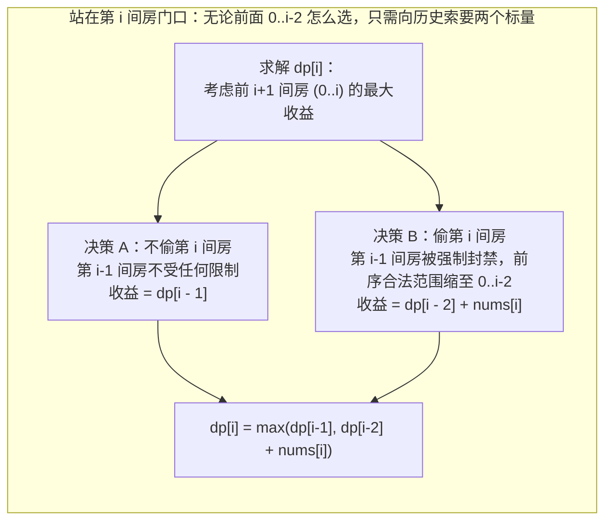

# 一维线性 DP：「选或不选」框架与打家劫舍系列

**摘要：**

在一维序列上做动态规划，最经典、也最富生命力的决策模型莫过于**"选或不选（Pick or Skip）"**：沿着数组从左往右扫描，对第 `i` 个元素做出二元抉择——如果不选它，问题直接缩减为前 `i-1` 个元素的子问题；如果选了它，则根据题目的互斥约束（譬如相邻房屋不能连偷、选中某任务后需冷却 $k$ 天），跳过若干受影响的元素后接上更早的前缀子问题。本文以**打家劫舍 I（LeetCode 198）**为基石，逐层推演**环形数组破环成链（打家劫舍 II，LeetCode 213）**、**值域聚合转化（删除并获得点数，LeetCode 740）**、**跳跃冷却期逆向刷表（解决智力问题，LeetCode 2140）**，并进一步升维至携带多状态的**粉刷房子（LeetCode 256）**与**使序列递增的最小交换次数（LeetCode 801）**，用统一的 Golang 框架彻底打通一维线性 DP 的任督二脉。

---

## 第 1 章 为什么「选或不选」能将 $O(2^n)$ 组合搜索坍缩为 $O(n)$？

### 1.1 贪心算法的局部短视反例

考察 **LeetCode 198：打家劫舍（House Robber）**：沿街有一排房屋，第 `i` 间房藏有现金 `nums[i]`（非负整数）。相邻两间房屋装有联动警报，不能在同一晚同时闯入。求在不触发警报的前提下能偷到的最高金额。

很多初学者看到这道题的第一反应是贪心："我每次挑当前剩下的房屋里金额最大的偷，或者隔一间偷一间（奇偶位置二选一），行不行？"
请看一个仅有 4 个元素的极简反例：`nums = [2, 1, 1, 2]`：
- 如果按奇偶位置选：下标 `{0, 2}` 得 $2 + 1 = 3$，下标 `{1, 3}` 得 $1 + 2 = 3$；
- 如果按贪心先挑左端最大的 `nums[0] = 2`，跳过 `nums[1]` 后紧接着贪心选 `nums[2] = 1`，就废掉了末尾更大的 `nums[3] = 2`；
- **真正的全局最优解是跨过中间两个 `1`，首尾并取 `{0, 3}`，得 $2 + 2 = 4$**。

为什么贪心会失败？因为"偷第 `i` 间房"这个动作具有**排他外部性（Negative Externality）**——它封死了你偷第 `i + 1` 间房的权利。在不看清后面房屋金额分布的情况下，局部贪心根本无法权衡"现在拿一个小钱"与"留出空位给下一步拿大钱"之间的得失。

### 1.2 「选或不选」的马尔可夫屏障与状态定义

在一个长度为 $n$ 的数组上，每个位置有"选"或"不选" 2 种可能，共有 $2^n$ 个子集。为什么我们不需要把这 $2^n$ 个子集全枚举出来？



请看上图揭示的**无后效性屏障**：
当我们定义 **`dp[i]` 表示"在前缀子数组 `nums[0 .. i]` 中合法挑选房屋所能获得的最大金额"**（注意：是**考虑范围在 `0..i` 内**，并不要求第 `i` 间房一定被偷）时，站在第 `i` 间房门口做最后一步决策：
1. **决策 A（不偷第 `i` 间房）**：既然第 `i` 间房不偷，那么第 `i - 1` 间房偷不偷都完全合法，此时在 `0 .. i` 上的最大收益，分毫不差就等于在 `0 .. i - 1` 上的最大收益 **`dp[i - 1]`**；
2. **决策 B（偷第 `i` 间房）**：既然决定偷第 `i` 间房（拿到 `nums[i]`），根据相邻警报规则，**第 `i - 1` 间房绝对不能偷**；至于第 `i - 2` 间及更早的房屋 `0 .. i - 2` 怎么偷，与第 `i` 间房隔着一个未偷的 `i - 1` 作缓冲屏障，完全互不干扰。因此，在偷第 `i` 间房的前提下，前序部分能贡献的最大收益必然就是 `0 .. i - 2` 的最优解 **`dp[i - 2]`**，总收益为 **`dp[i - 2] + nums[i]`**。

在决策 A 与决策 B 之间取最大值，状态转移方程便水到渠成：

$$dp[i] = \max\big(dp[i - 1], \; dp[i - 2] + \text{nums}[i]\big)$$

### 1.3 引入虚拟偏移哨兵：消除 `n == 1` 与 `i == 1` 的分支特判

很多题解在写打家劫舍时，开头先写一堆 `if n == 0 ... if n == 1 ... dp[0] = nums[0]; dp[1] = max(nums[0], nums[1])`。
更优雅、零分支特判的工程写法是：**将 `prev2`（代表 `dp[i-2]`）与 `prev1`（代表 `dp[i-1]`）统一初始化为 `0`（对应还没有任何房屋时的空前缀收益为 `0`）**，然后直接对数组里的每一个元素 `v` 执行统一的滚动更新 `prev2, prev1 = prev1, max(prev1, prev2 + v)`：

```go
package main

// rob LeetCode 198：设置空前缀哨兵 prev2=0, prev1=0，零分支特判完成 O(1) 空间滚动
// 时间复杂度：O(n)，额外空间复杂度：O(1)
func rob(nums []int) int {
	prev2, prev1 := 0, 0
	for _, v := range nums {
		prev2, prev1 = prev1, max(prev1, prev2+v)
	}
	return prev1
}
```

让我们验证一下为什么 `prev2 = 0, prev1 = 0` 连 `n = 1` 和 `n = 2` 都不需要特判：
- 当处理第 0 号房屋 `v = nums[0]` 时：`newPrev1 = max(0, 0 + nums[0]) = nums[0]`，`prev2` 变为 `0`；
- 当处理第 1 号房屋 `v = nums[1]` 时：`newPrev1 = max(nums[0], 0 + nums[1]) = max(nums[0], nums[1])`，`prev2` 变为 `nums[0]`；
- 完全与手工初始化的 `dp[0]`、`dp[1]` 分毫不差，代码从 15 行直接瘦身到了 6 行。

---

## 第 2 章 拓扑结构变形与值域转化：打家劫舍 II（LC 213）与删除获得点数（LC 740）

掌握了 `rob` 这把 6 行代码的瑞士军刀后，接下来看命题人是如何给它套上"环形几何"与"删除游戏"两层伪装的。

### 2.1 伪装一：首尾相连的环——打家劫舍 II（LeetCode 213）

**题目描述**：所有的房屋都**围成一圈**，这意味着第一个房屋（下标 `0`）和最后一个房屋（下标 `n - 1`）是紧挨着的邻居。求在不触动警报装置的情况下今晚能够偷窃到的最高金额。

#### 2.1.1 为什么不能直接在环上跑一遍线性 DP？

因为在普通线性 DP 中，当我们偷第 `0` 号房时，并没有在状态里记录"第 `0` 号房是否被偷了"；等到循环走到最后一间房 `n - 1` 时，你根本不知道当前 `dp[n - 3]` 对应的最优方案里到底包不包含第 `0` 号房，导致首尾冲突无法判定。

怎么在不给 `dp` 增加维度的前提下破除首尾互斥？
请分析第 `0` 号房与第 `n - 1` 号房在任何合法方案中的关系——由于它俩相邻，在全局最优解中只有三种可能：
1. 既没偷 `0`，也没偷 `n - 1`；
2. 偷了 `0`，**绝对没偷 `n - 1`**；
3. 偷了 `n - 1`，**绝对没偷 `0`**。

请注意：**情况 1 和情况 2 都满足"绝对没偷最后一间房 `n - 1`"**，因此它们的最优解必然包含在**去掉最后一间房的线性子数组 `nums[0 .. n-2]`** 当中；而**情况 1 和情况 3 都满足"绝对没偷第一间房 `0`"**，因此它们的最优解必然包含在**去掉第一间房的线性子数组 `nums[1 .. n-1]`** 当中。

这两段线性切片 `nums[:n-1]` 与 `nums[1:]` 的并集，$100\%$ 覆盖了所有合法的环形方案，且各自内部不再有任何首尾相连约束。直接对这两个切片各调用一次第 1.3 节的 6 行函数 `robLinear` 取最大值，环形难题应声而破：

```go
package main

// robII LeetCode 213：破环为两条去头/去尾的线性切片，复用打家劫舍 I
// 时间复杂度：O(n)，额外空间复杂度：O(1)
func robII(nums []int) int {
	n := len(nums)
	if n == 1 {
		return nums[0]
	}
	return max(rob(nums[:n-1]), rob(nums[1:]))
}
```

*(注：这种"枚举首元素选不选，将长为 $n$ 的环拆成两个长为 $n-1$ 的链"的思想，是解决一切环形序列 DP——如 **LeetCode 1388：3n 块披萨**——的标准母法。)*

### 2.2 伪装二：按数值删除邻居——删除并获得点数（LeetCode 740）

**题目描述**：给你一个整数数组 `nums` 。每次操作中，你可以选择任意一个 `nums[i]` ，删除它并获得 `nums[i]` 的点数。之后，你必须**删除所有等于 `nums[i] - 1` 和 `nums[i] + 1` 的元素**（被连带删除的元素不给分）。返回你能通过这些操作获得的最大点数。

#### 2.2.1 从"下标相邻互斥"到"值域相邻互斥"的同构映射

初看这道题，元素顺序是乱的，删掉一个数还会牵连全数组里所有比它大 1 和小 1 的数，似乎是个图论或回溯问题。
但请抓住两条关键不变量：
1. **同类捆绑原则**：如果你决定拿走数组里的某一个数字 $v$（比如说拿走了一个 `3`），那么所有的 `2` 和 `4` 都已经在那一瞬间被连坐销毁了；既然代价已经付过了，数组里剩下的其它所有的 `3` 再拿走就**没有任何额外副作用**了。因此，对于同一种数值 $v$，**要么一个都不拿（得 0 分），要么把数组里所有的 $v$ 全部拿光（得总分 `sumVal[v] = v * count(v)`）**；
2. **值域相邻互斥原则**：当你拿光了数值 $v$（获得 `sumVal[v]` 分）时，你唯一付出的代价就是**不能再拿数值 $v - 1$ 和数值 $v + 1$**。

请把这句话再读一遍：
> 在按数值 $0, 1, 2, \ldots, \max(\text{nums})$ 排好序的收益数组 `sumVal[0 .. maxVal]` 上，**拿了第 $v$ 号桶的钱 `sumVal[v]`，就不能拿它左右相邻的第 $v - 1$ 号桶和第 $v + 1$ 号桶的钱**。

这不就是把打家劫舍的"房屋门牌号 $i$"换成了"元素数值 $v$"吗？构造出值域累加数组 `sumVal` 后，直接把 `sumVal` 喂给第 1.3 节的 `rob(sumVal)`，一行代码不用改就能直接通关：

```go
package main

// deleteAndEarn LeetCode 740：按值域分桶累加总收益 sumVal[v]，直接归约为打家劫舍 I (rob)
// 时间复杂度：O(n + maxVal)，空间复杂度：O(maxVal)
func deleteAndEarn(nums []int) int {
	maxVal := 0
	for _, v := range nums {
		if v > maxVal {
			maxVal = v
		}
	}

	sumVal := make([]int, maxVal+1)
	for _, v := range nums {
		sumVal[v] += v
	}

	return rob(sumVal)
}
```

> [!info] 延伸追问：如果 `nums[i]` 的值域高达 $10^9$（如 LeetCode 3186 施咒的最大总伤害），不能开长度为 `maxVal` 的数组怎么办？
> 当值域极大而元素个数 $n \le 10^5$ 时，只需用哈希表统计每个不同数值的总收益并提取出有序去重键切片 `keys`。在 `keys` 上跑线性 DP 时，对位置 `i`，用双指针或二分找到左侧最后一个满足 `keys[j] < keys[i] - 1`（或 `< keys[i] - 2`）的不冲突前驱下标 `j`，转移方程即为 `dp[i] = max(dp[i-1], dp[j] + gain[keys[i]])`，时间复杂度 $O(n \log n)$、空间 $O(n)$。

---

## 第 3 章 跨度可变的「选或不选」：逆向 DP 与解码方案数

### 3.1 跳跃跨度与当前元素绑定：解决智力问题（LeetCode 2140）

在打家劫舍中，选了第 `i` 个元素固定跳过后面 1 个元素。如果**每个元素自带不同的冷却跳过步数 `brainpower[i]`** 呢？
看 **LeetCode 2140：解决智力问题**：给你一个二维数组 `questions`，其中 `questions[i] = [points_i, brainpower_i]`。对第 `i` 道题：
- 如果你**跳过**第 `i` 道题，你可以接着自由决定第 `i + 1` 道题；
- 如果你**解决**第 `i` 道题，你将获得 `points_i` 分，但接下来的 **`brainpower_i` 道题你全都不能做**（即下一道能考虑的题直接跳到了 **`i + brainpower_i + 1`**）。

#### 3.1.1 为什么这道题"从右往左逆推"比"从左往右正推"简单十倍？

如果我们试图从左往右正推，定义 `dp[i]` 为前 `i` 道题的最大得分，当你站在 `i` 处想问"我是从前面哪道题跳了 `brainpower[j]` 步刚好落到 `i` 的？"时，你会绝望地发现前面每个 `j` 的跳跃步长都不一样，根本不知道谁能跳到 `i`（除非用刷表法 Push DP）。

但如果我们**把视角调转 180 度，从右往左逆推**，定义 **`dp[i]` 表示解决后缀子数组 `questions[i .. n-1]` 所能获得的最大分数**：
站在第 `i` 道题面前，往右看（此时右边 `i+1 .. n` 的所有 `dp` 值都已经算好了）：
1. **不选第 `i` 题**：得分直接等于 **`dp[i + 1]`**；
2. **选第 `i` 题**：拿到 `points[i]` 分，并直接查阅右边已知的状态 **`dp[min(n, i + brainpower[i] + 1)]`**。
两个已知值取 `max`，每次转移严格 $O(1)$：

```go
package main

// mostPoints LeetCode 2140：变步长冷却约束下的后缀逆向 DP（选或不选）
// 时间复杂度：O(n)，空间复杂度：O(n)
func mostPoints(questions [][]int) int64 {
	n := len(questions)
	dp := make([]int64, n+1) // dp[n] = 0 作为越界哨兵

	for i := n - 1; i >= 0; i-- {
		pts, skip := int64(questions[i][0]), questions[i][1]
		nextIdx := i + skip + 1
		if nextIdx > n {
			nextIdx = n
		}
		// 决策 A（跳过第 i 题）：dp[i+1]
		// 决策 B（解决第 i 题）：pts + dp[nextIdx]
		dp[i] = max(dp[i+1], pts+dp[nextIdx])
	}
	return dp[0]
}
```

### 3.2 从"求最值"到"求方案数"：解码方法（LeetCode 91）

将一维线性 DP 中的 `max(决策A, 决策B)` 换成加法 **`决策A + 决策B`**，就得到了线性计数 DP 的标杆题——**LeetCode 91：解码方法**（将 `'A'..'Z'` 映射为 `"1".."26"`，给定数字字符串 `s`，求共有多少种解码方法）：
- 站在第 `i` 个字符 `s[i-1]` 处，最后一步解码有两种互斥方式：
  1. **单字符独立解码**：若 `s[i-1] != '0'`（`'1'..'9'` 合法），贡献 **`dp[i - 1]`** 种方案；
  2. **与前一个字符双字符联合解码**：若 `s[i-2]` 与 `s[i-1]` 组成的两位数落在 **`[10, 26]`** 之间（即 `s[i-2] == '1'`，或 `s[i-2] == '2' && s[i-1] <= '6'`），额外贡献 **`dp[i - 2]`** 种方案。

```go
package main

// numDecodings LeetCode 91：带合法性条件的爬楼梯计数（单字符迈 1 步 + 双字符迈 2 步）
func numDecodings(s string) int {
	if len(s) == 0 || s[0] == '0' {
		return 0
	}
	prev2, prev1 := 1, 1 // dp[0] = 1（空串 1 种）, dp[1] = 1
	for i := 2; i <= len(s); i++ {
		cur := 0
		if s[i-1] != '0' {
			cur += prev1
		}
		if s[i-2] == '1' || (s[i-2] == '2' && s[i-1] <= '6') {
			cur += prev2
		}
		prev2, prev1 = prev1, cur
	}
	return prev1
}
```

---

## 第 4 章 状态升维：当单个 `dp[i]` 标量不足以消除后效性时

### 4.1 为什么有些线性 DP 需要在每个位置维护 2 个或 3 个状态？

在前面的打家劫舍中，之所以一个标量 `dp[i]` 就够用，是因为"不偷第 `i` 间房"这个决策彻底切断了第 `i - 1` 间房与第 `i + 1` 间房之间的关联。
但如果题目要求**每一间房都必须做出某种动作（不能空着不选），且相邻两间房的动作互相制约**，单一标量 `dp[i]` 就会因为丢失了"第 `i` 间房到底选了哪个动作"而产生后效性。

此时，根据第 01 篇 3.2 节的升维法则：**第 `i` 步有几种影响下一步的离散状态，就在每个位置 `i` 维护几个状态变量**。

### 4.2 实战一：粉刷房子（LeetCode 256 / LCR 091）——三色互斥并行递推

**题目描述**：假如有一排房子，共 $n$ 个，每个房子可以被粉刷成红色（0）、蓝色（1）或者绿色（2）这三种颜色中的一种，你需要粉刷所有的房子并且使其**相邻的两个房子颜色不能相同**。费用矩阵 `costs[i][c]` 表示将第 `i` 号房子粉刷成颜色 `c` 的成本，计算出粉刷完所有房子的最少成本。

我们在每个位置维护三个并行状态 `(r, b, g)`，分别代表将第 `i` 号房刷成红、蓝、绿时的最小累计花费。每推进一间房，当前涂某种颜色的最小花费，等于**当前涂色成本加上前一间房涂另外两种异色中的较小值**：

```go
package main

// minCostPaintHouse LeetCode 256 / LCR 091：三状态并行滚动维护相邻异色约束
// 时间复杂度：O(n)，额外空间复杂度：O(1)
func minCostPaintHouse(costs [][]int) int {
	r, b, g := 0, 0, 0
	for _, c := range costs {
		r, b, g = c[0]+min(b, g), c[1]+min(r, g), c[2]+min(r, b)
	}
	return min(r, min(b, g))
}
```

请看第 9 行 Go 语言的多重赋值 `r, b, g = ...`：右侧表达式全部读取的是旧的 `r, b, g`，计算完毕后一次性同时赋给新的 `r, b, g`，连临时变量都省去了。

### 4.3 实战二：使序列递增的最小交换次数（LeetCode 801）——换与不换双轨状态机

**题目描述**：我们有两个长度相等且不为空的整型数组 `nums1` 和 `nums2`。在一次操作中，我们可以交换 `nums1[i]` 和 `nums2[i]` 的元素。返回使 `nums1` 和 `nums2` **都严格递增**所需操作的最小次数（用例保证总是可以实现）。

站在下标 `i` 处，为了检查 `i - 1` 与 `i` 之间是否严格递增，我们必须知道第 `i - 1` 列和第 `i` 列各自**有没有执行过上下交换**。因此每个位置 `i` 天然需要维护两个状态：
- **`keep`（即 `dp[i][0]`）**：第 `i` 列**不交换**时，使前缀 `0..i` 双双严格递增的最小交换次数；
- **`swap`（即 `dp[i][1]`）**：第 `i` 列**上下交换**时，使前缀 `0..i` 双双严格递增的最小交换次数。

观察相邻两列 `i - 1` 和 `i` 之间的两种合法衔接条件：
1. **自然平行递增**（`nums1[i-1] < nums1[i] && nums2[i-1] < nums2[i]`）：说明两列要么**都不换**（`keep = prevKeep`），要么**同时都换**（`swap = prevSwap + 1`）；
2. **交叉对角递增**（`nums1[i-1] < nums2[i] && nums2[i-1] < nums1[i]`）：说明两列必须**一列换、另一列不换**（`keep = min(keep, prevSwap)`，`swap = min(swap, prevKeep + 1)`）：

```go
package main

// minSwap LeetCode 801：双轨状态 (keep, swap) 维护相邻列的平行递增与交叉递增转移
// 时间复杂度：O(n)，额外空间复杂度：O(1)
func minSwap(nums1 []int, nums2 []int) int {
	n := len(nums1)
	keep, swap := 0, 1 // 第 0 列不换代价为 0，换代价为 1

	for i := 1; i < n; i++ {
		nextKeep, nextSwap := n, n
		// 条件 1：天然平行递增 -> 两列保持相同操作状态（同不换 或 同换）
		if nums1[i-1] < nums1[i] && nums2[i-1] < nums2[i] {
			nextKeep = keep
			nextSwap = swap + 1
		}
		// 条件 2：交叉递增 -> 两列采取相反操作状态（前换后不换 或 前不换后换）
		if nums1[i-1] < nums2[i] && nums2[i-1] < nums1[i] {
			nextKeep = min(nextKeep, swap)
			nextSwap = min(nextSwap, keep+1)
		}
		keep, swap = nextKeep, nextSwap
	}
	return min(keep, swap)
}
```

---

## 第 5 章 深度拓展：二分答案 + 线性 DP 与环形 $k$ 选不相邻进阶

### 5.1 打家劫舍 IV——当「选或不选」遇上最小化最大值（LeetCode 2560）

在面试中，当考官发现你对打家劫舍 I/II/III 对答如流时，往往会抛出一道将**二分答案（Binary Search on Answer）**与**打家劫舍线性 DP/贪心**结合的终极变体——**LeetCode 2560：打家劫舍 IV**：
**题目描述**：沿街有一排连续的房屋。小偷**至少要偷窃 `k` 间**不相邻的房屋。小偷的"窃取能力"定义为他在窃取过程中能从单间房屋中窃取的**最大金额**。给你一个整数数组 `nums` 表示每间房屋存放的现金金额和整数 `k`，返回使小偷至少能偷够 `k` 间房的**最小窃取能力**。

#### 5.1.1 为什么直接写二维 DP `dp[i][j]` 会超时，而二分答案 + 线性选或不选是绝杀？

如果尝试直接定义 `dp[i][j]` 为"从前 `i` 间房中偷 `j` 间不相邻房屋所需的最小能力"，状态数高达 $n \times k = 10^5 \times 10^5 = 10^{10}$，空间和时间双双爆炸。

但请抓住题目的黄金信号词：**"最小化所偷房屋的最大金额（Minimize the Maximum）"**。
我们在《排序与查找》专栏中反复强调：看到"最小化最大值"，第一时间对答案（窃取能力上限 `cap`）在 `[min(nums), max(nums)]` 上进行**二分查找**。
当假定小偷的窃取能力上限为 `cap` 时，那些金额 `> cap` 的豪宅小偷根本偷不动（只能跳过），而那些金额 `<= cap` 的房屋小偷全部可以偷。此时子问题 `canStealAtLeastK(cap)` 变成了：
> **在只能挑选 `nums[i] <= cap` 的房屋、且所选房屋两两不相邻的前提下，最多能挑出多少间房屋？**

这不就是一个价值全为 `1`（只允许挑 `nums[i] <= cap`）的打家劫舍 I 吗？
更妙的是，因为每间可偷房屋的价值都是均等的 `1`（不存在"为了后面更大的钱放弃前面小钱"的顾虑），在检验函数内部，甚至连 `max(f0, f1)` 都可以简化为贪心：**只要遇到 `nums[i] <= cap`，能偷就立刻偷（`count++`，并令 `i++` 额外跳过紧邻的下一间房）**：

```go
package main

import "slices"

// minCapability LeetCode 2560：二分窃取能力上限 cap + 线性不相邻选或不选验证，时间 O(n log(max))
func minCapability(nums []int, k int) int {
	lo, hi := slices.Min(nums), slices.Max(nums)

	canSteal := func(cap int) bool {
		// 用打家劫舍 DP（或等价贪心）计算仅偷 <= cap 的房屋最多能偷几间
		prev2, prev1 := 0, 0
		for _, v := range nums {
			if v <= cap {
				prev2, prev1 = prev1, max(prev1, prev2+1)
			} else {
				prev2, prev1 = prev1, prev1
			}
		}
		return prev1 >= k
	}

	for lo <= hi {
		mid := lo + (hi-lo)/2
		if canSteal(mid) {
			hi = mid - 1
		} else {
			lo = mid + 1
		}
	}
	return lo
}
```

### 5.2 环形选 $n$ 个不相邻元素：3n 块披萨（LeetCode 1388）

如果把打家劫舍 II（LC 213，环形数组不限选取个数）加上**固定选取个数限制**，就得到了困难题 **LeetCode 1388：3n 块披萨**：
**题目描述**：给你一个披萨，它由 $3n$ 块不同大小的部分组成，呈环形排列（数组 `slices`）。你和你的两个同伴分披萨，每次你挑一块，Alice 会挑掉你所选披萨逆时针方向相邻的一块，Bob 会挑掉顺时针方向相邻的一块。返回你可以获得的披萨总大小的最大值。

#### 5.2.1 数学等价归约：为什么等价于"在长为 $3n$ 的环上挑 $n$ 个两两不相邻的数"？

任何时候，只要你挑了相邻的两块披萨，是不可能的（因为你挑完一块后它左右紧邻的两块立刻被同伴拿走了）；反过来，对于任意一个在 $3n$ 块环形披萨中选出的、包含 $n$ 块**两两不相邻**披萨的集合，我们总能通过归纳法找到一种选取先后顺序将其全部收入囊中。
因此，这道题脱下游戏外衣后，纯粹就是**带选取个数维度 $j \in [1..n]$ 的打家劫舍 II**：
- 第一步，利用第 2.1 节的"化环为链"，将环形数组拆成 `slices[:3n-1]` 与 `slices[1:]` 两条长为 $3n - 1$ 的线性切片；
- 第二步，在单条线性切片 `arr` 上，定义 `dp[i][j]` 为从前 `i` 个元素中挑选 `j` 个不相邻元素的最大和，转移方程完全照搬「选或不选」：
  $$dp[i][j] = \max\big(dp[i - 1][j], \; dp[i - 2][j - 1] + \text{arr}[i]\big)$$

```go
package main

// maxSizeSlices LeetCode 1388：化环为链 (LC 213) + 选 n 个不相邻元素的二维打家劫舍 DP
// 时间复杂度：O(n^2)，空间复杂度：O(n)
func maxSizeSlices(slices []int) int {
	m := len(slices)
	choose := m / 3

	robK := func(arr []int) int {
		k := len(arr)
		// prev2[j] 对应 dp[i-2][j]，prev1[j] 对应 dp[i-1][j]
		prev2 := make([]int, choose+1)
		prev1 := make([]int, choose+1)
		cur := make([]int, choose+1)

		for i := 0; i < k; i++ {
			for j := 1; j <= choose; j++ {
				cur[j] = max(prev1[j], prev2[j-1]+arr[i])
			}
			copy(prev2, prev1)
			copy(prev1, cur)
		}
		return prev1[choose]
	}

	return max(robK(slices[:m-1]), robK(slices[1:]))
}
```

### 5.3 将字符翻转问题转化为双状态线性 DP：将字符串翻转到单调递增（LeetCode 926）

第 4 章的"多状态并行滚动"还能轻松秒杀一类看似需要枚举分割点的字符串修改题——**LeetCode 926：将字符串翻转到单调递增**（给定二进制字符串 `s`，每次可将 `'0'` 翻转为 `'1'` 或将 `'1'` 翻转为 `'0'`，求使 `s` 变为形如 `"00...011...1"` 的单调递增字符串的最少翻转次数）：
- 扫描到字符 `c` 时，它最终在单调递增串里只能处于两个状态之一：
  1. **`dp0`（当前位置最终保持为 `'0'` 的最少翻转次数）**：既然当前位是 `'0'`，它前面所有的位**必须全都是 `'0'`**，故 `dp0 = dp0 + int(c - '0')`（若 `c == '1'` 则需翻转 1 次）；
  2. **`dp1`（当前位置最终变为 `'1'` 的最少翻转次数）**：当前位是 `'1'`，它前面一位既可以是 `'0'` 也可以是 `'1'`，故 **`dp1 = min(oldDp0, dp1) + int('1' - c)`**（若 `c == '0'` 则需翻转 1 次）：

```go
package main

// minFlipsMonoIncr LeetCode 926：双状态 (结尾为 '0' 的代价 dp0, 结尾为 '1' 的代价 dp1) O(1) 空间滚动
func minFlipsMonoIncr(s string) int {
	dp0, dp1 := 0, 0
	for i := 0; i < len(s); i++ {
		c := s[i]
		dp0, dp1 = dp0+int(c-'0'), min(dp0, dp1)+int('1'-c)
	}
	return min(dp0, dp1)
}
```

### 5.4 延伸实战：最低票价——按日历天数推进的「多档位冷却选或不选」（LeetCode 983）

在「选或不选 + 跳跃冷却期」模型中，还有一道常考的日历线性 DP——**LeetCode 983：最低票价**：
在一个火车旅行很受欢迎的国度，你提前一年计划了一些火车旅行。接下来的一年里，你要旅行的日子将以一个名为 `days` 的数组给出（每一项是一个从 `1` 到 `365` 的严格递增整数）。火车票有三种销售方式：通行 `1` 天售价 `costs[0]`、通行 `7` 天售价 `costs[1]`、通行 `30` 天售价 `costs[2]`。返回完成给定的列表 `days` 中列出的每一天的旅行所需要的最低消费。

定义 `dp[d]` 为完成从第 `d` 天到第 `365` 天所有旅行计划的最低消费（或正推定义前 `d` 天的最低消费）：
- 如果第 `d` 天**不在旅行计划 `days` 中**：今天根本不用出门，一分钱不用花，直接继承 `dp[d] = dp[d - 1]`；
- 如果第 `d` 天**是必须出行的日子**：我们枚举今天买的通行证是哪一档（是 1 天前买的 1 日票、7 天前买的 7 日票，还是 30 天前买的 30 日票），取三者最小值：
  $$dp[d] = \min\Big(dp[d - 1] + \text{costs}[0], \; dp[\max(0, d - 7)] + \text{costs}[1], \; dp[\max(0, d - 30)] + \text{costs}[2]\Big)$$

这种将稀疏的出行日期数组映射在固定 365 天日历轴上做三选一转移的手法，时间与空间复杂度均为严格的 $O(365) = O(1)$，是工程业务中计费套餐与资源包组合优化的标准模板；如果出行日期跨度扩大到 $10^9$ 天，则只需将固定日历轴替换为在 `days` 下标数组上配合同向双指针定位 `days[j] <= days[i] - 7` 与 `days[k] <= days[i] - 30` 的滑动窗口 DP。

---

## 第 6 章 本章十道一维线性 DP 核心模型全景表

| 题目 | 序列拓扑与约束 | 状态定义 | 状态转移方程核心 | 时间 / 空间 |
|------|----------------|----------|------------------|-------------|
| LC 198 打家劫舍 I | 线性相邻不可同选 | `dp[i]`：前 $i$ 间最大金额 | `max(dp[i-1], dp[i-2] + nums[i])` | $O(n)$ / $O(1)$ |
| LC 213 打家劫舍 II | 环形首尾相邻不可同选 | 拆为 `nums[:n-1]` 与 `nums[1:]` | `max(rob(nums[:n-1]), rob(nums[1:]))` | $O(n)$ / $O(1)$ |
| LC 740 删除并获得点数 | 选 $v$ 则删 $v\pm 1$ | 值域桶 `sumVal[v] = v * cnt[v]` | 对 `sumVal` 直接运行 `rob` | $O(n+V)$ / $O(V)$ |
| LC 2140 解决智力问题 | 选 $i$ 则冷却跳过 $skip_i$ 题 | 后缀 `dp[i]`：`i..n-1` 最大得分 | 逆推 `max(dp[i+1], pts[i] + dp[i+skip+1])` | $O(n)$ / $O(n)$ |
| LC 91 解码方法 | 单字符 `1..9` / 双字符 `10..26` | `dp[i]`：前 $i$ 字符解码方案数 | 合法单字符加 `dp[i-1]`，合法双字符加 `dp[i-2]` | $O(n)$ / $O(1)$ |
| LC 256 粉刷房子 | 相邻房屋不可同涂一色 | `(r, b, g)` 当前涂三色最小花费 | `r' = cost[0] + min(b, g)` 三轨并行 | $O(n)$ / $O(1)$ |
| LC 801 最小交换递增 | 相邻列需严格双递增 | `(keep, swap)` 第 $i$ 列换与不换 | 平行继承 + 交叉互换取 `min` | $O(n)$ / $O(1)$ |
| LC 2560 打家劫舍 IV | 至少偷 $k$ 间最小化最大金额 | 二分上限 `cap` + 线性打家劫舍计数 | `v <= cap` 时 `max(prev1, prev2 + 1)` | $O(n \log V)$ / $O(1)$ |
| LC 1388 3n 块披萨 | 环形挑 $n$ 个不相邻元素 | 化环为链 + `dp[i][j]` 挑 $j$ 个 | `max(dp[i-1][j], dp[i-2][j-1] + arr[i])` | $O(n^2)$ / $O(n)$ |
| LC 926 翻转单调递增 | 前缀全 `'0'` 后缀全 `'1'` | `(dp0, dp1)` 当前位为 `'0'` 或 `'1'` | `dp0 += c-'0', dp1 = min(dp0,dp1) + '1'-c` | $O(n)$ / $O(1)$ |

---

## 小结

本章围绕一维线性 DP 最核心的「选或不选」范式完成了四级跳：
- **基础级（LC 198）**：利用未选位置作为马尔可夫缓冲屏障，写出 `dp[i] = max(dp[i-1], dp[i-2] + v)`；
- **结构变形级（LC 213、LC 740）**：遇到环就枚举首尾断开位置化环为链；遇到按数值连坐删除就按值域分桶归约为标准打家劫舍；
- **方向反转级（LC 2140）**：当跳跃步长与起点下标强绑定时，改"从左往右拉取"为"从右往左逆推"；
- **状态升维级（LC 256、LC 801）**：当每步必选且相邻动作互斥时，在每个位置并列维护多状态元组消除后效性。

下一篇 [[03 背包问题深度解析：0-1背包、完全背包与空间压缩]] 将在「选或不选」的基础上引入第二个关键维度——**背包容量（Capacity Constraint）**，揭开 0-1 背包与完全背包的全部秘密。

---

## 参考资料

1. LeetCode 198 / 213 / 740 / 2140 / 91 / 256 / 801 Official Editorial.
2. Kleinberg, J., & Tardos, É. (2005). *Algorithm Design*. Pearson. Chapter 6: Dynamic Programming.

---

> [!note] 思考题
> 1. 在 **LeetCode 2560：打家劫舍 IV**（小偷至少要偷 $k$ 间不相邻的房屋，他的窃取能力定义为所偷房屋中的最大金额，求最小化这个窃取能力）中，如果直接用二维 DP `dp[i][j]`（前 `i` 间房偷 `j` 间的最小能力）会達到 $O(nk)$ 超时。如何结合《排序与查找》专栏的**二分答案**与本章的打家劫舍贪心/DP 在 $O(n \log(\max))$ 时间内解决？
> 2. 在 **LeetCode 1388：3n 块披萨**（环形排列 $3n$ 块披萨，你每次挑一块，同伴会吃掉它左右相邻的两块，你一共能挑 $n$ 块，求最大总和）中，为什么这个问题等价于"在长度为 $3n$ 的环形数组中挑选 $n$ 个两两不相邻的元素使和最大"？
> 3. 在第 3.1 节的 LeetCode 2140（解决智力问题）中，如果坚持要**从左往右正向遍历**，请用第 01 篇思考题提到的"推送型刷表法（Push DP）"写出对应的 $O(n)$ 代码。
