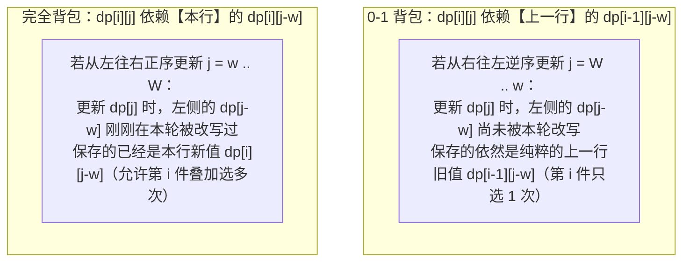
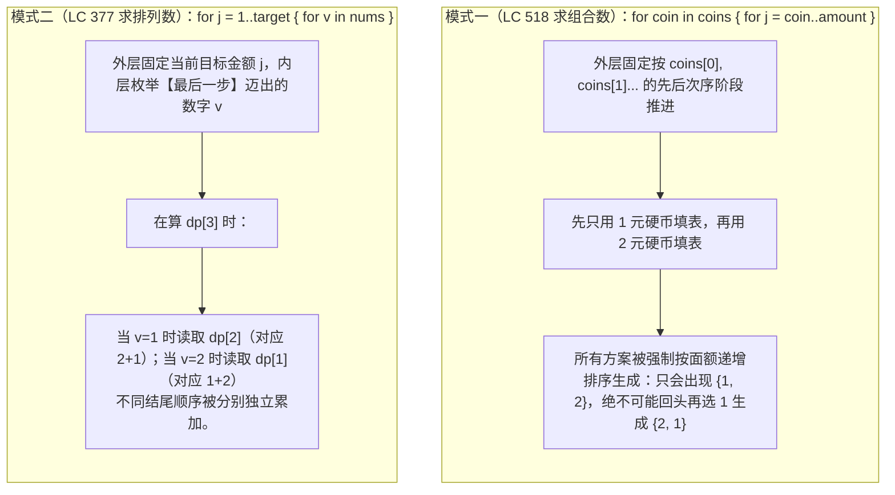

# 背包问题深度解析：0-1 背包、完全背包与空间压缩

**摘要：**

背包问题（Knapsack Problem）是动态规划殿堂中辐射面最广的模型——面试中凡是出现"能否从给定集合中挑出若干元素凑成目标值 `target`"、"凑出金额 `amount` 最少需要几个元素"、"共有多少种组合或排列方案"，其底层无一例外都是背包问题。然而，候选人在手写一维滚动数组时极易在四个旋钮上拧错方向：**0-1 背包与完全背包的内层容量循环到底谁逆序、谁正序？求组合数与求排列数时，外层循环到底枚举物品还是枚举容量？求最大价值、可行性、最小个数与方案数这四类目标的 `dp[0]` 初值该如何设定？** 本文从二维状态网格的依赖箭头出发，从内存覆盖的物理层面彻底讲透这三大灵魂拷问，并配齐 LeetCode 416、494、1049、474、322、518、377、279、139 九道高频真题的 Golang 实现。

---

## 第 1 章 背包问题的数学本质：带容量预算的「选或不选」

### 1.1 从一维「选或不选」到二维「物品 × 容量」

在上一篇（第 02 篇）的打家劫舍中，我们面对第 `i` 个元素做"选或不选"决策时，唯一受影响的是相邻下标 `i - 1`，因此状态只需要一维下标 `dp[i]`。
而在**背包问题**中，每件物品 $i$（$0 \le i < n$）都带有一个**消耗成本（重量/体积/面额 $w_i$）**与一个**产出收益（价值 $v_i$）**，而系统给定的总预算上限为 $W$。此时，光知道"考虑了前 `i` 件物品"还不够，还必须知道**"当前还剩多少可用容量 $j$"**才能满足无后效性。因此，状态自然张成了一个 $(n + 1) \times (W + 1)$ 的二维网格 `dp[i][j]`。

根据每件物品允许被选取的次数限制，面试中的背包问题分为四大基础流派：

| 背包分类 | 每件物品可用次数 | 二维状态转移方程核心 | 一维空间压缩遍历特征 |
|----------|------------------|----------------------|----------------------|
| **0-1 背包** | 至多 $1$ 次（选或不选） | `max(dp[i-1][j], dp[i-1][j-w] + v)` | 外层物品，内层容量**逆序** `W -> w` |
| **完全背包** | 无限次（$0, 1, 2, \dots$） | `max(dp[i-1][j], dp[i][j-w] + v)` | 外层物品，内层容量**正序** `w -> W` |
| **多重背包** | 至多 $c_i$ 次 | 枚举件数 $k \in [0..c_i]$ 或二进制拆分 | 二进制拆分为 $\lceil \log_2 c_i \rceil$ 件 0-1 物品 |
| **分组背包** | 每组至多选 $1$ 件 | 组内枚举选哪一件物品转移自 `dp[i-1][j-w]` | 外层枚举组，中层**逆序**枚举容量，内层枚举组内物品 |

---

## 第 2 章 灵魂拷问一：为什么一维压缩时 0-1 背包必须逆序，而完全背包必须正序？

### 2.1 0-1 背包：从二维 `dp[i-1][j-w]` 到一维逆序防污染证明

在 0-1 背包中，每件物品最多只能拿 1 次。定义 `dp[i][j]` 为从前 `i` 件物品中挑选、总重量不超过 `j` 时的最大价值。站在第 `i` 件物品（重量 $w$，价值 $v$）面前：
- **不选第 `i` 件物品**：容量不变，价值继承自上一行正上方 **`dp[i - 1][j]`**；
- **选第 `i` 件物品**（前提 $j \ge w$）：因为第 `i` 件物品只能拿 **1** 次，拿完它之后，剩下的 $j - w$ 容量**只能由前 `i - 1` 件物品去填**，因此价值继承自**上一行左上方 `dp[i - 1][j - w] + v`**：

$$dp[i][j] = \max\big(dp[i - 1][j], \; dp[i - 1][j - w] + v\big)$$

现在，我们要把二维数组 `dp[n+1][W+1]` 砍成只有一个一维数组 `dp[W+1]`，在每一轮处理物品 `i` 时原地覆写 `dp[j]`。



请用物理内存视角做一个推演：假设当前物品重量 $w = 2$，价值 $v = 10$，背包容量 $W = 4$，进入本轮前 `dp` 数组全为 `0`。
- **如果你错误地从左往右正序遍历 `j = 2 -> 4`**：
  1. 当 `j = 2` 时：`dp[2] = max(dp[2], dp[0] + 10) = 10`（此时 `dp[2]` 里已经装了 **1 件**当前物品）；
  2. 当继续往右走到 `j = 4` 时：`dp[4] = max(dp[4], dp[4 - 2] + 10) = dp[2] + 10 = 10 + 10 = 20`——看见了吗？因为 `dp[2]` 刚才已经被你更新成 `10` 了，你在 `j = 4` 时读取 `dp[2]` 再加 `10`，等于把这件只有 1 个的孤品**重复拿了第 2 次**；
- **如果你严格从右往左逆序遍历 `j = 4 -> 2`**：
  1. 先算 `j = 4`：此时左边的 `dp[2]` 还没被碰过，依然是上一轮留下的 `0`，所以 `dp[4] = max(0, dp[2] + 10) = 10`；
  2. 再算 `j = 2`：`dp[2] = max(0, dp[0] + 10) = 10`。整轮下来，每个容量最多只把当前物品加了 1 次。

### 2.2 完全背包：正序遍历天然契合无限次叠加

反过来，在**完全背包**中，每件物品有无限多个。当我们决定在容量 `j` 中至少装入 1 件第 `i` 号物品（耗重 $w$，得价值 $v$）后，剩下的 $j - w$ 容量里**依然允许继续装第 `i` 号物品**。
因此，完全背包的二维转移方程读取的本来就是**本行左侧**的 **`dp[i][j - w] + v`**：

$$dp[i][j] = \max\big(dp[i - 1][j], \; \mathbf{dp[i][j - w]} + v\big)$$

当压缩为一维数组 `dp[j]` 时，我们需要在算 `dp[j]` 的时候，`dp[j - w]` **最好已经被本轮更新过了**——这恰恰就是刚才正序遍历 `j = w -> W` 干的事情。

```go
package main

// knapsack01 0-1 背包一维模板：内层容量逆序 W -> w（确保每件物品至多用 1 次）
func knapsack01(weights, values []int, W int) int {
	dp := make([]int, W+1)
	for i := range weights {
		w, v := weights[i], values[i]
		for j := W; j >= w; j-- {
			dp[j] = max(dp[j], dp[j-w]+v)
		}
	}
	return dp[W]
}

// knapsackComplete 完全背包一维模板：内层容量正序 w -> W（允许同一物品重复叠加）
func knapsackComplete(weights, values []int, W int) int {
	dp := make([]int, W+1)
	for i := range weights {
		w, v := weights[i], values[i]
		for j := w; j <= W; j++ {
			dp[j] = max(dp[j], dp[j-w]+v)
		}
	}
	return dp[W]
}
```

---

## 第 3 章 0-1 背包四大变形实战：分割等和、目标和、最后一块石头与一和零

在 LeetCode 面试中，0-1 背包极少直接给你 `weights` 和 `values` 数组，而是隐藏在子集划分与正负号分配背后。

### 3.1 变形一：可行性判定型 0-1 背包——分割等和子集（LeetCode 416）

**题目描述**：给你一个只包含正整数的非空数组 `nums` 。请你判断是否可以将这个数组分割成两个子集，使得两个子集的元素和相等。

**归约推导**：设全数组总和为 `sum`。若 `sum` 为奇数，两个整数子集之和绝不可能相等，直接返回 `false`；若 `sum` 为偶数，问题 $100\%$ 等价于：**能否从 `nums` 中挑出一个子集（每个元素至多选 1 次），使其元素之和恰好等于 `target = sum / 2`？**

这是一个布尔可行性 0-1 背包：定义 `dp[j]` 表示能否凑出和 `j`，初值 **`dp[0] = true`**（什么都不选即可凑出 0），其余为 `false`，内层逆序更新 `dp[j] = dp[j] || dp[j - v]`：

```go
package main

// canPartition LeetCode 416：可行性 0-1 背包，逆序判断能否恰好凑出 sum/2
// 时间复杂度：O(n * sum)，空间复杂度：O(sum)
func canPartition(nums []int) bool {
	sum := 0
	for _, v := range nums {
		sum += v
	}
	if sum%2 != 0 {
		return false
	}

	target := sum / 2
	dp := make([]bool, target+1)
	dp[0] = true

	for _, v := range nums {
		for j := target; j >= v; j-- {
			if dp[j-v] {
				dp[j] = true
			}
		}
		if dp[target] {
			return true // 剪枝：一旦已凑出 target 即可提前返回
		}
	}
	return dp[target]
}
```

### 3.2 变形二：方案计数型 0-1 背包——目标和（LeetCode 494）

**题目描述**：给你一个非负整数数组 `nums` 和一个整数 `target` 。向数组中的每个整数前添加 `'+'` 或 `'-'` ，然后串联起所有整数，可以构造一个表达式。返回可以通过上述方法构造的、运算结果等于 `target` 的不同表达式的数目。

#### 3.2.1 代数消元化归为"恰好装满容量 $P$ 的 0-1 背包方案数"

不要去写带负数下标偏移的二维数组。设所有被冠以 `'+'` 号的元素之和为 $P$（Positive），所有被冠以 `'-'` 号的元素绝对值之和为 $N$（Negative），全数组元素总和为 $\text{sum}$。我们立刻拥有一个二元一次方程组：

$$\begin{cases} P + N = \text{sum} \\ P - N = \text{target} \end{cases} \implies 2P = \text{sum} + \text{target} \implies \mathbf{P = \frac{\text{sum} + \text{target}}{2}}$$

请看这个漂亮的消元结论：只要 $\text{sum} + \text{target} < 0$ 或 $(\text{sum} + \text{target})$ 是奇数，方程就没有非负整数解，直接返回 `0`；否则，原问题 $100\%$ 等价于：**从 `nums` 中挑选若干元素（每个至多选 1 次），使其总和恰好等于 $P = (\text{sum} + \text{target}) / 2$ 的组合方案总数是多少？**

对于求方案数的 0-1 背包，初始化 **`dp[0] = 1`**（凑出和为 0 有且仅有"空集"这 1 种方案），逆序转移方程将 `max` 替换为加法 **`dp[j] += dp[j - v]`**：

```go
package main

// findTargetSumWays LeetCode 494：通过 P = (sum + target) / 2 化归为 0-1 背包组合计数
// 时间复杂度：O(n * P)，空间复杂度：O(P)
func findTargetSumWays(nums []int, target int) int {
	sum := 0
	for _, v := range nums {
		sum += v
	}
	diff := sum + target
	if diff < 0 || diff%2 != 0 {
		return 0
	}

	p := diff / 2
	dp := make([]int, p+1)
	dp[0] = 1

	for _, v := range nums {
		for j := p; j >= v; j-- {
			dp[j] += dp[j-v]
		}
	}
	return dp[p]
}
```

### 3.3 变形三：最小化差值型 0-1 背包——最后一块石头的重量 II（LeetCode 1049）

**题目描述**：有一堆石头，每块石头的重量都是正整数。每一回合，从中选出任意两块石头，然后将它们一起粉碎：若 `x == y` 则两块完全粉碎；若 `x != y` 则留下重量为 `y - x` 的新石头。最后最多只会剩下一块石头，返回此石头最小的可能重量。

每次拿两块石头相撞求差，展开到最后本质上就是给每块石头前面放一个 `+` 号或 `-` 号，求 $\min |P - N| = \min |\text{sum} - 2N|$。
要想让 $\text{sum} - 2N \ge 0$ 尽可能接近 $0$，等价于：**在一个容量上限为 `target = sum / 2` 的 0-1 背包中，尽可能多地装入石头（设最多能装入的重量为 `dp[target]`），最后剩下的最小重量差就是 `sum - 2 * dp[target]`**：

```go
package main

// lastStoneWeightII LeetCode 1049：转化为容量 sum/2 的最大装载 0-1 背包
func lastStoneWeightII(stones []int) int {
	sum := 0
	for _, w := range stones {
		sum += w
	}
	target := sum / 2
	dp := make([]int, target+1)

	for _, w := range stones {
		for j := target; j >= w; j-- {
			dp[j] = max(dp[j], dp[j-w]+w)
		}
	}
	return sum - 2*dp[target]
}
```

### 3.4 变形四：双维容量限制 0-1 背包——一和零（LeetCode 474）

当背包同时受**两个维度的容量上限**制约——最多 `m` 个 `'0'` 和最多 `n` 个 `'1'`，求最多能装入多少个字符串（每个字符串价值为 `1`）时，只需将一维逆序滚动数组扩展为二维 `dp[i][j]`，对两个容量维度**同时从大到小逆序遍历**即可：

```go
package main

import "strings"

// findMaxForm LeetCode 474：二维费用 0-1 背包，对 m 和 n 双维度同时逆序更新
func findMaxForm(strs []string, m int, n int) int {
	dp := make([][]int, m+1)
	for i := range dp {
		dp[i] = make([]int, n+1)
	}

	for _, s := range strs {
		zeros := strings.Count(s, "0")
		ones := len(s) - zeros
		for i := m; i >= zeros; i-- {
			for j := n; j >= ones; j-- {
				dp[i][j] = max(dp[i][j], dp[i-zeros][j-ones]+1)
			}
		}
	}
	return dp[m][n]
}
```

---

## 第 4 章 灵魂拷问二：完全背包中"外层物品内层容量"与"外层容量内层物品"到底有什么区别？

在完全背包（每种物品无限个）中，当我们从求最值（如 **LeetCode 322：零钱兑换**、**LeetCode 279：完全平方数**，此时内外层循环顺序调换结果完全一样）转向**求方案数**时，你会发现两道题面几乎只差几个字、代码却因为内外层循环顺序颠倒而算出截然不同结果的经典姐妹题：
- **LeetCode 518：零钱兑换 II**：给定硬币面额 `coins` 和总金额 `amount`，求凑成总金额的**硬币组合数**（譬如 `1 + 2` 和 `2 + 1` 视为**同一种组合**，只算 1 次）；
- **LeetCode 377：组合总和 Ⅳ**（实为排列总和，同构于爬楼梯每次可迈 `nums[i]` 步）：给定不同正整数数组 `nums` 和目标整数 `target`，求总和为 `target` 的元素组合个数，**顺序不同的序列被视作不同的组合（即求排列数**，`1 + 2` 和 `2 + 1` 算 **2 种**方案）。

### 4.1 为什么"外层物品、内层容量"算的是组合数，而"外层容量、内层物品"算的是排列数？



请将上面两段原理刻进脑海：
1. **外层遍历物品 `coin`、内层正序遍历容量 `j`（LC 518 组合数）**：
   - 因为外层循环把物品出现的先后次序锁死了（先处理完所有的 `1` 元，再去处理所有的 `2` 元），当你站在 `coin = 2` 的轮次里时，`coin = 1` 的轮次早就永远翻篇了——你只能往 `{1}` 后面追加 `2` 形成 `{1, 2}`，**绝无可能在选了 `2` 之后再回到过去选一个 `1` 拼出 `{2, 1}`**。因此每一种无序多重集最多只按递增顺序被统计唯一一次；
2. **外层正序遍历容量 `j`、内层遍历物品 `v`（LC 377 排列数 / 单词拆分 LC 139）**：
   - 外层循环代表"当前正在攻克容量 `j`（台阶 `j`）"，内层循环代表"枚举最后一步选的是哪一个物品 `v`"。在算 `dp[3]` 时，最后一步选 `1`（接在 `dp[2]` 后面得到 `2 + 1`）与最后一步选 `2`（接在 `dp[1]` 后面得到 `1 + 2`）属于两个不同的内层分支，自然被加了两次。

```go
package main

// change LeetCode 518：完全背包求【组合数】（外层枚举物品，内层正序枚举容量）
func change(amount int, coins []int) int {
	dp := make([]int, amount+1)
	dp[0] = 1
	for _, c := range coins { // 外层物品：锁定物品选用顺序，消除排列重复
		for j := c; j <= amount; j++ {
			dp[j] += dp[j-c]
		}
	}
	return dp[amount]
}

// combinationSum4 LeetCode 377：完全背包求【排列数】（外层正序枚举容量，内层枚举物品）
func combinationSum4(nums []int, target int) int {
	dp := make([]int, target+1)
	dp[0] = 1
	for j := 1; j <= target; j++ { // 外层容量：对每个高度 j，枚举最后一步迈出的步长 v
		for _, v := range nums {
			if j >= v {
				dp[j] += dp[j-v]
			}
		}
	}
	return dp[target]
}
```

### 4.2 字符串上的完全背包排列判定：单词拆分（LeetCode 139）

理解了"外层容量、内层物品代表考虑顺序的拼接"，**LeetCode 139：单词拆分**（给定字符串 `s` 和词典 `wordDict`，判断是否可以利用词典中可重复使用的单词拼接出 `s`）就变成了一道透明的完全背包题：
- 字符串前缀长度 `i`（$1 \le i \le |s|$）就是背包容量；词典里的单词 `w` 就是可无限使用的物品；
- 因为单词拼接严格区分先后顺序（`"apple" + "pen"` 不等于 `"pen" + "apple"`），所以**必须外层枚举前缀长度 `i = 1 .. n`，内层枚举最后一段匹配的单词 `w`**（满足 `dp[i - len(w)] == true && s[i-len(w) : i] == w`）：

```go
package main

// wordBreak LeetCode 139：有序拼接完全背包（外层枚举前缀长度 i，内层枚举末尾单词 w）
func wordBreak(s string, wordDict []string) bool {
	n := len(s)
	dp := make([]bool, n+1)
	dp[0] = true // 空前缀天然可拼出

	for i := 1; i <= n; i++ {
		for _, w := range wordDict {
			k := len(w)
			if i >= k && dp[i-k] && s[i-k:i] == w {
				dp[i] = true
				break
			}
		}
	}
	return dp[n]
}
```

---

## 第 5 章 进阶背包专场：完全平方数（LC 279）、分组背包（LC 2218）与多重背包二进制拆分

### 5.1 隐式物品集合的完全背包：完全平方数（LeetCode 279）

在有些完全背包题目中，题目甚至不会直接给你 `coins` 数组，而是需要你根据数学定义自己构造出"物品列表"。
最典型的代表是 **LeetCode 279：完全平方数**：给你一个整数 `n` ，返回和为 `n` 的完全平方数的**最少数量**（完全平方数如 `1, 4, 9, 16, ...` 可以无限次重复使用）。

- **物品集合**：所有满足 $i^2 \le n$ 的完全平方数 $w_i = i^2$（共有 $\lfloor \sqrt{n} \rfloor$ 种物品，且每种物品可无限使用）；
- **背包容量**：目标整数 $n$；
- 直接套用 **LeetCode 322（零钱兑换）** 的完全背包求最小个数模板，外层枚举平方数 `w := i * i`，内层正序枚举容量 `j = w .. n`，时间复杂度 $O(n \sqrt{n})$、空间复杂度 $O(n)$：

```go
package main

// numSquares LeetCode 279：以完全平方数 i*i 为无限物品的完全背包求最少个数
// 时间复杂度：O(n * sqrt(n))，空间复杂度：O(n)
func numSquares(n int) int {
	dp := make([]int, n+1)
	for j := 1; j <= n; j++ {
		dp[j] = j // 最坏全用 1^2 凑出，需 j 个
	}

	for i := 1; i*i <= n; i++ {
		sq := i * i
		for j := sq; j <= n; j++ {
			if dp[j-sq]+1 < dp[j] {
				dp[j] = dp[j-sq] + 1
			}
		}
	}
	return dp[n]
}
```

### 5.2 分组背包（Grouped Knapsack）标杆实战：从栈中取出 K 个硬币的最大面值和（LeetCode 2218）

在第 1.1 节的四大背包流派表中，**分组背包（每组物品有若干个互斥选项，从每一组中至多只能挑 1 个选项）**是周赛与大厂压轴题的常客：
- **代表题一（LeetCode 1155：掷骰子的 N 种方法）**：$n$ 个骰子就是 $n$ 个分组，每个骰子必须掷出 `1 .. k` 中的某一个点数（组内 $k$ 选 1），求总点数恰好为 `target` 的方案数；
- **代表题二（LeetCode 2218：从栈中取出 K 个硬币的最大面值和，困难）**：一张桌子上总共有 $n$ 个硬币栈 `piles`。每一次操作中，你可以从任意一个栈的**栈顶**取出 1 个硬币，求最多进行 $k$ 次操作能拿到的最大面值和。

**为什么从栈顶取硬币是标准的分组背包？**
因为对于第 `i` 个硬币栈 `pile`，由于只能从栈顶连续往下拿，你在该栈上的最终决策只有互斥的 `len(pile) + 1` 种可能：**拿前 0 个、拿前 1 个、拿前 2 个……或拿前 `t` 个**（它们是互斥的，你在同一个栈里只能选其中一种拿法，消耗容量 `t`，获得该栈前 `t` 个硬币的前缀和收益 `prefixSum[t]`）。

在编写分组背包的一维空间压缩代码时，**三层循环的嵌套顺序是一条铁律：外层枚举组 `pile` $\to$ 中层从大到小逆序枚举总容量 `j = k -> 1` $\to$ 内层枚举该组内部选哪一个方案 `t`**。
为什么中层容量必须在内层组内选项的**外面**且**逆序**？因为只有先把容量 `j` 固定住，内层遍历同一个栈的不同拿法 `t = 1, 2, ...` 时，它们读取的 `dp[j - t]` 才全都是**进入这一个栈之前的上一组旧值**（保证同一个栈里的不同拿法不会互相叠加）：

```go
package main

// maxValueOfCoins LeetCode 2218：分组背包标准模板（外层枚举组，中层逆序枚举容量，内层枚举组内互斥决策）
// 时间复杂度：O(k * sum(len(pile)))，空间复杂度：O(k)
func maxValueOfCoins(piles [][]int, k int) int {
	dp := make([]int, k+1)

	for _, pile := range piles {
		// 中层必须逆序枚举背包容量 j = k -> 1（0-1 组间防污染）
		for j := k; j >= 1; j-- {
			curPileSum := 0
			maxTake := min(j, len(pile))
			// 内层枚举在当前栈中连续取前 t 个硬币的互斥选项
			for t := 1; t <= maxTake; t++ {
				curPileSum += pile[t-1]
				if dp[j-t]+curPileSum > dp[j] {
					dp[j] = dp[j-t] + curPileSum
				}
			}
		}
	}
	return dp[k]
}
```

### 5.3 多重背包（Bounded Knapsack）的二进制拆分技巧

如果第 `i` 种物品既不是只能选 1 次（0-1 背包），也不是无限次（完全背包），而是**最多只能选 $c_i$ 次**（如 **LeetCode 2585：获得分数的方法数**），如果直接把它拆成 $c_i$ 件一模一样的 0-1 物品，当 $c_i = 1000$ 时耗时就会乘上 $1000$ 倍。

此时最经典的通用优化是**二进制拆分（Binary Splitting）**：
- 将数量 $c_i$ 从小到大依次减去 $2^0 = 1, \, 2^1 = 2, \, 2^2 = 4, \, \ldots, \, 2^{k-1}$，直到剩余余数 $r = c_i - (2^k - 1) < 2^k$；
- 把这 $\lceil \log_2 c_i \rceil$ 个系数 $\{1, 2, 4, \dots, 2^{k-1}, r\}$ 分别乘以单件物品的重量 $w_i$ 和价值 $v_i$，打包成 **$\lceil \log_2 c_i \rceil$ 件独立的 0-1 背包大礼包**；
- 因为 $\{1, 2, 4, \dots, 2^{k-1}, r\}$ 的子集和能够不重不漏地拼出 $0, 1, 2, \dots, c_i$ 之间的每一个整数，我们直接对打包后的大礼包跑标准 0-1 背包，就能把单种物品的拆分开销从 $O(c_i)$ 指数级压缩到 **$O(\log c_i)$**。

### 5.4 延伸实战一：盈利计划——"至少产生 minProfit 利润"的下界封顶 0-1 背包（LeetCode 879）

在前文讨论的所有背包问题中，容量约束都是**"至多不超过 $W$"**或**"恰好等于 $W$"**。但如果在二维 0-1 背包中，其中一个维度要求的是**"至少达到 `minProfit`（下界约束，$\ge \text{minProfit}$）"**，该如何设计状态？

看困难题 **LeetCode 879：盈利计划**：集团里有 `n` 名员工，他们可以完成各种各样的工作创造利润。第 `i` 种工作会产生 `profit[i]` 的利润，它要求 `group[i]` 名成员共同参与。如果成员参与了其中一项工作，就不能参与另一项工作。工作的任何**至少产生 `minProfit` 利润**的子集称为盈利计划，并且工作的成员总数最多为 `n` 。有多少种计划可以选择？（结果模 $10^9 + 7$）。

**下界封顶（Capping at `minProfit`）状态技巧**：
- 第一个容量维度是人数上限 `j <= n`（标准"至多"约束，当 `j < group[i]` 时装不下）；
- 第二个维度是利润下限 `k >= minProfit`（"至少"约束）：如果把所有工作的利润总和当成数组大小，空间会非常大；但请注意——**一旦当前累计利润已经超过或等于了 `minProfit`（比如要求至少赚 5 块钱，你现在赚了 8 块钱或 100 块钱），它们在"已经达标"这件事上是 $100\%$ 等价的**；
- 因此，我们将利润维度的上限直接**封顶截断在 `minProfit`**。在逆序更新利润维度 `k = minProfit -> 0` 时，做完当前工作（利润 `p`）之前所需的旧利润门槛是 **`max(0, k - p)`**（当 `p > k` 时，哪怕之前一分钱没赚 `0`，加上 `p` 也已经超过 `k` 达标了，所以直接查 `dp[j - g][0]`）：

```go
package main

// profitableSchemes LeetCode 879：人数至多 n + 利润至少 minProfit（max(0, k-p) 下界封顶二维 0-1 背包）
// 时间复杂度：O(len(group) * n * minProfit)，空间复杂度：O(n * minProfit)
func profitableSchemes(n int, minProfit int, group []int, profit []int) int {
	const mod = 1_000_000_007
	// dp[j][k] 表示使用至多 j 名员工、产生至少 k 利润的方案数
	dp := make([][]int, n+1)
	for j := range dp {
		dp[j] = make([]int, minProfit+1)
		dp[j][0] = 1 // 产生至少 0 利润（什么工作都不做），无论给多少员工名额都有 1 种空集方案
	}

	for i := range group {
		g, p := group[i], profit[i]
		for j := n; j >= g; j-- {
			for k := minProfit; k >= 0; k-- {
				// 若当前工作利润 p 已 >= k，则前序只需产生至少 0 利润即可达标
				needProfit := max(0, k-p)
				dp[j][k] = (dp[j][k] + dp[j-g][needProfit]) % mod
			}
		}
	}
	return dp[n][minProfit]
}
```

### 5.5 延伸实战二：数位成本和为目标值的最大数字——完全背包 + 贪心字典序路径还原（LeetCode 1449）

将"恰好装满的完全背包"与第 01 篇的"逆向对账路径还原"结合到极致的，是困难题 **LeetCode 1449：数位成本和为目标值的最大数字**：
给你一个数组 `cost`（`cost[i]` 代表选数字 `i + 1` 的成本，$1 \le i+1 \le 9$）和一个整数 `target`。返回满足总成本**恰好等于 `target`** 的最大整数字符串。

1. **怎么让拼出来的十进制整数尽可能大？**
   - **第一优先级（位数越多越大）**：4 位数一定比 3 位数大。因此我们先跑一遍"恰好装满容量 `target` 的**最多物品个数**完全背包"（`dp[0] = 0`，`dp[1..target] = -inf`），算出最多能挑出多少个数字 `dp[target]`；
   - **第二优先级（位数相同时，高位数字越大越好）**：拿着填好的 `dp` 表，从终点 `cur = target` 开始逆向回溯。在每一步，**从大到小倒序枚举数字 `d = 9 -> 1`**，只要发现 `cur >= cost[d-1] && dp[cur] == dp[cur - cost[d-1]] + 1`（说明选数字 `d` 能通向最长位数的最优解），就立刻贪心地把最大的数字 `'0' + d` 填在当前最高位上，并令 `cur -= cost[d-1]` 继续往低位走：

```go
package main

import "math"

// largestNumber1449 LeetCode 1449：恰好装满求最大位数的完全背包 + 倒序 9..1 贪心对账还原最大字典序
func largestNumber1449(cost []int, target int) string {
	const negInf = math.MinInt32 / 2
	dp := make([]int, target+1)
	for j := 1; j <= target; j++ {
		dp[j] = negInf // 恰好装满初始化：非 0 容量全设为负无穷
	}

	for _, c := range cost {
		for j := c; j <= target; j++ {
			if dp[j-c]+1 > dp[j] {
				dp[j] = dp[j-c] + 1
			}
		}
	}
	if dp[target] < 0 {
		return "0"
	}

	// 从高到低贪心挑选满足转移等式 dp[cur] == dp[cur-c] + 1 的最大数字 d (9 -> 1)
	res := make([]byte, 0, dp[target])
	for cur := target; cur > 0; {
		for d := 9; d >= 1; d-- {
			c := cost[d-1]
			if cur >= c && dp[cur] == dp[cur-c]+1 {
				res = append(res, byte('0'+d))
				cur -= c
				break
			}
		}
	}
	return string(res)
}
```

### 5.6 常见误区与考场自检清单

1. **在"恰好装满求最大价值/最多位数"的背包（如 LC 1449）中，将 `dp[1..W]` 错误初始化为 `0`**：如果初始化为 `0`，那么未装满的空余容量也会算作合法起点被加上去，算出来的实际上是"至多装 $W$"而非"恰好装满 $W$"。记住：**恰好装满求最大值必须将 `dp[1..W]` 初始化为 `-inf`（`math.MinInt32 / 2`），仅留 `dp[0] = 0`**。
2. **在目标和（LC 494）中未检查 `sum + target < 0`**：当 `target` 是一个绝对值超过 `sum` 的负数（如 `nums = [100], target = -200`）时，虽然 `(100 + (-200)) % 2 == 0` 是偶数，但算出来的 $P = -50 < 0$ 会直接导致 `make([]int, p+1)` 触发负数长度 panic。
3. **在求方案数（`+=`）的背包中忘记对结果取模**：当 `target = 10^5` 且物品面额为 `1` 时，方案数呈指数级增长（斐波那契式），32 位 `int` 会在几十步内直接溢出为负数。凡题目要求对 $10^9 + 7$ 取模的计数背包（如 LC 494、LC 518、LC 1155），必须在每一步 `dp[j] = (dp[j] + dp[j-w]) % mod` 就地取模，绝不能等最后才取模。
4. **在分组背包（LC 2218）中把内层枚举组内选项 `t` 放在了中层枚举容量 `j` 的外面**：如果先枚举组内选项 `t` 再枚举容量 `j`，同一个栈的不同拿法 `t = 1` 与 `t = 2` 会互相叠加（先按 `t=1` 更新 `dp[j]`，再按 `t=2` 读取已被污染的 `dp[j-2]`），导致同一个栈被重复取款。牢记分组背包铁律：**外层组 $\to$ 中层逆序容量 $\to$ 内层组内选项**。

---

## 第 6 章 背包问题四类目标的初始化与转移黄金法则总表

把下面这张"背包四大金刚速查表"烂熟于心，你将永远不会在 `dp[0]` 和非零位置 `dp[1..W]` 的初始化上犯错：

| 求解目标类型 | `dp[0]` 初值 | `dp[1 .. W]` 初值 | 状态转移方程核心 | 典型代表题目 |
|--------------|--------------|-------------------|------------------|--------------|
| 1. **至多装 $W$ 的最大价值** | `0` | 全为 `0` | `dp[j] = max(dp[j], dp[j-w] + v)` | 经典 0-1 背包、LC 1049、LC 474 |
| 2. **恰好装满 $W$ 的最大价值** | `0` | 全为 **`-inf`**（未装满非法） | `dp[j] = max(dp[j], dp[j-w] + v)` | 恰好装满变体 |
| 3. **恰好凑出 $W$ 的最少物品数** | `0` | 全为 **`+inf`（如 `W + 1`）** | `dp[j] = min(dp[j], dp[j-w] + 1)` | LC 322 零钱兑换、LC 279 完全平方数 |
| 4. **恰好凑出 $W$ 是否可行（bool）** | `true` | 全为 `false` | `dp[j] = dp[j] \|\| dp[j-w]` | LC 416 分割等和子集、LC 139 单词拆分 |
| 5. **恰好凑出 $W$ 的方案总数** | **`1`** | 全为 `0` | `dp[j] += dp[j-w]` | LC 494 目标和、LC 518（组合）、LC 377（排列） |

---

## 小结

本章从二维状态依赖图的物理根源出发，彻底扫清了背包问题的三大迷雾：
- **遍历方向之谜**：0-1 背包依赖上一行 `dp[i-1][j-w]`，一维原地更新必须**逆序**以防同轮自污染；完全背包依赖本行 `dp[i][j-w]`，一维更新必须**正序**以允许无限叠加；
- **循环内外之谜**：不计顺序求**组合数**（LC 518）时，**外层物品、内层容量**；计较顺序求**排列数**（LC 377、LC 139）时，**外层容量、内层物品**；
- **初值设定之谜**：求方案数与可行性时，`dp[0]` 永远是 `1`（或 `true`）；求最小个数时，非零容量初值设为安全的 `amount + 1` 避免加法溢出。

下一篇 [[04 子序列DP：最长递增子序列与O(nlogn)优化]] 将转向单序列子序列问题，剖析"强制以 `nums[i]` 结尾"的状态建模范式，并揭秘 Patience Sorting（耐心排序）是如何通过贪心与二分查找将 $O(n^2)$ 的 LIS 优化到 $O(n \log n)$ 的。

---

## 参考资料

1. Cormen, T. H., et al. *Introduction to Algorithms* (4th ed.). MIT Press, 2022.
2. Martello, S., & Toth, P. (1990). *Knapsack Problems: Algorithms and Computer Implementations*. Wiley.
3. LeetCode 416 / 494 / 1049 / 474 / 322 / 518 / 377 / 279 / 139 Official Editorial.

---

> [!note] 思考题
> 1. 在 **LeetCode 322：零钱兑换**（求凑成金额 `amount` 的最少硬币数）中，如果把外层枚举硬币、内层枚举金额，改成**外层枚举金额、内层枚举硬币**，算出来的最少硬币数会不会变？为什么在求最值（`min`/`max`）而非求方案数（`+=`）时，排列与组合具有相同的最优值？
> 2. 在多重背包问题（第 $i$ 种物品最多有 $c_i$ 件）中，如果 $c_i = 13$，为什么我们可以把这 13 件相同物品拆成重量与价值分别乘以 **$1, 2, 4, 6$** 的 **4 件 0-1 背包大礼包**？请证明 $\{1, 2, 4, 6\}$ 的子集和能够不重不漏地表示 $0 \dots 13$ 之间的每一个整数。
> 3. 在 **LeetCode 2218：从栈中取出 K 个硬币的最大面值和**中，有 $n$ 个栈，从第 $i$ 个栈顶部连续取出 $t$ 个硬币可获得前缀和收益 $v(i, t)$，总共最多取 $K$ 个硬币。请用本章第 1.1 节表格中的**分组背包（外层枚举栈、中层逆序枚举总硬币数 $K \to 1$、内层枚举当前栈取出的硬币个数 $t$）**写出状态转移方程。
