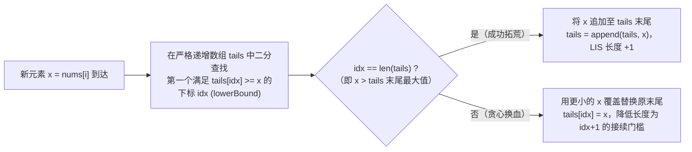

# 子序列 DP：最长递增子序列与 O(n log n) 优化

**摘要：**

在处理一维序列问题时，如果题目要求的对象从物理连续的"子数组（Subarray）"变成了允许跳跃选取的"子序列（Subsequence）"，或者虽是子数组但受正负号影响（如最大子数组和与最大乘积子数组），第 02 篇那种笼统的"考虑前 `i` 个元素的最优解"往往无法直接写出转移方程——因为你不知道前 `i` 个元素的最优子序列末尾到底停在哪个数字上，从而无法判断第 `i+1` 个元素能不能合法接上去。为了消除这一后效性，序列 DP 诞生了第二大黄金状态范式：**强制以第 `i` 个元素结尾的最优解（Ending-at-`i` State Paradigm）**。本文以**最长递增子序列（LIS，LeetCode 300）**为核心主线，完整推导从 $O(n^2)$ 动态规划到 **$O(n \log n)$ 耐心排序（Patience Sorting，贪心最小末尾 `tails` 数组 + 二分查找 `lowerBound`）**的思维跃迁，并串联讲解最大子数组和（LC 53）、乘积最大子数组（LC 152）、最长递增子序列的个数（LC 673）与二维偏序俄罗斯套娃信封（LC 354）的 Golang 实现。

---

## 第 1 章 状态定义范式转换：为什么必须定义「以 `nums[i]` 结尾」？

### 1.1 "前 `i` 个元素最优"在 LIS 上遭遇的后效性死胡同

考察 **LeetCode 300：最长递增子序列（Longest Increasing Subsequence，简称 LIS）**：给你一个整数数组 `nums` ，找到其中最长**严格递增子序列**的长度。

假设你照搬打家劫舍的习惯，尝试定义 `f[i]` 为"在前缀 `nums[0 .. i]` 中能找到的最长递增子序列长度"。
现在，当你算出了 `f[i - 1] = 3`，站在新元素 `nums[i] = 6` 面前想问："我能不能把 `6` 接在前面那个长为 3 的递增子序列屁股后面，拼成长度为 4？"
**你答不上来**——因为 `f[i - 1] = 3` 只告诉了你长度是 3，却**没有告诉你那个长为 3 的递增子序列最后一个元素到底是多少**（如果是 `[1, 2, 5]` 就能接上 `6`，如果是 `[1, 4, 9]` 就接不上 `6`）。历史子序列的末尾数值对未来能不能接新元素构成了强烈的**后效性**。

### 1.2 破局之道：用"强制以 `nums[i]` 为结尾"锁死末尾数值

怎么把这个不确定性彻底掐死？
我们直接修改状态定义：**令 `dp[i]` 表示"在必须选中 `nums[i]` 作为子序列最后一个元素的前提下，所能构成的最长严格递增子序列长度"**。

一旦强制规定子序列以 `nums[i]` 结尾，末尾数值就变成了板上钉钉的已知常数 `nums[i]`。站在下标 `i` 处，我们只需要回头枚举它前面那个倒数第二个元素是谁（设其下标为 $j$，满足 $0 \le j < i$）：
- 只要满足 **`nums[j] < nums[i]`**，`nums[i]` 就可以合法地接在"以 `nums[j]` 结尾的最长递增子序列"后面，形成长度为 `dp[j] + 1` 的递增子序列；
- 遍历所有合法的前驱 $j < i$ 取最大值（若没有任何 $j$ 满足 `nums[j] < nums[i]`，则 `nums[i]` 自己单干，长度为 `1`）：

$$dp[i] = 1 + \max\big(\{0\} \cup \{dp[j] \mid 0 \le j < i \text{ 且 } \text{nums}[j] < \text{nums}[i]\}\big)$$

最后，因为全局最长的递增子序列可能以数组中任何一个位置结尾，所以**最终答案绝不是 `dp[n - 1]`，而是全数组所有状态的全局最大值 $\max_{0 \le i < n} dp[i]$**：

```go
package main

// lengthOfLISQuadratic LeetCode 300 解法一：O(n^2) 经典 DP（定义 dp[i] 为以 nums[i] 结尾的 LIS 长度）
func lengthOfLISQuadratic(nums []int) int {
	n := len(nums)
	if n == 0 {
		return 0
	}
	dp := make([]int, n)
	maxLen := 1

	for i := 0; i < n; i++ {
		dp[i] = 1 // 保底：nums[i] 单独构成长度为 1 的子序列
		for j := 0; j < i; j++ {
			if nums[j] < nums[i] && dp[j]+1 > dp[i] {
				dp[i] = dp[j] + 1
			}
		}
		if dp[i] > maxLen {
			maxLen = dp[i]
		}
	}
	return maxLen
}
```

### 1.3 同属「以 `i` 结尾」范式的两大连续子数组名题：Kadane 算法（LC 53）与正负双轨乘积（LC 152）

不仅是非连续子序列，凡是要求**连续子数组（Subarray）**且数组中包含负数（导致滑动窗口失灵）的极值问题，也全部采用"强制以 `nums[i]` 结尾"的状态范式——而且由于**连续子数组**规定了倒数第二个元素若存在则**只能是紧挨着的 `i - 1`**，内层根本不需要 $O(n)$ 枚举 $j$，单步转移直接就是 $O(1)$：

1. **LeetCode 53：最大子数组和（Kadane 算法）**：
   - 定义 `dp[i]` 为强制以 `nums[i]` 结尾的最大连续子数组和；
   - 站在 `nums[i]` 处，如果前面的 `dp[i - 1] > 0`，接上它有利可图（`dp[i] = dp[i - 1] + nums[i]`）；如果 `dp[i - 1] <= 0`，前面的前缀和是个负数累赘，直接一刀斩断、从 `nums[i]` 重新自立门户（`dp[i] = nums[i]`）：
     $$dp[i] = \max(\text{nums}[i], \; dp[i - 1] + \text{nums}[i])$$
2. **LeetCode 152：乘积最大子数组（正负翻转下的双状态闭合）**：
   - 正如第 01 篇 3.1 节所剖析，由于负数乘以负数会负负得正变成最大正数，只维护以 `i` 结尾的最大乘积 `maxF` 不满足最优子结构；
   - 我们必须同时维护以 `i` 结尾的**最大乘积 `maxF`** 与**最小（最负）乘积 `minF`**。当新元素 `v = nums[i]` 为负数时，原有的 `maxF` 乘以 `v` 会变成最小值，原有的 `minF` 乘以 `v` 反而会摇身一变成为最大值：

```go
package main

// maxSubArray LeetCode 53：Kadane 算法，O(1) 空间维护以当前元素结尾的最大子数组和
func maxSubArray(nums []int) int {
	curMax, globalMax := nums[0], nums[0]
	for i := 1; i < len(nums); i++ {
		curMax = max(nums[i], curMax+nums[i])
		if curMax > globalMax {
			globalMax = curMax
		}
	}
	return globalMax
}

// maxProduct LeetCode 152：同时维护以当前元素结尾的最大积 maxF 与最小积 minF，应对负负得正
func maxProduct(nums []int) int {
	maxF, minF, ans := nums[0], nums[0], nums[0]
	for i := 1; i < len(nums); i++ {
		v := nums[i]
		// 若当前元素为负数，乘以 v 会使最大与最小角色瞬间互换
		if v < 0 {
			maxF, minF = minF, maxF
		}
		maxF = max(v, maxF*v)
		minF = min(v, minF*v)
		if maxF > ans {
			ans = maxF
		}
	}
	return ans
}
```

---

## 第 2 章 从 $O(n^2)$ 到 $O(n \log n)$：贪心最小末尾 `tails` 数组与二分查找

回到最长递增子序列（LC 300）。当数据规模扩大到 $n = 10^5$（如俄罗斯套娃信封 LC 354）时，$O(n^2)$ 的双重循环需要 $10^{10}$ 次运算，必然超时。
为什么 `lengthOfLISQuadratic` 慢？因为每算一个 `dp[i]`，我们都要把左边所有的 `0 .. i-1` 从头扫一遍。怎样把这层 $O(n)$ 扫描压缩到 $O(\log n)$？

### 2.1 核心贪心直觉：同样长度的递增子序列，末尾数字越小、未来潜力越大

请思考一个极其朴素的道理：
假设在扫描数组的过程中，你手头已经攒出了两个长度同样为 $3$ 的递增子序列：
- 选手甲：`[2, 5, 100]`（末尾是 `100`）；
- 选手乙：`[2, 5, 7]`（末尾是 `7`）。

请问：**对于后面即将到来的未知数字（譬如 `18`），选手甲和选手乙谁更容易接上新数字变成长为 $4$ 的递增子序列？**
**百分之百是末尾更小的选手乙 `[2, 5, 7]`**——因为任何能接在 `100` 后面的数（`> 100`），一定也能接在 `7` 后面；而像 `18` 这样能接在 `7` 后面的数，却接不在 `100` 后面。换言之，在同样长度 $k$ 的所有递增子序列中，**末尾元素最小的那一个对所有其他同长度子序列构成了绝对支配，我们只需要记住这个最小的末尾值就够了**。

### 2.2 `tails` 数组的严格单调性与 `lowerBound` 替换法则

基于上述贪心支配律，我们不再按"下标 $i$"记状态，而是反过来按**"子序列长度 $L$"**维护一个状态数组 **`tails`**（0-indexed）：
> **`tails[k]` 表示：截至目前为止，所有长度为 $k + 1$ 的严格递增子序列中，末尾元素的最小值。**

首先证明一条至关重要的性质：**在任意时刻，数组 `tails[0 .. len-1]` 必然是严格单调递增的（即 `tails[0] < tails[1] < ... < tails[len-1]`）**。
- **反证法**：假设存在某个位置使得 `tails[k-1] >= tails[k]`。根据定义，`tails[k]` 是某个长度为 $k + 1$ 的严格递增子序列 $S$ 的末尾元素；那么把 $S$ 的最后一个元素砍掉，剩下的前缀 $S'$ 是一个长度为 $k$ 的严格递增子序列，且其末尾元素 $x$ 严格小于 `tails[k]`（即 $x < \text{tails}[k] \le \text{tails}[k-1]$）。这就找到了一个长度为 $k$、末尾元素 $x$ 比 `tails[k-1]` 更小的递增子序列，与 `tails[k-1]` 是长度 $k$ 的最小末尾值相矛盾。$\square$

既然 `tails` 数组是**严格单调递增**的有序数组，当新元素 `x = nums[i]` 到来时，我们就可以直接在 `tails` 上使用**二分查找 `lowerBound`（寻找第一个 `>= x` 的下标 `idx`）**：
1. **情况 A（`x` 严格大于 `tails` 的所有元素，即 `idx == len(tails)`）**：
   - 说明 `x` 可以直接接在当前最长的递增子序列（末尾为 `tails[len-1]`）后面，使全局最长递增子序列的长度**增加 1**，执行 `tails = append(tails, x)`；
2. **情况 B（在 `tails` 中找到了第一个满足 `tails[idx] >= x` 的位置 `idx`）**：
   - 因为 `tails` 严格递增，既然 `tails[idx]` 是第一个 `>= x` 的，那么它前一个位置必然满足 **`tails[idx - 1] < x <= tails[idx]`**；
   - 这意味着 `x` 可以接在长度为 `idx` 的子序列（末尾为 `tails[idx - 1]`）后面，构成一个**新的长度为 `idx + 1`、且末尾元素更小（为 `x`）的递增子序列**。我们直接执行 **`tails[idx] = x`**，把原来的旧末尾 `tails[idx]` 替换调小，为后续元素创造更好的接续条件。



```go
package main

import "sort"

// lengthOfLIS LeetCode 300 解法二：贪心最小末尾数组 tails + 二分查找 lowerBound
// 时间复杂度：严格 O(n log n)，空间复杂度：O(n)
func lengthOfLIS(nums []int) int {
	var tails []int
	for _, x := range nums {
		// 在严格递增的 tails 中二分查找第一个 >= x 的下标
		idx := sort.SearchInts(tails, x)
		if idx == len(tails) {
			tails = append(tails, x)
		} else {
			tails[idx] = x
		}
	}
	return len(tails)
}
```

> [!warning] 考场必考追问：如果题目要求的是"最长非递减子序列（允许相邻元素相等 `<=`）"，二分条件该怎么改？
> - 求**严格递增（`<`）**时，相同元素不能接在自己后面，所以我们要找第一个 **`>= x`** 的位置把它替换掉（即 **`lowerBound`**）；
> - 求**非递减（`<=`）**（如 **LeetCode 1964：找出到每个位置为止最长的有效障碍赛跑路线**）时，`x` 可以合法接在等于 `x` 的末尾后面，因此我们要跳过所有 `<= x` 的元素，找第一个**严格大于 `x`（`> x`）**的位置替换（即 **`upperBound`**，`sort.Search(len(tails), func(i int) bool { return tails[i] > x })`）。

---

## 第 3 章 进阶拓展：俄罗斯套娃信封（二维偏序 LIS）与 LIS 方案计数

### 3.1 二维偏序降维：俄罗斯套娃信封问题（LeetCode 354）

**题目描述**：给你一个二维整数数组 `envelopes` ，其中 `envelopes[i] = [w_i, h_i]` ，表示第 `i` 个信封的宽度和高度。当另一个信封的宽度和高度都比这个信封**严格大**（$w_1 < w_2$ 且 $h_1 < h_2$）时，这个信封就可以放进另一个信封里。请计算最多能有多少个信封能组成一组"俄罗斯套娃"信封（不允许旋转信封）。其中 $n \le 10^5$。

#### 3.1.1 为什么"按宽度升序、宽度相同时按高度降序"是神来之笔？

这道题要求在二维平面上找一条宽度 $w$ 和高度 $h$ 同时严格递增的最长链。
1. 首先，我们按第一维**宽度 $w$ 升序排列**，把二维无序集合固定到从左往右的顺序上；
2. 排序之后，如果所有信封的宽度两两不同，我们只需要对第二维**高度 $h$ 求一遍 $O(n \log n)$ 的严格递增子序列（LIS）**就完事了；
3. **但如果有两个信封的宽度完全相同**——譬如 `[6, 4]` 和 `[6, 7]`，宽度都是 `6`，按照题意**同宽度的信封绝不能互相套入**。如果你在宽度相同时按高度**升序**排成了 `[6, 4], [6, 7]`，那么高度序列 `[..., 4, 7, ...]` 在跑 LIS 时就会错误地把 `4` 和 `7` 同时选进去；
4. 怎么从根源上禁止同宽度的信封在高度 LIS 中被选超过 1 个？
   **在宽度 $w$ 相同时，将高度 $h$ 按降序（从大到小）排列**（即排成 `[6, 7], [6, 4]`）。
   如此一来，所有宽度相同的信封在高度数组中构成了一段**严格递减子段** `[7, 4]`。而我们要找的是高度**严格递增**的子序列，在一段严格递减的序列里，任何严格递增子序列**最多只能挑走其中 1 个元素**，从而在不改一行 LIS 代码的前提下，自动保证了被选中的信封宽度也严格递增：

```go
package main

import "sort"

// maxEnvelopes LeetCode 354：按宽度升序、同宽按高度降序排列后，对高度求 O(n log n) LIS
func maxEnvelopes(envelopes [][]int) int {
	sort.Slice(envelopes, func(i, j int) bool {
		if envelopes[i][0] != envelopes[j][0] {
			return envelopes[i][0] < envelopes[j][0] // 宽度严格升序
		}
		return envelopes[i][1] > envelopes[j][1] // 同宽度时高度严格降序，杜绝同宽多选
	})

	var tails []int
	for _, env := range envelopes {
		h := env[1]
		idx := sort.SearchInts(tails, h)
		if idx == len(tails) {
			tails = append(tails, h)
		} else {
			tails[idx] = h
		}
	}
	return len(tails)
}
```

### 3.2 最长递增子序列的个数——长度与方案数双数组协同递推（LeetCode 673）

如果面试官不问你 LIS 的最大长度是多少，而是问你**"具有最大长度的最长递增子序列一共有多少个？"**（**LeetCode 673**），该如何基于第 1.2 节的 $O(n^2)$ DP 扩展？

我们在每个位置 `i` 同时维护两个数组：
- **`length[i]`**：以 `nums[i]` 结尾的最长递增子序列**长度**（初值为 `1`）；
- **`count[i]`**：以 `nums[i]` 结尾、且达到该最大长度 `length[i]` 的递增子序列**个数**（初值为 `1`）。

在内层循环枚举前驱 $j < i$（满足 `nums[j] < nums[i]`）时，会出现三种情况：
1. **发现更长的新纪录（`length[j] + 1 > length[i]`）**：说明之前攒的短方案全作废了，将最大长度更新为 `length[i] = length[j] + 1`，并将方案数**重置继承**为 **`count[i] = count[j]`**；
2. **平了当前最长纪录（`length[j] + 1 == length[i]`）**：说明从下标 `j` 走过来也能达到同样的最大长度，将方案数**累加汇入**：**`count[i] += count[j]`**；
3. **不如当前长（`length[j] + 1 < length[i]`）**：直接忽略：

```go
package main

// findNumberOfLIS LeetCode 673：双数组 (length[i], count[i]) 同步维护最长长度与方案数
// 时间复杂度：O(n^2)，空间复杂度：O(n)
func findNumberOfLIS(nums []int) int {
	n := len(nums)
	length := make([]int, n)
	count := make([]int, n)
	maxLen, totalAns := 0, 0

	for i := 0; i < n; i++ {
		length[i], count[i] = 1, 1
		for j := 0; j < i; j++ {
			if nums[j] < nums[i] {
				if length[j]+1 > length[i] {
					length[i] = length[j] + 1
					count[i] = count[j] // 刷新最大长度，重置计数
				} else if length[j]+1 == length[i] {
					count[i] += count[j] // 平齐最大长度，累加计数
				}
			}
		}
		if length[i] > maxLen {
			maxLen = length[i]
			totalAns = count[i]
		} else if length[i] == maxLen {
			totalAns += count[i]
		}
	}
	return totalAns
}
```

---

## 第 4 章 如何输出具体的最长递增子序列（路径回溯还原）

在面试中，一个经典的追问是："`tails` 数组里的元素本身就是最长递增子序列吗？如果题目让你把最长递增子序列的具体元素打印出来，在 $O(n \log n)$ 算法下怎么做？"

首先明确：**`tails` 数组最终存放的元素，未必是一个合法的原数组子序列**（因为后面来的小元素替换掉前面的 `tails[idx]` 时，它在原数组中的物理下标却在后面，破坏了下标先后顺序）。
要想在 $O(n \log n)$ 时间内同时还原出一条字典序最小（或合法）的具体 LIS：
- 在维护 `tails` 的同时，额外用一个长度为 $n$ 的数组 **`posLen[i]` 记录每个元素 `nums[i]` 当初被二分放进了 `tails` 的哪一个下标（即以 `nums[i]` 结尾的 LIS 长度为 `posLen[i] + 1`）**；
- 遍历结束后，设最大长度为 $L = \text{len}(\text{tails})$。我们从原数组末尾 `i = n - 1` 往 `0` 倒序扫描，依次寻找满足 `posLen[i] == L - 1`, `L - 2`, ..., `0` 的第一个元素填入结果数组即可，无需任何复杂的父指针链表，简洁又高效：

```go
package main

import "sort"

// reconstructLIS O(n log n) 求出最长递增子序列并逆向还原具体序列元素
func reconstructLIS(nums []int) []int {
	n := len(nums)
	var tails []int
	posLen := make([]int, n)

	for i, x := range nums {
		idx := sort.SearchInts(tails, x)
		if idx == len(tails) {
			tails = append(tails, x)
		} else {
			tails[idx] = x
		}
		posLen[i] = idx // 记录 nums[i] 对应的 LIS 阶梯位置 (0 .. len-1)
	}

	k := len(tails)
	res := make([]int, k)
	targetIdx := k - 1
	// 从右往左逆向拾取阶梯位置为 k-1, k-2, ..., 0 的元素，天然满足下标递增与数值递增
	for i := n - 1; i >= 0 && targetIdx >= 0; i-- {
		if posLen[i] == targetIdx {
			res[targetIdx] = nums[i]
			targetIdx--
		}
	}
	return res
}
```

---

## 第 5 章 延伸实战：最大整除子集（LC 368）、最长字符串链（LC 1048）与无矛盾球队（LC 1626）

「强制以 `i` 结尾」的子序列 DP 绝不仅限于数值大小比较 `nums[j] < nums[i]`。事实上，只要元素之间的衔接关系满足**偏序传递性（Transitivity：若 $A \prec B$ 且 $B \prec C$，则 $A \prec C$）**，全都可以直接套用 LIS 的状态框架。

### 5.1 整除偏序集上的 LIS：最大整除子集（LeetCode 368）

**题目描述**：给你一个由**无重复**正整数组成的集合 `nums` ，请你找出并返回其中最大的整除子集 `answer` ，子集中每一对元素 `(answer[i], answer[j])` 都应当满足：`answer[i] % answer[j] == 0` 或 `answer[j] % answer[i] == 0`。

**为什么排序后就变成了标准 LIS？**
- 整除关系具有天然的传递性：如果正整数 $a \mid b$（$b$ 是 $a$ 的倍数）且 $b \mid c$（$c$ 是 $b$ 的倍数），那么 $c$ 必然也是 $a$ 的倍数（$a \mid c$）；
- 因此，我们先将 `nums` **升序排列**。在一个升序排列的整除子集 `[x_1, x_2, ..., x_k]` 中，想要让新元素 `nums[i]` 能与子集里的**每一个**元素都满足相互整除，只需要检查**`nums[i]` 能否被该子集目前的最大末尾元素 `nums[j]` 整除（即 `nums[i] % nums[j] == 0`）**即可；
- 看，这不就是把 LIS 的转移条件从 `nums[j] < nums[i]` 改成了 **`nums[i] % nums[j] == 0`** 吗？配合前驱数组 `prev[i]` 记录最优跳板下标，填完表后逆向回溯即可输出完整子集：

```go
package main

import "sort"

// largestDivisibleSubset LeetCode 368：升序排序后利用整除传递性转化为带前驱回溯的 LIS
// 时间复杂度：O(n^2)，空间复杂度：O(n)
func largestDivisibleSubset(nums []int) []int {
	sort.Ints(nums)
	n := len(nums)
	dp := make([]int, n)
	prev := make([]int, n)
	maxLen, bestEnd := 0, 0

	for i := 0; i < n; i++ {
		dp[i], prev[i] = 1, -1
		for j := 0; j < i; j++ {
			if nums[i]%nums[j] == 0 && dp[j]+1 > dp[i] {
				dp[i] = dp[j] + 1
				prev[i] = j
			}
		}
		if dp[i] > maxLen {
			maxLen = dp[i]
			bestEnd = i
		}
	}

	res := make([]int, 0, maxLen)
	for cur := bestEnd; cur != -1; cur = prev[cur] {
		res = append(res, nums[cur])
	}
	return res
}
```

### 5.2 哈希表加速前驱查找的子序列 DP：最长字符串链（LeetCode 1048）与最长定差子序列（LC 1218）

在普通 $O(n^2)$ LIS 中，因为任何小于 `nums[i]` 的元素都能当它的前驱，我们不得不遍历左边所有的 $j < i$。但当题目的前驱条件**极其苛刻（每个元素只有唯一或极少数几个特定形态的前驱）**时，我们可以直接用**哈希表 `dpMap[state] -> maxLen`** 代替内层 `for j` 循环，将时间复杂度直接降到线性：

1. **LeetCode 1218：最长定差子序列**（要求相邻两数之差固定为 `diff`，即 `arr[i] - arr[j] == diff`）：
   - 数字 `x` 的合法前驱**唯一确定**就是数值 **`x - diff`**；
   - 连内层循环和二分都不用，直接一行 **`dp[x] = dp[x - diff] + 1`**，严格 $O(n)$ 时间通关；
2. **LeetCode 1048：最长字符串链**（词 `A` 插入恰好 1 个字母变成词 `B`，则 `A` 是 `B` 的前身，求最长词链长度）：
   - 先将单词数组 `words` 按**单词长度升序排列**（确保算长词 `w` 时，所有比它短 1 的前身词都已经算完了）；
   - 对长度为 $L$ 的单词 `w`，它所有可能的前身词只有 **$L$ 个**（即依次删掉 `w` 的第 `0, 1, ..., L-1` 个字符得到的短词 `pred = w[:k] + w[k+1:]`），直接去哈希表里查这 $L$ 个前身词的 `dp[pred]` 取最大值加 1：

```go
package main

import "sort"

// longestStrChain LeetCode 1048：按词长排序确定拓扑序 + 枚举删 1 字符前身查哈希表
// 时间复杂度：O(n * L^2)（L <= 16 为单词最大长度），空间复杂度：O(n * L)
func longestStrChain(words []string) int {
	sort.Slice(words, func(i, j int) bool {
		return len(words[i]) < len(words[j])
	})

	dp := make(map[string]int, len(words))
	maxChain := 1

	for _, w := range words {
		best := 1
		for k := 0; k < len(w); k++ {
			pred := w[:k] + w[k+1:]
			if prevLen, ok := dp[pred]; ok && prevLen+1 > best {
				best = prevLen + 1
			}
		}
		dp[w] = best
		if best > maxChain {
			maxChain = best
		}
	}
	return maxChain
}
```

### 5.3 带权二维偏序 LIS：无矛盾的最佳球队（LeetCode 1626）

如果将第 3.1 节的**俄罗斯套娃信封（LC 354，求最长个数）**与**带权最大和**结合起来，就得到了 **LeetCode 1626：无矛盾的最佳球队**：
给你每位球员的得分 `scores[i]` 和年龄 `ages[i]`，若一名年龄较小球员的得分严格大于一名年龄较大球员，则产生矛盾。求无矛盾球队的最大总得分。

- 将所有球员按**年龄升序排列，年龄相同时按得分升序排列**（因为同龄球员之间不产生矛盾，可以同时入选，所以同龄时按得分**升序**而非降序）；
- 排序后年龄已经单调不减，若要不产生矛盾，入选球员的**得分也必须单调不减（`scores[j] <= scores[i]`）**；
- 问题直接化归为在排序后的得分数组上求**最大和的非递减子序列**：`dp[i] = scores[i] + max_{j < i, scores[j] <= scores[i]} dp[j]`，在 $O(n^2)$（或用树状数组维护前缀最大值优化至 $O(n \log n)$）时间内即可解出。

### 5.4 延伸实战四：环形子数组的最大和——正难则反与 Kadane 双轨最值（LeetCode 918）

在第 1.3 节我们讲了普通平直数组上的最大子数组和（Kadane 算法，LC 53）。如果数组首尾相连变成了**环形数组**（**LeetCode 918：环形子数组的最大和**），怎么用 $O(1)$ 空间的 Kadane 算法解决？

环形数组上的非空连续子数组只有两种拓扑形态：
1. **形态一（不跨越首尾分界线）**：就是普通平直数组 `nums[0 .. n-1]` 内部的一段子数组，其最大和直接由标准 Kadane 算法求出，记为 **`maxSum`**；
2. **形态二（跨越首尾分界线，包含一段前缀 `0..i` 与一段后缀 `j..n-1`）**：
   - 正难则反：既然两头被选走了，那么**正中间没被选走的那一段连续子数组 `nums[i+1 .. j-1]`**，其元素之和如果**越小（越负）**，两头留下的环形子数组之和 `totalSum - minSum` 就**越大**；
   - 因此，我们在同一次遍历中，用完全对称的 Kadane 公式 `curMin = min(v, curMin + v)` 同步求出平直数组的**最小连续子数组和 `minSum`**；
   - **唯一边界陷阱**：如果全数组所有元素**全都是负数**（此时 `maxSum < 0`），那么最小子数组和 `minSum` 会把整个数组全选走（导致 `totalSum == minSum`，两头剩下的变成非法的**空子数组**，`totalSum - minSum == 0`）。因此当 `maxSum < 0` 时，直接返回 `maxSum`（那个最大的单元素负数）；否则返回 **`max(maxSum, totalSum - minSum)`**：

```go
package main

// maxSubarraySumCircular LeetCode 918：同步运行最大/最小 Kadane 算法，正难则反求环形最大子数组和
// 时间复杂度：O(n)，额外空间复杂度：O(1)
func maxSubarraySumCircular(nums []int) int {
	totalSum := nums[0]
	curMax, maxSum := nums[0], nums[0]
	curMin, minSum := nums[0], nums[0]

	for i := 1; i < len(nums); i++ {
		v := nums[i]
		totalSum += v
		curMax = max(v, curMax+v)
		maxSum = max(maxSum, curMax)
		curMin = min(v, curMin+v)
		minSum = min(minSum, curMin)
	}

	// 若 maxSum < 0，说明全数组均为负数，不可用 totalSum - minSum（会对应非法空子数组）
	if maxSum < 0 {
		return maxSum
	}
	return max(maxSum, totalSum-minSum)
}
```

### 5.5 延伸实战五：最长等差数列——双下标定公差的子序列 DP（LeetCode 1027 & 873）

在前面第 5.2 节的 LeetCode 1218 中，等差数列的公差 `diff` 是题目给定的固定常数，所以一维状态 `dp[x]` 就够了。
但如果题目**不指定公差**，让你找出数组中**任意公差**的最长等差子序列长度（**LeetCode 1027：最长等差数列**），或者找出最长的斐波那契式子序列长度（**LeetCode 873**）呢？
- 单靠最后一个元素的下标 `i` 无法确定公差是多少（有后效性）；
- 根据升维法则，要唯一确定一个等差数列（或斐波那契数列），需要知道它的**最后两个元素 `(j, i)`**（其中 $j < i$）。定义二维状态 **`dp[i][d]` 为以 `nums[i]` 结尾、且公差为 `d = nums[i] - nums[j]` 的最长等差子序列长度**，枚举前驱 $j < i$ 执行 `dp[i][d] = max(2, dp[j][d] + 1)`，即可在 $O(n^2)$ 时间内完美解决：

```go
package main

// longestArithSeqLength LeetCode 1027：二维状态 dp[i][diff] 维护以 i 结尾、公差为 diff 的最长等差子序列
// 时间复杂度：O(n^2)，空间复杂度：O(n * V)（V <= 1001 为差值范围，加偏移 500 映射为非负下标）
func longestArithSeqLength(nums []int) int {
	n := len(nums)
	const offset = 500
	dp := make([][1001]int, n)
	maxLen := 2

	for i := 1; i < n; i++ {
		for j := 0; j < i; j++ {
			d := nums[i] - nums[j] + offset
			prevLen := dp[j][d]
			if prevLen == 0 {
				prevLen = 1 // 单个元素 nums[j] 初始长度为 1
			}
			if prevLen+1 > dp[i][d] {
				dp[i][d] = prevLen + 1
			}
			if dp[i][d] > maxLen {
				maxLen = dp[i][d]
			}
		}
	}
	return maxLen
}
```

### 5.6 常见误区与考场自检清单

1. **在 $O(n \log n)$ LIS 中混淆 `lowerBound`（严格递增 `<`）与 `upperBound`（非递减 `<=`）**：记住，如果题目要求严格递增，相同数字不能并列，因此遇到相等数字时必须用它**原地替换**掉已有的相等末尾（找第一个 `>= x` 的位置 `sort.SearchInts`）；如果题目允许相等（非递减），相同数字可以合法追加在后面延长子序列，因此要找第一个**严格大于 `x`（`> x`）**的位置替换。
2. **在俄罗斯套娃信封（LC 354）中将相同宽度按高度升序排列**：同宽度时若按高度升序排列，高度 LIS 会把多个相同宽度的信封同时选入，违反宽度严格递增要求；同宽度必须按高度**降序**排列。
3. **在最长等差数列（LC 1027）中直接用 `dp[i][diff]` 而未对负公差加偏移量**：公差 `diff = nums[i] - nums[j]` 的取值范围是 `[-1000, 1000]`，直接用 `diff` 作为数组下标会让负公差触发负数下标 panic，必须加偏移量 `offset = 1000`（或 `500`，视题目值域而定）映射为非负下标。
4. **在乘积最大子数组（LC 152）中忘记先交换 `maxF/minF` 再乘负数**：当 `v < 0` 时，必须先执行 `maxF, minF = minF, maxF` 交换双轨，再统一执行 `maxF = max(v, maxF*v); minF = min(v, minF*v)`；若不交换直接乘，负负得正的最大值会被漏掉。

---

## 第 6 章 本章单序列「以 `i` 结尾」DP 家族全景表

| 题目 | 连续性要求 | 状态定义 | 转移复杂度与优化手段 | 总时间 / 空间 |
|------|------------|----------|----------------------|---------------|
| LC 53 最大子数组和 | 连续子数组 | `dp[i]`：以 `i` 结尾最大和 | `max(nums[i], dp[i-1]+nums[i])`（$O(1)$） | $O(n)$ / $O(1)$ |
| LC 152 乘积最大子数组 | 连续子数组 | `(maxF, minF)`：以 `i` 结尾最大/最小积 | 负数交换 `maxF/minF` 后乘 `v`（$O(1)$） | $O(n)$ / $O(1)$ |
| LC 300 最长递增子序列 | 非连续子序列 | `dp[i]` 或 `tails[k]`（长 $k+1$ 最小尾） | 二分查找 `lowerBound` 替换 `tails` | $O(n \log n)$ / $O(n)$ |
| LC 354 俄罗斯套娃信封 | 二维偏序子序列 | 宽升序、同宽高降序后转一维 `tails` | 排序降维 + 高度数组 `lowerBound` | $O(n \log n)$ / $O(n)$ |
| LC 673 LIS 的个数 | 非连续子序列 | `(length[i], count[i])` 双数组 | `>` 重置计数，`==` 累加计数 | $O(n^2)$ / $O(n)$ |
| LC 368 最大整除子集 | 整除偏序子序列 | 排序后 `dp[i]`：以 `nums[i]` 结尾最大集 | 枚举约数前驱 `nums[i] % nums[j] == 0` + `prev` 回溯 | $O(n^2)$ / $O(n)$ |
| LC 1048 最长字符串链 | 词长差 1 前身链 | 按词长排序 + 哈希表 `dp[word]` | 枚举删掉 1 个字符的前身词查表 `$O(L)$` | $O(n L^2)$ / $O(nL)$ |

---

## 小结

本章完整构建了单序列子序列与连续子数组 DP 的核心方法论：
- 当子问题拼接依赖于前序方案的末尾元素特征时，必须采用**"强制以第 `i` 个元素结尾"**的状态定义以消除后效性，且全局答案需对所有 `dp[i]` 取极值；
- 借助"同长度下末尾越小越具优势"的贪心支配律，将 LIS 的状态从"下标 $\to$ 长度"翻转为**"长度 $\to$ 最小末尾值 `tails`"**，利用 `tails` 的严格单调性引入二分查找，实现了从 $O(n^2)$ 到 $O(n \log n)$ 的质变；
- 在二维偏序问题（LC 354）中，通过**"第一维升序、同值时第二维降序"**的精巧排序，成功阻止了同宽信封的非法互套，将其无损归约为一维 LIS。

下一篇 [[05 最长公共子序列与字符串编辑距离]] 将把视野从单条序列拓展到**两条序列之间的对齐与变换**，攻克双序列二维 DP 的两大丰碑——LCS 与编辑距离。

---

## 参考资料

1. Aldous, D., & Diaconis, P. (1999). *Longest increasing subsequences: from patience sorting to the Baik-Deift-Johansson theorem*. Bulletin of the American Mathematical Society, 36(4), 413–432.
2. Dilworth, R. P. (1950). *A decomposition theorem for partially ordered sets*. Annals of Mathematics, 51(1), 161–166.
3. LeetCode 300 / 354 / 673 / 53 / 152 Official Editorial.

---

> [!note] 思考题
> 1. 根据偏序集上的 **Dilworth 定理**，一个序列的最长严格递增子序列（LIS）的长度，恰好等于将该序列划分为最少个数的**非递增（下降）子序列**所需的组数。结合这一结论，在 **LeetCode 1671：得到山形数组的最少删除次数**（要求先严格递增再严格递减）中，如何通过正反跑两遍 LIS 在 $O(n \log n)$ 时间内算出每个山峰位置 `i` 两侧的最长坡长？
> 2. 在第 4 章的 `reconstructLIS` 中，我们证明了在 $O(n \log n)$ 算法中，从右往左依次挑选 `posLen[i] == k-1, k-2, ..., 0` 的元素一定能构成一条合法的递增子序列。请严格证明：为什么如果在右边位置 $i_2$ 处找到了 `posLen[i_2] == t`，那么在它左边 $i_1 < i_2$ 处必然存在某个位置满足 `posLen[i_1] == t - 1` 且 `nums[i_1] < nums[i_2]`？
> 3. 在 **LeetCode 1218：最长定差子序列**（要求相邻两元素之差固定等于常数 `difference`）中，为什么连二分查找都不需要了，直接用一个哈希表 `dp[val] = dp[val - difference] + 1` 就能在严格的 $O(n)$ 时间内解出？
