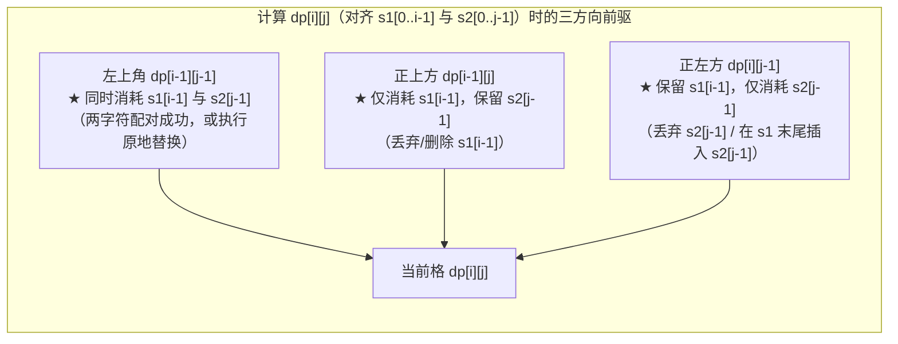

# 最长公共子序列与字符串编辑距离

**摘要：**

当动态规划的研究对象从一条序列升级为**两条序列（或两个字符串 `s1` 与 `s2`）之间的比对、对齐与转换**时，我们就进入了**双序列二维 DP（Two-Sequence 2D DP）**的领地。在这一领域中，**最长公共子序列（Longest Common Subsequence，简称 LCS，LeetCode 1143）**与 **Levenshtein 编辑距离（Edit Distance，LeetCode 72）**是支撑起整个知识体系的两根擎天柱——从 `git diff` 代码行比对、拼写纠错引擎到生物基因序列对齐（BLAST），无一不是这两套算法在工业界的直接映射。本文从"对齐最后一对字符 `s1[i-1]` 与 `s2[j-1]`"的第一性原理出发，推导双序列 DP 的通用二维网格模型与三方向转移几何（左上对角、正上、正左），详解如何用**单行滚动数组配合左上角暂存变量 `prev`** 将空间复杂度从 $O(mn)$ 压缩至 $O(\min(m, n))$，并一网打尽交错字符串（LC 97）、不同的子序列（LC 115）与最短公共超序列（LC 1092）等经典变形。

---

## 第 1 章 双序列 DP 的建模原点：为什么状态是二维前缀网格 `dp[i][j]`？

### 1.1 双序列尾端对齐的三种基本宿命

在单序列 DP 中，我们每次只需盯住一个游标 `i`（前缀 `s[0 .. i-1]` 的末尾字符）。而在涉及两个字符串 `s1`（长 $m$）和 `s2`（长 $n$）的问题中，两个字符串各自都有一个正在推进的进度游标：
- `i`（取值 $0 \dots m$）：代表当前考察 `s1` 的长度为 `i` 的前缀 `s1[0 .. i-1]`；
- `j`（取值 $0 \dots n$）：代表当前考察 `s2` 的长度为 `j` 的前缀 `s2[0 .. j-1]`。

为什么强烈建议使用 **1-indexed（长度作下标，`0` 专门留给空串 `""`）** 来定义 `dp[i][j]`？
因为在任何双字符串问题中，"其中一个字符串已经耗尽变成空串 `""`"都是最核心的递归终止边界（Base Case）。把下标 `0` 留给空前缀后，`dp[0][j]` 自然存放"`s1` 为空串与 `s2` 前 `j` 个字符"的边界值，`dp[i][0]` 自然存放"`s1` 前 `i` 个字符与 `s2` 为空串"的边界值，在主循环 `for i := 1; i <= m` 中读取 `dp[i-1][j-1]` 时永远不会发生负数下标越界。

当我们站在 `(i, j)` 这个格子上，审视两个前缀各自的**最后一个字符 `s1[i-1]` 与 `s2[j-1]`** 时，它们在二维网格上的转移来源永远逃不出左、上、左上这三个邻居格子：



看懂了上面这幅三向几何图，无论是 LCS、编辑距离、子序列计数还是正则匹配，都只是在给这三条箭头赋予不同的权重与合流运算（`max`、`min`、`+` 或 `||`）。

---

## 第 2 章 基石一：最长公共子序列（LCS，LeetCode 1143）与衍生家族

### 2.1 状态转移推导与二维标准实现

**题目描述**：给定两个字符串 `text1` 和 `text2`，返回这两个字符串的最长**公共子序列**的长度。如果不存在公共子序列，返回 `0`。

定义 `dp[i][j]` 为 `text1[0 .. i-1]` 与 `text2[0 .. j-1]` 的最长公共子序列长度。考察末尾字符对 `(text1[i-1], text2[j-1])`：
1. **若 `text1[i-1] == text2[j-1]`（尾字符相同）**：
   - 这两个相同的末尾字符完全可以手拉手作为公共子序列的最后一项，将问题无损缩减为左上方子问题，贡献长度 `+1`：
     $$dp[i][j] = dp[i - 1][j - 1] + 1$$
2. **若 `text1[i-1] != text2[j-1]`（尾字符不同）**：
   - 既然它俩不相等，就不可能**同时**作为公共子序列的最后一项。因此，它们当中至少有一个是多余的：要么把 `text1[i-1]` 扔掉看正上方 `dp[i - 1][j]`，要么把 `text2[j-1]` 扔掉看正左方 `dp[i][j - 1]`，两者取最大：
     $$dp[i][j] = \max\big(dp[i - 1][j], \; dp[i][j - 1]\big)$$

### 2.2 一维滚动数组压缩：如何用 `prev` 变量挽救被覆盖的左上角 `dp[i-1][j-1]`？

在二维表格中，`dp[i][j]` 只依赖上一行 `i - 1` 和本行左侧 `j - 1`。如果我们只开一个长度为 $n + 1$ 的一维切片 `dp` 从左往右滚动更新：
- 在 `dp[j]` 被改写**之前**，它里面存着的是正上方旧值 **`dp[i - 1][j]`**；
- 左边邻居 `dp[j - 1]` 刚刚在本轮被改写过，里面存着的是正左方新值 **`dp[i][j - 1]`**；
- 唯独**左上角 `dp[i - 1][j - 1]`**，在上一格 `j - 1` 更新时已经被覆盖掉了。怎么办？只需在更新 `dp[j]` 之前，先用临时变量 `temp := dp[j]` 把正上方的旧值存下来，等算完当前格后令 **`prev = temp`**，那么到了下一格 `j + 1` 时，这个 `prev` 就分毫不差地扮演了左上角 `dp[i - 1][j]` 的角色：

```go
package main

// longestCommonSubsequence LeetCode 1143：一维滚动数组 + prev 暂存左上角，空间 O(min(m, n))
// 时间复杂度：O(m * n)，额外空间复杂度：O(min(m, n))
func longestCommonSubsequence(text1 string, text2 string) int {
	if len(text1) < len(text2) {
		text1, text2 = text2, text1 // 确保内层滚动切片取较短字符串的长度
	}
	m, n := len(text1), len(text2)
	dp := make([]int, n+1)

	for i := 1; i <= m; i++ {
		prev := 0 // 对应 dp[i-1][0]
		for j := 1; j <= n; j++ {
			temp := dp[j] // 暂存未被覆盖前的 dp[i-1][j]，供下一列 j+1 作为左上角 prev 使用
			if text1[i-1] == text2[j-1] {
				dp[j] = prev + 1
			} else {
				dp[j] = max(dp[j], dp[j-1])
			}
			prev = temp
		}
	}
	return dp[n]
}
```

### 2.3 LCS 的四大高频变体：删除操作（LC 583）、最小 ASCII 删除和（LC 712）与最短公共超序列（LC 1092）

掌握了 LCS，以下四道题无需重头推导即可秒解：
1. **LeetCode 1035：不相交的线**：在两排数字间连相等数字的线且线不能相交，本质就是保持相对顺序不变的公共子序列，代码与 `longestCommonSubsequence` $100\%$ 相同；
2. **LeetCode 583：两个字符串的删除操作**（每步可删任一字符串的一个字符，求使两串相等的最小步数）：两串删剩下的相等部分最大长度就是 `lcs`，因此最少删除总步数恒等于 **`len(word1) + len(word2) - 2 * lcs`**；
3. **LeetCode 712：两个字符串的最小 ASCII 删除和**：等价于把每个字符的权值从 `1` 换成它的 ASCII 码值，求**最大 ASCII 权值和的公共子序列** `maxAsciiLCS`，再用两串总 ASCII 和减去 `2 * maxAsciiLCS`（或直接正向求最小删除 ASCII 和）；
4. **LeetCode 1092：最短公共超序列（Shortest Common Supersequence，困难）**：给出两个字符串 `str1` 和 `str2`，返回同时以 `str1` 和 `str2` 作为子序列的最短字符串。
   - **构造原理**：先算出完整的二维 `dp[m+1][n+1]` LCS 表，然后从右下角 `(m, n)` 往左上角 `(0, 0)` **逆向回溯**：
     - 若 `str1[i-1] == str2[j-1]`：该公共字符只写 **1** 次，向左上走 `i--; j--`；
     - 若 `dp[i-1][j] >= dp[i][j-1]`：说明 `str1[i-1]` 不在 LCS 中，将其单独写入超序列并向上走 `i--`；否则将 `str2[j-1]` 写入并向左走 `j--`。最后将回溯收集的字符反转即为最短公共超序列（长度恰为 `m + n - lcs`）：

```go
package main

import "slices"

// shortestCommonSupersequence LeetCode 1092：二维 LCS 填表 + 从右下角逆向回溯构造最短超序列
func shortestCommonSupersequence(str1 string, str2 string) string {
	m, n := len(str1), len(str2)
	dp := make([][]int, m+1)
	for i := range dp {
		dp[i] = make([]int, n+1)
	}
	for i := 1; i <= m; i++ {
		for j := 1; j <= n; j++ {
			if str1[i-1] == str2[j-1] {
				dp[i][j] = dp[i-1][j-1] + 1
			} else {
				dp[i][j] = max(dp[i-1][j], dp[i][j-1])
			}
		}
	}

	// 从 (m, n) 逆向回溯提取超序列字符
	res := make([]byte, 0, m+n-dp[m][n])
	i, j := m, n
	for i > 0 && j > 0 {
		if str1[i-1] == str2[j-1] {
			res = append(res, str1[i-1]) // 公共字符合并只输出一次
			i--
			j--
		} else if dp[i-1][j] >= dp[i][j-1] {
			res = append(res, str1[i-1])
			i--
		} else {
			res = append(res, str2[j-1])
			j--
		}
	}
	for i > 0 {
		res = append(res, str1[i-1])
		i--
	}
	for j > 0 {
		res = append(res, str2[j-1])
		j--
	}
	slices.Reverse(res)
	return string(res)
}
```

---

## 第 3 章 基石二：字符串编辑距离（Levenshtein Distance，LeetCode 72）

### 3.1 题目描述与三种编辑操作的几何对应

**题目描述**：给你两个单词 `word1` 和 `word2`，请返回将 `word1` 转换成 `word2` 所使用的**最少操作数**。你可以对一个单词进行如下三种操作：插入一个字符、删除一个字符、替换一个字符。

定义 `dp[i][j]` 为将 `word1` 的前 `i` 个字符 `word1[0 .. i-1]` 转换为 `word2` 的前 `j` 个字符 `word2[0 .. j-1]` 所需的最少操作数。
1. **边界初始化（切勿写漏）**：
   - 第一列 `dp[i][0] = i`：将长度为 `i` 的 `word1` 删成空串，必须执行 `i` 次删除；
   - 第一行 `dp[0][j] = j`：将空串变成长度为 `j` 的 `word2`，必须执行 `j` 次插入。
2. **状态转移（对比最后一对字符 `word1[i-1]` 与 `word2[j-1]`）**：
   - **若 `word1[i-1] == word2[j-1]`**：末尾字符本来就相等，无需耗费任何操作，直接继承左上角：**`dp[i][j] = dp[i - 1][j - 1]`**；
   - **若 `word1[i-1] != word2[j-1]`**：我们有三条互斥的转换路线可选，取三者最小值加 `1`：
     1. **替换（Replace）**：先把 `word1[0 .. i-2]` 变成 `word2[0 .. j-2]`（耗费 `dp[i - 1][j - 1]` 步），最后花 1 步把末尾的 `word1[i-1]` 替换成 `word2[j-1]` $\to$ **`dp[i - 1][j - 1] + 1`（左上角）**；
     2. **删除（Delete）**：先把 `word1` 末尾的 `word1[i-1]` 花 1 步删掉，再把剩下的 `word1[0 .. i-2]` 变成 `word2[0 .. j-1]`（耗费 `dp[i - 1][j]` 步） $\to$ **`dp[i - 1][j] + 1`（正上方）**；
     3. **插入（Insert）**：先把 `word1[0 .. i-1]` 变成 `word2[0 .. j-2]`（耗费 `dp[i][j - 1]` 步），最后花 1 步在末尾插入一个 `word2[j-1]` $\to$ **`dp[i][j - 1] + 1`（正左方）**。

```go
package main

// minDistance LeetCode 72：编辑距离一维滚动空间优化版，时间 O(m*n)，空间 O(n)
func minDistance(word1 string, word2 string) int {
	m, n := len(word1), len(word2)
	dp := make([]int, n+1)
	// 初始化第 0 行：空串变为 word2[0..j-1] 需 j 次插入
	for j := 0; j <= n; j++ {
		dp[j] = j
	}

	for i := 1; i <= m; i++ {
		prev := dp[0] // 保存左上角 dp[i-1][0]
		dp[0] = i     // 更新第 0 列：word1[0..i-1] 变为空串需 i 次删除
		for j := 1; j <= n; j++ {
			temp := dp[j] // 暂存正上方 dp[i-1][j]
			if word1[i-1] == word2[j-1] {
				dp[j] = prev
			} else {
				// min(左上替换 prev,min(正上删除 dp[j], 正左插入 dp[j-1])) + 1
				dp[j] = 1 + min(prev, min(dp[j], dp[j-1]))
			}
			prev = temp
		}
	}
	return dp[n]
}
```

请特别留意第 15 行 **`dp[0] = i`**：在一维滚动压缩编辑距离时，很多候选人只记得在循环前初始化第 0 行 `dp[j] = j`，却忘了在每一轮外层循环 `i` 开头把 **`dp[0]` 更新为 `i`**（因为在 LCS 中 `dp[i][0]` 恒为 `0` 不用改，而在编辑距离中 `dp[i][0] == i` 每行都在递增）。漏掉这一行会导致所有从第一列转移过来的路径全部算错。

---

## 第 4 章 双序列子序列计数与交错归并

### 4.1 不同的子序列——在源串中挑选目标子序列的方案数（LeetCode 115）

**题目描述**：给你两个字符串 `s` 和 `t` ，统计并返回在 `s` 的**子序列**中 `t` 出现的个数。

定义 `dp[i][j]` 为在 `s` 的前 `i` 个字符 `s[0 .. i-1]` 中挑出子序列等于 `t` 的前 `j` 个字符 `t[0 .. j-1]` 的方案数。
- **边界初值**：当目标串 `t` 为空串（`j = 0`）时，无论 `s` 多长，都有且仅有"一个字符都不选"这 **1** 种方案，故 `dp[i][0] = 1`；
- **状态转移（站在源串末尾字符 `s[i-1]` 做「选或不选」决策）**：
  1. **不选 `s[i-1]`**：无论 `s[i-1]` 与 `t[j-1]` 是否相等，我们都可以选择不用 `s[i-1]`，全部靠前面的 `s[0 .. i-2]` 去凑齐 `t[0 .. j-1]`，贡献 **`dp[i - 1][j]`** 种方案；
  2. **选 `s[i-1]` 去配对 `t[j-1]`**（仅当 **`s[i-1] == t[j-1]`** 时合法）：此时前面的 `s[0 .. i-2]` 只需凑齐 `t[0 .. j-2]`，额外贡献 **`dp[i - 1][j - 1]`** 种方案。

更妙的是：由于 `dp[i][j] = dp[i-1][j] + dp[i-1][j-1]` **只依赖上一行的正上方 `j` 与左上方 `j - 1`（不依赖本行左方）**，这与第 03 篇 **0-1 背包的依赖结构一模一样**。因此压缩为一维数组时，连 `prev` 变量都不需要，直接**内层从右往左逆序遍历 `j = n -> 1`** 即可：

```go
package main

// numDistinct LeetCode 115：类 0-1 背包逆序一维压缩，时间 O(m*n)，空间 O(n)
func numDistinct(s string, t string) int {
	m, n := len(s), len(t)
	if m < n {
		return 0
	}
	dp := make([]int, n+1)
	dp[0] = 1 // 空模式串 t="" 有 1 种匹配方案

	for i := 1; i <= m; i++ {
		// 逆序更新 j，使 dp[j-1] 保持为上一轮 i-1 的旧值 dp[i-1][j-1]
		for j := n; j >= 1; j-- {
			if s[i-1] == t[j-1] {
				dp[j] += dp[j-1]
			}
		}
	}
	return dp[n]
}
```

### 4.2 交错字符串——二维网格上的可达路径判定（LeetCode 97）

**题目描述**：给定三个字符串 `s1`、`s2`、`s3`，请你帮忙验证 `s3` 是否是由 `s1` 和 `s2` **交错**组成的。

如果把 `s1`（长 $m$）放在纵轴、`s2`（长 $n$）放在横轴，那么将 `s1` 和 `s2` 交错合并成长度为 $m + n$ 的 `s3`，在几何上就完全等价于：**在 $m \times n$ 的二维网格上，从左上角 `(0, 0)` 出发，每次只能向下走一步（消耗 `s1[i-1]` 去匹配 `s3[i+j-1]`）或向右走一步（消耗 `s2[j-1]` 去匹配 `s3[i+j-1]`），问能否顺利走到右下角 `(m, n)`？**

```go
package main

// isInterleave LeetCode 97：一维滚动数组验证二维网格交错可达性，空间 O(n)
func isInterleave(s1 string, s2 string, s3 string) bool {
	m, n := len(s1), len(s2)
	if m+n != len(s3) {
		return false
	}
	dp := make([]bool, n+1)
	dp[0] = true
	for j := 1; j <= n; j++ {
		dp[j] = dp[j-1] && s2[j-1] == s3[j-1]
	}

	for i := 1; i <= m; i++ {
		dp[0] = dp[0] && s1[i-1] == s3[i-1]
		for j := 1; j <= n; j++ {
			c := s3[i+j-1]
			// 来自正上方 (dp[j] 尚未覆盖的旧值) 且 s1[i-1]==c，或来自正左方 dp[j-1] 且 s2[j-1]==c
			dp[j] = (dp[j] && s1[i-1] == c) || (dp[j-1] && s2[j-1] == c)
		}
	}
	return dp[n]
}
```

---

## 第 5 章 深度拓展：最小 ASCII 删除和（LC 712）、两个子序列的最大点积（LC 1458）与线性空间 Hirschberg 分治

### 5.1 带权双序列对齐：两个字符串的最小 ASCII 删除和（LeetCode 712）

在第 2.3 节我们提到，**LeetCode 583（两个字符串的删除操作）**中每删一个字符的代价都是 `1`，而在 **LeetCode 712：两个字符串的最小 ASCII 删除和**中，删掉字符 `c` 的代价变成了它的 ASCII 码整数值 `int(c)`。

这道题既可以反过来求"最大 ASCII 码总和的公共子序列"，也可以直接正向定义 `dp[i][j]` 为使 `s1[0 .. i-1]` 与 `s2[0 .. j-1]` 相等所需删除字符的最小 ASCII 总和：
- **第 0 列初始化**：`dp[i][0] = dp[i-1][0] + int(s1[i-1])`（`s2` 为空，必须把 `s1` 前 `i` 个字符全删光）；
- **第 0 行初始化**：`dp[0][j] = dp[0][j-1] + int(s2[j-1])`（`s1` 为空，必须把 `s2` 前 `j` 个字符全删光）；
- **状态转移**：
  - 若 `s1[i-1] == s2[j-1]`：两个相同字符双双保留，不花一分钱删除代价，直接继承左上角 **`dp[i - 1][j - 1]`**；
  - 若 `s1[i-1] != s2[j-1]`：在"删掉 `s1[i-1]`（代价 `dp[i-1][j] + int(s1[i-1])`）"与"删掉 `s2[j-1]`（代价 `dp[i][j-1] + int(s2[j-1])`）"之间取较小值：

```go
package main

// minimumDeleteSum LeetCode 712：带权删除双序列 DP（一维滚动压缩版），时间 O(m*n)，空间 O(n)
func minimumDeleteSum(s1 string, s2 string) int {
	m, n := len(s1), len(s2)
	dp := make([]int, n+1)
	for j := 1; j <= n; j++ {
		dp[j] = dp[j-1] + int(s2[j-1])
	}

	for i := 1; i <= m; i++ {
		prev := dp[0]
		dp[0] += int(s1[i-1]) // 更新第 0 列：累加删掉 s1[i-1] 的 ASCII 代价
		for j := 1; j <= n; j++ {
			temp := dp[j]
			if s1[i-1] == s2[j-1] {
				dp[j] = prev
			} else {
				dp[j] = min(dp[j]+int(s1[i-1]), dp[j-1]+int(s2[j-1]))
			}
			prev = temp
		}
	}
	return dp[n]
}
```

### 5.2 非空约束下的双序列配对：两个子序列的最大点积（LeetCode 1458）

在双序列 DP 中，如果题目要求选出的两个等长子序列**必须非空**，且元素乘积可能为负数——代表题为困难题 **LeetCode 1458：两个子序列的最大点积**（给定数组 `nums1` 和 `nums2`，选出长度相等的**非空**子序列使对应位置乘积之和最大）：
- 在普通的 LCS 中，因为空子序列长度为 `0` 且字符贡献为正数，初始化全 `0` 没有任何问题；
- 但在本题中，如果 `nums1` 全是正数而 `nums2` 全是负数，任何非空子序列的点积都是**负数**。如果你把 `dp` 数组初始化为 `0`，算法就会倾向于"一个都不选（拿 `0` 分）"，从而违反**非空**约束；
- **破局技巧**：
  1. 将第 0 行和第 0 列的未选边界初始化为负无穷 **`math.MinInt32 / 2`**；
  2. 当配对 `nums1[i-1]` 与 `nums2[j-1]`（当前单对乘积为 `prod = nums1[i-1] * nums2[j-1]`）时，不仅可以选择接在左上角 `dp[i-1][j-1] + prod` 后面，还可以像 Kadane 算法那样**抛弃负数的左上角、只选当前这一对元素自立门户（即 `max(prod, dp[i-1][j-1] + prod)`）**：

```go
package main

import "math"

// maxDotProduct LeetCode 1458：非空约束下的双序列最大点积，融合 LCS 三向转移与 Kadane 另起炉灶思想
func maxDotProduct(nums1 []int, nums2 []int) int {
	m, n := len(nums1), len(nums2)
	const negInf = math.MinInt32 / 2
	dp := make([]int, n+1)
	for j := range dp {
		dp[j] = negInf
	}

	for i := 1; i <= m; i++ {
		prev := dp[0]
		for j := 1; j <= n; j++ {
			temp := dp[j]
			prod := nums1[i-1] * nums2[j-1]
			// 四选一：1) 仅选当前一对 prod 自立门户；2) 接在左上角 prev+prod 后；3) 丢弃 nums1[i-1] 看正上 dp[j]；4) 丢弃 nums2[j-1] 看正左 dp[j-1]
			bestPair := max(prod, prev+prod)
			dp[j] = max(bestPair, max(dp[j], dp[j-1]))
			prev = temp
		}
	}
	return dp[n]
}
```

### 5.3 工业级工程视野：`git diff` 与 Hirschberg 线性空间回溯算法

在第 2.2 节中我们知道，只求 LCS 的长度只需 $O(\min(m, n))$ 的一维滚动空间；但在第 2.3 节（最短公共超序列 LC 1092）中，为了回溯还原出具体的对齐路径，我们却不得不保留整张 $O(mn)$ 的二维表格。
在真实工程系统（如对比两个各含 $50,000$ 行代码的源文件的 `diff` 工具，或对比两条百万碱基基因序列的生物信息学软件）中，$50,000 \times 50,000 \times 4\text{B} = 10\text{GB}$ 的二维表会直接撑爆内存。

图灵奖得主与算法先驱 D. S. Hirschberg 在 1975 年提出了美妙绝伦的 **Hirschberg 算法（分治 + 前后缀一维滚动 LCS）**，将还原完整 LCS 路径的空间复杂度从 $O(mn)$ 降到了严格的 **$O(m + n)$ 线性空间**：
1. 将第一个字符串 `s1` 从正中间切开，分为上半截 `s1[0 .. mid-1]` 与下半截 `s1[mid .. m-1]`；
2. 用第 2.2 节的**一维滚动数组**，正向算出上半截 `s1[0 .. mid-1]` 与 `s2` 所有前缀的 LCS 长度数组 `L[0 .. n]`；再用一维滚动数组，逆向算出下半截 `s1[mid .. m-1]` 与 `s2` 所有后缀的 LCS 长度数组 `R[0 .. n]`（这一步仅需两行长度为 $n+1$ 的一维数组，空间 $O(n)$）；
3. 根据最优子结构，整条从 `(0, 0)` 到 `(m, n)` 的最优对齐路径，必然在中间第 `mid` 条水平分割线上穿过某一个使得 **`L[k] + R[k]` 达到最大**的列坐标 `k*`；
4. 一旦找到了这个中点交汇坐标 `(mid, k*)`，原问题就被一分为二拆成了左上子矩形 `(0, 0) -> (mid, k*)` 与右下子矩形 `(mid, k*) -> (m, n)` 两个独立子问题，递归分治下去：
   - 空间复杂度：始终复用同一对一维滚动数组，严格为 **$O(m + n)$**；
   - 时间复杂度：第一层耗时 $c \cdot mn$，第二层两个子矩形面积之和恰好为 $\frac{1}{2} mn$，第三层为 $\frac{1}{4} mn \dots$，根据几何级数求和 $1 + \frac{1}{2} + \frac{1}{4} + \cdots = 2$，总时间复杂度依然是严格的 **$O(mn)$**（仅比普通不还原路径的算法多花 1 倍常数时间，却省下了数万倍的内存）。

### 5.4 延伸实战三：最长重复子数组——连续子串对齐与滑动对齐法（LeetCode 718）

在第 6 章表格末尾我们点出了**最长公共子序列（LC 1143，允许不连续）**与**最长公共子串 / 最长重复子数组（LeetCode 718，必须物理连续）**的本质差异。下面给出 **LeetCode 718** 的完整实现与空间压缩技巧：
**题目描述**：给两个整数数组 `nums1` 和 `nums2` ，返回两个数组中公共的、长度最长的**子数组（连续）**的长度。

- 定义 `dp[i][j]` 为**强制以 `nums1[i-1]` 和 `nums2[j-1]` 同时作为末尾**的最长公共子数组长度；
- 当 `nums1[i-1] == nums2[j-1]` 时：`dp[i][j] = dp[i - 1][j - 1] + 1`；
- 当 `nums1[i-1] != nums2[j-1]` 时：因为要求**连续**，末尾一旦失配，公共后缀长度**当场归零 `dp[i][j] = 0`**；
- **一维逆序滚动技巧**：由于 `dp[i][j]` **只依赖左上角 `dp[i-1][j-1]`**（完全不依赖正上方和正左方），在一维滚动数组 `dp[j]` 中，如果我们**从右往左逆序遍历 `j = n -> 1`**，直接写 `if nums1[i-1] == nums2[j-1] { dp[j] = dp[j-1] + 1 } else { dp[j] = 0 }`，连 `prev` 临时变量都省掉了：

```go
package main

// findLength LeetCode 718：最长公共连续子数组，利用只依赖左上角的特性逆序遍历 j 省去 prev 变量
// 时间复杂度：O(m * n)，额外空间复杂度：O(n)
func findLength(nums1 []int, nums2 []int) int {
	m, n := len(nums1), len(nums2)
	dp := make([]int, n+1)
	maxLen := 0

	for i := 1; i <= m; i++ {
		for j := n; j >= 1; j-- {
			if nums1[i-1] == nums2[j-1] {
				dp[j] = dp[j-1] + 1
				if dp[j] > maxLen {
					maxLen = dp[j]
				}
			} else {
				dp[j] = 0 // 关键：连续子数组一旦末尾失配必须显式清零。
			}
		}
	}
	return maxLen
}
```

请一定注意第 19 行的 `else { dp[j] = 0 }`：在二维数组中未赋值的格子默认是 `0`，但在一维逆序滚动数组中，`dp[j]` 里残留着上一行 `i - 1` 的旧值，**一旦当前字符不匹配，必须显式将 `dp[j] = 0` 覆写清零**，否则旧值会幽灵般残留到下一行。

### 5.5 延伸实战四：当其中一个序列无重复元素时——将 $O(mn)$ 的 LCS 转化为 $O(n \log n)$ 的 LIS（LeetCode 1713）

如果面试官给出一道数据规模为 $m, n = 10^5$ 的最长公共子序列题——**LeetCode 1713：得到子序列的最少操作次数**（给你一个数组 `target` 和一个数组 `arr`，其中 **`target` 的所有元素互不相同**，每次可在 `arr` 任意位置插入任意整数，求使 `target` 成为 `arr` 子序列的最少插入次数）：
1. 最少插入次数显然等于 **`len(target) - LCS(target, arr)`**；
2. 但 $m, n = 10^5$ 时，$O(mn) = 10^{10}$ 的二维 LCS DP 必然超时；
3. **破局点在于"`target` 中所有元素互不相同"**：
   - 因为 `target` 里每个数出现的下标是唯一的，我们可以用一个哈希表 `posMap[val] -> idx` 把 `target` 里的每个元素映射为它的下标 $0, 1, \ldots, m-1$；
   - 随后遍历 `arr`：如果 `arr[i]` 不在 `target` 中，直接扔掉；如果在 `target` 中，就把它替换成它在 `target` 中的下标 `posMap[arr[i]]`；
   - 替换完成后的下标序列中，任何一个公共子序列都必须保持在 `target` 中的先后顺序——即**下标必须严格递增**。于是，求 `target` 与 `arr` 的**最长公共子序列（LCS）**，瞬间 $100\%$ 等价于求这个映射后下标序列的**最长严格递增子序列（LIS）**，直接调用第 04 篇的 `tails + lowerBound` 算法，在 $O(n \log n)$ 时间内绝杀：

```go
package main

import "sort"

// minOperationsLCStoLIS LeetCode 1713：利用 target 元素互异将 O(mn) LCS 归约为 O(n log n) LIS
func minOperationsLCStoLIS(target []int, arr []int) int {
	posMap := make(map[int]int, len(target))
	for idx, v := range target {
		posMap[v] = idx
	}

	var tails []int
	for _, v := range arr {
		idx, ok := posMap[v]
		if !ok {
			continue // 不在 target 中的元素对 LCS 无任何贡献
		}
		p := sort.SearchInts(tails, idx)
		if p == len(tails) {
			tails = append(tails, idx)
		} else {
			tails[p] = idx
		}
	}
	return len(target) - len(tails)
}
```

### 5.6 常见误区与考场自检清单

1. **在一维滚动压缩编辑距离（LC 72）或最小 ASCII 删除和（LC 712）时，忘记在每行外层循环开头更新 `dp[0]`**：
   - 在求 LCS 时，第 0 列 `dp[i][0]` 恒等于 `0`，所以一维滚动时 `dp[0]` 永远保持初始的 `0` 即可；
   - 但在编辑距离中，`dp[i][0] = i`（删除 `i` 个字符）；在交错字符串（LC 97）中，`dp[i][0] = dp[i-1][0] && s1[i-1] == s3[i-1]`。如果在 `for i := 1; i <= m` 循环体的第一行只写了 `prev := dp[0]` 却忘了紧接着更新 `dp[0]`，那么 `j = 1` 在读取左邻居 `dp[j - 1]`（即 `dp[0]`）时读到的就永远是第 0 行的 `0`，导致整张表算错。
2. **在最长公共子串（LC 718）的一维滚动压缩中，忘记在 `nums1[i-1] != nums2[j-1]` 时执行 `dp[j] = 0`**：
   - 二维数组每次都在新的一行 `dp[i][j]` 上写值，默认初值就是 `0`；而一维滚动数组复用同一块内存，失配时若不显式将 `dp[j]` 赋值为 `0`，上一行留下的非零匹配长度就会被错误保留下来。
3. **在不同的子序列（LC 115）中搞混谁是源串 `s`、谁是模式串 `t`**：
   - 我们在源串 `s` 中挑字符去凑模式串 `t`。当 `s[i-1] != t[j-1]` 时，只能丢弃源串字符 `s[i-1]`（继承 `dp[i-1][j]`），**绝不能丢弃必须被完整匹配的目标模式串字符 `t[j-1]`**（故没有 `dp[i][j-1]` 分支）。

### 5.7 延伸思考：Myers Diff 算法——为什么 `git diff` 比普通 $O(mn)$ 编辑距离快得多？

如果你打开 Git 源码查看 `git diff` 的底层实现，你会发现它使用的并不是朴素的 $O(mn)$ Wagner-Fischer 编辑距离填表，而是 Eugene Myers 在 1986 年发表的 **$O((m + n) \cdot D)$ Myers 差分算法**（其中 $D$ 是两个文件之间的实际最小编辑距离，即修改的总行数）：
- 在日常代码提交中，一个 $10,000$ 行的源文件往往只改动了其中 $D = 20$ 行（即 $D \ll m, n$）；
- 朴素二维 DP 不管两份文件有多相似，都要把 $10,000 \times 10,000 = 10^8$ 个格子老老实实填满；
- 而 Myers 算法将状态空间翻转过来：**以编辑步数 $d = 0, 1, 2, \dots, D$ 为外层循环，以对角线编号 $k = i - j$ 为内层状态**，维护在耗费 $d$ 步增删操作、处在对角线 $k$ 上时，沿着相同字符对角线（Snake）贪心滑行所能到达的最远行号 `x`。一旦到达右下角 `(m, n)` 立即终止，在微小改动的日常场景下速度比普通二维 DP 快出数百倍。这正是工业界将动态规划状态维度反转（类比第 04 篇 LIS 将下标与长度互换）的又一杰作。

### 5.8 延伸实战五：两个字符串的最小 ASCII 删除和与最长重复子数组的空间压缩对照

在第 5.1 节（LC 712）与第 5.4 节（LC 718）中，我们分别演示了"依赖正上 + 正左（需 `prev` 暂存）"与"仅依赖左上角（直接逆序遍历）"两种一维滚动压缩的对照。请将这两段代码并排放在一张纸上，逐行对比 `for j` 循环的遍历方向与 `prev/temp` 变量的存取位置，你会发现双序列 DP 的一维压缩完全由其二维依赖箭头图唯一决定——画清箭头，代码自然成型。此外，在编辑距离的一维滚动中，第 0 列 `dp[i][0] = i` 必须在外层 `for i` 循环开头显式递增更新；而在最长公共子串（LC 718）的一维滚动中，失配时必须显式 `dp[j] = 0` 覆写清零，否则上一行的旧匹配长度会幽灵残留。在工程实践中，当两个序列长度差距悬殊（如 $m = 10^5$ 而 $n = 10$）时，务必先交换两串使内层滚动数组取较短者，将空间从 $O(10^5)$ 压回 $O(10)$。这些细节看似琐碎，却正是 `git diff`、拼写纠错与基因对齐等工业系统在处理真实数据规模时赖以生存的内存经济学。在双序列 DP 的教学与面试表达中，建议始终先在草稿纸上画出二维依赖箭头图（左上、正上、正左三向），再据此决定一维滚动的遍历方向与暂存变量——这一步画图动作的成本不到一分钟，却能拦截掉绝大多数滚动压缩引发的幽灵 Bug。

---

## 第 6 章 本章八道双序列二维 DP 核心题型对比表

| 题目 | 状态 `dp[i][j]` 语义 | `s1[i-1] == s2[j-1]` 转移 | `s1[i-1] != s2[j-1]` 转移 | 第 0 行/列初值 |
|------|----------------------|---------------------------|---------------------------|----------------|
| LC 1143 最长公共子序列 | 最长公共子序列长度 | `dp[i-1][j-1] + 1` | `max(dp[i-1][j], dp[i][j-1])` | 全为 `0` |
| LC 583 两串删除操作 | 使相等的最少删除次数 | `dp[i-1][j-1]` | `1 + min(dp[i-1][j], dp[i][j-1])` | `dp[i][0]=i, dp[0][j]=j` |
| LC 712 最小 ASCII 删除和 | 使相等的最小删字符码和 | `dp[i-1][j-1]` | `min(上+s1[i-1], 左+s2[j-1])` | 前缀 ASCII 累加和 |
| LC 72 编辑距离 | 最少增删改操作数 | `dp[i-1][j-1]` | `1 + min(左上, 正上, 正左)` | `dp[i][0]=i, dp[0][j]=j` |
| LC 115 不同的子序列 | `s` 中出现子序列 `t` 的个数 | `dp[i-1][j] + dp[i-1][j-1]` | `dp[i-1][j]` | `dp[i][0]=1, dp[0][j]=0` |
| LC 97 交错字符串 | 能否交错拼出 `s3[0..i+j-1]` | `(上 && s1==s3) \|\| (左 && s2==s3)` | 同左 | 匹配前缀则为 `true` |
| LC 1458 最大子序列点积 | 非空等长子序列最大点积 | `max(prod, 左上+prod, 上, 左)` | 同左 | 全为 `-inf`（强制非空） |
| LC 718 最长重复子数组 | 强制以 `i, j` 结尾公共**子串**长 | `dp[i-1][j-1] + 1` | **`0`**（连续中断即清零） | 全为 `0` |

> [!note] 关键辨析：最长公共子序列（LC 1143）vs 最长公共子串 / 重复子数组（LC 718）
> 请看上表最后一行：如果题目要求的是连续的**最长公共子串（LC 718）**，我们就必须结合第 04 篇的"强制以 `(i, j)` 结尾"范式——当 `s1[i-1] != s2[j-1]` 时，连续性当场断裂，**`dp[i][j]` 直接清零为 `0`**（而不是取 `max(上, 左)`），并在填表全过程中维护全局最大值 `ans = max(ans, dp[i][j])`。

---

## 小结

本章构建了双序列比对与字符串变换 DP 的完整坐标系：
- 利用 1-indexed 下标将空串边界收敛于第 0 行与第 0 列，围绕最后一对字符建立"左上（配对/替换）、正上（删 `s1`）、正左（插 `s2`）"的三向几何转移；
- 揭示了 LCS 与只含增删的编辑距离之间的恒等式 $\text{DeleteDist} = m + n - 2 \cdot \text{LCS}$，以及如何从二维 LCS 表逆向回溯构造最短公共超序列（LC 1092）；
- 掌握了二维网格压缩为一维滚动切片的两套手法：需要正左方新值时正序遍历加 `prev` 暂存左上角（LC 1143、LC 72）；仅需上一行正上与左上时直接像 0-1 背包一样逆序遍历（LC 115）。

下一篇 [[06 矩阵路径DP：网格出发的二维状态转移]] 将把二维网格从抽象的双字符串前缀索引还原为真实的物理二维棋盘，深入剖析正推路径计数与逆推最低初始血量（地下城游戏 LC 174）。

---

## 参考资料

1. Wagner, R. A., & Fischer, M. J. (1974). *The string-to-string correction problem*. Journal of the ACM, 21(1), 168–173.
2. Hirschberg, D. S. (1975). *A linear space algorithm for computing maximal common subsequences*. Communications of the ACM, 18(6), 341–343.
3. LeetCode 1143 / 72 / 583 / 712 / 97 / 115 / 1092 Official Editorial.

---

> [!note] 思考题
> 1. 在第 2.3 节的 LeetCode 1092（最短公共超序列）中，为了回溯出具体的超序列字符串，我们保留了完整的 $O(mn)$ 二维 `dp` 表。如果字符串长度 $m, n = 10^4$，二维表需要 400MB 内存，如何利用 **Hirschberg 算法（分治 + 前后缀滚动数组 LCS）** 在仅使用 **$O(m + n)$ 线性空间**的前提下还原出完整的 LCS 或最短公共超序列？
> 2. 如果两个字符串 `s1` 和 `s2` 中，**其中一个字符串的元素互不相同**（譬如在 **LeetCode 1713：得到子序列的最少操作次数**中，`target` 数组元素两两互不相同，长度达 $10^5$），为什么此时的最长公共子序列（LCS）问题可以直接把每个元素映射为它在 `target` 中的下标，从而在 $O(n \log n)$ 时间内转化为第 04 篇的最长递增子序列（LIS）？
> 3. 在编辑距离（LC 72）中，如果额外允许第四种操作：**交换相邻两个字符（Damerau-Levenshtein Distance，如将 `"ab"` 一键交换为 `"ba"`，代价为 1）**，状态转移方程需要增加哪一个来自 `dp[i-2][j-2]` 的分支？
