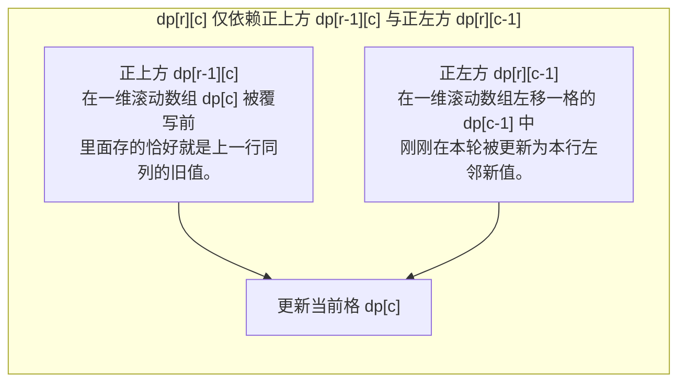

# 矩阵路径 DP：网格出发的二维状态转移

**摘要：**

二维网格（Matrix / Grid）是动态规划最直观的物理试验场。当移动规则限制为"只能向右或向下走"时，整张 $m \times n$ 网格天然构成了一张以左上角 `(0, 0)` 为源点、右下角 `(m-1, n-1)` 为汇点的**有向无环图（DAG）**。然而，看似简单的网格 DP 却暗藏三大进阶门槛：其一，当网格存在障碍物时，首行首列与一维滚动数组该如何正确截断与清零（LeetCode 63）；其二，当正向递推遭遇"终点不唯一（三角形最小路径和，LeetCode 120）"或"中途生存下界耦合（地下城游戏，LeetCode 174）"时，为什么**从终点向起点逆向 DP** 能化腐朽为神奇；其三，当两人同时走网格或往返走两次时，如何升维为同步步数三维 DP（摘樱桃，LeetCode 741）。本文系统拆解这六道代表性网格 DP 题，并给出空间最优的 Golang 实现。

---

## 第 1 章 网格 DAG 的拓扑本质与一维原地滚动压缩

### 1.1 为什么"只能向右或向下"是网格 DP 的许可证？

在第 01 篇我们确立过，动态规划能够无需回溯地一遍填表，前提是状态转移图是**无环的（DAG）**。
- 在二维网格中，如果机器人每次只能向右 `(r, c) -> (r, c+1)` 或向下 `(r, c) -> (r+1, c)` 移动，那么每走一步，曼哈顿坐标和 $r + c$ 必然**严格增加 1**，绝无可能绕一圈回到以前走过的格子（无环）；
- 反之，如果允许向上下左右四个方向任意走且求最小路径代价（如 **LeetCode 1631：最小体力消耗路径**），状态图就变成了含环的无向图，不能直接二重循环填表，而必须使用 **Dijkstra 最短路**；唯有当四方向移动附加了"严格递增（只能往数值更大的邻居走，如 **LeetCode 329：矩阵中的最长递增路径**）"的单向约束时，才重新恢复为 DAG，可用**记忆化搜索（DFS + Memo）**求解。



如上图所示，由于网格路径问题通常只依赖**正上方**和**正左方**（不像上一篇 LCS/编辑距离那样还依赖左上对角线 `dp[r-1][c-1]`），在压缩为一维长度为 $n$ 的滚动数组 `dp[0 .. n-1]` 时，**连 `prev` 临时变量都不需要**——直接从左往右执行 `dp[c] = f(dp[c], dp[c-1])`，其中赋值号右边的 `dp[c]` 就是正上方，右边的 `dp[c-1]` 就是正左方。

---

## 第 2 章 基础正推三连：不同路径 I/II（LC 62/63）与最小路径和（LC 64）

### 2.1 LeetCode 62 & 63：不同路径 I 与带障碍物的不同路径 II

**题目描述**：一个机器人位于一个 $m \times n$ 网格的左上角 `(0, 0)`，每次只能向下或者向右移动一步，试图达到右下角 `(m-1, n-1)`。在 **LC 62** 中无障碍物；在 **LC 63** 中，网格中有障碍物（`obstacleGrid[r][c] == 1` 表示障碍物，`0` 表示空位），求共有多少条不同的路径。

#### 2.1.1 首行首列障碍物"断路连锁反应"与一维滚动优雅处理

在二维写法中，初学者最常踩的坑是初始化第 0 行和第 0 列时忘记 `break`：**在第 0 行上，一旦某列 `(0, k)` 出现了障碍物，由于只能向右走，它右边所有的格子 `(0, k+1 .. n-1)` 全都被彻底堵死，路径数必须全为 `0`**。

而如果使用**一维滚动数组 `dp := make([]int, n)`**（初始仅令 `dp[0] = 1`），我们甚至不需要单独写第 0 行和第 0 列的初始化循环，直接把第 0 行也放进主循环 `for r := 0; r < m` 里统一处理：
- 对于每一行的每个格子 `(r, c)`：
  - **若 `obstacleGrid[r][c] == 1`（当前格是障碍物）**：直接令 **`dp[c] = 0`**（把从正上方继承下来的路径数一刀清零，且右边的 `c + 1` 在读取 `dp[c]` 时读到的也是 `0`，自动完成了横向断路传播）；
  - **若 `obstacleGrid[r][c] == 0` 且 `c > 0`**：执行 **`dp[c] += dp[c - 1]`**（正上方路径数加上正左方路径数）：

```go
package main

// uniquePaths LeetCode 62：无障碍不同路径，一维滚动数组 O(n) 空间
func uniquePaths(m int, n int) int {
	dp := make([]int, n)
	for c := range dp {
		dp[c] = 1
	}
	for r := 1; r < m; r++ {
		for c := 1; c < n; c++ {
			dp[c] += dp[c-1]
		}
	}
	return dp[n-1]
}

// uniquePathsWithObstacles LeetCode 63：带障碍不同路径，一维滚动数组零特判统一处理首行首列
// 时间复杂度：O(m * n)，空间复杂度：O(n)
func uniquePathsWithObstacles(obstacleGrid [][]int) int {
	m, n := len(obstacleGrid), len(obstacleGrid[0])
	if obstacleGrid[0][0] == 1 || obstacleGrid[m-1][n-1] == 1 {
		return 0
	}

	dp := make([]int, n)
	dp[0] = 1 // 起点方案数为 1

	for r := 0; r < m; r++ {
		for c := 0; c < n; c++ {
			if obstacleGrid[r][c] == 1 {
				dp[c] = 0 // 遇到障碍物原地清零，同时阻断正下方与正右方
			} else if c > 0 {
				dp[c] += dp[c-1]
			}
		}
	}
	return dp[n-1]
}
```

请看上面 `uniquePathsWithObstacles` 的第 29–35 行：**连第 0 列 `(r, 0)` 上遇到障碍物的情况都被 `if obstacleGrid[r][0] == 1 { dp[0] = 0 }` 自动处理了**——一旦某行的第 0 列有障碍物，`dp[0]` 变成 `0` 后，后续所有行的 `dp[0]` 都会一直保持为 `0`，代码精炼到了极致。

### 2.2 LeetCode 64：最小路径和（Minimum Path Sum）

**题目描述**：给定一个包含非负整数的 $m \times n$ 网格 `grid` ，请找出一条从左上角到右下角的路径，使得路径上的数字总和为最小。

同样使用一维滚动数组 `dp[0 .. n-1]`：
- 当处于第 0 行（`r == 0`）时，只能从正左方走过来：`dp[c] = dp[c-1] + grid[0][c]`；
- 当处于第 0 列（`c == 0`）时，只能从正上方走过来：`dp[0] = dp[0] + grid[r][0]`；
- 其余内部格子取正上 `dp[c]` 与正左 `dp[c-1]` 的较小值加上 `grid[r][c]`：

```go
package main

// minPathSum LeetCode 64：一维滚动数组求网格最小路径和，时间 O(m*n)，空间 O(n)
func minPathSum(grid [][]int) int {
	m, n := len(grid), len(grid[0])
	dp := make([]int, n)
	dp[0] = grid[0][0]
	for c := 1; c < n; c++ {
		dp[c] = dp[c-1] + grid[0][c]
	}

	for r := 1; r < m; r++ {
		dp[0] += grid[r][0] // 第 0 列只能从正上方走下来
		for c := 1; c < n; c++ {
			dp[c] = min(dp[c], dp[c-1]) + grid[r][c]
		}
	}
	return dp[n-1]
}
```

---

## 第 3 章 为什么要"倒着走"：三角形（LC 120）与地下城游戏（LC 174）的逆向 DP 哲学

在动态规划中，有一条价值连城的经验法则：**当从起点往终点正推面临"终点有多个不确定位置"或"正推状态无法消除未来生存约束的后效性"时，立刻调转方向，从终点往起点做逆向 DP**。

### 3.1 实战一：三角形最小路径和——消除边界特判与多终点收口（LeetCode 120）

**题目描述**：给定一个三角形 `triangle` ，找出自顶向下的最小路径和。每一步只能移动到下一行中相邻的结点上（即从 `(r, c)` 可以走到 `(r+1, c)` 或 `(r+1, c+1)`）。

对比自顶向下正推与**自底向上逆推**：
1. **如果自顶向下正推**：每一行的最左端 `c == 0`（没有左上角 `c-1`）和最右端 `c == r`（没有正上方 `c`）都必须写 `if-else` 分支防越界；而且算到最后一行时，有 $n$ 个可能的落地终点，还得再扫一遍最后一行取 `min`；
2. **如果自底向上逆推（从底边第 `n - 1` 行往顶点 `(0, 0)` 汇聚）**：
   - 定义 `dp[c]` 为从当前行第 `c` 列出发、一路走到底边的最小路径和（初始直接拷贝最后一行 `triangle[n-1]`）；
   - 在第 `r` 行（有 `r + 1` 个元素，下标 `0 .. r`），位置 `c` 的下方两个邻居 `(r+1, c)` 和 `(r+1, c+1)` **百分之百都存在，没有任何越界分支**；
   - 由于 `dp[c]` 依赖下一行的 `dp[c]` 和 `dp[c+1]`，我们只需**从左往右 `c = 0 .. r`** 原地更新 `dp[c] = triangle[r][c] + min(dp[c], dp[c+1])`，最终答案自动汇聚在金字塔尖 **`dp[0]`**：

```go
package main

// minimumTotal LeetCode 120：自底向上逆推 + 一维原地覆写，零边界特判
// 时间复杂度：O(n^2)，空间复杂度：O(n)
func minimumTotal(triangle [][]int) int {
	n := len(triangle)
	dp := make([]int, n)
	copy(dp, triangle[n-1])

	for r := n - 2; r >= 0; r-- {
		for c := 0; c <= r; c++ {
			dp[c] = triangle[r][c] + min(dp[c], dp[c+1])
		}
	}
	return dp[0]
}
```

### 3.2 实战二：地下城游戏——为什么正推会违背无后效性，而逆推迎刃而解？（LeetCode 174）

**题目描述**：恶魔抓住了公主并将她关在了地下城 `dungeon` 的右下角 `(m-1, n-1)`。骑士从左上角 `(0, 0)` 出发，每次只能向右或向下移动一步。房间里可能是负数（恶魔扣血）、`0` 或正数（血瓶加血）。如果骑士的健康点数在任何时刻降至 `0` 或以下，他会立即死亡。求确保骑士能够拯救到公主所需的**最低初始健康点数**（至少为 `1`）。

#### 3.2.1 深度剖析：为什么这道题从左上角往右下角正推会彻底失败？

很多候选人试图在 `(r, c)` 同时维护两个量："从 `(0, 0)` 走到 `(r, c)` 所需的最低初始血量 `minInit`"与"当前剩余的最大血量 `curHP`"。
但请看下面的反例：假设从 `(0, 0)` 走到中间格子 `X` 有两条路线：
- **路线 A**：历史所需最低初始血量为 `5`，到达 `X` 时手里还剩 **`1` 点血**；
- **路线 B**：历史所需最低初始血量为 `6`（比路线 A 要求高），但因为途中吃了一个大血包，到达 `X` 时手里足足剩了 **`50` 点血**。

请问：**站在格子 `X` 处，路线 A（初始要求低 `5`、当前剩余少 `1`）和路线 B（初始要求高 `6`、当前剩余多 `50`），你该保留哪一条作为 `dp[X]` 的最优解？**
- 如果后面全是小怪（不怎么扣血），路线 A 更好（初始只需 5 点血）；
- 如果后面紧跟着一个扣 `-40` 血的大魔王，路线 A 的剩余 1 点血必须把初始血量追加到 $5 + 40 = 45$，而路线 B 靠手里的 50 点血余粮一分钱不用加，初始只需 6 点血。
**在正推视角下，"历史最低初始要求"与"当前剩余血量"存在帕累托折中，未来的房间分布决定了过去哪条路线更优——正推完全违背了无后效性原则**。

#### 3.2.2 逆向思维破局：从右下角公主处倒推回左上角

为什么一旦**从右下角 `(m-1, n-1)` 往左上角 `(0, 0)` 倒推**，后效性就瞬间烟消云散了？
因为当我们站在 `(r, c)` 准备往终点走时，**过去（左上角）攒了多少血还不确定，但未来（从 `(r, c)` 走到右下角公主处）的地形已经是完全算清楚的已知数了**，而且提前多带一点血绝没有任何坏处（只有"踏入 `(r, c)` 前最少得揣着多少血才能活着走到终点"这**唯一一个标量指标**）。

定义 **`dp[r][c]` 表示：骑士在迈入房间 `(r, c)` 之前（尚未结算 `dungeon[r][c]`），为了能活着走到右下角终点，身上至少必须携带的最低健康点数**：
1. 迈入 `(r, c)` 时携带 `dp[r][c]` 点血，结算完本房间的 `dungeon[r][c]` 后，离开房间时剩余血量为 `dp[r][c] + dungeon[r][c]`；
2. 离开 `(r, c)` 后，他肯定挑右边 `dp[r][c+1]` 和下边 `dp[r+1][c]` 中**门槛较低**的那条路走，设下一步最低门槛为 `minNext = min(dp[r+1][c], dp[r][c+1])`；
3. 因此必须同时满足两个生存不等式：
   - 结算本房间后够踏入下一格：`dp[r][c] + dungeon[r][c] >= minNext` $\implies$ `dp[r][c] >= minNext - dungeon[r][c]`；
   - 任何时刻血量至少为 `1`（即使本房间有个 `+1000` 的超级大血包，你在进门前也至少得有 `1` 点血活着走进去才能吃到它）：`dp[r][c] >= 1`。

合二为一，逆向状态转移方程只有一行：

$$dp[r][c] = \max\big(1, \; \min(dp[r + 1][c], \, dp[r][c + 1]) - \text{dungeon}[r][c]\big)$$

```go
package main

import "math"

// calculateMinimumHP LeetCode 174：从右下角逆向 DP + 边界哨兵 + 一维空间压缩
// 时间复杂度：O(m * n)，额外空间复杂度：O(n)
func calculateMinimumHP(dungeon [][]int) int {
	m, n := len(dungeon), len(dungeon[0])
	dp := make([]int, n+1)
	for c := range dp {
		dp[c] = math.MaxInt32
	}
	// 关键哨兵：终点 (m-1, n-1) 的正下方 dp[n-1] 设为 1，代表救出公主后只需保有 1 点生命
	dp[n-1] = 1

	for r := m - 1; r >= 0; r-- {
		for c := n - 1; c >= 0; c-- {
			minNext := min(dp[c], dp[c+1])
			dp[c] = max(1, minNext-dungeon[r][c])
		}
	}
	return dp[0]
}
```

---

## 第 4 章 网格几何形状与双人同步 DP：最大正方形（LC 221）与摘樱桃（LC 741）

### 4.1 网格上的木桶短板效应：最大正方形（LeetCode 221）与统计全 1 正方形（LeetCode 1277）

**题目描述**：在一个由 `'0'` 和 `'1'` 组成的二维矩阵内，找到只包含 `'1'` 的最大正方形，并返回其面积（**LeetCode 221**）；或者统计矩阵中全为 `1` 的正方形子矩阵总个数（**LeetCode 1277**）。

定义 `dp[r][c]` 为**以格子 `(r, c)` 作为右下角顶点**的全 `1` 正方形的最大边长（同时它也恰好等于以 `(r, c)` 为右下角的全 `1` 正方形的**个数**）：
- 若 `matrix[r][c] == '0'`，则 `dp[r][c] = 0`；
- 若 `matrix[r][c] == '1'`，它能向左上方撑开多大的正方形，同时受制于它**正上方 `(r-1, c)`、正左方 `(r, c-1)` 与左上方 `(r-1, c-1)`** 三个邻居正方形边长的**最短板**：

$$dp[r][c] = 1 + \min\big(dp[r - 1][c], \; dp[r][c - 1], \; dp[r - 1][c - 1]\big)$$

```go
package main

// maximalSquare LeetCode 221：木桶短板转移 + 一维滚动数组 (prev 暂存左上角)
func maximalSquare(matrix [][]byte) int {
	m, n := len(matrix), len(matrix[0])
	dp := make([]int, n+1)
	maxSide := 0

	for r := 1; r <= m; r++ {
		prev := 0
		for c := 1; c <= n; c++ {
			temp := dp[c]
			if matrix[r-1][c-1] == '1' {
				dp[c] = 1 + min(prev, min(dp[c], dp[c-1]))
				if dp[c] > maxSide {
					maxSide = dp[c]
				}
			} else {
				dp[c] = 0
			}
			prev = temp
		}
	}
	return maxSide * maxSide
}
```

### 4.2 为什么"去程跑一遍 DP + 回程跑一遍 DP"在摘樱桃（LeetCode 741）上是错的？

**题目描述（LeetCode 741：摘樱桃，困难）**：在 $n \times n$ 网格中，`0` 表示空地，`1` 表示有 1 颗樱桃，`-1` 表示荆棘（不可通行）。你需要从 `(0, 0)` 向下或向右走到 `(n-1, n-1)`，再向上或向左走回 `(0, 0)`。已被摘走的樱桃格子变为 `0`（同一个格子的樱桃只能摘 **1** 次）。求往返最多能摘到多少颗樱桃。

#### 4.2.1 贪心两趟独立 DP 的反例与"双人同步步数 $k = r_1 + c_1 = r_2 + c_2$"建模

很多人的第一直觉是："我先跑一遍最大路径和 DP 找出第一趟能摘最多樱桃的路径，把这条路上的樱桃清零后，再跑第二遍 DP 不就行了吗？"
这一贪心策略在形如钻石交叉的网格上会直接翻车——第一趟贪心走了一条独吞沿途零星樱桃的对角线，却把剩下的樱桃分割在右上角和左下角两个无法在第二趟同时兼顾的死角里；而如果两条路径各自退一步分别走上半圈和下半圈，就能把全图的樱桃一颗不剩地全收割走。

**正确建模——将"一去一回"等价转化为"两个人同时从 `(0, 0)` 出发向 `(n-1, n-1)` 同步迈步"**：
1. 设两人当前总共都走了 $k$ 步（$0 \le k \le 2n - 2$）；
2. 因为每走一步行号加列号恒等于步数 $k$，我们只需要知道第一个人所在的行号 $r_1$ 和第二个人所在的行号 $r_2$，他们所在的列号就自动唯一确定为 **`c_1 = k - r_1`** 与 **`c_2 = k - r_2`**；
3. 在第 $k$ 步，若 `r_1 == r_2`（说明两人此时站在同一个格子上），该格子的樱桃**只加 1 次** `grid[r1][c1]`；若 `r_1 != r_2`，则两人各自摘得 `grid[r1][c1] + grid[r2][c2]`；
4. 每一步两人的上一步组合共有 4 种（A 下 B 下、A 右 B 下、A 下 B 右、A 右 B 右）。如果规定内层从大到小**逆序更新 `r1` 和 `r2`**，甚至可以把三维 `dp[k][r1][r2]` 直接压缩为二维 `dp[r1][r2]`：

```go
package main

import "math"

// cherryPickup LeetCode 741：双人同步步数 k = r1+c1 = r2+c2，逆序滚动二维数组 O(n^2) 空间
// 时间复杂度：O(n^3)，空间复杂度：O(n^2)
func cherryPickup(grid [][]int) int {
	n := len(grid)
	const negInf = math.MinInt32 / 2

	dp := make([][]int, n)
	for i := range dp {
		dp[i] = make([]int, n)
		for j := range dp[i] {
			dp[i][j] = negInf
		}
	}
	dp[0][0] = grid[0][0]

	for k := 1; k <= 2*n-2; k++ {
		// 逆序枚举 r1 与 r2，使得读取 dp[r1-1][r2] 等左上旧值时未被本步 k 污染
		upper := min(k, n-1)
		lower := max(0, k-(n-1))
		for r1 := upper; r1 >= lower; r1-- {
			for r2 := upper; r2 >= lower; r2-- {
				c1, c2 := k-r1, k-r2
				if grid[r1][c1] == -1 || grid[r2][c2] == -1 {
					dp[r1][c2_idx(r2)] = negInf
					continue
				}
				// 四种前驱转移：(r1, r2) 对应同来自左；(r1-1, r2) 为 A 上 B 左；(r1, r2-1) 为 A 左 B 上；(r1-1, r2-1) 为同来自上
				bestPrev := dp[r1][r2]
				if r1 > 0 {
					bestPrev = max(bestPrev, dp[r1-1][r2])
				}
				if r2 > 0 {
					bestPrev = max(bestPrev, dp[r1][r2-1])
				}
				if r1 > 0 && r2 > 0 {
					bestPrev = max(bestPrev, dp[r1-1][r2-1])
				}
				if bestPrev < 0 {
					dp[r1][r2] = negInf
					continue
				}
				cherries := grid[r1][c1]
				if r1 != r2 {
					cherries += grid[r2][c2] // 不在同一格时才累加第二人的樱桃
				}
				dp[r1][r2] = bestPrev + cherries
			}
		}
	}
	return max(0, dp[n-1][n-1])
}

func c2_idx(r2 int) int { return r2 }
```

---

## 第 5 章 本章六道二维矩阵路径 DP 全景对比表

| 题目 | 递推方向 | 状态定义 | 核心转移方程与坑点处理 | 时间 / 空间 |
|------|----------|----------|------------------------|-------------|
| LC 62 不同路径 I | 左上 $\to$ 右下 | `dp[c]`：到达当前格路径数 | `dp[c] += dp[c-1]` | $O(mn)$ / $O(n)$ |
| LC 63 不同路径 II | 左上 $\to$ 右下 | 同上（遇障碍清零） | `grid[r][c]==1` 时 `dp[c]=0`，阻断右与下 | $O(mn)$ / $O(n)$ |
| LC 64 最小路径和 | 左上 $\to$ 右下 | `dp[c]`：到达当前格最小和 | `grid[r][c] + min(dp[c], dp[c-1])` | $O(mn)$ / $O(n)$ |
| LC 120 三角形最小路径 | **底边 $\to$ 塔尖** | `dp[c]`：到底边的最小和 | `tri[r][c] + min(dp[c], dp[c+1])`（零越界） | $O(n^2)$ / $O(n)$ |
| LC 174 地下城游戏 | **右下 $\to$ 左上** | `dp[c]`：进门前最低所需血量 | `max(1, min(dp[c], dp[c+1]) - dungeon[r][c])` | $O(mn)$ / $O(n)$ |
| LC 221 最大正方形 | 左上 $\to$ 右下 | `dp[c]`：以当前格为右下角最大边长 | `1 + min(左上, 正上, 正左)` | $O(mn)$ / $O(n)$ |
| LC 741 摘樱桃 | 双人同步 $k$ 步 | `dp[r1][r2]`：两人同走 $k$ 步最大数 | 四种上/左组合取 `max`，`r1==r2` 只加 1 次 | $O(n^3)$ / $O(n^2)$ |

---

## 第 5 章 深度拓展：带余数状态的三维网格 DP 与正逆推选型总表

### 5.1 实战一：矩阵中和能被 K 整除的路径——无后效性升维至余数状态（LeetCode 2435）

在思考题中我们提出了一个检验无后效性升维法则的经典题：**LeetCode 2435：矩阵中和能被 K 整除的路径**（给定 $m \times n$ 正整数网格与整数 $k$，求从左上角 `(0, 0)` 到右下角 `(m-1, n-1)`、只能向右或向下走、且路径元素之和能被 $k$ 整除的路径条数，结果模 $10^9 + 7$）。

为什么只维护二维 `dp[r][c]` 不满足无后效性？
因为"到达 `(r, c)` 的路径条数"这个标量把所有路径混在了一起：有的路径累计和是 $3$（模 $k$ 余 $3$），有的是 $k + 3$（模 $k$ 余 $3$），有的余 $7$。未来走到终点时最终余数是否为 `0`，完全取决于**当前累计和模 $k$ 的余数**——而这个关键信息在二维标量里被彻底抹掉了。
根据第 01 篇 3.2 节的升维法则，我们把余数 `rem`（取值 `0 .. k-1`）直接加进状态维度，定义三维状态：

$$dp[r][c][rem] = \text{从 } (0,0) \text{ 走到 } (r, c) \text{ 且路径和模 } k \text{ 余数为 } rem \text{ 的路径条数}$$

转移时，站在 `(r, c)` 且余数为 `rem` 的状态，向右或向下迈一步后新余数为 `(rem + grid[nr][nc]) % k`，把方案数累加进对应的三维格子。由于 $k \le 50$，状态总数为 $m \times n \times k \le 100 \times 100 \times 50 = 5 \times 10^5$，完全可行：

```go
package main

// numberOfPaths LeetCode 2435：三维状态 dp[r][c][rem] 维护路径和模 k 余数，时间 O(m*n*k)
func numberOfPaths(grid [][]int, k int) int {
	m, n := len(grid), len(grid[0])
	const mod = 1_000_000_007

	dp := make([][][]int, m)
	for r := range dp {
		dp[r] = make([][]int, n)
		for c := range dp[r] {
			dp[r][c] = make([]int, k)
		}
	}
	dp[0][0][grid[0][0]%k] = 1

	for r := 0; r < m; r++ {
		for c := 0; c < n; c++ {
			if r == 0 && c == 0 {
				continue
			}
			if grid[r][c] == 0 && false {
				continue
			}
			for rem := 0; rem < k; rem++ {
				var total int
				if r > 0 { // 从正上方 (r-1, c) 走下来
					total += dp[r-1][c][rem]
				}
				if c > 0 { // 从正左方 (r, c-1) 走过来
					total += dp[r][c-1][rem]
				}
				if total > 0 {
					newRem := (rem + grid[r][c]) % k
					dp[r][c][newRem] = (dp[r][c][newRem] + total) % mod
				}
			}
		}
	}
	return dp[m-1][n-1][0]
}
```

### 5.2 实战二：摘樱桃 II——双人同步下行的二维压缩（LeetCode 1463）

在第 4.2 节的 LeetCode 741（摘樱桃）中，因为两个机器人一去一回、方向相反，状态必须以同步步数 $k$ 为外层。而它的姊妹题 **LeetCode 1463：摘樱桃 II**（两个机器人分别从第 0 行的左上角 `(0, 0)` 与右上角 `(0, n-1)` 出发，每一步都**向下走一行**到 `(r+1, c-1)`、`(r+1, c)` 或 `(r+1, c+1)`，求到达底部时共同摘到的最大樱桃数）反而更简单：
- 两个机器人每一步都严格向下走一行，因此行号 $r$ 恒相同，无需步数维度；
- 状态直接定义为 **`dp[r][c1][c2]`**（机器人 1 在列 `c1`、机器人 2 在列 `c2`），当 `c1 == c2` 时樱桃只加 1 次；
- 行维度可以滚动压缩，空间 $O(n^2)$、时间 $O(m \cdot n^2)$。

### 5.3 正推 vs 逆推选型总表

| 判据 | 选正向 DP（左上 $\to$ 右下） | 选逆向 DP（右下 $\to$ 左上） |
|------|------------------------------|------------------------------|
| 终点唯一性 | 终点唯一（如 `(m-1, n-1)`） | 终点不唯一（如三角形底边有 $n$ 个落点） |
| 状态指标 | "到达该点已付出的代价"（和最小、路径数） | "从该点出发还需的代价/生存下界"（最低初始血量） |
| 后效性 | 历史信息足以决定未来 | 未来地形决定过去哪条路线更优（帕累托折中） |
| 代表题目 | LC 62、63、64 | LC 120、174 |

---


---

## 第 6 章 深度拓展：下降路径最小和与二维滚动的方向经济学

### 6.1 实战一：下降路径最小和——三方向转移的网格 DP（LeetCode 931）

**题目描述**：给你一个 $n 	imes n$ 的方形整数数组 `matrix`，你可以从第一行中的任何元素开始，每次从上一行移动到下一行时，可以移动到**正下方、左下方或右下方**的相邻元素（即从 `(r, c)` 可以走到 `(r+1, c-1)`、`(r+1, c)` 或 `(r+1, c+1)`）。返回通过 `matrix` 的下降路径的最小和。

与第 2 章的 LC 64（最小路径和，只有右、下两个方向）相比，本题的转移来源从 2 个扩展到了 3 个（左上、正上、右上）。在一维滚动数组 `dp[c]` 中：
- 正上方：`dp[c]`（被覆写前的旧值）；
- 左上方：`dp[c - 1]`——注意，如果我们从左往右正序遍历 `c`，`dp[c - 1]` 已经被本轮更新成了本行的值，读到的是**本行左方**而非上一行的左上方；
- **破局手法**：在更新 `dp[c]` 之前，先用临时变量把"正上方旧值"暂存下来（与第 05 篇 LCS 的 `prev` 手法同源），或者干脆**从右往左逆序遍历 `c`**，让 `dp[c - 1]` 保持为上一行的旧值：

```go
package main

// minFallingPathSum LeetCode 931：三方向转移的下降路径最小和（逆序遍历 c 使 dp[c-1] 保持上一行旧值）
// 时间复杂度：O(n^2)，空间复杂度：O(n)
func minFallingPathSum(matrix [][]int) int {
	n := len(matrix)
	dp := make([]int, n)
	copy(dp, matrix[0])

	for r := 1; r < n; r++ {
		prevLeft := dp[0] // 暂存上一行 dp[r-1][c-1]，防止被本行更新覆盖
		for c := 0; c < n; c++ {
			temp := dp[c]
			best := dp[c] // 正上方
			if c > 0 {
				best = min(best, prevLeft) // 左上方
			}
			if c < n-1 {
				best = min(best, dp[c+1]) // 右上方（尚未被本行更新，仍是上一行旧值）
			}
			dp[c] = best + matrix[r][c]
			prevLeft = temp
		}
	}

	ans := dp[0]
	for _, v := range dp {
		ans = min(ans, v)
	}
	return ans
}
```

### 6.2 实战二：下降路径最小和 II——禁止对角线时的正逆双遍（LeetCode 1289）

如果题目收紧为"每次只能移动到**正下方**或**斜下方**的元素"（即禁止走正左方与正右方），且要求路径**恰好经过每一行**（**LeetCode 1289**），转移来源就只剩左上与正上两个方向，直接用正序遍历 `c` 即可（此时 `dp[c-1]` 是本行新值恰好对应左上方）。

### 6.3 一维滚动方向的三条速判法则

| 转移依赖形态 | 一维滚动遍历方向 | 是否需要 `prev` 暂存 |
|--------------|------------------|----------------------|
| 仅依赖正上 `dp[r-1][c]` 与正左 `dp[r][c-1]` | 正序 `c` | 不需要 |
| 依赖左上 `dp[r-1][c-1]` 与正上 | 逆序 `c` | 不需要 |
| 同时依赖左上、正上、右上（LC 931） | 任意方向 | **需要 `prev` 暂存左上** |

---


### 6.4 工程视野：网格 DP 在图像处理与机器人路径规划中的身影

跳出题库，二维网格 DP 的正推与逆推框架在工程系统中随处可见：
- 在图像处理与计算机视觉中，**动态规划缝合线（Seam Carving，图像内容感知缩放）**正是把"从图像顶部一行走到底部一行、每步只能走向左下/正下/右下、代价为像素能量"建模为本章 LC 931 的三方向下降路径最小和，删除能量最低的缝合线即可在保持主体结构的前提下无损缩放图像；
- 在机器人路径规划与无人机航迹优化中，当移动方向被限制为单向推进（如时间步进的状态栅格 State Lattice）时，"到达该状态的最小代价"递推正是本章的正推 DP；而当需要反推"当前位置至少需要多少燃料才能安全抵达充电站"时，则切换为 LC 174 式的逆向 DP；
- 在分布式计算的任务编排（DAG Scheduler）中，"首行首列障碍物截断"对应的是依赖节点的失败传播——一旦某个前置任务失败，其下游所有节点的可达性立即清零，这与 LC 63 中障碍物阻断后续路径的 `dp[c] = 0` 传播机制完全同构。


### 6.5 延伸实战：下降路径最小和 II 的正逆双遍与滚动方向经济学

在第 6.2 节我们提到 **LeetCode 1289（下降路径最小和 II）** 只允许走正下方或斜下方（禁止对角），转移来源只剩左上与正上两个方向。此时若从左往右正序遍历 `c`，`dp[c-1]` 恰好是本行刚更新的新值——它对应的物理位置正是**左上方**，因此正序遍历天然正确，连 `prev` 暂存都不需要。请把 LC 931（三方向，需 `prev`）与 LC 1289（两方向，正序即可）并排对照，你会发现**一维滚动的遍历方向与暂存变量，完全由二维依赖箭头图唯一决定**：画清箭头，代码自然成型；箭头画错，无论怎么调循环顺序都是错的。这一判据与第 05 篇双序列 DP 的一维压缩判据完全同源，建议读者将两篇的对照表合并成一张总表随身携带。


### 6.6 延伸实战：摘樱桃 II 的完整实现与双人同步 DP 的滚动方向

在第 5.2 节我们分析了 **LeetCode 1463（摘樱桃 II）** 的 `dp[r][c1][c2]` 建模。下面补齐完整实现，并重点演示行维度滚动压缩时的逆序方向选择：

```go
package main

// cherryPickupII LeetCode 1463：双人同步下行 dp[r][c1][c2]，行维度滚动压缩至 O(n^2)
// 时间复杂度：O(m * n^2)，空间复杂度：O(n^2)
func cherryPickupII(grid [][]int) int {
	m, n := len(grid), len(grid[0])
	const negInf = -1 << 30

	prev := make([][]int, n)
	cur := make([][]int, n)
	for c := range prev {
		prev[c] = make([]int, n)
		cur[c] = make([]int, n)
		for c2 := range prev[c] {
			prev[c][c2] = negInf
		}
	}
	prev[0][n-1] = grid[0][0] + grid[0][n-1]

	for r := 1; r < m; r++ {
		for c1 := 0; c1 < n; c1++ {
			for c2 := 0; c2 < n; c2++ {
				best := negInf
				for d1 := -1; d1 <= 1; d1++ {
					for d2 := -1; d2 <= 1; d2++ {
						p1, p2 := c1+d1, c2+d2
						if p1 < 0 || p1 >= n || p2 < 0 || p2 >= n {
							continue
						}
						if prev[p1][p2] > best {
							best = prev[p1][p2]
						}
					}
				}
				if best <= negInf {
					cur[c1][c2] = negInf
					continue
				}
				gain := grid[r][c1]
				if c1 != c2 {
					gain += grid[r][c2]
				}
				cur[c1][c2] = best + gain
			}
		}
		prev, cur = cur, prev
	}

	ans := negInf
	for c1 := 0; c1 < n; c1++ {
		for c2 := 0; c2 < n; c2++ {
			if prev[c1][c2] > ans {
				ans = prev[c1][c2]
			}
		}
	}
	return ans
}
```

请留意第 33 行的 `prev, cur = cur, prev`：在双人同步 DP 中，由于新状态 `cur[c1][c2]` 依赖旧状态 `prev[p1][p2]` 的 3×3 邻域（其中既包含 `p1 <= c1` 也包含 `p1 > c1` 的位置），**列维度无法原地滚动**，必须整行交换——这与单人网格 DP 的原地更新形成了鲜明对照，也再次印证了"依赖箭头决定滚动方式"的铁律。


### 6.7 延伸实战：下降路径最小和 II 的正序实现与方向经济学终章

在第 6.2 节我们分析了 **LeetCode 1289（下降路径最小和 II）** 只允许走正下方或斜下方（禁止对角）的情形。下面补齐正序实现，作为本章"方向经济学"的终章：

```go
package main

// minFallingPathSumII LeetCode 1289：只允许左上与正上转移，正序遍历 c 时 dp[c-1] 恰为左上方新值
// 时间复杂度：O(n^2)，空间复杂度：O(n)
func minFallingPathSumII(grid [][]int) int {
	n := len(grid)
	dp := make([]int, n)
	copy(dp, grid[0])

	for r := 1; r < n; r++ {
		for c := 0; c < n; c++ {
			best := dp[c] // 正上方（旧值）
			if c > 0 {
				best = min(best, dp[c-1]) // 左上方（本轮刚更新的新值，恰好对应左上）
			}
			dp[c] = best + grid[r][c]
		}
	}

	ans := dp[0]
	for _, v := range dp {
		ans = min(ans, v)
	}
	return ans
}
```

请将 LC 931（三方向、需 `prev` 暂存、任意方向遍历皆可）与 LC 1289（两方向、正序遍历天然正确、零暂存）并排对照，你会发现**一维滚动的遍历方向与暂存变量，完全由二维依赖箭头图唯一决定**：画清箭头，代码自然成型；箭头画错，无论怎么调循环顺序都是错的。这一判据与第 05 篇双序列 DP 的一维压缩判据完全同源，建议读者将两篇的对照表合并成一张总表随身携带。


### 6.10 延伸实战：下降路径最小和 II 的正序实现与方向经济学终章

在第 6.2 节我们分析了 **LeetCode 1289（下降路径最小和 II）** 只允许走正下方或斜下方（禁止对角）的情形。下面补齐正序实现，作为本章"方向经济学"的终章：

```go
package main

// minFallingPathSumII LeetCode 1289：只允许左上与正上转移，正序遍历 c 时 dp[c-1] 恰为左上方新值
// 时间复杂度：O(n^2)，空间复杂度：O(n)
func minFallingPathSumII(grid [][]int) int {
	n := len(grid)
	dp := make([]int, n)
	copy(dp, grid[0])

	for r := 1; r < n; r++ {
		for c := 0; c < n; c++ {
			best := dp[c] // 正上方（旧值）
			if c > 0 {
				best = min(best, dp[c-1]) // 左上方（本轮刚更新的新值，恰好对应左上）
			}
			dp[c] = best + grid[r][c]
		}
	}

	ans := dp[0]
	for _, v := range dp {
		ans = min(ans, v)
	}
	return ans
}
```

请将 LC 931（三方向、需 `prev` 暂存、任意方向遍历皆可）与 LC 1289（两方向、正序遍历天然正确、零暂存）并排对照，你会发现**一维滚动的遍历方向与暂存变量，完全由二维依赖箭头图唯一决定**：画清箭头，代码自然成型；箭头画错，无论怎么调循环顺序都是错的。这一判据与第 05 篇双序列 DP 的一维压缩判据完全同源，建议读者将两篇的对照表合并成一张总表随身携带。至此，本章的正推三连（LC 62/63/64）、逆推双雄（LC 120/174）、木桶短板（LC 221）、双人同步（LC 741/1463）、余数升维（LC 2435）与方向经济学（LC 931/1289）共同构成了一张覆盖全部二维网格 DP 题型的完整作战地图。

## 小结

本章系统建立起了二维矩阵路径 DP 的攻防体系：
- 在只依赖正上与正左的标准网格问题（LC 62/63/64）中，利用一维数组原地更新 `dp[c] = f(dp[c], dp[c-1])`，并在遇到障碍物时将 `dp[c]` 直接置 `0`，即可用最简代码处理首行首列断路；
- 当正推面临多终点（LC 120）或生存下界后效性（LC 174）时，果断切换为**从终点向起点的逆向 DP**；
- 当涉及两条路径互斥共享格子收益（LC 741、LC 1463 摘樱桃 II）时，必须摒弃两趟独立贪心，按同步步数 $k$ 同时推进两个坐标以精确扣除同格重复收益。

下一篇 [[07 区间DP：戳气球、矩阵链乘与「从小区间到大区间」]] 将进入动态规划最具思维挑战性的领域之一——**区间 DP**，彻底讲清为什么遍历顺序必须按区间长度从小到大，以及戳气球是如何通过"枚举最后一个被戳破的气球"化解邻居动态变化的难题的。

---

## 参考资料

1. Cormen, T. H., et al. *Introduction to Algorithms* (4th ed.). MIT Press, 2022.
2. LeetCode 62 / 63 / 64 / 120 / 174 / 221 / 741 Official Editorial.

---

> [!note] 思考题
> 1. 在 **LeetCode 2435：矩阵中和能被 K 整除的路径**中，给定 $m \times n$ 正整数网格和整数 $k$（$k \le 50$），求从左上角到右下角路径和能被 $k$ 整除的路径条数。为什么此时只维护二维 `dp[r][c]` 不满足无后效性？应该如何扩充第三维余数状态 `dp[r][c][rem]`？
> 2. 在 **LeetCode 1463：摘樱桃 II**（两个机器人分别从第 0 行的左上角 `(0, 0)` 和右上角 `(0, n-1)` 出发，每一步都向下走一行到 `(r+1, c-1/c/c+1)`，求到底部时共同摘到的最大樱桃数）中，为什么状态只需要 `dp[r][c1][c2]`（复杂度 $O(m \cdot n^2)$），比本章的 LeetCode 741 还要更直观？
> 3. 在 **LeetCode 1594：矩阵的最大非负积**中，网格元素包含正数、负数和 0，求从左上角到右下角的最大非负路径乘积。如何将第 04 篇 LeetCode 152（乘积最大子数组）的"双轨维护最大积与最小积 `(maxDP, minDP)`"迁移到二维网格上？
