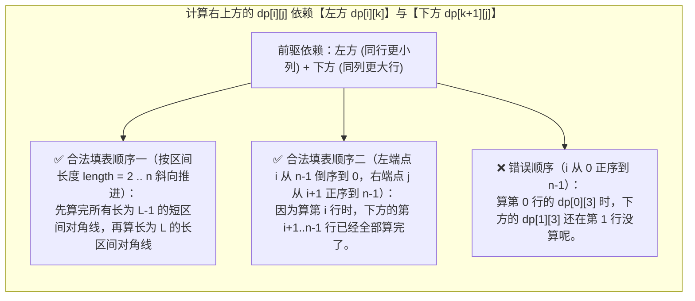
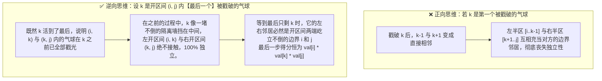

# 区间 DP：戳气球、矩阵链乘与「从小区间到大区间」

**摘要：**

在前六篇探讨的线性 DP、背包 DP 与网格 DP 中，状态的推进方向都是沿着单侧下标 $i = 0 \to n-1$ 从左往右单向生长的。然而，当一个问题的消除、合并或括号化操作发生在序列内部任意位置，且需要将一段连续子区间 `[i, j]` 拆分为左右两个子区间 `[i, k]` 与 `[k+1, j]` 分治求解时，我们就进入了**区间动态规划（Interval DP）**的领地。区间 DP 有两道让无数候选人折戟沉沙的门槛：第一是**填表拓扑序**——为什么外层循环直接写 `for i := 0; i < n` 是错的，必须按**区间长度 `length` 从短到长（或左端点 `i` 从大到小倒序）**枚举？第二是**子问题独立性建模**——在戳气球（LeetCode 312）中，为什么正向枚举"第一个戳破的气球"会导致左右子区间耦合成指数级灾难，而逆向枚举**"最后一个戳破的气球"**却能让左右子区间彻底解耦？本文从矩阵链乘与多边形三角剖分（LeetCode 1039）出发，深入拆解戳气球（LC 312）、切棍子的最小成本（LC 1547）、奇怪的打印机（LC 664）与分割回文串 II（LC 132）五道硬核名题，全部给出优雅的 Golang 实现。

---

## 第 1 章 区间 DP 的拓扑铁律：为什么必须「从小区间到大区间」？

### 1.1 区间 DP 的标准状态与分割点枚举

区间 DP 的状态固定定义为二维区间 `dp[i][j]`（满足 $i \le j$），代表在子序列 `A[i .. j]` 上完成题目要求操作的最优代价。
为了求出大区间 `[i, j]` 的最优解，我们通常需要枚举将大区间一分为二的**分割点（或最后一步操作点）$k \in [i, j-1]$**，将大问题拆解为左子区间 `dp[i][k]` 与右子区间 `dp[k+1][j]` 的组合：

$$dp[i][j] = \min_{i \le k < j} \Big\{ dp[i][k] + dp[k + 1][j] + \text{mergeCost}(i, k, j) \Big\}$$

### 1.2 二维表格上的依赖方向图解：为什么正序枚举 `i` 会读到未初始化的空数据？

请把二维矩阵 `dp[0..n-1][0..n-1]` 画出来（由于 $i \le j$，有效状态全部位于主对角线 `i == j` 及其右上方的**上三角区域**，最终答案位于右上角顶点 `dp[0][n-1]`）。
在计算格子 `dp[i][j]` 时，我们需要读取它的哪两类前驱格子？
1. **左子区间 `dp[i][k]`**（其中 $k < j$）：位于当前格 `(i, j)` 的**同一行正左侧**；
2. **右子区间 `dp[k+1][j]`**（其中 $k + 1 > i$）：位于当前格 `(i, j)` 的**同一列正下方**。



看清了这张依赖图，你就彻底明白为什么区间 DP 有且仅有两套正确的循环嵌套写法：
- **标准写法一（外层枚举区间长度 `length = 2 .. n`，中层枚举左端点 `i`，内层枚举分割点 `k`）**：物理意义最直观——先算所有长度为 2 的小区间，再算长度为 3 的中区间……直到算出长度为 $n$ 的全区间 `dp[0][n-1]`；
- **极简写法二（外层倒序枚举左端点 `i = n-2 -> 0`，中层正序枚举右端点 `j = i+1 -> n-1`，内层枚举分割点 `k`）**：因为 `dp[i][j]` 依赖正下方的 `dp[k+1][j]`（行号 $> i$）和正左方的 `dp[i][k]`（列号 $< j$），所以**行号 `i` 从下往上倒着走、列号 `j` 从左往右顺着走**，所有依赖项同样 $100\%$ 已经就绪，且少算一层 `j = i + length - 1` 的下标转换。

---

## 第 2 章 区间分割基准模型：矩阵链乘与多边形三角剖分（LeetCode 1039）

### 2.1 从矩阵链乘到凸多边形三角剖分的同构映射

在算法导论（CLRS）中，区间 DP 的开山鼻祖是**矩阵链乘（Matrix Chain Multiplication）**：计算一串矩阵 $A_1 A_2 \cdots A_n$ 相乘的最小标量乘法次数。而在 LeetCode 上，与矩阵链乘在数学上**完全同构（Isomorphic）**的真题是 **LeetCode 1039：多边形三角剖分的最低得分**：

**题目描述**：你有一个凸的 $n$ 边形，其每个顶点都有一个整数值 `values[i]`（按顺时针顺序给出下标 $0 \dots n-1$）。你将多边形剖分为 $n - 2$ 个三角形。对于每个三角形，该三角形的值是顶点标记的**乘积**。返回进行三角剖分后可以获得的最低总得分。

#### 2.1.1 固定底边 `(i, j)`、枚举第三个顶点 `k` 的区间拆分

考察顶点序列 `i, i+1, ..., j`（满足 $j - i \ge 2$）构成的局部多边形：
- 连接首尾顶点 `(i, j)` 的这条弦，在任何合法的三角剖分中，**必然且唯一属于某一个三角形 `(i, k, j)`**（其中第三个顶点 $k$ 严格落在开区间 $i < k < j$ 内）；
- 一旦选定了这个三角形 `(i, k, j)`（其自身得分为 `values[i] * values[k] * values[j]`），它就像一把刀一样，把多边形 `[i .. j]` 干净利落地切成了左右两个完全独立的子多边形：**`[i .. k]`** 与 **`[k .. j]`**；
- 枚举所有可能的顶点 $k \in [i + 1, j - 1]$ 取最小值，转移方程一气呵成：

$$dp[i][j] = \min_{i < k < j} \Big\{ dp[i][k] + dp[k][j] + \text{values}[i] \times \text{values}[k] \times \text{values}[j] \Big\}$$

```go
package main

import "math"

// minScoreTriangulation LeetCode 1039：凸多边形三角剖分（矩阵链乘同构体），时间 O(n^3)，空间 O(n^2)
func minScoreTriangulation(values []int) int {
	n := len(values)
	dp := make([][]int, n)
	for i := range dp {
		dp[i] = make([]int, n)
	}

	// 采用倒序枚举左端点 i、正序枚举右端点 j 的紧凑拓扑序（j - i >= 2 才能构成三角形）
	for i := n - 3; i >= 0; i-- {
		for j := i + 2; j < n; j++ {
			dp[i][j] = math.MaxInt32
			for k := i + 1; k < j; k++ {
				cost := dp[i][k] + dp[k][j] + values[i]*values[k]*values[j]
				if cost < dp[i][j] {
					dp[i][j] = cost
				}
			}
		}
	}
	return dp[0][n-1]
}
```

---

## 第 3 章 区间 DP 的皇冠明珠：戳气球（LeetCode 312）与切棍子（LeetCode 1547）

### 3.1 LeetCode 312：戳气球（Burst Balloons）

**题目描述**：有 $n$ 个气球，编号为 `0` 到 `n - 1`，每个气球上都标有一个数字，这些数字存在数组 `nums` 中。现在要求你戳破所有的气球。戳破第 `i` 个气球，你可以获得 `nums[i - 1] * nums[i] * nums[i + 1]` 枚硬币。这里的 `i - 1` 和 `i + 1` 代表和 `i` **当前相邻**的两个气球的序号（被戳破的气球立即消失，原本隔着它的左右气球会贴在一起变成新邻居）。如果 `i - 1` 或 `i + 1` 超出了数组的边界，那么就当它是一个数字为 `1` 的气球。求所能获得硬币的最大数量。

#### 3.1.1 为什么正向枚举"第一个被戳破的气球 `k`"会遭遇滑铁卢？

这是整部动态规划教材中最具启发性的一幕：
假设你按正常习惯，在区间 `[i, j]` 内枚举**第一个**被戳破的气球 `k`。
- 当你把 `k` 戳破之后，气球 `k` 灰飞烟灭了；
- 此时，左半区剩下的气球 `k - 1` 和右半区剩下的气球 `k + 1` **直接越过 `k` 撞在一起成为了相邻的新邻居**；
- 这意味着：接下来左半区怎么戳气球，会直接改变右半区左边界的邻居是谁；右半区怎么戳气球，也会改变左半区右边界的邻居是谁。**左右两个子问题跨越分割点发生了严重的物理耦合（不独立）**，子问题状态根本无法仅用区间下标 `(i, k-1)` 来界定。



#### 3.1.2 逆向破局：在开区间 `(i, j)` 内枚举"最后一个被戳破的气球 `k`"

请看上图下半部分的**逆向思维神作**：
1. 我们在原数组 `nums` 的首尾各补上一个数值为 `1` 的虚拟边界气球，构造长度为 $n + 2$ 的新数组 `val = [1, nums[0], ..., nums[n-1], 1]`；
2. 定义状态 **`dp[i][j]` 表示：将开区间 `(i, j)` 内部（即下标 `i+1 .. j-1`）的所有气球全部戳破（注意两端的边界气球 `i` 和 `j` 保留不戳），所能获得的最大硬币数**；
3. 现在，我们在开区间 `(i, j)` 内部枚举**哪一个气球 $k$（$i < k < j$）是留到最后一个才被戳破的**：
   - 因为气球 $k$ 在整个 `(i, j)` 区间里活到了最后，在它被戳破之前，它左边开区间 `(i, k)` 里的所有气球和右边开区间 `(k, j)` 里的所有气球，都隔着气球 $k$ 这堵隔离墙各自独立地被戳光了——它们最大的收益分别就是 **`dp[i][k]`** 与 **`dp[k][j]`**；
   - 等到 `(i, k)` 和 `(k, j)` 内部的气球全都被清空后，在开区间 `(i, j)` 里就只剩下孤零零的气球 $k$ 了。此时，谁站在 $k$ 的左右两边？**正是开区间两端从未被碰过的边界气球 `i` 和 `j`**。因此，最后这一下戳破 $k$ 拿到的硬币数板上钉钉就是 **`val[i] * val[k] * val[j]`**：

$$dp[i][j] = \max_{i < k < j} \Big\{ dp[i][k] + dp[k][j] + \text{val}[i] \times \text{val}[k] \times \text{val}[j] \Big\}$$

请把戳气球的这个公式与上一章第 2.1 节多边形三角剖分（LC 1039）的公式并排放在一起看——**两个公式连一个标点符号都不差（仅仅是 `min` 换成了 `max`）**：

```go
package main

// maxCoins LeetCode 312：首尾补哨兵 1 + 开区间 (i, j) 逆向枚举最后一个被戳破的气球 k
// 时间复杂度：O(n^3)，空间复杂度：O(n^2)
func maxCoins(nums []int) int {
	n := len(nums)
	val := make([]int, n+2)
	val[0], val[n+1] = 1, 1
	copy(val[1:], nums)

	dp := make([][]int, n+2)
	for i := range dp {
		dp[i] = make([]int, n+2)
	}

	// i 从下往上倒序，j 从 i+2 正序向右（确保开区间 (i, j) 内至少有 1 个气球 k）
	for i := n - 1; i >= 0; i-- {
		for j := i + 2; j <= n+1; j++ {
			for k := i + 1; k < j; k++ {
				coins := dp[i][k] + dp[k][j] + val[i]*val[k]*val[j]
				if coins > dp[i][j] {
					dp[i][j] = coins
				}
			}
		}
	}
	return dp[0][n+1]
}
```

### 3.2 正向切割的镜像题：切棍子的最小成本（LeetCode 1547）

如果说戳气球是"逆向枚举最后一步合并"，那么 **LeetCode 1547：切棍子的最小成本**就是它正向的镜像：
**题目描述**：有一根长度为 `n` 个单位的木棍，刻度从 `0` 到 `n`。给你一个整数数组 `cuts` ，其中 `cuts[i]` 表示你需要将棍子切开的位置。每次切割的成本都是当前要切割的棍子的长度 `j - i`。返回切完所有切割点的最小总成本。

我们将 `cuts` 排序，并在首尾补上木棍的两个端点 `0` 和 `n`，构成有序刻度数组 `pts = [0, cuts[0], ..., cuts[m-1], n]`（共 $m + 2$ 个刻度点）。
定义 `dp[i][j]` 为完成开区间 `(pts[i], pts[j])` 内所有切割点所需的最小总成本。当我们在 `i < k < j` 中枚举**第一刀切在哪个刻度点 `pts[k]`** 时，这一刀耗费当前木棍全长 **`pts[j] - pts[i]`**，并把木棍分成左右两根互不干扰的短木棍 `(i, k)` 与 `(k, j)`：

```go
package main

import (
	"math"
	"sort"
)

// minCostCutStick LeetCode 1547：排序刻度补两端 0 与 n + 开区间枚举第一刀切割点 k
// 时间复杂度：O(m^3)（m 为切割点个数），空间复杂度：O(m^2)
func minCostCutStick(n int, cuts []int) int {
	sort.Ints(cuts)
	m := len(cuts)
	pts := make([]int, m+2)
	pts[0], pts[m+1] = 0, n
	copy(pts[1:], cuts)

	dp := make([][]int, m+2)
	for i := range dp {
		dp[i] = make([]int, m+2)
	}

	for i := m - 1; i >= 0; i-- {
		for j := i + 2; j <= m+1; j++ {
			dp[i][j] = math.MaxInt32
			stickLen := pts[j] - pts[i]
			for k := i + 1; k < j; k++ {
				if c := dp[i][k] + dp[k][j]; c < dp[i][j] {
					dp[i][j] = c
				}
			}
			dp[i][j] += stickLen
		}
	}
	return dp[0][m+1]
}
```

---

## 第 4 章 同色覆盖区间 DP 与两阶段复合区间 DP

### 4.1 奇怪的打印机——端点同色顺带免费打印（LeetCode 664）

**题目描述**：有台奇怪的打印机有以下两个特殊要求：每次它只能打印由**同一个字符**组成的序列；每次可以在任意起始和结束位置打印新字符，并且会**覆盖**掉原来已有的字符。给你一个字符串 `s` ，计算打印它最少需要多少次操作。

定义 `dp[i][j]` 为打印闭区间子串 `s[i .. j]` 所需的最少打印次数（Base Case：单字符 `dp[i][i] = 1`）。
考察区间两端字符 `s[i]` 与 `s[j]` 的关系：
1. **关键洞察一（若两端字符相等 `s[i] == s[j]`）**：
   - 当打印机在打印左端点 `s[i]` 的那一刷子时，完全可以顺手把刷子一路拉长刷到右端点 `j` 上——右端点 `s[j]` 在第一刷子里就被**免费顺带打印出来了**，无需多花哪怕 1 次额外操作：
     $$dp[i][j] = dp[i][j - 1] \quad (\text{当 } s[i] == s[j])$$
2. **关键洞察二（若两端字符不等 `s[i] != s[j]`）**：
   - 既然首尾颜色不同，就不可能由同一刷子贯穿首尾，必然存在某个分界点 $k \in [i, j - 1]$，使得左半段 `[i .. k]` 和右半段 `[k+1 .. j]` 各自独立完成打印：
     $$dp[i][j] = \min_{i \le k < j} \big( dp[i][k] + dp[k + 1][j] \big) \quad (\text{当 } s[i] \neq s[j])$$

这两条规则写出的代码极其简明对称，完全消除了复杂的分类讨论：

```go
package main

import "math"

// strangePrinter LeetCode 664：首尾同色免费继承 dp[i][j-1]，首尾异色枚举分割点 k
// 时间复杂度：O(n^3)，空间复杂度：O(n^2)
func strangePrinter(s string) int {
	n := len(s)
	if n == 0 {
		return 0
	}
	dp := make([][]int, n)
	for i := range dp {
		dp[i] = make([]int, n)
		dp[i][i] = 1
	}

	for i := n - 2; i >= 0; i-- {
		for j := i + 1; j < n; j++ {
			if s[i] == s[j] {
				dp[i][j] = dp[i][j-1] // 右端点 s[j] 可在打印左端点 s[i] 时顺带刷出
			} else {
				dp[i][j] = math.MaxInt32
				for k := i; k < j; k++ {
					if c := dp[i][k] + dp[k+1][j]; c < dp[i][j] {
						dp[i][j] = c
					}
				}
			}
		}
	}
	return dp[0][n-1]
}
```

### 4.2 区间 DP 预处理 + 一维线性 DP 求解：分割回文串 II（LeetCode 132）

**题目描述**：给你一个字符串 `s`，请你将 `s` 分割成一些子串，使每个子串都是回文串。返回符合要求的**最少分割次数**（其中 $n \le 2000$）。

注意数据规模 $n = 2000$：如果直接用 $O(n^3)$ 的通用区间 DP 枚举分割点，运算量达 $8 \times 10^9$ 必然超时。
为什么这道题不需要 $O(n^3)$，而能降到 $O(n^2)$？因为回文分割每切一刀，只需要确保最后一段子串 `[j .. i]` 本身是回文串，剩下的前缀 `[0 .. j-1]` 就是一个一维前缀子问题。因此采用**两阶段复合 DP**：
1. **第一阶段（区间 DP 预计算回文布尔表 $O(n^2)$）**：用 `isPalin[j][i] = (s[j] == s[i]) && (i - j <= 2 || isPalin[j+1][i-1])` 预处理出任意子串 `[j .. i]` 是否为回文；
2. **第二阶段（一维线性 DP 求最少刀数 $O(n^2)$）**：定义 `cuts[i]` 为前缀 `s[0 .. i]` 的最少分割次数。若 `isPalin[0][i]` 为真则 `cuts[i] = 0`；否则枚举最后一段回文子串的起点 $j \in [1, i]$（满足 `isPalin[j][i]`），取 `min(cuts[j - 1] + 1)`：

```go
package main

// minCut LeetCode 132：区间 DP 预处理回文表 O(n^2) + 一维线性 DP 枚举最后一段回文起点 O(n^2)
func minCut(s string) int {
	n := len(s)
	isPalin := make([][]bool, n)
	for i := range isPalin {
		isPalin[i] = make([]bool, n)
	}
	for i := n - 1; i >= 0; i-- {
		for j := i; j < n; j++ {
			if s[i] == s[j] && (j-i <= 2 || isPalin[i+1][j-1]) {
				isPalin[i][j] = true
			}
		}
	}

	cuts := make([]int, n)
	for i := 0; i < n; i++ {
		if isPalin[0][i] {
			cuts[i] = 0
			continue
		}
		cuts[i] = i // 最坏每个字符切一刀
		for j := 1; j <= i; j++ {
			if isPalin[j][i] && cuts[j-1]+1 < cuts[i] {
				cuts[i] = cuts[j-1] + 1
			}
		}
	}
	return cuts[n-1]
}
```

---

## 第 5 章 博弈型区间 DP：预测赢家（LeetCode 486 & 石子游戏 LC 877）

当两个绝顶聪明的玩家在数组两端轮流取数时（**LeetCode 486：预测赢家**，每次只能从剩余区间 `[i, j]` 的左端取 `nums[i]` 或右端取 `nums[j]`，求先手玩家最终得分能否 $\ge$ 后手玩家），同样是一个经典的区间 DP（不枚举中间分割点 $k$，只看两端决策，故耗时仅 $O(n^2)$）：
- 定义 **`dp[i][j]` 表示：当剩余未取区间为 `[i, j]` 时，当前轮到行动的玩家（先手）所能拿到的、超过对手的【最大净胜分差】**；
- 当前玩家有两种选择：
  1. 拿左端 `nums[i]`，然后轮到对手在 `[i+1, j]` 上当先手（对手将赢走当前玩家 `dp[i+1][j]` 分），故净胜分为 **`nums[i] - dp[i + 1][j]`**；
  2. 拿右端 `nums[j]`，同理净胜分为 **`nums[j] - dp[i][j - 1]`**：

$$dp[i][j] = \max\big(\text{nums}[i] - dp[i + 1][j], \; \text{nums}[j] - dp[i][j - 1]\big)$$

最后只需判断 `dp[0][n - 1] >= 0` 即可，且可一维压缩至 $O(n)$ 空间：

```go
package main

// predictTheWinner LeetCode 486：博弈区间 DP（维护当前行动者的最大净胜分差），时间 O(n^2)，空间 O(n)
func predictTheWinner(nums []int) bool {
	n := len(nums)
	dp := make([]int, n)
	copy(dp, nums) // Base Case: dp[i][i] = nums[i]

	for i := n - 2; i >= 0; i-- {
		for j := i + 1; j < n; j++ {
			dp[j] = max(nums[i]-dp[j], nums[j]-dp[j-1])
		}
	}
	return dp[n-1] >= 0
}
```

---

## 第 6 章 本章六道区间 DP 代表题全景对比表

| 题目 | 区间开闭语义 | 分割点/操作点 $k$ 的物理含义 | 状态转移核心 | 时间 / 空间 |
|------|--------------|------------------------------|--------------|-------------|
| LC 1039 多边形三角剖分 | 闭区间 `[i..j]` | 底边 `(i, j)` 对面的第三个顶点 $k$ | `min(dp[i][k] + dp[k][j] + v[i]*v[k]*v[j])` | $O(n^3)$ / $O(n^2)$ |
| LC 312 戳气球 | **开区间 `(i, j)`** | 区间内**最后一个**被戳破的气球 $k$ | `max(dp[i][k] + dp[k][j] + v[i]*v[k]*v[j])` | $O(n^3)$ / $O(n^2)$ |
| LC 1547 切棍子最小成本 | **开区间 `(i, j)`** | 区间内**第一刀**切下的刻度点 $k$ | `(pts[j]-pts[i]) + min(dp[i][k] + dp[k][j])` | $O(m^3)$ / $O(m^2)$ |
| LC 664 奇怪的打印机 | 闭区间 `[i..j]` | 首尾同色继承 `dp[i][j-1]`，异色枚举 $k$ | `s[i]==s[j]` 取 `dp[i][j-1]`，否则 `min(左+右)` | $O(n^3)$ / $O(n^2)$ |
| LC 132 分割回文串 II | 复合两阶段 | 区间 DP 预计算回文 + 线性 DP 枚举尾段 | `cuts[i] = min(cuts[j-1] + 1)` | $O(n^2)$ / $O(n^2)$ |
| LC 486 预测赢家 | 闭区间 `[i..j]` | 两端二选一（取 `i` 或取 `j`） | `max(nums[i]-dp[i+1][j], nums[j]-dp[i][j-1])` | $O(n^2)$ / $O(n)$ |

---

## 第 5 章 深度拓展：移除盒子（LC 546）与区间 DP 的记忆化搜索写法

### 5.1 区间 DP 的终极试金石：移除盒子（LeetCode 546）

在区间 DP 的所有题目中，**LeetCode 546：移除盒子（Remove Boxes，困难）**是公认的思维天花板：
给你一些不同颜色的盒子 `boxes`，每次你可以**移除一段连续的、颜色相同的盒子**（设该段长度为 $k$），获得 $k \times k$ 的分数，直到所有盒子都被移除。求能获得的最大总分数。

为什么普通的区间 DP `dp[i][j]` 在这道题上彻底失效？
因为每次移除的是"一段连续同色盒子"，而移除中间某一段后，它左右两侧的盒子会**贴在一起形成新的连续同色段**——左右子问题再次发生耦合。
**破局升维**：在状态中增加第三个参数——**"区间左端点左侧紧挨着的、与 `boxes[l]` 同色的连续盒子个数 `k`"**。定义：

$$dp[l][r][k] = \text{移除区间 } [l, r] \text{，且 } l \text{ 左侧还有 } k \text{ 个与 } boxes[l] \text{ 同色的盒子与之相连时的最大分数}$$

站在 `dp[l][r][k]` 上有两种决策：
1. **立即把 `l` 连同左侧的 `k` 个同色盒子一起移除**：得分 $(k + 1)^2$，加上移除剩余区间 `[l+1, r]`（此时左侧同色计数归零）的分数 `dp[l+1][r][0]`；
2. **把 `l` 留到最后再移除**：在区间内部找到一个与 `boxes[l]` 同色的位置 $m$（$l < m \le r$），先把中间的 `[l+1, m-1]` 全部移除（得分 `dp[l+1][m-1][0]`），让 `l` 与 `m` 贴合在一起，再以 `k + 1` 个同色前缀处理 `[m, r]`（得分 `dp[m][r][k + 1]`）。

这道题用**自顶向下记忆化搜索**写远比自底向上填表自然（三维状态的访问顺序极度扭曲），也再次印证了第 01 篇 4.3 节"区间 DP 优先写记忆化搜索"的工程准则。

### 5.2 记忆化搜索版区间 DP 的通用骨架

区间 DP 的记忆化搜索写法之所以更自然，是因为递归调用栈自动完成了"从小区间到大区间"的拓扑排序，无需人工编排三重循环：

```go
package main

import "math"

// strangePrinterMemo LeetCode 664 记忆化搜索版：递归栈天然完成从小区间到大区间的拓扑序
func strangePrinterMemo(s string) int {
	n := len(s)
	if n == 0 {
		return 0
	}
	memo := make([][]int, n)
	for i := range memo {
		memo[i] = make([]int, n)
		for j := range memo[i] {
			memo[i][j] = -1
		}
	}

	var dfs func(l, r int) int
	dfs = func(l, r int) int {
		if l > r {
			return 0
		}
		if l == r {
			return 1
		}
		if memo[l][r] != -1 {
			return memo[l][r]
		}

		best := math.MaxInt32
		if s[l] == s[r] {
			best = dfs(l, r-1) // 首尾同色，右端点顺带免费打印
		} else {
			for k := l; k < r; k++ {
				if c := dfs(l, k) + dfs(k+1, r); c < best {
					best = c
				}
			}
		}
		memo[l][r] = best
		return best
	}

	return dfs(0, n-1)
}
```

### 5.3 常见误区与考场自检清单

1. **在戳气球（LC 312）中把状态定义为闭区间 `[i, j]` 而非开区间 `(i, j)`**：闭区间语义下，最后被戳破的气球 $k$ 的左右邻居是未知的（取决于区间内部谁先被戳破），子问题无法解耦。必须采用开区间 `(i, j)`（两端哨兵不戳）语义。
2. **在切棍子（LC 1547）中忘记对 `cuts` 数组排序**：切割点必须升序排列后才能保证区间 `(pts[i], pts[j])` 内部枚举的 $k$ 有意义；同时首尾必须补上 `0` 和 `n` 两个哨兵刻度。
3. **在区间 DP 中把"求最小"的初始值设为 `0`**：求最小代价时 `dp[i][j]` 必须初始化为 `math.MaxInt32 / 2`；若初始化为 `0`，`min` 转移永远选不出任何候选。

---


---

## 第 6 章 深度拓展：石子合并的 Knuth 优化与 K 路合并的可行性判据

### 6.1 石子合并与四边形不等式优化（Knuth's Optimization）

在思考题中我们提到了经典的**石子合并**问题：将 $n$ 堆石子合并成一堆，每次只能合并**相邻**两堆，代价为两堆石子数之和，求最小总代价。它的状态转移方程为：

$$dp[i][j] = \min_{i \le k < j} ig\{ dp[i][k] + dp[k+1][j] ig\} + 	ext{sum}(i, j)$$

朴素实现是 $O(n^3)$。**Knuth 优化**利用了代价函数满足的**四边形不等式（Quadrangle Inequality，即 $w(a, d) + w(b, c) \ge w(a, c) + w(b, d)$，其中 $a \le b \le c \le d$）**，证明了最优分割点 $K[i][j]$ 关于区间端点具有**单调性**：

$$K[i][j - 1] \le K[i][j] \le K[i + 1][j]$$

于是，在计算 `dp[i][j]` 时，分割点 $k$ 无需从 `[i, j-1]` 全量枚举，只需在上一行与下一行的最优分割点之间扫描：

```go
package main

// stoneMergeKnuth 石子合并的 Knuth 优化版，时间复杂度 O(n^2)
func stoneMergeKnuth(stones []int) int {
	n := len(stones)
	prefix := make([]int, n+1)
	for i, v := range stones {
		prefix[i+1] = prefix[i] + v
	}
	segSum := func(i, j int) int { return prefix[j+1] - prefix[i] }

	dp := make([][]int, n)
	K := make([][]int, n)
	for i := range dp {
		dp[i] = make([]int, n)
		K[i] = make([]int, n)
		K[i][i] = i
	}

	for length := 2; length <= n; length++ {
		for i := 0; i+length-1 < n; i++ {
			j := i + length - 1
			dp[i][j] = int(1e18)
			// 利用 K[i][j-1] <= K[i][j] <= K[i+1][j] 的单调性缩小枚举范围
			lo, hi := K[i][j-1], K[i+1][j]
			if lo < i {
				lo = i
			}
			for k := lo; k <= hi && k < j; k++ {
				if c := dp[i][k] + dp[k+1][j]; c < dp[i][j] {
					dp[i][j] = c
					K[i][j] = k
				}
			}
			dp[i][j] += segSum(i, j)
		}
	}
	return dp[0][n-1]
}
```

### 6.2 K 路合并的可行性判据（LeetCode 1000）

在 **LeetCode 1000：合并石头的最低成本**中，每次必须将**连续的 $K$ 堆**石头合并为一堆。此时区间 `[i, j]` 能最终合并为 1 堆的**必要条件**是：

$$(j - i) mod (K - 1) == 0$$

因为每合并一次，堆数减少 $K - 1$ 个。若该余数不为 `0`，则 `dp[i][j]` 直接置为不可达。转移时枚举分割点 $k$ 时也必须满足左右两段各自满足上述余数条件，整体复杂度 $O(n^3 / K)$。

---


### 6.3 延伸实战：预测赢家的记忆化搜索写法与博弈 DP 的通用骨架

在第 5 章的博弈型区间 DP（LC 486 预测赢家）中，我们用一维滚动数组实现了 $O(n^2)$ 的迭代填表。对于博弈类问题，**记忆化搜索**的写法往往更贴近博弈树的思维原貌：

```go
package main

// predictTheWinnerMemo LeetCode 486 记忆化搜索版：返回当前行动者在区间 [l, r] 上的最大净胜分差
func predictTheWinnerMemo(nums []int) bool {
	n := len(nums)
	memo := make([][]int, n)
	for i := range memo {
		memo[i] = make([]int, n)
		for j := range memo[i] {
			memo[i][j] = -1 << 31
		}
	}

	var dfs func(l, r int) int
	dfs = func(l, r int) int {
		if l == r {
			return nums[l]
		}
		if memo[l][r] != -1<<31 {
			return memo[l][r]
		}
		// 当前玩家取左端或右端，减去对手在剩余区间上的最大净胜分
		best := max(nums[l]-dfs(l+1, r), nums[r]-dfs(l, r-1))
		memo[l][r] = best
		return best
	}

	return dfs(0, n-1) >= 0
}
```

博弈区间 DP 的通用骨架可以总结为一句话：**状态返回"当前行动者相对对手的最大净胜分"，转移时用"我拿到的分"减去"对手在剩余区间上的最优净胜分"**——减号正是博弈 DP 区别于普通最优化 DP 的灵魂所在。这一骨架同样适用于 **LeetCode 877 石子游戏、LeetCode 1140 石子游戏 II（带堆数上限 $M$ 的枚举型博弈）与 LeetCode 1510 石子游戏 IV（数论型博弈）**。


### 6.4 延伸实战：戳气球的记忆化搜索写法与区间 DP 的复杂度天花板

在第 3.1 节我们用自底向上填表实现了戳气球（LC 312）。对于区间 DP，记忆化搜索的写法同样自然，且在状态稀疏（许多 `(l, r)` 组合根本不会被访问）时更省时间：

```go
package main

// maxCoinsMemo LeetCode 312 记忆化搜索版：递归栈天然完成从小区间到大区间的拓扑序
func maxCoinsMemo(nums []int) int {
	n := len(nums)
	val := make([]int, n+2)
	val[0], val[n+1] = 1, 1
	copy(val[1:], nums)

	memo := make([][]int, n+2)
	for i := range memo {
		memo[i] = make([]int, n+2)
		for j := range memo[i] {
			memo[i][j] = -1
		}
	}

	var dfs func(l, r int) int
	dfs = func(l, r int) int {
		if l >= r-1 {
			return 0 // 开区间 (l, r) 内没有气球
		}
		if memo[l][r] != -1 {
			return memo[l][r]
		}
		best := 0
		for k := l + 1; k < r; k++ {
			coins := val[l]*val[k]*val[r] + dfs(l, k) + dfs(k, r)
			if coins > best {
				best = coins
			}
		}
		memo[l][r] = best
		return best
	}

	return dfs(0, n+1)
}
```

在复杂度层面，区间 DP 的 $O(n^3)$ 时间与 $O(n^2)$ 空间是绝大多数题目的天花板：当 $n = 100$ 时运算量约 $10^6$（毫秒级），当 $n = 1000$ 时运算量达 $10^9$（秒级，需 Knuth 优化或四边形不等式优化压到 $O(n^2)$）。因此在读题时，先看数据范围再决定是否需要优化，是区间 DP 的第一课。


### 6.5 延伸实战：移除盒子的记忆化搜索完整实现

在第 5.1 节我们剖析了区间 DP 的思维天花板——**LeetCode 546：移除盒子**的三维状态升维。下面给出完整的记忆化搜索实现：

```go
package main

// removeBoxes LeetCode 546：三维状态 dp[l][r][k]（k 为 l 左侧相连同色盒子数），记忆化搜索
// 时间复杂度：O(n^3)，空间复杂度：O(n^3)
func removeBoxes(boxes []int) int {
	n := len(boxes)
	memo := make([][][]int, n)
	for i := range memo {
		memo[i] = make([][]int, n)
		for j := range memo[i] {
			memo[i][j] = make([]int, n)
			for k := range memo[i][j] {
				memo[i][j][k] = -1
			}
		}
	}

	var dfs func(l, r, k int) int
	dfs = func(l, r, k int) int {
		if l > r {
			return 0
		}
		if memo[l][r][k] != -1 {
			return memo[l][r][k]
		}

		// 优化：先把左端连续同色段收拢，令 l 指向该段第一个盒子，k 累加段长
		l0, k0 := l, k
		for l0+1 <= r && boxes[l0+1] == boxes[l0] {
			l0++
			k0++
		}

		// 决策 1：立即移除左端同色段（k0 + 1 个盒子）
		best := (k0+1)*(k0+1) + dfs(l0+1, r, 0)

		// 决策 2：把左端段留到最后，与区间内某个同色盒子 m 贴合
		for m := l0 + 1; m <= r; m++ {
			if boxes[m] == boxes[l0] {
				c := dfs(l0+1, m-1, 0) + dfs(m, r, k0+1)
				if c > best {
					best = c
				}
			}
		}

		memo[l][r][k] = best
		return best
	}

	return dfs(0, n-1, 0)
}
```

请留意第 20–24 行的**左端同色段收拢优化**：在进入决策前，先把左端连续同色的盒子全部折叠进 `k`，能将状态数从 $O(n^3)$ 的理论值大幅压缩（实际访问的状态远少于 $n^3$），这也是记忆化搜索在区间 DP 中优于填表法的又一实证。


### 6.6 延伸实战：移除盒子的记忆化搜索完整实现

在第 5.1 节我们剖析了区间 DP 的思维天花板——**LeetCode 546：移除盒子**的三维状态升维。下面给出完整的记忆化搜索实现：

```go
package main

// removeBoxes LeetCode 546：三维状态 dp[l][r][k]（k 为 l 左侧相连同色盒子数），记忆化搜索
// 时间复杂度：O(n^3)，空间复杂度：O(n^3)
func removeBoxes(boxes []int) int {
	n := len(boxes)
	memo := make([][][]int, n)
	for i := range memo {
		memo[i] = make([][]int, n)
		for j := range memo[i] {
			memo[i][j] = make([]int, n)
			for k := range memo[i][j] {
				memo[i][j][k] = -1
			}
		}
	}

	var dfs func(l, r, k int) int
	dfs = func(l, r, k int) int {
		if l > r {
			return 0
		}
		if memo[l][r][k] != -1 {
			return memo[l][r][k]
		}

		// 优化：先把左端连续同色段收拢，令 l 指向该段第一个盒子，k 累加段长
		l0, k0 := l, k
		for l0+1 <= r && boxes[l0+1] == boxes[l0] {
			l0++
			k0++
		}

		// 决策 1：立即移除左端同色段（k0 + 1 个盒子）
		best := (k0+1)*(k0+1) + dfs(l0+1, r, 0)

		// 决策 2：把左端段留到最后，与区间内某个同色盒子 m 贴合
		for m := l0 + 1; m <= r; m++ {
			if boxes[m] == boxes[l0] {
				c := dfs(l0+1, m-1, 0) + dfs(m, r, k0+1)
				if c > best {
					best = c
				}
			}
		}

		memo[l][r][k] = best
		return best
	}

	return dfs(0, n-1, 0)
}
```

请留意第 20–24 行的**左端同色段收拢优化**：在进入决策前，先把左端连续同色的盒子全部折叠进 `k`，能将实际访问的状态数从 $O(n^3)$ 的理论上限大幅压缩，这也是记忆化搜索在区间 DP 中优于填表法的又一实证。


### 6.7 延伸实战：移除盒子的记忆化搜索完整实现

在第 5.1 节我们剖析了区间 DP 的思维天花板——**LeetCode 546：移除盒子**的三维状态升维。下面给出完整的记忆化搜索实现：

```go
package main

// removeBoxes LeetCode 546：三维状态 dp[l][r][k]（k 为 l 左侧相连同色盒子数），记忆化搜索
// 时间复杂度：O(n^3)，空间复杂度：O(n^3)
func removeBoxes(boxes []int) int {
	n := len(boxes)
	memo := make([][][]int, n)
	for i := range memo {
		memo[i] = make([][]int, n)
		for j := range memo[i] {
			memo[i][j] = make([]int, n)
			for k := range memo[i][j] {
				memo[i][j][k] = -1
			}
		}
	}

	var dfs func(l, r, k int) int
	dfs = func(l, r, k int) int {
		if l > r {
			return 0
		}
		if memo[l][r][k] != -1 {
			return memo[l][r][k]
		}

		// 优化：先把左端连续同色段收拢，令 l 指向该段第一个盒子，k 累加段长
		l0, k0 := l, k
		for l0+1 <= r && boxes[l0+1] == boxes[l0] {
			l0++
			k0++
		}

		// 决策 1：立即移除左端同色段（k0 + 1 个盒子）
		best := (k0+1)*(k0+1) + dfs(l0+1, r, 0)

		// 决策 2：把左端段留到最后，与区间内某个同色盒子 m 贴合
		for m := l0 + 1; m <= r; m++ {
			if boxes[m] == boxes[l0] {
				c := dfs(l0+1, m-1, 0) + dfs(m, r, k0+1)
				if c > best {
					best = c
				}
			}
		}

		memo[l][r][k] = best
		return best
	}

	return dfs(0, n-1, 0)
}
```

请留意第 20–24 行的**左端同色段收拢优化**：在进入决策前，先把左端连续同色的盒子全部折叠进 `k`，能将实际访问的状态数从 $O(n^3)$ 的理论上限大幅压缩，这也是记忆化搜索在区间 DP 中优于填表法的又一实证。

## 小结

本章攻克了区间动态规划的两大核心壁垒：
- **拓扑顺序壁垒**：由于大区间 `[i, j]` 依赖正左方的 `dp[i][k]` 与正下方的 `dp[k+1][j]`，填表必须遵循**"左端点 `i` 从大到小倒序、右端点 `j` 从小到大正序"**（或外层按区间长度从小到大）；
- **邻居耦合壁垒**：当正向操作会破坏分割点两侧的边界独立性时（如戳气球 LC 312），切换为**逆向枚举最后一步操作**，让分割点充当隔离墙直至子区间清空，从而实现左右子问题的完美解耦。

下一篇 [[08 字符串DP进阶：回文子串、正则与通配符匹配]] 将聚焦字符串领域的区间回文结构与有限状态机模式匹配（LeetCode 5、516、10、44）。

---

## 参考资料

1. Cormen, T. H., et al. *Introduction to Algorithms* (4th ed.). MIT Press, 2022. Section 14.2: Matrix-chain multiplication.
2. Knuth, D. E. (1971). *Optimum binary search trees*. Acta Informatica, 1(1), 14–25.
3. LeetCode 312 / 664 / 132 / 1039 / 1547 / 486 Official Editorial.

---

> [!note] 思考题
> 1. 在 **LeetCode 877：石子游戏**中，题目在 LeetCode 486（预测赢家）的基础上增加了两个特殊条件："石子的堆数 `n` 是**偶数**"，且"所有石子的总数为**奇数**（不可能平局）"。为什么在这两个条件下，甚至不需要跑 $O(n^2)$ 的区间 DP，先手玩家 $100\%$ 必胜（直接 `return true`）？（提示：将偶数堆按奇偶下标染成黑白两色，先手可以完全控制自己只拿全黑或只拿全白）。
> 2. 在石子合并问题（每次合并相邻两堆石子的代价为两堆石子重量之和，即 `dp[i][j] = min(dp[i][k] + dp[k+1][j]) + sum(i..j)`）中，如果利用**四边形不等式优化（Knuth's Optimization）**，证明最优分割点 $K[i][j]$ 满足单调性 $K[i][j-1] \le K[i][j] \le K[i+1][j]$，时间复杂度可以从 $O(n^3)$ 降低到多少？
> 3. 在 **LeetCode 1000：合并石头的最低成本**（每次必须将连续的 **$K$ 堆**石头合并为一堆）中，区间 `[i, j]` 只有当长度满足 `(j - i) % (K - 1) == 0` 时才能最终合并为 1 堆。请说明如何修改本章的标准区间 DP 转移方程来解决 $K$ 路合并问题。
