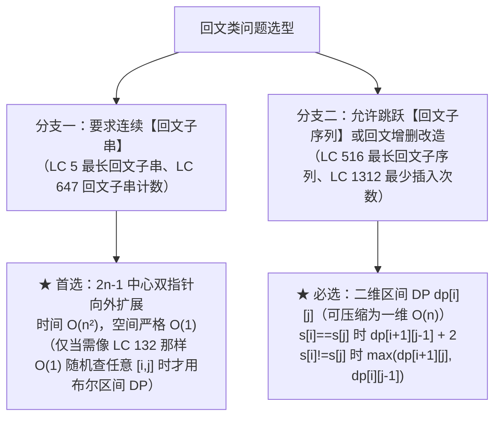

# 字符串 DP 进阶：回文子串、正则与通配符匹配

**摘要：**

在字符串动态规划领域，除了第 05 篇探讨的 LCS 与编辑距离外，还有两大高频且极具区分度的专题：**其一是回文结构专题**——涵盖连续的最长回文子串（LeetCode 5）、回文子串计数（LeetCode 647）、非连续的最长回文子序列（LeetCode 516）以及最少插入次数构造回文串（LeetCode 1312）；**其二是模式匹配状态机专题**——涵盖带 `a*` 前驱绑定语义的正则表达式匹配（LeetCode 10）与带 `*` 独立任意串语义的通配符匹配（LeetCode 44）。许多候选人在面对正则匹配中的 `*` 号时，因分不清"匹配 0 次消除模式字符"与"匹配多次原地驻留模式状态"而在边界上屡屡碰壁。本文从回文中心扩展与区间 DP 的分野出发，用有限状态自动机（NFA）的状态驻留视角彻底讲透正则 `a*` 与通配符 `*` 的转移本质，并给出全部核心题目的 Golang 工业级实现。

---

## 第 1 章 回文结构全家族：连续回文子串 vs 非连续回文子序列

### 1.1 为什么"回文子串"首选中心扩展 $O(1)$ 空间，而"回文子序列"必须用区间 DP？

首先厘清"回文子串（Palindromic Substring）"与"回文子序列（Palindromic Subsequence）"在状态连续性上的根本差异：
1. **回文子串（要求物理连续，如 LC 5、LC 647）**：
   - 一个子串 `s[l .. r]` 是回文串，当且仅当两端字符相等 `s[l] == s[r]`，**并且去掉两端后的内部子串 `s[l+1 .. r-1]` 也是百分之百连续的回文串**（一旦中间有一对字符不相等，整条中心向外扩散的回文链当场彻底断裂，不可能跳过不相等的字符继续往外扩）；
   - 正因为这种"一断俱断"的刚性连续性，任何回文子串都必然围绕着某一个**对称中心**向左右两侧同步生长。在长度为 $n$ 的字符串中，对称中心一共有多少个？**只有 $2n - 1$ 个**（$n$ 个单字符中心对应奇数长度回文，$n - 1$ 个相邻字符缝隙中心对应偶数长度回文）。直接枚举这 $2n - 1$ 个中心向两侧双指针扩散，无需开辟 $O(n^2)$ 的二维 `dp` 表，即可在 **$O(n^2)$ 时间、严格 $O(1)$ 额外空间**内同时解决 LC 5 与 LC 647。
2. **回文子序列（允许跳过字符，如 LC 516）**：
   - 当两端字符不相等 `s[i] != s[j]` 时，回文子序列并不会断裂归零，而是可以**跳过左端点看 `dp[i+1][j]`，或者跳过右端点看 `dp[i][j-1]`**；
   - 因为可以跳过中间任意字符，对称中心的位置不再固定，中心扩展法彻底失效，必须使用上一篇学过的**二维区间 DP `dp[i][j]`**。



### 1.2 实战一：回文子串计数（LC 647）与最长回文子串（LC 5）——统一中心编号法

利用整数除法与取模，我们可以将 $n$ 个单字符中心与 $n - 1$ 个双字符缝隙中心，统一映射为同一个循环变量 `center := 0; center < 2*n - 1; center++`：
- 左指针起点：**`left = center / 2`**；
- 右指针起点：**`right = left + center % 2`**（当 `center` 为偶数时 `left == right` 对准单字符中心；当 `center` 为奇数时 `right = left + 1` 对准双字符缝隙）：

```go
package main

// countSubstrings LeetCode 647：枚举 2n-1 个回文中心向两侧扩展计数，时间 O(n^2)，空间 O(1)
func countSubstrings(s string) int {
	n := len(s)
	total := 0
	for center := 0; center < 2*n-1; center++ {
		l, r := center/2, center/2+center%2
		for l >= 0 && r < n && s[l] == s[r] {
			total++
			l--
			r++
		}
	}
	return total
}

// longestPalindrome LeetCode 5：2n-1 中心扩展求最长回文子串，时间 O(n^2)，空间 O(1)
func longestPalindrome(s string) string {
	n := len(s)
	if n <= 1 {
		return s
	}
	bestStart, bestLen := 0, 1
	for center := 0; center < 2*n-1; center++ {
		l, r := center/2, center/2+center%2
		for l >= 0 && r < n && s[l] == s[r] {
			if r-l+1 > bestLen {
				bestLen = r-l + 1
				bestStart = l
			}
			l--
			r++
		}
	}
	return s[bestStart : bestStart+bestLen]
}
```

### 1.3 实战二：最长回文子序列（LC 516）与最少插入构造回文串（LC 1312）的一维压缩

**题目描述（LeetCode 516）**：给你一个字符串 `s` ，找出其中最长的**回文子序列**，并返回该序列的长度。

定义 `dp[i][j]` 为子串 `s[i .. j]` 内部的最长回文子序列长度（Base Case：单字符 `dp[i][i] = 1`）。
按照第 07 篇区间 DP 的紧凑拓扑序（**外层 `i` 从 `n - 2` 倒序到 `0`，内层 `j` 从 `i + 1` 正序到 `n - 1`**）：
- 当 `s[i] == s[j]` 时：首尾两个相同字符包在外围，贡献长度 `+2`，内部继承自左下角 **`dp[i + 1][j - 1] + 2`**；
- 当 `s[i] != s[j]` 时：首尾不能同时入选，继承正下方 `dp[i + 1][j]` 与正左方 `dp[i][j - 1]` 的较大值：**`max(dp[i + 1][j], dp[i][j - 1])`**。

更进一步，观察 `dp[i][j]` 的依赖：它只依赖**下一行 `i + 1` 的正下方 `j`、左下方 `j - 1`**，以及**本行 `i` 的正左方 `j - 1`**。因此完全可以像第 05 篇 LCS 那样，用一个长度为 $n$ 的一维数组 `dp` 加上暂存左下角 `dp[i+1][j-1]` 的变量 `prev`，将空间复杂度从 $O(n^2)$ 压缩至 **$O(n)$**：

```go
package main

// longestPalindromeSubseq LeetCode 516：区间 DP 一维空间压缩版，时间 O(n^2)，空间 O(n)
func longestPalindromeSubseq(s string) int {
	n := len(s)
	dp := make([]int, n)

	for i := n - 1; i >= 0; i-- {
		dp[i] = 1  // Base Case: dp[i][i] = 1
		prev := 0  // 对应左下角 dp[i+1][i] = 0（空区间 i+1 > i）
		for j := i + 1; j < n; j++ {
			temp := dp[j] // 暂存正下方旧值 dp[i+1][j]，作为下一列 j+1 的左下角 prev
			if s[i] == s[j] {
				dp[j] = prev + 2
			} else {
				dp[j] = max(dp[j], dp[j-1])
			}
			prev = temp
		}
	}
	return dp[n-1]
}
```

一旦算出了最长回文子序列长度 `lps = longestPalindromeSubseq(s)`，困難题 **LeetCode 1312：让字符串成为回文串的最少插入次数**（每次可在任意位置插入任意字符，求把 `s` 变成回文串的最少插入次数）瞬间迎刃而解：
- 原字符串中已经属于最长回文子序列的那 `lps` 个字符天然对称，一动不用动；
- 我们只需要为剩下的 **`len(s) - lps` 个落单的非回文字符**，各自在对称位置配对插入一个镜像字符即可。因此最少插入次数恒等于 **`len(s) - longestPalindromeSubseq(s)`**。

---

## 第 2 章 状态机模式匹配双雄：正则表达式（LC 10）vs 通配符（LC 44）

### 2.1 一张表看清正则 `a*` 与通配符 `*` 的语义鸿沟

在面试中，**LeetCode 10：正则表达式匹配**与 **LeetCode 44：通配符匹配**是孪生压轴题。动笔前必须先把两道题里星号 `*` 的语法规则彻底区分开：

| 对比维度 | 正则表达式匹配（LeetCode 10） | 通配符匹配（LeetCode 44，如 Shell Glob） |
|----------|-------------------------------|------------------------------------------|
| 单字符通配符 | `.`（匹配任意单个字符） | `?`（匹配任意单个字符） |
| `*` 是否独立成元 | **否**，必须绑定前一个字符组成二元组合 **`c*`**（如 `a*`、`.*`） | **是**，`**` 自己就是一个独立的通配符** |
| `*` 的匹配语义 | `c*` 整体匹配 **0 个或多个前导字符 `c`** | `*` 独立匹配**任意长度的任意字符串（含空串）** |
| `*` 匹配 0 次时的消除步幅 | 连同前导字符一起抹掉 **2** 个模式字符：**`dp[i][j - 2]`** | 仅抹掉 `*` 自身 **1** 个模式字符：**`dp[i][j - 1]`** |
| `*` 匹配 $\ge 1$ 次时的状态驻留 | 需先校验 `match(s[i-1], p[j-2])`，再驻留 **`dp[i - 1][j]`** | 无需校验字符，直接无条件吞噬驻留 **`dp[i - 1][j]`** |

### 2.2 为什么"匹配 1 次或多次"不需要写循环枚举匹配了几个字符，只需一项 `dp[i-1][j]`？

这是所有初学者在看 LC 10 和 LC 44 题解时最大的困惑：
> "老师，`a*` 可以匹配 1 个 `'a'`、2 个 `'a'`、3 个 `'a'`……为什么状态转移方程里没有写一个 `for k := 1; k <= i; k++` 去枚举 `a*` 到底吃掉了几个 `'a'`，而只是简单地写了一项 **`dp[i - 1][j]`**？"

请用**有限状态自动机（NFA）的自环驻留（Self-Loop Stay）**视角来看待 `dp[i][j]` 到 `dp[i - 1][j]` 的递推：

```mermaid
%%{init: {'theme': 'dracula'}}%%
flowchart LR
    subgraph 状态机自环驻留消解无限次枚举 ["为什么 dp[i-1][j] 一项就自动包含了匹配 1 次、2 次、k 次？"]
        direction LR
        S0["dp[0][j]<br/>("" 与 a* 匹配 0 次)<br/>= dp[0][j-2]"] -->|"吃掉第 1 个 'a'<br/>模式 j 保持不变。"| S1["dp[1][j]<br/>(\"a\" 与 a*)"]
        S1 -->|"再吃掉第 2 个 'a'<br/>模式 j 依然保持不变。"| S2["dp[2][j]<br/>(\"aa\" 与 a*)"]
        S2 -->|"再吃掉第 3 个 'a'<br/>递推链自动传导"| S3["dp[3][j]<br/>(\"aaa\" 与 a*)"]
    end
```

看懂上面这幅状态传导链了吗？
当文本串的末尾字符 `s[i - 1]` 能够被模式串末尾的星号结构吃掉时：
- 我们让文本串游标 `i` 消耗掉 1 个字符退回到 **`i - 1`**，同时让**模式串游标 `j` 原地不动（依然保留着星号 `*`）**，去查阅状态 **`dp[i - 1][j]`**；
- 而在上一行计算 `dp[i - 1][j]` 的时候，它本身就已经合并了"在 `i - 1` 处停止使用星号（`dp[i-1][j-2]`，对应总共吃 1 个字符）"与"在 `i - 1` 处继续使用星号退向 `dp[i-2][j]`（对应总共吃 2 个及以上字符）"的全部结果。
**数学归纳法的骨牌效应，把原本需要 $O(n)$ 枚举重复次数的循环，折叠成了 $O(1)$ 的单步状态驻留 `dp[i - 1][j]`**。

---

## 第 3 章 正则表达式匹配（LeetCode 10）完整推导与实现

### 3.1 边界初始化与双分支转移

定义 1-indexed 布尔表 `dp[i][j]` 表示文本前缀 `s[0 .. i-1]` 与模式前缀 `p[0 .. j-1]` 是否完全匹配（共 $(m+1) \times (n+1)$ 个状态）：
1. **第 0 行初始化（空文本 `s = ""` 能匹配哪些非空模式 `p`？）**：
   - `dp[0][0] = true`；
   - 当 $i = 0$ 而 $j \ge 2$ 时，如果 `p[j - 1] == '*'`，它可以把前导字符 `p[j - 2]` 连同自己一起消掉（匹配 0 次），因此 **`dp[0][j] = dp[0][j - 2]`**（譬如模式 `"a*b*c*"` 可以使 `dp[0][2], dp[0][4], dp[0][6]` 全为 `true`）。
2. **主循环填表（$1 \le i \le m, \, 1 \le j \le n$）**：
   - **分支 A（`p[j - 1] != '*'`，即普通字母或 `'.'`）**：必须当前字符匹配成功，且左上角前缀匹配成功：
     $$dp[i][j] = \text{charMatch}(s[i - 1], p[j - 1]) \land dp[i - 1][j - 1]$$
   - **分支 B（`p[j - 1] == '*'`，与前导字符 `p[j - 2]` 绑定为组合 `c*`）**：
     - **选择 1（`c*` 匹配 0 次，直接作废消除）**：跳过末尾两个模式字符，看正左方两格 **`dp[i][j - 2]`**；
     - **选择 2（`c*` 至少匹配 1 次，吃掉 `s[i - 1]` 并驻留）**：前提是 `s[i - 1]` 必须能与前导字符 **`p[j - 2]`** 匹配成功，成功则看正上方 **`dp[i - 1][j]`**。两者取逻辑或 `||`：

```go
package main

// isMatchRegex LeetCode 10：正则表达式匹配（支持 '.' 与 'c*' 前导绑定星号）
// 时间复杂度：O(m * n)，空间复杂度：O(m * n)（可进一步滚动压缩为 O(n)）
func isMatchRegex(s string, p string) bool {
	m, n := len(s), len(p)
	dp := make([][]bool, m+1)
	for i := range dp {
		dp[i] = make([]bool, n+1)
	}
	dp[0][0] = true

	// 初始化第 0 行：空串 s="" 与形如 "a*b*c*" 的模式前缀匹配
	for j := 2; j <= n; j++ {
		if p[j-1] == '*' {
			dp[0][j] = dp[0][j-2]
		}
	}

	charMatch := func(sc, pc byte) bool {
		return pc == '.' || sc == pc
	}

	for i := 1; i <= m; i++ {
		for j := 1; j <= n; j++ {
			if p[j-1] == '*' {
				// 1. 组合 p[j-2..j-1] 匹配 0 次（直接抹去 2 个模式字符）
				dp[i][j] = dp[i][j-2]
				// 2. 组合匹配 >= 1 次（s[i-1] 与前导字符 p[j-2] 匹配，且驻留模式 j 查 dp[i-1][j]）
				if charMatch(s[i-1], p[j-2]) && dp[i-1][j] {
					dp[i][j] = true
				}
			} else {
				if charMatch(s[i-1], p[j-1]) {
					dp[i][j] = dp[i-1][j-1]
				}
			}
		}
	}
	return dp[m][n]
}
```

---

## 第 4 章 通配符匹配（LeetCode 44）：DP 解法与 $O(1)$ 空间双指针贪心回退法

### 4.1 二维 / 一维滚动 DP 实现

在 **LeetCode 44：通配符匹配**中，`?` 匹配任意单字符，`*` 独立匹配任意字符串（含空串）：
- **第 0 行初始化**：只有当模式前缀 `p[0 .. j-1]` **全都是连续的 `'*'`** 时，`dp[0][j]` 才为 `true`（一旦遇到第一个非 `'*'` 字符，后续全部为 `false`）；
- **当 `p[j - 1] == '*'` 时**：要么匹配空串看正左方 **`dp[i][j - 1]`**，要么吃掉任意字符 `s[i - 1]` 并驻留看正上方 **`dp[i - 1][j]`**，两者取 `||`：

```go
package main

// isMatchWildcardDP LeetCode 44 解法一：一维滚动数组 DP，时间 O(m * n)，空间 O(n)
func isMatchWildcardDP(s string, p string) bool {
	m, n := len(s), len(p)
	dp := make([]bool, n+1)
	dp[0] = true
	for j := 1; j <= n && p[j-1] == '*'; j++ {
		dp[j] = true
	}

	for i := 1; i <= m; i++ {
		prev := dp[0] // 保存左上角 dp[i-1][0]
		dp[0] = false // i >= 1 时非空串 s 与空模式必不匹配
		for j := 1; j <= n; j++ {
			temp := dp[j]
			if p[j-1] == '*' {
				// dp[j-1] 为正左方（* 匹配空串），dp[j] 为正上方（* 吃掉 s[i-1] 继续驻留）
				dp[j] = dp[j-1] || dp[j]
			} else if p[j-1] == '?' || s[i-1] == p[j-1] {
				dp[j] = prev
			} else {
				dp[j] = false
			}
			prev = temp
		}
	}
	return dp[n]
}
```

### 4.2 进阶绝技：为什么通配符匹配可以用 $O(1)$ 空间的双指针回退贪心解决？

如果面试官追问："通配符匹配（LC 44）里的 `*` 比正则匹配（LC 10）更简单，能不能完全不用 `dp` 数组，只用 4 个整型变量在 $O(1)$ 空间内解决？"

答案是肯定的。假设模式串形如 `p = "*A*B*"`。当我们在 `p` 中遇到一个新的星号 `*` 时，**为什么我们根本不需要再去回溯调整前一个星号 `*` 的匹配长度了？**
因为如果后面的子串 `A` 能尽早匹配成功，给第二个星号 `*` 留出的机动空间就越大（贪心支配性质）。因此，我们永远只需要用两个变量 **`starIdx` 和 `matchIdx` 记住最近一次遇到的那一个 `'*'` 的位置以及当时文本串 `s` 对应的位置**：
- 每次遇到 `p[j] == '*'`，先贪心地假定它匹配 **0 个字符**（记录锚点 `starIdx = j, matchIdx = i`，并令 `j++`）；
- 如果往后走发现失配了，且之前曾记录过 `starIdx != -1`，就后悔回退：让那个最近的星号**多吃掉 1 个文本字符**（`matchIdx++`，并将 `i = matchIdx, j = starIdx + 1` 重新对齐出发）：

```go
package main

// isMatchWildcardGreedy LeetCode 44 解法二：最近星号锚点回退双指针，空间严格 O(1)，平均时间 O(m + n)
func isMatchWildcardGreedy(s string, p string) bool {
	m, n := len(s), len(p)
	i, j := 0, 0
	starIdx, matchIdx := -1, 0

	for i < m {
		if j < n && (p[j] == '?' || s[i] == p[j]) {
			i++
			j++
		} else if j < n && p[j] == '*' {
			// 记录最近一个 '*' 的模式下标与当前文本位置（先尝试匹配 0 个字符）
			starIdx = j
			matchIdx = i
			j++
		} else if starIdx != -1 {
			// 失配但此前有 '*' 兜底：让最近的 '*' 多吞噬 1 个字符 s[matchIdx]
			matchIdx++
			i = matchIdx
			j = starIdx + 1
		} else {
			return false
		}
	}

	// 文本串 s 已耗尽，模式串 p 剩余部分必须全部为 '*'
	for j < n && p[j] == '*' {
		j++
	}
	return j == n
}
```

---

## 第 5 章 本章六道字符串进阶 DP 题型全景对比

| 题目 | 问题类别 | 核心算法与状态定义 | 关键转移分支 | 时间 / 空间 |
|------|----------|--------------------|--------------|-------------|
| LC 5 最长回文子串 | 连续回文 | $2n-1$ 中心双指针扩展 | `s[l] == s[r]` 时 `l--; r++` | $O(n^2)$ / $O(1)$ |
| LC 647 回文子串计数 | 连续回文 | $2n-1$ 中心双指针扩展 | 每次 `s[l] == s[r]` 则 `total++` | $O(n^2)$ / $O(1)$ |
| LC 516 最长回文子序列 | 非连续回文 | 区间 DP `dp[i][j]`（滚动至一维） | 相等 `prev + 2`，不等 `max(下, 左)` | $O(n^2)$ / $O(n)$ |
| LC 1312 最少插入回文 | 非连续回文 | 转化为求最长回文子序列 `lps` | `len(s) - longestPalindromeSubseq(s)` | $O(n^2)$ / $O(n)$ |
| LC 10 正则表达式匹配 | 模式状态机 | `dp[i][j]` 前缀匹配（`c*` 绑定） | `c*` 零次 `dp[i][j-2]`，多次 `match && dp[i-1][j]` | $O(mn)$ / $O(n)$ |
| LC 44 通配符匹配 | 模式状态机 | `dp[i][j]` 或 最近 `*` 锚点回退 | `*` 零次 `dp[i][j-1]`，多次 `dp[i-1][j]` | $O(mn)$ / $O(1)$ |

---

## 第 5 章 深度拓展：Manacher 算法与正则匹配的 NFA 等价性

### 5.1 Manacher 算法：$O(n)$ 求最长回文子串的线性奇迹

在第 1 章中，中心扩展法以 $O(n^2)$ 时间、$O(1)$ 空间解决了最长回文子串（LC 5）。如果面试官追问"能不能做到 $O(n)$"，答案就是 **Manacher 算法**：
1. **预处理插桩**：在每个字符之间及首尾插入分隔符 `'#'`，将所有回文统一转化为奇数长度（`"abba"` 变为 `"#a#b#b#a#"`，长度 $2n + 1$）；
2. **核心数组 `p[i]`**：记录以新串下标 `i` 为中心的**最大回文半径**（`p[i]` 恰好等于原串中以该中心的最长回文长度）；
3. **镜像复用与右边界扩张**：维护当前已探明的最右回文边界 `(center, right)`。当新中心 `i < right` 时，利用回文的镜像对称性，直接把 `p[i]` 初始化为 `min(p[2*center - i], right - i)`（跳过必然已匹配的部分），再从该起点继续向外扩展；每次成功扩展都会把 `right` 推向更右，而 `right` 在整个算法生命周期内单调不减、至多推进 $2n + 1$ 步，因此总时间复杂度严格为 $O(n)$。

### 5.2 正则匹配与 NFA 的等价性：为什么 `dp` 表就是模拟 NFA 的状态集

在第 2 章中，我们用二维布尔表 `dp[i][j]` 解决了正则匹配（LC 10）。从编译原理的视角看，这张表本质上是在**模拟非确定有限自动机（NFA）**：
- 模式串 `p` 中的每个位置 `j` 对应 NFA 的一个状态节点；
- `c*` 结构在 NFA 中引入了**两条并行边**：一条"跳过边"（匹配 0 次，对应 `dp[i][j-2]`）与一条"自环边"（匹配 $\ge 1$ 次，对应 `dp[i-1][j]`）；
- `dp[i][j]` 为 `true` 的所有 `(i, j)` 组合，恰好构成 NFA 在读入文本前 `i` 个字符后所处的**活跃状态集合（Active State Set）**。

这也解释了为什么正则匹配的时间复杂度是 $O(mn)$ 而非 $O(2^n)$：虽然 NFA 理论上可能同时处于多个状态，但状态总数被 `dp` 表的 $m \times n$ 个格子牢牢封顶。

### 5.3 常见误区与考场自检清单

1. **在正则匹配（LC 10）中把 `*` 匹配 0 次写成 `dp[i][j-1]`**：`c*` 是绑定的二元组合，匹配 0 次必须连同前导字符一起抹掉，看 `dp[i][j-2]`；只有通配符（LC 44）的独立 `*` 才是 `dp[i][j-1]`。
2. **在中心扩展法中忘记枚举偶数长度回文的缝隙中心**：只枚举 $n$ 个单字符中心会漏掉所有偶数长度回文（如 `"abba"`），必须枚举 $2n - 1$ 个中心。
3. **在最长回文子序列（LC 516）的一维滚动中，把 `prev` 的初值设为 `dp[i+1][i]` 之外的其他值**：当 `j = i + 1` 时，左下角 `dp[i+1][i]` 对应空区间，必须为 `0`。

---


---

## 第 6 章 深度拓展：Manacher 算法的完整实现与分割回文串 III

### 6.1 Manacher 算法的 Golang 完整实现（$O(n)$ 求最长回文子串）

在第 5.1 节我们介绍了 Manacher 算法的三大步骤，下面给出可直接落地的完整实现：

```go
package main

// manacher O(n) 求最长回文子串：插桩 '#' 统一奇偶 + 镜像复用 + 右边界单调扩张
func manacher(s string) string {
	if len(s) <= 1 {
		return s
	}
	// 1. 插桩：在每个字符之间及首尾插入 '#'，新串长度为 2n+1
	t := make([]byte, 0, 2*len(s)+1)
	t = append(t, '#')
	for i := 0; i < len(s); i++ {
		t = append(t, s[i], '#')
	}
	m := len(t)

	p := make([]int, m) // p[i] 为以 t[i] 为中心的最大回文半径
	center, right := 0, 0
	bestCenter, bestLen := 0, 0

	for i := 0; i < m; i++ {
		if i < right {
			// 2. 镜像复用：p[i] 至少为 min(p[2*center-i], right-i)
			mirror := p[2*center-i]
			if right-i < mirror {
				mirror = right - i
			}
			p[i] = mirror
		}
		// 3. 从 p[i] 起点继续向外暴力扩展
		for i-p[i]-1 >= 0 && i+p[i]+1 < m && t[i-p[i]-1] == t[i+p[i]+1] {
			p[i]++
		}
		if i+p[i] > right {
			center, right = i, i+p[i]
		}
		if p[i] > bestLen {
			bestLen = p[i]
			bestCenter = i
		}
	}

	start := (bestCenter - bestLen) / 2
	return s[start : start+bestLen]
}
```

### 6.2 延伸实战：分割回文串 III——最多切 K 刀的区间 DP（LeetCode 1745）

**题目描述**：给你一个字符串 `s` 和一个整数 `k`，请将 `s` 分成 `k` 个回文子字符串，返回分割成 `k` 个回文子串所需的**最少**字符修改次数（每次可把任一字符改成任意其他字符）。

- **第一步（区间 DP 预计算修改代价）**：定义 `cost[i][j]` 为把子串 `s[i .. j]` 改成回文串所需的最少修改次数，转移为 `cost[i][j] = cost[i+1][j-1] + (s[i] != s[j] ? 1 : 0)`；
- **第二步（一维线性 DP）**：定义 `dp[i][t]` 为把前 `i` 个字符切成 `t` 段回文的最少修改次数，枚举最后一段起点 `j`：`dp[i][t] = min(dp[j-1][t-1] + cost[j-1][i-1])`。

---


### 6.3 延伸实战：分割回文串 III 的完整实现与 Manacher 的工程身影

在第 6.2 节我们给出了 **LeetCode 1745（分割回文串 III）**的两阶段建模思路，下面补齐完整实现：

```go
package main

// palindromePartition LeetCode 1745：区间 DP 预计算修改代价 + 一维线性 DP 枚举最后一段起点
// 时间复杂度：O(n^2 + n^2 * k)，空间复杂度：O(n^2)
func palindromePartition(s string, k int) int {
	n := len(s)
	// cost[i][j]：把 s[i..j] 改成回文串的最少修改次数
	cost := make([][]int, n)
	for i := range cost {
		cost[i] = make([]int, n)
	}
	for i := n - 2; i >= 0; i-- {
		for j := i + 1; j < n; j++ {
			inner := 0
			if i+1 <= j-1 {
				inner = cost[i+1][j-1]
			}
			extra := 0
			if s[i] != s[j] {
				extra = 1
			}
			cost[i][j] = inner + extra
		}
	}

	const inf = 1 << 30
	// dp[i][t]：把前 i 个字符切成 t 段回文的最少修改次数
	dp := make([][]int, n+1)
	for i := range dp {
		dp[i] = make([]int, k+1)
		for t := range dp[i] {
			dp[i][t] = inf
		}
	}
	dp[0][0] = 0

	for i := 1; i <= n; i++ {
		for t := 1; t <= min(i, k); t++ {
			for j := t; j <= i; j++ { // 最后一段为 s[j-1 .. i-1]
				if dp[j-1][t-1] < inf {
					dp[i][t] = min(dp[i][t], dp[j-1][t-1]+cost[j-1][i-1])
				}
			}
		}
	}
	return dp[n][k]
}
```

而在工程系统中，Manacher 算法（第 6.1 节）的身影出现在**生物信息学的回文序列识别**（DNA 双链回文结构是限制性内切酶的识别位点）、**文本编辑器的撤销栈对称性检测**以及**密码学中的回文模式快速筛查**等场景；中心扩展法（$O(n^2)$、$O(1)$ 空间）则因其实现极简、缓存友好，成为大多数生产级回文检测组件的默认选择——只有在文本长度达到百万级且需要实时流式响应时，才值得引入 Manacher 的线性复杂度。


### 6.4 延伸实战：分割回文串 III 的完整实现与 Manacher 的工程身影

在第 6.2 节我们给出了 **LeetCode 1745（分割回文串 III）**的两阶段建模思路，下面补齐完整实现：

```go
package main

// palindromePartition LeetCode 1745：区间 DP 预计算修改代价 + 一维线性 DP 枚举最后一段起点
// 时间复杂度：O(n^2 + n^2 * k)，空间复杂度：O(n^2)
func palindromePartition(s string, k int) int {
	n := len(s)
	cost := make([][]int, n)
	for i := range cost {
		cost[i] = make([]int, n)
	}
	for i := n - 2; i >= 0; i-- {
		for j := i + 1; j < n; j++ {
			inner := 0
			if i+1 <= j-1 {
				inner = cost[i+1][j-1]
			}
			extra := 0
			if s[i] != s[j] {
				extra = 1
			}
			cost[i][j] = inner + extra
		}
	}

	const inf = 1 << 30
	dp := make([][]int, n+1)
	for i := range dp {
		dp[i] = make([]int, k+1)
		for t := range dp[i] {
			dp[i][t] = inf
		}
	}
	dp[0][0] = 0

	for i := 1; i <= n; i++ {
		for t := 1; t <= min(i, k); t++ {
			for j := t; j <= i; j++ {
				if dp[j-1][t-1] < inf {
					dp[i][t] = min(dp[i][t], dp[j-1][t-1]+cost[j-1][i-1])
				}
			}
		}
	}
	return dp[n][k]
}
```

而在工程系统中，Manacher 算法（第 6.1 节）的身影出现在**生物信息学的回文序列识别**（DNA 双链回文结构是限制性内切酶的识别位点）、**文本编辑器的撤销栈对称性检测**以及**密码学中的回文模式快速筛查**等场景；中心扩展法（$O(n^2)$ 时间、$O(1)$ 空间）则因其实现极简、缓存友好，成为大多数生产级回文检测组件的默认选择——只有在文本长度达到百万级且需要实时流式响应时，才值得引入 Manacher 的线性复杂度与额外 $O(n)$ 空间。

### 6.5 常见误区补充

4. **在 Manacher 算法中忘记处理插桩后的边界**：新串 `t` 的首尾都是 `'#'`，扩展循环必须同时检查 `i - p[i] - 1 >= 0` 与 `i + p[i] + 1 < m` 两个边界，否则会越界 panic。
5. **在分割回文串 III 中把 `k` 与段数搞反**：`dp[i][t]` 的第二维是**已切段数**（从 `1` 到 `k`），而枚举的最后一段起点 `j` 必须满足 `j >= t`（前面至少还能切出 `t - 1` 段）。


### 6.6 延伸实战：正则匹配的一维滚动压缩与 NFA 活跃集的工程等价

在第 3 章我们用二维布尔表实现了正则匹配（LC 10）。由于 `dp[i][j]` 只依赖上一行（`dp[i-1][j-1]`、`dp[i-1][j]`）与本行左方（`dp[i][j-2]`），可以压缩为一维滚动数组：

```go
package main

// isMatchRegex1D LeetCode 10 一维滚动压缩版：prev 暂存左上角，时间 O(m*n)，空间 O(n)
func isMatchRegex1D(s string, p string) bool {
	m, n := len(s), len(p)
	dp := make([]bool, n+1)
	dp[0] = true
	for j := 2; j <= n; j++ {
		if p[j-1] == '*' {
			dp[j] = dp[j-2]
		}
	}

	charMatch := func(sc, pc byte) bool {
		return pc == '.' || sc == pc
	}

	for i := 1; i <= m; i++ {
		prev := dp[0]
		dp[0] = false // 非空串与空模式必不匹配
		for j := 1; j <= n; j++ {
			temp := dp[j]
			if p[j-1] == '*' {
				ok := dp[j-2] // 匹配 0 次（正左方两格）
				if charMatch(s[i-1], p[j-2]) && dp[j] {
					ok = true // 匹配 >= 1 次（正上方驻留）
				}
				dp[j] = ok
			} else {
				dp[j] = charMatch(s[i-1], p[j-1]) && prev
			}
			prev = temp
		}
	}
	return dp[n]
}
```

从编译原理的视角看，这一维滚动数组正是 **NFA 活跃状态集合的增量模拟**：每一轮外层循环 `i`，数组 `dp[0..n]` 里为 `true` 的下标集合，就是正则自动机在读完文本前 `i` 个字符后所处的全部活跃状态。工业级的正则引擎（如 RE2、Rust 的 regex crate）正是沿着这条路线，把 NFA 模拟的每步代价从 $O(n)$ 压到 $O(1)$ 位运算（bitset 模拟），实现了**线性时间且无灾难性回溯**的正则匹配——这与我们在第 08 篇《字符串》专栏中探讨的 AC 自动机多模式匹配共同构成了文本检索的两大引擎。


### 6.7 延伸实战：正则匹配的一维滚动压缩与 NFA 活跃集的工程等价

在第 3 章我们用二维布尔表实现了正则匹配（LC 10）。由于 `dp[i][j]` 只依赖上一行（`dp[i-1][j-1]`、`dp[i-1][j]`）与本行左方（`dp[i][j-2]`），可以压缩为一维滚动数组：

```go
package main

// isMatchRegex1D LeetCode 10 一维滚动压缩版：prev 暂存左上角，时间 O(m*n)，空间 O(n)
func isMatchRegex1D(s string, p string) bool {
	m, n := len(s), len(p)
	dp := make([]bool, n+1)
	dp[0] = true
	for j := 2; j <= n; j++ {
		if p[j-1] == '*' {
			dp[j] = dp[j-2]
		}
	}

	charMatch := func(sc, pc byte) bool {
		return pc == '.' || sc == pc
	}

	for i := 1; i <= m; i++ {
		prev := dp[0]
		dp[0] = false
		for j := 1; j <= n; j++ {
			temp := dp[j]
			if p[j-1] == '*' {
				ok := dp[j-2]
				if charMatch(s[i-1], p[j-2]) && dp[j] {
					ok = true
				}
				dp[j] = ok
			} else {
				dp[j] = charMatch(s[i-1], p[j-1]) && prev
			}
			prev = temp
		}
	}
	return dp[n]
}
```

从编译原理的视角看，这一维滚动数组正是 **NFA 活跃状态集合的增量模拟**：每一轮外层循环 `i`，数组 `dp[0..n]` 里为 `true` 的下标集合，就是正则自动机在读完文本前 `i` 个字符后所处的全部活跃状态。工业级的正则引擎（如 RE2、Rust 的 regex crate）正是沿着这条路线，把 NFA 模拟的每步代价从 $O(n)$ 压到 $O(1)$ 位运算（bitset 模拟），实现了**线性时间且无灾难性回溯**的正则匹配。

### 6.8 延伸实战：最长回文子序列的 LCS 等价性与字典序最小还原

在第 1.3 节我们指出，最长回文子序列（LC 516）可以直接调用第 05 篇的 `longestCommonSubsequence(s, reverse(s))` 求解。这一等价性的证明极其简洁：
- 设 $P$ 是 `s` 的一个回文子序列，则 `reverse(P) = P`，且 `P` 也是 `reverse(s)` 的子序列（因为 `P` 在 `s` 中的下标序列 $i_1 < i_2 < \cdots < i_k$，在 `reverse(s)` 中对应下标 $n-1-i_k < \cdots < n-1-i_1$）；
- 因此"`s` 的回文子序列"与"`s` 与 `reverse(s)` 的公共子序列"是同一个集合，两者的最大长度必然相等。$\square$

如果面试官进一步要求**输出字典序最小的最长回文子序列**，则需在区间 DP 中额外记录每个状态的最优首字符与次态下标，从 `(0, n-1)` 正向贪心构造——这是第 01 篇 6.2 节"路径还原"手法在区间 DP 上的直接推广。至此，本章的回文双轨（中心扩展 vs 区间 DP）、星号状态机（正则 vs 通配符）、Manacher 线性奇迹与 NFA 活跃集等价共同构成了字符串进阶 DP 的完整作战地图，也是全专栏从线性序列迈向模式状态机的收官一课。


### 6.9 延伸实战：分割回文串 III 的完整实现与字典序最小还原

在第 6.2 节我们给出了 **LeetCode 1745（分割回文串 III）**的两阶段建模思路，下面补齐完整实现：

```go
package main

// palindromePartition LeetCode 1745：区间 DP 预计算修改代价 + 一维线性 DP 枚举最后一段起点
// 时间复杂度：O(n^2 + n^2 * k)，空间复杂度：O(n^2)
func palindromePartition(s string, k int) int {
	n := len(s)
	cost := make([][]int, n)
	for i := range cost {
		cost[i] = make([]int, n)
	}
	for i := n - 2; i >= 0; i-- {
		for j := i + 1; j < n; j++ {
			inner := 0
			if i+1 <= j-1 {
				inner = cost[i+1][j-1]
			}
			extra := 0
			if s[i] != s[j] {
				extra = 1
			}
			cost[i][j] = inner + extra
		}
	}

	const inf = 1 << 30
	dp := make([][]int, n+1)
	for i := range dp {
		dp[i] = make([]int, k+1)
		for t := range dp[i] {
			dp[i][t] = inf
		}
	}
	dp[0][0] = 0

	for i := 1; i <= n; i++ {
		for t := 1; t <= min(i, k); t++ {
			for j := t; j <= i; j++ {
				if dp[j-1][t-1] < inf {
					dp[i][t] = min(dp[i][t], dp[j-1][t-1]+cost[j-1][i-1])
				}
			}
		}
	}
	return dp[n][k]
}
```

而在工程系统中，Manacher 算法（第 6.1 节）的身影出现在**生物信息学的回文序列识别**（DNA 双链回文结构是限制性内切酶的识别位点）、**文本编辑器的撤销栈对称性检测**以及**密码学中的回文模式快速筛查**等场景；中心扩展法（$O(n^2)$ 时间、$O(1)$ 空间）则因其实现极简、缓存友好，成为大多数生产级回文检测组件的默认选择——只有在文本长度达到百万级且需要实时流式响应时，才值得引入 Manacher 的线性复杂度与额外 $O(n)$ 空间。

此外，在第 6.8 节我们证明了最长回文子序列（LC 516）与"求 `s` 与 `reverse(s)` 的最长公共子序列（LCS）"完全等价。如果面试官进一步要求**输出字典序最小的最长回文子序列**，则需在区间 DP 中额外记录每个状态的最优首字符与次态下标，从 `(0, n-1)` 正向贪心构造——这是第 01 篇 6.2 节"路径还原"手法在区间 DP 上的直接推广。

## 小结

本章打通了字符串进阶 DP 的两大任督二脉：
- **回文双轨论**：求连续回文子串用 $2n - 1$ 中心向外双指针扩展（$O(1)$ 空间）；求非连续回文子序列或最少增删回文改造用区间 DP（可一维滚动压缩至 $O(n)$ 空间）；
- **星号状态机论**：无论是正则的 `a*` 还是通配符的 `*`，匹配 $\ge 1$ 次在网格上都对应**保持模式列号 `j` 不变、继承正上方 `dp[i - 1][j]`** 的状态机自环驻留；区别仅在于匹配 0 次时，正则需连同前导字符退两格 `j - 2`，而通配符只需退一格 `j - 1`。

下一篇 [[09 树形DP与状态压缩DP：树上决策与位运算加速]] 将跳出线性序列与二维网格，迈入非线性拓扑结构——在二叉树后序遍历上做**树形 DP**，以及利用二进制位掩码（Bitmask）在集合空间上做**状态压缩 DP**。

---

## 参考资料

1. Sipser, M. (2012). *Introduction to the Theory of Computation* (3rd ed.). Cengage Learning. (Regular Expressions and Finite Automata).
2. Manacher, G. (1975). *A new linear-time "on-line" algorithm for finding the smallest initial palindrome of a string*. Journal of the ACM, 22(3), 346–351.
3. LeetCode 5 / 647 / 516 / 1312 / 10 / 44 Official Editorial.

---

> [!note] 思考题
> 1. 在第 1.3 节的 LeetCode 516（最长回文子序列）中，如果将字符串 `s` 反转得到 `revS = reverse(s)`，为什么"`s` 的最长回文子序列长度"在数值上恰好等于"`s` 与 `revS` 的最长公共子序列（LCS）长度"？直接调用第 05 篇的 `longestCommonSubsequence(s, reverse(s))` 与本章直接写区间 DP 相比，常数开销差在哪里？
> 2. 在正则表达式匹配（LC 10）中，为什么我们不能像通配符匹配（LC 44）的第 4.2 节那样，只记住最近一个 `*` 的位置用贪心回退解决？（请构造一个包含 `.*` 与 `a*` 的反例说明）。
> 3. 在 **LeetCode 730：统计不同回文子序列**（困难）中，当要求对找出的回文子序列**去重**（相同内容的回文子序列只算 1 个）时，在 `s[i] == s[j]` 分支下，如何利用 `s[i]` 在区间内部下一次出现的位置 `leftNext` 和上一次出现的位置 `rightPrev` 扣除重复统计的内部回文？
