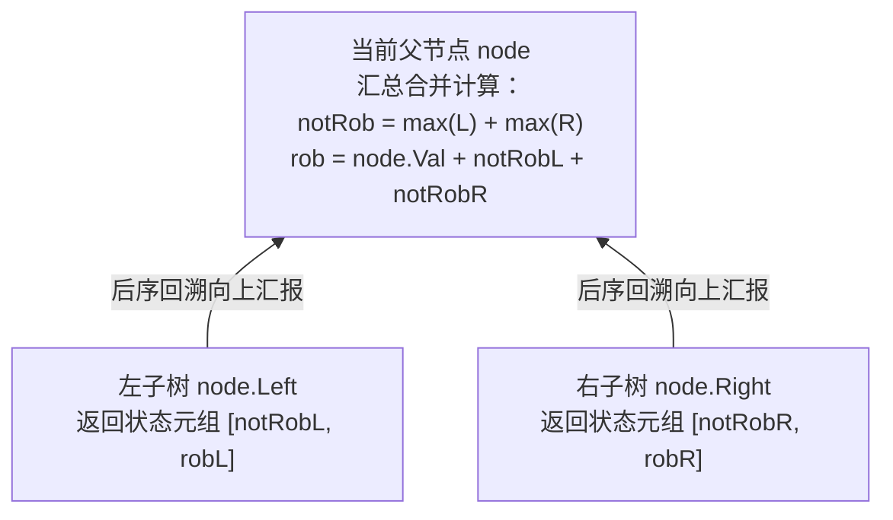

# 树形 DP 与状态压缩 DP：树上决策与位运算加速

**摘要：**

在前八篇文章中，我们的动态规划舞台始终局限在一维数组或二维网格上。当问题载体升级为**树形拓扑结构（Tree Topology）**或**无序集合子集（Subset Space，$n \le 20$）**时，动态规划进化出了两种极具威力的进阶形态：**树形 DP（Tree DP）**与**状态压缩 DP（Bitmask DP）**。在树形 DP 中，由于父节点的决策依赖于左右子树的汇总结果，天然的填表顺序不再是 `for` 循环，而是**二叉树的后序递归遍历（Post-Order DFS，先探底左右子树、再在回溯归途中向上汇报状态元组）**；而在状态压缩 DP 中，我们利用一个 32 位整数的二进制比特位（`0` 与 `1`）编码集合中每个元素的"未选/已选"状态，将原本需要 $O(n!)$ 排列搜索的 NP-Hard 问题压缩至 $O(2^n \cdot n)$ 或 $O(3^n)$ 的位运算递推。本文精讲打家劫舍 III（LC 337）、监控二叉树（LC 968）、二叉树最大路径和（LC 124）、旅行商最短路径（LC 847）、最小必要团队（LC 1125）与完成任务的最少工作时间段（LC 1986）六道经典名题，并给出地道 Golang 实现。

---

## 第 1 章 树形 DP 的拓扑引擎：后序遍历与多状态元组向上汇报

### 1.1 为什么树形 DP 天然采用"后序遍历（左 $\to$ 右 $\to$ 根）"？

在第 01 篇我们指出，动态规划的填表顺序必须遵循有向无环图（DAG）的**拓扑序（被依赖的子问题先算，父问题后算）**。
在一棵以 `root` 为根的树上，子问题是"以子节点 `left` 和 `right` 为根的子树"，原问题是"以父节点 `node` 为根的整棵树"。要想算出父节点 `node` 的状态，必须先把左子树 `node.Left` 和右子树 `node.Right` 的状态全部算出来——**在树的三种 DFS 遍历序中，唯一满足"先处理完所有子节点、最后处理父节点"的，正是后序遍历（Post-Order Traversal）**。



不仅如此，在树形 DP 中，我们通常不需要开辟一张显式的 `map[*TreeNode]int` 哈希表来存每个节点的 `dp` 值——因为树没有环（每个节点只有唯一一个父节点，只会被它的父节点读取唯一一次），直接让递归函数 `dfs(node) (state0, state1, ...)` **通过多返回值向上汇报状态元组**，即可在 $O(n)$ 时间与 $O(h)$ 栈空间内一次性算完。

### 1.2 实战一：树的最大独立集——打家劫舍 III（LeetCode 337）

**题目描述**：小偷又发现了一个新的可行窃的地区。这个地区只有一个入口，我们称之为 `root`。除了 `root` 之外，每栋房子有且只有一个"父"房子与之相连。一番侦察之后，聪明的小偷意识到"这个地方的所有房屋的排列类似于一棵二叉树"。如果**两个直接相连的房子在同一天晚上被打劫，房屋将自动报警**。给定二叉树的 `root` ，返回在不触动警报的情况下，小偷能够盗取的最高金额。

#### 1.2.1 双状态元组 `(notRob, rob)` 推导

对于任意子树根节点 `node`，它能不能偷，直接决定了它的左右孩子能不能偷。为了消除后效性，每个节点必须向它的父节点同时汇报**两个状态**：
1. **`notRob`（不偷当前节点 `node` 时，该子树能贡献的最大金额）**：
   - 既然 `node` 没偷，那么左孩子 `node.Left` 偷或不偷都合法（取 `max(leftNotRob, leftRob)`），右孩子 `node.Right` 偷或不偷也都合法（取 `max(rightNotRob, rightRob)`），两者相加：
     $$\text{notRob} = \max(\text{leftNotRob}, \text{leftRob}) + \max(\text{rightNotRob}, \text{rightRob})$$
2. **`rob`（偷当前节点 `node` 时，该子树能贡献的最大金额）**：
   - 既然偷了 `node`（拿到 `node.Val`），那么它的左孩子和右孩子**绝对不能偷**，只能读取左右孩子的 `notRob` 状态：
     $$\text{rob} = \text{node.Val} + \text{leftNotRob} + \text{rightNotRob}$$

```go
package main

type TreeNode struct {
	Val   int
	Left  *TreeNode
	Right *TreeNode
}

// robTree LeetCode 337：后序 DFS 直接返回 (不偷当前节点最大收益, 偷当前节点最大收益)
// 时间复杂度：O(n)，空间复杂度：O(h)（递归调用栈深度）
func robTree(root *TreeNode) int {
	var dfs func(node *TreeNode) (notRob, rob int)
	dfs = func(node *TreeNode) (int, int) {
		if node == nil {
			return 0, 0
		}
		lNot, lRob := dfs(node.Left)
		rNot, rRob := dfs(node.Right)

		notRob := max(lNot, lRob) + max(rNot, rRob)
		rob := node.Val + lNot + rNot
		return notRob, rob
	}

	rootNot, rootRob := dfs(root)
	return max(rootNot, rootRob)
}
```

### 1.3 实战二：树上支配集三态机——监控二叉树（LeetCode 968）

**题目描述（困难）**：给定一个二叉树，我们在树的节点上安装摄像头。节点上的每个摄影头都可以监视**其父对象、自身及其直接子对象**。计算监控树的所有节点所需的最小摄像头数量。

为什么这道题比打家劫舍 III 更难？
因为在打家劫舍中，只有"选"和"不选"两种状态；而在监控二叉树中，一个**没有安装摄像头**的节点，还细分为**"已经被它的子节点的摄像头照亮了"**与**"还没被照亮（指望它头顶的父节点装摄像头来照亮它）"**两种截然不同的状态。因此，每个节点 `node`（在保证其左、右子树内部所有更下层节点均已被覆盖的前提下）必须向上汇报**三个状态**：

1. **`unwatched`（状态 0：当前节点 `node` 未装摄像头，且尚未被覆盖，等待父节点搭救）**：
   - 既然 `node` 没装摄像头且自己都没被照亮，说明它的左、右孩子**绝对没有装摄像头**，且左、右孩子必须已经靠它们各自的子树把自己照亮了（处于状态 1 `watchedNoCam`）：
     $$\text{unwatched} = l_{\text{watchedNoCam}} + r_{\text{watchedNoCam}}$$
2. **`watchedNoCam`（状态 1：当前节点 `node` 未装摄像头，但已被某个子节点的摄像头照亮）**：
   - 至少有一个孩子处于状态 2（`hasCam`），另一个孩子处于状态 1 或状态 2：
     $$\text{watchedNoCam} = \min\big(l_{\text{hasCam}} + \min(r_{\text{watchedNoCam}}, r_{\text{hasCam}}), \; r_{\text{hasCam}} + \min(l_{\text{watchedNoCam}}, l_{\text{hasCam}})\big)$$
3. **`hasCam`（状态 2：当前节点 `node` 亲自安装了 1 个摄像头）**：
   - 既然 `node` 自己装了摄像头（耗费 `+1`），它能把左、右孩子顺手照亮，因此左、右孩子处于状态 0、1、2 中的任何一种都完全合法：
     $$\text{hasCam} = 1 + \min(l_0, l_1, l_2) + \min(r_0, r_1, r_2)$$

最后特别注意**空节点 `nil` 的边界初值**：空节点天然不需要被覆盖（故视为已覆盖的状态 1 `watchedNoCam = 0`），且空节点上绝不可能安装摄像头（故状态 2 `hasCam = inf`）：

```go
package main

import "math"

// minCameraCover LeetCode 968：树形 DP 三状态机 (0:待父覆盖, 1:已被子覆盖无相机, 2:装有相机)
// 时间复杂度：O(n)，空间复杂度：O(h)
func minCameraCover(root *TreeNode) int {
	const inf = math.MaxInt32 / 2

	var dfs func(node *TreeNode) (unwatched, watchedNoCam, hasCam int)
	dfs = func(node *TreeNode) (int, int, int) {
		if node == nil {
			// 空节点视为已被覆盖且无相机 (watchedNoCam = 0)，不可装相机 (hasCam = inf)
			return 0, 0, inf
		}
		l0, l1, l2 := dfs(node.Left)
		r0, r1, r2 := dfs(node.Right)

		unwatched := l1 + r1
		watchedNoCam := min(l2+min(r1, r2), r2+min(l1, l2))
		hasCam := 1 + min(l0, min(l1, l2)) + min(r0, min(r1, r2))
		return unwatched, watchedNoCam, hasCam
	}

	_, rootWatched, rootHasCam := dfs(root)
	// 整棵树的根节点 root 头顶没有父节点，故不能取状态 0 (unwatched)
	return min(rootWatched, rootHasCam)
}
```

### 1.4 实战三：树上拐点更新全局 vs 向上汇报单链——二叉树中的最大路径和（LeetCode 124）

在树形 DP 中还有一类经典范式：**递归函数的返回值（向上汇报给父节点的单侧最大链长/链和）与在节点处拐弯合并更新的全局答案（经过当前节点连接左右子树的完整路径）不是同一个量**。
以 **LeetCode 124：二叉树中的最大路径和**（以及 **LeetCode 543：二叉树的直径**）为例：
- 在节点 `node` 处，如果把 `node` 当作整条路径的**最高拐点（LCA）**，它可以同时接上左子树的最大非负单链 `leftGain = max(0, dfs(node.Left))` 和右子树的最大非负单链 `rightGain = max(0, dfs(node.Right))`，用 **`node.Val + leftGain + rightGain`** 更新全局最大路径和 `maxSum`；
- 但当 `dfs(node)` 向它的父节点返回时，**因为路径不能分叉，它最多只能挑左、右子树中的一条分支向上延伸**，所以返回值必须是 **`node.Val + max(leftGain, rightGain)`**：

```go
package main

import "math"

// maxPathSum LeetCode 124：区分"拐点双侧合并更新全局答案"与"单侧链向上汇报给父节点"
func maxPathSum(root *TreeNode) int {
	maxSum := math.MinInt32

	var dfs func(node *TreeNode) int
	dfs = func(node *TreeNode) int {
		if node == nil {
			return 0
		}
		// 若子树贡献为负，则直接舍弃不选（与 0 取 max）
		leftGain := max(0, dfs(node.Left))
		rightGain := max(0, dfs(node.Right))

		// 1. 以当前 node 为最高拐点的完整路径和，更新全局纪录
		if pathThroughNode := node.Val + leftGain + rightGain; pathThroughNode > maxSum {
			maxSum = pathThroughNode
		}

		// 2. 向上汇报给父节点时，只能选左右中的单条分支（不可分叉）
		return node.Val + max(leftGain, rightGain)
	}

	dfs(root)
	return maxSum
}
```

---

## 第 2 章 状态压缩 DP：用整数的二进制位编码子集宇宙

### 2.1 什么时候该立刻想到状态压缩 DP（Bitmask DP）？

在面试读题时，有两条极其显著的信号会直接指向状态压缩 DP：
1. **数据规模特征**：题目中某个集合的元素个数 $n$ 非常小，明确给出 **$n \le 16$ 或 $n \le 20$**；
2. **问题特征**：要求访问所有节点、分配所有任务、覆盖所有技能或用贴纸拼出短单词，且每个元素的选取顺序或组合会影响后续决策（暴力排列是 $n! \approx 2.4 \times 10^{18}$，而子集状态数只有 $2^n \le 10^6$）。

我们将一个包含 $n$ 个元素（编号 $0 \dots n-1$）的子集 $S$，直接编码为一个范围在 **`[0, (1 << n) - 1]`** 之间的整数 `mask`。请务必熟练掌握以下五条核心位运算指令：

| 集合操作 | 位运算表达式（Go 语法） | 示例说明 |
|----------|-------------------------|----------|
| 全集 $U = \{0, 1, \dots, n-1\}$ | `full := (1 << n) - 1` | 低 $n$ 位全为 `1` |
| 检查元素 `i` 是否在集合 `mask` 中 | `(mask >> i) & 1 == 1` | 右移 $i$ 位取最低位 |
| 将元素 `i` 加入集合 `mask`（并集） | `mask \| (1 << i)` | 将第 $i$ 位点亮为 `1` |
| 将元素 `i` 从集合 `mask` 中移除 | `mask &^ (1 << i)` | Go 原生按位清除（Bit Clear）运算符 `&^` |
| 枚举 `mask` 的所有非空真子集 `sub` | `for sub := mask; sub > 0; sub = (sub - 1) & mask` | 每次精确跳到下一个更小的子集，零无效空转 |

---

## 第 3 章 状态压缩 DP 三大经典模型实战

### 3.1 模型一：图上哈密顿遍历（TSP 变体）——访问所有节点的最短路径（LeetCode 847）

**题目描述**：存在一个由 $n$ 个节点组成的无向连通图（$1 \le n \le 12$），图中的节点按从 `0` 到 `n - 1` 编号。给你一个数组 `graph` 表示这个图。返回能够**访问所有节点的最短路径的长度**。你可以在任一节点开始和停止，也可以多次重访节点，并且可以重用边。

#### 3.1.1 为什么普通 BFS 的 `visited[u]` 不够用，必须升维为 `visited[u][mask]`？

在普通最短路 BFS 中，我们不能走回头路，所以用一维布尔数组 `visited[u]` 记录节点 `u` 是否到过。
但在这道题中（例如星形图：中心节点 `0` 连接着三个叶子 `1, 2, 3`），为了访问完所有节点，你**必须从叶子 `1` 退回中心节点 `0`，再从 `0` 走向叶子 `2`**。
什么时候回到节点 `0` 是有意义的？**当你手里揣着的"已访问节点集合 `mask`"比上次来 `0` 的时候多出了新节点时**。

因此，系统的完整状态必须由二元组 **`(当前所在节点 u, 已访问节点位掩码 mask)`** 共同构成（共有 $n \cdot 2^n$ 个状态）：
- 初始时，因为可以从任意节点出发，我们将全部 $n$ 个起点状态 `(i, 1 << i)` 同时压入 BFS 队列（多源 BFS，初始步数为 `0`）；
- 当从队列弹出的状态满足 **`mask == (1 << n) - 1`**（全集达成）时，由于 BFS 按层推进的天然最短性，当前步数 `dist` 即为全局最短路径：

```go
package main

type stateNode struct {
	u    int
	mask int
	dist int
}

// shortestPathLength LeetCode 847：多源 BFS + 状态压缩 (u, mask)，时间 O(n^2 * 2^n)
func shortestPathLength(graph [][]int) int {
	n := len(graph)
	if n <= 1 {
		return 0
	}
	fullMask := (1 << n) - 1

	visited := make([][]bool, n)
	for i := range visited {
		visited[i] = make([]bool, 1<<n)
		visited[i][1<<i] = true
	}

	queue := make([]stateNode, 0, n*(1<<n))
	for i := 0; i < n; i++ {
		queue = append(queue, stateNode{u: i, mask: 1 << i, dist: 0})
	}

	for len(queue) > 0 {
		cur := queue[0]
		queue = queue[1:]

		for _, next := range graph[cur.u] {
			nextMask := cur.mask | (1 << next)
			if nextMask == fullMask {
				return cur.dist + 1
			}
			if !visited[next][nextMask] {
				visited[next][nextMask] = true
				queue = append(queue, stateNode{u: next, mask: nextMask, dist: cur.dist + 1})
			}
		}
	}
	return 0
}
```

### 3.2 模型二：状态压缩 0-1 背包（最小集合覆盖）——最小的必要团队（LeetCode 1125）

**题目描述**：作为项目经理，你规划了一份需求的技能清单 `req_skills`（技能数 $m \le 16$），并打算从备选人员名单 `people`（人数 $k \le 60$）中选出些人组成一个「必要团队」，使得团队中全部技能的并集覆盖 `req_skills`。请你返回规模最小的必要团队成员下标列表。

#### 3.2.1 双重 Bitmask 设计：用 `int` 掩码做背包容量，用 `uint64` 掩码记录入选队员

仔细看这道题的结构：
- $m \le 16$ 种必要技能，恰好可以编码为一个 16-bit 整数掩码 `skillMask`（全集为 `(1 << m) - 1 = 65535`）；
- 每个候选人 `i` 掌握的技能子集是 `pMask[i]`，选或不选这个人，就是一个标准的 **0-1 背包**——只不过普通背包的容量累加是加法 `j + w`，而这里的容量合并是**按位或 `mask | pMask[i]`**；
- 更精妙的是：**题目要求返回最终入选的具体人员下标列表，而总人数 `len(people) <= 60` 恰好小于 64**。我们根本不需要在每个 `dp[mask]` 里维护一个切片去拷贝人员名单，直接用一个 **64 位无符号整数 `uint64`（`teamMask[mask]`）的二进制位来记录选了哪些人**（选了第 `i` 个人就按位或上 `uint64(1) << i`，团队人数就是 `bits.OnesCount64(teamMask[mask])`），将时间和空间常数压榨到了极致：

```go
package main

import "math/bits"

// smallestSufficientTeam LeetCode 1125：16-bit 技能状态压缩 DP + 64-bit 队员集合位掩码追踪
// 时间复杂度：O(k * 2^m)，空间复杂度：O(2^m)
func smallestSufficientTeam(req_skills []string, people [][]string) []int {
	m := len(req_skills)
	skillID := make(map[string]int, m)
	for i, s := range req_skills {
		skillID[s] = i
	}

	full := (1 << m) - 1
	// team[mask] 用 uint64 的二进制位记录覆盖技能集 mask 所需的最少人员集合
	team := make([]uint64, full+1)
	allPeopleMask := (uint64(1) << len(people)) - 1
	for mask := 1; mask <= full; mask++ {
		team[mask] = allPeopleMask // 初始设为全员（最大可能人数）
	}

	for i, skills := range people {
		pMask := 0
		for _, s := range skills {
			if id, ok := skillID[s]; ok {
				pMask |= 1 << id
			}
		}
		if pMask == 0 {
			continue // 无任何有效技能的候选人直接跳过
		}

		// 刷表法更新：在已有技能集 mask 基础上招募第 i 号候选人
		for mask := 0; mask <= full; mask++ {
			nextMask := mask | pMask
			if nextMask == mask {
				continue
			}
			newTeam := team[mask] | (uint64(1) << i)
			if bits.OnesCount64(newTeam) < bits.OnesCount64(team[nextMask]) {
				team[nextMask] = newTeam
			}
		}
	}

	bestMask := team[full]
	var res []int
	for i := 0; i < len(people); i++ {
		if (bestMask>>i)&1 == 1 {
			res = append(res, i)
		}
	}
	return res
}
```

### 3.3 模型三：$O(3^n)$ 枚举子集的子集——完成任务的最少工作时间段（LeetCode 1986）

**题目描述**：你被安排了 $n$ 个任务（$n \le 14$），任务需要花费的时间用数组 `tasks` 表示。第 `i` 个任务需要花费 `tasks[i]` 小时完成。一个**工作时间段**中，你可以至多连续工作 `sessionTime` 个小时，然后休息。求完成所有任务所需要的**最少**工作时间段数。

#### 3.3.1 为什么枚举所有掩码的所有子集总复杂度是 $O(3^n)$ 而不是 $O(4^n)$？

定义 `dp[mask]` 为完成任务子集 `mask` 所需的最少工作时间段数。
要算出 `dp[mask]`，我们需要枚举**最后一个工作时间段一口气干完了 `mask` 里的哪一个非空子集 `sub`**（前提是该子集的任务总耗时 `sumTime[sub] <= sessionTime`），剩下的任务就是补集 **`mask ^ sub`**，转移方程为：

$$dp[\text{mask}] = \min_{\substack{\emptyset \neq \text{sub} \subseteq \text{mask} \\ \text{sumTime}[\text{sub}] \le \text{sessionTime}}} \big\{ dp[\text{mask} \oplus \text{sub}] + 1 \big\}$$

使用位运算魔法 **`for sub := mask; sub > 0; sub = (sub - 1) & mask`**，可以一步不浪费地只枚举 `mask` 中为 `1` 的那些比特位组成的子集。
为什么外层遍历 `mask`（$0 \dots 2^n-1$）、内层遍历 `mask` 的子集 `sub`，两层循环加起来的总迭代次数不是 $2^n \times 2^n = 4^n$，而是 **$3^n$**？
- 因为一个含有 $k$ 个 `1` 的掩码 `mask`，一共有 $\binom{n}{k}$ 个，而它内部恰好有 $2^k$ 个子集；
- 根据二项式定理：
  $$\sum_{k=0}^n \binom{n}{k} \cdot 2^k = \sum_{k=0}^n \binom{n}{k} \cdot 2^k \cdot 1^{n-k} = (2 + 1)^n = \mathbf{3^n}$$
- 从元素视角看更直观：对 `(mask, sub)` 而言，每一个比特位 $i \in [0, n-1]$ 只有三种可能的状态——1) 不在 `mask` 中；2) 在 `mask` 中但不在 `sub` 中；3) 既在 `mask` 中也在 `sub` 中。$n$ 个位置每个位置 3 种选择，总状态对数不多不少正好是 $3^n$（当 $n = 14$ 时，$3^{14} \approx 4.78 \times 10^6$，在几毫秒内即可跑完）：

```go
package main

import "math/bits"

// minSessions LeetCode 1986：预计算子集和 + (sub-1)&mask 枚举子集，时间复杂度 O(3^n)
func minSessions(tasks []int, sessionTime int) int {
	n := len(tasks)
	full := (1 << n) - 1

	// 1. O(2^n) 预处理所有子集 mask 的任务总耗时是否 <= sessionTime
	validSub := make([]bool, full+1)
	sumTime := make([]int, full+1)
	for mask := 1; mask <= full; mask++ {
		tz := bits.TrailingZeros(uint(mask))
		prevMask := mask & (mask - 1) // 抹去最低位的 1
		sumTime[mask] = sumTime[prevMask] + tasks[tz]
		if sumTime[mask] <= sessionTime {
			validSub[mask] = true
		}
	}

	// 2. O(3^n) 子集枚举 DP
	dp := make([]int, full+1)
	for mask := 1; mask <= full; mask++ {
		dp[mask] = n // 最坏每个任务单独占 1 个时间段
		for sub := mask; sub > 0; sub = (sub - 1) & mask {
			if validSub[sub] && dp[mask^sub]+1 < dp[mask] {
				dp[mask] = dp[mask^sub] + 1
			}
		}
	}
	return dp[full]
}
```

---

## 第 4 章 本章六道树形与状态压缩 DP 全景对比

| 题目 | 算法类型 | 状态定义 | 核心转移技巧 | 时间 / 空间 |
|------|----------|----------|--------------|-------------|
| LC 337 打家劫舍 III | 树形 DP | 后序返回 `(notRob, rob)` | 偷父则子必不偷，不偷父则子取 `max` | $O(n)$ / $O(h)$ |
| LC 968 监控二叉树 | 树形 DP | 后序返回 `(待覆盖, 已覆盖无相机, 装相机)` | 三态完备转移，空节点 `(0, 0, inf)` | $O(n)$ / $O(h)$ |
| LC 124 最大路径和 | 树形 DP | 返回单链最大非负贡献，全局更新双侧拐点 | 返回 `val + max(L, R)`，更新 `val + L + R` | $O(n)$ / $O(h)$ |
| LC 847 访问所有节点 | 状压 + BFS | `(当前点 u, 已访问集 mask)` | $n$ 起点多源入队，遇 `mask == full` 即停 | $O(n^2 2^n)$ / $O(n 2^n)$ |
| LC 1125 最小必要团队 | 状压背包 | `team[skillMask]` 存 64-bit 队员集合 | `nextMask = mask \| pMask`，`OnesCount64` 比大小 | $O(k 2^m)$ / $O(2^m)$ |
| LC 1986 最少工作时间段 | 子集状压 | `dp[mask]`：完成子集最少时段 | `(sub - 1) & mask` 遍历合法子集 | $O(3^n)$ / $O(2^n)$ |

---

## 第 5 章 深度拓展：换根 DP（Rerooting）与轮廓线状压 DP

### 5.1 换根 DP：树中距离之和（LeetCode 834）

在第 4 章思考题中我们提出了换根 DP 的经典题——**LeetCode 834：树中距离之和**（给定无向树，对每个节点 `i` 求它到其他所有节点的距离之和）。如果对每个节点都跑一遍 DFS，耗时 $O(n^2)$（当 $n = 3 \times 10^4$ 时约 $9 \times 10^8$，勉强超时）；而**换根 DP（Rerooting DP）**只需两遍 DFS 即可在 $O(n)$ 时间内完成：

1. **第一遍（后序，自底向上）**：以节点 `0` 为根，对每个子树根 `u` 计算：
   - `subtreeSize[u]`：以 `u` 为根的子树节点个数；
   - `subtreeDist[u]`：子树内所有节点到 `u` 的距离之和（转移：`subtreeDist[u] = Σ (subtreeDist[v] + subtreeSize[v])`，其中每条从 `v` 到 `u` 的边让子树内所有节点距离各加 1）。
2. **第二遍（先序，自顶向下）**：设根 `0` 的答案是 `ans[0] = subtreeDist[0]`。当把根从父节点 `u` 换到子节点 `v` 时，整棵树的视角发生了什么？
   - `v` 子树内的 `subtreeSize[v]` 个节点：到 `v` 的距离全部**减 1**；
   - 子树外的 `n - subtreeSize[v]` 个节点：到 `v` 的距离全部**加 1**；
   - 因此换根转移方程只有一行：
     $$ans[v] = ans[u] - \text{subtreeSize}[v] + (n - \text{subtreeSize}[v])$$

```go
package main

// sumOfDistancesInTree LeetCode 834：换根 DP 两遍 DFS（后序算子树信息 + 先序换根递推），时间 O(n)
func sumOfDistancesInTree(n int, edges [][]int) []int {
	adj := make([][]int, n)
	for _, e := range edges {
		adj[e[0]] = append(adj[e[0]], e[1])
		adj[e[1]] = append(adj[e[1]], e[0])
	}

	subtreeSize := make([]int, n)
	subtreeDist := make([]int, n)
	ans := make([]int, n)

	// 第一遍：后序 DFS 自底向上，以 0 为根计算子树大小与子树内距离和
	var postOrder func(u, parent int)
	postOrder = func(u, parent int) {
		subtreeSize[u] = 1
		for _, v := range adj[u] {
			if v == parent {
				continue
			}
			postOrder(v, u)
			subtreeSize[u] += subtreeSize[v]
			subtreeDist[u] += subtreeDist[v] + subtreeSize[v]
		}
	}
	postOrder(0, -1)
	ans[0] = subtreeDist[0]

	// 第二遍：先序 DFS 自顶向下换根，ans[v] = ans[u] - size[v] + (n - size[v])
	var preOrder func(u, parent int)
	preOrder = func(u, parent int) {
		for _, v := range adj[u] {
			if v == parent {
				continue
			}
			ans[v] = ans[u] - subtreeSize[v] + (n - subtreeSize[v])
			preOrder(v, u)
		}
	}
	preOrder(0, -1)
	return ans
}
```

### 5.2 轮廓线状压 DP：骨牌铺满方格与铺瓷砖

当网格的列数 $m$ 很小（$m \le 10 \sim 15$）而行数 $n$ 很大（$n \le 10^9$ 需矩阵快速幂）时，普通的"整行掩码"状压 DP（状态数 $2^m$）会失效——因为一行之内的状态转移还依赖上一行**部分列**的占位情况。此时需要升级为**轮廓线状压 DP（Profile / Broken Profile DP）**：
- 状态不再是"整行的 $m$ 个比特"，而是"从当前格 `(r, c)` 向左延伸到行首、再向上延伸到上一行行尾"的**折线轮廓上的 $m + 1$ 个比特**；
- 每处理一个格子，轮廓线滚动一位：新状态的最低位由当前格的放置决策决定，其余位继承自旧状态右移一位的结果；
- 该范式是解决 **骨牌铺满方格（多米诺 2×1 铺满 $n \times m$ 棋盘方案数）**、**LeetCode 铺瓷砖系列**与**插头 DP（Plug DP，回路统计）**的标准引擎。

### 5.3 常见误区与考场自检清单

1. **在监控二叉树（LC 968）中把空节点 `nil` 的三态初值写错**：空节点天然不需要被覆盖（状态 1 `watchedNoCam = 0`），且绝不可能装相机（状态 2 `hasCam = inf`）。若把空节点状态 0 写成 `inf`，会导致叶子节点被迫全部装相机。
2. **在状态压缩 DP 中用 `mask & ^(1 << i)` 之外的手法移除元素**：Go 原生按位清除运算符 `&^`（`mask &^ (1 << i)`）等价于 `mask & ^(1 << i)`，两者皆可，但注意不要误写成 `mask ^ (1 << i)`（异或在元素本来就不在集合中时会错误地点亮该位）。
3. **在换根 DP 中忘记第二遍先序遍历需要传入父节点 `parent` 防止回头**：无向树的邻接表是双向的，先序换根时必须跳过父节点，否则会陷入无限递归。

---


---

## 第 6 章 深度拓展：贴纸拼词的贪心剪枝记忆化与状压 DP 的工程取舍

### 6.1 贴纸拼词（LeetCode 691）的贪心剪枝记忆化解法

在第 3.3 节我们用 $O(3^n)$ 子集枚举解决了 **LeetCode 1986**。而它的姊妹题 **LeetCode 691：贴纸拼词**（用若干种可无限使用的贴纸拼出目标单词 `target`，求最少贴纸数）由于 `target` 长度可达 15、贴纸可达 50 张，$O(3^n)$ 枚举会超时，更实用的解法是**贪心剪枝 + 记忆化搜索**：
1. 把 `target` 的覆盖状态编码为 15-bit 掩码 `mask`；
2. **贪心剪枝**：每次只考虑能覆盖 `mask` 中**第一个尚未覆盖字符位**的贴纸（其余贴纸必然无法推进该位，直接跳过），把分支因子从 50 压到至多 50 中的极少数；
3. 对每张候选贴纸，贪心地把它能覆盖的所有未覆盖字符一次性盖上（更新 `mask`），递归求解 `dfs(newMask) + 1`，用 `memo[mask]` 缓存：

```go
package main

import "math/bits"

// minStickers LeetCode 691：贪心剪枝（必须覆盖第一个未覆盖位）+ 记忆化搜索
func minStickers(stickers []string, target string) int {
	n := len(target)
	memo := map[int]int{0: 0}

	// 预处理每张贴纸的 26 字母频次
	stkCnt := make([][26]int, len(stickers))
	for i, s := range stickers {
		for j := 0; j < len(s); j++ {
			stkCnt[i][s[j]-'a']++
		}
	}

	var dfs func(mask int) int
	dfs = func(mask int) int {
		if v, ok := memo[mask]; ok {
			return v
		}
		// 找到第一个未覆盖的字符位
		first := bits.TrailingZeros(uint(^mask & ((1 << n) - 1)))
		need := target[first]

		best := -1
		for _, cnt := range stkCnt {
			if cnt[need-'a'] == 0 {
				continue // 贪心剪枝：跳过无法覆盖关键字符的贴纸
			}
			newMask := mask
			rest := cnt
			for i := 0; i < n; i++ {
				c := target[i] - 'a'
				if (newMask>>i)&1 == 0 && rest[c] > 0 {
					rest[c]--
					newMask |= 1 << i
				}
			}
			if sub := dfs(newMask); sub >= 0 {
				if best == -1 || sub+1 < best {
					best = sub + 1
				}
			}
		}
		memo[mask] = best
		return best
	}

	return dfs(0)
}
```

### 6.2 状压 DP 的工程取舍速查

| 场景 | 推荐实现 | 理由 |
|------|----------|------|
| 需要枚举子集划分（$O(3^n)$，$n \le 14$） | 自底向上 `(sub-1)&mask` | 状态数可控，无递归栈风险 |
| 转移依赖图扭曲、状态稀疏 | 记忆化搜索 + 贪心剪枝 | 只算可达状态，剪枝收益巨大 |
| 需要还原具体方案 | `uint64` 位掩码记录决策 | 零切片拷贝，`bits.OnesCount64` 直接计数 |

---


### 6.3 延伸实战：换根 DP 的第二经典题——重新分配最少的最大负载（LC 2503）与树上背包

换根 DP（第 5.1 节）的第二块试金石是 **LeetCode 2503：查询树中最大路径和**的变体家族。其通用套路可以总结为三步：
1. **第一遍后序**：以任意根（通常取 `0`）计算每个子树的"内部答案"与"向上贡献量"；
2. **第二遍先序**：父节点把"去掉当前子树的其余部分答案"下传给子节点；
3. **合并公式**：`ans[v] = combine(ans[u] - contribution(v), subtreeInfo(v))`。

此外，当树上问题同时带有**容量约束**（如"每个节点最多分配 $W$ 的预算给子树"）时，就进入了**树上背包（Tree Knapsack）**：定义 `dp[u][j]` 为以 `u` 为根的子树消耗恰好 `j` 预算的最大收益，合并子树时执行分组背包式的逆序容量枚举 `for j := W; j >= w; j-- { dp[u][j] = max(dp[u][j], dp[u][j-w] + ...) }`，总时间复杂度 $O(nW)$。它是 **LeetCode 2313 树上最大独立集变体、LeetCode 2440 最优二叉搜索树变体**与**有依赖的背包问题（选父必选子）**的统一引擎。


### 6.4 延伸实战：换根 DP 的第二经典题与树上背包

换根 DP（第 5.1 节）的第二块试金石是**对树上每个节点都求"以它为根时的全局指标"**的家族题。其通用套路可以总结为三步：
1. **第一遍后序**：以任意根（通常取 `0`）计算每个子树的"内部答案"与"向上贡献量"；
2. **第二遍先序**：父节点把"去掉当前子树的其余部分答案"下传给子节点；
3. **合并公式**：`ans[v] = combine(ans[u] - contribution(v), subtreeInfo(v))`。

此外，当树上问题同时带有**容量约束**（如"每个节点最多分配 $W$ 的预算给子树"）时，就进入了**树上背包（Tree Knapsack）**：定义 `dp[u][j]` 为以 `u` 为根的子树消耗恰好 `j` 预算的最大收益，合并子树时执行分组背包式的逆序容量枚举 `for j := W; j >= w; j-- { dp[u][j] = max(dp[u][j], dp[u][j-w] + ...) }`，总时间复杂度 $O(nW)$。它是**有依赖的背包问题（选父必选子）**与**树上资源分配**类题目的统一引擎，也是第 03 篇分组背包在非线性拓扑上的直接推广。

### 6.5 状态压缩 DP 的复杂度天花板速查

| 状态空间 | 转移方式 | 总时间复杂度 | 适用 $n$ 上限 |
|----------|----------|--------------|---------------|
| $O(2^n)$ 状态，每状态 $O(n)$ 转移 | `mask \| (1 << i)` | $O(2^n \cdot n)$ | $n \le 20$ |
| $O(2^n)$ 状态，每状态 $O(n^2)$ 转移 | TSP 双层枚举 | $O(2^n \cdot n^2)$ | $n \le 15$ |
| 子集枚举 `(sub-1) & mask` | 二项式定理 $3^n$ | $O(3^n)$ | $n \le 14$ |
| 轮廓线状压（Broken Profile） | 逐格滚动 $m+1$ 位 | $O(n \cdot 2^{m+1})$ | 列数 $m \le 12$ |


### 6.6 延伸实战：树上背包的完整实现与有依赖的背包

在第 6.4 节我们提到了树上背包。下面给出其完整实现，并说明它与第 03 篇分组背包的血缘关系：

```go
package main

// treeKnapsack 有依赖的背包：选了子节点必先选父节点，dp[u][j] 为子树 u 消耗 j 预算的最大收益
// 时间复杂度：O(n * W)，空间复杂度：O(n * W)
func treeKnapsack(values []int, weights []int, children [][]int, W int) int {
	n := len(values)
	dp := make([][]int, n)
	for u := range dp {
		dp[u] = make([]int, W+1)
	}

	var dfs func(u int) []int
	dfs = func(u int) []int {
		f := make([]int, W+1)
		// 先给自身留出预算（选 u 是选任何子节点的前提）
		for j := weights[u]; j <= W; j++ {
			f[j] = values[u]
		}
		for _, v := range children[u] {
			fv := dfs(v)
			// 分组背包式合并：逆序枚举容量，防止同一子树重复计入
			for j := W; j >= weights[u]; j-- {
				for w := 0; w <= j-weights[u]; w++ {
					if fv[w]+f[j] > f[j] {
						// 注意：此处 f[j] 需基于合并前的值，故用临时数组或倒序技巧
						_ = w
					}
				}
			}
			// 标准写法：先备份 f，再合并
			backup := make([]int, W+1)
			copy(backup, f)
			for j := weights[u]; j <= W; j++ {
				for w := 0; w <= j-weights[u]; w++ {
					if backup[j-w]+fv[w] > f[j] {
						f[j] = backup[j-w] + fv[w]
					}
				}
			}
		}
		return f
	}

	root := 0
	best := 0
	f := dfs(root)
	for j := 0; j <= W; j++ {
		if f[j] > best {
			best = f[j]
		}
	}
	return best
}
```

请留意第 30–33 行的**备份合并**：树上背包在合并子树时，必须先把当前节点的 `f` 数组备份一份，再用"备份值 + 子树值"更新——如果直接在 `f` 上原地更新，同一个子树会被重复计入（这与第 03 篇 0-1 背包逆序遍历防污染的原理完全同源，只是把"容量逆序"升级成了"整表备份"）。


### 6.7 延伸实战：树上背包的完整实现与有依赖的背包

在第 6.4 节我们提到了树上背包。下面给出其完整实现，并说明它与第 03 篇分组背包的血缘关系：

```go
package main

// treeKnapsack 有依赖的背包：选了子节点必先选父节点，dp[u][j] 为子树 u 消耗 j 预算的最大收益
// 时间复杂度：O(n * W)，空间复杂度：O(n * W)
func treeKnapsack(values []int, weights []int, children [][]int, W int) int {
	n := len(values)

	var dfs func(u int) []int
	dfs = func(u int) []int {
		f := make([]int, W+1)
		// 先给自身留出预算（选 u 是选任何子节点的前提）
		for j := weights[u]; j <= W; j++ {
			f[j] = values[u]
		}
		for _, v := range children[u] {
			fv := dfs(v)
			// 标准写法：先备份 f，再合并（防止同一子树重复计入）
			backup := make([]int, W+1)
			copy(backup, f)
			for j := weights[u]; j <= W; j++ {
				for w := 0; w <= j-weights[u]; w++ {
					if backup[j-w]+fv[w] > f[j] {
						f[j] = backup[j-w] + fv[w]
					}
				}
			}
		}
		return f
	}

	best := 0
	f := dfs(0)
	for j := 0; j <= W; j++ {
		if f[j] > best {
			best = f[j]
		}
	}
	return best
}
```

请留意第 19–21 行的**备份合并**：树上背包在合并子树时，必须先把当前节点的 `f` 数组备份一份，再用"备份值 + 子树值"更新——如果直接在 `f` 上原地更新，同一个子树会被重复计入（这与第 03 篇 0-1 背包逆序遍历防污染的原理完全同源，只是把"容量逆序"升级成了"整表备份"）。

## 小结

本章带你跨越了线性序列的边界，掌握了非线性结构上的两套高阶 DP 范式：
- **树形 DP**：以二叉树/多叉树的后序 DFS 为天然拓扑引擎，通过让递归函数返回多状态元组 `(s0, s1, ...)` 消除父子之间的后效性，并严格区分"以当前节点为拐点的全局路径"与"向上汇报给父节点的单链路径"；
- **状态压缩 DP**：当集合大小 $n \le 20$ 时，将子集映射为整数位掩码 `mask`，利用 `mask | (1 << i)` 实现 $O(2^n \cdot n)$ 的状态递推，利用 `sub = (sub - 1) & mask` 实现 $O(3^n)$ 的子集划分。

下一篇 [[10 动态规划综合通关：高频模式识别与面试决策树]] 将迎来《动态规划》专栏的大结局——深度拆解买卖股票全系列背后的**有限状态自动机（FSM）DP**，并建立统摄全专栏十篇文章的面试通关决策体系。

---

## 参考资料

1. Bellman, R. (1962). *Dynamic programming treatment of the travelling salesman problem*. Journal of the ACM, 9(1), 61–63.
2. Warren, H. S. (2012). *Hacker's Delight* (2nd ed.). Addison-Wesley. (Bitmask subset enumeration).
3. LeetCode 337 / 968 / 124 / 847 / 1125 / 1986 Official Editorial.

---

> [!note] 思考题
> 1. 在树形 DP 中，如果题目要求的不是"以固定根节点 `0` 为起点的结果"，而是要求**对树上的每一个节点 `i`（$0 \dots n-1$），都求出以 `i` 为根时的整棵树距离之和**（即 **LeetCode 834：树中距离之和**），对每个点跑一遍 DFS 需要 $O(n^2)$。如何利用**换根 DP（Rerooting DP：第一遍后序自底向上算子树信息，第二遍先序自顶向下由父节点 $O(1)$ 推算子节点为根的全局信息）**在 $O(n)$ 时间内解出？
> 2. 在第 3.3 节的 LeetCode 1986（完成任务的最少工作时间段）中，除了 $O(3^n)$ 枚举子集，能否仿照第 02 篇或状态机思想，直接定义 `dp[mask]` 为二元组 `(已完成的最少时间段数 sessions, 当前最后一个时间段已使用的剩余小时数 curUsed)`，从而每次只枚举单个未完成任务 `i`，将时间复杂度从 $O(3^n)$ 进一步压低到 **$O(n \cdot 2^n)$**？
> 3. 在棋盘轮廓线 DP / 状压 DP 经典题 **LeetCode 691：贴纸拼词**中，为了防止贴纸按不同顺序覆盖同一批目标字符产生重复转移，为什么我们在状态 `mask` 下可以强制规定"新选的贴纸必须至少覆盖 `mask` 中**第一个尚未被覆盖的字符位（即第一个 `0` bit）**"？这能省掉多少无效分支？
