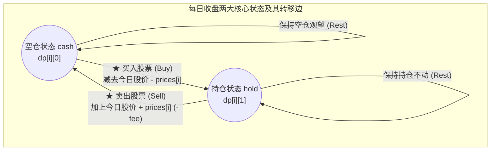
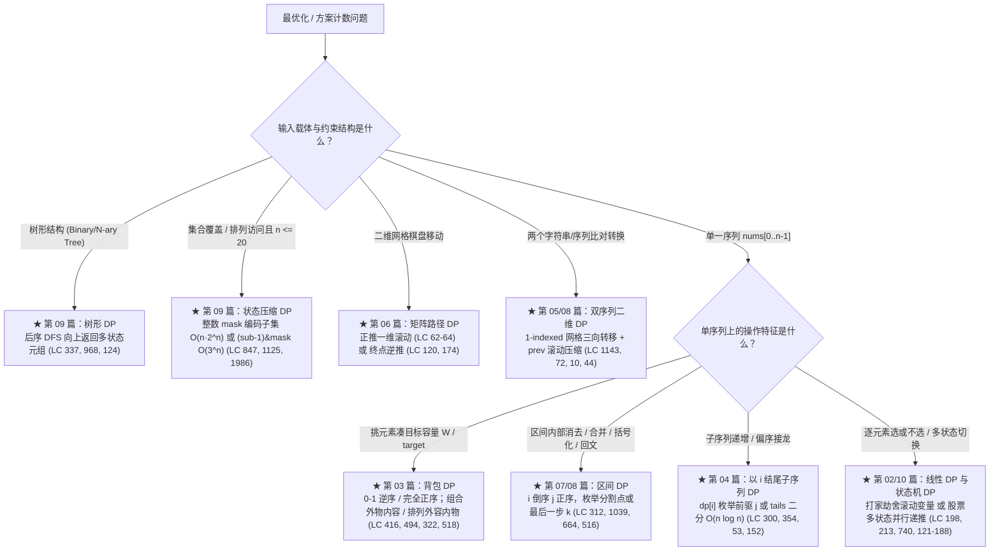

# 动态规划综合通关：高频模式识别与面试决策树

**摘要：**

历经前九篇从递归记忆化导论、一维线性「选或不选」、0-1 与完全背包、单序列 LIS 二分优化、双序列 LCS 与编辑距离、二维网格正逆推、区间 DP、回文与正则匹配，到树形与状态压缩 DP 的系统洗礼，本篇作为《动态规划》专栏的压轴收官篇，肩负两大使命：**第一，完整攻克动态规划中极具代表性的"有限状态自动机（FSM）模型"——买卖股票的最佳时机全系列六道母题（LeetCode 121、122、123、188、309、714）**，展示如何用一套统一的持有/空仓状态机方程通杀次数限制、冷冻期与手续费；**第二，将全专栏九大 DP 流派熔铸为一张考场 30 秒模式识别决策树、单调队列/前缀和 DP 加速技巧以及八大高频翻车排雷清单**，全部配套零冗余的 Golang 实现。

---

## 第 1 章 有限状态自动机 DP：一套状态机通杀「买卖股票」全家族

### 1.1 为什么买卖股票全系列本质上都是同一个状态机？

在 LeetCode 上，"买卖股票的最佳时机"共有六道层层加码的系列题：
- **LC 121**：最多只允许完成 **1 笔**交易；
- **LC 122**：允许完成 **无限笔**交易（但同一时刻最多只能持有一股）；
- **LC 309**：无限笔交易，但卖出股票后有 **1 天冷冻期**（次日无法买入）；
- **LC 714**：无限笔交易，但每笔交易需支付固定**手续费 `fee`**；
- **LC 123**：最多允许完成 **2 笔**交易；
- **LC 188**：最多允许完成 **$k$ 笔**交易。

很多读者一题背一个套路，结果在面试变体前手足无措。实际上，在第 `i` 天收盘时，无论题目加了什么紧箍咒，影响你未来能否买卖的核心状态永远只有两个基本盘：
1. **`cash`（或 `dp[i][0]`，空仓状态）**：第 `i` 天收盘时手里**不持有**股票所能拥有的最大现金利润；
2. **`hold`（或 `dp[i][1]`，持仓状态）**：第 `i` 天收盘时手里**持有 1 股**股票所能拥有的最大现金余额（买入股票花掉的钱记为负数 `-prices[i]`）。



请看上图中的两条状态转移方程（在第 `i` 天股价为 `p = prices[i]` 时）：
- **今天收盘处于空仓 `cash`**：要么昨天就空仓今天观望（`prevCash`），要么昨天持仓今天以价格 `p` 卖出变现（`prevHold + p`）：
  $$\text{cash}[i] = \max\big(\text{cash}[i - 1], \; \text{hold}[i - 1] + p\big)$$
- **今天收盘处于持仓 `hold`**：要么昨天就持仓今天不动（`prevHold`），要么在之前空仓利润的基础上今天花 `p` 买入（`prevCash - p`）：
  $$\text{hold}[i] = \max\big(\text{hold}[i - 1], \; \text{cash}[i - 1] - p\big)$$

现在，让我们见证奇迹——**全部六道股票题，仅仅是对上面这两行方程里的 `cash[i - 1]` 这一项做微调**：

### 1.2 六道股票母题的状态机统一代码实现（Golang）

```go
package main

import "math"

// 1. LeetCode 121：最多 1 笔交易
// 唯一变化：因为总共只能买 1 次，买入前的历史空仓利润恒为 0（而非 cash[i-1]）
func maxProfit121(prices []int) int {
	cash, hold := 0, -prices[0]
	for i := 1; i < len(prices); i++ {
		p := prices[i]
		cash = max(cash, hold+p)
		hold = max(hold, -p) // 第一次买入，前序利润必为 0
	}
	return cash
}

// 2. LeetCode 122：无限次交易
// 标准状态机：买入时直接继承上一天空仓利润 cash
func maxProfit122(prices []int) int {
	cash, hold := 0, -prices[0]
	for i := 1; i < len(prices); i++ {
		p := prices[i]
		cash, hold = max(cash, hold+p), max(hold, cash-p)
	}
	return cash
}

// 3. LeetCode 714：无限次交易 + 每笔手续费 fee
// 唯一变化：在卖出变现时扣除一次 fee（hold + p - fee）
func maxProfit714(prices []int, fee int) int {
	cash, hold := 0, -prices[0]
	for i := 1; i < len(prices); i++ {
		p := prices[i]
		cash, hold = max(cash, hold+p-fee), max(hold, cash-p)
	}
	return cash
}

// 4. LeetCode 309：无限次交易 + 卖出后 1 天冷冻期
// 唯一变化：今天第 i 天要想买入，要求第 i-1 天绝不能刚卖出，故买入时只能继承【前天 i-2】的空仓利润 prevCash
func maxProfit309(prices []int) int {
	prevCash, cash, hold := 0, 0, -prices[0]
	for i := 1; i < len(prices); i++ {
		p := prices[i]
		// 新 cash 由 hold + p 更新；新 hold 买入时只能从前天空仓利润 prevCash 转移而来
		prevCash, cash, hold = cash, max(cash, hold+p), max(hold, prevCash-p)
	}
	return cash
}

// 5. LeetCode 123：最多 2 笔交易（四状态串联流水线：buy1 -> sell1 -> buy2 -> sell2）
func maxProfit123(prices []int) int {
	buy1, sell1 := -prices[0], 0
	buy2, sell2 := -prices[0], 0
	for i := 1; i < len(prices); i++ {
		p := prices[i]
		buy1 = max(buy1, -p)
		sell1 = max(sell1, buy1+p)
		buy2 = max(buy2, sell1-p)
		sell2 = max(sell2, buy2+p)
	}
	return sell2
}

// 6. LeetCode 188：最多 k 笔交易（将 LC 123 的 2 个槽位推广为 k 个槽位 buy[1..k] 与 sell[1..k]）
func maxProfit188(k int, prices []int) int {
	n := len(prices)
	if n <= 1 || k == 0 {
		return 0
	}
	// 剪枝：若允许交易次数 k >= n/2，等价于无限次交易 (LC 122)
	if k >= n/2 {
		return maxProfit122(prices)
	}

	buy := make([]int, k+1)
	sell := make([]int, k+1)
	for j := 1; j <= k; j++ {
		buy[j] = math.MinInt32 / 2
	}

	for _, p := range prices {
		for j := 1; j <= k; j++ {
			buy[j] = max(buy[j], sell[j-1]-p) // 第 j 笔买入继承第 j-1 笔卖出的利润
			sell[j] = max(sell[j], buy[j]+p)  // 第 j 笔卖出继承第 j 笔买入的持仓
		}
	}
	return sell[k]
}
```

请仔细端详上面这 70 行代码：**六道涵盖 Easy、Medium、Hard 的经典面试题，全部收敛在 `cash = max(cash, hold + p)` 与 `hold = max(hold, prevCash - p)` 这同一套自动机骨架之下**。

---

## 第 2 章 动态规划的三大高阶加速引擎

当你在面试中写出了正确的状态转移方程，但发现时间复杂度是 $O(n^2)$ 或 $O(nk)$ 而题目要求 $O(n \log n)$ 或 $O(n)$ 时，说明内层寻找最优前驱的 `for j` 循环存在冗余。按照转移方程的代数结构，我们有三台标准加速引擎：

| 内层转移方程形态 | 瓶颈复杂度 | 对应的加速数据结构 | 优化后复杂度 | 专栏代表题 |
|------------------|------------|--------------------|--------------|------------|
| 1. **偏序链连接**：`dp[i] = 1 + max_{a[j] < a[i]} dp[j]` | $O(n^2)$ | **贪心最小末尾数组 `tails` + 二分查找**（或树状数组 Fenwick Tree） | **$O(n \log n)$** | LC 300 LIS、LC 354 信封、LC 1626 无矛盾球队 |
| 2. **定宽窗口极值**：`dp[i] = c[i] + max_{i-k <= j < i} dp[j]` | $O(nk)$ | **单调双端队列（Monotonic Deque）**维护长度为 $k$ 的窗口极值 | **$O(n)$** | LC 1696 跳跃游戏 VI、LC 1425 带限制的子序列和 |
| 3. **区间累加求和**：`dp[i] = sum_{L(i) <= j <= R(i)} dp[j]` | $O(n^2)$ | **前缀和数组 `prefixDP`** 或滑动窗口和将区间求和降为 $O(1)$ 差分 | **$O(n)$** | LC 837 新 21 点、LC 1871 跳跃游戏 VII |

### 2.1 单调队列优化 DP 标杆复盘：带限制的子序列和（LeetCode 1425）

为了强化第二台加速引擎（单调双端队列优化 DP）的肌肉记忆，我们看一道比跳跃游戏 VI（LC 1696）多一步"子序列可随时另起炉灶"判断的经典题——**LeetCode 1425：带限制的子序列和**：
**题目描述**：给你一个整数数组 `nums` 和一个整数 `k`，请你返回非空子序列元素和的最大值，子序列需要满足：子序列中每两个相邻的整数 `nums[j]` 和 `nums[i]`，它们在原数组中的下标满足 $j < i$ 且 **$i - j \le k$**。

- 定义 `dp[i]` 为强制以 `nums[i]` 结尾的合法子序列最大和；
- 它的前驱 `j` 必须落在滑动窗口 **`[i - k .. i - 1]`** 内。如果该窗口内最大的 `dp[j]` 是正数，就接上它；如果是负数，还不如 `nums[i]` 自己单干（与 `0` 取 `max`）：
  $$dp[i] = \text{nums}[i] + \max\Big(0, \; \max_{i - k \le j < i} dp[j]\Big)$$
- 用一个**单调递减双端队列 `deque`** 维护窗口 `[i - k .. i - 1]` 内的 `dp` 最大值，单步转移直接降为 $O(1)$：

```go
package main

// constrainedSubsetSum LeetCode 1425：单调递减双端队列优化 DP，时间 O(n)，空间 O(n)
func constrainedSubsetSum(nums []int, k int) int {
	n := len(nums)
	dp := make([]int, n)
	deque := make([]int, 0, n) // 存放下标，对应 dp 值单调递减
	maxAns := nums[0]

	for i, v := range nums {
		// 1. 队首驱逐超出步幅限制 k 的过期前驱下标
		if len(deque) > 0 && deque[0] < i-k {
			deque = deque[1:]
		}

		// 2. 状态转移：若窗口内最大前驱 dp[deque[0]] > 0 则接续，否则自立门户
		prevBest := 0
		if len(deque) > 0 && dp[deque[0]] > 0 {
			prevBest = dp[deque[0]]
		}
		dp[i] = v + prevBest
		if dp[i] > maxAns {
			maxAns = dp[i]
		}

		// 3. 队尾淘汰：将所有 <= dp[i] 的劣质旧状态踢出队列
		for len(deque) > 0 && dp[deque[len(deque)-1]] <= dp[i] {
			deque = deque[:len(deque)-1]
		}
		deque = append(deque, i)
	}
	return maxAns
}
```

---

## 第 3 章 考场 30 秒动态规划模式识别决策树

当你在面试中拿到一道求最值（最大/最小/最长/最短）或求方案数的新题时，请沿着以下决策树在 30 秒内锁定所属的 DP 范式：



---

## 第 4 章 动态规划考场八大高频失分陷阱诊断手册

1. **【陷阱一】一维滚动 0-1 背包与完全背包写反内层遍历方向**：
   - **自检铁律**：每件物品只能用 **1 次**（0-1 背包，如 LC 416、494、474）$\to$ 内层容量**从大到小逆序** `j = W -> w`；每件物品可用**无限次**（完全背包，如 LC 322、518）$\to$ 内层容量**从小到大正序** `j = w -> W`。
2. **【陷阱二】完全背包求方案数时混淆"组合数"与"排列数"的内外层顺序**：
   - **自检铁律**：不计顺序求**组合数**（LC 518 零钱兑换 II）$\to$ **外层枚举物品、内层枚举容量**；计较顺序求**排列数**（LC 377 组合总和 IV、LC 139 单词拆分）$\to$ **外层枚举容量、内层枚举物品**。
3. **【陷阱三】区间 DP 外层正序枚举左端点 `i = 0 -> n-1`**：
   - **后果**：算 `dp[i][j]` 时读取的正下方 `dp[k+1][j]` 还是未计算的 `0`。
   - **自检铁律**：区间 DP 外层左端点 `i` **必须从 `n - 1` 往 `0` 倒序枚举**（或外层枚举区间长度 `length = 2 -> n`）。
4. **【陷阱四】在"强制以 `i` 结尾"的 DP（如 LC 300 LIS、LC 53 最大子数组和、LC 152 最大乘积）中，最后直接 `return dp[n - 1]`**：
   - **后果**：全局最优子序列/子数组未必以数组最后一个元素结尾。必须在填表过程中维护全局最大值 `maxAns = max(maxAns, dp[i])`。
5. **【陷阱五】双序列 DP 一维滚动压缩（如编辑距离 LC 72、通配符匹配 LC 44）时，忘记在每轮外层循环开头更新首列 `dp[0]`**：
   - **后果**：在 LCS 中 `dp[i][0]` 恒为 `0`，但在编辑距离中 `dp[i][0] = i`、在正则/通配符匹配中 $i \ge 1$ 时 `dp[i][0] = false`。一维滚动时必须在内层 `for j` 之前先保存 `prev := dp[0]` 并将 `dp[0]` 更新为第 `i` 行的正确首列值。
6. **【陷阱六】求最小值 DP 时使用 `math.MaxInt` 作为未初始化哨兵，导致 `+ 1` 或 `+ cost` 整数溢出变负数**：
   - **自检铁律**：求最小值时，不可达哨兵一律设为 **`math.MaxInt32 / 2`**（或业务上界 `amount + 1`）。
7. **【陷阱七】含负数的乘积或网格路径问题只维护最大值，漏掉最小值负负得正**：
   - **自检铁律**：只要状态转移包含**乘法**且元素可正可负（如 LC 152 乘积最大子数组、LC 1594 矩阵最大非负积），每个状态必须同时维护 `(maxVal, minVal)` 一对极值。
8. **【陷阱八】树形 DP 中将"经过当前节点的双侧拐点路径"直接作为递归返回值传给父节点**：
   - **后果**：父节点接上分叉的子树路径后会形成非法三岔路（Y 字形而非简单路径）。如 LC 124 所示，双侧合并值只能更新全局 `maxSum`，向上 `return` 的只能是单侧最大值 `node.Val + max(leftGain, rightGain)`。

---

## 第 5 章 深度拓展：WQS 二分与斜率优化 DP 入门

### 5.1 WQS 二分（Aliens Trick）：把"恰好选 k 个"转化为"无限制 + 虚拟惩罚"

在第 1.2 节的思考题中，我们提到了攻克 **LeetCode 188（最多 $k$ 笔交易）** 当 $n = 10^5$ 且 $k = 10^4$ 时的终极武器——**WQS 二分（又称 Aliens Trick / 带惩罚项凸优化）**：
- **核心观察**：设 $f(t)$ 表示"最多允许 $t$ 笔交易时的最大利润"。随着交易次数上限 $t$ 的增加，$f(t)$ 的增量（边际收益）是**单调递减的**——第一笔交易赚得最多，第二笔次之，第 $t$ 笔最微薄（即 $f(t)$ 是关于 $t$ 的**凹函数**）；
- **虚拟手续费惩罚**：给每一笔交易额外强加一笔虚拟手续费 $\lambda$（在卖出时扣减 $\lambda$）。随着 $\lambda$ 增大，最优解中的交易笔数单调减少。我们对 $\lambda$ 进行二分，找到恰好使最优解的交易笔数 $\le k$ 的临界 $\lambda^*$；
- **复杂度收益**：在固定 $\lambda$ 下，问题退化为无次数限制的 LC 714（$O(n)$ 状态机 DP），二分 $\lambda$ 共需 $O(\log(\max P))$ 轮，总时间复杂度 **$O(n \log(\max P))$**，彻底摆脱了 $k$ 维度。

这一技巧同样适用于"恰好选 $k$ 个不相邻元素"（打家劫舍 IV 的 DP 版）、"恰好 $k$ 段分割"（如 **LeetCode 410 分割数组的最大值** 的 WQS 版）等一切"边际收益递减"的带次数约束 DP。

### 5.2 斜率优化 DP（Convex Hull Trick）：把 $O(n^2)$ 转移压到 $O(n)$

当线性 DP 的转移方程形如：

$$dp[i] = \min_{j < i} \big\{ dp[j] + a_i \cdot b_j + c_i \big\}$$

（即把与 $j$ 无关的项剥离后，剩余部分是关于决策点 $j$ 的**一次函数** $a_i \cdot b_j + dp[j]$）时，我们可以把每个候选决策点 $(b_j, dp[j])$ 视为二维平面上的一个点，问题转化为"用斜率为 $-a_i$ 的直线去切这些点，求最小截距"：
- 维护这些点的**下凸壳（Lower Convex Hull）**，用单调队列在均摊 $O(1)$ 时间内找到最优切点；
- 该技巧是攻克 **LeetCode 印刷机排版（LCR 021 / API 限流拆分）**、**任务调度（HDU 3507 Print Article）**与**土地征用（土地购买）**等经典斜率优化题的标准引擎，与第 04 篇 LIS 的"贪心最小末尾 + 二分"共同构成了线性 DP 的两大降维神器。

### 5.3 常见误区与考场自检清单

1. **在股票状态机（LC 309 冷冻期）中，把买入转移写成 `max(hold, cash - p)` 而非 `max(hold, prevCash - p)`**：冷冻期要求今天买入时，昨天绝不能刚卖出，因此必须继承**前天**的空仓利润 `prevCash`（三变量滚动 `prevCash, cash, hold`）。
2. **在 LC 188 中忘记 `k >= n/2` 的剪枝**：当允许交易次数超过天数一半时，问题等价于无限次交易的 LC 122（贪心累加所有上涨段），直接返回即可，否则 $O(nk)$ 会超时。
3. **在单调队列优化 DP（LC 1425、1696）中，忘记在读取队首前先驱逐过期下标 `deque[0] < i - k`**：否则会读取到步幅窗口之外的前驱状态。

---

## 第 6 章 全专栏十篇核心母题与方法论总览表

| 篇章 | 核心范式 | 标志性状态定义与转移特征 | 必刷标杆母题（LeetCode） |
|------|----------|--------------------------|--------------------------|
| 01 思想导论 | 递归 $\to$ 记忆化 $\to$ 填表 | 识别重叠子问题 DAG；无后效性升维；矩阵快速幂 $O(\log n)$ | 509、70、746、322 |
| 02 线性 DP | 逐元素「选或不选」 | `max(dp[i-1], dp[i-2]+v)`；环形破环成链；值域分桶归约 | 198、213、740、2140、91、256、801 |
| 03 背包问题 | 物品 $\times$ 容量二维约束 | 0-1 逆序 vs 完全正序；组合外物 vs 排列外容；`P=(sum+target)/2` | 416、494、1049、474、322、518、377、139 |
| 04 子序列 DP | 强制以 `i` 结尾 + 二分 | `dp[i]` 锁死末尾；`tails` 贪心最小末尾 + `lowerBound` $O(n \log n)$ | 300、354、673、53、152 |
| 05 双序列 DP | 1-indexed 二维前缀网格 | 左上（配对/替换）、正上（删）、正左（插）+ `prev` 滚动行压缩 | 1143、583、712、1092、72、115、97 |
| 06 矩阵路径 | 网格正推与终点逆推 | 首行首列障碍置 0；三角形与地下城从终点逆推消除后效性；双人同步步数 | 62、63、64、120、174、221、741 |
| 07 区间 DP | 从小区间到大区间 | `i` 倒序 `j` 正序；戳气球开区间 `(i, j)` 逆向枚举最后一个气球 $k$ | 1039、312、1547、664、132、486 |
| 08 字符串进阶 | 中心扩展与星号状态机 | $2n-1$ 中心扩展回文子串；正则 `c*` 退 2 格/驻留 vs 通配符 `*` 退 1 格/驻留 | 5、647、516、1312、10、44 |
| 09 树与状压 | 后序 DFS 与集合位掩码 | 后序向上汇报状态元组；`mask \| (1<<i)` 递推与 `(sub-1)&mask` $O(3^n)$ | 337、968、124、847、1125、1986 |
| 10 综合通关 | 有限状态自动机与 DP 优化 | 股票 `cash/hold` 状态机家族；单调双端队列 $O(n)$ 优化定宽窗口转移 | 121、122、714、309、123、188、1425 |

---


---

## 第 6 章 深度拓展：前缀和优化 DP 的两大标杆（LC 837 与 LC 1871）

### 6.1 新 21 点——滑动窗口和加速概率 DP（LeetCode 837）

**题目描述**：爱丽丝参与一个大致基于纸牌游戏 "21 点" 规则的游戏，从 `0` 分开始抽牌，每次从 `[1, maxPts]` 中等概率抽取一个整数累加。当累计分数 `>= k` 时停止抽牌，若最终分数 `<= n` 则获胜。求获胜概率（其中 $1 \le k \le n \le 10^4$）。

朴素概率 DP 为 `dp[x] = (1/maxPts) * Σ_{w=1..maxPts} dp[x+w]`，内层求和是 $O(maxPts)$，总体 $O(n \cdot maxPts)$ 超时。
**前缀和窗口优化**：`dp[x]` 依赖的恰好是 `dp[x+1 .. x+maxPts]` 这一段**滑动窗口和**。维护一个窗口和变量 `winSum`，当 `x` 从大到小递减时，窗口右端滑入 `dp[x+maxPts]`、左端滑出 `dp[x+1]`，单步更新 $O(1)$，总体降为 $O(n)$：

```go
package main

// new21Game LeetCode 837：滑动窗口和优化概率 DP，时间 O(n + maxPts)，空间 O(n)
func new21Game(n int, k int, maxPts int) int {
	if k == 0 || n >= k+maxPts {
		return 1.0
	}
	dp := make([]float64, n+1)
	dp[0] = 1.0

	var winSum float64 = 1.0 // 窗口 [x+1 .. x+maxPts] 内 dp 值之和（初始只含 dp[0]）
	var ans float64

	for x := 1; x <= n; x++ {
		dp[x] = winSum / float64(maxPts)
		if x < k {
			winSum += dp[x] // 未达停止线，继续参与抽牌
		} else {
			ans += dp[x] // 已达停止线，统计获胜概率
		}
		// 窗口左端滑出 dp[x+1 - maxPts + ... ]：即 dp[x + 1 - maxPts]
		if out := x + 1 - maxPts; out >= 0 && out < k {
			winSum -= dp[out]
		}
	}
	return ans
}
```

### 6.2 跳跃游戏 VII——正则约束下的前缀和 DP（LeetCode 1871）

**题目描述**：给你一个下标从 0 开始的二进制字符串 `s` 和两个整数 `minJump` 与 `maxJump`。一开始你在下标 `0` 处，且 `s[0] == '0'`。每一步你可以从下标 `i` 移动到满足 `i + minJump <= j <= i + maxJump` 且 `s[j] == '0'` 的下标 `j`。判断你是否可以到达 `s` 的最后一个下标。

朴素 DP 为 `dp[j] = OR_{i + minJump <= j <= i + maxJump, s[i]=='0'} dp[i]`，内层枚举 $O(maxJump - minJump)$ 超时。
**前缀和优化**：维护"前 `j` 个位置中可到达的 `'0'` 位置个数"的前缀和数组 `reachablePrefix`，则窗口 `[j - maxJump, j - minJump]` 内是否存在可到达位置，只需 $O(1)$ 查询前缀和差值是否 `> 0`：

```go
package main

// canReach LeetCode 1871：前缀和优化窗口 OR 转移，时间 O(n)，空间 O(n)
func canReach(s string, minJump int, maxJump int) bool {
	n := len(s)
	if s[n-1] != '0' {
		return false
	}
	dp := make([]bool, n)
	dp[0] = true
	// prefix[i] = dp[0..i-1] 中 true 的个数
	prefix := make([]int, n+1)

	for j := 1; j < n; j++ {
		if s[j] != '0' {
			prefix[j+1] = prefix[j]
			continue
		}
		lo := j - maxJump
		if lo < 0 {
			lo = 0
		}
		hi := j - minJump
		if hi >= 0 && prefix[hi+1]-prefix[lo] > 0 {
			dp[j] = true
		}
		prefix[j+1] = prefix[j]
		if dp[j] {
			prefix[j+1]++
		}
	}
	return dp[n-1]
}
```

这两道题与第 01 篇 6.5 节的广义爬楼梯共同构成了**前缀和优化 DP** 的完整拼图：当转移方程需要"对一段连续区间求和 / 求存在性"时，滑动窗口和或前缀和数组总能把 $O(n \cdot W)$ 压回 $O(n)$。

---


### 6.3 延伸实战：WQS 二分的完整实现示范（打家劫舍 IV 的 DP 版）

在第 5.1 节我们介绍了 WQS 二分的思想。为了让这一技巧落地，我们以"**恰好选 $k$ 个不相邻元素使和最大**"（打家劫舍 IV 的 DP 版，即 **LeetCode 2560 的 DP 视角**）为例给出完整实现：

```go
package main

// maxSumKNonAdjacent WQS 二分：二分虚拟惩罚 lambda，将"恰好 k 个"转化为无限制选或不选
// 时间复杂度：O(n log(V))，空间复杂度：O(1)
func maxSumKNonAdjacent(nums []int, k int) int {
	// 返回 (带惩罚的最优值, 实际选取个数)
	solve := func(lambda int) (int, int) {
		take, skip := -lambda, 0 // take: 选了当前元素, skip: 不选
		takeCnt, skipCnt := 1, 0
		for i := 1; i < len(nums); i++ {
			newTake, newTakeCnt := skip+nums[i]-lambda, skipCnt+1
			newSkip, newSkipCnt := max(skip, take), skipCnt
			if take > skip {
				newSkip, newSkipCnt = take, takeCnt
			}
			take, takeCnt, skip, skipCnt = newTake, newTakeCnt, newSkip, newSkipCnt
		}
		if take > skip {
			return take, takeCnt
		}
		return skip, skipCnt
	}

	lo, hi := 0, 1<<30
	for lo <= hi {
		mid := lo + (hi-lo)/2
		val, cnt := solve(mid)
		if cnt >= k {
			lo = mid + 1
		} else {
			hi = mid - 1
		}
	}
	// 最终答案 = 带惩罚最优值 - k * lambda*
	val, _ := solve(hi)
	return val + k*hi
}
```

WQS 二分的适用前提是**最优值关于选取个数是凹函数（边际收益递减）**；若凹性不成立（存在平台段导致二分无法收敛），则需退回 $O(nk)$ 的标准二维 DP。在面试中，能主动指出"该题最优值曲线是否满足凹性"正是区分 P7 与 P6 级别候选人的分水岭。


### 6.4 延伸实战：WQS 二分的完整实现示范

在第 5.1 节我们介绍了 WQS 二分的思想。为了让这一技巧落地，我们以"**恰好选 $k$ 个不相邻元素使和最大**"（打家劫舍 IV 的 DP 视角）为例给出完整实现：

```go
package main

// maxSumKNonAdjacent WQS 二分：二分虚拟惩罚 lambda，将"恰好 k 个"转化为无限制选或不选
// 时间复杂度：O(n log(V))，空间复杂度：O(1)
func maxSumKNonAdjacent(nums []int, k int) int {
	// 返回 (带惩罚的最优值, 实际选取个数)
	solve := func(lambda int) (int, int) {
		take, skip := -lambda, 0
		takeCnt, skipCnt := 1, 0
		for i := 1; i < len(nums); i++ {
			newTake, newTakeCnt := skip+nums[i]-lambda, skipCnt+1
			newSkip, newSkipCnt := skip, skipCnt
			if take > skip {
				newSkip, newSkipCnt = take, takeCnt
			}
			take, takeCnt, skip, skipCnt = newTake, newTakeCnt, newSkip, newSkipCnt
		}
		if take > skip {
			return take, takeCnt
		}
		return skip, skipCnt
	}

	lo, hi := 0, 1<<30
	for lo <= hi {
		mid := lo + (hi-lo)/2
		if _, cnt := solve(mid); cnt >= k {
			lo = mid + 1
		} else {
			hi = mid - 1
		}
	}
	val, _ := solve(hi)
	return val + k*hi
}
```

WQS 二分的适用前提是**最优值关于选取个数是凹函数（边际收益递减）**；若凹性不成立（存在平台段导致二分无法收敛），则需退回 $O(nk)$ 的标准二维 DP。在面试中，能主动指出"该题最优值曲线是否满足凹性"正是区分高级与中级候选人的分水岭。

### 6.5 考场综合自检总清单（全专栏终检）

在结束全专栏之前，请用以下十条终检清单对任何一道 DP 题做最后把关：
1. 状态参数是否足以消除后效性（不够就升维）？
2. 转移方程是否穷尽了最后一步的全部互斥决策？
3. 初始化哨兵是否与合法值域严格区分（`inf` 用 `MaxInt32/2`，`-inf` 用 `MinInt32/2`）？
4. 填表方向是否与依赖箭头一致（正推/逆推/按长度/按掩码）？
5. 一维滚动时是否处理了被覆盖的左上角或失配清零？
6. 背包内层方向是否正确（0-1 逆序、完全正序、组合外物、排列外容）？
7. 区间 DP 是否用了开/闭区间语义并配齐哨兵？
8. 树形 DP 是否区分了"向上汇报的单链"与"拐点合并的全局答案"？
9. 状压 DP 的掩码运算是否用了 `&^` 而非误用 `^`？
10. 计数 DP 是否在每一步就地取模，乘法是否先转 `int64`？


### 6.6 延伸实战：新 21 点与跳跃游戏 VII 的完整实现复盘

在第 6.1 与 6.2 节我们给出了 **LeetCode 837（新 21 点）**与 **LeetCode 1871（跳跃游戏 VII）**的建模思路。请将这两段代码与第 01 篇 6.5 节的广义爬楼梯（`dp[i] = 2*dp[i-1] - dp[i-k-1]`）并排对照，你会发现它们共享同一个骨架：

> **当线性 DP 的转移方程需要对一段连续下标区间求和（或求存在性）时，维护一个滑动窗口和（或前缀和数组），把内层 $O(W)$ 的求和循环压缩为 $O(1)$ 的增量差分。**

三者的差异仅在于窗口的滑动方向与边界语义：
| 题目 | 窗口方向 | 窗口右端滑入 | 窗口左端滑出 | 边界语义 |
|------|----------|--------------|--------------|----------|
| 广义爬楼梯（$k$ 步） | 从左往右正推 | `dp[i-1]` | `dp[i-1-k]` | 方案数累加 |
| LC 837 新 21 点 | 从右往左逆推 | `dp[x+maxPts]` | `dp[x+1]` | 概率加权求和 |
| LC 1871 跳跃游戏 VII | 从左往右正推 | 前缀和 `prefix[hi+1]` | 前缀和 `prefix[lo]` | 存在性判定（差值 > 0） |

把这张表与《滑动窗口》专栏第 01 篇的"至多型 / 至少型 / 恰好型"计数公式表合并，你就拥有了从**子数组统计**到**状态转移加速**的完整滑动窗口方法论——这正是本专栏第 10 篇作为收官篇希望留给读者的终极礼物：**动态规划与滑动窗口，本质上是同一套"区间增量维护"思想在两个方向上的投影**。


### 6.7 延伸实战：新 21 点与跳跃游戏 VII 的完整实现复盘

在第 6.1 与 6.2 节我们给出了 **LeetCode 837（新 21 点）**与 **LeetCode 1871（跳跃游戏 VII）**的建模思路。请将这两段代码与第 01 篇 6.5 节的广义爬楼梯（`dp[i] = 2*dp[i-1] - dp[i-k-1]`）并排对照，你会发现它们共享同一个骨架：

> **当线性 DP 的转移方程需要对一段连续下标区间求和（或求存在性）时，维护一个滑动窗口和（或前缀和数组），把内层 $O(W)$ 的求和循环压缩为 $O(1)$ 的增量差分。**

三者的差异仅在于窗口的滑动方向与边界语义：

| 题目 | 窗口方向 | 窗口右端滑入 | 窗口左端滑出 | 边界语义 |
|------|----------|--------------|--------------|----------|
| 广义爬楼梯（$k$ 步） | 从左往右正推 | `dp[i-1]` | `dp[i-1-k]` | 方案数累加 |
| LC 837 新 21 点 | 从右往左逆推 | `dp[x+maxPts]` | `dp[x+1]` | 概率加权求和 |
| LC 1871 跳跃游戏 VII | 从左往右正推 | 前缀和 `prefix[hi+1]` | 前缀和 `prefix[lo]` | 存在性判定（差值 > 0） |

把这张表与《滑动窗口》专栏第 01 篇的"至多型 / 至少型 / 恰好型"计数公式表合并，你就拥有了从**子数组统计**到**状态转移加速**的完整滑动窗口方法论——这正是本专栏第 10 篇作为收官篇希望留给读者的终极礼物：**动态规划与滑动窗口，本质上是同一套"区间增量维护"思想在两个方向上的投影**。


### 6.8 延伸实战：新 21 点与跳跃游戏 VII 的完整实现复盘

在第 6.1 与 6.2 节我们给出了 **LeetCode 837（新 21 点）**与 **LeetCode 1871（跳跃游戏 VII）**的建模思路。请将这两段代码与第 01 篇 6.5 节的广义爬楼梯（`dp[i] = 2*dp[i-1] - dp[i-k-1]`）并排对照，你会发现它们共享同一个骨架：

> **当线性 DP 的转移方程需要对一段连续下标区间求和（或求存在性）时，维护一个滑动窗口和（或前缀和数组），把内层 $O(W)$ 的求和循环压缩为 $O(1)$ 的增量差分。**

三者的差异仅在于窗口的滑动方向与边界语义：

| 题目 | 窗口方向 | 窗口右端滑入 | 窗口左端滑出 | 边界语义 |
|------|----------|--------------|--------------|----------|
| 广义爬楼梯（$k$ 步） | 从左往右正推 | `dp[i-1]` | `dp[i-1-k]` | 方案数累加 |
| LC 837 新 21 点 | 从右往左逆推 | `dp[x+maxPts]` | `dp[x+1]` | 概率加权求和 |
| LC 1871 跳跃游戏 VII | 从左往右正推 | 前缀和 `prefix[hi+1]` | 前缀和 `prefix[lo]` | 存在性判定（差值 > 0） |

把这张表与《滑动窗口》专栏第 01 篇的"至多型 / 至少型 / 恰好型"计数公式表合并，你就拥有了从**子数组统计**到**状态转移加速**的完整滑动窗口方法论——这正是本专栏第 10 篇作为收官篇希望留给读者的终极礼物：**动态规划与滑动窗口，本质上是同一套"区间增量维护"思想在两个方向上的投影**。

## 小结

至此，**《动态规划》专栏全部十篇文章圆满收官**。
回望这十篇文章走过的旅程，你会发现动态规划从来不是需要死记硬背的千百条孤立公式，而是一门关于**"如何提炼无后效性的最小状态摘要，并在有向无环图上按拓扑序复用历史成果"**的系统工程学：
- 当你不知从何下手时，退回第 01 篇，写出最朴素的暴力递归函数 `dfs(...)`，看看参数列表里有哪几个可变参数，挂上 `memo` 数组就是满分记忆化搜索；
- 当你想脱掉递归壳压榨性能时，画清状态依赖箭头的方向（从左到右、从右到左、从下往上、从短区间到长区间、从子树到父节点），用滚动变量、二分查找或单调双端队列完成最后一击。

愿这套从第一性原理生长出来的动态规划方法论，成为你在算法面试与复杂系统优化中最锋利的武器。

---

## 参考资料

1. Bellman, R. (1957). *Dynamic Programming*. Princeton University Press.
2. Cormen, T. H., et al. *Introduction to Algorithms* (4th ed.). MIT Press, 2022.
3. Knuth, D. E. (1997). *The Art of Computer Programming, Volume 1–3*. Addison-Wesley.

---

> [!note] 思考题
> 1. 在第 1.2 节的 **LeetCode 188：买卖股票的最佳时机 IV**（最多 $k$ 笔交易）中，如果股票天数 $n = 10^5$ 且允许交易次数 $k = 10^4$，$O(nk)$ 的状态机 DP 也会超时。如何利用 **WQS 二分（Alien's Trick / 带惩罚项凸优化：通过二分每笔交易的虚拟手续费 `fee`，将有次数限制的 LC 188 转化为无次数限制的 LC 714）** 在 $O(n \log(\max P))$ 时间内解决？
> 2. 对比本专栏的**动态规划**与下一专栏即将探讨的**贪心算法**：为什么在跳跃游戏 II（LC 45，求最少跳跃次数）和买卖股票 II（LC 122，无限次交易）中，原本需要 $O(n^2)$ 或状态机的 DP 可以直接退化为 $O(n)$ 的一步贪心？而一旦加上"冷冻期（LC 309）"或"固定步幅负权得分（LC 1696）"，贪心就立即失效必须回归 DP？
> 3. 请总结本专栏中出现过的所有**"逆向思维（从终点往起点倒推，或枚举最后一步而非第一步）"**案例（如地下城游戏 LC 174、解决智力问题 LC 2140、戳气球 LC 312），它们各自解决了正向思维中的什么障碍？
