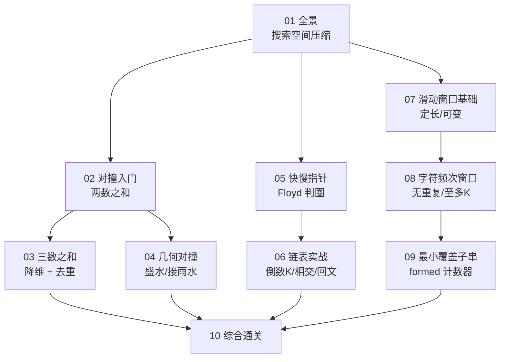

# 双指针算法专栏导览：从核心模型到 LeetCode 面试通关

**摘要：**

本专栏面向有一定编程基础、正在备战技术面试的工程师。**讨论范围严格限定**于双指针算法（含对撞指针、快慢指针、滑动窗口三大变体）及其在数组、链表、字符串场景下的应用，不涉及树/图的遍历、动态规划等领域。**核心主张只有一条：双指针能用，依赖某种"单调性"——它保证"一个指针朝某方向移动时，另一个指针不必朝反方向回退"。** 全文示例代码统一使用 Go 语言。读完本专栏，你将能一眼识别双指针题型、迅速判断该用哪种模型，并避开那些高频的边界陷阱。

---

## 专栏定位

**讨论范围**：对撞指针、快慢指针、滑动窗口。不覆盖树的两指针遍历（BST 中序双指针）、图中的双向 BFS（虽形式类似，但属图算法）。

**写作取向**：每篇从"朴素解法"或"约束"出发推导优化解，重点回答**为什么这样解**；对每种技巧，交代其适用前提、失效场景与边界反例。

**语言约定**：示例代码以 **Go** 为主。Go 的切片、`map`、数组可比较等特性，恰好能让"窗口统计量维护""频次比较"这些细节写得格外清晰。

---

## 专栏目录

| 序号 | 文章标题 | 核心话题 | 覆盖 LeetCode 题目 |
|------|----------|----------|--------------------|
| 01 | 双指针算法全景：核心直觉、三大模型与面试考频分析 | 搜索空间压缩、三大分支、适用判断、复杂度证明 | 概念篇 |
| 02 | 对撞指针入门：有序数组中的两数之和 | 搜索空间消除、有序性前提、跳字符边界 | 167、125、344、977 |
| 03 | 三数之和与 N 数之和：排序+对撞指针的组合拳 | 降维、去重的两层、剪枝 | 15、16、18 |
| 04 | 对撞指针进阶：盛水容器与接雨水的几何直觉 | 贪心排除论证、左右边界最大值 | 11、42 |
| 05 | 快慢指针精讲：链表成环检测与 Floyd 判圈算法 | Floyd 三段证明、环起点定位、迭代函数图 | 141、142、202 |
| 06 | 链表双指针实战：倒数第 N 个节点、相交链表与回文链表 | 先出发、交换起点、三步组合 | 19、160、234 |
| 07 | 滑动窗口基础：定长窗口与可变窗口的统一框架 | 加一减一、扩张-收缩状态机 | 643、209、1493 |
| 08 | 滑动窗口进阶：无重复字符与字符频次匹配 | 位置数组、频次哈希、至多 K 个不同 | 3、567、159 |
| 09 | 最小覆盖子串：滑动窗口的最难挑战 | `formed` 计数器、频次匹配、枚举偏移 | 76、438、30 |
| 10 | 双指针综合通关：模式识别、算法选型与面试高频模式总结 | 决策树、陷阱盘点、复杂度速查 | 综合复习篇 |

合计覆盖 **25 余道高频面试题**。

---

## 阅读路径

专栏的组织逻辑是**先建立"搜索空间压缩"的认知，再沿"对撞 → 快慢 → 滑动"三条支线深入**：

---

## 贯穿全专栏的三条主线

**主线一，"搜索空间压缩"是统一的本质。** 双指针能把 $O(n^2)$ 降到 $O(n)$，靠的是"每步排除一整批候选"。

**主线二，"单调性"是双指针的许可证。** 有序性（对撞）、节奏差（快慢）、窗口单调性（滑动）——**没有单调性，双指针失效**。

**主线三，"边界"决定成败。** 循环条件、去重、跳字符、收缩方向——**这些细节是失分的重灾区**。

---

## 双指针适用场景速查表

| 场景特征 | 推荐模型 | 典型例题 |
|----------|----------|----------|
| 有序数组，找两数之和/差 | 对撞指针 | 167 |
| 有序数组，找 N 数之和 | 排序 + 对撞 | 15、18 |
| 两端构成容器（求最优） | 对撞指针 | 11、42 |
| 链表，检测环/找中点 | 快慢指针 | 141、876 |
| 链表，找倒数第 K 个 | 距离双指针 | 19 |
| 连续子数组/子串，定长 | 定长滑动窗口 | 643、567 |
| 连续子数组/子串，可变 | 可变滑动窗口 | 209、76 |

---

## 专栏阅读建议

1. **第 01 篇必读**：理解"搜索空间压缩"与"单调性"，后续所有题才有理论支撑。
2. **对撞指针篇（02-04）**：重点理解"有序性"是前提，不是所有两指针都叫对撞指针。
3. **快慢指针篇（05-06）**：核心是节奏差，建议在纸上画链表逐步模拟。
4. **滑动窗口篇（07-09）**：理解"扩张条件"与"收缩条件"是关键，注意"求最短还是最长"决定收缩方向。
5. **亲自动手**：每篇讲完，建议先不看代码，自己在 LeetCode 上独立实现一遍。

---

## 关联专栏

- **线性表专栏**（[[01 线性表全景：数组与链表的本质与工程权衡]]）：双指针是数组/链表的核心技巧，链表反转、哑节点等与之相通。
- **字符串专栏**（[[01 回文检测：Valid Palindrome 与双指针范式]]）：本专栏第 02 篇的回文判断与字符串专栏互为表里。
- **滑动窗口专栏**（[[01 滑动窗口算法原理全景：从暴力枚举到 O(n) 的思维跃迁]]）：本专栏第 07-09 篇是滑动窗口的入门版，独立专栏有更深的展开。
- **排序与查找专栏**（[[01 排序算法原理全景：从 O(n²) 到 O(nlogn) 的演进之路]]）：对撞指针依赖排序，二分查找与对撞同源。
