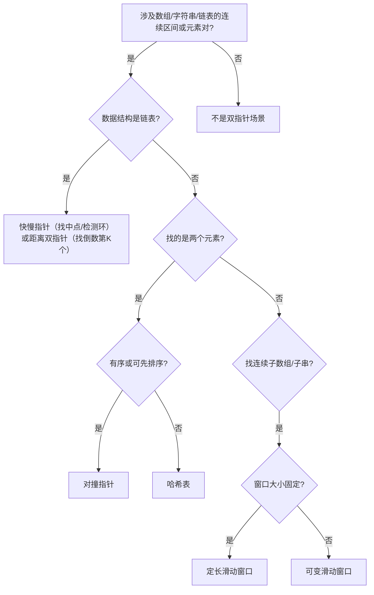

# 双指针算法全景：核心直觉、三大模型与面试考频分析

**摘要：**

双指针（Two Pointers）是算法面试中频率极高、覆盖面极广的一类技巧，涵盖有序数组的两端夹逼、链表的快慢追逐、子数组的滑动窗口三大场景。本文不讲具体题目，而是从**搜索空间压缩**这一本质出发，系统梳理三大双指针模型的适用前提、核心直觉与复杂度保证。**核心结论只有一条：双指针能用，依赖某种"单调性"——它保证"一个指针朝某方向移动时，另一个指针不必朝反方向回退"。** 本文用 Go 语言给出三套模板，并逐层追问：为什么双指针能把 $O(n^2)$ 降到 $O(n)$、对撞指针为什么必须有"有序性"、快慢指针为什么一定能相遇、以及滑动窗口在什么情况下会失效。这是整个双指针专栏的认知地基。

---

## 第 1 章 双指针的本质：搜索空间的系统性压缩

### 1.1 从暴力出发

算法优化的起点永远是暴力枚举。以"在有序数组中找两个数使其和为 `target`"为例，暴力解法是两重循环枚举所有 $(i,j)$ 对，时间 $O(n^2)$。

**用"搜索空间"的语言描述**：所有合法下标对 $(i,j)$（$0 \le i < j < n$）构成一个大小为 $\binom{n}{2} = O(n^2)$ 的搜索空间，暴力做法就是逐一扫描它。

**双指针能优化到 $O(n)$，本质上是因为**：它不是随机地跳到答案，而是利用问题的**单调性**——每次移动一个指针，就能**永久排除一整行或一整列**的搜索空间。总排除量达 $O(n^2)$，而总移动步数仅 $O(n)$。

用图理解最清晰：

```text
       j=0  j=1  j=2  j=3  j=4
i=0     -    ✓    ✓    ✓    ✓
i=1          -    ✓    ✓    ✓
i=2               -    ✓    ✓
i=3                    -    ✓
i=4                         -
```

暴力遍历上三角的全部 $O(n^2)$ 个格子。而**对撞指针从 $(i=0, j=n-1)$ 出发**，利用有序性：

- 若 `nums[i] + nums[j] < target`：当前 `i` 行的所有 `j' < j` 都满足"和小于 target"，**整行可排除**，`i++`；
- 若 `nums[i] + nums[j] > target`：当前 `j` 列的所有 `i' > i` 都满足"和大于 target"，**整列可排除**，`j--`。

**每一步排除一行或一列，$n$ 步后搜索完毕。**

> [!info] 核心概念：单调性是双指针的前提
> 双指针能正确工作的**充要条件**是：问题具备某种**单调性**——当一个指针朝某方向移动时，能确保另一个指针不需要朝反方向回退。**没有单调性，双指针不能保证正确性，更不能保证 $O(n)$ 复杂度。**

### 1.2 三种单调性，三大模型

双指针可按**两指针的运动方向**与**所在数据结构**分类：

| 模型 | 两指针方向 | 典型结构 | 依赖的单调性 |
|------|-----------|---------|-------------|
| 对撞指针 | 相向，从两端收缩 | 有序数组、字符串 | 数组的全局有序性 |
| 快慢指针 | 同向，步幅不同 | 链表、数组 | 移动距离的节奏差 |
| 滑动窗口 | 同向，扩缩不同步 | 数组、字符串 | 窗口内统计量的单调性 |

**注意"快慢指针"与"滑动窗口"都是同向，但含义不同**：前者强调**步幅不同**（一个走一步、一个走两步），后者强调**窗口的扩张与收缩**（右扩、左缩）。**它们解决的问题类型也完全不同。**

---

## 第 2 章 对撞指针：从两端向中间收缩

### 2.1 核心直觉

**适用场景**：序列**已排序**，需要从中找满足某个"和/差/积"条件的元素对。

两个指针 `left`、`right` 分别从两端出发，根据"当前两端之和与目标值的比较"决定收缩哪一端：

- 当前和偏小 → `left` 右移（换一个更大的左端）；
- 当前和偏大 → `right` 左移（换一个更小的右端）；
- 当前和等于目标 → 找到答案。

**正确性来自有序性**：数组有序，所以"更大的左端"是确定的（就是 `left+1`）、"更小的右端"也是确定的（就是 `right-1`）。**若数组无序，你不知道移动 `left` 后新的和是增大还是减小，双指针就失效了。**

### 2.2 适用范围

对撞指针不止于"两数之和"：

- **回文判断**：`left` 从头、`right` 从尾，依次比较；
- **原地反转**：`left` 与 `right` 交换元素并相向移动；
- **接雨水 / 盛水容器**：利用高度与左右边界最大值的单调性；
- **三数之和及 N 数之和**：固定一个数后，退化为有序数组的两数之和。

> [!note] 设计哲学：有序性是对撞指针的充电器
> 对撞指针每一步都依赖"排除这整行/列是安全的"这一论断，而它成立的基础是数组有序。**这也是为什么"无序数组的两数之和"（LC 1）要用哈希表而非双指针**——因为没有有序性保证。**遇到对撞指针不生效的题，先问：输入有序吗？不有序能先排序吗？**

### 2.3 Go 模板

```go
// 对撞指针通用模板（以两数之和为例）
func twoSumSorted(nums []int, target int) []int {
    left, right := 0, len(nums)-1
    for left < right {
        sum := nums[left] + nums[right]
        switch {
        case sum == target:
            return []int{left + 1, right + 1} // 找到答案
        case sum < target:
            left++ // 和偏小，移动左指针
        default:
            right-- // 和偏大，移动右指针
        }
    }
    return []int{-1, -1} // 无解
}
```

**复杂度**：每次循环 `left` 或 `right` 至少移动一步，且两者单调变化，最多移动 $n$ 步——时间 $O(n)$、空间 $O(1)$。

---

## 第 3 章 快慢指针：节奏差创造的魔法

### 3.1 核心直觉

**快慢指针主要用于链表**，解决三类问题：**环检测**（LC 141）、**找中点**（LC 876）、**找倒数第 K 个**（LC 19）。

**快指针每次走两步、慢指针每次走一步。** 当快指针到达末尾时，慢指针恰好在中间——**这个"节奏差"的直觉非常优雅**：同时出发，快指针走完全程时，慢指针走了一半。

对**环检测**，直觉更微妙：若链表有环，快指针在环里绕圈、慢指针也进入环，两者最终必然相遇（快指针"追上"慢指针）；若无环，快指针会先到达 `nil`。

### 3.2 为什么快慢指针一定能相遇

设链表非环部分长为 $F$、环长为 $C$。慢指针进入环时，快指针已在环内走了 $F$ 步（因速度是 2 倍），相对慢指针的入环点，快指针在环内的位置是 $F \bmod C$。

此后快指针每步比慢指针多走一步，**即以相对速度 1 追赶**。它们之间的距离每步减少 1，经过 $C - (F \bmod C)$ 步后距离归零，即相遇。

**关键结论**：只要链表有环，快慢指针必然在有限步内相遇——时间 $O(n)$、空间 $O(1)$（不需要哈希表记录访问过的节点）。

> [!warning] 生产避坑：快指针的判空顺序
> 快指针每次走两步，代码中需判断 `fast != nil && fast.Next != nil`。**注意顺序：先判 `fast != nil`，再判 `fast.Next != nil`**，否则 `fast` 为 `nil` 时访问 `fast.Next` 会 panic。

### 3.3 Go 模板

```go
// 环检测
func hasCycle(head *ListNode) bool {
    slow, fast := head, head
    for fast != nil && fast.Next != nil {
        slow = slow.Next      // 慢指针走一步
        fast = fast.Next.Next // 快指针走两步
        if slow == fast {
            return true // 相遇，有环
        }
    }
    return false // fast 到达末尾，无环
}

// 找中点
func middleNode(head *ListNode) *ListNode {
    slow, fast := head, head
    for fast != nil && fast.Next != nil {
        slow = slow.Next
        fast = fast.Next.Next
    }
    // 循环结束后，slow 指向中点（偶数长度时指向后半段第一个）
    return slow
}
```

---

## 第 4 章 滑动窗口：可变区间的收缩扩张

### 4.1 核心直觉

**滑动窗口本质上是"对撞指针的同向变体"**：两个指针 `left`、`right` 都从左出发，`right` 是右边界（扩张）、`left` 是左边界（收缩）。窗口 `[left, right]` 是当前考察的子数组/子串。

**为什么滑动窗口比暴力快？** 暴力枚举所有子数组需 $O(n^2)$（起点与终点各有 $n$ 种选择）。而滑动窗口依赖一个关键单调性：**当窗口右端固定时，满足条件的最短窗口的左端，随右端的增大而不减少（单调不减）。** 有了它，`left` 不需要每次从 0 出发，整个过程中只向右移动，总步数 $O(n)$。

### 4.2 两类窗口

**定长窗口**：窗口大小固定为 $k$，每次 `right` 与 `left` 同时移动，维护窗口内统计量（和、最大值等）。适用于"长度为 $k$ 的子数组的最大平均值"。

**可变窗口**：窗口大小可变，`right` 每次移动一步（扩张），当窗口不满足条件时移动 `left`（收缩）。适用于"最短子数组使其和 ≥ target"。

**两类窗口的共同点是**：`right` 只向右、`left` 也只向右——所以总操作次数是 $O(n)$，而非 $O(n^2)$。

### 4.3 状态机思维

可变窗口的代码逻辑可用一个状态机描述：

```text
状态：当前窗口 [left, right] 是否满足条件

right 移动（扩张）：将 nums[right] 加入窗口，更新统计量
    → 检查窗口是否满足条件
    → 若满足，尝试收缩 left（找最小满足窗口）
    → 若不满足，继续扩张 right

left 移动（收缩）：将 nums[left] 移出窗口，更新统计量
    → 重复检查条件
```

**理解了这个状态机，滑动窗口的代码就变得机械化**：确定"满足条件"是什么、确定如何维护统计量，代码自然就出来了。

### 4.4 Go 模板

```go
// 可变滑动窗口通用模板
func minSubArrayLen(target int, nums []int) int {
    left, sum := 0, 0
    answer := math.MaxInt32

    for right := 0; right < len(nums); right++ {
        sum += nums[right] // 1. 扩张
        for sum >= target { // 2. 收缩
            if right-left+1 < answer {
                answer = right - left + 1 // 更新答案
            }
            sum -= nums[left] // 移出左端
            left++
        }
    }
    if answer == math.MaxInt32 {
        return 0
    }
    return answer
}
```

> [!info] 核心概念：为什么 `left` 不需要回退
> 假设对某个 `right`，最优的 `left` 是 $l^*$。当 `right` 增大为 `right+1` 时，最优的 `left` 一定 $\ge l^*$（单调不减）。**这是因为**：若 `right+1` 对应的最优 `left` 比 $l^*$ 更小，那么 `[left', right]` 也满足条件且更长，与 $l^*$ 是 `right` 的最优左端矛盾。**有了这个单调性，`left` 只需从上次停下的位置继续向右**，总步数从 $O(n^2)$ 降到 $O(n)$。

---

## 第 5 章 三大模型的判断决策树

### 5.1 如何在面试中快速识别

读完题目，按以下决策树判断：



### 5.2 常见的误判场景

**误判一，无序数组想用对撞指针。** LC 1（Two Sum）给的是无序数组，对撞指针需先 $O(n \log n)$ 排序，但排序后下标改变，返回原始下标需额外工作——**用哈希表 $O(n)$ 更优。**

**误判二，链表问题想用哈希表。** LC 141（环检测）用哈希表也能 $O(n)$，但空间 $O(n)$；**快慢指针是 $O(1)$ 空间的最优解**，面试官期待你给出它。

**误判三，滑动窗口收缩条件写错。** 可变窗口的收缩条件是"**当窗口满足条件时**尝试收缩"，而非"当窗口不满足时停止收缩"。**这两个方向相反，搞混了代码逻辑就完全错了。**

---

## 第 6 章 面试考频与复杂度速查

### 6.1 高频题分布

| 题目 | 难度 | 模型 | 考频 |
|------|------|------|------|
| Two Sum II (167) | 简单 | 对撞指针 | 高 |
| 3Sum (15) | 中等 | 排序 + 对撞指针 | 极高 |
| Container With Most Water (11) | 中等 | 对撞指针 | 极高 |
| Trapping Rain Water (42) | 困难 | 对撞指针 / 单调栈 | 极高 |
| Linked List Cycle (141) | 简单 | 快慢指针 | 高 |
| Linked List Cycle II (142) | 中等 | 快慢指针 + 数学 | 高 |
| Longest Substring Without Repeating Characters (3) | 中等 | 滑动窗口 | 极高 |
| Minimum Window Substring (76) | 困难 | 滑动窗口 | 高 |

### 6.2 复杂度一览

| 模型 | 时间 | 空间 | 备注 |
|------|------|------|------|
| 对撞指针 | $O(n)$（已排序）/ $O(n\log n)$（需排序） | $O(1)$ | 不含排序辅助空间 |
| 快慢指针（环检测） | $O(n)$ | $O(1)$ | 对比哈希表 $O(n)$ 空间 |
| 快慢指针（找中点） | $O(n)$ | $O(1)$ | — |
| 滑动窗口（定长） | $O(n)$ | $O(1)$ 或 $O(k)$ | $k$ 为窗口大小 |
| 滑动窗口（可变） | $O(n)$ | $O(1)$ 或 $O(\vert\Sigma\vert)$ | $\vert\Sigma\vert$ 为字符集大小 |

### 6.3 学习路径

1. **本篇（01）**：全局认知，建立"搜索空间压缩"的心智模型；
2. **02-04**：对撞指针三篇，从两数之和、三数之和到接雨水；
3. **05-06**：快慢指针两篇，环检测、Floyd 算法证明、链表倒数第 K 个；
4. **07-09**：滑动窗口三篇，从定长窗口到最难的最小覆盖子串；
5. **10**：综合通关，模式识别与面试心理模型。

---

## 第 7 章 双指针与其他算法的边界

### 7.1 双指针 vs 哈希表

两者常是同一问题的两种解法，取舍点是：

- **数组有序**：优先双指针（时间 $O(n)$、空间 $O(1)$）；
- **数组无序且不能接受排序开销**：用哈希表（时间 $O(n)$、空间 $O(n)$）；
- **需要返回原始下标**（如 LC 1）：哈希表更自然。

### 7.2 双指针 vs 二分查找

两者都依赖有序性，但解决的问题不同：

- **二分查找**：找**单一位置**，每步排除一半搜索空间；
- **对撞指针**：找**一对元素**，每步排除一行或一列。

**对"有序数组的两数之和"，对撞指针 $O(n)$ 优于"固定一个数后二分"的 $O(n \log n)$。**

### 7.3 双指针 vs 前缀和

滑动窗口与前缀和都能解决子数组求和问题：

- **子数组和等于 target**：前缀和 + 哈希表，$O(n)$（可处理负数）；
- **子数组和 ≥ target**（全为正）：滑动窗口，$O(n)$、空间 $O(1)$；
- **数组含负数时**：滑动窗口的单调性假设不成立，**必须改用前缀和**。

> [!warning] 生产避坑：滑动窗口在有负数时失效
> 可变滑动窗口的正确性依赖"窗口内所有元素均为非负数"这一前提（这样加入元素时和单调不减）。**一旦有负数，缩小窗口后和可能反而增大，破坏了单调性，导致 `left` 必须回退，算法退化为 $O(n^2)$。** 遇到有负数的连续子数组问题，首先考虑前缀和。

---

## 小结

双指针算法的核心是**搜索空间压缩**：利用问题中固有的单调性，每次移动一个指针，永久排除一批不可能的候选，使总操作数从 $O(n^2)$ 降到 $O(n)$。三大模型的本质区别，在于**单调性的来源**：

- **对撞指针**：来自数组的**全局有序性**；
- **快慢指针**：来自链表结构与**移动节奏差**；
- **滑动窗口**：来自**窗口内统计量相对于窗口大小的单调性**。

贯穿全篇的核心认知有两条。其一，**"双指针能用吗"这一问题的答案，就是"有没有单调性"**——有序性、节奏差、窗口单调性，都是单调性的具体形态。其二，**双指针不是"万能加速"**——无序数组（LC 1）、含负数的子数组和，都让它失效。**把这两条握住，你遇到新题时就能判断"这题能不能用双指针"，而非靠模板套题。**

下一篇 [[02 对撞指针入门：有序数组中的两数之和]] 将从两数之和出发，讲清对撞指针的"搜索空间消除"原理、有序性前提的作用，以及返回下标的两种变体。

---

## 参考资料

1. LeetCode 167. Two Sum II - Input Array Is Sorted. https://leetcode.cn/problems/two-sum-ii-input-array-is-sorted/
2. LeetCode 15. 3Sum. https://leetcode.cn/problems/3sum/
3. LeetCode 141. Linked List Cycle. https://leetcode.cn/problems/linked-list-cycle/
4. Cormen, T. H., et al. *Introduction to Algorithms* (4th ed.). MIT Press, 2022. 第 2 章"算法基础"。
5. Sedgewick, R., & Wayne, K. *Algorithms* (4th ed.). Addison-Wesley, 2011. 第 1.4 节"算法分析"。

---

> [!note] 思考题
> 1. 为什么双指针能把 $O(n^2)$ 降到 $O(n)$？请用"每步排除一行/列"说明。
> 2. 对撞指针为什么必须有"有序性"？无序数组为什么失效？
> 3. 快慢指针为什么一定能相遇？请用"相对速度 1"说明。
> 4. 滑动窗口的 `left` 为什么不需要回退？请用"最优左端单调不减"说明。
> 5. 滑动窗口在什么情况下失效？为什么此时该改用前缀和？
