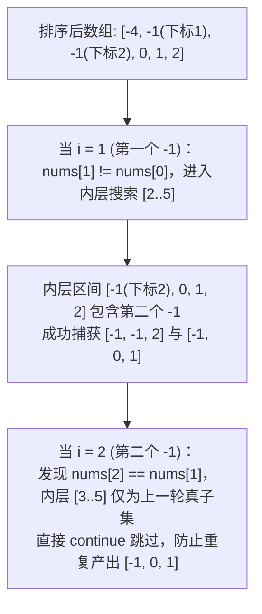

# 三数之和与 N 数之和：排序+对撞指针的组合拳

**摘要：**

三数之和（3Sum）是双指针里考频最高、也最容易写错的题之一——**它的算法框架不难（排序 + 固定一个数 + 对撞），难的是"去重"**。本文从两数之和出发，讲清"降维"这一核心思路：**多数之和问题，可以"固定一个数"后，退化为"少一个数"的问题**，最终落到 $O(n)$ 的对撞指针上。文中用 Go 语言实现 3Sum、3Sum Closest、4Sum，并逐层追问：为什么必须先排序、"去重"到底在去什么、以及"外层去重"与"内层去重"为什么要分开处理。掌握本篇，你就掌握了"用排序 + 对撞解决 N 数之和"这一通用框架。

---

## 第 1 章 降维：从两数之和到 N 数之和

### 1.1 核心思路

**两数之和（有序）用对撞指针 $O(n)$。** 那么三数之和呢？**思路是"固定一个数、降维"**：

```text
三数之和 nums[i] + nums[j] + nums[k] = target
→ 固定 i，问题变成"在 nums[i+1..n-1] 里找两数之和 = target - nums[i]"
→ 用对撞指针 O(n) 解决
→ 外层枚举 i，总复杂度 O(n^2)
```

**四数之和同理**：固定两个数，退化为两数之和，$O(n^3)$。

**"降维"是 N 数之和的通用框架**——**$k$ 数之和，就是"枚举 $k-2$ 层 + 对撞指针"**，复杂度 $O(n^{k-1})$。

### 1.2 为什么必须先排序

**因为"降维"后的两数之和，必须用对撞指针——而对撞指针要求有序。** 所以 N 数之和的**第一步永远是排序**（$O(n \log n)$）。

**排序还带来两个好处**：

- **便于去重**：排序后相同元素相邻，可以用"与前一个元素比较"来跳过重复；
- **便于剪枝**：排序后，若"最小的几个数之和已经超过 target"，可以提前 `break`。

**"排序"是 N 数之和的"万能钥匙"。**

> [!info] 降维：一个可迁移的通用思路
> "把 $k$ 数之和降维成 $(k-1)$ 数之和，直到两数之和"，是 N 数之和的核心。**这个思路可以迁移到很多问题**——如"K 个有序链表的合并"（降维成"两两合并"）、"多数之和的变体"。**抓住"降维"，你就能把"复杂问题"逐步化简为"已知问题"。**

---

## 第 2 章 LeetCode 15：三数之和

### 2.1 题目

**LeetCode 15 - 3Sum**（中等）

给你一个整数数组 `nums`，判断是否存在三元组 `[nums[i], nums[j], nums[k]]` 满足 `i != j != k` 且 `nums[i] + nums[j] + nums[k] == 0`。**返回所有和为 0 且不重复的三元组。**

```text
输入: [-1,0,1,2,-1,-4]  →  [[-1,-1,2],[-1,0,1]]
输入: [0,1,1]           →  []
输入: `[0,0,0]`           →  `[[0,0,0]]`
```

### 2.2 Go 实现

```go
func threeSum(nums []int) [][]int {
    sort.Ints(nums) // 第一步：排序
    var res [][]int
    n := len(nums)

    for i := 0; i < n-2; i++ {
        if nums[i] > 0 {
            break // 剪枝：最小的数已 > 0，三数之和不可能为 0
        }
        if i > 0 && nums[i] == nums[i-1] {
            continue // 外层去重：跳过重复的 i
        }
        left, right := i+1, n-1
        for left < right {
            sum := nums[i] + nums[left] + nums[right]
            switch {
            case sum == 0:
                res = append(res, []int{nums[i], nums[left], nums[right]})
                // 内层去重：跳过重复的 left 与 right
                for left < right && nums[left] == nums[left+1] {
                    left++
                }
                for left < right && nums[right] == nums[right-1] {
                    right--
                }
                left++
                right--
            case sum < 0:
                left++ // 和偏小
            default:
                right-- // 和偏大
            }
        }
    }
    return res
}
```

**复杂度**：时间 $O(n^2)$（外层 $O(n)$ × 内层对撞 $O(n)$）、空间 $O(\log n)$（排序）或 $O(n)$（视排序实现）。

### 2.3 去重：本题的核心难点

**"去重"是 3Sum 最容易出错的地方，它分两层**：

**外层去重**（`if i > 0 && nums[i] == nums[i-1] { continue }`）：**跳过"与前一个 `i` 相同的 `i`"**——因为固定同一个值，会得到相同的三元组。**注意条件是 `i > 0`**（否则第一个 `i` 会被跳过，漏解）。

**内层去重**（找到答案后 `for nums[left] == nums[left+1] { left++ }`）：**跳过"与当前 `left`/`right` 相同的值"**——避免同一个三元组被多次加入。**注意"先去重、再 `left++`"的顺序**（若顺序反了，会漏掉或重复）。

**"外层去重"与"内层去重"必须分开处理**——**它们的目的是同一个（去重），但位置与时机不同。**

### 2.4 手动验证 `[-1,0,1,2,-1,-4]`

```text
排序后: [-4,-1,-1,0,1,2]

i=0 (nums[i]=-4): 在 [-1,-1,0,1,2] 里找和为 4 的两数 → 无
i=1 (nums[i]=-1): 在 [-1,0,1,2] 里找和为 1 的两数
   left=-1, right=2: 和 1 == 1 → 加入 [-1,-1,2]
   left=-1, right=1: 和 0 < 1 → left++
   left=0, right=1: 和 1 == 1 → 加入 [-1,0,1]
i=2 (nums[i]=-1): 与前一个 -1 相同 → 跳过（外层去重）
i=3 (nums[i]=0): nums[i] > 0? 否；在 [1,2] 里找和为 0 的两数 → 无

结果: [[-1,-1,2],[-1,0,1]] ✓
```

> [!warning] 生产避坑：去重时的两个 off-by-one
> **其一，外层去重必须是 `i > 0`**——若写成 `i >= 0`，第一个 `i` 会被跳过，**漏解**。**其二，内层去重要"先判断相等、再移动"**——顺序反了会**漏解或重复**。这两个 off-by-one，是 3Sum 最常见的错误。

### 2.5 深度剖析：为什么外层去重是 `nums[i] == nums[i-1]`，而不是 `nums[i] == nums[i+1]`？

在面试现场写 3Sum 时，除了 `i > 0` 的下标越界保护外，最让初学者犯迷糊的哲学问题是：**同样是判断相邻重复元素，为什么外层循环写的是跟前一个元素比（`if i > 0 && nums[i] == nums[i-1] { continue }`），而不是跟后一个元素比（`if nums[i] == nums[i+1] { continue }`）？**

不妨拿经典三元组 `[-1, -1, 2]`（在排序后的数组 `[-4, -1, -1, 0, 1, 2]` 中，两个 `-1` 分别位于下标 `1` 和 `2`）来做一次反事实推演：
- **错误写法（跟后一个比 `nums[i] == nums[i+1]`）**：
  - 当 `i = 1`（第一个 `-1`）时，程序一看 `nums[1] == nums[2]`（后面还有一个 `-1`），立刻触发 `continue` 跳过了 `i = 1`；
  - 紧接着来到 `i = 2`（第二个 `-1`），此时虽然不再跳过，但内层双指针的搜索范围已经被限制在了 `[i + 1, n - 1]`（即 `[3, 5]`，对应子数组 `[0, 1, 2]`）。在这个缩水后的子数组里，第一个 `-1` 已经被永久甩在身后了，你再也凑不出包含**两个 `-1`** 的合法解 `[-1, -1, 2]`。
- **正确写法（跟前一个比 `nums[i] == nums[i-1]`）**：
  - 当 `i = 1`（第一个 `-1`）时，`nums[1] != nums[0]`（`-1 != -4`），**正常进入内层循环**。此时内层区间 `[2, 5]`（对应 `[-1, 0, 1, 2]`）里完好地包含着第二个 `-1`，于是对撞指针顺利捕获包含两个 `-1` 的解 `[-1, -1, 2]`，同时也捕获只含一个 `-1` 的解 `[-1, 0, 1]`；
  - 等到外层推进到 `i = 2`（第二个 `-1`）时，发现 `nums[2] == nums[1]`，说明**"以 `-1` 作为三元组最小元素的所有可能性（包括用两个 `-1` 和只用一个 `-1` 的全部情况），已经在 `i = 1` 那一轮被彻底穷尽了"**，因为区间 `[3, 5]` 只是上一轮区间 `[2, 5]` 的真子集，继续搜只会产出重复的 `[-1, 0, 1]`。此时跳过 `i = 2`，既不漏掉任何含重复元素的解，又精准消灭了所有重复产出的三元组。

用一句话总结这条去重黄金法则：**"先让第一个代表把包含同值兄弟在内的全集搜完，再把后续紧跟的同值替身全部跳过"**——这就是"向前看 `nums[i] == nums[i-1]`"而非"向后看 `nums[i] == nums[i+1]`"的根本原因。



### 2.6 另一条去重路线：如果不做内层双指针移动，只靠外层跳重行不行？

有些读者还会问："内层在 `sum == 0` 之后写两个 `for` 循环跳过重复的 `left` 和 `right`，代码看起来有点长。如果在 `sum == 0` 时，我不在末尾用 `for` 跳重，而是模仿外层去重，在 `for left < right` 循环体开头写一句 `if left > i + 1 && nums[left] == nums[left-1] { left++; continue }`，可行吗？"

完全可行，而且逻辑上与外层去重高度对称：
- 外层第 1 个数是 `i`，它的起点是 `0`，所以当 `i > 0 && nums[i] == nums[i-1]` 时跳过；
- 内层第 2 个数是 `left`，它的起点是 `i + 1`，所以当 `left > i + 1 && nums[left] == nums[left-1]` 时，说明当前的 `(nums[i], nums[left])` 组合跟上一次完全一样，由于前两个数固定后第 3 个数 `nums[right] = 0 - nums[i] - nums[left]` 是唯一确定的，直接跳过重复的 `left` 就能自动避免产出重复三元组。

这种"左端判断 `left > i + 1 && nums[left] == nums[left-1]`"的写法，与正文 2.2 节"命中解后双端跳过 `nums[left] == nums[left+1]`"的写法完全等价，在考场上任选你最顺手的一种即可。

---

## 第 3 章 LeetCode 16：最接近的三数之和

### 3.1 题目

**LeetCode 16 - 3Sum Closest**（中等）

给你一个长度为 `n` 的整数数组 `nums` 和一个目标值 `target`，选出三个整数，使它们的和与 `target` 最接近。返回这三个数的和。

### 3.2 Go 实现

```go
func threeSumClosest(nums []int, target int) int {
    sort.Ints(nums)
    n := len(nums)
    best := nums[0] + nums[1] + nums[2] // 初始化为前三个

    for i := 0; i < n-2; i++ {
        left, right := i+1, n-1
        for left < right {
            sum := nums[i] + nums[left] + nums[right]
            if abs(sum-target) < abs(best-target) {
                best = sum // 更新最接近的和
            }
            switch {
            case sum < target:
                left++
            case sum > target:
                right--
            default:
                return target // 正好相等，直接返回
            }
        }
    }
    return best
}

func abs(x int) int {
    if x < 0 {
        return -x
    }
    return x
}
```

**与 3Sum 的区别**：**3Sum 是"找所有和为 0 的三元组"（需要去重），而 3Sum Closest 是"找一个最接近的和"（无需去重）。** **因为"最接近的和"只有一个，重复的和不影响结果。**

**这提示我们："去重"只在"要返回所有解"时才需要**——**若只需"一个最优解"，去重可以省去。**

### 3.3 为什么不需要去重

**3Sum 需要去重，是因为"同一个三元组"可能被多次找到**；而 3Sum Closest 只返回"一个和"，**即使同一个和被找到多次，也不影响最终答案。** **所以"去重"这一步可以完全省去。**

**"是否需要去重"取决于"输出是什么"**——**输出"所有解"需要去重，输出"一个最优值"不需要。**

---

## 第 4 章 LeetCode 18：四数之和

### 4.1 题目

**LeetCode 18 - 4Sum**（中等）

给你一个由 `n` 个整数组成的数组 `nums` 和一个目标值 `target`，找出并返回满足 `nums[a] + nums[b] + nums[c] + nums[d] == target` 的所有四元组（不重复）。

### 4.2 Go 实现

```go
func fourSum(nums []int, target int) [][]int {
    sort.Ints(nums)
    var res [][]int
    n := len(nums)

    for i := 0; i < n-3; i++ {
        if i > 0 && nums[i] == nums[i-1] {
            continue // 外层去重
        }
        for j := i + 1; j < n-2; j++ {
            if j > i+1 && nums[j] == nums[j-1] {
                continue // 次外层去重
            }
            left, right := j+1, n-1
            for left < right {
                sum := nums[i] + nums[j] + nums[left] + nums[right]
                switch {
                case sum == target:
                    res = append(res, []int{nums[i], nums[j], nums[left], nums[right]})
                    for left < right && nums[left] == nums[left+1] {
                        left++
                    }
                    for left < right && nums[right] == nums[right-1] {
                        right--
                    }
                    left++
                    right--
                case sum < target:
                    left++
                default:
                    right--
                }
            }
        }
    }
    return res
}
```

**复杂度**：时间 $O(n^3)$（两层枚举 $O(n^2)$ × 对撞 $O(n)$）。

### 4.3 四数之和的"降维"过程

```text
四数之和 = target
→ 固定 i，变成"三数之和 = target - nums[i]"
→ 固定 j，变成"两数之和 = target - nums[i] - nums[j]"
→ 对撞指针 O(n)
```

**"每固定一个数，就降一维"**——**四数之和就是"两层枚举 + 对撞"，三数之和是"一层枚举 + 对撞"，两数之和是"直接对撞"。**

### 4.4 四数之和的剪枝

**四数之和的剪枝比三数之和更多**（因为层数多）：

- **最小剪枝**：若"`nums[i] + nums[i+1] + nums[i+2] + nums[i+3] > target`"，则后面的更大，`break`；
- **最大剪枝**：若"`nums[i] + nums[n-1] + nums[n-2] + nums[n-3] < target`"，则这一层 `i` 无解，`continue`。

**"最小/最大剪枝"能大幅减少无效搜索**——**它利用"排序后最小/最大的组合"来提前排除。**

> [!info] 剪枝：利用"最小/最大组合"
> 排序后，**"最小的 `k` 个数之和"与"最大的 `k` 个数之和"是这一层能达到的极值**。**若"最小和 > target"或"最大和 < target"，整层都无解，可以提前跳过。** 这是 N 数之和的通用剪枝技巧——**层数越多，剪枝的收益越大。**

---

## 第 5 章 N 数之和的统一框架

### 5.1 框架

**所有 N 数之和，都能套进这个框架**：

```text
1. 排序
2. 递归/迭代地"固定最外层的一个数"，降维
3. 当降到"两数之和"时，用对撞指针
4. 每一层都要"去重"（跳过重复的固定值）
5. 找到答案后，"内层去重"（跳过重复的 left/right）
6. 可选：用"最小/最大组合"剪枝
```

**"排序 → 降维 → 对撞 → 去重"是 N 数之和的四步。**

### 5.2 三题对照

| 题目 | 层数 | 去重 | 剪枝 |
|------|------|------|------|
| LC 15 三数之和 | 1 层 + 对撞 | 需要（返回所有解） | `nums[i] > 0` 剪枝 |
| LC 16 最接近 | 1 层 + 对撞 | 不需要（只返回一个和） | 无 |
| LC 18 四数之和 | 2 层 + 对撞 | 需要 | 最小/最大剪枝 |

**这张表说明："N 数之和的差异，在'层数、是否需要去重、剪枝方式'"。**

### 5.3 一个可复用的判断

**遇到"N 数之和"类问题，先问三句**：

1. **要"所有解"还是"一个最优"？** 所有解需去重，最优不需要；
2. **能否剪枝？** 排序后可用"最小/最大组合"；
3. **返回"值"还是"下标"？** 返回下标则不能排序（需用哈希）。

**这三句，能定下 N 数之和题的方案。**

> [!warning] 生产避坑：返回下标时不能排序
> N 数之和的解法依赖"排序"，**但排序会打乱原始下标**。**若题目要求返回"原始下标"，就不能用排序 + 对撞**——只能改用哈希表（两数之和的哈希解法），或"记录下标"的变体。**读题时先确认"返回的是值还是下标"。**

---

## 第 6 章 常见误区与自测方法

### 6.1 四个高频误区

**误区一，外层去重写成 `i >= 0`。** 会跳过第一个 `i`，漏解。**应为 `i > 0`。**

**误区二，内层去重的顺序反了。** 应先"判断相等并移动"，再"`left++`/`right--`"。

**误区三，忘了排序。** 对撞指针失效。

**误区四，返回下标却用了排序。** 下标被打乱。

**误区五，在四数之和（LC 18）中误用 `nums[i] > target` 作为最小和剪枝条件。** 在三数之和（LC 15）中，因为目标值固定为 `target = 0`，当 `nums[i] > 0` 时，排在它后面的两个数必然也是正数，三数之和绝不可能等于 `0`，因此可以安全 `break`；但在四数之和（LC 18）中，`target` 完全可能是一个**负数**（譬如 `nums = [-4, -3, -2, -1], target = -10`）。此时第一个数 `nums[0] = -4` 虽然严格大于 `target = -10`，但四个负数相加 `-4 + (-3) + (-2) + (-1)` 恰好等于 `-10`（因为加上负数会让总和变得更小而非更大）。因此在通用 `target` 下，单元素提前 `break` 必须加上 `nums[i] > target && nums[i] >= 0` 的非负保护，或者老老实实使用第 7.1 节的完整四项最小和 `int64(nums[i]) + int64(nums[i+1]) + int64(nums[i+2]) + int64(nums[i+3]) > int64(target)` 判断，这是 LeetCode 18 考场上排名第一的隐蔽翻车点。

### 6.2 一套自测用例

| 用例 | 检验什么 |
|------|---------|
| `[0,0,0]` | 全零（去重） |
| `[0,0,0,0]` | 多个相同值 |
| `[-1,0,1,2,-1,-4]` | 常规（多个解） |
| `[1,2,3]` | 无解 |
| `[0,1,1]` | 无解（去重后） |

**其中 `[0,0,0,0]` 最值得测**——它检验"外层与内层去重"是否都正确（正确答案是 `[[0,0,0]]`，只有一个）。

---

## 第 7 章 进阶延伸：递归泛化 K-Sum 引擎与不等式计数变体

### 7.1 从 3Sum、4Sum 到任意 K-Sum 的通用递归引擎

当我们在面试中写完 `threeSum`（1 层循环 + 对撞）和 `fourSum`（2 层循环 + 对撞）之后，面试官往往会顺势追问：**"如果题目把 4 改成变量 $k$（即实现通用函数 `kSum(nums, target, k)`，求所有不重复的 $k$ 元组使其和为 `target`），你总不能手写 $k-2$ 层 `for` 循环吧？如何用一套干净的递归代码把任意 $k \ge 2$ 统一起来？"**

观察第 4 章四数之和的结构，你会发现对于任意 $k > 2$，第 $k$ 层所做的事情完全一模一样：
1. **极值双剪枝（Pruning）**：
   - 若当前起点 `start` 往后连续取最小的 $k$ 个元素之和已经大于 `target`（即 `nums[start] + ... + nums[start+k-1] > target`，在防溢出写法中也可简化为 `int64(nums[start])*int64(k) > target`），由于数组升序，后面任何 $k$ 个数的组合都必然更大，直接 `break` 终止本层循环；
   - 若当前元素 `nums[i]` 加上数组最末尾最大的 $k-1$ 个元素之和仍然小于 `target`（可简化为 `int64(nums[i]) + int64(nums[n-1])*int64(k-1) < target`），说明当前这个 `nums[i]` 太小了，连搭上最大的 $k-1$ 个帮手都够不着 `target`，直接 `continue` 跳到下一个更大的 `i`；
2. **本层同值去重**：若 `i > start && nums[i] == nums[i-1]`，直接 `continue`；
3. **固定 `nums[i]` 递归降维**：递归调用 `kSum(nums, i+1, k-1, target - nums[i])`，将返回的每个 $(k-1)$ 元组前置拼上 `nums[i]`；
4. **递归基（Base Case，$k == 2$）**：当降维到 $k == 2$ 时，停止递归，直接调用 $O(n)$ 的对撞指针并执行内层去重。

```go
package main

import "sort"

// kSum 通用 K 数之和引擎：支持任意 k >= 2，集成极值双剪枝与全层级去重
// 时间复杂度：O(n^(k-1))，空间复杂度：O(k) 递归栈
func kSum(nums []int, target int, k int) [][]int {
	sort.Ints(nums)
	n := len(nums)

	var dfs func(start int, k int, target int64) [][]int
	dfs = func(start int, k int, target int64) [][]int {
		var res [][]int
		if n-start < k || k < 2 {
			return res
		}

		// 递归基：k == 2 时执行标准对撞指针
		if k == 2 {
			left, right := start, n-1
			for left < right {
				sum := int64(nums[left]) + int64(nums[right])
				if sum == target {
					res = append(res, []int{nums[left], nums[right]})
					for left < right && nums[left] == nums[left+1] {
						left++
					}
					for left < right && nums[right] == nums[right-1] {
						right--
					}
					left++
					right--
				} else if sum < target {
					left++
				} else {
					right--
				}
			}
			return res
		}

		// 递归步：k > 2 时固定一个数 nums[i]，降维至 (k-1)Sum
		for i := start; i <= n-k; i++ {
			// 1. 本层去重：注意是 i > start 而非 i > 0
			if i > start && nums[i] == nums[i-1] {
				continue
			}
			// 2. 最小和剪枝：最小的 k 个数之和已 > target，后续更大，直接 break
			if int64(nums[i])+int64(nums[i+1])*int64(k-1) > target {
				break
			}
			// 3. 最大和剪枝：nums[i] 加上最大的 k-1 个数仍 < target，当前 i 无解，continue
			if int64(nums[i])+int64(nums[n-1])*int64(k-1) < target {
				continue
			}

			for _, sub := range dfs(i+1, k-1, target-int64(nums[i])) {
				tuple := make([]int, 0, k)
				tuple = append(tuple, nums[i])
				tuple = append(tuple, sub...)
				res = append(res, tuple)
			}
		}
		return res
	}

	return dfs(0, k, int64(target))
}
```

请注意上面代码中两处工程级的防御细节：
- **去重起点 `i > start`**：在第 $m$ 层递归中，允许当前层取到的第一个元素 `nums[start]` 与上一层刚刚取过的 `nums[start-1]` 相等（譬如用例 `[-1, -1, 2]` 中，外层取了第一个 `-1` 下标 `0`，内层起点 `start = 1` 完全合法地取第二个 `-1`）；只有当在**同一层**内部移动 `i > start` 且遇到相同值时才跳过。很多人在写 4Sum 时把内层循环的去重条件误写成了 `if j > 0 && nums[j] == nums[j-1]`（本应写 `j > i + 1`），导致把形如 `[-2, -1, -1, 4]` 的合法解全部误杀；
- **64 位整型防溢出（`int64`）**：在 LeetCode 18（四数之和）的测试用例中，专门包含 `[1000000000, 1000000000, 1000000000, 1000000000]` 这类四个 $10^9$ 相加突破 32 位有符号整数上限（$2.14 \times 10^9$）的用例，统一提升为 `int64` 累加可彻底免疫溢出。

### 7.2 延伸实战一：较小的三数之和（LeetCode 259）与有效三角形个数（LeetCode 611）

如果题目不是找"三数之和**等于** `target`"，而是统计有多少组下标三元组 $(i, j, k)$（$0 \le i < j < k < n$）满足**不等式** `nums[i] + nums[j] + nums[k] < target`（**LeetCode 259：较小的三数之和**），对撞指针如何把计数复杂度同样压到 $O(n^2)$？

将数组升序排列后，固定最左边的下标 `i`，令 `left = i + 1, right = n - 1`：
- 当发现 `nums[i] + nums[left] + nums[right] < target` 时：由于数组是升序的，把右端点从 `right` 换成区间 `[left + 1, right]` 内的**任意一个位置 $r'$**，三数之和只会更小，必然全部满足 `< target`。因此，以当前 `(i, left)` 为前两个元素的合法第三元下标共有 **`right - left` 个**，我们无需逐一枚举，直接一行 **`count += right - left`** 批量结算，随后令 `left++` 考察下一个左端点；
- 反之若 `nums[i] + nums[left] + nums[right] >= target`，说明 `right` 太大了，令 `right--`。

同理，在 **LeetCode 611：有效三角形的个数**中，要求统计满足 $a + b > c$（升序排列后即 `nums[left] + nums[right] > nums[k]`）的三元组个数。这次我们反过来**倒序固定最大边下标 `k`（从 `n - 1` 到 `2`）**，在 `[0, k - 1]` 上用 `left = 0, right = k - 1` 对撞：
- 一旦 `nums[left] + nums[right] > nums[k]`，说明固定当前的 `right` 和 `k` 时，把左端点从 `left` 换成 `[left, right - 1]` 内的任意一个位置，两边之和只会更大，必然全部能构成三角形。于是直接批量累加 **`count += right - left`**，随后令 `right--`；
- 反之若 `nums[left] + nums[right] <= nums[k]`，说明左端太短，令 `left++`：

```go
package main

import "sort"

// threeSumSmaller LeetCode 259：统计满足 nums[i]+nums[j]+nums[k] < target 的三元组下标对数
func threeSumSmaller(nums []int, target int) int {
	sort.Ints(nums)
	n := len(nums)
	count := 0

	for i := 0; i < n-2; i++ {
		left, right := i+1, n-1
		for left < right {
			if nums[i]+nums[left]+nums[right] < target {
				// 右端点取 [left+1 .. right] 共 right-left 个位置全部合法，批量结算
				count += right - left
				left++
			} else {
				right--
			}
		}
	}
	return count
}

// triangleNumber LeetCode 611：倒序固定最大边 k + 对撞指针批量统计有效三角形个数，时间 O(n^2)
func triangleNumber(nums []int) int {
	sort.Ints(nums)
	n := len(nums)
	count := 0

	for k := n - 1; k >= 2; k-- {
		left, right := 0, k-1
		for left < right {
			if nums[left]+nums[right] > nums[k] {
				// 左端点取 [left .. right-1] 共 right-left 个位置全部大于 nums[k]
				count += right - left
				right--
			} else {
				left++
			}
		}
	}
	return count
}
```

请仔细体会 `triangleNumber` 中**"为什么必须固定最大边 `k`，而不是像 3Sum 那样固定最小边 `i`"**的微妙差别：在 `a + b > c` 中，如果我们固定最小边 $a$（`nums[i]`），那么剩下的不等式是 $c - b < a$（两个变量的**差**而非**和**），此时若把 `left` 放在 `i+1`、`right` 放在 `n-1`，减小 `right` 和增大 `left` 都会让差值 $c - b$ 变小，对撞方向同向冲突，无法用相向对撞解决（只能用同向双指针）；而一旦改为**固定最大边 $c$（`nums[k]`）**，不等式就变成了标准的两个变量之**和** $a + b > c$，相向对撞指针瞬间丝滑生效。

### 7.3 对比视野：四数相加 II（LeetCode 454）为什么改用分组哈希折半搜索？

并非所有带"四数之和"字眼的题都用排序 + 对撞。在 **LeetCode 454：四数相加 II（4Sum II）**中，题目直接给出了四个独立的数组 `nums1, nums2, nums3, nums4`（长度均为 $n$），要求统计有多少个下标四元组 `(i, j, k, l)` 使得 `nums1[i] + nums2[j] + nums3[k] + nums4[l] == 0`，且**不需要对数值去重**。

如果套用本章的排序 + 对撞，时间复杂度是 $O(n^3)$；但由于这四个元素来自四个彼此独立的数组且只求下标组合总数，我们可以采用**折半搜索（Meet-in-the-Middle）+ 哈希表**：
1. 先用两层循环遍历 `nums1` 和 `nums2` 的所有组合，将两数之和 `a + b` 及其出现次数存入哈希表 `sumMap`（耗时 $O(n^2)$，空间 $O(n^2)$）；
2. 再用两层循环遍历 `nums3` 和 `nums4` 的所有组合，在 `sumMap` 中查找 `-(c + d)` 的出现次数并累加（耗时 $O(n^2)$）。

总时间复杂度直接从 $O(n^3)$ 降到了 **$O(n^2)$**。为什么在 LeetCode 18（单数组四数之和）里我们不优先用这种 $O(n^2)$ 哈希表法，而坚持用 $O(n^3)$ 的排序 + 对撞？因为 LeetCode 18 要求**所有四元组按数值严格去重**且四个数取自同一个数组（需防止同一个下标被左右两半重复使用），若用哈希表存数对，处理下标冲突与四元组去重会产生极高的常数开销与高达 $O(n^2)$ 的内存占用；而排序 + 对撞仅需 $O(1)$ 额外空间，加上极值剪枝后在实际测试集上的运行速度反而远超哈希表方案。

### 7.4 延伸实战二：三数之和的多种变形（LeetCode 923 带重计数与 LeetCode 16 剪枝强化）

在面试中，围绕三数之和还有两类极具代表性的高频变形：

1. **三数之和的多种可能（LeetCode 923：3Sum With Multiplicity）**：
   - 给定一个整数数组 `arr` 和一个目标值 `target`，返回满足 `i < j < k` 且 `arr[i] + arr[j] + arr[k] == target` 的**下标三元组总数**（对 $10^9 + 7$ 取模）。
   - 与 LeetCode 15（去重返回数值三元组）相反，这道题要求**统计所有重复下标组合的精确数量**。排序后固定 `i`，在内层对撞遇到 `arr[left] + arr[right] == target - arr[i]` 时：
     - 若 `arr[left] == arr[right]`：说明闭区间 `[left, right]` 内的全部 `m = right - left + 1` 个元素完全相等，从中任选 2 个下标的组合数为 $\binom{m}{2} = \frac{m(m-1)}{2}$，累加后直接 `break` 退出内层循环；
     - 若 `arr[left] != arr[right]`：分别向内统计左侧连续相等的 `arr[left]` 有 `cntLeft` 个、右侧连续相等的 `arr[right]` 有 `cntRight` 个，根据乘法原理一次性累加 **`cntLeft * cntRight`** 种组合，并将 `left` 和 `right` 跨过这批相等元素。

2. **最接近的三数之和（LeetCode 16）的极致剪枝与去重提速**：
   - 虽然第 3 章指出 LC 16 因为只返回一个标量最优和，在正确性上不需要去重；但在工程性能上，加上外层去重（`if i > 0 && nums[i] == nums[i-1] { continue }`）与最小/最大极值短路剪枝，能将运行耗时从十几个毫秒直接压到 0ms：
     - **最小和短路**：若当前 `s := nums[i] + nums[i+1] + nums[i+2]` 已经大于 `target`，那么后续任何 `left, right` 乃至更大的 `i` 算出的和都必然比 `s` 更大（离 `target` 更远），直接用 `s` 更新一次 `best` 后即可 **`break` 跳出整个外层循环**；
     - **最大和短路**：若当前 `s := nums[i] + nums[n-2] + nums[n-1]` 仍然小于 `target`，那么固定当前 `i` 的任何内层组合都不可能比 `s` 更接近 `target`，用 `s` 更新一次 `best` 后直接 **`continue` 跳入下一个 `i`**。

```go
package main

import "sort"

// threeSumMulti LeetCode 923：排序 + 对撞指针 + 组合计数处理重复元素下标数
func threeSumMulti(arr []int, target int) int {
	const mod = 1_000_000_007
	sort.Ints(arr)
	n := len(arr)
	var ans int64

	for i := 0; i < n-2; i++ {
		rem := target - arr[i]
		left, right := i+1, n-1
		for left < right {
			sum := arr[left] + arr[right]
			if sum < rem {
				left++
			} else if sum > rem {
				right--
			} else if arr[left] == arr[right] {
				// [left, right] 全相等，任取两个的组合数为 C(m, 2)
				m := int64(right - left + 1)
				ans = (ans + m*(m-1)/2) % mod
				break
			} else {
				// 左右值不等，分别清点左右连续相等元素的个数，按乘法原理结算
				cntL, cntR := int64(1), int64(1)
				for left+1 < right && arr[left] == arr[left+1] {
					cntL++
					left++
				}
				for right-1 > left && arr[right] == arr[right-1] {
					cntR++
					right--
				}
				ans = (ans + cntL*cntR) % mod
				left++
				right--
			}
		}
	}
	return int(ans)
}
```

### 7.5 理论边界：3Sum 到底能不能突破 $O(n^2)$？

在算法理论界（Computational Geometry & Fine-Grained Complexity），**3SUM 问题是否存在 $O(n^{2-\epsilon})$ 的亚二次方（Subquadratic）算法**，是一个困扰了计算机科学家数十年的核心猜想（3SUM Conjecture）：
- 在通用的实数比较与线性算术模型下，已被证明 $O(n^2)$ 是紧确下界，许多计算几何问题（如判断平面上是否存在三点共线、判断一组线段能否覆盖目标区域）都被证明是 **3SUM-Hard** 的；
- 只有在元素均为绝对值不超过 $M$ 的小整数时，才能通过将元素编码为多项式系数，利用 **快速傅里叶变换（FFT，Fast Fourier Transform）** 在 $O(n + M \log M)$ 时间内完成多项式自乘卷积。这也让我们在面试场上彻底定下心来：**面对通用整数数组的 3Sum，先把数组花 $O(n \log n)$ 排好序、再用 $O(n^2)$ 的枚举 + 对撞指针求解，在渐进复杂度与空间开销上已经是无可争议的理论最优解**。

### 7.6 全章六道 K-Sum 家族题目的横向决策矩阵

为了帮助读者在考场上快速区分 N 数之和家族中的细微变形，我们将本章涵盖的六道核心题目按"目标函数"、"是否需要去重"、"指针固定方式"与"时间/空间复杂度"整理如下：

| 题目 | 目标条件 | 是否需要跳重去重 | 枚举固定层与对撞层 | 最优时间 / 额外空间 |
|------|----------|------------------|--------------------|---------------------|
| LC 15 三数之和 | $a + b + c == 0$（返回所有不重复三元组） | **必须**（外层 `i > 0` 跳重 + 内层命中后双侧跳重） | 正序固定最小元 `i`，`[i+1, n-1]` 对撞 | $O(n^2)$ / $O(1)$（不计排序栈） |
| LC 16 最接近的三数之和 | $\min |(a + b + c) - target|$（返回单一最接近和） | 正确性不强制，但外层跳重+极值短路可大幅提速 | 正序固定最小元 `i`，`[i+1, n-1]` 对撞 | $O(n^2)$ / $O(1)$ |
| LC 18 四数之和 | $a + b + c + d == target$（返回所有不重复四元组） | **必须**（`i > 0`、`j > i+1` 与内层三级跳重 + `int64` 防溢出） | 固定 `i` 与 `j` 两层，`[j+1, n-1]` 对撞 | $O(n^3)$ / $O(1)$ |
| LC 259 较小的三数之和 | 统计满足 $a + b + c < target$ 的下标三元组数 | **禁止跳重**（求的是下标三元组个数，重复值需分别计数） | 正序固定 `i`，小于时批量累加 `right - left` 并 `left++` | $O(n^2)$ / $O(1)$ |
| LC 611 有效三角形个数 | 统计满足 $a + b > c$ 的下标三元组数 | **禁止跳重**（同上） | **倒序固定最大边 `k`**，大于时批量累加 `right - left` 并 `right--` | $O(n^2)$ / $O(1)$ |
| LC 923 三数之和的多种可能 | 统计满足 $a + b + c == target$ 的下标三元组数 | 不跳过，改为统计连续同值元素个数再用组合公式 $\binom{m}{2}$ 或 `cntL * cntR` 批量结算 | 正序固定 `i` + 内层分组计数对撞 | $O(n^2)$ / $O(1)$ |
| LC 454 四数相加 II | 四个独立数组统计 $A[i]+B[j]+C[k]+D[l]==0$ 下标数 | 禁止跳重 | 折半哈希表：先存 `A+B` 频次，再查 `-(C+D)` | $O(n^2)$ / $O(n^2)$ |

---

## 小结

本篇用三道题讲清了"排序 + 对撞"这一 N 数之和框架。核心思路是**降维**：每固定一个数，就降一维，直到两数之和用对撞指针。3Sum 的难点在**去重**（外层去重 + 内层去重）；3Sum Closest 展示了"只返回一个最优值"时**无需去重**；4Sum 则展示了"多层枚举 + 剪枝"。

贯穿全篇的核心认知有两条。其一，**"降维"是 N 数之和的通用框架**——$k$ 数之和就是"枚举 $k-2$ 层 + 对撞"。其二，**"是否需要去重"取决于"输出是什么"**——输出"所有解"要去重，输出"一个最优值"不用。**把这两条握住，你面对任何 N 数之和的问题，都能先排序、再降维、最后处理去重。**

下一篇 [[04 对撞指针进阶：盛水容器与接雨水的几何直觉]] 将进入"几何类"对撞指针——盛水容器的贪心论证与接雨水的左右边界预处理。

---

## 参考资料

1. LeetCode 15. 3Sum. https://leetcode.cn/problems/3sum/
2. LeetCode 16. 3Sum Closest. https://leetcode.cn/problems/3sum-closest/
3. LeetCode 18. 4Sum. https://leetcode.cn/problems/4sum/
4. LeetCode 167. Two Sum II. https://leetcode.cn/problems/two-sum-ii-input-array-is-sorted/

---

> [!note] 思考题
> 1. 为什么 N 数之和必须先排序？排序带来哪些好处？
> 2. 3Sum 的"外层去重"为什么必须写成 `i > 0`？写成 `i >= 0` 会怎样？
> 3. 3Sum Closest 为什么不需要去重？请从"输出是什么"说明。
> 4. 四数之和的"最小/最大剪枝"分别排除什么？
> 5. 若题目要求"返回原始下标"，N 数之和该怎么解？为什么不能排序？
