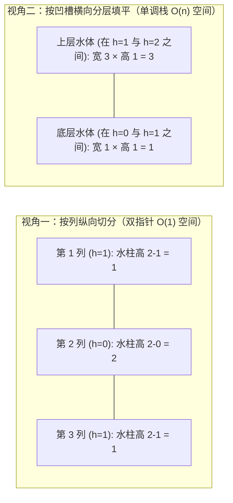

# 对撞指针进阶：盛水容器与接雨水的几何直觉

**摘要：**

盛水容器（LC 11）与接雨水（LC 42）是对撞指针在"几何问题"上的两个经典应用，也都常被面试官追问"为什么这样移动是正确的"。**盛水容器的关键，是一条贪心论证：每次移动"较矮的那一端"，不会错过最优解**；**接雨水的关键，是"左右边界的最大值"这一预处理的单调性**——它可以用"左右双指针"一次遍历完成，也可以用"前缀最大值数组"或"单调栈"解决。本文用 Go 语言实现三道题（含接雨水的三种解法），并逐层追问：为什么移动矮端是安全的、接雨水的"水量"由什么决定、以及三种解法各自的取舍。掌握本篇，你就掌握了对撞指针在"几何问题"上的应用。

---

## 第 1 章 LeetCode 11：盛最多水的容器

### 1.1 题目

**LeetCode 11 - Container With Most Water**（中等）

给定一个长度为 $n$ 的整数数组 `height`（第 $i$ 条线的高度），找出其中的两条线，使它们与 $x$ 轴共同构成的容器可以容纳最多的水。

```text
输入: height = [1,8,6,2,5,4,8,3,7]  →  49
（选第 2 条(8) 与第 9 条(7)，宽度 7、高度 7，面积 49）
```

**水量公式**：两条线 `i`、`j` 构成的容器，容量为

$$\min(\text{height}[i], \text{height}[j]) \times (j - i)$$

**"容量由较短的那条线决定"**——这是本题的关键直觉。

### 1.2 思路：对撞指针 + 贪心

**从两端出发，每次移动"较矮的那一端"**：

```go
func maxArea(height []int) int {
    left, right := 0, len(height)-1
    maxWater := 0
    for left < right {
        h := min(height[left], height[right])
        water := h * (right - left)
        if water > maxWater {
            maxWater = water
        }
        // 移动较矮的一端
        if height[left] < height[right] {
            left++
        } else {
            right--
        }
    }
    return maxWater
}

func min(a, b int) int {
    if a < b {
        return a
    }
    return b
}
```

**复杂度**：时间 $O(n)$、空间 $O(1)$。

### 1.3 为什么移动"较矮的一端"是正确的

**这是本题最需要讲清的地方**（面试常追问）。**证明如下**：

假设当前左右两端为 `l`、`r`，且 `height[l] <= height[r]`（左端较矮）。**当前容量是 `height[l] * (r - l)`。**

**考虑"以 `l` 为左端点的所有容器"**：它们的宽度都 $\le (r-l)$（因为右端最多到 `r`），而高度都 $\le height[l]$（因为容量由矮端决定，而左端就是 `l`）。**所以，以 `l` 为左端点的所有容器，容量都不超过当前容量。**

**因此，"以 `l` 为左端点的容器"里，当前的 `(l, r)` 已经是最优的**——**`l` 不可能再和"别的右端"构成更大的容器。** **于是可以安全地把 `l` 排除**，即 `left++`。

**对称地，若 `height[r] < height[l]`，则 `r` 可以被排除**，即 `right--`。

**结论**：每次移动较矮的一端，都"排除了一整条边界的所有可能"，不遗漏最优解。$\square$

> [!info] 核心概念：贪心的"安全性"来自"排除论证"
> 盛水容器的贪心（移动矮端）之所以安全，是因为**"以矮端为边界的容器，容量已被当前值支配"**。**这与对撞指针的"排除整行/整列"是同一逻辑**——每一步都"证明了一整批候选不可能更优"。**理解了"排除论证"，你就理解了贪心为什么正确。**

### 1.4 与两数之和的对比

**盛水容器与两数之和都是对撞指针，但"移动哪一端"的判据不同**：

- **两数之和**：看"和"与 target 的大小关系（和偏小移左、偏大移右）；
- **盛水容器**：看"两端高度"（移动矮端）。

**它们的共同点是"每次移动，都能排除一整条边界"**——**但"排除的判据"由问题决定。**

### 1.5 深度追问：当左右两端高度相等（`height[left] == height[right]`）时，随便移哪边都对吗？

在面试 LeetCode 11（盛最多水的容器）时，细心的面试官常会指着代码里的 `if height[left] < height[right] { left++ } else { right-- }` 追问一个尖锐的问题：
**"当 `height[left]` 与 `height[right]` 严格不相等时，你说移动较矮端不会丢解，这我同意；可如果恰巧遇到 `height[left] == height[right]`（两边一样高），你的代码走 `else` 分支只移动了 `right--`，万一真正的最优容器是以当前的 `right` 为右界、以某个更靠里的 `left'` 为左界呢？或者能不能干脆两边同时向内移动（`left++; right--`）？"**

这是一个极佳的边界试金石。我们来严格推导：
假设当前处于 `(l, r)`，且左右两根柱子高度相等，记为 $H = \text{height}[l] = \text{height}[r]$。
现在考虑任何包含 `l` 或包含 `r`（但不同时包含两者）的更窄子区间 `(l, r')`（其中 $r' < r$）或 `(l', r)`（其中 $l' > l$）：
- 在子区间 `(l, r')` 中，左边界高度依然是 $\text{height}[l] = H$，因此无论新右端 $\text{height}[r']$ 有多高（哪怕高達一万米），**受限于左端高度 $H$，新容器的有效水位 $\min(H, \text{height}[r'])$ 绝不可能超过 $H$**；与此同时，宽度 $r' - l$ 严格小于 $r - l$。因此，任何固定 `l`、改变右端的子容器，其面积严格小于当前面积 $H \times (r - l)$；
- 完全对称地，任何固定 `r`、改变左端的子容器 `(l', r)`，受限于右端高度 $\text{height}[r] = H$，其有效水位同样绝不可能超过 $H$，而宽度更窄，面积也必然严格小于当前面积 $H \times (r - l)$。

由此得出一个比"随便移哪边都行"更强的结论：**当 `height[left] == height[right]` 时，不仅单移左边或单移右边绝对安全，甚至直接令左右指针同时向内收缩一步（`left++; right--`）也绝对不会漏掉任何比当前更大的容器**——因为要想超越当前的面积 $H \times (r - l)$，未来的左右两根新柱子必须**同时严格高于 $H$**，当前的 `l` 和 `r` 两个端点全都可以当场淘汰。

基于这一推论，我们甚至可以在盛水容器中写出一个**连续跳过矮柱子**的常数级加速版：每次算完当前水位 $h = \min(\text{height}[left], \text{height}[right])$ 后，任何高度小于等于 $h$ 的内侧柱子都绝无可能在宽度缩小的情况下创造更大面积，直接用内层循环一路跨过去：

```go
package main

// maxAreaFast 盛最多水的容器（含同高双淘汰与矮柱连续跳跃优化）
func maxAreaFast(height []int) int {
	left, right := 0, len(height)-1
	maxWater := 0

	for left < right {
		h := min(height[left], height[right])
		if area := h * (right - left); area > maxWater {
			maxWater = area
		}
		// 凡是高度 <= 当前瓶颈 h 的边界柱子，在宽度缩水后绝无可能突破当前面积，直接连续跳过
		for left < right && height[left] <= h {
			left++
		}
		for left < right && height[right] <= h {
			right--
		}
	}
	return maxWater
}
```

### 1.6 变体辨析：为什么接雨水（LC 42）在左右相等时不能像盛水容器那样跳过中间柱子？

请注意：上面 `maxAreaFast` 中"连续跳过 `<= h` 的柱子"只适用于盛水容器（求单一最大矩形），而在第 2 章的**接雨水（LC 42）**中，由于每一根矮柱子头顶上的水坑都要单独计入总水量，双指针每走一步都必须老老实实结算该列的积水 `leftMax - height[left]`，绝不能不计水量就直接跳过去。

---

## 第 2 章 LeetCode 42：接雨水

### 2.1 题目

**LeetCode 42 - Trapping Rain Water**（困难）

给定 $n$ 个非负整数表示每个宽度为 1 的柱子的高度图，计算按此排列的柱子，下雨之后能接多少雨水。

```text
输入: height = [0,1,0,2,1,0,1,3,2,1,2,1]  →  6
```

### 2.2 核心直觉：水量由"左右最大值"决定

**某个位置 `i` 能接的水量，由"它左边最高的柱子"与"它右边最高的柱子"共同决定**：

$$\text{water}[i] = \min(\text{leftMax}[i], \text{rightMax}[i]) - \text{height}[i]$$

**直觉**：水会积到"左右两边较矮的那道墙"的高度，减去当前位置的高度，就是能接的水。**若"较矮的墙"不比当前柱子高，则接不到水（水量为 0，用 `max(0, ...)` 保证）。**

### 2.3 解法一：前缀最大值数组（$O(n)$ 空间）

**先分别算出"每个位置左边最大值"与"右边最大值"，再逐位置计算水量**：

```go
func trapPrefix(height []int) int {
    n := len(height)
    if n == 0 {
        return 0
    }
    leftMax := make([]int, n)
    rightMax := make([]int, n)

    leftMax[0] = height[0]
    for i := 1; i < n; i++ {
        leftMax[i] = max(leftMax[i-1], height[i])
    }
    rightMax[n-1] = height[n-1]
    for i := n - 2; i >= 0; i-- {
        rightMax[i] = max(rightMax[i+1], height[i])
    }

    water := 0
    for i := 0; i < n; i++ {
        water += min(leftMax[i], rightMax[i]) - height[i]
    }
    return water
}
```

**复杂度**：时间 $O(n)$、空间 $O(n)$。**思路最清晰，但空间不是最优。**

### 2.4 解法二：左右双指针（$O(1)$ 空间）

**关键观察**：**我们不需要"精确的左右最大值"，只需要"较矮的那一侧的最大值"**——因为水量由 `min(leftMax, rightMax)` 决定。

**于是可以用双指针**：`left` 从左、`right` 从右，维护 `leftMax` 与 `rightMax`：

```go
func trap(height []int) int {
    left, right := 0, len(height)-1
    leftMax, rightMax := 0, 0
    water := 0

    for left < right {
        if height[left] < height[right] {
            // 左端较矮，水量由 leftMax 决定
            if height[left] >= leftMax {
                leftMax = height[left]
            } else {
                water += leftMax - height[left]
            }
            left++
        } else {
            // 右端较矮（或相等），水量由 rightMax 决定
            if height[right] >= rightMax {
                rightMax = height[right]
            } else {
                water += rightMax - height[right]
            }
            right--
        }
    }
    return water
}
```

**为什么"移动较矮的一端"是正确的？** **因为当 `height[left] < height[right]` 时，`leftMax` 就是"`left` 处的 `min(leftMax, rightMax)`"**——**右侧一定有一个不低于 `height[right]` 的墙（即 `height[right]` 本身），所以 `rightMax >= height[right] > height[left]`，从而 `min(leftMax, rightMax) = leftMax`。** **因此，`left` 处的水量只由 `leftMax` 决定，可以立即结算。**

**复杂度**：时间 $O(n)$、空间 $O(1)$。**这是最优解法。**

### 2.5 解法三：单调栈（按"层"计算）

**接雨水也可以用单调栈**——**它按"横向的层"计算水量**（与双指针的"按列"相反）：

```go
func trapStack(height []int) int {
    water := 0
    var stack []int // 存下标，高度单调递减

    for i := 0; i < len(height); i++ {
        for len(stack) > 0 && height[i] > height[stack[len(stack)-1]] {
            mid := stack[len(stack)-1]
            stack = stack[:len(stack)-1]
            if len(stack) == 0 {
                break
            }
            left := stack[len(stack)-1]
            h := min(height[left], height[i]) - height[mid]
            w := i - left - 1
            water += h * w
        }
        stack = append(stack, i)
    }
    return water
}
```

**单调栈的视角是"横向的"**：**它找"凹槽"（左右两根更高的柱子），按"凹槽的宽度 × 高度"累加。** **这与双指针的"纵向的"（按每一列算水量）是两种不同的分解方式。**

### 2.6 三种解法对照

| 解法 | 时间 | 空间 | 视角 |
|------|------|------|------|
| 前缀最大值数组 | $O(n)$ | $O(n)$ | 按列（预计算） |
| 左右双指针 | $O(n)$ | $O(1)$ | 按列（实时） |
| 单调栈 | $O(n)$ | $O(n)$ | 按层（横向） |

**这张表说明："同一道题，可以有多种视角"**——**按列（双指针）与按层（单调栈），都能算出同样的水量。**

> [!info] 从"按列"到"按层"：同一问题的两种分解
> 接雨水的"按列"（每个位置积多少水）与"按层"（每个凹槽积多少水），是同一问题的两种分解方式。**"按列"适合双指针/前缀最大值，"按层"适合单调栈。** **理解了这一点，你就明白"为什么同一道题有多种解法"——因为"问题的分解方式"可以不唯一。**

---

## 第 3 章 两道题的对比与"几何类对撞"

### 3.1 对比

| 维度 | 盛水容器 | 接雨水 |
|------|---------|--------|
| 目标 | 最大的"一个"容器 | 所有位置的水量之和 |
| 移动判据 | 移动矮端 | 移动矮端 |
| 关键 | 贪心排除论证 | 左右最大值 |
| 空间 | $O(1)$ | $O(1)$（双指针）/ $O(n)$（前缀/栈） |

**两道题的"移动判据"都是"移动矮端"**——**因为"较矮的一端"限制了当前的容量/水量。**

### 3.2 "几何类对撞"的共性

**盛水容器与接雨水，共享"移动矮端"这一判据**——**它们的共同直觉是"较矮的一端是瓶颈"。**

**"瓶颈决定结果"是一个可迁移的直觉**——**当"结果由两端中较小的那个决定"时，就"移动较小的一端"。** **这与"木桶效应"（最短的木板决定容量）是同一道理。**

### 3.3 一个可复用的判断

**遇到"两端构成容器/区间"的几何题，先问三句**：

1. **结果由什么决定？** 若由"较小端"决定，移动较小端；
2. **是"一个最优"还是"总和"？** 一个用贪心，总和可能要预处理；
3. **能否实时维护？** 能则 $O(1)$ 空间。

**这三句，能定下几何类对撞题的方案。**

---

## 第 4 章 常见误区与自测方法

### 4.1 四个高频误区

**误区一，盛水容器移动"较高的一端"。** 会错过最优解（应移动矮端）。

**误区二，接雨水的双指针用 `leftMax`/`rightMax` 时搞混。** 应"哪端矮，就结算哪端"。

**误区三，接雨水忘了 `max(0, ...)`。** 当"墙不比柱子高"时，水量应为 0（用 `if height >= max` 分支处理）。

**误区四，单调栈的"层"算错。** `h = min(左高, 右高) - 凹槽底高`、`w = 右下标 - 左下标 - 1`。

**误区五，在接雨水（LC 42）的双指针解法中，混淆 `height[left] < height[right]` 与 `leftMax < rightMax` 的分支边界。** 如果你在循环开头先更新了 `leftMax` 和 `rightMax`（如 5.5 节的 `trapBranchless`），那么判断条件直接写 `leftMax < rightMax` 或 `height[left] < height[right]` 都是完全正确的；但如果你没有在循环开头提前更新 `rightMax`（比如 `right` 还没走过一步时 `rightMax` 初始为 `0`），却直接用 `leftMax < rightMax` 作判断，就会因为初始 `rightMax = 0` 而错误地一直移动右指针。因此，若采用延迟更新写法，外层分支条件应直接对比当前实测柱高 `if height[left] < height[right]`；若采用提前更新写法，则先在循环首行同时更新 `leftMax = max(leftMax, height[left])` 与 `rightMax = max(rightMax, height[right])`，再对比 `if leftMax < rightMax`。两套体系各有自洽的循环不变量，切忌在代码中将两者张冠李戴混写在一起，否则必在单边极值用例上出现漏算或负积水异常，建议在考场上固定采用本篇 5.5 节的无分支提前更新模板。

### 4.2 一套自测用例

| 用例 | 检验什么 |
|------|---------|
| `height = []` | 空数组 |
| `height = [1,1]` | 等高的两根（盛水） |
| `height = [1,2,1]` | 简单凹槽（接雨水 = 1） |
| `height = [0,1,0,2,1,0,1,3,2,1,2,1]` | 经典样例（= 6） |
| 单调递增/递减 | 接不到水 |

**其中 `[1,2,1]` 最值得测**——它是最简单的凹槽，检验"接雨水"的核心逻辑（答案应为 1）。

---

## 第 5 章 深度拓展：从一维接雨水到二维木桶原理与直方图最大矩形

### 5.1 为什么"盛水容器（LC 11）"与"接雨水（LC 42）"看似孪生、实则有着本质差异？

很多读者在刷完 LC 11 和 LC 42 后，只记住了"两道题都是谁矮移谁"，却没意识到两道题里的柱子在物理意义上扮演着截然不同的角色：
- 在 **盛水容器（LC 11）** 中，每条竖线是**没有宽度（厚度为 0）的隔板**，选定左右两块隔板 `left` 和 `right` 后，中间所有的竖线全部视若无睹（不占体积也不挡水），目标函数是单次取极值 $\max_{i < j} \{\min(h[i], h[j]) \cdot (j - i)\}$；
- 在 **接雨水（LC 42）** 中，每根柱子是**宽度为 1 的实心砖块**，中间的柱子实实在在地占据体积，目标函数是对每一格求和 $\sum_i (\min(L_{\max}[i], R_{\max}[i]) - h[i])$。

更进一步，与这两道题并称为"柱状图三剑客"的还有 **LeetCode 84：柱状图中最大的矩形（Largest Rectangle in Histogram）**。为什么前两道题都能用 $O(1)$ 空间的相向对撞指针解决，唯独第三道题（求柱状图内能勾勒出的最大矩形面积）用相向对撞指针会彻底失效，必须改用**单调递增栈**？

让我们尝试对 LC 84 用对撞指针分析一下：矩形的高度不是由左右两根端点柱子的较小值决定的，而是由**区间 `[left, right]` 内所有柱子的全局最小值** $\min_{k \in [left, right]} h[k]$ 决定的。当你站在两端观察 `h[left]` 和 `h[right]` 时，那个真正卡住矩形高度的"最矮短板"可能藏在区间肚子里的任意位置，移动 `left` 或 `right` 根本无法预知肚子里短板的变化方向——**缺乏两端可观测的单调支配性，正是对撞指针在 LC 84 上失效的根本原因**。

| 柱状图三剑客 | 几何物理意义 | 高度决定者（瓶颈） | 最优解法与时空复杂度 |
|--------------|--------------|--------------------|----------------------|
| LC 11 盛最多水的容器 | 选两块零厚度挡板，中间柱子透明 | 仅由两端挡板较矮者 $\min(h[l], h[r])$ 决定 | 相向对撞指针，时间 $O(n)$，空间 $O(1)$ |
| LC 42 接雨水 | 实心柱子阵列，求所有凹槽蓄水总和 | 第 $i$ 列水位由前缀最高与后缀最高较矮者 $\min(L_{\max}[i], R_{\max}[i])$ 决定 | 相向对撞指针（时间 $O(n)$ 空间 $O(1)$）或单调递减栈（时间 $O(n)$ 空间 $O(n)$） |
| LC 84 柱状图最大矩形 | 在柱子内部内接一个实心矩形 | 由区间 `[l, r]` **内部所有柱子的最矮者** $\min_{k=l}^r h[k]$ 决定 | 单调递增栈找每根柱子左右第一个更矮边界，时间 $O(n)$，空间 $O(n)$ |

### 5.2 升维挑战：三维空间中的接雨水 II（LeetCode 407，木桶原理 + 最小堆 Dijkstralike 收缩）

如果面试官在确认你完全掌握了一维接雨水的双指针解法后，把问题升维到二维网格（三维地形）：给定一个 $m \times n$ 的高度矩阵 `heightMap`，计算下雨后整个三维地形能接多少体积的雨水（**LeetCode 407：接雨水 II**）？

在一维接雨水中，某个位置的水只能往**左**或往**右**流，因此它的最高水位由"左边界最大值 `leftMax`"和"右边界最大值 `rightMax`"这两个点中的较矮者决定，我们只需用 `left` 和 `right` **两个指针**守住一维线段的两端，每次挑较矮的一端向内推进即可。

到了二维网格里，某个格子里的水可以沿着上下左右四个方向蜿蜒流出边界。它的最高水位不再仅由同行的左右最大值和同列的上下最大值决定（因为水可以拐弯从斜刺里的缺口漏出去），而是由**包围整个内部未结算区域的"一整圈围栏（Boundary Ring）"上最矮的那块木板**决定——这就是最纯粹的**木桶原理**。

- 在一维线段上，"围栏"只有左端点 `left` 和右端点 `right` **2 个点**，所以用 `if height[left] < height[right]` 就能 $O(1)$ 找出围栏的最矮短板；
- 在二维矩阵上，"围栏"是矩阵最外圈（以及随着向内收缩不断演化的闭合边界）上的 **$O(m + n)$ 个格子**。要在动态变化的闭合围栏里快速找出"当前最矮的那块木板"，自然就是用**最小堆（Min-Heap）**代替一维的左右双指针：
  1. **初始化围栏**：将矩阵四条边上的所有外周格子推入最小堆，并标记为 `visited`（外周格子自身无法蓄水）；
  2. **每次从堆顶弹出当前围栏的最矮木板 `(r, c, h)`**：这完全对应一维双指针里的"挑 `height[left]` 与 `height[right]` 中较矮的一侧"；
  3. **向内收缩围栏**：查看 `(r, c)` 的上下左右四个邻居 `(nr, nc)`。若 `(nr, nc)` 尚未访问，由于它是从整圈围栏的最矮缺口 `h` 迈进来的，它的蓄水上限就已经被这块最矮木板 `h` 死死锁定了：
     - 若 `heightMap[nr][nc] < h`，则该格子能蓄水 `h - heightMap[nr][nc]`，且它注满水后的等效高度变为 `h`；
     - 将 `(nr, nc, max(h, heightMap[nr][nc]))` 作为新的围栏木板推入最小堆，并标记 `visited`。

```go
package main

import "container/heap"

type cell struct {
	r, c, h int
}

type cellMinHeap []cell

func (h cellMinHeap) Len() int           { return len(h) }
func (h cellMinHeap) Less(i, j int) bool { return h[i].h < h[j].h }
func (h cellMinHeap) Swap(i, j int)      { h[i], h[j] = h[j], h[i] }
func (h *cellMinHeap) Push(x any)        { *h = append(*h, x.(cell)) }
func (h *cellMinHeap) Pop() any {
	old := *h
	n := len(old)
	x := old[n-1]
	*h = old[:n-1]
	return x
}

// trapRainWater LeetCode 407：一维对撞指针向二维闭合围栏最小堆的自然升维
// 时间复杂度：O(mn log(m+n))，空间复杂度：O(mn)
func trapRainWater(heightMap [][]int) int {
	m := len(heightMap)
	if m <= 2 {
		return 0
	}
	n := len(heightMap[0])
	if n <= 2 {
		return 0
	}

	visited := make([][]bool, m)
	for i := range visited {
		visited[i] = make([]bool, n)
	}

	h := &cellMinHeap{}
	// 1. 将最外圈四条边界全部加入最小堆围栏
	for r := 0; r < m; r++ {
		for c := 0; c < n; c++ {
			if r == 0 || r == m-1 || c == 0 || c == n-1 {
				*h = append(*h, cell{r: r, c: c, h: heightMap[r][c]})
				visited[r][c] = true
			}
		}
	}
	heap.Init(h)

	water := 0
	dirs := [4][2]int{{-1, 0}, {1, 0}, {0, -1}, {0, 1}}

	// 2. 每次从围栏最矮短板向内收缩结算
	for h.Len() > 0 {
		cur := heap.Pop(h).(cell)
		for _, d := range dirs {
			nr, nc := cur.r+d[0], cur.c+d[1]
			if nr >= 0 && nr < m && nc >= 0 && nc < n && !visited[nr][nc] {
				visited[nr][nc] = true
				if heightMap[nr][nc] < cur.h {
					water += cur.h - heightMap[nr][nc]
				}
				heap.Push(h, cell{
					r: nr,
					c: nc,
					h: max(cur.h, heightMap[nr][nc]),
				})
			}
		}
	}
	return water
}
```

把一维接雨水的"左右双指针挑较矮端内缩"与二维接雨水的"最小堆维护闭合外围栏挑最矮木板内缩"放在一起对照，你会瞬间顿悟：**一维对撞指针，其实就是规模 $k = 2$ 的最小堆围栏**。

### 5.3 动手推演：接雨水三种解法在经典数组上的微观轨迹对比

为了把第 2 章中"前缀后缀数组"、"相向对撞双指针"与"单调递减栈"三种解法的物理直觉彻底融会贯通，我们拿一段局部地形 `height = [2, 1, 0, 1, 3]`（共 5 根柱子）做一次显微镜级的推演对比：

1. **按列纵向结算（双指针法）**：
   - 初始 `left = 0 (h=2), right = 4 (h=3)`，因为 `height[left] = 2 < height[right] = 3`，左端是短板，右边有高达 `3` 的太行山保底，左侧任何位置的水位上限完全由 `leftMax = 2` 决定：
     - `left = 1 (h=1)`：头顶直接注入一整列深 `2 - 1 = 1` 的水柱；
     - `left = 2 (h=0)`：头顶直接注入一整列深 `2 - 0 = 2` 的水柱；
     - `left = 3 (h=1)`：头顶直接注入一整列深 `2 - 1 = 1` 的水柱；
   - 合计蓄水 $1 + 2 + 1 = 4$。注意双指针是**一列一列从水面直插谷底**竖着切分水体的。

2. **按层横向填平（单调栈法）**：
   - 栈中依次压入递减的左壁：`0 (h=2)` $\to$ `1 (h=1)` $\to$ `2 (h=0)`；
   - 当扫到 `i = 3 (h=1)` 时，它比栈顶 `2 (h=0)` 高，触发第一次弹栈结算：凹槽底是 `h[2] = 0`，左壁是 `1 (h=1)`，右壁是 `3 (h=1)`，先在最底下填平一层宽为 `3 - 1 - 1 = 1`、高为 `min(1, 1) - 0 = 1` 的水层（水量 $+1$）；
   - 当扫到 `i = 4 (h=3)` 时，它比栈里剩下的 `3 (h=1)` 高，把中间整个宽为 `4 - 0 - 1 = 3`、高为 `min(2, 3) - 1 = 1` 的上半截水层一次性横向填平（水量 $+3$）；
   - 合计蓄水同样是 $1 + 3 = 4$。



### 5.4 延伸实战：好子数组的最大分数——从中心向两端贪心扩张的反向双指针（LeetCode 1793）

在 5.1 节我们提到，**柱状图中最大的矩形（LeetCode 84）**因为不知道最矮短板在哪，不能从两端往中间对撞。但如果题目**明确指定矩形必须包含下标 $k$**（即 **LeetCode 1793：好子数组的最大分数**，求满足 $i \le k \le j$ 的子数组 $\min_{i \le p \le j} nums[p] \times (j - i + 1)$ 的最大值），双指针能不能从中心 $k$ 出发**向两端背向扩张**？

答案是肯定的，而且它的证明与盛水容器（LC 11）构成了绝妙的镜像对偶：
- 令 `left = k, right = k`，当前矩形高度瓶颈为 `curMin = nums[k]`；
- 下一步我们要把窗口宽度扩大 1 格，面临两个选择：要么往左扩一格纳入 `nums[left - 1]`，要么往右扩一格纳入 `nums[right + 1]`；
- 为了让扩张后的矩形高度 `curMin` 下降得尽可能慢，我们当然应该**贪心地向 `nums[left - 1]` 与 `nums[right + 1]` 中较高的那一侧扩张**。这样每次宽度 $+1$ 时，高度维持在当前宽度所能达到的理论最高值，耗时严格 $O(n)$、额外空间 $O(1)$：

```go
package main

// maximumScore LeetCode 1793：从指定中心 k 背向双指针贪心向较高侧扩张
// 时间复杂度：O(n)，空间复杂度：O(1)
func maximumScore(nums []int, k int) int {
	n := len(nums)
	left, right := k, k
	curMin := nums[k]
	ans := curMin

	for left > 0 || right < n-1 {
		// 决定向哪一侧扩张：挑左邻与右邻中较高的那一侧，使短板 curMin 衰减最慢
		if left == 0 {
			right++
			curMin = min(curMin, nums[right])
		} else if right == n-1 {
			left--
			curMin = min(curMin, nums[left])
		} else if nums[left-1] > nums[right+1] {
			left--
			curMin = min(curMin, nums[left])
		} else {
			right++
			curMin = min(curMin, nums[right])
		}
		if score := curMin * (right - left + 1); score > ans {
			ans = score
		}
	}
	return ans
}
```

请记住这对漂亮的法则：**两端向中心收缩（LC 11 盛水容器）时，因为宽度在缩小，必须抛弃较矮端以求高度突破，故"谁矮移谁"；中心向两端扩张（LC 1793 好子数组）时，因为宽度在增大，必须吸纳较高端以延缓高度滑坡，故"谁高移谁"**。

### 5.5 延伸实战二：接雨水的流式与内存受限变体思考

在系统设计与高级算法面试中，面试官围绕接雨水（LC 42）还常设下两个工程追问：

1. **追问一：如果柱子高度不是一次性躺在数组里，而是像传感器数据流一样从左到右逐个到达（Streaming Input），且内存有限，还能用双指针吗？**
   - 双指针解法需要同时读取数组的最左端 `height[0]` 和最右端 `height[n-1]`，在未见到最后一个元素之前，右指针根本无处落脚，因此**相向双指针是严格的离线（Offline）算法**；
   - 在只允许单向从左往右扫描一遍的流式场景下，第 2.5 节的**单调递减栈**优势尽显：它只需要从左往右顺序消费数据流，每当新到达的柱子高于栈顶时，就能当场把局部凹槽的水量横向结算出来，无需等待全局最右端数据到达。

2. **追问二：在双指针接雨水代码中，维护 `leftMax` 和 `rightMax` 时，能不能先用 `leftMax = max(leftMax, height[left])` 更新最大值，再直接无脑执行 `water += leftMax - height[left]`（省去内层的 `if-else` 分支）？**
   - 完全可以，而且在现代超标量 CPU 上**无分支（Branchless）写法**能减少分支预测失败惩罚：因为如果当前 `height[left]` 创造了新的 `leftMax`，那么先更新 `leftMax = height[left]` 后，`leftMax - height[left]` 算出来恰好是 `0`，加 `0` 对 `water` 毫无影响。下面给出这一极简工业级实现：

```go
package main

// trapBranchless 接雨水双指针极简实现（先更新极值再累加差值，消除内层 if-else 分支）
func trapBranchless(height []int) int {
	left, right := 0, len(height)-1
	leftMax, rightMax := 0, 0
	water := 0

	for left < right {
		leftMax = max(leftMax, height[left])
		rightMax = max(rightMax, height[right])
		if leftMax < rightMax {
			water += leftMax - height[left]
			left++
		} else {
			water += rightMax - height[right]
			right--
		}
	}
	return water
}
```

仔细看上面这段仅有 16 行的 `trapBranchless`：直接比较 `leftMax < rightMax` 比比较 `height[left] < height[right]` 在逻辑上更加直白——因为第 `left` 列的积水高度公式本来就是 $\min(\text{leftMax}, \text{rightMax}_{\text{true}}) - \text{height}[left]$，只要当前的 `leftMax` 已经小于右侧已知的某根柱子最大高度 `rightMax`，那么哪怕未来 `[left+1 .. right-1]` 之间还有更高的柱子使真实的右侧最高值变得更大，$\min(\text{leftMax}, \text{rightMax}_{\text{true}})$ 也已经铁定等于 `leftMax` 了。这大概是整个 LeetCode 困难题库中最短小精悍、数学美感最强烈的一段代码。

---

## 小结

本篇用两道题讲清了"几何类对撞指针"。**盛水容器的关键是一条贪心论证**——移动矮端不会错过最优解（因为"以矮端为边界的容器，容量已被当前值支配"）；**接雨水的关键是"左右边界的最大值"**——它可以用前缀数组（$O(n)$ 空间）、左右双指针（$O(1)$ 空间）、单调栈（按层）三种方式解决。

贯穿全篇的核心认知有两条。其一，**"移动矮端"是几何类对撞的通用判据**——它的依据是"较矮的一端是瓶颈"。其二，**同一道题可以有多种"分解方式"**——接雨水的"按列"（双指针）与"按层"（单调栈），都能算出同样结果。**把这两条握住，你面对任何"两端构成容器"的几何题，都能先找"瓶颈在哪"。**

下一篇 [[05 快慢指针精讲：链表成环检测与 Floyd 判圈算法]] 将转入快慢指针，讲清 Floyd 判圈算法的数学原理与环起点定位。

---

## 参考资料

1. LeetCode 11. Container With Most Water. https://leetcode.cn/problems/container-with-most-water/
2. LeetCode 42. Trapping Rain Water. https://leetcode.cn/problems/trapping-rain-water/
3. LeetCode 407. Trapping Rain Water II. https://leetcode.cn/problems/trapping-rain-water-ii/

---

> [!note] 思考题
> 1. 盛水容器为什么移动"较矮的一端"？请用"排除论证"说明。
> 2. 接雨水的"水量"由什么决定？为什么可以用"较矮一侧的最大值"？
> 3. 接雨水的双指针为什么是 $O(1)$ 空间？它与前缀数组解法等价在哪？
> 4. 单调栈解接雨水的"视角"是什么？它与双指针的视角有何不同？
> 5. "瓶颈决定结果"这一直觉，还能用在哪些问题上？
