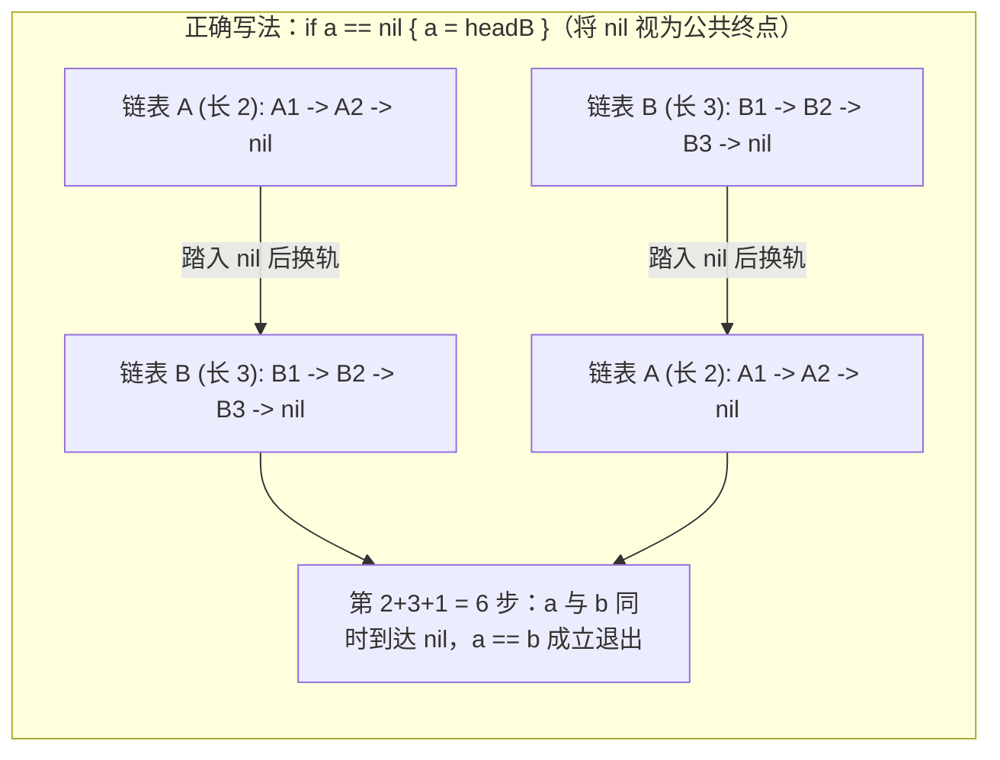

# 链表双指针实战：倒数第 N 个节点、相交链表与回文链表

**摘要：**

链表双指针的实战，考验的是"用指针的相对位置代替额外空间"这一能力。本文用三道题展开：**删除倒数第 N 个节点**（LC 19）讲"快指针先出发 K 步"与"哑节点抹平边界"；**相交链表**（LC 160）讲"等长对齐"的精妙技巧——**让两个指针走完各自的链后交换起点，从而"补齐长度差"**；**回文链表**（LC 234）讲"找中点 + 反转后半 + 比较"的三步组合。三题的共同点是：**用"指针的相对位置/节奏"代替"先求长度再对齐"或"额外存储"。** 全文用 Go 语言实现，并逐层追问：哑节点为什么能抹平边界、相交链表的"交换起点"为什么正确、以及回文链表为什么需要"反转后半段"。

---

## 第 1 章 LeetCode 19：删除链表的倒数第 N 个节点

### 1.1 题目

**LeetCode 19 - Remove Nth Node From End of List**（中等）

给你一个链表，删除链表的倒数第 `n` 个节点，并返回链表的头节点。

```text
输入: head = [1,2,3,4,5], n = 2  →  [1,2,3,5]
```

### 1.2 思路：快指针先出发 N+1 步

**核心技巧是"让快指针先出发 $n+1$ 步"**——**这样"快指针到达末尾时，慢指针恰好指向'待删除节点的前一个'"**：

```go
func removeNthFromEnd(head *ListNode, n int) *ListNode {
    dummy := &ListNode{Next: head} // 哑节点
    fast, slow := dummy, dummy
    // fast 先走 n+1 步
    for i := 0; i <= n; i++ {
        fast = fast.Next
    }
    // fast、slow 同速前进，直到 fast 到达末尾
    for fast != nil {
        fast = fast.Next
        slow = slow.Next
    }
    // 此时 slow 指向"待删除节点的前一个"
    slow.Next = slow.Next.Next
    return dummy.Next
}
```

**复杂度**：时间 $O(n)$、空间 $O(1)$。

### 1.3 两个关键点

**关键点一，为什么先走 $n+1$ 步而非 $n$ 步？** **因为要让慢指针最终停在"待删除节点的前一个"**——删除需要"前驱节点"来改指针。**若先走 $n$ 步，慢指针会停在"待删除节点本身"，无法删除。**

**关键点二，哑节点 `dummy` 的作用**：**它让"删除头节点"这一边界情形无需特判。** 若删的是头节点（`n` 等于链表长度），没有 `dummy` 就需特判"`head = head.Next`"；有了 `dummy`，`slow` 停在 `dummy`、`dummy.Next = dummy.Next.Next` 即可。

**"哑节点抹平边界"是本专栏反复出现的手法**——**它把"需要分类讨论的边界"统一成了"无需讨论的通例"。**

> [!info] 核心概念：快指针"先出发"的通用性
> "快指针先出发 $K$ 步"是一个通用技巧——**它让"快指针到末尾时，慢指针落后 $K$ 步"，从而指向"倒数第 K 个（或其前驱）"。** **这与"环检测"的"相对速度"是同一思想的两种应用**——**都是"用指针的相对位置，代替'先求长度再对齐'"。**

### 1.4 手动验证 `[1,2,3,4,5]`、`n=2`

```text
dummy → 1 → 2 → 3 → 4 → 5

fast 先走 3 步（n+1=3）: fast = 3
然后同速:
  fast=4, slow=1
  fast=5, slow=2
  fast=nil, slow=3
slow 指向 3（待删除节点的前一个），slow.Next = slow.Next.Next → 删除 4
结果: [1,2,3,5] ✓
```

---

## 第 2 章 LeetCode 160：相交链表

### 2.1 题目

**LeetCode 160 - Intersection of Two Linked Lists**（简单）

给你两个单链表的头节点 `headA`、`headB`，找出并返回两个单链表相交的起始节点；若不相交，返回 `null`。

### 2.2 思路：交换起点，补齐长度差

**若两个链表等长，"同时前进、相遇处即交点"**——**但两链长度可能不同，怎么办？**

**精妙技巧是"交换起点"**：**让指针 `a` 走完链表 A 后，从链表 B 的头继续；指针 `b` 走完链表 B 后，从链表 A 的头继续。** **这样"两个指针走的总路程相同（都走了 `lenA + lenB`），从而在交点处相遇"。**

```go
func getIntersectionNode(headA, headB *ListNode) *ListNode {
    a, b := headA, headB
    for a != b {
        if a == nil {
            a = headB // 走完 A，从 B 的头继续
        } else {
            a = a.Next
        }
        if b == nil {
            b = headA // 走完 B，从 A 的头继续
        } else {
            b = b.Next
        }
    }
    return a // 相遇处即交点（或都为 nil，表示不相交）
}
```

**复杂度**：时间 $O(m+n)$、空间 $O(1)$。

### 2.3 为什么"交换起点"是正确的

**设链表 A 的非公共部分长为 $a$、链表 B 的非公共部分长为 $b$、公共部分长为 $c$。**

- 指针 `a` 走的路程：$a + c + b$（先走 A，再走 B 的"非公共 + 公共"）；
- 指针 `b` 走的路程：$b + c + a$（先走 B，再走 A 的"非公共 + 公共"）。

**两者路程相同（都是 $a + b + c$）**——**所以它们会"同时到达公共部分的起点"，即交点。**

**若不相交**（`c = 0`），两者会**同时到达 `nil`**，循环结束、返回 `nil`。

**"交换起点"的精妙，在于它"用两次遍历补齐了长度差"**——**无需先求长度、再对齐。**

### 2.4 与"先求长度再对齐"的对比

**另一种解法是"先分别求两链长度，算出长度差，让长链先走差值步，再同时前进"**——**它也需要 $O(m+n)$ 时间、$O(1)$ 空间，但代码更啰嗦。**

**"交换起点"的优势，是"代码更简洁"**——**它把"求长度差 + 对齐"这两步，压缩成了"一个循环 + 交换"。**

> [!info] 从"显式对齐"到"隐式对齐"
> "先求长度再对齐"是**显式对齐**——它明确算出长度差、让长链先走。"交换起点"是**隐式对齐**——它用"交换起点"自动补齐长度差。**两者复杂度相同，但后者更优雅。** **"用巧妙的结构代替显式的计算"，是算法优化的一个方向。**

---

## 第 3 章 LeetCode 234：回文链表

### 3.1 题目

**LeetCode 234 - Palindrome Linked List**（简单）

给你一个单链表的头节点 `head`，判断该链表是否为回文链表。

```text
输入: 1→2→2→1  →  true
输入: 1→2        →  false
```

### 3.2 思路：三步组合

**回文链表需要"从两端比较"，但单链表只能"单向访问"**——**解决办法是"三步组合"**：

1. **快慢指针找中点**；
2. **反转后半段**；
3. **从头与"反转后的后半段"逐个比较**。

```go
func isPalindrome(head *ListNode) bool {
    // 第一步：快慢指针找中点
    slow, fast := head, head
    for fast != nil && fast.Next != nil {
        slow = slow.Next
        fast = fast.Next.Next
    }
    // 第二步：反转后半段
    var prev *ListNode
    for slow != nil {
        next := slow.Next
        slow.Next = prev
        prev, slow = slow, next
    }
    // 第三步：比较
    left, right := head, prev
    for right != nil {
        if left.Val != right.Val {
            return false
        }
        left, right = left.Next, right.Next
    }
    return true
}
```

**复杂度**：时间 $O(n)$、空间 $O(1)$。

### 3.3 三步各自的理由

**第一步"找中点"**：**因为要"从中间向两端比较"，必须先知道中点在哪。** **快慢指针一次遍历就能找到中点。**

**第二步"反转后半段"**：**因为单链表不能"从后往前访问"，所以把后半段反转，让它"变成正向"。** **反转后，`prev` 就是"原链表的最后一个节点"。**

**第三步"比较"**：**从头与反转后的后半段逐个比较**——**注意循环条件是 `right != nil`（后半段），因为"后半段长度 ≤ 前半段"。** **奇数长度时，中间节点被 `right` 跳过（不影响回文判断）。**

**"三步组合"是回文链表的经典解法**——**它把"快慢指针"（第 05 篇）、"链表反转"（线性表专栏）与"对撞比较"（第 02 篇）三个技巧组合在了一起。**

### 3.4 为什么不用"转成数组"

**另一种解法是"把链表转成数组，再用对撞指针"**——**它代码更简单，但空间是 $O(n)$。**

**"三步组合"的优势正是 $O(1)$ 空间**——**它无需额外存储。** **在空间敏感场景下，$O(1)$ 的"三步组合"优于 $O(n)$ 的"转数组"。**

> [!info] 组合的力量：三个技巧，一道题
> 回文链表把三个技巧组合在了一起——**快慢指针（找中点）、链表反转（反转后半）、对撞比较（逐对比较）。** **它们各自都很简单，但组合起来解决了"单链表不能反向访问"这一难题。** **"把简单技巧组合成复杂解法"，是算法进阶的重要能力。**

---

## 第 4 章 三道题的对照与"链表双指针"的共性

### 4.1 对照

| 题目 | 核心技巧 | 关键 |
|------|---------|------|
| LC 19 倒数第 N | 快指针先出发 N+1 步 | 慢指针停在"前驱" |
| LC 160 相交链表 | 交换起点 | 补齐长度差 |
| LC 234 回文链表 | 找中点 + 反转 + 比较 | $O(1)$ 空间 |

**三题的共同点是"用指针的相对位置代替额外空间/计算"**——**快慢的"距离差"、相交的"路程差"、回文的"中点"，都是"用指针运动代替显式计算"。**

### 4.2 链表双指针的共性

**链表双指针的核心，是"用两个指针的相对位置，编码出'距离'或'位置'信息"**：

- **快指针先出发 K 步** → 编码"倒数第 K 个"；
- **交换起点** → 编码"长度差"；
- **快慢同速（找中点）** → 编码"中点"。

**"用指针运动编码位置信息"，是链表双指针的灵魂。**

### 4.3 一个可复用的判断

**遇到"链表位置"类问题，先问三句**：

1. **要找"正数第 K 个"还是"倒数第 K 个"？** 倒数用"先出发"；
2. **两个链表的长度可能不同吗？** 是则考虑"交换起点"；
3. **需要"从后往前"访问吗？** 是则"找中点 + 反转"。

**这三句，能定下链表双指针题的方案。**

---

## 第 5 章 常见误区与自测方法

### 5.1 四个高频误区

**误区一，LC 19 的快指针只走 `n` 步。** 应走 `n+1` 步（让慢指针停在"前驱"）。

**误区二，LC 19 忘了哑节点。** 删除头节点时会出错。

**误区三，LC 160 的交换起点写反。** `a` 走完应从 `headB` 继续，`b` 走完应从 `headA` 继续。

**误区四，LC 234 的比较循环用 `left != nil`。** 应用 `right != nil`（后半段）。

**误区五，在相交链表（LC 160）中将换轨条件写成 `if a.Next == nil { a = headB }` 而非 `if a == nil { a = headB }`。** 这是一个极其隐蔽的死循环重灾区：如果两条链表**根本不相交**，当 `a` 走到尾节点（`a.Next == nil`）时如果不让它先踏入 `nil` 而是直接跳到 `headB`，那么 `a` 和 `b` 永远都不会变成 `nil`；由于不相交的链表也没有公共节点能让 `a == b` 成立，两个指针就会在两条链表上永无休止地循环换轨下去。**只有允许 `a` 和 `b` 实实在在地走到末尾的 `nil` 节点（把 `nil` 当作两条链表在无穷远处的虚拟公共交点），才能保证在不相交时两人走满 $lenA + lenB$ 步后同时变为 `nil`（触发 `nil == nil` 优雅退出循环并返回 `nil`）**。



### 5.3 深度对比：链表双指针 vs 递归回溯栈（空间与可读性的权衡）

在面试中，有时面试官会问："除了双指针，删除倒数第 $N$ 个节点（LC 19）和判断回文链表（LC 234）能不能用**递归（Recursion）**写？递归与双指针相比有什么优劣？"

1. **递归解 LC 19（后序归途计数）**：递归一路深入到链表末尾 `nil`，在函数返回（归途）时维护一个从尾往头递增的计数器 `posFromEnd++`，当 `posFromEnd == n + 1` 时直接修改当前节点的 `Next = Next.Next`。
2. **递归解 LC 234（前序指针 + 后序归途比对）**：在外部维护一个从表头向右走的全局变量 `frontPtr = head`，同时利用递归调用栈走到链表最右端，在递归归途从右往左返回时，拿当前递归层的 `curNode.Val` 与 `frontPtr.Val` 比对，并令 `frontPtr = frontPtr.Next`。

虽然递归写法巧妙地借用了**系统调用栈（Call Stack）**充当"反向遍历器"，无需显式写快慢指针和链表反转，但它的空间复杂度退化到了 **$O(n)$**（当链表长达十万节点时会直接触发 Stack Overflow 崩溃），而且递归函数帧的压栈弹栈开销远高于寄存器内的指针跳转。因此，**在单链表上用快慢指针、定距指针与原地反转，本质上就是把原本需要 $O(n)$ 栈空间暂存的逆向位置信息，压缩编码进了两个指针的步差与链表自身的 `Next` 指针方向里**——这就是链表双指针不可替代的工程价值。

**误区六，在奇偶链表或分隔链表（LC 86、328）中拼接两条子链后，忘记将第二条子链的尾节点 `Next` 置为 `nil`。** 试想原链表的最后一个节点恰好属于第一条子链（被挂到了前半段末尾），那么原本指向它的倒数第二个节点（现已成为第二条子链的尾节点）其 `Next` 指针依然死死拽着那个已被搬去前半段的节点，一旦遍历拼接后的新链表就会立刻掉进死循环环路。因此在任何拆链重连操作中，**最后一条子链的 `tail.Next = nil` 收尾清零动作绝不可省略**。

**误区七，在 K 个一组翻转链表（LeetCode 25）中未先用探路指针确认剩余节点够不够 K 个就盲目边走边翻转。** 如果题目要求每 $k$ 个节点一组进行翻转、末尾不足 $k$ 个保持原样，正确的双指针范式是先让探路快指针 `end` 从上一组尾部 `prevGroupTail` 往前探 $k$ 步，若中途遇到 `nil` 则直接保持原样返回；只有确认凑齐了整组 $k$ 个节点，才把这一段截下来原地翻转并重新焊回主链，从而避免把最后不足 $k$ 个的尾巴误翻过来后还得二次翻转还原。

### 5.2 一套自测用例

| 用例 | 检验什么 |
|------|---------|
| `[1]`, n=1 | 删除唯一节点 |
| `[1,2]`, n=2 | 删除头节点 |
| 不相交的链表 | 返回 `nil` |
| 相交于头节点 | 交点即头 |
| 奇/偶长度回文 | 中点处理 |

**其中"删除头节点"与"相交于头节点"最值得测**——它们专治"哑节点"与"交换起点"的边界。

---

## 第 6 章 深度拓展：链表双指针的进阶变形与工程还原纪律

### 6.1 回文链表（LC 234）的工业级追问：判断完毕后如何恢复原链表结构？

在第 3 章的 LeetCode 234 实现中，为了达到 $O(1)$ 额外空间，我们直接把原链表的后半段原地反转了。虽然这能顺利通过力扣判题，但在真实的生产环境或严苛的现场面试中，面试官几乎一定会追问：**"一个只读的判断函数 `isPalindrome(head)`，在返回布尔值之后居然把调用方传进来的链表后半截给扭断反转了，这在工程上属于严重的副作用（Side Effect）与并发灾难。如何在保持 $O(1)$ 空间的前提下，在函数返回前把链表恢复原状？"**

要做到"雁过无痕"，我们需要注意两个细节：
1. **找中点时让 `slow` 停在前半段的尾节点（初始化 `slow, fast := head, head.Next`）**：这样 `slow.Next` 就是后半段的起点，把后半段反转得到 `secondHalfHead`；
2. **比对完成后，无论结果是 `true` 还是 `false`，都对 `secondHalfHead` 再执行一次原地反转**，并将还原后的后半段重新挂回 `slow.Next = reverseList(secondHalfHead)`，最后再返回布尔结果：

```go
package main

// isPalindromeRestore 工业级无副作用回文链表判定：比对完成后原地还原链表拓扑
// 时间复杂度：O(n)，额外空间复杂度：O(1)
func isPalindromeRestore(head *ListNode) bool {
	if head == nil || head.Next == nil {
		return true
	}

	// 1. 锁定前半段尾节点 firstHalfEnd
	slow, fast := head, head.Next
	for fast != nil && fast.Next != nil {
		slow = slow.Next
		fast = fast.Next.Next
	}
	firstHalfEnd := slow

	reverseList := func(node *ListNode) *ListNode {
		var prev *ListNode
		for node != nil {
			next := node.Next
			node.Next = prev
			prev = node
			node = next
		}
		return prev
	}

	// 2. 反转后半段
	secondHalfStart := reverseList(firstHalfEnd.Next)

	// 3. 双指针比对前半段与反转后的后半段
	p1, p2 := head, secondHalfStart
	palindrome := true
	for p2 != nil {
		if p1.Val != p2.Val {
			palindrome = false
			break
		}
		p1 = p1.Next
		p2 = p2.Next
	}

	// 4. 关键：无论是否回文，都将后半段二次反转并接回原链表，消除副作用
	firstHalfEnd.Next = reverseList(secondHalfStart)
	return palindrome
}
```

### 6.2 相交链表（LC 160）的同构升维：二叉树的最近公共祖先 III（LeetCode 1650）

第 2 章中相交链表（LC 160）那段不到 15 行的"走完自己走对方（$a + c + b = b + c + a$）"代码，常被誉为链表题中最具浪漫色彩的写法。但很少有人意识到，**这道题与带有父指针 `Parent` 的二叉树求最近公共祖先（LeetCode 1650：二叉树的最近公共祖先 III）在数学上是 100% 同构的同一个问题**。

试想：在一棵二叉树中，每个节点除了 `Left` 和 `Right`，还有一个指向父节点的指针 `Parent *Node`。给定两个节点 `p` 和 `q`，求它们的最近公共祖先（LCA）。
如果你把根节点 `root` 看作链表的末尾 `nil`，把顺着 `Parent` 指针向上走看作顺着单链表的 `Next` 指针向后走，那么从 `p` 到 `root` 的路径就是链表 A，从 `q` 到 `root` 的路径就是链表 B，而**它们的最近公共祖先，分毫不差就是这两条单链表第一次相交的起始节点**。

因此，根本不需要用哈希表存 `p` 的祖先集合（耗费 $O(h)$ 空间），也不需要先分别走到根算出深度差，直接把 LC 160 的"交换起点双指针"原封不动搬过来，6 行代码就能以 $O(h)$ 时间、**严格 $O(1)$ 空间**拿下：

```go
package main

type TreeNodeWithParent struct {
	Val    int
	Left   *TreeNodeWithParent
	Right  *TreeNodeWithParent
	Parent *TreeNodeWithParent
}

// lowestCommonAncestorIII 将带父指针的 LCA 问题同构映射为相交链表（LC 160），空间严格 O(1)
func lowestCommonAncestorIII(p *TreeNodeWithParent, q *TreeNodeWithParent) *TreeNodeWithParent {
	a, b := p, q
	for a != b {
		if a == nil {
			a = q
		} else {
			a = a.Parent
		}
		if b == nil {
			b = p
		} else {
			b = b.Parent
		}
	}
	return a
}
```

### 6.3 延伸实战一：旋转链表（LeetCode 61）与交换链表中的节点（LeetCode 1721）

围绕第 1 章"定距双指针（快指针先走 $k$ 步）"的内核，面试中还有两道直接考察指针编码位置关系的变体题：

1. **LeetCode 1721：交换链表中的节点（Swapping Nodes in a Linked List）**：
   - 给你链表的头节点 `head` 和一个整数 `k`，交换链表**正数第 $k$ 个节点**和**倒数第 $k$ 个节点**的值后，返回链表的头节点（下标从 1 开始）。
   - 如何在**仅遍历链表一遍（One-Pass）**的情况下同时抓到正数第 $k$ 个节点 `first` 和倒数第 $k$ 个节点 `second`？
   - 让快指针 `fast` 从 `head` 出发先走 $k - 1$ 步，此时 `fast` 停下的位置就是**正数第 $k$ 个节点 `first`**；紧接着，让慢指针 `second` 从 `head` 出发，与 `fast` 同速往后走，直到 `fast.Next == nil`（`fast` 停在尾节点）——此时落后 $k - 1$ 步的 `second` 恰好停在**倒数第 $k$ 个节点**上，交换两者的值即可。

2. **LeetCode 61：旋转链表（Rotate List）**：
   - 给你一个链表的头节点 `head`，旋转链表，将链表每个节点向右移动 `k` 个位置。
   - 由于 `k` 可能高达 $2 \times 10^9$（远超链表长度 $n$），如果用快指针盲目先走 $k$ 步会空转超时。最稳健的手法是**先顺着链表走到尾节点 `tail` 算出长度 $n$（耗时 $O(n)$），顺手令 `tail.Next = head` 把单链表首尾相接闭合成一个环**，然后在环上从 `head` 往前走 $n - 1 - (k \bmod n)$ 步找到新的尾节点 `newTail`，令 `newHead := newTail.Next`、`newTail.Next = nil` 解环即可：

```go
package main

// swapNodes LeetCode 1721：单次遍历同时锁定正数第 k 个与倒数第 k 个节点
func swapNodes(head *ListNode, k int) *ListNode {
	fast := head
	for i := 1; i < k; i++ {
		fast = fast.Next
	}
	first := fast // 正数第 k 个节点

	second := head
	for fast.Next != nil {
		fast = fast.Next
		second = second.Next
	}
	// 此时 second 恰为倒数第 k 个节点
	first.Val, second.Val = second.Val, first.Val
	return head
}

// rotateRight LeetCode 61：首尾成环 + 定距断链实现链表右旋 k 步
func rotateRight(head *ListNode, k int) *ListNode {
	if head == nil || head.Next == nil || k == 0 {
		return head
	}

	// 1. 求链表长度 n 并定位于原尾节点 tail
	n := 1
	tail := head
	for tail.Next != nil {
		tail = tail.Next
		n++
	}
	k %= n
	if k == 0 {
		return head
	}

	// 2. 首尾相连成环，再走 n - k 步找到新尾节点断环
	tail.Next = head
	newTail := tail
	for steps := n - k; steps > 0; steps-- {
		newTail = newTail.Next
	}
	newHead := newTail.Next
	newTail.Next = nil
	return newHead
}
```

### 6.4 终极脑洞追问：如果两条相交链表自身还可能带环，还能找交点吗？

在面试大厂资深岗时，面试官有时会在 LC 160（相交链表）和 LC 142（环形链表 II）的基础上合体出一道压轴题：**"给定两条单链表 `headA` 和 `headB`，它们各自可能无环、也可能有环，且可能相交。请判断它们是否相交，若相交则返回第一个公共节点。"**

这道题看似复杂，实则只需先对 `headA` 和 `headB` 分别调用上一篇的 `detectCycle` 求出各自的入环节点 `loopA` 和 `loopB`，然后按三种拓扑情况彻底分治：
1. **情况一（`loopA == nil && loopB == nil`）**：两条都是无环链表，直接调用本章第 2 章的 `getIntersectionNode(headA, headB)` 即可；
2. **情况二（其中一个为 `nil`，另一个非 `nil`）**：一条无环、一条有环。由于单链表每个节点只有一个 `Next` 指针，一旦相交后后续路径必然完全重合，不可能一条进环另一条走去 `nil`，因此**必然不相交，直接返回 `nil`**；
3. **情况三（`loopA != nil && loopB != nil`）**：两条都有环。这又细分为两个子情况：
   - **子情况 3a（`loopA == loopB`）**：两条链表在进入环路**之前**就已经相交了（共享同一个环入口 `loopA`）。此时只需把 `loopA` 当作虚拟的末尾 `nil`，在前缀段 `[headA .. loopA)` 与 `[headB .. loopB)` 上运行 LC 160 的交换起点双指针，即可找到环外的首个交点；
   - **子情况 3b（`loopA != loopB`）**：让一个游标从 `loopA.Next` 出发绕环走一圈回到 `loopA`。如果在绕环途中撞见了 `loopB`，说明两条链表是从**环上的不同入口**汇入同一个环的，此时返回 `loopA` 或 `loopB` 均是合法的首个公共节点；如果绕完一整圈都没见到 `loopB`，说明它们是两个各自独立的分离环，返回 `nil`。

这套分类讨论将第 05 篇与第 06 篇的全部链表双指针技术熔于一炉，也是检验链表拓扑功底的终极试金石。

### 6.5 进阶实战二：删除排序链表中的重复元素 I & II——前驱哨兵与探路游标（LeetCode 83 & 82）

在链表同向双指针中，除了"定距先后出发"，还有一类极其高频的题型是**"前驱守卫指针 `prev` + 探路快指针 `cur`"**，最典型的代表就是链表去重双子星：
- **LeetCode 83（删除排序链表中的重复元素 I）**：遇到重复值时**保留其中 1 个**（如 `1 -> 1 -> 2` 变为 `1 -> 2`）。此时无需哑节点（因为表头第 1 个节点至少会被保留下来），只需让 `cur` 从 `head` 出发，只要 `cur.Val == cur.Next.Val` 就执行 `cur.Next = cur.Next.Next` 跳过后继；
- **LeetCode 82（删除排序链表中的重复元素 II）**：遇到重复值时**将所有等于该值的节点连根拔起、一个不留**（如 `1 -> 1 -> 2 -> 3 -> 3` 变为 `2`）。
  - 为什么 LC 82 必须引入哨兵哑节点 `dummy`？因为表头节点 `head` 本身就可能是重复元素（如 `1 -> 1 -> 2`），随时面临被彻底抹除的命运；
  - 我们让前驱守卫指针 `prev` 站在 `dummy`（代表"目前已确认唯一保留区的尾节点"），探路观察窗看它的后两个节点 `prev.Next` 和 `prev.Next.Next`：
    - 若 `prev.Next.Val != prev.Next.Next.Val`：说明 `prev.Next` 是独一无二的清白节点，`prev` 放心向前迈一步 `prev = prev.Next`；
    - 若 `prev.Next.Val == prev.Next.Next.Val`：抓到了重复团伙的值 `dupVal := prev.Next.Val`。此时 **`prev` 一步都不准动**，用一个内层循环只要发现 `prev.Next != nil && prev.Next.Val == dupVal`，就不断执行 `prev.Next = prev.Next.Next`，直到把整个 `dupVal` 团伙全部摘除干净为止：

```go
package main

// deleteDuplicatesII LeetCode 82：哨兵前驱指针 prev + 团伙连续摘除，时间 O(n)，空间 O(1)
func deleteDuplicatesII(head *ListNode) *ListNode {
	var dummy ListNode
	dummy.Next = head
	prev := &dummy

	for prev.Next != nil && prev.Next.Next != nil {
		if prev.Next.Val == prev.Next.Next.Val {
			dupVal := prev.Next.Val
			// 将等于 dupVal 的整串连续节点从 prev.Next 处连根拔除，注意此时 prev 保持不动
			for prev.Next != nil && prev.Next.Val == dupVal {
				prev.Next = prev.Next.Next
			}
		} else {
			prev = prev.Next
		}
	}
	return dummy.Next
}
```

请特别留意 `if` 分支结束后**为什么 `prev` 不能往前走一步**：因为把 `1 -> 1` 拔干净之后，新接上来的 `prev.Next` 可能是另一伙重复元素 `2 -> 2`。如果冒然执行 `prev = prev.Next`，就会把第一个 `2` 误纳入已确认保留区，导致漏删。

### 6.6 进阶实战三：链表最大孪生和与分治反转对称访问（LeetCode 2130）

与回文链表（LC 234）共享同一套"快慢指针找中点 + 反转后半段 + 双指针同向扫描"骨架的，还有 **LeetCode 2130：链表最大孪生和（Maximum Twin Sum of a Linked List）**。在偶数长度 $n$ 的链表中，第 $i$ 个节点与第 $n - 1 - i$ 个节点互为"孪生节点"，求所有孪生节点和的最大值。

直接套用第 3 章的三步组合：
1. 快慢指针找到后半段起点 `slow`；
2. 原地反转后半段得到 `prev`；
3. 让 `p1 = head, p2 = prev` 同步走 $n / 2$ 步，用 `p1.Val + p2.Val` 更新最大值即可，时间 $O(n)$、额外空间严格 $O(1)$。

### 6.7 链表双指针全景模式速查表

将第 05 篇与本篇（第 06 篇）涵盖的全部九道链表双指针核心题归纳如下，你会发现链表上的所有双指针技巧不过是四个基本动作的排列组合：

| 模式分类 | 代表题目 | 双指针初始关系与运动规则 | 是否需要 `dummy` | 核心边界与防坑要点 |
|----------|----------|--------------------------|------------------|--------------------|
| 定距先行（Lag Pointer） | LC 19 删除倒数第 N 节点、LC 1721 交换节点 | `fast` 先走 $n+1$ 步，随后与 `slow` 同速 | LC 19 **必须**（防删头节点） | 删节点需停在前驱，故从 `dummy` 出发先走 $n+1$ 步 |
| 交叉换轨（Switch Track） | LC 160 相交链表、LC 1650 带父指针 LCA | `a, b` 走完本链后跳至对方表头，走满 $a+c+b$ 相遇 | 不需要 | 判空时必须是 `if a == nil { a = headB }` 而非 `a.Next == nil` |
| 快慢折半 + 反转 | LC 234 回文链表、LC 143 重排链表、LC 2130 孪生和 | `fast` 2 步、`slow` 1 步找中点，反转右半后双游标扫描 | 不需要 | 工程代码中只读判定后应再次反转恢复原链表结构 |
| 前驱守卫 + 探路跳重 | LC 82 删除重复元素 II、LC 203 移除链表元素 | `prev` 守住确认区尾部，探查 `prev.Next` 决定跳过或前进 | **必须**（头节点可能被删） | 拔除整串同值节点后 `prev` 必须留在原地继续审查新后继 |
| 首尾闭环 + 定距断链 | LC 61 旋转链表 | 先求长度 $n$ 并令 `tail.Next = head`，再走 $n - k\%n$ 步断环 | 不需要 | 务必先执行 `k %= n` 并在 `k == 0` 时提前返回 |

---

## 小结

本篇用三道题讲清了链表双指针的实战。**LC 19** 用"快指针先出发 $n+1$ 步"与"哑节点"；**LC 160** 用"交换起点"补齐长度差（$a+b+c$ 的等式）；**LC 234** 用"找中点 + 反转后半 + 比较"的三步组合。三题的共同点是**"用指针的相对位置，代替额外空间/显式计算"**。

贯穿全篇的核心认知有两条。其一，**"用指针运动编码位置信息"是链表双指针的灵魂**——距离差、路程差、中点，都是它的应用。其二，**"把简单技巧组合成复杂解法"是算法进阶的重要能力**——回文链表就是"快慢指针 + 反转 + 比较"的组合。**把这两条握住，你面对任何"链表位置/结构"的问题，都有了实现的起点。**

下一篇 [[07 滑动窗口基础：定长窗口与可变窗口的统一框架]] 将转入滑动窗口——定长窗口的"加一减一"维护与可变窗口的"扩张-收缩"状态机。

---

## 参考资料

1. LeetCode 19. Remove Nth Node From End of List. https://leetcode.cn/problems/remove-nth-node-from-end-of-list/
2. LeetCode 160. Intersection of Two Linked Lists. https://leetcode.cn/problems/intersection-of-two-linked-lists/
3. LeetCode 234. Palindrome Linked List. https://leetcode.cn/problems/palindrome-linked-list/
4. LeetCode 876. Middle of the Linked List. https://leetcode.cn/problems/middle-of-the-linked-list/

---

> [!note] 思考题
> 1. LC 19 的快指针为什么先走 $n+1$ 步而非 $n$ 步？
> 2. 哑节点在 LC 19 中解决了什么边界？若不使用会怎样？
> 3. LC 160 的"交换起点"为什么正确？请用 $a+b+c$ 说明。
> 4. 回文链表的"三步组合"分别是哪三步？各自解决了什么？
> 5. "用指针运动编码位置信息"——请举三个不同的例子。
