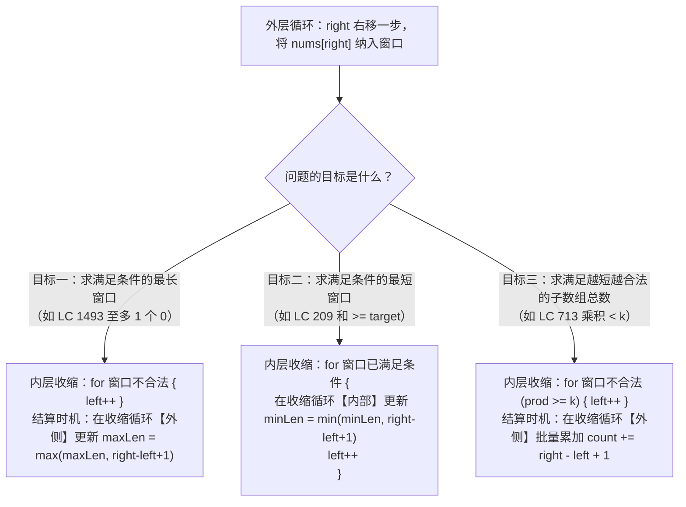

# 滑动窗口基础：定长窗口与可变窗口的统一框架

**摘要：**

滑动窗口是双指针里"处理连续子数组/子串"的主力。它只有两类——**定长窗口**（大小固定，每次"进一个、出一个"）与**可变窗口**（大小可变，右扩左缩）。本文用三道题讲清这两类窗口：**子数组最大平均数**（LC 643，定长）、**长度最小的子数组**（LC 209，可变）、**删掉一个元素以后全为 1 的最长子数组**（LC 1493，可变）。核心是**"加一减一"**（定长）与**"扩张-收缩"状态机**（可变）。文中用 Go 语言实现，并逐层追问：为什么滑动窗口比暴力快、`left` 为什么不需要回退、以及可变窗口的"收缩条件"为什么要写对方向。掌握本篇，你就掌握了滑动窗口的通用框架。

---

## 第 1 章 滑动窗口为什么比暴力快

### 1.1 暴力的 $O(n^2)$ 与窗口的 $O(n)$

**暴力枚举所有子数组需 $O(n^2)$**——因为起点与终点各有 $n$ 种选择。

**滑动窗口依赖一个关键单调性**：**当窗口右端固定时，满足条件的最短窗口的左端，随右端的增大而不减少（单调不减）。** **有了它，`left` 不需要每次从 0 出发，整个过程中只向右移动——总步数 $O(n)$。**

### 1.2 `left` 为什么不需要回退

**假设对某个 `right`，最优的 `left` 是 $l^*$。当 `right` 增大为 `right+1` 时，最优的 `left` 一定 $\ge l^*$（单调不减）。**

**证明（反证法）**：若 `right+1` 对应的最优 `left` 比 $l^*$ 更小（记为 `left' < l*`），那么 `[left', right]` 也满足条件（因为 `[left', right+1]` 满足，去掉右端仍满足），**且比 `[l*, right]` 更长**——**这与"$l^*$ 是 `right` 的最优（最短）左端"矛盾。**

**所以 `left` 单调不减，无需回退。** **这是滑动窗口 $O(n)$ 的根本原因。**

> [!info] 核心概念：单调性是滑动窗口的"许可证"
> 滑动窗口能 $O(n)$，靠的是"**`left` 单调不减**"这一性质。**而它成立的依据，是"窗口满足条件的性质对'扩张/收缩'是单调的"**——如"和 ≥ target"（元素为正时，加元素和增大、减元素和减小）。**一旦这个单调性被破坏（如数组含负数），滑动窗口就失效**（详见第 5 章）。

---

## 第 2 章 定长窗口：加一减一

### 2.1 LeetCode 643：子数组最大平均数 I

**题目**：给一个整数数组和一个整数 $k$，找出"平均数最大"且长度为 $k$ 的连续子数组，返回其最大平均数。

**定长窗口的思路是"维护窗口的和，每次'进一个、出一个'"**：

```go
func findMaxAverage(nums []int, k int) float64 {
    sum := 0
    for i := 0; i < k; i++ {
        sum += nums[i] // 初始化第一个窗口
    }
    maxSum := sum
    for i := k; i < len(nums); i++ {
        sum += nums[i] - nums[i-k] // 进 nums[i]，出 nums[i-k]
        if sum > maxSum {
            maxSum = sum
        }
    }
    return float64(maxSum) / float64(k)
}
```

**复杂度**：时间 $O(n)$、空间 $O(1)$。

### 2.2 定长窗口的"加一减一"

**定长窗口的关键是"维护窗口的统计量"**——**每次窗口右移一格，就"加一个新元素、减一个旧元素"**：

```text
窗口 [i-k+1, i] → 右移一格 → [i-k+2, i+1]
加 nums[i+1]，减 nums[i-k+1]
```

**"加一减一"是定长窗口的灵魂**——**它让"每次更新窗口统计量"只需 $O(1)$，而非"重新计算整个窗口"的 $O(k)$。** **正是这一点，把"枚举所有窗口"的 $O(nk)$ 降到了 $O(n)$。**

**"加一减一"适用于任何"可增量维护的统计量"**——和、平均值、频次等。**但"最大值/最小值"不能直接加一减一**（减去最大值后不知道新的最大值），需用"单调队列"（第 07 篇）。

> [!note] "加一减一"的适用边界
> 定长窗口的"加一减一"，适用于"**可增量维护**"的统计量——**和、乘积（非零）、频次等。** **但"最大值/最小值"不行**——因为"减去一个数后，你不知道剩下的最大值是谁"。**这类统计量需要"单调队列"**（滑动窗口最大值，LC 239）。

---

## 第 3 章 可变窗口：扩张-收缩状态机

### 3.1 LeetCode 209：长度最小的子数组

**题目**：给一个正整数数组和一个正整数 `target`，找出"和 ≥ target"的长度最小的连续子数组，返回其长度；不存在则返回 0。

**可变窗口的思路是"右扩左缩"**：

```go
func minSubArrayLen(target int, nums []int) int {
    left, sum := 0, 0
    ans := math.MaxInt32

    for right := 0; right < len(nums); right++ {
        sum += nums[right] // 1. 扩张
        for sum >= target { // 2. 收缩（当窗口满足条件）
            if right-left+1 < ans {
                ans = right - left + 1 // 更新答案
            }
            sum -= nums[left] // 移出左端
            left++
        }
    }
    if ans == math.MaxInt32 {
        return 0
    }
    return ans
}
```

**复杂度**：时间 $O(n)$（`right` 与 `left` 各移动 $n$ 次）、空间 $O(1)$。

### 3.2 状态机：扩张与收缩

**可变窗口的代码逻辑，可以用一个状态机描述**：

```text
right 移动（扩张）：将 nums[right] 加入窗口，更新统计量
    → 检查窗口是否满足条件
    → 若满足，尝试收缩 left（找最小满足窗口）
    → 若不满足，继续扩张 right

left 移动（收缩）：将 nums[left] 移出窗口，更新统计量
    → 重复检查条件
```

**理解了这个状态机，可变窗口的代码就变得机械化**：确定"满足条件"是什么、确定如何维护统计量，代码自然就出来了。

### 3.3 收缩条件的"方向"必须写对

**可变窗口最易错的地方，是"收缩条件的方向"**：

- **求"最短满足窗口"**：当窗口**满足条件**时收缩（`while sum >= target`）；
- **求"最长满足窗口"**：当窗口**不满足条件**时收缩（`while !valid`）。

**这两个方向相反**——**求最短是"满足就收缩"（贪心地缩小），求最长是"不满足才收缩"（贪心地保留）。** **搞混了，代码逻辑就完全错了。**

**"收缩条件的方向，取决于'求最短还是最长'"**——**这是可变窗口的第一条纪律。**

> [!warning] 生产避坑：收缩条件写反是最常见错误
> "求最短"与"求最长"的收缩条件方向相反——**求最短用 `while 满足条件`（满足就收缩），求最长用 `while 不满足条件`（不满足才收缩）。** **很多人凭感觉写，结果"最短"写成"最长"。** **动笔前先明确"求最短还是最长"，再确定收缩条件。**

---

## 第 4 章 LeetCode 1493：删掉一个元素以后全为 1 的最长子数组

### 4.1 题目

**LeetCode 1493**（中等）

给你一个二进制数组 `nums`，你可以从中删掉一个元素。请返回"删掉一个元素以后，最长的且只包含 1 的非空子数组"的长度。

```text
输入: [1,1,0,1]  →  3（删掉 0，得到 [1,1,1]）
```

### 4.2 思路：窗口内"至多一个 0"

**把"删掉一个元素"转化为"窗口内至多一个 0"**——**于是求"最长且 0 的个数 ≤ 1 的窗口"**：

```go
func longestSubarray(nums []int) int {
    left, zeroCount := 0, 0
    ans := 0

    for right := 0; right < len(nums); right++ {
        if nums[right] == 0 {
            zeroCount++ // 扩张，可能引入 0
        }
        for zeroCount > 1 { // 不满足条件（0 太多），收缩
            if nums[left] == 0 {
                zeroCount--
            }
            left++
        }
        if right-left > ans { // 注意：长度是 right-left（因为要"删掉一个"）
            ans = right - left
        }
    }
    return ans
}
```

**复杂度**：时间 $O(n)$、空间 $O(1)$。

### 4.3 两个关键点

**关键点一，"删掉一个元素"转化为"窗口内至多一个 0"。** **因为删掉的元素只能是 0（删 1 会让结果更短），所以"删掉一个 0 后全为 1"= "窗口内至多一个 0"。**

**关键点二，窗口长度是 `right - left` 而非 `right - left + 1`。** **因为"删掉了一个元素"，所以窗口的实际长度要减一。** **这个 `-1`，是本题最容易漏的细节。**

**"把'操作'转化为'约束'"是一个重要的建模技巧**——**"删掉一个元素"→"窗口内至多一个 0"，把"操作"变成了"约束"，从而套进滑动窗口框架。**

> [!info] 从"操作"到"约束"：一个建模技巧
> 很多题的"操作"（删掉、替换、翻转）都能转化为"约束"——**"删掉一个"→"至多一个 X"、"替换 K 个"→"至多 K 个不同"、"翻转 K 个"→"至多 K 个 0"。** **一旦转化为"约束"，就能套进滑动窗口框架。** **这是"把问题转化为已知框架"的一个典型例子。**

---

## 第 5 章 滑动窗口的失效边界

### 5.1 有负数时失效

**可变窗口的正确性，依赖"窗口内统计量对'扩张/收缩'单调"**——**如"和 ≥ target"要求"元素为正"（加元素和增大、减元素和减小）。**

**一旦有负数，缩小窗口后和可能反而增大，破坏了单调性，`left` 必须回退，算法退化为 $O(n^2)$。** **遇到"有负数的连续子数组求和"，必须改用"前缀和 + 哈希表"。**

### 5.2 定长与可变的统一视角

| 维度 | 定长窗口 | 可变窗口 |
|------|---------|---------|
| 大小 | 固定 $k$ | 可变 |
| 移动 | `right`、`left` 同步 | `right` 扩张、`left` 收缩 |
| 统计量维护 | 加一减一 | 扩张时加、收缩时减 |
| 适用 | "长度为 k 的..." | "最短/最长满足..." |

**两者共同点是"`right` 与 `left` 都只向右移动"**——**所以总操作次数是 $O(n)$。**

### 5.3 一个可复用的判断

**遇到"连续子数组/子串"类问题，先问三句**：

1. **窗口大小固定吗？** 固定用定长（加一减一），可变用扩张-收缩；
2. **求最短还是最长？** 决定"收缩条件的方向"；
3. **统计量可增量维护吗？** 和/频次可以；最大/最小需单调队列。

**这三句，能定下滑动窗口题的方案。**

---

## 第 6 章 常见误区与自测方法

### 6.1 四个高频误区

**误区一，收缩条件写反。** 求最短是"满足就收缩"，求最长是"不满足才收缩"。

**误区二，定长窗口忘了"加一减一"的初值。** 要先初始化第一个窗口。

**误区三，LC 1493 的长度忘了减一。** 应 `right - left`。

**误区四，数组含负数时仍用滑动窗口。** 单调性失效。

**误区五，在求乘积小于 K 的子数组（LC 713）时，未特判 `k <= 1` 导致内层收缩越界 panic。** 当数组中全是正整数（$\ge 1$）而题目传入 `k = 0` 或 `k = 1` 时，任何非空子数组的乘积都至少为 `1`，不可能严格小于 `k`。如果不在函数入口处加 `if k <= 1 { return 0 }` 拦截，内层收缩循环 `for prod >= k` 就会把 `left` 一路加到 `right + 1`（甚至在 `right == n - 1` 时让 `left` 越界到 `n`），导致 `prod /= nums[left]` 触发数组下标越界或後續 `right - left + 1` 算出负数。因此写可变窗口时，务必审视"当连单元素窗口都不合法时，`left` 会不会跑过 `right`"。

### 6.2 一套自测用例

| 用例 | 检验什么 |
|------|---------|
| `nums=[1], k=1` | 单元素 |
| `target` 大于数组总和 | 无解（返回 0） |
| `[1,1,0,1]`（LC 1493） | 长度减一 |
| 全 0 / 全 1 | 极端 |
| 含负数的子数组和 | 滑动窗口失效 |

**其中"含负数的子数组和"最值得测**——它检验"是否误用了滑动窗口"。

---

## 第 7 章 深度拓展：从求最值窗口到子数组计数与可删除替换模型

### 7.1 可变滑动窗口的三大核心目标：求最短、求最长与求子数组个数

在第 3 章与第 4 章中，我们见识了可变滑动窗口的两种基本目标：**求满足条件的最短窗口**（LC 209）与**求满足条件的最长窗口**（LC 1493）。实际上，在面试中还有第三类极其高频的目标——**统计满足条件的连续子数组总个数**（如 **LeetCode 713：乘积小于 K 的子数组**）。

把这三类可变窗口放在一起对比，你会发现它们共用同一个外层 `for right := 0; right < n; right++` 扩张框架，唯一的区别在于**内层 `for` 收缩循环的条件**与**更新答案 `ans` 的时机位置**：



为什么要重点理解目标三（`count += right - left + 1`）？
以 **LeetCode 713：乘积小于 K 的子数组**为例：给你一个正整数数组 `nums` 和一个整数 `k`，请找出该数组内乘积严格小于 `k` 的连续子数组的个数。
- 因为数组中全是正整数（$\ge 1$），窗口扩大时乘积单调不减，窗口缩小时乘积单调不增，完美契合滑动窗口的单调性许可证；
- 当右端点固定在 `right`，且内层循环将 `left` 推进到第一个使得窗口 `nums[left .. right]` 的乘积严格小于 `k` 的位置时，请问：**以 `right` 作为右端点的合法连续子数组一共有多少个？**
- 既然最长的 `[left .. right]` 乘积都已经小于 `k` 了，那么它的任何后缀子数组 `[left+1 .. right]`、`[left+2 .. right]`、……直至单元素 `[right .. right]`，其乘积只会更小，必然全部合法。这些以 `right` 结尾、起点取遍 `[left, right]` 的子数组，不多不少正好有 **`right - left + 1` 个**。

```go
package main

// numSubarrayProductLessThanK LeetCode 713：可变窗口批量统计以 right 结尾的合法子数组个数
// 时间复杂度：O(n)，额外空间复杂度：O(1)
func numSubarrayProductLessThanK(nums []int, k int) int {
	if k <= 1 {
		return 0 // 正整数乘积最小为 1，不可能严格小于 1
	}

	left, prod, count := 0, 1, 0
	for right, v := range nums {
		prod *= v
		for prod >= k {
			prod /= nums[left]
			left++
		}
		// 此时 [left..right] 合法，则以 right 为右端点的 [left..right], [left+1..right]..[right..right]
		// 共 right - left + 1 个子数组全部合法
		count += right - left + 1
	}
	return count
}
```

### 7.2 "容忍 K 次异常"通用模板：最大连续 1 的个数 III（LeetCode 1004）与将 x 减到 0 的最小操作数（LeetCode 1658）

第 4 章的 LeetCode 1493（删掉一个元素后全为 1 的最长子数组）实质上是**"容忍至多 $K$ 次异常（At Most K Exceptions）"**模型在 $K = 1$ 时的特例。如果题目允许你把至多 $K$ 个 `0` 翻转为 `1`，求最长连续 `1` 的长度（**LeetCode 1004：最大连续 1 的个数 III**），只需把收缩条件 `for zeroCount > 1` 改为 **`for zeroCount > k`**，答案长度取 `right - left + 1` 即可。

更具迷惑性的是那些**表面上要求从数组两端做操作，实际上等价于在数组中间找一个滑动窗口**的"正难则反（逆向思维）"题——最典型的代表是 **LeetCode 1658：将 x 减到 0 的最小操作数**：
- **题目描述**：给你一个正整数数组 `nums` 和一个整数 `x`。每一次操作时，你应当移除数组 `nums` 最左边或最右边的元素，然后从 `x` 中减去该元素的值。请返回可以将 `x` 恰好减到 `0` 的**最小操作数**；若不能则返回 `-1`。
- **正难则反转化**：从数组两头摘除最少数量的元素使其和等于 `x`，等价于**在数组正中间留下一段最长的连续子数组（滑动窗口），使其元素之和恰好等于 `target = sum(nums) - x`**。
- 一旦完成这一步逆向转化，原本需要在两端枚举或记忆化搜索的问题，瞬间坍缩为最基础的正整数可变滑动窗口：设剩余总和目标为 `target = totalSum - x`，只要维护窗口和 `winSum`，当 `winSum > target` 时收缩 `left++`，每当遇到 `winSum == target` 时用 `n - (right - left + 1)` 更新最小操作数即可：

```go
package main

// minOperations LeetCode 1658：正难则反，将两端移除最少元素转化为中间保留和为 sum-x 的最长滑动窗口
// 时间复杂度：O(n)，额外空间复杂度：O(1)
func minOperations(nums []int, x int) int {
	total := 0
	for _, v := range nums {
		total += v
	}
	target := total - x
	if target < 0 {
		return -1 // 全数组加起来都不够减 x
	}
	if target == 0 {
		return len(nums) // 必须移除全部元素
	}

	maxWindowLen := -1
	left, winSum := 0, 0
	for right, v := range nums {
		winSum += v
		for winSum > target {
			winSum -= nums[left]
			left++
		}
		if winSum == target {
			if right-left+1 > maxWindowLen {
				maxWindowLen = right - left + 1
			}
		}
	}

	if maxWindowLen == -1 {
		return -1
	}
	return len(nums) - maxWindowLen
}
```

同样的"正难则反"滑动窗口转化，还直接解出了 **LeetCode 1423：可获得的最大点数**（从卡牌数组两端拿走 $k$ 张卡牌使点数最大 $\Longleftrightarrow$ 在中间留下长度为 $n - k$ 的定长滑动窗口使其点数之和最小）。

### 7.3 深度进阶：当数组包含负数时，为什么 LC 862 必须用"前缀和 + 单调双端队列"？

在第 5 章我们反复强调：一旦数组中包含**负数**，子数组和随窗口扩大不再单调，普通滑动窗口（如 LC 209 长度最小的子数组）立刻失效。

如果面试官把 LC 209 的数组改成**允许包含负数**，即 **LeetCode 862：和至少为 K 的最短子数组（Shortest Subarray with Sum at Least K）**，该如何修补被负数打破的单调性？

我们先把子数组和改写为前缀和之差：$S[r] - S[l] \ge K$（其中 $S[i]$ 表示前 $i$ 个元素之和）。对于当前右端点 $r$，我们想在左侧找一个最大的下标 $l < r$ 使得 $S[l] \le S[r] - K$。用**双端队列（Deque）**维护左侧候选起点下标 $l$，会发现两条惊人的剪枝淘汰法则：
1. **队首达标即弹出（对应普通滑窗的 `left++`）**：若队首下标 $l_0$ 已经满足 $S[r] - S[l_0] \ge K$，用 $r - l_0$ 更新最短长度后，**$l_0$ 可以直接从队首永久弹出**——因为后续的 $r' > r$ 就算也能跟 $l_0$ 配对，长度 $r' - l_0$ 也必定大于当前的 $r - l_0$，不可能更优；
2. **队尾劣质起点淘汰（专门克服负数带来的逆序）**：在将当前下标 $r$ 压入队尾前，如果队列末尾的某个旧起点 $l_{\text{tail}} < r$ 的前缀和居然大于等于当前前缀和（即 **$S[l_{\text{tail}}] \ge S[r]$**，这正是因为中间出现了负数），那么对于未来任何右端点 $r' > r$ 而言，用 $r$ 作左起点不仅**减去的数 $S[r]$ 更小（差值更大，更容易满足 $\ge K$）**，而且**下标 $r$ 更靠右（子数组长度更短）**。因此旧起点 $l_{\text{tail}}$ 被新起点 $r$ 在数值和位置上双重碾压，直接从队尾永久踢出，从而在双端队列内部人为重建了严格单调递增的秩序：

```go
package main

// shortestSubarray LeetCode 862：含负数的最短和 >= k 子数组（前缀和 + 单调递增双端队列）
// 时间复杂度：O(n)，空间复杂度：O(n)
func shortestSubarray(nums []int, k int) int {
	n := len(nums)
	prefix := make([]int64, n+1)
	for i, v := range nums {
		prefix[i+1] = prefix[i] + int64(v)
	}

	ans := n + 1
	deque := make([]int, 0, n+1) // 存放前缀和下标，保持 prefix[deque[i]] 严格单调递增

	for r := 0; r <= n; r++ {
		// 1. 队首达标结算并弹出：一旦满足 prefix[r] - prefix[l] >= k，l 的最短历史使命已完成
		for len(deque) > 0 && prefix[r]-prefix[deque[0]] >= int64(k) {
			if r-deque[0] < ans {
				ans = r - deque[0]
			}
			deque = deque[1:]
		}
		// 2. 队尾维护单调递增：因负数导致 prefix[r] <= 队尾时，队尾旧起点被双重支配，直接淘汰
		for len(deque) > 0 && prefix[deque[len(deque)-1]] >= prefix[r] {
			deque = deque[:len(deque)-1]
		}
		deque = append(deque, r)
	}

	if ans > n {
		return -1
	}
	return ans
}
```

把正数数组的 LC 209（双指针 $O(1)$ 空间）与含负数数组的 LC 862（前缀和 + 单调队列 $O(n)$ 空间）对照阅读，你就从根源上看懂了"为什么天然单调时只需两个整型指针，而单调性被负数破坏时必须用单调队列人工筛出单调子序列"。

### 7.4 进阶实战：定长滑动窗口的高频变体——定长子串元音数（LC 1456）与半径为 k 的子数组平均值（LC 2090）

回到第 2 章的定长窗口，在面试与笔试的热身题中，定长滑动窗口常以两种面貌考察候选人的代码整洁度与防溢出意识：

1. **LeetCode 1456：定长子串中元音的最大数目**：
   - 给你字符串 `s` 和整数 `k`，返回长度为 `k` 的单个子字符串中可能包含的最大元音字母数。
   - **单循环统一模板（免去单独写前 $k$ 个元素的初始化循环）**：很多人在写定长窗口时，习惯先写一个 `for i := 0; i < k; i++` 算第一个窗口，再写第二个 `for i := k; i < n; i++` 滑动。实际上，可以在同一个 `for right := 0; right < n; right++` 循环里完成：**先无脑把 `s[right]` 算进窗口；若 `right < k - 1`（窗口还没攒够 $k$ 个元素）则 `continue`；一旦 `right >= k - 1`，先更新答案 `ans`（若提前 achieved 满分 `ans == k` 可直接提前返回 `k`），再把左端点 `s[right - k + 1]` 移出窗口**。这套"入窗 $\to$ 满窗检查 $\to$ 更新答案 $\to$ 出窗"的四步单循环模板，能彻底杜绝两段循环复制粘贴带来的笔误。

2. **LeetCode 2090：半径为 k 的子数组平均值**：
   - 以每个下标 `i` 为中心、左右各取 `k` 个元素，构成总长度为 **`windowSize = 2*k + 1`** 的定长滑动窗口，求每个中心的整数平均值（不足 `2*k + 1` 个元素的边缘位置填 `-1`）。
   - 核心考点是将"中心下标 `center`"与"定长窗口右端点 `right`"对齐：**当窗口右端点走到 `right` 时，它对应的窗口中心恰为 `center = right - k`，窗口左端点恰为 `right - 2*k`**，且累加和必须使用 `int64` 防止 $10^5$ 个 $10^5$ 相加溢出：

```go
package main

// maxVowels LeetCode 1456：定长窗口"入窗-满窗更新-出窗"单循环标准模板
func maxVowels(s string, k int) int {
	isVowel := func(c byte) int {
		if c == 'a' || c == 'e' || c == 'i' || c == 'o' || c == 'u' {
			return 1
		}
		return 0
	}

	vowels, maxV := 0, 0
	for right := 0; right < len(s); right++ {
		// 1. 右端新元素入窗
		vowels += isVowel(s[right])
		if right < k-1 {
			continue // 尚未攒满 k 个元素
		}
		// 2. 满窗更新答案
		if vowels > maxV {
			maxV = vowels
			if maxV == k {
				return k // 已达理论上限 k，提前短路
			}
		}
		// 3. 左端最老元素 s[right-k+1] 出窗，为下一轮腾位置
		vowels -= isVowel(s[right-k+1])
	}
	return maxV
}

// getAverages LeetCode 2090：半径为 k（窗口长 2k+1）的定长窗口与 int64 防溢出
func getAverages(nums []int, k int) []int {
	n := len(nums)
	ans := make([]int, n)
	for i := range ans {
		ans[i] = -1
	}
	winSize := 2*k + 1
	if n < winSize {
		return ans
	}

	var sum int64
	for right := 0; right < n; right++ {
		sum += int64(nums[right])
		if right < winSize-1 {
			continue
		}
		ans[right-k] = int(sum / int64(winSize))
		sum -= int64(nums[right-winSize+1])
	}
	return ans
}
```

### 7.5 连续子数组求和 / 极值问题的四大武器选型总表

为什么同样是求"连续子数组"，有时候用定长窗口、有时候用可变窗口、有时候用前缀和 + 哈希表、有时候又要搬出前缀和 + 单调队列？我们将这四把武器的适用边界严格对比如下：

| 问题形态与输入特征 | 代表题目 | 窗口单调性是否成立 | 最优算法武器 | 时间 / 空间复杂度 |
|--------------------|----------|--------------------|--------------|-------------------|
| 窗口长度固定为 $k$，求最大和/均值/元音数 | LC 643、LC 1456、LC 2090 | 天然成立（宽度恒为 $k$） | 定长滑动窗口（入窗-更新-出窗） | $O(n)$ / $O(1)$ |
| **全为正数**，求和 $\ge target$ 的最短子数组或乘积 $< k$ 的个数 | LC 209、LC 713 | **成立**（元素为正，扩窗必增、缩窗必减） | 可变滑动窗口（右扩左缩双指针） | $O(n)$ / $O(1)$ |
| **含负数**，求和**恰好等于** $k$ 的子数组个数 | LC 560 和为 K 的子数组 | **不成立**（有负数，和可增可减） | 前缀和 + 哈希表统计 `prefix[r] - k` 频次 | $O(n)$ / $O(n)$ |
| **含负数**，求和**至少为** $k$ 的最短子数组 | LC 862 和至少为 K 的最短子数组 | **不成立**（有负数） | 前缀和 + 单调递增双端队列（淘汰劣质起点） | $O(n)$ / $O(n)$ |

### 7.6 进阶实战二：滑动窗口最大值与单调双端队列的寿命竞争（LeetCode 239）

在第 2.2 节中我们留了一个伏笔：定长窗口的"加一减一"能够 $O(1)$ 维护窗口的**和（Sum）**、**异或和（XOR）**与**频次（Frequency）**，因为这些运算都存在逆运算（加的逆是减，异或的逆是自身）；但如果我们要求定长窗口的**最大值（Maximum）**（**LeetCode 239：滑动窗口最大值**），"加一减一"为什么就彻底失灵了？

因为 $\max$ 运算**不可逆**：当窗口右移把左端元素 `nums[i-k]` 移出窗口时，即使你知道移出去的恰好是刚才的最大值，你也完全不知道窗口里剩下的 $k - 1$ 个元素中"第二大"的是谁。如果每次重扫窗口找最大值，耗时退化为 $O(nk)$；如果用平衡树或最大堆维护，耗时是 $O(n \log k)$。

怎么在严格的 **$O(n)$ 时间**内维护滑动窗口最大值？答案是维护一个**单调递减双端队列（Monotonic Decreasing Deque，队内存放元素下标）**，它的核心法则被形象地称为**"比你年轻（下标更靠右、在窗口里活得更久）还比你强（数值更大或相等），那你就永无出头之日"**：
1. **队尾淘汰老弱（维持单调递减）**：当右端新元素 `nums[right]` 进窗时，所有已经在队列里、且数值 `<= nums[right]` 的旧元素下标，由于它们比 `right` 更早过期出窗、数值又不如 `nums[right]` 大，在未来的任何窗口里都绝不可能成为最大值，直接从**队尾**依次永久踢出，随后将 `right` 压入队尾；
2. **队首过期驱逐（维持窗口宽度 $\le k$）**：检查队首的最大值下标 `deque[0]` 是否已经滑出窗口左界（即 `deque[0] < right - k + 1`），若是则从**队首**弹出；
3. **队首即当前窗口最大值**：当 `right >= k - 1` 时，`nums[deque[0]]` 永远就是当前窗口的最大值，查询耗时 $O(1)$，每个下标最多进队一次、出队一次，总时间严格 $O(n)$：

```go
package main

// maxSlidingWindow LeetCode 239：单调递减双端队列 O(n) 求定长滑动窗口最大值
func maxSlidingWindow(nums []int, k int) []int {
	n := len(nums)
	if n == 0 || k == 0 {
		return nil
	}
	res := make([]int, 0, n-k+1)
	deque := make([]int, 0, k) // 存储下标，对应元素值严格单调递减

	for right := 0; right < n; right++ {
		// 1. 队尾清理：淘汰所有比当前新元素 nums[right] 更小或相等的旧候选
		for len(deque) > 0 && nums[deque[len(deque)-1]] <= nums[right] {
			deque = deque[:len(deque)-1]
		}
		deque = append(deque, right)

		// 2. 队首清理：若队首最大值下标已滑出窗口左边界 right-k+1，将其驱逐
		if deque[0] < right-k+1 {
			deque = deque[1:]
		}

		// 3. 满窗记录答案：队首恒为当前窗口最大值
		if right >= k-1 {
			res = append(res, nums[deque[0]])
		}
	}
	return res
}
```

更进一步，在 **LeetCode 1438：绝对差不超过限制的最长连续子数组**（求窗口内最大值与最小值之差 $\le limit$ 的最长可变窗口）中，我们只需同时维护一个**单调递减双端队列 `maxQ`**（管窗口最大值）和一个**单调递增双端队列 `minQ`**（管窗口最小值）：每当 `nums[maxQ[0]] - nums[minQ[0]] > limit` 时，就收缩左指针 `left++`（若 `maxQ[0] < left` 或 `minQ[0] < left` 则同步弹出队首），即可将"可变滑动窗口"与"单调队列极值维护"合二为一，在 $O(n)$ 时间内解决。

---

## 小结

本篇用三道题讲清了滑动窗口的两类——**定长窗口**（加一减一，LC 643）与**可变窗口**（扩张-收缩，LC 209、1493）。核心是**"`left` 单调不减"**这一性质（它是 $O(n)$ 的根本原因）。而 LC 1493 则展示了"把'操作'转化为'约束'"这一建模技巧。

贯穿全篇的核心认知有两条。其一，**"收缩条件的方向取决于'求最短还是最长'"**——求最短"满足就收缩"，求最长"不满足才收缩"。其二，**滑动窗口依赖"统计量单调"**——有负数时失效，须改用前缀和。**把这两条握住，你面对任何"连续子数组"的问题，都能先判断"窗口固定吗、求最短还是最长"。**

下一篇 [[08 滑动窗口进阶：无重复字符与字符频次匹配]] 将进入"字符频次"类的滑动窗口——哈希表在窗口中的维护技巧与"至多 K 个不同字符"的抽象框架。

---

## 参考资料

1. LeetCode 643. Maximum Average Subarray I. https://leetcode.cn/problems/maximum-average-subarray-i/
2. LeetCode 209. Minimum Size Subarray Sum. https://leetcode.cn/problems/minimum-size-subarray-sum/
3. LeetCode 1493. Longest Subarray of 1's After Deleting One Element. https://leetcode.cn/problems/longest-subarray-of-1s-after-deleting-one-element/
4. LeetCode 239. Sliding Window Maximum. https://leetcode.cn/problems/sliding-window-maximum/

---

> [!note] 思考题
> 1. 滑动窗口为什么是 $O(n)$？请用"`left` 单调不减"说明。
> 2. 定长窗口的"加一减一"为什么能省时间？它适用于哪些统计量？
> 3. 求最短与求最长时，收缩条件的方向有何不同？为什么？
> 4. LC 1493 为什么窗口长度要减一？"删掉一个"是如何转化为"至多一个 0"的？
> 5. 滑动窗口在什么情况下失效？为什么此时该改用前缀和？
