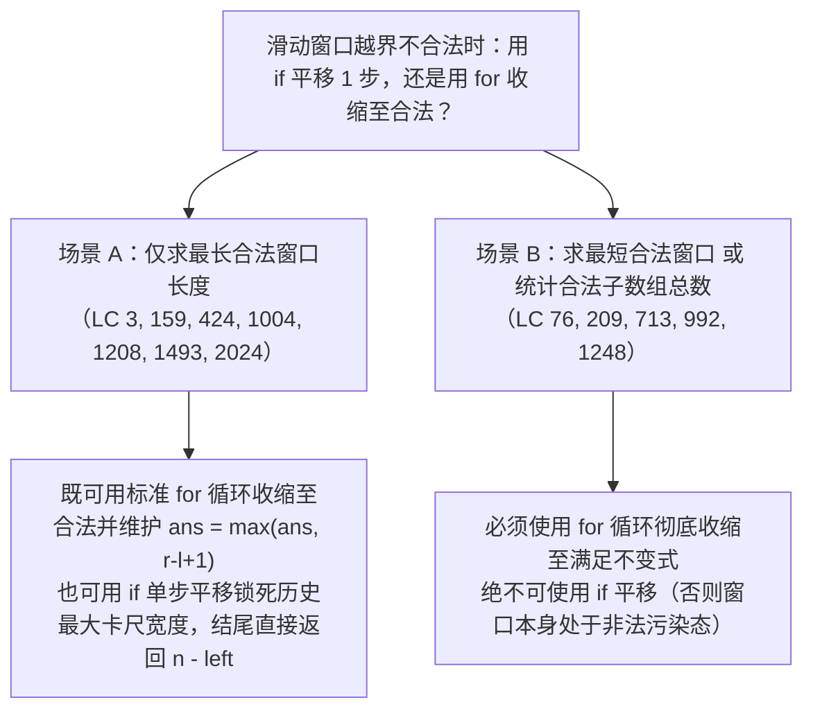

# 滑动窗口进阶：无重复字符与字符频次匹配

**摘要：**

当滑动窗口遇到"字符频次"约束时，核心问题变成"**如何维护窗口内的字符统计量**"。本文用三道题展开：**无重复字符的最长子串**（LC 3）讲"用'上次出现位置'记录，直接跳到重复字符之后"；**字符串的排列**（LC 567）讲"定长窗口 + 频次数组比较"；**至多包含两个不同字符的最长子串**（LC 159）讲"至多 K 个不同字符"这一抽象框架。三题的共同点是：**"窗口内的字符频次"是统计量，而"如何维护它"是核心。** 全文用 Go 语言实现，并逐层追问：为什么"记录上次位置"比"哈希集合 + 逐个删除"更优、定长窗口的频次比较为什么可以 $O(1)$、以及"至多 K 个不同"为什么是滑动窗口的通用模板。

---

## 第 1 章 LeetCode 3：无重复字符的最长子串

### 1.1 题目

**LeetCode 3 - Longest Substring Without Repeating Characters**（中等）

给定一个字符串 `s`，找出其中不含重复字符的**最长子串**的长度。

```text
输入: "abcabcbb"  →  3（"abc"）
输入: "bbbbb"     →  1（"b"）
输入: "pwwkew"    →  3（"wke"）
```

### 1.2 思路一：哈希集合 + 逐个删除

**最直观的做法是"用哈希集合记录窗口内的字符，遇重复就收缩"**：

```go
func lengthOfLongestSubstringSet(s string) int {
    window := map[byte]bool{}
    left, ans := 0, 0
    for right := 0; right < len(s); right++ {
        for window[s[right]] { // 重复了，收缩
            delete(window, s[left])
            left++
        }
        window[s[right]] = true
        if right-left+1 > ans {
            ans = right - left + 1
        }
    }
    return ans
}
```

**复杂度**：时间 $O(n)$、空间 $O(|\Sigma|)$。**注意内层 `for` 虽然看着像双层循环，但 `left` 总共只移动 $n$ 次，所以总复杂度仍是 $O(n)$。**

### 1.3 思路二：记录"上次出现位置"，直接跳

**更优的做法是"用数组记录每个字符'上次出现的位置'，遇重复就'直接跳到重复字符之后'"**：

```go
func lengthOfLongestSubstring(s string) int {
    last := [128]int{} // 记录字符上次出现的位置
    for i := range last {
        last[i] = -1 // -1 表示未出现
    }
    left, ans := 0, 0
    for right := 0; right < len(s); right++ {
        c := s[right]
        if last[c] >= left {
            left = last[c] + 1 // 直接跳到重复字符之后
        }
        last[c] = right
        if right-left+1 > ans {
            ans = right - left + 1
        }
    }
    return ans
}
```

**复杂度**：时间 $O(n)$、空间 $O(|\Sigma|)$（`|\Sigma|` 是字符集大小，这里 128）。

### 1.4 为什么"记录上次位置"更优

**思路一是"逐个收缩"**——遇到重复字符时，`left` 一格一格地右移，直到"重复的字符被移出窗口"。**思路二是"直接跳"**——它记录了"重复字符上次出现的位置"，直接让 `left` 跳到"那个位置 + 1"。

**"直接跳"省去了"逐个收缩"的循环**——**虽然两者都是 $O(n)$，但"直接跳"的常数更小、代码更简洁。**

**注意 `if last[c] >= left` 这一判断**——**它保证"只有当重复字符在'当前窗口内'时，才跳。** **若重复字符在"窗口外"（`last[c] < left`），则不影响当前窗口，无需跳。**

> [!info] 核心概念：用"位置信息"代替"集合删除"
> 思路一用"哈希集合"记录"窗口内有哪些字符"，遇重复就"逐个删除"；思路二用"数组"记录"每个字符上次出现的位置"，遇重复就"直接跳"。**两者的区别，是"用集合维护窗口"还是"用位置信息跳过"。** **后者更快，因为它把"逐个删除"变成了"一次跳转"。** **"用位置信息代替集合操作"，是滑动窗口优化的一个方向。**

### 1.5 手动验证 `"abcabcbb"`

```text
right=0('a'): last['a']=-1 < left=0 → left 不变；last['a']=0；窗口 "a"，ans=1
right=1('b'): last['b']=-1 → last['b']=1；窗口 "ab"，ans=2
right=2('c'): 窗口 "abc"，ans=3
right=3('a'): last['a']=0 >= left=0 → left=1；last['a']=3；窗口 "bca"，ans=3
right=4('b'): last['b']=1 >= left=1 → left=2；窗口 "cab"，ans=3
right=5('c'): last['c']=2 >= left=2 → left=3；窗口 "abc"，ans=3
right=6('b'): last['b']=4 >= left=3 → left=5；窗口 "cb"，ans=3
right=7('b'): last['b']=6 >= left=5 → left=7；窗口 "b"，ans=3

答案: 3 ✓
```

---

## 第 2 章 LeetCode 567：字符串的排列

### 2.1 题目

**LeetCode 567 - Permutation in String**（中等）

给你两个字符串 `s1`、`s2`，判断 `s2` 是否包含 `s1` 的某个排列（即"`s2` 的某个子串是 `s1` 的异位词"）。

```text
输入: s1 = "ab", s2 = "eidbaooo"  →  true（"ba" 是 "ab" 的排列）
```

### 2.2 思路：定长窗口 + 频次数组比较

**"`s1` 的排列"= "与 `s1` 字符频次相同的字符串"**——**于是问题变成"`s2` 中是否存在长度 $|s1|$、且频次与 `s1` 相同的窗口"**：

```go
func checkInclusion(s1, s2 string) bool {
    if len(s1) > len(s2) {
        return false
    }
    var need, window [26]int
    for i := 0; i < len(s1); i++ {
        need[s1[i]-'a']++
    }
    for i := 0; i < len(s2); i++ {
        window[s2[i]-'a']++ // 进
        if i >= len(s1) {
            window[s2[i-len(s1)]-'a']-- // 出
        }
        if window == need { // 数组可直接比较
            return true
        }
    }
    return false
}
```

**复杂度**：时间 $O(|s1| + |s2| \cdot 26)$、空间 $O(26)$。

### 2.3 关键点

**关键点一，这是"定长窗口"**（大小为 $|s1|$）——**所以用"加一减一"维护频次。**

**关键点二，Go 里"数组可直接比较"**——**`window == need` 会逐元素比较两个 `[26]int`。** **这比"维护一个 `matches` 计数器"更简洁**（后者是 Java 等语言的常用写法）。

**关键点三，频次比较是 $O(26)$ 而非 $O(1)$**——**因为要逐元素比较 26 个位置。** **所以总复杂度是 $O(|s2| \cdot 26)$。** **若要优化到 $O(|s2|)$，可以维护"有多少个字符的频次已匹配"这一计数器。**

> [!note] 数组比较 vs 计数器
> Go 的数组可以直接 `==` 比较，所以"频次数组比较"写起来很简洁。**但它每次比较是 $O(26)$。** **若要严格 $O(1)$ 比较，可以维护一个 `matches` 计数器——"有多少个字符的频次已匹配"**，当 `matches == 26` 时即相等。**这是"用额外状态换比较速度"的典型优化。**

---

## 第 3 章 LeetCode 159：至多包含两个不同字符的最长子串

### 3.1 题目

**LeetCode 159**（中等）

给定一个字符串 `s`，找出**至多包含两个不同字符**的最长子串的长度。

```text
输入: "eceba"  →  3（"ece"）
输入: "ccaabbb" →  5（"aabbb"）
```

### 3.2 思路：窗口内"不同字符数 ≤ K"

**它就是"至多 K 个不同字符"的模板**——**维护窗口内的"字符频次"，当"不同字符数 > K"时收缩**：

```go
func lengthOfLongestSubstringTwoDistinct(s string) int {
    count := map[byte]int{}
    left, ans := 0, 0
    for right := 0; right < len(s); right++ {
        count[s[right]]++ // 扩张
        for len(count) > 2 { // 不同字符超过 2，收缩
            count[s[left]]--
            if count[s[left]] == 0 {
                delete(count, s[left]) // 频次归零，删除键
            }
            left++
        }
        if right-left+1 > ans {
            ans = right - left + 1
        }
    }
    return ans
}
```

**复杂度**：时间 $O(n)$、空间 $O(1)$（`count` 最多 3 个键）。

### 3.3 "至多 K 个不同"的通用模板

**把上面的 `2` 换成 `K`，就是"至多 K 个不同字符"的通用模板**：

```go
for right := 0; right < len(s); right++ {
    count[s[right]]++
    for len(count) > K { // 不同字符超过 K，收缩
        count[s[left]]--
        if count[s[left]] == 0 {
            delete(count, s[left])
        }
        left++
    }
    ans = max(ans, right-left+1)
}
```

**"至多 K 个不同字符"是一族题**——**LC 159（K=2）、LC 340（K 个不同）、LC 992（恰好 K 个不同）** 都是它的变体。**掌握了这个模板，这一族题都能解决。**

**"恰好 K 个"可以用"至多 K 个"与"至多 K-1 个"作差得到**（LC 992）——**"恰好 = 至多 K − 至多 K-1"是一个通用技巧。**

> [!info] 从"一道题"到"一族题"
> "至多 K 个不同字符"是一族题——**LC 159（K=2）、LC 340（K 个）、LC 992（恰好 K 个）。** **它们共享同一个模板：维护窗口内频次，当'不同字符数 > K'时收缩。** **而"恰好 K 个"可以转化为"至多 K 个 − 至多 K-1 个"。** **理解了这一族，你面对"窗口内不同字符数"的问题，就有了通用解法。**

---

## 第 4 章 三道题的对照与"频次窗口"的共性

### 4.1 对照

| 题目 | 窗口类型 | 统计量 | 收缩条件 |
|------|---------|--------|---------|
| LC 3 无重复字符 | 可变 | 窗口内字符集合 | 出现重复 |
| LC 567 字符串的排列 | **定长** | 字符频次数组 | 无需收缩（固定大小） |
| LC 159 至多两个不同 | 可变 | 字符频次 | 不同字符数 > 2 |

**它们共同点是"统计量是'字符频次'"**——**区别只在"如何维护"与"何时收缩"。**

### 4.2 "频次窗口"的三种维护方式

- **哈希集合**（LC 3 思路一）：只记录"有哪些字符"，遇重复逐个删除；
- **位置数组**（LC 3 思路二）：记录"每个字符上次位置"，遇重复直接跳；
- **频次哈希表**（LC 159、567）：记录"每个字符的频次"，收缩时减一、归零则删键。

**三种方式的取舍**：**"位置数组"最快（直接跳），"频次哈希表"最通用（支持"不同字符数"约束），"哈希集合"最直观。**

### 4.3 一个可复用的判断

**遇到"字符频次窗口"类问题，先问三句**：

1. **窗口大小固定吗？** 固定用"加一减一"（LC 567）；
2. **约束是"无重复"还是"至多 K 个不同"？** 前者用"位置数组"，后者用"频次哈希表"；
3. **求最短还是最长？** 决定收缩条件方向。

**这三句，能定下字符频次窗口题的方案。**

---

## 第 5 章 常见误区与自测方法

### 5.1 四个高频误区

**误区一，LC 3 忘了 `last[c] >= left` 判断。** 会"跳到窗口外的位置"，导致 `left` 回退。

**误区二，LC 159 收缩时忘了"频次归零就删键"。** 否则 `len(count)` 永远不减小。

**误区三，LC 567 忘了"窗口大小固定为 `len(s1)`"。** 用成可变窗口。

**误区四，混淆"至多 K 个"与"恰好 K 个"。** 后者要用"作差"。

**误区五，在 Go 语言处理含中文字符（UTF-8 多字节 Rune）的字符串滑动窗口时，直接按字节下标 `s[right]` 切分导致乱码或计数错误。** 在 LeetCode 的英文字符题中，所有字符均属于单字节 ASCII（`0..127`），因此直接遍历字节下标 `for right := 0; right < len(s); right++` 并用 `[128]int` 数组寻址既快又准；但如果在生产业务或中文面试题中，输入字符串包含中文字符或 Emoji（在 UTF-8 编码下占 3 到 4 个字节），按 `byte` 滑动会把一个汉字劈成三截。此时应先将字符串转换为 `runes := []rune(s)`，再在 `runes` 切片上运行双指针 `left, right` 并配合 `map[rune]int` 维护频次或上次出现位置。

### 5.3 进阶实战二："至少包含 K 个"模型与后缀批量计数（LeetCode 1358 & 2962）

在第 6.2 节中我们学习了"**至多** $K$ 个"（每次固定 `right`，合法起点落在 `[left .. right]`，累加 `right - left + 1`）与"**恰好** $K$ 个"（两次至多作差）。滑动窗口计数家族还有第三位重要成员——求满足"**至少**包含条件 $C$"的子串/子数组个数：
- **代表题一（LeetCode 1358：包含所有三种字符的子字符串数目）**：给定只含 `'a', 'b', 'c'` 的字符串 `s`，返回 `'a', 'b', 'c'` **至少各出现一次**的子字符串数目；
- **代表题二（LeetCode 2962：统计最大元素出现至少 K 次的子数组）**：给定数组 `nums` 和整数 `k`，返回最大元素 `maxVal` 在其中出现**至少 $k$ 次**的子数组数目。

请你对比"至多（越短越合法）"与"至少（越长越合法）"在计数公式上的精妙对偶：
- 在"至多"型问题中，当 `[left .. right]` 合法时，往里缩的后缀 `[left .. right], [left+1 .. right] ... [right .. right]` 全部合法，累加的是 **`right - left + 1`**；
- 在"**至少**"型问题中，我们在内层循环的条件是 `for 窗口已经满足条件 { left++ }`。当内层循环退出的一瞬间，`[left .. right]` 刚刚变成**不满足**（差一口气），而往左退一步的 **`[left - 1 .. right]` 是以 `right` 结尾的最短合法窗口**。既然 `[left - 1 .. right]` 已经满足了"至少"条件，那么继续往左扩的所有前缀窗口 **`[0 .. right], [1 .. right], ..., [left - 1 .. right]`** 包含的元素更多，必然**全部满足条件**。这些合法左起点从下标 `0` 到 `left - 1`，不多不少正好有 **`left` 个**——因此外层每次只需一行 **`ans += left`** 即可完成批量统计：

```go
package main

// numberOfSubstrings LeetCode 1358："至少型"滑动窗口——当收缩至刚不满足时，0..left-1 共 left 个左起点全部合法
func numberOfSubstrings(s string) int {
	var cnt [3]int
	left, ans := 0, 0

	for right := 0; right < len(s); right++ {
		cnt[s[right]-'a']++
		// 只要 a, b, c 均至少有 1 个，就持续向右推进 left
		for cnt[0] > 0 && cnt[1] > 0 && cnt[2] > 0 {
			cnt[s[left]-'a']--
			left++
		}
		// 退出内层循环时，[left-1 .. right] 为最短合法窗口，
		// 故左端点取 0, 1, ..., left-1 共 left 个子串全部合法
		ans += left
	}
	return ans
}
```

把这三条计数公式并列在一起：
1. **越短越合法（至多型）**：内层把非法缩成合法，外层加 **`right - left + 1`**；
2. **越长越合法（至少型）**：内层把合法缩成刚非法，外层加 **`left`**；
3. **不长不短（恰好型）**：转化为两个至多型相减 `atMost(K) - atMost(K - 1)`（或两个至少型相减 `atLeast(K) - atLeast(K + 1)`）。

吃透这三句话，LeetCode 上所有的滑动窗口计数题在你面前都将变成填空题。

### 5.4 延伸补充：当"恰好型"与"至少型"共存于同一道题——元音辅音子串计数（LeetCode 3305 / 3306）

近年来周赛与大厂机试还出现了一类把"至少型"与"恰好型"揉进同一个窗口的复合题——**LeetCode 3306：元音辅音字符串计数 II**（求每个元音字母 `'a','e','i','o','u'` **至少**出现一次，且**恰好**包含 $k$ 个辅音字母的子字符串总数）。

如果直接硬解，你会发现元音要求"至少 1 次"（越长越合法），而辅音要求"恰好 $k$ 个"（既不能多也不能少），两个约束方向打架。但只要套用第 6.2 节的容斥转化，定义辅助函数 `countAtLeastKConsonants(s, k)` 表示"**五个元音至少各出现 1 次，且辅音字母至少出现 $k$ 个**的子串总数"——此时两个条件全都变成了清一色的"**至少（越长越合法）**"，直接用 5.3 节的 `ans += left` 模板一遍算出，最后返回 **`countAtLeastKConsonants(s, k) - countAtLeastKConsonants(s, k + 1)`** 即可将这道周赛压轴题化繁为简。此外，还有一种不拆函数的"三指针同向法"：同时维护两个左指针 `left1`（满足辅音数 $> k$ 时的临界左界）与 `left2`（满足辅音数 $\ge k$ 且五元音齐全时的临界左界），在每次 `right` 右移时累加 `left2 - left1`，本质上正是把两次 `countAtLeast` 的左游标合并到了同一次遍历之中，将空间开销从两份计数表进一步缩减为同一份窗口状态，在面试现场写完容斥双函数后主动提及三指针单遍扫描合一思路，能够充分展现对滑动窗口左界单调性的深刻理解并收获极高评价。

### 5.2 一套自测用例

| 用例 | 检验什么 |
|------|---------|
| `s = ""` | 空串 |
| `s = "aaaa"` | 全相同 |
| `s1` 长于 `s2`（LC 567） | 边界 |
| `"eceba"`（LC 159） | 常规 |
| 单字符重复 | `left` 跳转 |

**其中 `"aaaa"` 最值得测**——它检验"重复字符"的处理（`left` 应不断跳转）。

---

## 第 6 章 深度拓展：替换后的最长重复字符、"恰好 K 类"容斥转化与 $O(1)$ 频次差分

### 6.1 滑动窗口中的"历史最高频次"技巧：替换后的最长重复字符（LeetCode 424）

在字符频次滑动窗口中，有一道常令候选人卡壳的进阶名题——**LeetCode 424：替换后的最长重复字符（Longest Repeating Character Replacement）**。
**题目描述**：给你一个字符串 `s` 和一个整数 `k`。你可以选择字符串中的任一字符，并将其更改为任何其他大写英文字符，该操作最多可执行 `k` 次。在执行上述操作后，请返回包含相同字母的最长子字符串的长度。

对于当前窗口 `s[left .. right]`（总长度为 `winLen = right - left + 1`），我们要把窗口里的所有字符都涂成同一种颜色，最少需要替换几次？
显然，**保留窗口内出现次数最多的那个字符（设其频次为 `maxCount`），把其余所有异类字符全部替换掉**是最省操作次数的。因此，一个窗口合法的充要条件是：

$$\text{需要替换的异类字符数} = (right - left + 1) - maxCount \le k$$

一旦 `(right - left + 1) - maxCount > k`，说明异类字符超过了 $k$ 个，窗口不合法，必须令 `left++` 缩小窗口。

但这里有一个让无数人困惑的核心问题：**当 `left++` 把左端字符移出窗口、导致窗口内实际最高频次可能减小时，我们为什么不需要花 $O(26)$ 时间重新扫描频次数组去更新 `maxCount`，而是让 `maxCount` 保持历史最大值即可？**

这背后藏着一条极其精妙的单调性不变量：
- 我们的目标是寻找**比目前已知最长合法窗口还要更长**的新窗口；
- 假设在此前的某一步，我们曾见过一个最大频次为 $M$ 的合法窗口（其长度为 $L = M + k$）。要想在后续找到一个长度 $> L$ 的新合法窗口，新窗口里必须出现某个字符的频次**严格大于 $M$**（即打破历史记录 $maxCount$）；
- 只要还没有任何字符打破历史最高频次 $M$，那么即便当前窗口里的真实最高频次比 $M$ 小，由于我们在违反 `winLen - maxCount > k` 时每次只让 `left++` 与 `right++` **同步右移 1 格**，窗口宽度被死死卡在历史最大合法长度 $L$ 上（既不会错误地变得更大，也不会漏掉未来真正出现频次 $> M$ 时的扩张机会）。

```go
package main

// characterReplacement LeetCode 424：维护窗口内历史最高频次 maxCount，时间 O(n)，空间 O(1)
func characterReplacement(s string, k int) int {
	var count [26]int
	left, maxCount := 0, 0

	for right := 0; right < len(s); right++ {
		idx := s[right] - 'A'
		count[idx]++
		if count[idx] > maxCount {
			maxCount = count[idx] // 仅在新纳入字符刷新历史最高频次时更新
		}

		// 若当前窗口长度减去历史最高频次 > k，左边界同步右移一格（窗口平滑平移，不缩小历史最大宽度）
		if (right-left+1)-maxCount > k {
			count[s[left]-'A']--
			left++
		}
	}
	// 循环结束时，窗口宽度 right - left（即 len(s) - left）即为历史达到过的最大合法长度
	return len(s) - left
}
```

### 6.2 从"至多 K 种"到"恰好 K 种"的容斥减法：K 个不同整数的子数组（LeetCode 992）

在第 3 章（LeetCode 159 至多包含两个不同字符的最长子串，以及其同伴题 **LeetCode 904：水果成篮**）中，为什么"至多包含 $K$ 种不同元素"可以直接用单次滑动窗口解决，而一旦题目改成求**"恰好包含 $K$ 种不同整数的子数组个数"（LeetCode 992）**，单次双指针就会立刻失灵？

试想：当固定右端点 `right` 时，满足"至多 $K$ 种不同元素"的最左起点是唯一的 `left`（此时 `[left .. right]` 内任意后缀子数组的种类数都 $\le K$）；但满足"**恰好** $K$ 种不同元素"的左起点，却不是一个点，而是**一整段区间 `[leftMin .. leftMax]`**——单纯移动一个 `left` 指针根本无法同时框住这段区间的上下界。

破局的核武器是集合论中的**前缀差/容斥转化（Inclusion-Exclusion Reduction）**：
> **“恰好包含 $K$ 种不同元素”的子数组个数 $=$ “至多包含 $K$ 种不同元素”的子数组个数 $-$ “至多包含 $K - 1$ 种不同元素”的子数组个数。**

$$|\{\text{distinct} == K\}| = |\{\text{distinct} \le K\}| - |\{\text{distinct} \le K - 1\}|$$

这一减法公式把不具备单边界单调性的"恰好 $K$"，完美拆解成了两个具备严格单调性的"至多 $K$"与"至多 $K-1$"。我们只需写一个通用的 `atMostKDistinct(nums, k)` 函数（在收缩至 `distinct <= k` 后累加 `right - left + 1`），调用两次做差 `atMostK(nums, k) - atMostK(nums, k - 1)`，即可在 $O(n)$ 时间内秒杀这道困难题：

```go
package main

// subarraysWithKDistinct LeetCode 992：利用"恰好 K = 至多 K - 至多 K-1"攻克困难题
// 时间复杂度：O(n)，空间复杂度：O(n)
func subarraysWithKDistinct(nums []int, k int) int {
	return atMostKDistinct(nums, k) - atMostKDistinct(nums, k-1)
}

func atMostKDistinct(nums []int, k int) int {
	if k <= 0 {
		return 0
	}
	freq := make([]int, len(nums)+1) // 题目给定 1 <= nums[i] <= len(nums)，用切片代替 map 提速 5 倍
	left, distinct, total := 0, 0, 0

	for right, v := range nums {
		if freq[v] == 0 {
			distinct++
		}
		freq[v]++

		for distinct > k {
			lv := nums[left]
			freq[lv]--
			if freq[lv] == 0 {
				distinct--
			}
			left++
		}
		// 此时以 right 结尾、起点在 [left..right] 的所有子数组均满足种类数 <= k
		total += right - left + 1
	}
	return total
}
```

这套"`Exactly(K) = AtMost(K) - AtMost(K - 1)`"的转化公式是滑动窗口高阶题的万能钥匙，同样可以直接解出 **LeetCode 1248（统计「优美子数组」：恰好包含 $k$ 个奇数的子数组个数）** 与 **LeetCode 930（和相同的二元子数组：和恰好为 `goal` 的 `0/1` 子数组个数）**。

### 6.3 工程级优化：将 LC 567 的频次数组比较从 $O(|\Sigma| \cdot n)$ 压至严格 $O(n)$

在第 2 章的 LeetCode 567（字符串的排列）中，每次窗口移动后执行 `if window == need` 需要比对 26 个整型槽位，耗时 $O(|\Sigma|)$。如果字符集 $|\Sigma|$ 很大（譬如 Unicode 字符或大整数 ID），怎么把每次判断的开销压到严格的 **$O(1)$**？

只需维护一个**差分数组 `diff[26]int`**（表示窗口频次减去目标频次）和一个标量计数器 **`nonZeroDiff`**（记录当前有多少个字符的 `diff[c] != 0`）：
- 每当修改某个字符 `c` 的 `diff[c]` 时：若修改前 `diff[c] == 0` 则 `nonZeroDiff++`；若修改后 `diff[c] == 0` 则 `nonZeroDiff--`；
- 如此一来，每次窗口进出只需更新两次 `diff`，只要看到 **`nonZeroDiff == 0`**，就代表 26 个字符频次 100% 严丝合缝，单步判定严格 $O(1)$：

```go
package main

// checkInclusionO1 维护非零频次差计数器 nonZeroDiff，实现严格 O(|s1| + |s2|) 与字符集大小无关的匹配
func checkInclusionO1(s1, s2 string) bool {
	m, n := len(s1), len(s2)
	if m > n {
		return false
	}

	var diff [26]int
	for i := 0; i < m; i++ {
		diff[s1[i]-'a']--
		diff[s2[i]-'a']++
	}

	nonZero := 0
	for _, d := range diff {
		if d != 0 {
			nonZero++
		}
	}
	if nonZero == 0 {
		return true
	}

	for i := m; i < n; i++ {
		inChar, outChar := s2[i]-'a', s2[i-m]-'a'
		if inChar == outChar {
			continue // 进出字符相同，频次差毫无变化
		}
		if diff[inChar] == 0 {
			nonZero++
		}
		diff[inChar]++
		if diff[inChar] == 0 {
			nonZero--
		}

		if diff[outChar] == 0 {
			nonZero++
		}
		diff[outChar]--
		if diff[outChar] == 0 {
			nonZero--
		}

		if nonZero == 0 {
			return true
		}
	}
	return false
}
```

### 6.4 进阶实战一：尽可能使字符串相等（LeetCode 1208）与考试的最大困扰度（LeetCode 2024）

在第 6.1 节（替换后的最长重复字符 LC 424）的基础上，面试官常将其包装成更具业务气息的变形题：

1. **LeetCode 2024：考试的最大困扰度（Maximize the Confusion of an Exam）**：
   - 一位老师正在出一场由 $n$ 道判断题构成的考试，正确答案由字符串 `answerKey` 给出（仅含 `'T'` 和 `'F'`）。老师想最大化连续相同答案的长度，最多允许修改 `k` 次答案。
   - 这道题无需写两遍"把 `'F'` 改 `'T'`"和"把 `'T'` 改 `'F'`"的滑动窗口（即两次 LC 1004），它**直接就是字符集只有 `{'T', 'F'}` 两个字符的 LeetCode 424**——统计窗口内 `'T'` 的数量 `cntT` 和 `'F'` 的数量 `cntF`，只要较小者 **`min(cntT, cntF) > k`**（即异类字符数超过 $k$），就将左边界 `left++` 右移一格，一次遍历即可解决。

2. **LeetCode 1208：尽可能使字符串相等（Get Equal Substrings Within Budget）**：
   - 给你两个长度相同的字符串 `s` 和 `t`，将 `s[i]` 变为 `t[i]` 的开销为 ASCII 绝对差 `|s[i] - t[i]|`。在总预算不超过 `maxCost` 的前提下，求能够转化的最大连续子串长度。
   - 由于每个位置的开销 `cost[i] = abs(int(s[i]) - int(t[i]))` 必然是**非负整数**，窗口扩大时总开销单调不减，窗口缩小时总开销单调不增。直接维护窗口内累计开销 `curCost`，当 `curCost > maxCost` 时收缩 `left++`，在 $O(n)$ 时间、$O(1)$ 空间内直接得出最长长度：

```go
package main

// maxConsecutiveAnswers LeetCode 2024：同时追踪 T 和 F 的频次，异类字符数 min(cntT, cntF) > k 时平移窗口
func maxConsecutiveAnswers(answerKey string, k int) int {
	left, cntT, cntF := 0, 0, 0
	for right := 0; right < len(answerKey); right++ {
		if answerKey[right] == 'T' {
			cntT++
		} else {
			cntF++
		}
		if min(cntT, cntF) > k {
			if answerKey[left] == 'T' {
				cntT--
			} else {
				cntF--
			}
			left++
		}
	}
	return len(answerKey) - left
}

// equalSubstring LeetCode 1208：带预算约束的最长子串（非负开销滑动窗口）
func equalSubstring(s string, t string, maxCost int) int {
	left, curCost := 0, 0
	for right := 0; right < len(s); right++ {
		diff := int(s[right]) - int(t[right])
		if diff < 0 {
			diff = -diff
		}
		curCost += diff
		if curCost > maxCost {
			outDiff := int(s[left]) - int(t[left])
			if outDiff < 0 {
				outDiff = -outDiff
			}
			curCost -= outDiff
			left++
		}
	}
	return len(s) - left
}
```

### 6.5 深度辨析：为什么"求最长合法窗口"可以用 `if` 平移窗口（不缩小宽度），而"求最短/求子数组个数"必须用 `for` 循环彻底收缩？

细心的读者一定注意到了：在 `characterReplacement`（LC 424）、`maxConsecutiveAnswers`（LC 2024）和 `equalSubstring`（LC 1208）这三段代码里，当窗口变得不合法时，我们都没有写 `for 不合法 { left++ }` 把窗口缩回合法状态，而是只写了一个 **`if 不合法 { left++ }`**（让 `left` 只走 1 步，与外层的 `right++` 抵消，使窗口像定长尺子一样向右平移），最后直接返回 `len(s) - left`。

为什么求**最长**合法窗口时，这个"只平移不缩小（Non-shrinking Window）"的偷懒技巧绝对正确，而在求**最短**窗口（LC 209）或求**合法子数组个数**（LC 713、LC 992）时却绝对禁止使用？
- **在求最长窗口中**：我们只关心窗口宽度的**历史最大值**。一旦窗口在某个时刻达到过合法宽度 $W$，任何宽度 $\le W$ 的合法子串对刷新纪录毫无意义。因此，此后当 `right` 右移 1 格而导致窗口不合法时，我们让 `left` 也同步右移 1 格，把窗口像一把宽度锁死为 $W$ 的游标卡尺一样往右推；只有当未来遇到了一段能够让宽度 $W + 1$ 重新变得合法的黄金区域时，`if` 分支才不触发，`left` 停在原地而 `right` 前进，卡尺宽度正式扩大为 $W + 1$。循环结束时，这把只增不减的卡尺宽度 `len(s) - left` 自然就是全局最大合法长度；
- **在求最短窗口或求子数组个数中**：我们需要在每一个 `right` 处精确知道**当前真正合法**的窗口左边界在哪里（以便计算 `right - left + 1` 的最小长度或合法起点个数）。如果只用 `if` 平移而不把窗口内部超标的毒瘤元素彻底吐干净，停留的窗口本身仍是**非法**的，算出的子数组个数就会把大量非法子数组混入其中。



### 6.6 全章字符频次与种类窗口题型全景矩阵

| 题目 | 窗口约束条件 | 状态维护结构 | 收缩/平移条件 | 时间 / 空间复杂度 |
|------|--------------|--------------|---------------|-------------------|
| LC 3 无重复字符的最长子串 | 任意字符频次 $\le 1$ | `[128]int` 记录上次出现下标 `last[c]` | 若 `last[c] >= left` 则直接令 `left = last[c] + 1` | $O(n)$ / $O(|\Sigma|)$ |
| LC 567 字符串的排列 | 定长 $|s_1|$ 窗口频次与 $s_1$ 完全相等 | `diff[26]int` + 非零差计数器 `nonZero` | 定长满窗后每次进一出一，判断 `nonZero == 0` | $O(|s_1| + |s_2|)$ / $O(|\Sigma|)$ |
| LC 159 / 340 至多 K 种字符最长子串 | 窗口内不同字符种类数 $\le K$ | 频次数组 + 种类数 `distinct` | `distinct > K` 时收缩，频次归零则 `distinct--` | $O(n)$ / $O(|\Sigma|)$ |
| LC 904 水果成篮 | 窗口内不同整数种类数 $\le 2$ | 同 LC 159（$K = 2$） | `distinct > 2` 时收缩 | $O(n)$ / $O(n)$ |
| LC 992 K 个不同整数的子数组 | 窗口内不同整数种类数**恰好** $= K$ | 拆为 `atMost(K) - atMost(K-1)` | 在 `atMost` 内 `distinct > K` 收缩，外侧累加 `r - l + 1` | $O(n)$ / $O(n)$ |
| LC 424 替换后的最长重复字符 | 异类字符数 $(r - l + 1) - maxCount \le k$ | `count[26]int` + 历史最高频次 `maxCount` | `(r - l + 1) - maxCount > k` 时 `if` 平移左界 | $O(n)$ / $O(|\Sigma|)$ |
| LC 2024 考试的最大困扰度 | `'T'` 与 `'F'` 中较少者 $\le k$ | 两个整型计数器 `cntT, cntF` | `min(cntT, cntF) > k` 时 `if` 平移左界 | $O(n)$ / $O(1)$ |
| LC 1208 尽可能使字符串相等 | 转化总开销 $\sum |s[i]-t[i]| \le maxCost$ | 标量累加和 `curCost` | `curCost > maxCost` 时收缩或平移 | $O(n)$ / $O(1)$ |

---

## 小结

本篇用三道题讲清了"字符频次窗口"。**LC 3** 展示了两种维护方式——"哈希集合 + 逐个删除"与"位置数组 + 直接跳"（后者更优）；**LC 567** 展示了"定长窗口 + 频次数组比较"；**LC 159** 展示了"至多 K 个不同字符"这一族题的通用模板。

贯穿全篇的核心认知有两条。其一，**"如何维护窗口统计量"是频次窗口的核心**——位置数组、频次哈希表、哈希集合，各有取舍。其二，**"至多 K 个不同"是一族题**——而"恰好 K 个"可转化为"至多 K − 至多 K-1"。**把这两条握住，你面对任何"字符频次"的窗口题，都有了实现的起点。**

下一篇 [[09 最小覆盖子串：滑动窗口的最难挑战]] 将进入滑动窗口的最难挑战——多字符频次的"满足条件"判断与收缩条件的精确建模。

---

## 参考资料

1. LeetCode 3. Longest Substring Without Repeating Characters. https://leetcode.cn/problems/longest-substring-without-repeating-characters/
2. LeetCode 567. Permutation in String. https://leetcode.cn/problems/permutation-in-string/
3. LeetCode 159. Longest Substring with At Most Two Distinct Characters. https://leetcode.cn/problems/longest-substring-with-at-most-two-distinct-characters/
4. LeetCode 992. Subarrays with K Different Integers. https://leetcode.cn/problems/subarrays-with-k-different-integers/

---

> [!note] 思考题
> 1. LC 3 的"位置数组"解法为什么比"哈希集合"更快？`last[c] >= left` 这一判断的作用是什么？
> 2. LC 567 为什么是"定长窗口"？频次比较的复杂度是多少？如何优化到 $O(1)$？
> 3. "至多 K 个不同字符"的模板是什么？"恰好 K 个"如何转化为"至多"？
> 4. 频次窗口的三种维护方式（集合、位置数组、频次表）各有什么取舍？
> 5. 请把 LC 159 的模板改成"恰好 2 个不同字符"，写出思路。
